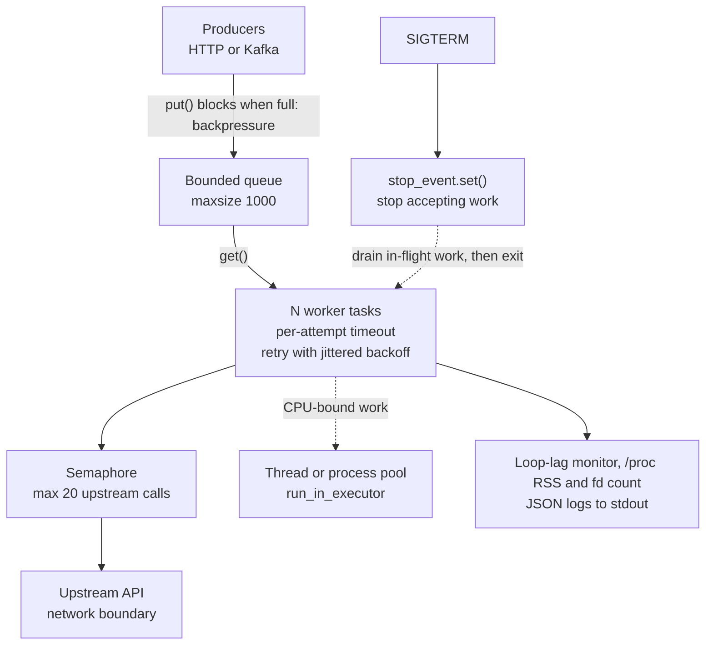

# Intuition & Mental Model

An asyncio program is **one thread running a to-do list of tasks that politely hand the CPU back whenever they wait**. Waiting on a socket costs almost nothing; computing or calling a blocking library freezes *everyone*. That single fact explains most "the service is slow but CPU is at 12%" tickets.

In enterprise deployments you are rarely writing the clever algorithm. You are writing the glue that fans out 200 upstream calls, must never exceed a partner's rate limit, and must exit cleanly when Kubernetes sends SIGTERM. The Linux layer matters because the failure modes are OS-level: file-descriptor exhaustion, `TIME_WAIT` pile-ups, cgroup memory kills (OOMKilled, exit 137), and CPU throttling that looks like random latency.

Mental model in three rules:
1. **Never block the loop.** Blocking calls go to an executor (threads for blocking I/O, processes for CPU).
2. **Everything is bounded.** Bounded queues, bounded concurrency, bounded retries, bounded timeouts. Unbounded is a future outage.
3. **Shutdown is a feature.** Stop accepting, drain in-flight work, then exit, within the pod's grace period.

# Production Architecture & Data Flow

Job states: QUEUED, RUNNING, RETRYING (loops back to RUNNING), then DONE, FAILED, or DROPPED when shutdown outlasts the drain timeout.

# Architectural Trade-Off Matrix

| Approach | Latency | Scalability | Implementation Complexity | Cost |
|---|---|---|---|---|
| **asyncio single process** (this lab) | Lowest for I/O-bound fan-out; poor tail if loop blocked | Thousands of sockets per core; one core of CPU | Medium: discipline about blocking calls | Lowest: few pods |
| **Threads (ThreadPoolExecutor / sync framework)** | Good; context switching adds jitter | Hundreds of threads, GIL limits CPU work | Low: familiar model, races possible | Medium: more memory per concurrent call |
| **Multiprocess / Celery / Ray workers** | Higher (serialization, broker hop) | Horizontal and CPU-parallel | High: brokers, idempotency, ops | Highest: broker + more nodes |

# Enterprise War Stories & Edge Cases

**1. The "healthy" pod that served nothing.** A PDF-parsing call (`pypdf`, synchronous) ran inside an `async def` handler. Under load, the loop stalled 8 s at a time; liveness probes timed out and Kubernetes restarted pods in a cascade. *Remediation:* move parsing to a process pool, add a loop-lag gauge with an alert at p99 > 250 ms, and make the liveness probe a loop-served endpoint so stalls are visible.

**2. `OSError: Too many open files` at 02:00.** A nightly batch opened an `aiohttp` session per request. fds leaked until the 1024 soft `ulimit -n` was hit, and even log writes failed. *Remediation:* one shared client per process, `ulimit -n` raised via the container runtime, an fd-count metric read from `/proc/self/fd`, and a connection-pool limit that is lower than the fd limit.

**3. Retry storm after an upstream blip.** A vendor returned 503 for 40 s; 300 workers retried on a fixed 1 s interval, amplifying load so the vendor stayed down for 25 more minutes and our bill spiked. *Remediation:* exponential backoff with full jitter, retry budgets (cap total retries as a fraction of traffic), a circuit breaker, and honoring `Retry-After`.
