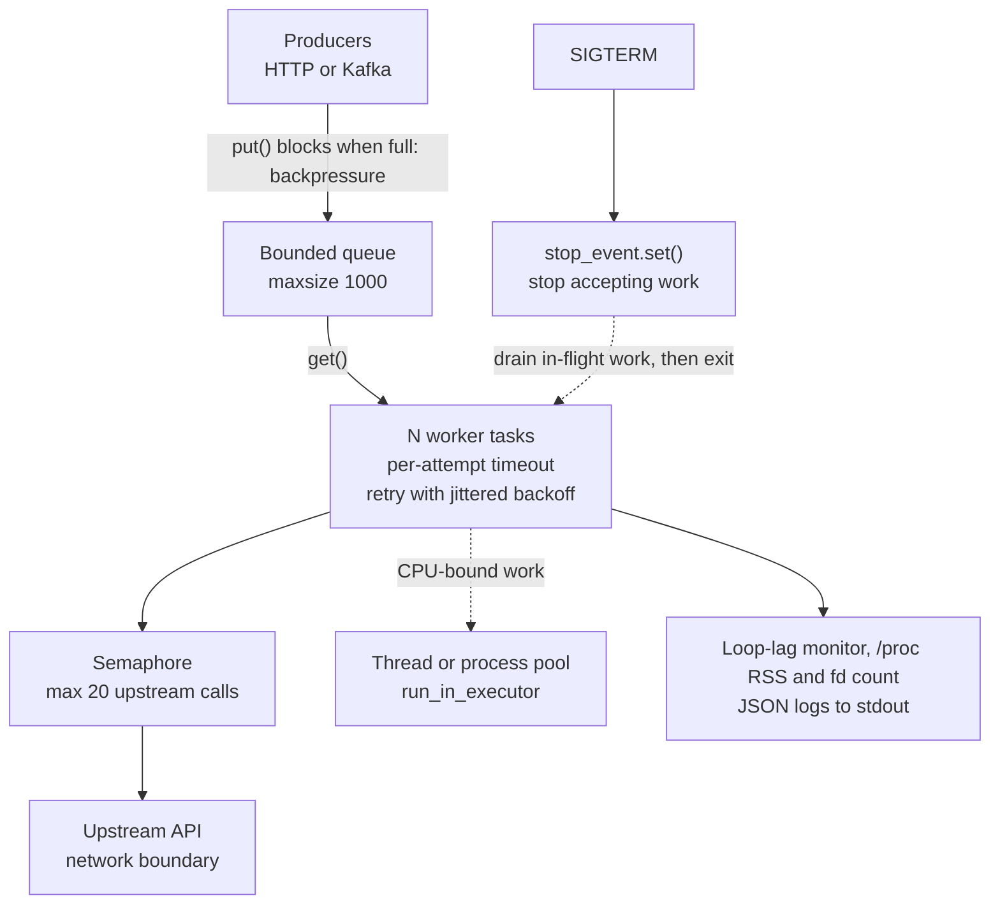

> **Syllabus lessons for this module:** full teaching notes for every topic are in [Syllabus Topic Write-ups](#syllabus-topic-write-ups); the topic-to-code map is in the [Syllabus Coverage Map](#syllabus-coverage-map) and [COVERAGE.md](../../COVERAGE.md).

# Intuition & Mental Model

An asyncio program is **one thread running a to-do list of tasks that politely hand the CPU back whenever they wait**. Waiting on a socket costs almost nothing; computing or calling a blocking library freezes *everyone*. That single fact explains most "the service is slow but CPU is at 12%" tickets.

In enterprise deployments you are rarely writing the clever algorithm. You are writing the glue that fans out 200 upstream calls, must never exceed a partner's rate limit, and must exit cleanly when Kubernetes sends SIGTERM. The Linux layer matters because the failure modes are OS-level: file-descriptor exhaustion, `TIME_WAIT` pile-ups, cgroup memory kills (OOMKilled, exit 137), and CPU throttling that looks like random latency.

Mental model in three rules:
1. **Never block the loop.** Blocking calls go to an executor (threads for blocking I/O, processes for CPU).
2. **Everything is bounded.** Bounded queues, bounded concurrency, bounded retries, bounded timeouts. Unbounded is a future outage.
3. **Shutdown is a feature.** Stop accepting, drain in-flight work, then exit, within the pod's grace period.

# Production Architecture & Data Flow



Job states: QUEUED, RUNNING, RETRYING (loops back to RUNNING), then DONE, FAILED, or DROPPED when shutdown outlasts the drain timeout.

# Architectural Trade-Off Matrix

| Approach | Latency | Scalability | Implementation Complexity | Cost |
|---|---|---|---|---|
| **asyncio single process** (this lab) | Lowest for I/O-bound fan-out; poor tail if loop blocked | Thousands of sockets per core; one core of CPU | Medium: discipline about blocking calls | Lowest: few pods |
| **Threads (ThreadPoolExecutor / sync framework)** | Good; context switching adds jitter | Hundreds of threads, GIL limits CPU work | Low: familiar model, races possible | Medium: more memory per concurrent call |
| **Multiprocess / Celery / Ray workers** | Higher (serialization, broker hop) | Horizontal and CPU-parallel | High: brokers, idempotency, ops | Highest: broker + more nodes |

# Enterprise War Stories & Edge Cases

**1. The "healthy" pod that served nothing.** A PDF-parsing call (`pypdf`, synchronous) ran inside an `async def` handler. Under load, the loop stalled 8 s at a time; liveness probes timed out and Kubernetes restarted pods in a cascade. *Remediation:* move parsing to a process pool, add a loop-lag gauge with an alert at p99 > 250 ms, and make the liveness probe a loop-served endpoint so stalls are visible.

**2. `OSError: Too many open files` at 02:00.** A nightly batch opened an `aiohttp` session per request. fds leaked until the 1024 soft `ulimit -n` was hit, and even log writes failed. *Remediation:* one shared client per process, `ulimit -n` raised via the container runtime, an fd-count metric read from `/proc/self/fd`, and a connection-pool limit that is lower than the fd limit.

**3. Retry storm after an upstream blip.** A vendor returned 503 for 40 s; 300 workers retried on a fixed 1 s interval, amplifying load so the vendor stayed down for 25 more minutes and our bill spiked. *Remediation:* exponential backoff with full jitter, retry budgets (cap total retries as a fraction of traffic), a circuit breaker, and honoring `Retry-After`.


# Syllabus Topic Write-ups

This module teaches the foundations that sit underneath almost every production AI integration: the Python data structures and memory model your code lives in, the asyncio machinery that lets one process talk to hundreds of upstream systems, and the Linux skills you need when that process misbehaves at 2 a.m. A Forward Deployed Engineer is dropped into a customer's environment, often with a locked-down server, an old SDK and a tight deadline, and is expected to diagnose problems quickly. Interviewers use these topics to find out whether you understand what is actually happening below the framework. Each lesson below is self-contained, but they build on each other. Numbers marked as examples are invented for illustration; measure your own systems before quoting them.

**How to study this module**

Read in this order, because later topics assume earlier ones:
1. Topics 1 to 3 (data structures, memory, OOP) give you the vocabulary of objects, references and hashing.
2. Topic 4 (exceptions) and topic 5 (file I/O) cover correctness and safe writes; both are used by everything after.
3. Topics 6, 7 and 8 (event loop, coroutines and tasks, async context managers) form one arc. Learn the loop first, then tasks, then resource handling.
4. Topics 9 and 10 (concurrency vs parallelism, ThreadPoolExecutor) explain when asyncio is the wrong tool and how to bridge to blocking code.
5. Topics 11 to 13 (file system, permissions, process monitoring) are the Linux diagnosis toolkit; read them together.
6. Topics 14 and 15 (shell scripting, environment variables) tie Linux and Python together at deployment time.

**Module cheat sheet**

| Must-know | One-line answer |
|---|---|
| `x in list` vs `x in set` | List membership is O(n) because it scans; set membership is O(1) on average because it hashes. |
| Why a mutable default argument is a bug | The default object is created once at function definition and shared by every call. |
| How CPython frees memory | Reference counting frees at zero immediately; a cyclic collector reclaims reference cycles later. |
| Exit code 137 | 128 plus signal 9 (SIGKILL), most often the kernel OOM killer or a container memory limit. |
| `raise X from exc` | Sets `__cause__` so logs show the original error as the explicit cause. |
| Atomic file replace | Write a temp file in the same directory, flush and fsync, then `os.replace` over the target. |
| What blocks an event loop | Any synchronous call (CPU work, `time.sleep`, blocking client) that does not reach an `await`. |
| Task vs coroutine | A coroutine is an unstarted description of work; a task is that coroutine scheduled on the loop. |
| Concurrency vs parallelism | Concurrency is overlapping progress on many tasks; parallelism is literally simultaneous execution on several cores. |
| GIL effect | One thread runs Python bytecode at a time, so threads help I/O-bound work but not pure-Python CPU work. |
| Little's Law | Items in flight = arrival rate x time in system, so it sizes pools, queues and connection limits. |
| Permission bits and umask | r=4, w=2, x=1 for owner, group, other; umask 022 turns 666 into 644 and 777 into 755. |
| `set -euo pipefail` | Exit on errors, treat unset variables as errors, and fail a pipeline if any stage fails. |
| Environment variables | Strings copied into a child process at start; read once, validate early, never put secrets on the command line. |

### 1. Python Core data structures
**What you will be able to do**

- Choose between list, tuple, dict, set, deque and heapq for a given problem and justify the choice with complexity.
- Explain how a hash table finds a key, why keys must be hashable, and what a collision is.
- Compute by hand how many comparisons a list scan needs versus a set lookup.
- Spot the mutable default argument bug and shallow-copy surprises in a code review.

**Prerequisites**

Basic Python syntax (loops, functions) and the idea of Big-O notation, which describes how work grows as input size n grows. Nothing earlier in this course is required.

**The idea from first principles**

Every program stores collections of things, and the question is how you will use the collection. Think of a library. If books sit in a pile, finding one means checking each in turn. If they are shelved by call number, you walk straight to the right spot. Data structures are different ways of shelving, each making some questions cheap and others expensive.

A `list` is an ordered, growable array: elements sit next to each other in memory (as pointers to objects), so reading item 5 is instant, but asking "is this value anywhere in here" means checking every item. A `tuple` is the same layout but immutable, which makes it hashable when its contents are, and a safe thing to share. A `dict` maps keys to values, and a `set` is a dict without values. Both are hash tables, which find a key by computing a number from it instead of searching. A `deque` (double-ended queue) is built for adding and removing at both ends. `heapq` keeps a plain list arranged so the smallest item is always first.

The naive approach fails because scanning scales linearly. If you check 100,000 event IDs against a list of 100,000 seen IDs, you do on the order of 5 billion comparisons. A hash table replaces the scan with arithmetic: hash the key, jump to a slot. That is the single most important idea in this topic.

Terms to define precisely. Hash: an integer computed from a value, equal values must give equal hashes. Hashable: an object whose hash never changes during its life and which supports equality; ints, strings, frozensets and tuples of hashables qualify, lists, dicts and sets do not. Amortised cost: the average cost per operation over a long sequence, even if one operation is occasionally expensive. Average case versus worst case: hash lookup is O(1) on average but degrades if many keys collide.

**How it works, step by step**

List growth. A list over-allocates: when full, it grows by a proportion of its current size (roughly a constant factor), copies the pointers once, and then has spare room. Because each copy buys many cheap appends, append is amortised O(1). Inserting or deleting at the front shifts every element, which is O(n).

Dict and set lookup:
1. Compute `hash(key)`.
2. Reduce it to a slot index in the internal array (for example by masking low bits).
3. If the slot is empty, the key is absent.
4. If occupied, compare the stored hash, then compare the key with `==`. Equal means found.
5. If the slot holds a different key (a collision), probe a different slot using a fixed sequence and repeat from step 3.
6. When the table is roughly two thirds full, allocate a larger array and re-insert every entry. This resize is why inserts are amortised O(1).

Worked calculation. Table of 8 slots, keys with hashes 3, 11 and 19, index = hash mod 8. Hash 3 goes to slot 3. Hash 11 mod 8 is 3: slot taken by a different key, probe to the next slot (say 4). Hash 19 mod 8 is 3 again: slots 3 and 4 taken, probe to 5. Looking up the key with hash 19 therefore costs three comparisons instead of one. With a good hash function and a table kept under about two thirds full, the average number of probes stays close to 1, which is why the average is O(1). Real CPython uses a more elaborate probe sequence, but the principle is the same.

Complexity summary (average case):

| Operation | list | tuple | dict / set | deque |
|---|---|---|---|---|
| Index by position | O(1) | O(1) | n/a | O(n) in the middle |
| Membership `x in c` | O(n) | O(n) | O(1) | O(n) |
| Append at end | O(1) amortised | n/a | O(1) amortised | O(1) |
| Insert/remove at front | O(n) | n/a | n/a | O(1) |
| Push/pop smallest (heapq) | O(log n) | n/a | n/a | n/a |

Since Python 3.7, dicts preserve insertion order as a language guarantee, and sets do not.

**Worked example 1: small and hand-traceable**

Count words and keep the two most common.

```python
words = ["a", "b", "a", "c", "a", "b"]
counts = {}
for w in words:
    counts[w] = counts.get(w, 0) + 1
```

Trace of `counts` after each word: `{a:1}`, `{a:1, b:1}`, `{a:2, b:1}`, `{a:2, b:1, c:1}`, `{a:3, b:1, c:1}`, `{a:3, b:2, c:1}`. Each step does one hash lookup and one store. Now the top two with a heap of size 2 holding `(count, word)` pairs: push (3,a) giving [(3,a)]; push (2,b) giving [(2,b),(3,a)] since the smallest is first; push (1,c) makes size 3, so pop the smallest (1,c), leaving [(2,b),(3,a)]. The heap never exceeded 3 items, so cost is O(n log k) where k=2. `collections.Counter(words).most_common(2)` does the same job in one line.

**Worked example 2: enterprise scenario**

A telecom ingests call-detail records (CDRs) and must drop duplicates (the upstream switch resends on timeout), keep a rolling window of the last 1,000 records for a dashboard, and report the busiest cell towers.

```python
from collections import Counter, deque

seen_ids = set()
window = deque(maxlen=1000)
tower_counts = Counter()

def ingest(rec):
    if rec["id"] in seen_ids:
        return False
    seen_ids.add(rec["id"])
    window.append(rec)
    tower_counts[rec["tower"]] += 1
    return True
```

Commentary: `seen_ids` gives O(1) duplicate checks, which is what matters at millions of records. `deque(maxlen=1000)` silently discards the oldest item on append, so memory for the window is bounded. `Counter` is a dict subclass that returns 0 for missing keys, which removes the `get` boilerplate. A real trap here is that `seen_ids` grows forever: at 50 million records a day with 36-byte IDs (example figures) it will consume gigabytes. In production you would expire IDs by time (a dict of id to timestamp pruned periodically) or move deduplication to Redis or the database with a unique constraint.

**Hands-on practice**

Exercise 1 (easy). A function `def add(x, bucket=[]): bucket.append(x); return bucket` is called as `add(1)` then `add(2)`. What does the second call return and why?
Solution: `[1, 2]`. The default list is created once when the function is defined and stored on the function object, so both calls mutate the same list. Fix: `def add(x, bucket=None): bucket = [] if bucket is None else bucket`, then append.

Exercise 2 (medium). You have 200,000 customer IDs in list A and 50,000 in list B. Find the IDs in both. Estimate comparisons for the naive loop and the set approach.
Solution: Naive `[x for x in B if x in A]` scans A (average half, 100,000) for each of 50,000 items: about 5 billion comparisons. Set approach: `set_a = set(A)` costs 200,000 inserts, then 50,000 O(1) lookups: roughly 250,000 operations. About 20,000 times fewer. `set(A) & set(B)` is shorter still.

Exercise 3 (hard). Design a structure for "the last 10,000 events, with O(1) duplicate detection, where the oldest event and its ID leave together".
Solution: Keep a `deque` of event IDs (order) plus a `set` of the same IDs (membership). On a new event: if the ID is in the set, skip. Otherwise, if the deque has 10,000 items, `popleft()` and remove that ID from the set, then append the new ID to both. All operations are O(1). The invariant is that the set and deque always hold identical IDs; update both inside one function so they cannot diverge. For thread safety add a lock.

**Alternatives and trade-offs**

| Option | Latency | Scalability | Complexity | Risk and cost |
|---|---|---|---|---|
| Built-in set/dict | Lowest for lookups | Bounded by RAM | Lowest | Memory overhead per item |
| Sorted list with `bisect` | O(log n) lookup, O(n) insert | Good for read-mostly data | Low | Slow inserts |
| NumPy array or pandas column | Fast for vector math | Millions of numbers, compact | Medium | Not for mixed or small data |
| Database or Redis | Network hop per lookup | Beyond memory, shared | Higher | Operational cost |

Use built-ins until the data no longer fits in memory or must be shared between processes. The technique is the wrong tool when you need ordered range queries (use a sorted structure or database index) or millions of homogeneous numbers (use NumPy).

**Where it goes wrong in production**

1. Quadratic scans. Symptom: a job fine on test data takes hours on production volume, CPU at 100% in a single function. Cause: `in` on a list inside a loop. Diagnose with a profiler such as `cProfile`. Fix: build a set once outside the loop.
2. Unbounded dedupe sets or caches. Symptom: memory climbs until OOMKilled. Cause: no eviction. Diagnose: track RSS and `len()` of the container. Fix: TTL, LRU or an external store.
3. Mutating a list while iterating. Symptom: skipped items, intermittent wrong counts. Fix: iterate a copy or build a new list.
4. Mutable default or shared class attribute. Symptom: state leaks between requests. Fix: `None` default, per-instance initialisation.
5. Relying on set ordering or unstable `hash()` of strings between runs (string hashes are randomised per process). Symptom: output differs between runs or workers. Fix: sort explicitly.

**Do not confuse**

`list.sort()` sorts in place and returns `None`; `sorted(x)` returns a new list. `d[k]` raises `KeyError` on a missing key; `d.get(k)` returns `None`. A shallow copy (`list(x)`, `x.copy()`) shares inner objects; `copy.deepcopy` duplicates them. A tuple is immutable but a tuple containing a list can still have that list modified.

**How interviewers probe this**

1. When would you pick a tuple over a list?
2. What is the complexity of `in` for list, set and dict, and why?
3. Why can a list not be a dict key?
4. How does a hash table handle collisions and growth?
5. Design a structure for last-N events with fast duplicate detection.
6. What breaks if a mutable object used as a key is modified?
7. Why can set operations be slower than lists for tiny collections?
8. Trap: "dict lookup is always O(1)". Is that right?

**Model answer (60-90 seconds)**

"Python has four workhorse containers. A list is a dynamic array: indexing and appending are fast, but searching is linear. A tuple is the immutable version, hashable if its contents are. Dict and set are hash tables: they hash the key to jump to a slot, so lookup, insert and delete are O(1) on average, at the price of extra memory and the rule that keys must be hashable. The practical rule is that if I test membership inside a loop, I use a set. For example, deduplicating 100,000 events against a list is billions of comparisons, while a set does about 100,000 operations. For sliding windows I use a deque with a max length, and for top-k a heap. The limit is memory: hash tables cost more per item than arrays, and an unbounded set is a leak, so in production I add expiry or move deduplication into Redis or the database."

**Quick-fire answers**

- Q: Tuple over list? A: When the data is fixed, should be hashable or shared safely, such as a dict key or a record of coordinates.
- Q: Complexity of `in`? A: O(n) for list and tuple because they scan; O(1) average for set and dict because they hash.
- Q: Why not a list as key? A: Its contents can change, which would change its hash and strand the entry in the wrong slot, so Python makes lists unhashable.
- Q: Collisions and growth? A: Colliding keys probe to another slot; at about two thirds full the table is rebuilt larger, making inserts amortised O(1).
- Q: Last-N with duplicate detection? A: A deque for order and a set for membership, updated together; evict from both at once.
- Q: Mutated key? A: Lookups compute a new hash and look in the wrong place, so the entry appears lost.
- Q: Tiny collections? A: Hashing and table overhead outweigh scanning three items; complexity only matters as n grows.
- Q: Always O(1)? A: Only on average with a good hash and a sane load factor; adversarial or badly designed hashes can degrade toward O(n).

**Recap in five lines**

- A list scans (O(n) membership); a set or dict hashes (O(1) average).
- Hash tables resize near two thirds full, so inserts are amortised O(1).
- Keys must be hashable, meaning immutable and with a stable hash.
- deque for queues and windows, heapq for top-k, Counter for tallies.
- Unbounded containers and mutable defaults cause most production bugs.

### 2. Memory management fundamentals
**What you will be able to do**

- Explain how CPython frees memory using reference counts and a cyclic collector, with a hand trace.
- Diagnose a container that is OOMKilled (exit 137) and decide whether it is a leak or a plateau.
- Use `tracemalloc`, `weakref`, `__slots__` and bounded caches appropriately.
- Explain RSS versus virtual memory to a colleague in two minutes.

**Prerequisites**

Topic 1 (objects, containers and references). Basic idea of what RAM is and that processes have a memory limit.

**The idea from first principles**

A running program needs somewhere to keep its objects, and that space is finite. Memory management answers two questions: where does new data go, and when is old data safe to discard? Get the second wrong in one direction and the program crashes by reading freed data; get it wrong in the other direction and it never gives memory back and eventually dies. Think of a hotel. Rooms are objects, guests are references. A room can be cleaned and reused only when the last guest has checked out.

Python takes the hotel approach literally. Every object stores a reference count, the number of references (names, list slots, attributes) pointing at it. When the count drops to zero nobody can reach the object, so CPython frees it immediately. This is simple and predictable, and it is why a file object often closes the moment the last name for it disappears.

The naive version of this scheme fails on cycles. If object A holds a reference to B and B holds one to A, each count stays at 1 even after the rest of the program forgets both. They are unreachable but never reach zero. CPython therefore adds a cyclic garbage collector that periodically searches for groups of objects that only refer to each other and frees them. It is generational: it assumes most objects die young, so it checks new objects often and old ones rarely. The thresholds and some internals change between Python versions, so verify against your version's documentation if you need specifics.

Terms. Heap: the region of memory where objects live. Reference: a pointer to an object. Virtual memory: address space the process has mapped, much of it never touched. RSS (resident set size): the part actually held in physical RAM right now, which is what container limits and the OOM killer care about. Leak: memory that grows without bound because something still references it. In Python, a leak almost always means "still referenced", for example by a global cache.

**How it works, step by step**

1. Creating an object asks CPython's allocator for memory. Small objects (up to a few hundred bytes) come from internal pools, larger ones from the system allocator.
2. The new object starts with a reference count of 1 for the first name that holds it.
3. Assignment, passing into a container, or storing as an attribute increments the count. `del name`, rebinding, leaving a function scope or removing from a container decrements it.
4. At zero, CPython calls the object's finalizer, decrements the counts of objects it refers to (possibly freeing them in a cascade), and returns the memory to the allocator.
5. Periodically, based on allocation counts, the cyclic collector examines container objects, subtracts internal references, and frees groups with no outside references.
6. Memory returned to the allocator is usually kept by the process for reuse and only sometimes handed back to the operating system. RSS therefore often stays high after a spike.

Worked calculation of reference counts: `a = []` gives count 1. `b = a` gives 2. `lst = [a, a]` gives 4 (two list slots). `del lst` gives back to 2. `del a` gives 1, `b = None` gives 0, so the list is freed. `sys.getrefcount(x)` returns one more than you expect because the call itself holds a temporary reference.

Worked sizing calculation (illustrative figures): an instance with a per-object dictionary may use about 350 bytes; the same fields with `__slots__` may use about 50 bytes. For 2,000,000 instances: 2,000,000 x 350 = 700 MB versus 2,000,000 x 50 = 100 MB. The exact numbers depend on Python version and fields, so always measure with `sys.getsizeof` plus the attributes, or `tracemalloc`.

**Worked example 1: small and hand-traceable**

```python
import gc

class Node:
    def __init__(self, name):
        self.name = name
        self.other = None

a = Node("a")
b = Node("b")
a.other = b
b.other = a
del a, b
print(gc.collect() > 0)
```

Trace. `Node("a")` count 1 (name `a`). `Node("b")` count 1 (name `b`). `a.other = b` raises b to 2; `b.other = a` raises a to 2. `del a, b` removes the names: each count drops to 1, not 0, because each node still points at the other. Both objects are now unreachable but alive. `gc.collect()` finds the pair, frees them, and returns the number of unreachable objects found, so the print shows `True`. If the cycle never gets collected promptly, memory just sits there; if you use `weakref.ref(b)` for one direction, the cycle disappears and plain counting frees both at once.

**Worked example 2: enterprise scenario**

A bank's enrichment worker looks up customer profiles from a CRM for each transaction. After roughly nine hours the pod is OOMKilled with exit code 137. The code stored every profile in a module-level dict so repeat lookups were fast.

```python
import tracemalloc
from functools import lru_cache

@lru_cache(maxsize=10_000)
def customer_profile(customer_id: str) -> dict:
    return fetch_from_crm(customer_id)

tracemalloc.start()
run_batch()
snap1 = tracemalloc.take_snapshot()
run_batch()
snap2 = tracemalloc.take_snapshot()
for stat in snap2.compare_to(snap1, "lineno")[:5]:
    print(stat)
```

Commentary. `lru_cache(maxsize=10_000)` evicts the least recently used entry beyond 10,000, bounding memory. Choose the size from data: if a profile is about 2 KB (example), 10,000 entries is about 20 MB. `tracemalloc.start()` begins recording allocations (it slows the program, so use it in a debug run or a canary pod). Comparing two snapshots shows which source lines gained memory between them, which is the correct view for leaks; a single snapshot only shows who holds the most. If one line keeps appearing at the top with growing size, that is your unbounded structure. In Kubernetes, also set the memory request and limit deliberately and alert on RSS as a percentage of the limit rather than waiting for exit 137.

**Hands-on practice**

Exercise 1 (easy). What are the reference counts after: `x = [1]`, `y = x`, `z = [x, x]`?
Solution: The list `[1]` is referenced by `x`, `y` and two slots in `z`, so 4. (Plus a temporary 1 if you call `sys.getrefcount`.)

Exercise 2 (medium). RSS rose from 200 MB to 900 MB during a batch and stays at 900 MB for hours afterwards, then stays flat across ten more batches. Leak or not?
Solution: Probably not a leak. The peak was reached once and RSS plateaued; the allocator keeps freed memory for reuse, so later batches reuse it. A leak shows a staircase: each batch ends higher than the last. To confirm, plot RSS at the end of each batch, and if the pod limit is tight, reduce the peak by streaming or chunking the data.

Exercise 3 (hard). Design a cache of expensive objects that must never prevent those objects from being freed when the rest of the program drops them.
Solution: Use `weakref.WeakValueDictionary`. Values are held through weak references, so when the last strong reference elsewhere disappears the entry vanishes automatically. Lookups must handle a miss by rebuilding the object. Note limits: only objects that support weak references can be stored (plain `int`, `str`, `list` and `dict` cannot, though subclasses and ordinary class instances can), and the cache provides no guarantee of hit rate, so combine it with a small strong LRU for the hot set if you need one.

**Alternatives and trade-offs**

| Approach | Latency | Scalability | Complexity | Risk |
|---|---|---|---|---|
| CPython refcount plus cycle GC | Prompt frees, small pauses | Per-object overhead | Low for the programmer | Cycles, retained arenas |
| Tracing GC (Java, Go) | Occasional pauses | Handles cycles uniformly | Tuning flags | Memory freed later |
| Manual (C, C++, Rust ownership) | Lowest overhead | Best control | High | Leaks, use after free (Rust prevents at compile time) |
| External cache (Redis) | Network hop | Shared across pods, survives restarts | Operations | Extra dependency |

Use an in-process bounded LRU for small hot data. Use an external cache when many pods need the same data or when restarts must not cold-start the cache. Reference counting is the wrong tool to reason about when your issue is huge arrays; use NumPy and memory-mapped files for those.

**Where it goes wrong in production**

1. Unbounded in-process cache. Symptom: RSS climbs steadily, exit 137. Cause: no eviction. Diagnose: snapshot comparison, `len()` of caches. Fix: LRU with max size or TTL.
2. Unbounded queue between a fast producer and slow consumer. Symptom: same staircase, plus rising latency. Fix: bounded queue so producers wait (backpressure).
3. Loading everything at once. Symptom: memory spike per request, OOM under concurrency. Fix: stream, paginate, or process in chunks.
4. Exceptions or frames kept alive. Symptom: objects survive far longer than expected. Cause: storing tracebacks, closures or loggers that capture large locals. Fix: avoid storing exception objects, delete references explicitly in long-lived scopes.
5. Misreading the plateau. Symptom: team raises a leak ticket for a flat RSS. Fix: measure growth across repeated cycles and compare to the container limit.
6. Container limit lower than the interpreter assumes. Symptom: kills despite modest Python heap. Cause: native libraries, thread stacks and buffers count too. Fix: measure total RSS, not only Python objects.

**Do not confuse**

Virtual size (everything mapped) versus RSS (in RAM now). A leak (unbounded growth) versus high-water-mark retention (a plateau). `del x` (drops one reference) versus freeing the object. `gc.collect()` (handles cycles) versus reference counting (handles the rest automatically).

**How interviewers probe this**

1. How does CPython decide when to free an object?
2. What is a reference cycle and who collects it?
3. What does `del` actually do?
4. A pod is OOMKilled every few hours. How do you find out why?
5. When would you use `weakref` or `__slots__`?
6. Why can RSS stay high after you free a large structure?
7. Design a cache for a service that must stay under 512 MB.
8. Trap: "Python has a garbage collector, so memory leaks cannot happen."

**Model answer (60-90 seconds)**

"CPython manages memory primarily with reference counting: every object tracks how many references point at it, and the moment that reaches zero it is freed. That makes release deterministic, so files and buffers go away promptly. The weakness is cycles, where objects refer to each other and never reach zero, so there is also a generational cyclic collector that finds unreachable groups. In production, the typical problem is not the interpreter but unbounded growth: a cache or queue with no limit. I would watch RSS over time, because container limits act on RSS, and use `tracemalloc` snapshot comparison to find which lines allocate more over time. Fixes are bounded caches, bounded queues and streaming. One limit of that approach is that Python often keeps freed memory for reuse, so a high flat RSS is not a leak, and native libraries can use memory that Python tools do not show."

**Quick-fire answers**

- Q: When is an object freed? A: When its reference count reaches zero, immediately. Cycles wait for the cyclic collector.
- Q: What is a cycle? A: Objects referring to each other so their counts never reach zero. The generational collector detects and frees unreachable cycles.
- Q: What does `del x` do? A: It removes the name and decrements the count. The object is freed only if nothing else references it.
- Q: OOMKilled pod? A: Plot RSS over time, compare `tracemalloc` snapshots, and look for unbounded caches, queues and large reads.
- Q: `weakref` and `__slots__`? A: Weak references let a cache avoid keeping objects alive; slots drop the per-instance dict to cut memory for many small objects.
- Q: High RSS after freeing? A: The allocator holds freed memory for reuse. A staircase pattern over repeated cycles distinguishes a real leak.
- Q: 512 MB cache design? A: Measure item size, bound entries (LRU plus TTL), leave headroom for the rest of the process, and alert on RSS percentage.
- Q: No leaks in Python? A: False. Anything still referenced, such as a growing global dict, is a leak the collector cannot help with.

**Recap in five lines**

- Reference count reaches zero, object freed immediately; cycles need the cyclic collector.
- Container limits act on RSS, and exit 137 means SIGKILL, often from the OOM killer.
- Leaks in Python are usually unbounded caches, queues or retained references.
- Use `tracemalloc` snapshot comparison, bounded LRU caches, `weakref` and `__slots__`.
- A flat high RSS is allocator retention; a staircase is a leak.

### 3. Object-oriented programming basics
**What you will be able to do**

- Explain classes, instances, inheritance, polymorphism and method resolution order with a concrete trace.
- Choose between inheritance, composition, abstract base classes and protocols for a design.
- Write a frozen dataclass and explain what it generates.
- Spot a Liskov violation, a shared class attribute and an `__eq__` without `__hash__` in review.

**Prerequisites**

Topics 1 and 2 (hashing, references). Functions and basic classes in Python.

**The idea from first principles**

Programs grow, and the hard part becomes keeping related data and operations together so a change in one place does not break ten others. Object-oriented programming (OOP) answers that by bundling state with the functions that act on it. A bank account has a balance and operations to deposit and withdraw; bundling them means no other code needs to know how the balance is stored.

A class is a blueprint, an object (instance) is one thing built from it, and a method is a function defined in the class that receives the instance as its first argument, conventionally `self`. Polymorphism means different classes respond to the same call in their own way: a caller says `notifier.send(msg)` and does not care whether it is email or Slack. That lets you add a new channel without editing the caller, which is the real payoff.

The naive approach is to copy and paste behavior between similar classes, or to push everything into a deep inheritance tree. Copying creates drift. Deep inheritance creates the fragile base class problem: a change at the top breaks distant subclasses nobody remembered. The mature approach is small interfaces, shallow hierarchies, and composition, where an object holds another object and delegates to it ("has-a" rather than "is-a").

Python adds two ways to describe an interface. An abstract base class (ABC) declares abstract methods, and Python refuses to create an instance of a subclass that has not implemented them. A protocol (`typing.Protocol`) describes a shape structurally: any object with the right methods fits, without inheriting from anything, and a static type checker such as mypy verifies it. The first is nominal typing (you must declare the relationship), the second structural ("duck typing" made checkable).

**How it works, step by step**

1. `class Cat(Animal)` executes the class body and creates a class object. Methods are stored on the class, once, not copied into each instance.
2. `Cat()` allocates an instance and runs `__init__`. Each instance gets its own attribute dictionary (unless `__slots__` is declared).
3. For `obj.speak()`, Python looks on the instance, then on `type(obj)`, then up the parents in method resolution order (MRO), the linearised list of classes to search. `Cat.__mro__` shows it. Python uses C3 linearisation so each class appears before its parents and the order of base classes is respected.
4. `super()` means "continue the search at the next class in the MRO", which is what makes cooperative multiple inheritance work.
5. Special (dunder) methods hook into the language: `__repr__` for printing, `__eq__` for `==`, `__hash__` for dict and set use, `__len__`, `__iter__` and so on.
6. If you define `__eq__` without `__hash__`, Python sets `__hash__` to `None`, so instances become unhashable. This protects the rule that equal objects must have equal hashes.

Worked example of what `@dataclass` generates. Writing `@dataclass(frozen=True) class Money: cents: int; currency: str` gives you `__init__(self, cents, currency)`, a readable `__repr__`, `__eq__` comparing the field tuples, and, because `frozen=True` with `eq=True`, a `__hash__` built from the fields. Assigning `m.cents = 1` raises `FrozenInstanceError`. So `Money(500, "USD") == Money(500, "USD")` is `True`, and both hash the same, so a set holds one copy.

MRO calculation for a diamond: `class A`, `class B(A)`, `class C(A)`, `class D(B, C)`. The MRO of D is D, B, C, A, object. A method defined in A and overridden in C: `D().method()` finds it in B first if B defines it, else C, else A. Each `super().method()` call moves one step along that list, so A's method runs once.

**Worked example 1: small and hand-traceable**

```python
class Animal:
    def speak(self):
        return "..."
    def describe(self):
        return f"{type(self).__name__} says {self.speak()}"

class Dog(Animal):
    def speak(self):
        return "woof"

class Puppy(Dog):
    def speak(self):
        return super().speak() + "!"
```

Trace `Puppy().describe()`. Look up `describe` on the instance: not there. On `Puppy`: not there. On `Dog`: not there. On `Animal`: found. It runs with `self` being the Puppy. Inside, `self.speak()` starts the lookup again from `Puppy` and finds `Puppy.speak`, which calls `super().speak()`, resolving to `Dog.speak` returning "woof", and then adds "!". Result: `"Puppy says woof!"`. The key lesson is that `self.speak()` uses the instance's real type, not the class where the calling method was written. That is polymorphism.

**Worked example 2: enterprise scenario**

An insurer sends claim updates by email, SMS and a Slack channel. The claims service must not know which channel is used, and tests must not send real messages.

```python
from abc import ABC, abstractmethod
from dataclasses import dataclass

@dataclass(frozen=True)
class Claim:
    claim_id: str
    amount_cents: int

class Notifier(ABC):
    @abstractmethod
    def send(self, msg: str) -> None: ...

class EmailNotifier(Notifier):
    def send(self, msg: str) -> None:
        print("email:", msg)

class ClaimService:
    def __init__(self, notifier: Notifier) -> None:
        self.notifier = notifier

    def approve(self, claim: Claim) -> None:
        self.notifier.send(f"claim {claim.claim_id} approved")

class FakeNotifier(Notifier):
    def __init__(self): self.sent = []
    def send(self, msg: str) -> None: self.sent.append(msg)
```

Commentary. `Claim` is a frozen value object: safe to share across threads and usable as a dict key. `Notifier` is an ABC, so a subclass that forgets `send` fails at instantiation rather than in production. `ClaimService` receives its notifier through the constructor (dependency injection), which is composition: the service has-a notifier. In tests, `ClaimService(FakeNotifier())` records messages with no network. If you instead consumed a third-party class with a compatible `send`, a `Protocol` would let you accept it without forcing it to inherit from your ABC. Adding an SMS channel means adding one class and changing zero existing code.

**Hands-on practice**

Exercise 1 (easy). What prints? `class A: tags = []` then `a, b = A(), A(); a.tags.append("x"); print(b.tags)`.
Solution: `['x']`. `tags` is a class attribute shared by all instances, and `append` mutates the shared list. Fix by setting `self.tags = []` in `__init__`.

Exercise 2 (medium). Write a value object `Point(x, y)` that can be a dict key and cannot be changed after creation.
Solution: `@dataclass(frozen=True) class Point: x: float; y: float`. Equality and hash come from the fields. `{Point(1, 2): "depot"}[Point(1, 2)]` returns "depot". Without `frozen=True` (and with `eq=True`) the dataclass would set `__hash__` to `None` and the key use would fail.

Exercise 3 (hard). A `Stack` class inherits from `list` to reuse `append` and `pop`. A teammate adds `Stack.insert(0, x)` usage in a caller. Why is inheriting a poor choice and what is the alternative?
Solution: Inheriting exposes the whole list API (`insert`, `sort`, slicing), so callers can break stack discipline and you cannot change the internal storage later without breaking them. This violates the principle that a subclass should be usable wherever the parent is, only with narrower behavior, and here the intent is narrower. Use composition: `class Stack: def __init__(self): self._items = []` with `push`, `pop` and `__len__` methods only. The public surface is exactly what you intend.

**Alternatives and trade-offs**

| Technique | Latency | Scalability of the code base | Complexity | Risk |
|---|---|---|---|---|
| Inheritance | Negligible | Poor if deep | Low at first | Fragile base class |
| Composition | Negligible (one extra call) | Good | Slight wiring | Boilerplate delegation |
| ABC | Check at instantiation | Good for hierarchies you own | Low | Forces inheritance |
| Protocol | No runtime cost | Good for third-party types | Needs a type checker | No runtime enforcement |
| Plain functions and dicts | None | Fine until logic sprawls | Lowest | Weak structure |

Choose inheritance for a genuine is-a relationship with shared implementation, composition when behavior should be swapped or combined, and plain functions when there is one behavior. OOP is the wrong tool for a one-off script or a simple data transform, where a function or a dataclass is clearer.

**Where it goes wrong in production**

1. Shared class attribute. Symptom: data from one request appears in another. Cause: a mutable class-level default. Diagnose: print `id()` of the attribute on two instances. Fix: initialise in `__init__`.
2. Deep hierarchies. Symptom: a small change breaks unrelated subclasses. Fix: flatten, extract interfaces, use composition.
3. `__eq__` without `__hash__`. Symptom: `TypeError: unhashable type` when adding to a set. Fix: define both consistently or use a frozen dataclass.
4. Liskov violation. Symptom: callers work with the parent type but fail with one subclass (for example a read-only subtype that raises on `save()`). Fix: honour the parent contract or do not inherit.
5. Calling `super().__init__()` incorrectly in multiple inheritance. Symptom: some initialisers never run or run twice. Fix: use cooperative `super()` everywhere or avoid multiple inheritance.
6. Mutable objects in a hot path with hidden mutation. Symptom: heisenbugs where a shared object changes between calls. Fix: frozen dataclasses and copying on write.

**Do not confuse**

Nominal typing (ABC: you must inherit) versus structural typing (Protocol: the right methods suffice). Class attributes (shared) versus instance attributes (per object). `@staticmethod` (no implicit first argument) versus `@classmethod` (receives the class). Inheritance (is-a) versus composition (has-a).

**How interviewers probe this**

1. What is the difference between a class and an object?
2. How does Python find a method on an instance?
3. ABC versus Protocol: when would you choose each?
4. Composition versus inheritance with an example.
5. Design a notification system that can add channels without changing callers.
6. What breaks when a subclass violates the parent's contract?
7. What does `@dataclass(frozen=True)` give you and what does it not?
8. Trap: "Python has no interfaces." True?

**Model answer (60-90 seconds)**

"A class bundles data and behavior, and an object is one instance with its own state. Python supports inheritance, but I use it sparingly because it couples a subclass to its parent. For a shared interface I choose between an abstract base class, which Python enforces at instantiation, and a protocol, which is structural: anything with the right methods fits and a type checker verifies it. For example, in a claims system I would define a notifier interface with a `send` method, inject an email or Slack implementation into the service, and use a fake in tests. That is composition plus polymorphism, so adding a channel changes no existing code. The trade-off is indirection; for a single behavior a plain function is simpler. I use frozen dataclasses for value objects to get equality, hashing and immutability. The limit is that a protocol has no runtime enforcement."

**Quick-fire answers**

- Q: Class versus object? A: The class is the blueprint stored once; an object is one instance with its own attributes.
- Q: Method lookup? A: Instance, then the class, then parents in MRO order, found with C3 linearisation.
- Q: ABC or Protocol? A: ABC for hierarchies you own with runtime enforcement; Protocol for structural typing of types you do not control.
- Q: Composition versus inheritance? A: Composition holds and delegates to a collaborator and is easier to swap and test; inheritance reuses a parent but couples tightly.
- Q: Notification design? A: A small interface, injected implementations, fakes for tests, and no conditionals in the caller.
- Q: Violated contract? A: Callers relying on the parent's guarantees fail for that subtype, which breaks polymorphism.
- Q: Frozen dataclass? A: It generates init, repr, eq and hash, and blocks attribute assignment. It is shallow: a list field can still be mutated.
- Q: No interfaces? A: Incorrect. ABCs and Protocols are interfaces, and duck typing works without declaring any.

**Recap in five lines**

- A class holds shared methods; each instance holds its own state.
- Attribute lookup goes instance, class, then MRO parents.
- Prefer composition and small interfaces over deep inheritance.
- ABC enforces at runtime; Protocol describes shape for a type checker.
- Frozen dataclasses give safe, hashable value objects; watch shared class attributes.

### 4. Exception handling
**What you will be able to do**

- Trace how Python unwinds the stack to find a handler, including `else` and `finally`.
- Classify errors as transient or permanent and design a safe retry policy.
- Compute exponential backoff with jitter by hand.
- Explain chaining (`__context__`, `__cause__`) and why async cancellation must be re-raised.

**Prerequisites**

Topic 3 (classes, since exceptions are classes and form a hierarchy). Functions and the call stack.

**The idea from first principles**

Real systems fail constantly: networks drop packets, files vanish, partners return errors, users send bad input. Code needs a way to say "I cannot continue" without every function in between checking a return code. Imagine a shift supervisor at a factory. A worker who hits a problem does not carry on assembling; they shout, and the shout travels up the chain of command until someone with authority to handle it responds. If nobody does, the line stops. Exceptions work the same way.

An exception is an object describing what went wrong. Raising it interrupts normal flow and begins unwinding the call stack: Python leaves the current function, then its caller, and so on, until it finds a matching `except` clause. If it reaches the top, the interpreter prints a traceback and the program exits. The naive alternative is returning error codes. It forces every caller to check every result, and one forgotten check silently turns a failure into corrupt data. Exceptions make failure loud by default.

Exceptions are organised in a class hierarchy. `BaseException` is the root. `Exception` is the parent of ordinary errors such as `ValueError`, `KeyError` and `TimeoutError`. Three things deliberately sit outside `Exception`: `KeyboardInterrupt`, `SystemExit` and `asyncio.CancelledError` (since Python 3.8). That is why a bare `except:` is dangerous: it catches them too, so Ctrl-C and shutdown requests get swallowed.

Terms. Handler: an `except` clause. Propagate: let an exception move up to the caller. Transient error: one that may succeed on retry (timeout, 503). Permanent error: one that will fail the same way every time (validation failure, 404 for a nonexistent resource). Idempotent operation: one that can be repeated with the same effect as doing it once, which is the precondition for safe retries.

**How it works, step by step**

1. Code executes `raise SomeError("message")`, or a library call raises.
2. Python marks the current frame as failed and checks its enclosing `try` blocks, innermost first.
3. For each `try`, the `except` clauses are tested top to bottom; the first whose class matches (including subclasses) runs. So order specific classes before general ones.
4. If a handler runs and finishes, execution continues after the whole `try` statement. If no handler matches, the exception propagates to the caller and the process repeats.
5. `else` runs only if the `try` body completed with no exception. Putting success-only code there keeps it outside the protected region, so a bug in it is not accidentally caught.
6. `finally` runs on every exit path: success, handled error, unhandled error, `return`, `break`. It is the place for cleanup, though a context manager (`with`) is usually cleaner.
7. Chaining: raising inside an `except` block automatically stores the original in `__context__`. `raise New from exc` stores it in `__cause__` ("this was the direct cause"). `raise New from None` suppresses the context. Tracebacks show the chain.
8. Since Python 3.11, `ExceptionGroup` bundles several exceptions, and `except*` handles members by type. `asyncio.TaskGroup` raises them when several tasks fail.

Worked backoff calculation (exponential backoff with full jitter). Formula: sleep before retry n = random between 0 and `min(cap, base x 2^n)`. With base 0.5 s and cap 30 s (example values): attempt 0 upper bound 0.5 s; 1 gives 1.0; 2 gives 2.0; 3 gives 4.0; 4 gives 8.0; 5 gives 16.0; 6 gives 32 which the cap reduces to 30. The expected sleep is half the bound. If 300 clients all fail together and use a fixed 1 s retry, 300 requests arrive every second. With full jitter at attempt 4, those 300 retries spread uniformly over 8 seconds, about 37 per second. That is the whole point of jitter.

**Worked example 1: small and hand-traceable**

```python
def parse(s):
    try:
        n = int(s)
    except ValueError:
        print("bad")
        return None
    else:
        print("ok")
        return n * 2
    finally:
        print("done")
```

Trace `parse("21")`: `int("21")` succeeds, so no handler runs; `else` prints "ok" and computes 42; before the `return` leaves, `finally` prints "done"; the call returns 42. Output order: ok, done. Trace `parse("x")`: `int("x")` raises `ValueError`, the matching handler prints "bad" and executes `return None`, but `finally` still runs first and prints "done". Output order: bad, done. Trace `parse(None)`: `int(None)` raises `TypeError`, which does not match `ValueError`, so the handler is skipped, `finally` prints "done", and the `TypeError` propagates to the caller.

**Worked example 2: enterprise scenario**

A bank's payment worker calls a card processor. Timeouts should be retried, bad input should not, and the call must be idempotent so a retry cannot charge twice.

```python
import random, time

class PaymentError(Exception): ...
class TransientError(PaymentError): ...

def charge_with_retry(client, order, attempts=5):
    for n in range(attempts):
        try:
            return client.charge(order, idempotency_key=order["id"])
        except TimeoutError as exc:
            if n == attempts - 1:
                raise TransientError("gave up after retries") from exc
            time.sleep(random.uniform(0, min(30, 0.5 * 2 ** n)))
        except ValueError as exc:
            raise PaymentError("invalid order") from exc
```

Commentary. `idempotency_key` (a feature many payment APIs offer; confirm the exact parameter in your provider's documentation) lets the server detect a repeated request and return the original result rather than charging again. Only `TimeoutError` is retried; `ValueError` is converted to a typed `PaymentError` immediately, because retrying invalid input just wastes time. `from exc` keeps the original as the cause, so logs show both. On the last attempt the code raises instead of sleeping, otherwise it would wait for nothing. In real services you would add a total deadline, log each attempt with a correlation ID, and trip a circuit breaker when a partner is clearly down.

**Hands-on practice**

Exercise 1 (easy). What is wrong with `try: save(x)` followed by `except: pass`?
Solution: It swallows every error including `KeyboardInterrupt`, and discards the failure so the caller believes the save worked. Replace with a narrow `except OSError as exc:` that logs with the traceback and either handles it or re-raises.

Exercise 2 (medium). Compute the maximum total wait for 5 attempts with base 1 s, cap 8 s, full jitter, retrying after attempts 0 to 3.
Solution: Upper bounds per retry: min(8, 1x2^0)=1, min(8, 2)=2, min(8, 4)=4, min(8, 8)=8. The worst case total sleep is 1+2+4+8 = 15 s; the expected total is half, 7.5 s. Add the call durations themselves for a full time budget, and make sure that the sum fits the caller's timeout, otherwise an upstream layer will give up first.

Exercise 3 (hard). An async worker catches `Exception` around `await queue.get()` and a shutdown cancels the task, but the worker never stops. Why, and how do you fix it?
Solution: Cancellation raises `asyncio.CancelledError` inside the awaiting task. Since 3.8 it derives from `BaseException`, so a plain `except Exception` does not catch it. If the worker still never stops, the handler must be broader than described: a bare `except:`, an `except BaseException`, or an explicit `except CancelledError` that logs and continues the loop. Any of these swallows the cancellation. Fix: never swallow it. If you must clean up, catch it, do the cleanup in `finally` or the handler, and re-raise. Test by cancelling the task and asserting it finishes.

**Alternatives and trade-offs**

| Style | Latency | Scalability | Complexity | Risk |
|---|---|---|---|---|
| Exceptions (EAFP) | Raising is slower than a branch when failure is common | Fine | Clean happy path | Overly broad `except` hides bugs |
| Check first (LBYL) | Cheap when failures are frequent | Fine | Duplicated validation | Race: state changes after the check |
| Result objects or codes | Cheap | Fine | Verbose | Errors ignored silently |
| Retry libraries | As configured | Fine | Less code | Hidden policy, still needs idempotency |
| Circuit breaker | Fails fast when open | Protects partners | Extra state | Wrong thresholds cause false trips |

Use exceptions for truly exceptional paths and checks for expected branching, such as a key that is usually missing. Retries are the wrong tool for permanent errors and for non-idempotent calls without a key.

**Where it goes wrong in production**

1. Silent swallow. Symptom: data missing, no logs. Cause: `except Exception: pass`. Diagnose: search for broad handlers with no logging. Fix: narrow types, log with traceback, re-raise what you cannot handle.
2. Retry storm. Symptom: a 40 s partner outage becomes 25 minutes. Cause: fixed-interval retries from many clients. Fix: exponential backoff with full jitter, retry budget, circuit breaker, honour `Retry-After`.
3. Duplicate side effects. Symptom: double charges or duplicate emails. Cause: retrying a non-idempotent call. Fix: idempotency keys or make the handler check a processed marker.
4. Lost context. Symptom: logs say only "failed". Cause: raising a new error without `from`. Fix: chain and log the whole traceback with identifiers.
5. Cancellation swallowed. Symptom: pods slow to stop, killed after the grace period. Fix: re-raise `CancelledError`, use timeouts.
6. Cleanup masked errors. Symptom: the traceback shows an error from `finally` rather than the original. Fix: keep `finally` blocks tiny and safe.

**Do not confuse**

`__context__` (implicit, set when raising during handling) versus `__cause__` (explicit, set with `from`). `except Exception` versus `except BaseException`. Transient versus permanent errors. Bare `raise` (re-raise the current exception unchanged) versus `raise e` (re-raises but adds a traceback line).

**How interviewers probe this**

1. What do `else` and `finally` do?
2. Why is a bare `except:` dangerous?
3. Difference between `raise`, `raise e` and `raise X from e`?
4. How do you decide whether to retry an error?
5. Design error handling for a service that calls three flaky partners.
6. What breaks if you retry a non-idempotent call with exponential backoff?
7. How do exceptions behave with `asyncio.TaskGroup` and cancellation?
8. Trap: "I put `return` in `try` so `finally` will not run." Correct?

**Model answer (60-90 seconds)**

"An exception signals that normal flow cannot continue, and Python unwinds the stack to the nearest matching handler. I catch the narrowest type I can actually handle, use `finally` or a context manager for cleanup, and translate low-level errors into my own typed errors with `raise ... from exc` so the cause is kept. The key design decision is classification: transient errors such as timeouts are retried with exponential backoff and jitter, permanent ones such as validation errors are not. For a payment API I would also send an idempotency key so a retry cannot double charge, add a total deadline and a circuit breaker, and log each attempt with its traceback. The trade-off is that retries add latency and can hide a real problem, so I cap attempts and emit metrics. In async code I always re-raise cancellation. The limit is that retries cannot fix a permanently down dependency."

**Quick-fire answers**

- Q: `else` and `finally`? A: `else` runs only when the `try` body raised nothing; `finally` runs on every exit path, for cleanup.
- Q: Why not bare `except:`? A: It catches `KeyboardInterrupt`, `SystemExit` and cancellation, and hides real bugs.
- Q: `raise` forms? A: Bare `raise` re-raises the current exception; `raise X from e` creates a new one with `e` as explicit cause.
- Q: Retry or not? A: Retry transient, idempotent operations with backoff and jitter; fail fast on permanent or validation errors.
- Q: Three flaky partners? A: Per-partner timeouts, classified retries with jitter, circuit breakers, typed errors and per-partner metrics.
- Q: Non-idempotent retry? A: It repeats side effects. Use idempotency keys or avoid retrying.
- Q: TaskGroup and cancellation? A: When one task fails, the group cancels the others and raises an `ExceptionGroup`; cancelled tasks must let `CancelledError` propagate.
- Q: Return in `try`? A: `finally` still runs before the function actually returns, and can even override the return value.

**Recap in five lines**

- Exceptions unwind the stack to the first matching `except`; order specific before general.
- `else` is success-only code; `finally` always runs.
- Chain with `from exc`; never swallow `CancelledError` or use a bare `except:`.
- Retry only transient, idempotent operations, with exponential backoff and full jitter.
- Define typed errors so callers react to meaning, and log with tracebacks.

### 5. File I/O operations
**What you will be able to do**

- Read and write files safely with `with`, explicit encodings and `pathlib`.
- Explain why in-place rewriting corrupts data and implement an atomic replace.
- Process files larger than memory by streaming.
- Explain why `open()` blocks an event loop and how to avoid it.

**Prerequisites**

Topic 4 (exceptions and `finally`) and topic 2 (memory, why loading everything is risky). Basic idea of a file path.

**The idea from first principles**

A file is a named sequence of bytes that the operating system stores durably. Your program does not touch the disk directly. It asks the operating system for a file descriptor, a small integer that identifies an open file, and then reads or writes through it. The OS keeps recently written data in memory (the page cache) and flushes it to the disk later, which is fast but creates a gap: a successful `write()` does not mean the data is on disk yet.

That gap is the root of the classic production bug. Imagine a config file that a service rewrites in place. If the process is killed halfway, or the machine loses power, the file contains half of the new data, and the next start fails reading it. The naive fix, "be careful", cannot work, because the crash can happen at any instruction. The real fix is a protocol that makes the change appear all at once: write the new content somewhere else, make sure it is on disk, then swap it in with a single operation that the OS guarantees to be atomic.

Terms. File descriptor: integer handle for an open file. Buffering: Python and the OS hold data in memory before it reaches the device. Flush: push Python's buffer to the OS. fsync: ask the OS to push its buffers to the physical device. Atomic: happens entirely or not at all from any observer's view. Text mode: bytes are decoded to strings using an encoding; binary mode: raw bytes. Encoding: the mapping between characters and bytes, such as UTF-8.

Everything blocks. Plain file reads and writes are synchronous calls, so in a single-threaded event loop (topic 6) they stall every other task while they wait for the disk, which may take milliseconds on a busy volume or much longer on a network file system.

**How it works, step by step**

Safe reading:
1. `with open(path, "r", encoding="utf-8") as f:` opens the file and guarantees it is closed when the block exits, even on an exception. Set the encoding explicitly because the default depends on the machine's locale.
2. For small files, `f.read()` returns everything. For large ones, iterate `for line in f:`, which reads in buffered chunks and keeps memory flat. For binary data, `f.read(65536)` in a loop processes fixed-size chunks.
3. `pathlib.Path` provides `read_text`, `write_text`, `exists`, `mkdir(parents=True, exist_ok=True)` and `rglob` without string handling.

Atomic write protocol:
1. Create a temporary file in the same directory as the target (same filesystem, so the final rename is possible).
2. Write the new content and call `flush()` to move Python's buffer to the OS.
3. Call `os.fsync(fd)` to force the file's data to disk.
4. Call `os.replace(tmp, target)`. On POSIX, a rename within one filesystem is atomic, so readers see either the complete old file or the complete new file, never a mix. (`os.replace` also overwrites on Windows.)
5. For crash safety of the directory entry itself, some systems also fsync the directory. Treat this as an optional extra for data you cannot regenerate.

Worked calculation (illustrative). A 2 GB log file read with `read()` needs at least 2 GB of RAM, plus a decode copy for text, so about 4 GB peak. A container with a 1 GB limit is killed. Iterating line by line with an average 200-byte line holds one line (200 bytes) plus a buffer of a few kilobytes, so memory is essentially constant regardless of file size. A chunked binary hash with 64 KB chunks does 2 GB / 64 KB = 32,768 reads.

**Worked example 1: small and hand-traceable**

```python
from pathlib import Path

p = Path("notes.txt")
p.write_text("a\nb\n", encoding="utf-8")
total = 0
with p.open(encoding="utf-8") as f:
    for line in f:
        total += len(line.strip())
print(total)
```

Trace. `write_text` creates the file containing the four characters `a`, newline, `b`, newline. Opening it, the loop yields `"a\n"` and then `"b\n"`. `strip()` removes the newline, so lengths are 1 and 1, and `total` ends at 2. When the `with` block ends, the file closes. If `total += ...` had raised, the `with` still closes the file. Without `with`, an exception before `f.close()` would leak the descriptor, and a long-running service doing that repeatedly hits the per-process file descriptor limit (see topic 13).

**Worked example 2: enterprise scenario**

A manufacturer's gateway writes a `routing.json` file that three other processes read every few seconds. A crash during a plain rewrite once left them reading an empty file and stopping the line. The fix is an atomic replace.

```python
import json, os, tempfile
from pathlib import Path

def atomic_write_json(path: str, obj: dict) -> None:
    target = Path(path)
    fd, tmp = tempfile.mkstemp(dir=target.parent, suffix=".tmp")
    try:
        with os.fdopen(fd, "w", encoding="utf-8") as f:
            json.dump(obj, f)
            f.flush()
            os.fsync(f.fileno())
        os.replace(tmp, target)
    except BaseException:
        if os.path.exists(tmp):
            os.unlink(tmp)
        raise
```

Commentary. `mkstemp(dir=target.parent)` puts the temp file beside the target so the rename never crosses a filesystem (a cross-device rename fails). `os.fdopen` wraps the descriptor in a normal file object so the `with` closes it. `flush` then `fsync` get the bytes durably onto disk before the swap. `os.replace` is the atomic step. The `except` cleans the temp file on failure and re-raises, so errors are not hidden. Readers in other processes open `routing.json` and see either the old or the new version in full. Note that `mkstemp` creates files with owner-only permissions, so set the mode (for example with `os.chmod`) if other users must read it, which ties into topic 12.

**Hands-on practice**

Exercise 1 (easy). Why write `encoding="utf-8"` in `open`?
Solution: Without it Python uses a locale-dependent default, so the same code can work on a developer laptop and corrupt or crash on a server with a different locale. Explicit UTF-8 makes behavior identical everywhere.

Exercise 2 (medium). Count the lines containing the word `ERROR` in a 10 GB log with a 512 MB memory limit.
Solution: Stream it: `with open(path, encoding="utf-8", errors="replace") as f: n = sum(1 for line in f if "ERROR" in line)`. Memory stays at one line plus the buffer. `errors="replace"` stops a stray bad byte from aborting a 10 GB run. At a disk speed of, say, 200 MB/s (example), the run takes about 50 seconds; it is I/O bound, so threads would not help much.

Exercise 3 (hard). Your async API handler reads a 5 MB template with `open()`. At 200 requests per second, p99 latency rises. Explain and fix.
Solution: The synchronous read blocks the event loop thread; if each read takes 2 ms (example), 200 requests per second spend 400 ms of every second blocked, so tasks queue behind one another and tail latency rises. Fixes in order of preference: read the file once at startup and cache it in memory; otherwise move the read into a worker thread with `await asyncio.to_thread(path.read_text, encoding="utf-8")`; or use a dedicated async file library after verifying its maintenance status. Measure loop lag before and after.

**Alternatives and trade-offs**

| Option | Latency | Scalability | Complexity | Risk |
|---|---|---|---|---|
| Plain `open` and write in place | Lowest | Fine | Lowest | Corruption on crash |
| Temp file plus `os.replace` | Slightly higher (fsync) | Fine | Low | Needs same filesystem |
| Database or key-value store | Network hop | High, shared access | Higher | Operational dependency |
| Append-only log | Very fast writes | Good | Medium | Needs compaction and replay |
| Memory-mapped file (`mmap`) | Very fast random access | Large files | Medium | Subtle crash and sizing issues |

Use atomic replace for config and small state files. Use append-only logs for event data. Use a database when several writers need consistency, since files give you atomic replace but no transactions or locking by default.

**Where it goes wrong in production**

1. Truncated config. Symptom: service fails to start after a crash. Cause: in-place rewrite. Fix: atomic replace.
2. File descriptor exhaustion. Symptom: `OSError: Too many open files`. Cause: files or sockets not closed. Diagnose: count entries in `/proc/PID/fd`. Fix: `with` blocks, close sockets, raise the limit sensibly.
3. Blocked event loop. Symptom: latency spikes with low CPU. Cause: synchronous file calls in async code. Diagnose: loop-lag measurement. Fix: cache or thread offload.
4. Reading everything into memory. Symptom: OOMKilled on large inputs. Fix: stream in lines or chunks.
5. Encoding errors. Symptom: `UnicodeDecodeError` on a customer's file. Cause: assuming UTF-8 on data from other systems (often Windows-1252 or UTF-16 from legacy exports). Fix: detect or negotiate the encoding, use `errors="replace"` for tolerant paths, and log the replaced count.
6. Concurrent writers. Symptom: interleaved or lost lines. Cause: no coordination. Fix: single writer process, a lock file with `fcntl` (advisory), or a queue.

**Do not confuse**

`flush()` (Python buffer to OS) versus `fsync()` (OS buffer to device). `os.rename` (can fail or overwrite inconsistently across platforms) versus `os.replace` (consistent overwrite, atomic within a filesystem). Text mode versus binary mode. A hard link versus a copy: they are different operations (see topic 11).

**How interviewers probe this**

1. Why use `with open(...)`?
2. How do you read a file too big for memory?
3. What is the difference between `flush` and `fsync`?
4. How do you update a config file safely?
5. Design a pipeline that ingests 50 GB of CSV nightly with bounded memory.
6. What breaks when file I/O runs inside an async handler?
7. What if the temp file and target are on different filesystems?
8. Trap: "Writing and closing a file means it is safely on disk."

**Model answer (60-90 seconds)**

"File I/O goes through the operating system, which buffers writes, so a completed write is not necessarily durable. I always open files with a `with` block so descriptors close on error, set the encoding explicitly, and stream large files by line or chunk to keep memory flat. For updating state or config, I never rewrite in place, because a crash leaves a half-written file. I write a temp file in the same directory, flush and fsync it, then `os.replace` it over the target, which is atomic on POSIX within one filesystem, so readers see old or new, never partial. The trade-offs are the fsync cost and the same-filesystem requirement. In async code, plain file calls block the loop, so I cache at startup or use `asyncio.to_thread`. The limit is that files give no transactions, so with several writers I would use a database."

**Quick-fire answers**

- Q: Why `with`? A: It guarantees the file closes on every exit path, preventing descriptor leaks.
- Q: Larger than memory? A: Iterate line by line or read fixed-size chunks so memory stays constant.
- Q: `flush` versus `fsync`? A: `flush` moves Python's buffer to the OS; `fsync` forces the OS to write to the device.
- Q: Safe config update? A: Temp file in the same directory, flush, fsync, then atomic `os.replace`.
- Q: 50 GB CSV nightly? A: Stream in chunks, process and write batches, checkpoint progress, make the job restartable and idempotent.
- Q: File I/O in async? A: It blocks the loop. Cache once or offload with `asyncio.to_thread`.
- Q: Different filesystems? A: The rename cannot be atomic and may fail; create the temp file in the target's directory.
- Q: Closed means durable? A: No. Data may sit in OS buffers until flushed to the device; use fsync for data you cannot regenerate.

**Recap in five lines**

- Use `with`, explicit UTF-8 and `pathlib`.
- Stream big files; never read whole files by default.
- Atomic update: temp file, flush, fsync, `os.replace`, same directory.
- Closing a file does not mean it is durable; fsync does.
- Synchronous file calls block an event loop; cache or use a thread.

### 6. Event loop architecture
**What you will be able to do**

- Explain, with a diagram you can draw, how a single thread serves thousands of connections.
- Trace one loop iteration: ready queue, timers and I/O readiness.
- Size in-flight work with Little's Law and measure loop lag.
- Find and fix blocking calls that stall an async service.

**Prerequisites**

Topic 4 (exceptions, since cancellation is an exception) and topic 5 (why file calls block). Familiarity with the idea of a thread and a socket.

**The idea from first principles**

Most server programs spend nearly all their time waiting: for a database reply, an HTTP response, a message on a socket. A naive design gives each request its own thread, and each thread sits idle most of the time while still costing memory (often hundreds of kilobytes to megabytes of stack) and scheduling work for the operating system. At several thousand connections this gets expensive. Picture a restaurant. One waiter per table is the thread-per-request model. A single waiter who takes an order, walks to the kitchen, and while the food cooks serves other tables, is the event loop. The waiter is never idle, and never stands at one table waiting.

An event loop is a single-threaded scheduler that runs small pieces of code until they have to wait, then switches to whichever piece is ready. Python's `asyncio` provides one. The pieces are coroutines (topic 7), which hand control back at each `await`. This is cooperative multitasking: tasks yield voluntarily. The upside is no data races on ordinary variables between awaits and very cheap tasks (a task costs on the order of a few kilobytes, example). The downside is the central rule: nothing may hold the thread for long. If one task computes for 300 ms without awaiting, every other task is frozen for 300 ms.

Terms. Callback: a function the loop calls later. Ready queue: callbacks that can run now. Timer: a callback scheduled for a future time, kept in a heap ordered by due time. I/O multiplexing: asking the operating system "which of these thousands of sockets are ready?" in one call, using `epoll` on Linux, `kqueue` on macOS and BSD, or `select` as a fallback. Python wraps these in the `selectors` module. Blocking call: one that does not return until finished and does not yield to the loop. Loop lag: how late the loop wakes a task compared with when it should have.

The OS does the waiting efficiently. The loop registers interest in sockets, sleeps inside `epoll_wait` until at least one is readable or writable or a timer is due, then runs the handlers. CPU is used only when there is real work.

**How it works, step by step**

One iteration of the loop (simplified):
1. Compute the timeout: if there are ready callbacks, zero; otherwise the time until the earliest timer, or indefinite.
2. Call the selector (for example `epoll_wait`) with that timeout. It returns the list of sockets with events.
3. For each ready socket, add the registered callback to the ready queue. This usually resumes a coroutine that was awaiting that socket.
4. Move timers whose due time has passed from the timer heap to the ready queue.
5. Run every callback that was in the ready queue at the start of this step, one by one, each until its next `await` suspends it or it finishes.
6. Repeat from step 1.

A task suspends by awaiting something that is not ready, such as `await sock.recv()` or `await asyncio.sleep(1)`. Control returns to the loop, which resumes it later by scheduling its continuation as a callback.

Worked calculation with Little's Law, which says average items in the system L = arrival rate lambda x average time in the system W. An API handles 2,000 requests per second and each waits on a downstream call for 50 ms: L = 2,000 x 0.05 = 100 requests in flight on average. That is trivial for the loop (100 small tasks). If the downstream slows to 500 ms, L = 2,000 x 0.5 = 1,000 in flight, so a connection pool limit of 100 would now queue the rest. Use the law to size pools, semaphores and queues.

Worked loop-lag calculation. If a handler blocks for 300 ms once every second, a task sleeping 100 ms might wake at 400 ms: lag 300 ms. If requests arrive uniformly, about 30 percent of the time is spent in the stall, so roughly 30 percent of requests see extra delay of up to 300 ms, which is what shows up as a p99 jump while average CPU stays modest.

**Worked example 1: small and hand-traceable**

```python
import asyncio

async def tick(name, delay):
    print(name, "start")
    await asyncio.sleep(delay)
    print(name, "end")

async def main():
    await asyncio.gather(tick("A", 0.2), tick("B", 0.1))

asyncio.run(main())
```

Trace. `gather` wraps both coroutines in tasks and schedules them. Task A runs until its first `await`, printing "A start", registers a timer for t=0.2 and suspends. Task B runs, prints "B start", registers a timer for t=0.1 and suspends. Nothing is ready, so the loop asks the selector to wait 0.1 s (the earliest timer). At t=0.1 B's timer is due, B resumes, prints "B end" and finishes. The loop waits another 0.1 s, A resumes, prints "A end". Output: A start, B start, B end, A end, and total time about 0.2 s instead of 0.3 s sequentially. Now replace `asyncio.sleep(delay)` with `time.sleep(delay)`: A would block the thread for 0.2 s before B even starts, total 0.3 s, and the output order changes to A start, A end, B start, B end.

**Worked example 2: enterprise scenario**

A hospital network's integration service accepts HL7-style messages over HTTP, calls two internal APIs per message, and must never freeze. One day a handler starts parsing large PDF attachments with a synchronous library inside `async def`. Liveness probes fail, and pods restart in a cascade. The fix has two parts: monitor lag, and move the blocking work out.

```python
import asyncio, time

async def loop_lag_monitor(interval=0.1, warn=0.25):
    while True:
        expected = time.perf_counter() + interval
        await asyncio.sleep(interval)
        lag = time.perf_counter() - expected
        if lag > warn:
            print(f"loop lag {lag*1000:.0f} ms")

async def handle(pdf_bytes):
    loop = asyncio.get_running_loop()
    return await loop.run_in_executor(None, parse_pdf, pdf_bytes)
```

Commentary. The monitor measures how late the loop wakes it, and logs when lag exceeds 250 ms (example threshold; export it as a metric and alert on p99). `run_in_executor(None, ...)` sends the blocking `parse_pdf` to the default thread pool so the loop stays free; for pure Python CPU-bound parsing a process pool is the better choice (topic 9) because of the GIL. Also run the liveness endpoint on the loop itself, so a stalled loop is visible as a failed probe, and consider the debug mode of asyncio (`PYTHONASYNCIODEBUG=1` or `asyncio.run(main(), debug=True)`), which logs callbacks that run longer than a threshold. Debug mode slows the program, so use it in testing.

**Hands-on practice**

Exercise 1 (easy). Why does `time.sleep(1)` inside `async def` hurt, and what replaces it?
Solution: `time.sleep` holds the only thread for one second, so every other task stalls. `await asyncio.sleep(1)` registers a timer and yields so other tasks run.

Exercise 2 (medium). A service receives 800 requests per second. Each calls an upstream that averages 120 ms. How many requests are in flight, and what connection pool limit would you set?
Solution: L = 800 x 0.12 = 96 in flight on average. Peaks and variance matter, so set the limit with headroom, for example 150 to 200, but also check that the upstream can tolerate that concurrency and that the process file descriptor limit is well above it. A semaphore of that size protects the upstream.

Exercise 3 (hard). p99 latency doubles at midnight but CPU stays at 25 percent. Describe how you would locate the cause.
Solution: Suspect loop blocking: a midnight batch or cron work sharing the process. Step 1: check loop lag metrics around midnight. Step 2: if absent, enable asyncio debug on a canary to log slow callbacks. Step 3: sample stacks with a tool such as `py-spy dump` against the running process (verify availability in your environment) to see what runs on the loop thread. Step 4: confirm by grepping for synchronous clients, `open()`, large `json.loads`, regex backtracking and `time.sleep`. Fix by offloading to threads or processes, chunking CPU work with periodic `await asyncio.sleep(0)`, or moving the batch to its own worker.

**Alternatives and trade-offs**

| Model | Latency | Scalability | Complexity | Cost |
|---|---|---|---|---|
| asyncio single loop | Lowest for I/O fan-out, poor tail if blocked | Thousands of sockets per core | Medium, needs discipline | Fewest pods |
| Threads per request | Good, scheduling jitter | Hundreds to low thousands | Low, familiar | More memory per call |
| Multiple processes (workers) | Good, no shared GIL | Scales across cores | Medium, state is not shared | More memory and nodes |
| Message queue and workers (Celery, Ray) | Added hop and serialisation | Horizontal | High | Highest |

Choose asyncio when the work is mostly waiting on the network and you have libraries with async support. It is the wrong tool for CPU-heavy work, or when most of your dependencies are blocking drivers and you cannot easily wrap them. Run several loop processes (for example one per core behind a server) to use multiple cores.

**Where it goes wrong in production**

1. A blocking call on the loop. Symptom: periodic stalls, failed probes, low CPU. Diagnose: loop-lag metric, slow-callback debug logs, stack sampling. Fix: offload to threads or processes.
2. Unbounded concurrency. Symptom: thousands of tasks open sockets to one upstream, timeouts and fd exhaustion. Fix: semaphores, bounded queues, connection pool limits.
3. Lost tasks. Symptom: work silently never completes. Cause: `create_task` result not stored (weakly referenced). Fix: keep references or use a TaskGroup.
4. Cancellation mishandled at shutdown. Symptom: pod killed after the grace period with in-flight work lost. Fix: signal handlers that stop accepting work, drain, then exit; re-raise `CancelledError`.
5. CPU work disguised as I/O, such as large JSON, compression or regex. Symptom: lag spikes proportional to payload size. Fix: executor, or limit payload sizes.
6. Mixing event loops or calling `asyncio.run` inside a running loop. Symptom: `RuntimeError`. Fix: one `asyncio.run` at the entry point and `await` everywhere else.

**Do not confuse**

Event loop versus thread: the loop runs on a thread, and many tasks share it. Asynchronous versus parallel: async interleaves on one core. `await` (yield until ready) versus blocking (hold the thread). A task that is "waiting" (suspended, free) versus "running" (on the thread, blocking everyone else).

**How interviewers probe this**

1. What is an event loop and why does it scale?
2. What happens at an `await`?
3. Why must you never block the loop? Give an example.
4. Walk me through what one loop iteration does.
5. Design a service that fans out 200 calls per request without overloading a partner.
6. What breaks when the loop stalls for 8 seconds in Kubernetes?
7. How would you measure and alert on loop health?
8. Trap: "asyncio makes my CPU-heavy code faster."

**Model answer (60-90 seconds)**

"An event loop is a single-threaded scheduler. Tasks run until they hit an `await` on something that is not ready, then they yield, and the loop runs another ready task. The operating system does the waiting: the loop uses `epoll` or its equivalent to ask which sockets are ready, so one thread can juggle thousands of connections. The strength is cheap concurrency for I/O-bound work. The cost is the central rule: nothing may block the loop, because every task shares that one thread. A single synchronous 300 ms call freezes the whole process, which shows up as latency spikes with low CPU. I measure loop lag, bound concurrency with semaphores and queues, size pools with Little's Law, and push blocking or CPU work to threads or processes. The limit is that one loop uses one core, so CPU-bound work or multi-core scaling needs processes."

**Quick-fire answers**

- Q: What is an event loop? A: A single-threaded scheduler that runs ready tasks and sleeps on I/O readiness, switching tasks at awaits.
- Q: At an `await`? A: The task suspends, control returns to the loop, and the task resumes when what it awaited is ready.
- Q: Why never block? A: All tasks share one thread, so one blocking call freezes everything.
- Q: One iteration? A: Compute timeout, poll the selector, queue ready callbacks and due timers, run them, repeat.
- Q: 200-call fan-out? A: Tasks with a semaphore, per-call timeouts, retries with jitter, and a bounded overall deadline.
- Q: 8-second stall? A: Probes fail, Kubernetes restarts the pod, load shifts to others, and a restart cascade can follow.
- Q: Measure health? A: Loop-lag gauge (scheduled sleep versus actual wake time), alert on p99.
- Q: CPU-heavy speed-up? A: False. A single loop runs one thing at a time; CPU work needs processes.

**Recap in five lines**

- One thread, many tasks, switching only at `await`.
- The OS multiplexes I/O (`epoll`); the loop sleeps until something is ready.
- A blocking call stalls every task; measure loop lag.
- Little's Law: in flight = rate x latency; use it to size limits.
- Offload blocking work to threads and CPU work to processes; bound everything.

### 7. Coroutines and tasks
**What you will be able to do**

- Explain the difference between a coroutine, a task and a future, and what `await` does.
- Run work concurrently with `create_task`, `gather` and `TaskGroup`, and predict the total time.
- Add timeouts, bounded concurrency and correct cancellation handling.
- Spot the forgotten `await` and the discarded task reference in a code review.

**Prerequisites**

Topic 6 (event loop) and topic 4 (exceptions). Python function and generator basics help.

**The idea from first principles**

The event loop needs units of work that can pause and resume. A normal function cannot: once called it runs to the end. Python generators can pause at `yield` and resume later, and coroutines build on that idea with the keywords `async def` and `await`. Think of a recipe card with bookmarks. You can cook until "wait 10 minutes for the dough", put the card aside, and pick it up later exactly where you stopped, while meanwhile working on another card.

A coroutine function is defined with `async def`. Calling it does not run its body. It returns a coroutine object, a suspended computation. It only advances when something drives it, either `await coro` inside another coroutine, which runs it to completion before continuing, or by wrapping it in a task. A task (`asyncio.Task`) wraps a coroutine and schedules it on the event loop so it runs concurrently with other tasks. A future is a placeholder for a result that will arrive later; a task is a future that also drives a coroutine.

The naive approach is sequential awaiting. `a = await fetch("users"); b = await fetch("orders")` waits for the first to finish before even starting the second, so total time is the sum. Running them as tasks lets both be waiting on the network at once, so total time is roughly the slowest. That is the whole latency benefit of asyncio for I/O.

Terms. `await`: suspend this coroutine until the awaited thing completes, letting the loop run others. Cancellation: asking a task to stop, delivered as `asyncio.CancelledError` at its next `await`. Structured concurrency: a design rule that child tasks live inside a scope that waits for them, so none is orphaned. `TaskGroup` (Python 3.11 and later) implements it. Backpressure: slowing producers when consumers cannot keep up.

**How it works, step by step**

1. `async def f(): ...` defines a coroutine function. `f()` returns a coroutine object; nothing has executed.
2. `await f()` inside another coroutine runs `f` to completion, suspending the caller at that line. No concurrency yet.
3. `task = asyncio.create_task(f())` schedules `f` on the loop and returns immediately. It starts running the next time the current coroutine yields.
4. `await task` waits for the result (or raises the task's exception).
5. `asyncio.gather(*coros)` runs several and returns the results in order. By default the first exception propagates while the others keep running; with `return_exceptions=True` exceptions are returned as values.
6. `async with asyncio.TaskGroup() as tg:` creates tasks via `tg.create_task`; leaving the block waits for all. If one fails, the others are cancelled and an `ExceptionGroup` is raised.
7. `asyncio.timeout(seconds)` (3.11+) as an `async with` cancels the block if it takes too long and raises `TimeoutError`. `asyncio.wait_for` does it for a single awaitable.
8. `asyncio.Semaphore(n)` limits how many tasks may hold it at once.

Worked timing calculation. Three calls take 200, 300 and 250 ms. Sequential: 200 + 300 + 250 = 750 ms. Concurrent: all start at t=0, finish at 200, 300, 250, so the group completes at max = 300 ms. Speed-up is 750/300 = 2.5x. Add a semaphore of 2: calls A (200) and B (300) start at 0; A finishes at 200 freeing a slot, so C (250) starts at 200 and ends at 450. Total 450 ms. The semaphore trades speed for a bound on load.

**Worked example 1: small and hand-traceable**

```python
import asyncio

async def work(name, ms):
    await asyncio.sleep(ms / 1000)
    return f"{name}:{ms}"

async def main():
    t1 = asyncio.create_task(work("a", 200))
    t2 = asyncio.create_task(work("b", 100))
    print("scheduled")
    r2 = await t2
    r1 = await t1
    print(r1, r2)

asyncio.run(main())
```

Trace. `create_task` for `a` and `b` only schedules them. "scheduled" prints at once. `await t2` suspends `main`; the loop runs task a (starts sleeping 200 ms) and task b (sleeping 100 ms). At 100 ms b finishes, `main` resumes with `r2="b:100"`, then `await t1` suspends again until 200 ms. Total about 200 ms. Output: scheduled, then `a:200 b:100`. If both calls were `await work(...)` directly, total would be 300 ms. If you wrote `work("a", 200)` without `await` or `create_task`, Python warns "coroutine was never awaited" and nothing runs.

**Worked example 2: enterprise scenario**

A bank's "customer 360" endpoint needs data from the accounts, cards and fraud services. Each call has a 2 s deadline, the fraud service is optional, and no more than 20 calls may run at once across the process.

```python
import asyncio

sem = asyncio.Semaphore(20)

async def call(svc, cid):
    async with sem:
        async with asyncio.timeout(2):
            return await svc.get(cid)

async def customer_360(cid, accounts, cards, fraud):
    async with asyncio.TaskGroup() as tg:
        t_acc = tg.create_task(call(accounts, cid))
        t_cards = tg.create_task(call(cards, cid))
        t_fraud = tg.create_task(optional(fraud, cid))
    return t_acc.result(), t_cards.result(), t_fraud.result()

async def optional(svc, cid):
    try:
        return await call(svc, cid)
    except TimeoutError:
        return None
```

Commentary. The semaphore is shared, so it caps concurrent upstream calls for the whole process rather than per request. `asyncio.timeout(2)` raises `TimeoutError` when the block exceeds 2 s and cancels the pending call. The `TaskGroup` runs all three concurrently, so latency is the slowest of the three (up to 2 s) rather than the sum. If accounts or cards fail, the group cancels the rest and raises an `ExceptionGroup`; handle it with `except*`. `optional` converts a fraud timeout into `None` so the endpoint degrades gracefully, which is a deliberate product decision, not a default. The `svc.get` interface is illustrative, so adapt to your client library.

**Hands-on practice**

Exercise 1 (easy). What does this print and how long does it take? `await work("x", 100); await work("y", 100)`.
Solution: Sequential awaits take about 200 ms because the second does not start until the first finishes. To get about 100 ms, create both as tasks (or use `gather` or a `TaskGroup`) and await them together.

Exercise 2 (medium). Fetch 10 URLs, each 100 ms, but at most 3 at a time. Estimate total time and write the structure.
Solution: Waves of 3: ceil(10/3) = 4 rounds x 100 ms = 400 ms. Structure: `sem = asyncio.Semaphore(3)`; each fetch wraps its work in `async with sem:`; launch all 10 in a `TaskGroup`. At most 3 hold the semaphore at once, the others wait cheaply.

Exercise 3 (hard). A background task is created with `asyncio.create_task(sync_to_crm(row))` inside a request handler, and occasionally rows are not synced and no error appears. Diagnose and fix.
Solution: The loop keeps only a weak reference to tasks, so a task with no other reference can be garbage collected mid-flight, and if it fails nobody retrieves its exception. Fix: store tasks in a set and remove with `task.add_done_callback(tasks.discard)`, add a done-callback that logs exceptions, or restructure with a `TaskGroup` owned by the application. For durability beyond process restarts, put the work on a queue.

**Alternatives and trade-offs**

| Approach | Latency | Scalability | Complexity | Risk |
|---|---|---|---|---|
| Sequential awaits | Sum of calls | Trivial | Lowest | Slow |
| `gather` | Max of calls | Good | Low | Orphan tasks on first error, subtle error semantics |
| `TaskGroup` | Max of calls | Good | Low | Requires 3.11+, raises groups |
| Threads for each call | Max of calls | Heavier per call | Low | Races, memory |
| Queue plus worker pool | Added queue delay | High, bounded | Medium | Operational complexity |

Choose `TaskGroup` for new code that needs a scope-owned lifetime, `gather` when you need results as values and are on older Python, and a queue with workers for long-lived background work. Tasks are the wrong tool for CPU-heavy work (they will not run in parallel).

**Where it goes wrong in production**

1. Forgotten `await`. Symptom: result is a coroutine object, warning "never awaited", missing side effects. Diagnose: run with warnings visible, use linters. Fix: add `await`.
2. Discarded task reference. Symptom: work silently disappears. Fix: keep references or use a TaskGroup.
3. Unbounded fan-out. Symptom: 10,000 tasks hit one upstream, timeouts and fd exhaustion. Fix: semaphore or bounded queue.
4. Swallowed cancellation. Symptom: shutdown hangs. Cause: catching `CancelledError` without re-raising. Fix: re-raise, put cleanup in `finally`.
5. `gather` leaving siblings running. Symptom: after one failure, other tasks keep consuming resources. Fix: `TaskGroup`, or cancel the rest explicitly.
6. Missing timeouts. Symptom: one stuck upstream holds tasks forever and the backlog grows. Fix: a timeout on every external call.

**Do not confuse**

Coroutine (suspended computation) versus task (scheduled coroutine) versus future (result placeholder). `await coro` (run now, wait) versus `create_task(coro)` (schedule, continue). `gather` versus `TaskGroup` error handling. Cancellation (a request to stop, delivered as an exception) versus a timeout (which uses cancellation underneath).

**How interviewers probe this**

1. What is the difference between a coroutine and a task?
2. What happens if you call an `async def` function without `await`?
3. How do you run three calls concurrently and collect results?
4. `gather` versus `TaskGroup`: what is different?
5. Design fan-out of 500 calls with a rate limit and per-call timeout.
6. What breaks if you create tasks and drop the references?
7. How does cancellation work and how should handlers respond to it?
8. Trap: "`async def` makes my function run in the background."

**Model answer (60-90 seconds)**

"A coroutine is the object you get from calling an `async def` function: a suspended computation that does nothing until awaited. `await` runs it and suspends the caller until the result is ready, letting the loop run other work. A task wraps a coroutine and schedules it on the loop, so several run concurrently; that is what turns three sequential calls of 200, 300 and 250 ms, 750 ms total, into about 300 ms. For structure I prefer `TaskGroup`: it owns its child tasks, waits for all, and on failure cancels the rest and raises an exception group. I add a timeout on every external call and a semaphore to bound concurrency so I do not overwhelm an upstream. The common bugs are forgetting `await`, dropping task references, and swallowing cancellation. The limit is that tasks share one thread, so CPU-heavy work needs an executor."

**Quick-fire answers**

- Q: Coroutine versus task? A: A coroutine is a suspended computation; a task schedules it on the loop to run concurrently.
- Q: Calling without `await`? A: You get an unrun coroutine object and a "never awaited" warning; the body never executes.
- Q: Three concurrent calls? A: Create tasks (or use `gather` or a `TaskGroup`) and await them together; time is about the slowest.
- Q: `gather` versus `TaskGroup`? A: `TaskGroup` cancels siblings on failure and raises an `ExceptionGroup`; plain `gather` propagates the first error and leaves the others running.
- Q: 500 calls with limits? A: A `TaskGroup` or worker pool, a semaphore for concurrency, a rate limiter, and a timeout and retry policy per call.
- Q: Dropped references? A: The task can be garbage collected mid-flight and its exceptions are lost. Keep references or use a group.
- Q: Cancellation? A: `CancelledError` is raised at the task's next `await`. Clean up in `finally` and re-raise it.
- Q: `async def` background? A: No. It only defines a coroutine; it runs when awaited or scheduled as a task, on the same thread.

**Recap in five lines**

- Calling `async def` gives a coroutine object; `await` or a task makes it run.
- `await` runs sequentially; tasks run concurrently, so latency is the slowest, not the sum.
- Prefer `TaskGroup`; bound fan-out with a semaphore and add timeouts.
- Keep task references; never swallow `CancelledError`.
- Tasks share one thread, so CPU work belongs in an executor.

### 8. Async context managers
**What you will be able to do**

- Explain `async with`, `__aenter__` and `__aexit__`, and when to use them instead of plain `with`.
- Write one as a class and with `@asynccontextmanager`, with correct cleanup on error.
- Predict what happens to an exception raised inside the block, including suppression.
- Use `AsyncExitStack`, locks and timeouts as context managers.

**Prerequisites**

Topic 7 (coroutines and `await`), topic 4 (`finally` and exceptions), and topic 5 (why `with` closes files).

**The idea from first principles**

Many resources have a lifecycle: acquire, use, release. A database connection must be borrowed from a pool and returned. A lock must be taken and released. A transaction must be committed or rolled back. The danger is the release step being skipped when an error happens halfway. Think of borrowing a library book: the library only works if every borrowed book eventually comes back, whatever happened to the borrower.

The naive code is `conn = await pool.acquire()`, do work, `await pool.release(conn)`. If the work raises, the release line never runs and the connection leaks. With a pool of 20 (example size), 20 failures leave the pool permanently empty and every later request waits forever. Wrapping in `try/finally` fixes it but must be repeated everywhere, and people forget.

A context manager packages the lifecycle into one reusable object so the guarantee lives in one place. The `with` statement calls an enter step, runs the block, and always calls an exit step. An async context manager is the same idea for resources whose setup or teardown involves waiting, such as network calls. You use `async with`, and the enter and exit steps are coroutines that may `await`. A plain `with` cannot await, so it cannot properly open a network connection or release one over a socket without blocking the loop.

Terms. `__aenter__`: coroutine run on entry; its return value is bound by `as`. `__aexit__(exc_type, exc, tb)`: coroutine run on exit, receiving the exception details (all `None` if the block succeeded). Suppression: if `__aexit__` returns a truthy value, the exception is swallowed. Resource: anything with acquire and release semantics. Async generator: a function with `async def` and `yield`, used by `@asynccontextmanager`.

**How it works, step by step**

Class-based form:
1. `async with Thing() as x:` first creates the object, then awaits `Thing.__aenter__()`.
2. The return value of `__aenter__` is assigned to `x`.
3. The block body runs. It may await.
4. On any exit path (normal end, exception, `return`, `break`, or cancellation), Python awaits `__aexit__(exc_type, exc, tb)`.
5. If the block raised, those three arguments describe the exception. Returning `True` suppresses it; returning `None` or `False` lets it continue propagating. Almost always you should return `None`.

Decorator form with `contextlib.asynccontextmanager`:
1. Write an `async def` generator with exactly one `yield`.
2. Code before `yield` is the enter step. The yielded value becomes `as x`.
3. If the block raises, the exception is thrown into the generator at the `yield`. Therefore put `try/finally` around the `yield`, so cleanup runs.
4. Code after `yield` (in `finally`) is the exit step.

Composition: `contextlib.AsyncExitStack` lets you enter a variable number of async context managers and unwinds them in reverse order on exit, which is useful when the resources are discovered at runtime.

Worked leak calculation (example numbers). A handler leaks a connection on each failure; failures occur at 1 percent of 200 requests per second, so 2 failures per second. A pool of 20 is exhausted in 20 / 2 = 10 seconds. After that every request waits for a connection that never returns, so latency becomes the timeout and throughput drops to zero, even though CPU is idle and the database is healthy. With `async with`, the connection returns on every path, so the pool never shrinks.

**Worked example 1: small and hand-traceable**

```python
import asyncio

class Demo:
    async def __aenter__(self):
        print("enter")
        return "resource"
    async def __aexit__(self, exc_type, exc, tb):
        print("exit", exc_type.__name__ if exc_type else None)
        return False

async def main():
    try:
        async with Demo() as r:
            print("using", r)
            raise ValueError("boom")
    except ValueError:
        print("caught")

asyncio.run(main())
```

Trace. `Demo()` is created, `__aenter__` prints "enter" and returns "resource", bound to `r`. The body prints "using resource", then raises `ValueError`. Control goes to `__aexit__` with `exc_type=ValueError`; it prints "exit ValueError" and returns `False`, so the exception is not suppressed and propagates. The outer `except` prints "caught". Full output: enter, using resource, exit ValueError, caught. If `__aexit__` returned `True`, "caught" would never print and the program would continue as if nothing happened, which is rarely what you want.

**Worked example 2: enterprise scenario**

A telecom billing service borrows a database connection from a pool, starts a transaction, and must commit on success or roll back on failure, then release the connection, even when a request is cancelled.

```python
from contextlib import asynccontextmanager

@asynccontextmanager
async def transaction(pool):
    conn = await pool.acquire()
    try:
        await conn.execute("BEGIN")
        yield conn
        await conn.execute("COMMIT")
    except BaseException:
        await conn.execute("ROLLBACK")
        raise
    finally:
        await pool.release(conn)

async def post_charge(pool, account, cents):
    async with transaction(pool) as conn:
        await conn.execute("UPDATE accounts SET balance = balance - $1 WHERE id = $2", cents, account)
```

Commentary. The `acquire` happens before the `try`, so a failed acquire does not try to release. `yield conn` hands control to the block; success falls through to `COMMIT`. Any exception, including cancellation (which is a `BaseException`), triggers `ROLLBACK` and is re-raised, not hidden. `finally` always returns the connection. The `execute` call and `$1` placeholders are illustrative of an asyncpg-style driver; check your driver's actual transaction helper, since many drivers provide a built-in `async with conn.transaction()` that is better than hand-written SQL. Awaiting inside cleanup during cancellation can itself be interrupted by a second cancellation, so for critical cleanup consider `asyncio.shield` and keep cleanup short.

**Hands-on practice**

Exercise 1 (easy). Why does `with pool.acquire() as conn:` fail for an async pool?
Solution: A plain `with` calls synchronous `__enter__` and `__exit__`, which the object does not define (it defines `__aenter__` and `__aexit__`), so Python raises an error (an `AttributeError` or `TypeError` depending on version). Use `async with`, inside an `async def`.

Exercise 2 (medium). Write an async context manager `timed(label)` that prints how long a block took, even if it raises.
Solution: `@asynccontextmanager async def timed(label): t = time.perf_counter(); try: yield; finally: print(label, f"{(time.perf_counter()-t)*1000:.1f} ms")`. The `finally` guarantees the print on success, error and cancellation. Use as `async with timed("db"): await query()`.

Exercise 3 (hard). You must open an unknown number of connections (one per shard) and close them all in reverse order on exit, even if opening the fifth fails.
Solution: Use `AsyncExitStack`: `async with AsyncExitStack() as stack: conns = [await stack.enter_async_context(connect(s)) for s in shards]`. If the fifth `connect` raises, the stack unwinds, closing connections one to four in reverse order, then propagates the error. This avoids writing nested `try/finally` of dynamic depth.

**Alternatives and trade-offs**

| Approach | Latency | Scalability | Complexity | Risk |
|---|---|---|---|---|
| `try/finally` by hand | None | Fine | Repeated boilerplate | Forgotten cleanup |
| Class with `__aenter__`/`__aexit__` | None | Fine | More lines, explicit | Mishandled exception args |
| `@asynccontextmanager` | None | Fine | Fewest lines | Missing `try/finally` around `yield` |
| Explicit pool lifecycle (release in a callback) | None | Fine | High | Leaks |

Use the decorator for most cases, a class when the object has state and other methods (for example a connection wrapper), and `AsyncExitStack` for dynamic sets of resources. A context manager is the wrong tool when the lifetime outlives one block, for example a connection owned by the application for its whole run; manage that with application startup and shutdown hooks.

**Where it goes wrong in production**

1. Cleanup after `yield` without `try/finally`. Symptom: leaked resources only when the body fails. Cause: the exception is thrown at `yield`, skipping later lines. Fix: `try: yield ... finally: cleanup`.
2. Pool exhaustion. Symptom: requests hang with idle CPU. Diagnose: pool metrics, count of checked-out connections. Fix: always use `async with`, set acquire timeouts.
3. Swallowing exceptions. Symptom: errors vanish. Cause: `__aexit__` returns `True` carelessly. Fix: return `None` unless suppression is deliberate and documented.
4. Cancellation during cleanup. Symptom: half-rolled-back transactions, connections returned dirty. Fix: shield critical cleanup, keep it short, rely on the pool discarding connections in unknown state.
5. Using a plain `with` or forgetting `async`. Symptom: runtime error, or in worse cases a lock that is never released. Fix: linters and tests.
6. Holding a lock or connection across slow work. Symptom: pool starvation. Fix: hold the resource for the minimum scope; do slow non-database work outside the block.

**Do not confuse**

`with` versus `async with`: the first cannot await in setup or teardown. `__aexit__` returning `True` (suppress) versus `None` (propagate). A context manager (scoped lifetime) versus a long-lived resource (application lifetime). `asyncio.Lock` used as `async with lock` versus `threading.Lock`, which is a different class for threads.

**How interviewers probe this**

1. What is an async context manager and why would you use one?
2. What are the arguments of `__aexit__` and what does its return value mean?
3. How do you write one with a decorator and what is the common mistake?
4. Design a safe database transaction helper for async code.
5. What breaks if a task is cancelled during `__aexit__`?
6. How would you manage a dynamic number of async resources?
7. How do you protect a shared pool from leaks?
8. Trap: "The code after `yield` always runs."

**Model answer (60-90 seconds)**

"An async context manager is an object you use with `async with`. It defines `__aenter__` to acquire a resource and `__aexit__` to release it, and both can await, so it suits connections, locks and transactions that need network calls to open or close. The guarantee is that cleanup runs on every exit path, including exceptions and cancellation. The easy way to write one is `@asynccontextmanager` with a `try/finally` around the `yield`. For example, a database transaction helper acquires a connection, begins, yields it, commits on success, rolls back on any exception and re-raises, and always releases the connection to the pool. That prevents pool leaks, which otherwise appear as hangs with idle CPU. The trade-offs are a little indirection and the subtlety that cleanup itself can be cancelled, so I keep it short and shield what is critical. For a variable number of resources I use `AsyncExitStack`."

**Quick-fire answers**

- Q: What is it? A: An object usable with `async with` whose setup and teardown are coroutines that can await.
- Q: `__aexit__` arguments? A: Exception type, value and traceback (all `None` on success). Returning `True` suppresses the exception; otherwise it propagates.
- Q: Decorator form mistake? A: Putting cleanup after `yield` without `try/finally`, so it is skipped when the body raises.
- Q: Transaction helper? A: Acquire, begin, yield, commit on success, rollback and re-raise on error, release in `finally`.
- Q: Cancelled during exit? A: Cleanup may be interrupted, leaving a dirty state. Shield critical cleanup, keep it short, and let the pool discard suspect connections.
- Q: Variable resources? A: `AsyncExitStack` enters each and unwinds them in reverse order, even if a later one fails.
- Q: Protect a pool? A: `async with` everywhere, acquire timeouts, pool metrics and minimal hold times.
- Q: Code after `yield`? A: Only if it is in `finally` or the body completes normally. On an exception it is skipped otherwise.

**Recap in five lines**

- `async with` awaits `__aenter__` and always awaits `__aexit__`.
- Use `@asynccontextmanager` with `try/finally` around `yield`.
- Return `None` from `__aexit__` unless you deliberately suppress errors.
- Prefer built-in helpers (locks, timeouts, driver transactions) and `AsyncExitStack` for dynamic sets.
- Leaked connections show up as hangs with idle CPU.

### 9. Concurrency vs parallelism
**What you will be able to do**

- Define concurrency and parallelism precisely and give one everyday analogy for each.
- Explain the GIL, what it blocks and what it does not.
- Choose among asyncio, threads and processes for a workload and justify it.
- Compute expected speed-ups with Amdahl's Law and total time for I/O-bound work.

**Prerequisites**

Topic 6 (event loop) and topic 2 (memory, since processes do not share it). Knowing what a CPU core is.

**The idea from first principles**

You have a long list of jobs and want them done faster. There are two different ways to get speed, and they solve different problems. Imagine one cook in a kitchen. While the pasta boils, the cook chops vegetables: one pair of hands, many dishes in progress, nothing idle. That is concurrency, which means structuring work so several tasks make progress during overlapping time by taking turns, often exploiting waiting. Now hire three cooks, each chopping at the same moment. That is parallelism, which means several tasks literally executing at the same instant on separate CPU cores.

Which one helps depends on what the job is waiting for. An I/O-bound job spends most of its time waiting for something external (a network reply, a disk). Overlapping the waits gives a big gain, and one core is enough. A CPU-bound job spends its time computing. Overlapping does nothing, because the core is already busy. Only more cores help.

In CPython there is a wrinkle. The GIL (global interpreter lock) is a mutex that allows only one thread to execute Python bytecode at a time within a process. It exists to keep the interpreter's internal structures, like reference counts, safe without fine-grained locks. The consequence: two Python threads doing pure-Python computation cannot run on two cores at once. But the GIL is released while a thread waits on I/O, and many C extensions (NumPy, hashing, compression) release it during heavy native work. So threads do overlap I/O waits, and they can parallelise certain native code, but not pure-Python CPU work. Recent Python versions have an experimental free-threaded build that removes the GIL; its status and library compatibility are version-specific, so verify against current documentation before relying on it.

Processes sidestep the GIL: each process has its own interpreter and memory, so several can run on several cores. The price is start-up time, memory per process, and communication cost, because data must be serialised (pickled) to move between processes.

**How it works, step by step**

Choosing a model:
1. Measure or reason about where time goes: waiting (I/O) or computing (CPU).
2. If waiting on many connections and libraries are async-capable, use asyncio: lowest overhead per concurrent task.
3. If waiting but you must use blocking libraries, use a thread pool: threads release the GIL during blocking calls.
4. If computing in pure Python, use a process pool sized to the core count.
5. If computing inside NumPy or another native library that releases the GIL, threads may work, but verify by measuring.

Worked I/O calculation. 50 API calls of 200 ms each. Serial: 50 x 0.2 = 10 s. Concurrent with enough parallel waits (async or 50 threads): about 0.2 s plus overhead. With a cap of 10 concurrent calls: ceil(50/10) = 5 waves x 0.2 = 1.0 s.

Worked CPU calculation with Amdahl's Law. If a fraction p of the work can be parallelised across n workers, the maximum speed-up is 1 / ((1 - p) + p/n). Take p = 0.9 and n = 4: 1 / (0.1 + 0.9/4) = 1 / (0.1 + 0.225) = 1 / 0.325 = 3.08x. With n = 8: 1 / (0.1 + 0.1125) = 4.7x. With n infinite: 1 / 0.1 = 10x, the ceiling. The serial 10 percent dominates. Also subtract process start-up and pickling: if each task takes 2 ms but pickling costs 3 ms, the process pool is slower than a loop.

**Worked example 1: small and hand-traceable**

```python
import time
from concurrent.futures import ThreadPoolExecutor

def wait(_):
    time.sleep(0.2)

def count(_):
    n = 0
    for i in range(3_000_000):
        n += i
    return n

t = time.perf_counter()
with ThreadPoolExecutor(max_workers=4) as pool:
    list(pool.map(wait, range(4)))
print("io", round(time.perf_counter() - t, 2))
```

Trace. `pool.map(wait, range(4))` hands four jobs to four threads. Each calls `time.sleep(0.2)`, which releases the GIL, so all four sleep at the same time. Total is about 0.2 s, not 0.8 s. Replace `wait` with `count`: each thread runs pure-Python bytecode, they take turns holding the GIL, and the total is roughly the same as running the four sequentially (about 4 x the single-job time), sometimes slightly worse due to lock switching. With `ProcessPoolExecutor` and 4 cores, the four `count` jobs run at once and the total approaches the single-job time. Exact timings depend on your machine; measure.

**Worked example 2: enterprise scenario**

A bank scores 2 million transactions nightly. Each record needs a feature lookup from a remote service (I/O, 30 ms) and a pure-Python scoring function (CPU, 5 ms). A single sequential loop would take 2,000,000 x 35 ms = 70,000 s, about 19.4 hours.

```python
import asyncio
from concurrent.futures import ProcessPoolExecutor

def score(features):
    return sum(w * x for w, x in zip(WEIGHTS, features))

async def run(records, fetch):
    loop = asyncio.get_running_loop()
    sem = asyncio.Semaphore(100)
    with ProcessPoolExecutor(max_workers=4) as pool:
        async def one(rec):
            async with sem:
                feats = await fetch(rec)
            return await loop.run_in_executor(pool, score, feats)
        return await asyncio.gather(*(one(r) for r in records))
```

Commentary. The fetch stage is I/O-bound, so asyncio with a semaphore of 100 overlaps waits: effective throughput up to 100 / 0.03 = about 3,333 per second (upper bound; the remote service may limit it). The scoring stage is CPU-bound pure Python, so it goes to a process pool of 4 (one per core, example). CPU time totals 2,000,000 x 5 ms = 10,000 s, divided by 4 cores gives about 2,500 s, which is now the bottleneck: roughly 42 minutes instead of 19 hours. Real code would process in batches rather than creating 2 million tasks at once, and would send batches to the pool to reduce pickling overhead (illustrative design; measure). The `WEIGHTS` global must be available in worker processes, for example loaded at module import.

**Hands-on practice**

Exercise 1 (easy). Classify as I/O-bound or CPU-bound: resizing images, calling a payment API, hashing files, waiting for a database query, parsing a 1 GB XML file.
Solution: Resizing (CPU), payment API (I/O), hashing (CPU, though native hashing can release the GIL), database query (I/O), parsing XML in pure Python (CPU). Classification tells you the tool: I/O gets async or threads, CPU gets processes.

Exercise 2 (medium). A job is 80 percent parallelisable. What is the best speed-up with 4 workers, and with 16?
Solution: p = 0.8. n=4: 1 / (0.2 + 0.2) = 2.5x. n=16: 1 / (0.2 + 0.05) = 4.0x. The ceiling at infinity is 1/0.2 = 5x. Quadrupling workers from 4 to 16 only gains 1.6x more, so cost per gain rises quickly; reduce the serial part instead.

Exercise 3 (hard). A teammate moved a CPU-bound function from a loop to a ProcessPoolExecutor and it got slower. List the likely causes and how to verify.
Solution: Causes: (1) tasks too small, so per-task pickling and inter-process overhead exceeds the compute; (2) large arguments or results being serialised repeatedly; (3) start-up cost of workers for a short job; (4) more workers than cores causing contention; (5) memory pressure from multiple copies. Verify: time one task, time pickling with `pickle.dumps`, and measure with different chunk sizes (`pool.map(..., chunksize=N)`). Fixes: batch tasks into larger chunks, pass identifiers rather than payloads and load data in the worker, reuse the pool, and size workers to cores.

**Alternatives and trade-offs**

| Model | Latency | Scalability | Complexity | Cost and risk |
|---|---|---|---|---|
| asyncio | Lowest per task for I/O | Thousands of waits per core | Medium, no blocking | Cheapest; one core |
| Threads | Good, switching jitter | Hundreds | Low, but shared state needs locks | GIL limits CPU work; race bugs |
| Processes | Start-up and pickling cost | Cores times machines | Medium, no shared memory | Memory per process; serialisation |
| Distributed workers (queue, Ray) | Network hop | Large | High | Infrastructure, idempotency |

Use asyncio for many network waits, threads to wrap blocking libraries, processes for CPU, distributed workers when one machine is not enough or jobs must survive restarts. Parallelism is the wrong tool when the job is mostly waiting, and concurrency is the wrong tool when it is mostly computing.

**Where it goes wrong in production**

1. Threads for CPU work. Symptom: no speed-up, one core at 100 percent. Cause: GIL. Fix: processes or native libraries.
2. Oversubscription. Symptom: more workers than cores, higher latency and context switching. Fix: size CPU pools to cores; size I/O concurrency by Little's Law and downstream limits.
3. Pickling overhead. Symptom: process pool slower than a loop. Fix: chunk work, send IDs, keep data local to workers.
4. Fork and shared state surprises. Symptom: duplicated connections or locks in child processes. Fix: create connections after the fork, or use the spawn start method; initialise workers explicitly.
5. Race conditions with threads. Symptom: rare wrong totals. Cause: unsynchronised shared mutation. Fix: locks, queues, or avoiding shared state.
6. Container CPU limits. Symptom: a pool sized to the host's cores is throttled in a container limited to fewer CPUs. Fix: size to the cgroup quota, not `os.cpu_count()`; verify how your runtime reports it.

**Do not confuse**

Concurrency (structure: overlapping progress) versus parallelism (execution: simultaneous). Asynchronous (cooperative, one thread) versus multithreaded (preemptive, GIL-limited). Threads (shared memory) versus processes (separate memory). I/O-bound versus CPU-bound.

**How interviewers probe this**

1. What is the difference between concurrency and parallelism?
2. What is the GIL and what does it prevent?
3. For each of I/O-bound and CPU-bound Python work, what would you use?
4. Why can a process pool be slower than a loop?
5. Design a nightly scoring job that mixes remote lookups and CPU scoring.
6. What breaks when you size a process pool to `os.cpu_count()` in Kubernetes?
7. Does the GIL make threaded code thread-safe?
8. Trap: "Python cannot do real parallelism."

**Model answer (60-90 seconds)**

"Concurrency is about dealing with many things at once by interleaving them, which pays off when work waits. Parallelism is doing many things at the same instant on multiple cores, which pays off when work computes. In CPython the GIL lets only one thread run Python bytecode at a time, so threads do not speed up pure-Python computation, but they do overlap I/O waits because the lock is released while blocked. So for I/O-bound work I use asyncio, or threads when the library is blocking; for CPU-bound work I use processes, accepting start-up and pickling costs. For example, 50 API calls of 200 ms take 10 seconds serially and about 0.2 seconds concurrently, while hashing in threads gains nothing, but four processes on four cores can approach 3 to 4 times faster, limited by Amdahl's Law. The limits: processes do not share memory, tiny tasks lose to overhead, and the free-threaded builds are still version-dependent."

**Quick-fire answers**

- Q: Concurrency versus parallelism? A: Concurrency is overlapping progress on many tasks; parallelism is simultaneous execution on several cores.
- Q: GIL? A: A lock allowing one thread to run Python bytecode at a time per process; it is released during blocking I/O and some native code.
- Q: Which tool? A: I/O-bound: asyncio or threads. CPU-bound: processes or native code.
- Q: Slower process pool? A: Per-task overhead (pickling, start-up) exceeds the compute; batch work and pass IDs.
- Q: Nightly scoring job? A: Async stage with a semaphore for lookups, a process pool sized to cores for scoring, batches, and restartable checkpoints.
- Q: Kubernetes sizing? A: `os.cpu_count()` may report host cores, not the container quota; size to the cgroup limit.
- Q: GIL and thread safety? A: No. Operations like `x += 1` are multiple bytecodes and can interleave; shared mutable state still needs locks.
- Q: No real parallelism? A: False. Processes, native extensions that release the GIL, and free-threaded builds all provide it.

**Recap in five lines**

- Concurrency interleaves; parallelism runs simultaneously.
- The GIL limits pure-Python threads, not I/O waits or GIL-releasing native code.
- I/O-bound: asyncio or threads; CPU-bound: processes.
- Amdahl: speed-up = 1 / ((1 - p) + p/n); the serial fraction is the ceiling.
- Pickling, start-up and container CPU limits decide whether parallelism pays.

### 10. ThreadPoolExecutor integration
**What you will be able to do**

- Explain why blocking code must leave the event loop thread and how a thread pool achieves that.
- Use `run_in_executor` and `asyncio.to_thread` correctly, and choose a pool size with arithmetic.
- Avoid thread-safety traps: shared connections, shared state and executor deadlock.
- Shut a pool down cleanly and handle timeouts around uncancellable work.

**Prerequisites**

Topic 6 (event loop and blocking), topic 7 (tasks and `await`), and topic 9 (GIL, I/O-bound versus CPU-bound).

**The idea from first principles**

Real integrations rarely come with async libraries. A legacy SOAP client, a vendor SDK, a synchronous database driver such as many ODBC drivers, or a PDF library all expose plain blocking functions. Calling one inside an `async def` handler holds the loop's only thread until it returns, so every other request waits. Think of the single waiter again: if they must stand at the kitchen counter until one dish is ready, the whole restaurant stops.

The fix is to hire a few extra workers who are allowed to wait. A `ThreadPoolExecutor` (from `concurrent.futures`) keeps a pool of worker threads. You submit a function call, one of the threads runs it, and you get back a future representing the eventual result. The event loop can `await` that future, so while the thread blocks inside the vendor library, the loop thread continues serving other tasks. Because a thread waiting on I/O releases the GIL (topic 9), the overlap is real.

The naive alternatives fail in specific ways. Calling the blocking function directly freezes the loop. Spawning a new thread per call works but is wasteful and uncontrolled, because 5,000 simultaneous requests would try to create 5,000 threads. A pool bounds the number of simultaneous blocking calls, which also protects the downstream system. Rewriting the vendor SDK to be async is usually not an option within the timeline.

Terms. Executor: an object that runs callables elsewhere (threads or processes). Future: a placeholder for a result, with `result()`, `done()` and `cancel()` (cancel only works if the work has not started). `run_in_executor(executor, func, *args)`: schedules the call on an executor and returns an awaitable. `asyncio.to_thread(func, *args)`: shorthand that uses the loop's default executor and copies the current context variables into the thread. Thread-safe: correct when called from several threads at once.

The default executor, if you pass `None`, is created lazily. Its default size in current Python versions is `min(32, os.cpu_count() + 4)` (verify against your version's documentation), which is sensible for I/O-bound work but may be too many or too few for your downstream.

**How it works, step by step**

1. At startup, create a pool: `pool = ThreadPoolExecutor(max_workers=8, thread_name_prefix="legacy")`. Naming threads helps in stack dumps.
2. In an async handler: `result = await loop.run_in_executor(pool, blocking_fn, arg)`. Alternatively `await asyncio.to_thread(blocking_fn, arg)` for the default executor.
3. The executor puts the job on an internal queue. A free worker thread takes it and runs it. If all workers are busy, the job waits in the queue (the queue is unbounded by default).
4. The worker finishes and sets the future's result or exception.
5. A thread cannot touch the loop directly, so the result is delivered back to the loop thread safely (internally via `call_soon_threadsafe`), and the awaiting task resumes.
6. At shutdown, `pool.shutdown(wait=True)` stops accepting jobs and waits for running ones. Use `cancel_futures=True` (Python 3.9+) to drop jobs that have not started.

Sizing arithmetic. With W workers and calls taking T seconds, throughput is at most W / T. If a legacy call takes 200 ms and the pool has 8 workers, throughput is 8 / 0.2 = 40 calls per second. If 100 requests arrive at once, they finish in ceil(100 / 8) = 13 waves, so the last one waits 13 x 0.2 = 2.6 s. If the vendor tolerates only 10 concurrent calls, a pool of 8 is already within its limit, and increasing to 50 would just shift the overload to them. Little's Law gives the other direction: to sustain 100 calls per second at 200 ms each you need L = 100 x 0.2 = 20 workers.

**Worked example 1: small and hand-traceable**

```python
import asyncio, time
from concurrent.futures import ThreadPoolExecutor

def slow(n):
    time.sleep(0.2)
    return n * 2

async def main():
    loop = asyncio.get_running_loop()
    with ThreadPoolExecutor(max_workers=2) as pool:
        futs = [loop.run_in_executor(pool, slow, i) for i in range(4)]
        results = await asyncio.gather(*futs)
    print(results)

asyncio.run(main())
```

Trace. Four jobs are submitted at t=0. The pool has two threads. Jobs 0 and 1 start immediately, each sleeping 0.2 s; jobs 2 and 3 sit in the queue. At t=0.2 the first two finish and the threads pick up jobs 2 and 3, which finish at t=0.4. `gather` returns `[0, 2, 4, 6]` in submission order. Total about 0.4 s: two waves. Meanwhile the loop was never blocked, so a heartbeat coroutine could print every 50 ms the whole time. The `with` block calls `shutdown(wait=True)` at exit.

**Worked example 2: enterprise scenario**

An insurer's async quoting API must call a legacy rating engine through a synchronous vendor SDK. The vendor allows at most 6 concurrent calls and calls take about 300 ms. The SDK client object is not thread-safe.

```python
import asyncio, threading
from concurrent.futures import ThreadPoolExecutor

pool = ThreadPoolExecutor(max_workers=6, thread_name_prefix="rating")
local = threading.local()

def get_client():
    if not hasattr(local, "client"):
        local.client = VendorClient()
    return local.client

def rate_blocking(request):
    return get_client().rate(request)

async def rate(request):
    loop = asyncio.get_running_loop()
    return await asyncio.wait_for(
        loop.run_in_executor(pool, rate_blocking, request), timeout=5
    )
```

Commentary. `max_workers=6` matches the vendor's concurrency limit, so the pool itself is the rate guard; throughput is at most 6 / 0.3 = 20 requests per second. `threading.local` gives each worker thread its own `VendorClient`, which avoids sharing a non-thread-safe object (check the vendor documentation to see whether a client may be shared). `asyncio.wait_for(..., timeout=5)` stops the caller waiting after 5 s, but the thread keeps running until the vendor call returns, because a running thread cannot be killed. So the real protection is a timeout inside the vendor call (socket timeout or SDK option). Beyond about 20 requests per second the internal queue grows, so add a bounded semaphore in front to reject or shed load rather than letting the queue hold hundreds of stale requests. `VendorClient` is a placeholder name.

**Hands-on practice**

Exercise 1 (easy). When would you use `asyncio.to_thread` instead of `run_in_executor` with your own pool?
Solution: `to_thread` is the short form for quick offloads using the default executor and it propagates context variables. Use your own pool when you need a specific size (to respect a vendor limit), named threads, isolation between workloads, or explicit shutdown control.

Exercise 2 (medium). A pool of 10 threads serves a blocking call of 500 ms. Requests arrive at 30 per second. What happens?
Solution: Capacity is 10 / 0.5 = 20 calls per second, below the arrival rate of 30, so the queue grows by 10 per second without bound and latency climbs indefinitely (after 60 s, 600 jobs wait, roughly 30 s of delay). Fix: raise the pool to at least 15 workers if the downstream allows it, cache or batch calls, or reject excess load quickly (backpressure) with a bounded semaphore and a 429 or 503 response.

Exercise 3 (hard). A function running in the pool submits a second job to the same pool and waits for it. Under load the service freezes. Explain and fix.
Solution: This is a pool deadlock. With all workers occupied by outer jobs that are each waiting for an inner job, the inner jobs sit in the queue with no free thread to run them, so nothing completes. Fixes: use separate pools for outer and inner work, avoid blocking waits on futures from inside pool jobs, restructure so the outer job is async and awaits inner calls, or make the pool larger than the maximum nesting (fragile). Detect with a thread dump showing all workers waiting on `Future.result`.

**Alternatives and trade-offs**

| Option | Latency | Scalability | Complexity | Risk |
|---|---|---|---|---|
| Blocking call directly in async | Freezes loop | Poor | None | Outages |
| ThreadPoolExecutor | Thread hop (sub-millisecond, example) | Bounded by pool | Low | Thread safety, uncancellable work |
| ProcessPoolExecutor | Pickling and start-up | Multi-core | Medium | Memory, serialisation |
| Native async library | Best | Best | Needs replacement | Migration effort |
| Separate service for the legacy code | Network hop | Scales independently | High | Operations |

Choose a thread pool for blocking I/O libraries, a process pool for CPU-heavy pure-Python work, and a native async client when one exists and is reliable. Threads are the wrong tool for CPU-bound Python (the GIL) and for anything that must be forcibly cancelled.

**Where it goes wrong in production**

1. Pool starvation. Symptom: latency climbs and the queue grows although CPU is idle. Cause: workers fewer than demand (Little's Law). Diagnose: queue length metric via a wrapper, thread dump. Fix: size pool by calls per second times duration, add backpressure.
2. Nested submission deadlock. Symptom: complete freeze under load. Fix: separate pools or avoid blocking waits.
3. Shared non-thread-safe objects. Symptom: rare corrupted responses, interleaved protocol messages. Cause: one connection used by several threads. Fix: per-thread clients, a pool of connections, or a lock.
4. Uncancellable work after timeout. Symptom: timed-out requests still consume threads; the pool fills with zombie calls. Fix: timeouts inside the blocking call; shed load.
5. Unclean shutdown. Symptom: lost in-flight work at deployment, or hangs on exit. Fix: stop accepting, `shutdown(wait=True)` within the grace period, `cancel_futures=True` for the queue.
6. Hidden default pool contention. Symptom: unrelated features slow each other. Cause: everything uses the default executor via `to_thread`. Fix: dedicated pools per downstream.

**Do not confuse**

`ThreadPoolExecutor` (threads, shared memory, GIL) versus `ProcessPoolExecutor` (processes, pickling). `run_in_executor` (explicit executor, returns an awaitable future) versus `asyncio.to_thread` (default executor, copies context). `asyncio.Future` (loop-bound) versus `concurrent.futures.Future` (thread-bound). Cancelling an awaiting task versus stopping the running thread.

**How interviewers probe this**

1. Why not just call the blocking function in the handler?
2. How does `run_in_executor` work and how does the result return to the loop?
3. How do you choose `max_workers`?
4. What happens when a task awaiting `run_in_executor` is cancelled or times out?
5. Design an async API in front of a legacy SOAP service that allows 6 concurrent calls.
6. What breaks when threads share one database connection?
7. How do you shut down gracefully?
8. Trap: "The thread pool makes my CPU-bound parsing parallel."

**Model answer (60-90 seconds)**

"A blocking call inside an async handler holds the loop's only thread, so I send it to a thread pool. `loop.run_in_executor` or `asyncio.to_thread` queues the call, a worker thread runs it, and the loop awaits the future, so it keeps serving other requests. Threads release the GIL while waiting on I/O, so the overlap is real. I size the pool from arithmetic: workers equal calls per second times call duration, capped by what the downstream tolerates; 100 calls per second at 200 ms needs about 20 workers. The risks are that a running thread cannot be killed, so a timeout on the await does not stop the work and I need timeouts inside the call, that shared non-thread-safe objects need per-thread instances, and that nested submission to the same pool deadlocks. I use dedicated pools per downstream and shut down with `shutdown(wait=True)`. For CPU-bound pure Python I would use processes instead."

**Quick-fire answers**

- Q: Why not call it directly? A: It holds the single loop thread, so all other tasks stall for the duration.
- Q: How does the result return? A: The worker sets the future's result, which is delivered to the loop thread through a thread-safe call, resuming the awaiting task.
- Q: Choosing workers? A: Calls per second times call duration (Little's Law), capped by downstream concurrency limits and memory.
- Q: Cancel or timeout? A: The await stops waiting, but a running thread cannot be killed; only queued jobs can be cancelled. Put timeouts inside the call.
- Q: Legacy SOAP design? A: Dedicated pool of 6, per-thread clients, semaphore with load shedding, timeouts in the client, metrics for queue depth.
- Q: Shared connection? A: Interleaved or corrupted requests. Use a client per thread, a connection pool, or a lock.
- Q: Graceful shutdown? A: Stop accepting new work, `shutdown(wait=True)` in the grace period, and cancel queued futures if needed.
- Q: CPU-bound parsing? A: Threads will not parallelise pure-Python CPU work because of the GIL; use a process pool.

**Recap in five lines**

- Offload blocking calls so the loop thread stays free.
- `run_in_executor` for a chosen pool; `to_thread` for the default.
- Size pools with rate x duration, capped by downstream limits.
- Running threads cannot be killed; timeouts belong inside the call.
- Per-thread clients, no nested submission, dedicated pools, clean shutdown.

### 11. Navigating the file system
**What you will be able to do**

- Read a Linux directory tree, explain what lives in `/etc`, `/var`, `/tmp`, `/proc` and others, and move around quickly.
- Find what filled a disk using `df`, `du` and `find`, and explain why they can disagree.
- Distinguish inodes, hard links and symbolic links.
- Run destructive commands safely with quoting and dry runs.

**Prerequisites**

Topic 5 (file I/O, paths and descriptors). A terminal session on any Linux or macOS machine.

**The idea from first principles**

On a customer's server, over SSH, you often have no IDE and no graphical tools. Your first job is to orient yourself: where am I, what is here, how big is it, what changed. Linux organises everything into a single tree rooted at `/`. There are no drive letters. A disk or network share is attached ("mounted") at some directory, and from then on its files simply appear under that path. Even devices and running processes appear as files, which is why a few tools can inspect so much.

A path is an address in the tree. An absolute path starts with `/` and means the same thing everywhere. A relative path is read from the current working directory. The shorthand `.` is the current directory, `..` its parent, and `~` your home directory. A useful analogy is a postal address versus directions from where you stand: both reach the same place, but directions depend on the starting point, which is why a script run from a different directory can fail.

Underneath names sits the inode, a record holding a file's metadata (owner, permissions, size, timestamps, where the data blocks are). A directory is just a table mapping names to inode numbers. A hard link is a second name for the same inode. A symbolic (soft) link is a tiny file containing a path to follow. Deleting a name removes one link; the data is freed only when no names remain and no process still has the file open. This explains a common puzzle: you delete a huge log but the disk stays full, because a running process still holds it open.

Terms. Mount point: a directory where a filesystem is attached. Filesystem: the structure on a disk or partition that organises files. Hidden file: a name starting with `.`. Glob: shell pattern such as `*.log` expanded by the shell. Working directory: the current location, shown by `pwd`.

**How it works, step by step**

Orientation:
1. `pwd` prints where you are. `ls -la` lists everything including hidden entries with permissions, owner, size and time. `cd -` returns to the previous directory.
2. Know the common map: `/etc` configuration; `/var/log` logs and `/var/lib` application state; `/tmp` scratch space cleared on reboot or by policy; `/home` user directories; `/usr` installed software; `/opt` add-on packages; `/proc` live view of processes and kernel; `/dev` devices.

Finding a full disk:
1. `df -h` shows each mounted filesystem's size, used and available. Identify which mount is full.
2. `df -i` shows inode usage. A disk can be "full" because it has run out of inodes (millions of tiny files) while bytes are free.
3. `du -sh /var/* 2>/dev/null | sort -h` shows the size of each top-level item, ordered. Descend into the biggest.
4. `find /var -type f -size +100M` lists large files. `find . -mtime -1` lists files modified in the last day.
5. If `du` totals much less than `df` reports used, a deleted-but-open file is likely. `lsof +L1` lists open files with zero links (output varies by system).

Worked calculation. `df -h` says `/var` is 50 GB, 100 percent used. `du -sh /var` reports 12 GB. The gap of 38 GB is data that no longer has a name but is still held open, commonly an old log that was deleted while the application kept writing. `lsof +L1` shows a process holding a 38 GB file. Restarting or signalling that process to reopen its logs releases the space. In inode terms: an inode table of 3,276,800 entries with 3,276,800 used means no new file can be created even with free bytes.

Safe habits: quote paths (`"$dir"`) so spaces do not split them; preview a delete with `ls` or `find ... -print` before `-delete` or `rm`; use `find ... -print0 | xargs -0` to handle odd filenames.

**Worked example 1: small and hand-traceable**

```bash
mkdir -p /tmp/demo/a
cd /tmp/demo
echo hi > a/file.txt
ln -s a/file.txt link.txt
ln a/file.txt hard.txt
ls -li a/file.txt hard.txt link.txt
cat link.txt
rm a/file.txt
cat hard.txt
cat link.txt
```

Trace. After creation, `a/file.txt` has inode, say, 101. `hard.txt` is another name for inode 101, so `ls -li` shows the same inode number and a link count of 2 for both. `link.txt` is a separate small file with its own inode, pointing at the text `a/file.txt`. `cat link.txt` follows the path and prints `hi`. After `rm a/file.txt` the link count of inode 101 drops to 1: the data survives. `cat hard.txt` still prints `hi`. `cat link.txt` now fails with "No such file or directory" because the path it points to no longer exists (a dangling symlink). Note that `ln -s` stores the path text exactly as given, so a relative target is interpreted relative to the link's own directory.

**Worked example 2: enterprise scenario**

A telecom billing server throws "no space left on device" at 2 a.m. The on-call engineer works through it.

```bash
df -h
df -i /var
du -xh --max-depth=1 /var 2>/dev/null | sort -h | tail -5
find /var/log -type f -size +500M -exec ls -lh {} +
lsof +L1 | head
```

Commentary. `df -h` locates the full mount (say `/var`). `df -i /var` rules out inode exhaustion (use percent column). `du -x` stays on one filesystem so it does not wander into other mounts, `--max-depth=1` limits output, and `sort -h` sorts human-readable sizes; `tail -5` shows the five largest (`--max-depth` and `sort -h` are GNU options, so on macOS or BSD the flags differ). `find ... -exec ls -lh {} +` lists huge log files with sizes; the `+` batches arguments efficiently. `lsof +L1` shows deleted-but-open files. Typical remedy: compress or truncate the offending log (`: > file` to truncate in place, which keeps the open descriptor valid), fix log rotation (`logrotate` with `copytruncate` or a reopen signal), and add a disk-usage alert at 80 percent. Do not delete files blindly, since a database file or an active journal looks like any other large file.

**Hands-on practice**

Exercise 1 (easy). What is the difference between `cd /etc` and `cd etc`?
Solution: `cd /etc` is absolute and works from anywhere. `cd etc` is relative, so it goes into an `etc` directory inside the current directory and fails if none exists.

Exercise 2 (medium). Find all `.log` files larger than 100 MB modified in the last 7 days under `/var/log`, and list their sizes.
Solution: `find /var/log -type f -name '*.log' -size +100M -mtime -7 -exec ls -lh {} +`. `-mtime -7` means modified less than 7 days ago. Quote `'*.log'` so the shell does not expand it before `find` sees it.

Exercise 3 (hard). `df` shows 95 percent used on `/data` but `du -sh /data` shows 30 percent. The application still runs. Diagnose and fix without downtime.
Solution: Probably deleted-but-open files. Run `lsof +L1 /data` (or look in `/proc/PID/fd` for links marked `(deleted)`) to identify the process and size. Without restarting, truncate the open file through its descriptor: `: > /proc/PID/fd/N` (needs privileges; verify it is the right descriptor and that losing the content is acceptable). Longer term, fix rotation so logs are rotated with a mechanism the application understands (signal to reopen, or `copytruncate`), and alert on the `df` versus `du` gap.

**Alternatives and trade-offs**

| Approach | Latency | Scalability | Complexity | Risk |
|---|---|---|---|---|
| Shell tools (`ls`, `du`, `find`) | Instant | Fine for one host | Low | Mistakes are immediate and destructive |
| `ncdu` or similar interactive tools | Fast browsing | One host | Low | Needs installation |
| Python `pathlib` scripts | Slower to write | Testable, portable | Medium | Edge cases in permissions and symlinks |
| Monitoring agents and fleet tooling | Continuous | Many hosts | High | Setup and cost |

Use shell tools for diagnosis on one machine, scripts for repeatable tasks, and monitoring for prevention. Interactive diagnosis is the wrong tool for recurring problems: automate the alert and the fix.

**Where it goes wrong in production**

1. Disk full. Symptom: writes fail, services crash, even logging fails. Cause: logs without rotation, core dumps, temp files. Diagnose: `df`, `du`, `find`. Fix: rotation, retention, alerts.
2. Inode exhaustion. Symptom: "no space left" while `df -h` shows free space. Cause: millions of small files. Diagnose: `df -i`. Fix: clean up, restructure into fewer files, create the filesystem with more inodes.
3. Deleted but open files. Symptom: `df` and `du` disagree. Fix: restart or reopen, truncate through descriptor, rotate correctly.
4. Destructive command with unset variable. Symptom: `rm -rf "$DIR/"` with empty `DIR` targets `/`. Fix: `set -u`, `${DIR:?}`, preview first. (Modern `rm` refuses `/` by default, but subtrees like `/home` are still at risk.)
5. Dangling or wrong symlinks after a deployment. Symptom: service reads stale or missing files. Fix: switch symlinks atomically (create new link, then `mv -T` over the old one), and verify with `readlink -f`.
6. Relative paths in cron or systemd. Symptom: works by hand, fails scheduled. Cause: different working directory. Fix: absolute paths everywhere.

**Do not confuse**

`df` (filesystem-level usage) versus `du` (sum of files reachable by name). Hard link (another name, same inode, same filesystem only) versus symbolic link (a pointer to a path, may dangle). Absolute versus relative path. `rm` (removes a name) versus freeing space (needs zero links and no open handles).

**How interviewers probe this**

1. How do you find out what is using the disk on a server?
2. What is an inode?
3. Hard link versus symbolic link?
4. Why might `df` and `du` disagree?
5. Design a log management approach so disks never fill.
6. What breaks when `rm -rf "$DIR"/` runs with an empty variable?
7. What is in `/proc` and how have you used it?
8. Trap: "I deleted the big file, so the space is free."

**Model answer (60-90 seconds)**

"Linux has one directory tree rooted at `/`; disks are mounted into it, and files are described by inodes, with directories mapping names to inodes. When a service reports no space, I start with `df -h` to find the full mount, `df -i` to rule out inode exhaustion, then `du -x --max-depth=1` sorted by size to descend to the culprit, and `find -size +100M` for big files. If `du` is much smaller than `df`, I suspect a deleted file still held open, which `lsof +L1` shows. The fix is to restart or reopen the process, or truncate through the descriptor, then repair rotation and add an 80 percent alert. I am careful with destructive commands: quote variables, preview with `find -print`, and use `set -u`. The trade-off with shell tools is speed versus risk, so recurring issues get automation and monitoring."

**Quick-fire answers**

- Q: Find disk usage? A: `df -h` for the mount, `du -x --max-depth=1 | sort -h` to drill down, `find -size +NM` for big files.
- Q: Inode? A: A metadata record for a file (owner, permissions, size, block locations). Directories map names to inodes.
- Q: Hard versus soft link? A: A hard link is another name for the same inode on the same filesystem; a soft link is a file holding a path, and can dangle.
- Q: `df` versus `du`? A: `df` reports filesystem usage, `du` sums reachable files; a gap suggests deleted-but-open files or other mounts.
- Q: Log management? A: Rotation with compression, retention limits, a separate partition for logs, alerts at 80 percent, and central shipping.
- Q: Empty variable `rm`? A: The path collapses to a broader directory and deletes far more than intended; use `set -u`, `${VAR:?}` and previews.
- Q: `/proc`? A: A virtual filesystem exposing process and kernel state, such as `/proc/PID/status` and `/proc/PID/fd`.
- Q: Deleted means free? A: Only when no names and no open descriptors remain; otherwise the space stays used.

**Recap in five lines**

- One tree from `/`; absolute paths start with `/`, relative paths depend on `pwd`.
- Disk full: `df -h`, `df -i`, `du -x --max-depth=1`, `find -size`.
- Inodes hold metadata; hard links share an inode, symlinks hold a path.
- `df` greater than `du` usually means deleted-but-open files; check `lsof +L1`.
- Quote variables, preview deletes, use absolute paths in automation.

### 12. Permission and user management
**What you will be able to do**

- Read `ls -l` output and convert between symbolic and octal permissions.
- Compute the permissions of new files from the umask by hand.
- Explain directory permissions, setuid, the sticky bit and how groups grant access.
- Fix "permission denied" correctly, with least privilege, instead of `chmod 777`.

**Prerequisites**

Topic 11 (file system, inodes, `ls -l`) and topic 5 (files and paths). A shell prompt.

**The idea from first principles**

A server shared by many programs and people needs rules about who may do what to which file. Without rules, any compromised process could read the database password file or overwrite the application. Linux answers with a simple model that every file carries: an owner (a user), a group, and a set of permission bits for three classes of people, the owner, members of the group, and everyone else (other). Each class gets three possible rights: read (r), write (w), execute (x).

Think of an office filing room. Each cabinet has a named keeper, a team that has some access, and then the rest of the building. The keeper may have full access, the team may only look inside, and others may not even know what is there. The system checks these in order: if you are the owner, owner bits apply; otherwise, if you are in the group, group bits apply; otherwise other bits apply. It does not combine them, so an owner with no rights is denied even if others have rights.

Terms. User: an account identified by a numeric UID. Group: a set of users identified by a GID. Process identity: a running program has an effective user and group, and the kernel checks that identity, not a person's name, against file permissions. Root: UID 0, bypasses most permission checks. Authentication: proving who you are (a login or key). Authorization: deciding what you may do. Linux file permissions are authorization.

Permission bits have numeric values: read 4, write 2, execute 1. Add them to get a digit per class. So rwx = 7, rw- = 6, r-x = 5, r-- = 4, --- = 0. `chmod 640` therefore means owner 6 (rw-), group 4 (r--), other 0 (---).

Meaning differs for directories. On a directory, read allows listing names, write allows creating, deleting and renaming entries inside (it is the directory's permission, not the file's, that governs deleting a file), and execute (also called search) allows entering it and accessing items by name. Without execute on a directory you cannot reach anything inside, even files that are world-readable.

**How it works, step by step**

1. A process asks to open a file. The kernel takes the process's effective UID and GID.
2. If the UID is 0, access is granted for most operations (subject to capabilities, mandatory access control and container restrictions).
3. Else if the UID equals the file's owner, the owner bits decide. Else if the GID or a supplementary group matches the file's group, the group bits decide. Else the other bits decide.
4. Every directory on the path also needs execute permission for that process.
5. New files get a mode from the creating program (commonly 666 for files and 777 for directories) minus the bits set in the umask.

Worked umask calculation. With `umask 022`: file 666 minus 022 = 644 (rw-r--r--); directory 777 minus 022 = 755 (rwxr-xr-x). With `umask 027`: file 666 minus 027 = 640; directory 777 minus 027 = 750. Strictly, umask removes bits (a bitwise AND with the complement), which equals subtraction here because the umask bits are all set in the base. With `umask 077`: files 600, directories 700, private to the owner. New regular files do not get execute automatically.

Worked reading of `-rwxr-x---  1 app deploy 2048 Jan 3 10:00 run.sh`. Type `-` regular file. Owner `app`: rwx. Group `deploy`: r-x. Other: none. So user `app` can run and edit it, members of `deploy` can read and run it, and everyone else is denied. Octal 750.

Special bits: setuid on an executable makes it run as the file's owner (used by `passwd`; dangerous if misused). Setgid on a directory makes new files inherit the directory's group, useful for shared project folders. The sticky bit on a directory (as on `/tmp`) lets only a file's owner (or root) delete it, even though everyone can write to the directory. Finer control comes from ACLs (`setfacl`, `getfacl`) and, for privileged operations without full root, capabilities. `sudo` runs a command as another user (usually root) according to its policy file, so grant it narrowly.

**Worked example 1: small and hand-traceable**

```bash
mkdir -p /tmp/perm && cd /tmp/perm
touch secret.txt
ls -l secret.txt
chmod 640 secret.txt
ls -l secret.txt
chmod g+w,o-r secret.txt
stat -c '%a %A %U %G' secret.txt
```

Trace. With a typical `umask 022`, `touch` creates mode 644, shown as `-rw-r--r--`. `chmod 640` sets owner rw (6), group r (4), other none (0), shown `-rw-r-----`. `chmod g+w,o-r` adds write for group (4 becomes 6) and removes read for other (already 0, so unchanged). Result `-rw-rw----`, octal 660. `stat -c '%a %A %U %G'` prints `660 -rw-rw---- yourname yourgroup` (the `-c` format is GNU `stat`; macOS uses `stat -f`). Now imagine another user in the same group: group bits are rw-, so they can read and write. A user outside the group matches other bits (none) and is denied.

**Worked example 2: enterprise scenario**

An insurer deploys a claims service that runs as a dedicated account `claims`. It must read its config and secrets, write only to its data directory, and not be readable by other service accounts on the same host. Operations staff in group `ops` need to read logs.

```bash
sudo useradd --system --no-create-home --shell /usr/sbin/nologin claims
sudo install -d -o claims -g claims -m 750 /var/lib/claims
sudo install -o root -g claims -m 640 claims.env /etc/claims/claims.env
sudo install -d -o claims -g ops -m 2750 /var/log/claims
id claims
sudo -u claims test -r /etc/claims/claims.env && echo readable
```

Commentary. `useradd --system` makes a service account with no login shell, so it cannot be used interactively. `install -d -m 750` creates the data directory owned by the service with no access for others. The secrets file is owned by root but group `claims` with mode 640, so the service can read it and nothing else can; the service cannot modify its own configuration, which limits the damage of a compromise. The log directory has mode 2750 where the leading 2 is setgid, so new log files inherit group `ops`, which lets operations read them. `id claims` shows its groups. The last line verifies access as the real service identity, which is the most reliable test of a permission problem. `useradd` flags and shell paths vary by distribution, so check your system's manual.

**Hands-on practice**

Exercise 1 (easy). Convert `rwxr-x--x` to octal.
Solution: Owner rwx = 7, group r-x = 5, other --x = 1, so 751.

Exercise 2 (medium). A web process runs as `www`. A file is mode 640 owned by `app:app`. A directory above it is mode 700 owned by `app`. Can `www` read the file, even if `www` is in group `app`?
Solution: No. Reading the file would be allowed by the group bits (r) if `www` is in `app`, but every directory on the path needs execute for `www`. The parent directory is 700, so `www` (not the owner, and `other` has no rights) cannot traverse it. Fix by granting group execute on the directory (750, with `www` in the group), or by moving the file, after considering what else that opens.

Exercise 3 (hard). A deployment script fails with "Permission denied" when a container tries to write to a mounted volume. Describe a systematic diagnosis and a least-privilege fix.
Solution: Step 1: find the process's identity (`id` inside the container, or the user set in the container spec; containers often run as a numeric non-root UID). Step 2: inspect the target: `ls -ld /path` and `stat` for owner UID and mode, remembering that inside the container the numeric UID matters, not the name. Step 3: check mount options (read-only mounts) and any mandatory access control layer (SELinux or AppArmor logs). Step 4: fix ownership or group of the volume to the container's UID/GID (for example `chown 1000:1000` the directory, or use the orchestrator's `fsGroup`-style setting; verify the exact setting in your platform's documentation) rather than running as root or `chmod 777`. Step 5: re-test as that user.

**Alternatives and trade-offs**

| Mechanism | Latency | Scalability | Complexity | Risk and use |
|---|---|---|---|---|
| Owner/group/other bits | None | Simple, coarse | Lowest | Too coarse for many users |
| POSIX ACLs | None | Per-user rules | Medium | Easy to forget; harder audits |
| `sudo` rules | None | Central policy | Medium | Over-broad rules equal root |
| Containers and non-root users | None | Per-service isolation | Medium | UID mapping surprises |
| Mandatory access control (SELinux, AppArmor) | Minimal | Strong confinement | High | Hard to debug; do not disable |
| Secrets managers | Network hop | Centralised audit | Higher | Operational dependency |

Use file modes plus dedicated service accounts as the baseline, ACLs when one extra user needs access, and a secrets manager for credentials you must rotate and audit. `chmod` alone is the wrong tool for protecting secrets from a user who can already become root, or from other containers on a shared kernel.

**Where it goes wrong in production**

1. `chmod 777` as a fix. Symptom: it works, and any local user can modify the file; audits flag it. Fix: find the real identity and grant the minimum.
2. World-readable secrets. Symptom: config files with passwords at mode 644. Diagnose: `find /etc -type f -perm -o+r -name '*.env'`. Fix: 640 with a service group; rotate the leaked secrets.
3. Running as root. Symptom: a bug in the app can modify the whole host. Fix: dedicated non-root users, drop capabilities.
4. UID mismatch in containers. Symptom: writes fail on a volume that looks right by name. Cause: numeric IDs differ between host and container. Fix: align UIDs or set group ownership by orchestrator settings.
5. Missing directory execute bit. Symptom: file permissions look right but access fails. Fix: check every path component (`namei -l /path`).
6. Overly broad `sudo`. Symptom: a user can run an editor or shell as root through an allowed command. Fix: restrict to exact commands, avoid wildcards, review policy.

**Do not confuse**

Authentication (who are you) versus authorization (what may you do). `chmod` (changes permissions) versus `chown` (changes owner and group). User permissions versus process identity: the kernel checks the process. Read and execute on files versus on directories. `su` (switch user) versus `sudo` (run one command with privileges).

**How interviewers probe this**

1. What does `-rw-r-----` mean?
2. What is `chmod 750`, and how do you compute it?
3. How does umask work? What are the default permissions with umask 022?
4. What do read, write and execute mean on a directory?
5. Design permissions for a service account that must read secrets and write one data directory.
6. What breaks when a container runs as a different UID than the volume owner?
7. What are setuid, setgid and the sticky bit?
8. Trap: "If I own the file I can always read it."

**Model answer (60-90 seconds)**

"Linux checks a process's effective user and group against three sets of bits on each file: owner, group and other, each with read 4, write 2 and execute 1. `-rw-r-----` is 640: the owner reads and writes, the group reads, others get nothing. The kernel picks the first matching class and does not combine them, and every directory on the path also needs execute. New files are created as 666 for files or 777 for directories minus the umask, so umask 022 yields 644 and 755. For a service I create a dedicated non-login account, make its data directory 750, mount secrets as 640 owned by root with the service's group, and verify access with `sudo -u service test -r`. The trade-offs: simple bits are coarse, so I use ACLs or a secrets manager when more users or rotation are involved. The fix for permission denied is never `chmod 777`; it is finding the real identity and granting the minimum."

**Quick-fire answers**

- Q: `-rw-r-----`? A: A regular file, owner read and write, group read, others none: mode 640.
- Q: `chmod 750`? A: Owner 7 (rwx), group 5 (r-x), other 0: add 4 for read, 2 for write and 1 for execute per class.
- Q: umask? A: Bits removed from the default 666 or 777. With 022 files are 644 and directories 755.
- Q: Directory bits? A: Read lists names, write creates and deletes entries, execute allows entering and accessing by name.
- Q: Service account design? A: Dedicated non-login user, data directory 750, secrets 640 owned by root with the service group, verify as that user.
- Q: Container UID mismatch? A: Permissions compare numeric IDs; align UIDs or set the volume's group ownership via platform settings instead of using root.
- Q: Special bits? A: Setuid runs a program as its owner, setgid on a directory makes new files inherit the group, sticky bit restricts deletion to owners (as in `/tmp`).
- Q: Owner always reads? A: No. If the owner bits deny read, the owner is denied (though the owner can change the mode), and path directories must also be searchable.

**Recap in five lines**

- Owner, group, other; r=4, w=2, x=1; the first matching class applies.
- Directories: execute means enter; write means create and delete entries.
- Umask removes bits from 666 and 777: 022 gives 644 and 755.
- Dedicated service accounts, 640 for secrets, 750 for data, test as that user.
- Never `chmod 777`; authentication is not authorization.

### 13. Process monitoring
**What you will be able to do**

- Explain what a process is, its states, and how signals and exit codes work (including 137 and 143).
- Inspect CPU, memory and open files for a process with `ps`, `top`, `lsof` and `/proc`.
- Read load average and tell RSS from virtual memory.
- Stop a process safely and diagnose restarts, zombies and OOM kills.

**Prerequisites**

Topic 2 (memory, RSS and OOM), topic 11 (`/proc`, file descriptors) and topic 12 (users and permissions for who may signal a process).

**The idea from first principles**

A program is a file on disk. A process is that program running: it has memory, open files, a user identity and a place in the scheduler's queue. The operating system gives each process a numeric PID and tracks its parent (PPID). When a service misbehaves, the useful questions are all about processes: is it running, what state is it in, how much CPU and memory does it use, what files and sockets does it hold, and how can I stop it without losing data?

Think of a call centre supervisor. They glance at a board showing each agent's status (talking, waiting, on break), how long they have been on the call, and how busy the whole floor is. They do not interrupt every call; they escalate politely first and only pull the plug at the end. Process monitoring tools are that board, and signals are the polite escalation.

A signal is a small message the kernel delivers to a process. SIGTERM (15) politely asks it to shut down; the process can catch it, flush data and exit. SIGINT (2) is what Ctrl-C sends. SIGHUP (1) traditionally means "terminal closed" and many daemons reuse it for "reload configuration". SIGKILL (9) cannot be caught or ignored: the kernel removes the process immediately, with no cleanup. When a process ends it returns an exit status. By shell convention, death by signal N reports as 128 + N, so SIGKILL is 137 and SIGTERM is 143. In Python's `subprocess`, a child killed by signal N has a return code of `-N`.

Process states (the `STAT` column in `ps`): R running or runnable; S interruptible sleep (waiting for an event, the usual state); D uninterruptible sleep (waiting on I/O such as a hung network disk, cannot be killed until it returns); T stopped; Z zombie, a process that has finished but whose parent has not yet collected its exit status. A zombie uses no CPU or memory beyond a table entry, and it disappears when the parent waits for it or exits.

Memory terms. VSZ (virtual size) is all address space mapped, often huge and mostly untouched. RSS (resident set size) is what is currently in physical RAM. PSS divides shared pages fairly among the processes sharing them, and is better for totals. Containers enforce limits on memory actually used, in practice something close to RSS plus page cache charged to the cgroup, so RSS is the number to watch.

**How it works, step by step**

Investigating a misbehaving service:
1. List and find: `ps aux --sort=-%mem | head` (GNU `ps`) shows top memory users; `pgrep -af name` finds PIDs by name.
2. Focus on one process: `ps -o pid,ppid,stat,rss,etime,cmd -p PID` prints identity, state, resident memory in KB and uptime.
3. Live view: `top` (or `htop` if installed) shows CPU and memory per process; press `q` to quit. Look at the load average and the state counts.
4. Open files and sockets: `lsof -p PID`, or `ls /proc/PID/fd | wc -l` to count descriptors. Compare with the limit in `/proc/PID/limits`.
5. Kernel view: `/proc/PID/status` has `VmRSS`, `Threads`, `State`. `/proc/PID/cmdline` shows the arguments.
6. Stop it: `kill -TERM PID`, wait for a grace period, then `kill -KILL PID` only if it does not exit.
7. If it keeps restarting, check the exit code from the supervisor (`docker inspect`, `kubectl describe pod`, `systemctl status`) and the kernel log (`dmesg` or `journalctl -k`) for OOM messages.

Worked exit-code arithmetic. Container exits with 137: 137 - 128 = 9, so SIGKILL. With a memory limit set, the likely sender is the kernel OOM killer; confirm with kernel logs reporting a kill for that cgroup. Exit 143: 143 - 128 = 15, so SIGTERM, a normal orchestrator stop; if the app exited 143 and lost work, it did not handle SIGTERM. Exit 139 = 128 + 11 is SIGSEGV, a native-code crash.

Worked load average reading. `uptime` shows load averages for 1, 5 and 15 minutes, for example `4.2 3.1 1.0` on a machine with 4 cores. Load counts processes running or waiting for CPU (and on Linux, those in uninterruptible I/O wait). A load of 4.2 on 4 cores means every core is busy with a small queue; load 16 on 4 cores means about 4 processes per core are contending. The rising pattern 1.0, 3.1, 4.2 means the load is climbing. Divide by core count to judge: load per core near or above 1 means saturation (but high load with low CPU use suggests blocked I/O).

**Worked example 1: small and hand-traceable**

```bash
sleep 300 &
echo $!
ps -o pid,ppid,stat,etime,cmd -p $!
kill -TERM $!
wait $!
echo "exit=$?"
```

Trace. `sleep 300 &` starts a background process. `$!` is its PID, say 4242, printed by `echo`. `ps` shows `4242` with PPID of the shell, `STAT` of `S` (sleeping), elapsed time `00:00`. `kill -TERM` sends SIGTERM; `sleep` has no handler so the default action terminates it. `wait $!` collects its status; the shell returns 143 (128 + 15), so `exit=143`. Between the kill and the `wait`, the process is briefly a zombie (`Z`), because the shell has not yet collected its status. If you had used `kill -KILL`, the status would be 137.

**Worked example 2: enterprise scenario**

A hospital network's HL7 gateway container restarts every few hours with exit code 137. Memory limit is 2 GiB. The on-call engineer must decide whether it is a leak, a spike or a low limit.

```bash
kubectl describe pod gateway-0 | grep -A3 "Last State"
kubectl top pod gateway-0
ps -o pid,rss,vsz,nlwp,etime -p 1
ls /proc/1/fd | wc -l
grep -E 'VmRSS|Threads' /proc/1/status
```

Commentary. `Last State` in the pod description typically shows `Terminated` with reason `OOMKilled` and exit code 137 (verify wording in your Kubernetes version). `kubectl top` shows current usage versus the limit. Inside the container, PID 1 is the service, `rss` is in KB (so 1,900,000 means about 1.8 GiB), `nlwp` is the thread count, and the `fd` listing counts descriptors. Sampling RSS every minute for a few hours separates the patterns: a staircase that rises after every batch is a leak; a sawtooth that spikes with large messages points to loading whole payloads into memory; a flat line just under the limit means the limit is too low for the workload. Fixes follow topic 2: bounded caches and queues, streaming, or raising the limit with headroom. Add alerts at, say, 80 percent of the limit so you act before the kill. Commands require suitable access to the cluster and container; adapt for your platform.

**Hands-on practice**

Exercise 1 (easy). What do exit codes 137, 143 and 130 mean?
Solution: 137 = 128 + 9, SIGKILL (often OOM killer). 143 = 128 + 15, SIGTERM (normal stop request). 130 = 128 + 2, SIGINT (Ctrl-C).

Exercise 2 (medium). `ps` shows many `Z` processes under a parent worker. Are they a problem and what do you do?
Solution: Zombies have finished running and hold only a process table entry, so a few are harmless. A growing number means the parent is not calling `wait()` on its children, and eventually the PID table can fill. You cannot kill a zombie (it is already dead); fix the parent: reap children (for example `subprocess` objects not awaited, or `os.waitpid`), or restart the parent, which makes the zombies' new parent (init) reap them. In containers, use a minimal init process as PID 1 so orphans get reaped.

Exercise 3 (hard). A service shows CPU at 5 percent, load average of 40 on 8 cores, and requests time out. What is happening and how would you investigate?
Solution: High load with low CPU suggests many tasks are blocked, not computing: probably uninterruptible I/O waits (`D` state), such as a hung NFS mount or a saturated disk. Check `ps -eo stat,pid,cmd | awk '$1 ~ /D/'` for processes in D state, `iostat -x` (from the sysstat package, if installed) for device saturation and await times, `dmesg` for I/O or NFS errors, and `/proc/PID/stack` or `wchan` to see where they wait (root needed). Fix the underlying storage or network issue; restarting the processes will not help while they are stuck in D state. Add timeouts and mount options appropriate for the storage.

**Alternatives and trade-offs**

| Tool or approach | Latency | Scalability | Complexity | Risk |
|---|---|---|---|---|
| `ps`, `top`, `/proc` | Instant, point in time | One host | Low | No history |
| `lsof`, `ss`, `strace` | Instant, deeper | One process | Medium | `strace` slows the target and may expose data |
| Monitoring agents (Prometheus node and process exporters, APM) | Continuous | Fleet | Higher | Setup and cost |
| Supervisors (systemd, Kubernetes) with probes | Automatic restart | Fleet | Medium | Restart loops mask root causes |

Use CLI tools for live diagnosis, metrics for trends and alerts, and supervisors for recovery. Restarting is the wrong tool for a leak, because it only resets the timer; diagnose and fix the cause.

**Where it goes wrong in production**

1. OOM kills. Symptom: exit 137, restarts. Diagnose: pod or cgroup events, kernel log, RSS trend. Fix: bound memory, set requests and limits deliberately, alert before the limit.
2. File descriptor exhaustion. Symptom: `Too many open files`. Diagnose: `/proc/PID/fd` count versus `/proc/PID/limits`. Fix: close resources, share clients, raise the limit with care.
3. Ignoring SIGTERM. Symptom: orchestrator waits the full grace period then sends SIGKILL; in-flight work lost. Fix: handle SIGTERM, stop accepting, drain, exit. Note shell wrappers can swallow signals; use `exec` in entrypoint scripts so the app is PID 1 and receives them.
4. Zombies and orphans. Symptom: growing `Z` entries. Fix: reap children, proper init.
5. Wrong PID killed. Symptom: unrelated outage. Fix: confirm with `ps -p` and `pgrep -af` before `kill`; prefer service managers (`systemctl restart`).
6. CPU throttling in containers. Symptom: random latency with modest reported CPU. Cause: cgroup quota exhausted. Diagnose: throttling counters in the cgroup stats. Fix: raise the limit or reduce parallelism.

**Do not confuse**

Program versus process. VSZ versus RSS versus PSS. SIGTERM (catchable, graceful) versus SIGKILL (immediate). Zombie (finished, awaiting reaping) versus orphan (alive, parent died). Load average (runnable plus blocked tasks) versus CPU utilisation. Exit code 137 (killed by signal) versus an application-defined exit code.

**How interviewers probe this**

1. How do you see what is running and how much memory it uses?
2. What does exit code 137 mean?
3. SIGTERM versus SIGKILL, and when to use each?
4. What are process states, and what is a zombie?
5. A container restarts every few hours. Walk me through your diagnosis.
6. What breaks if your app runs behind a shell script entrypoint and ignores SIGTERM?
7. How do you read load average?
8. Trap: "High load average means the CPU is the bottleneck."

**Model answer (60-90 seconds)**

"A process is a running program with its own memory, descriptors and identity. To monitor one I use `ps -o pid,rss,stat,etime -p PID` for state and resident memory, `top` for live CPU and memory, `lsof` or `/proc/PID/fd` for open files, and `/proc/PID/status` for VmRSS and threads. For stopping, I send SIGTERM first so the app can flush and close, and SIGKILL only as a last resort because it cannot be caught. Exit codes above 128 mean death by signal: 137 is SIGKILL, commonly the OOM killer, 143 is SIGTERM. For a container restarting with 137, I check the pod's last state and kernel logs, then plot RSS over time to tell a leak from a spike or a limit that is too low, and fix with bounds and streaming. The limit of these tools is that they are point-in-time, so I back them with metrics and alerts at around 80 percent of limits."

**Quick-fire answers**

- Q: See processes and memory? A: `ps aux --sort=-%mem`, `ps -o pid,rss,stat,etime -p PID`, `top`, and `/proc/PID/status`.
- Q: Exit 137? A: 128 + 9, SIGKILL, most often the OOM killer or an orchestrator forced kill.
- Q: SIGTERM versus SIGKILL? A: SIGTERM can be handled for a graceful shutdown; SIGKILL cannot be caught and gives no cleanup, so it is a last resort.
- Q: States and zombie? A: R, S, D, T, Z. A zombie has exited but its parent has not collected the status; fix the parent.
- Q: Restart diagnosis? A: Read termination reason and exit code, kernel log, RSS trend, descriptors, and then fix the cause rather than raising limits blindly.
- Q: Shell entrypoint? A: The shell may not forward SIGTERM, so the app gets SIGKILL after the grace period; use `exec` or an init process and handle the signal.
- Q: Load average? A: Average number of tasks running or waiting (including uninterruptible I/O); compare to core count and check whether CPU is actually busy.
- Q: High load means CPU? A: No. Blocked I/O can drive load high with idle CPUs; check D states and I/O wait.

**Recap in five lines**

- A process has a PID, state, memory, descriptors and an exit status.
- SIGTERM asks, SIGKILL forces; exit code 128 + N means signal N (137, 143).
- Watch RSS, not virtual size; read `/proc/PID` and count descriptors.
- Load average counts waiting tasks too; compare with cores and CPU use.
- Handle SIGTERM, reap children, and diagnose OOM from trends, not restarts.

### 14. Shell scripting basics
**What you will be able to do**

- Write a defensive bash script with strict mode, argument checking, quoting, exit codes and cleanup.
- Explain word splitting, pipes, exit statuses and why `set -e` has gotchas.
- Predict what a pipeline returns with and without `pipefail`.
- Decide when to stop scripting in bash and switch to Python.

**Prerequisites**

Topic 11 (commands, paths), topic 12 (permissions such as the execute bit), and topic 13 (exit codes and signals).

**The idea from first principles**

Operations work is repetitive: deploy steps, log rotation, health checks, data pulls. Typing the same commands by hand invites mistakes, and a text file of those commands, run by a shell such as bash, makes the work repeatable and reviewable. The shell's real strength is gluing small tools together: each command does one thing, and pipes (`|`) feed one command's output into the next.

The shell is an unusual language, because everything is text and a command's result is an exit status: 0 means success, any other value means failure. `if` tests an exit status, not a boolean. Variables are strings. Before running a command, the shell performs expansions, notably replacing `$var` with its value and then splitting the result on whitespace into separate arguments (word splitting), and expanding wildcards. Quoting controls this. The unquoted `rm $file` with `file="my report.txt"` becomes `rm my report.txt`, which tries to delete two files. The quoted `rm "$file"` passes one argument.

By default bash is forgiving, which is dangerous in automation. A misspelled variable silently becomes an empty string. A failing command in the middle of a script is ignored and the next line runs anyway. A failure in the first stage of a pipeline is hidden by a successful last stage. So a nightly cleanup script with a typo can run `rm -rf "$BACKUP_DIR/"` with an empty variable and delete the wrong tree. Defensive options turn those silent behaviors into immediate failures.

Terms. Shebang: the first line `#!/usr/bin/env bash` naming the interpreter. Exit status: the number a command returns, available as `$?`. Subshell: a child shell, created for `( ... )`, command substitution and each side of a pipe; variable changes inside do not affect the parent. Trap: a handler run when the script receives a signal or exits. Here-document: inline multi-line input using `<<EOF`.

**How it works, step by step**

A robust script skeleton:
1. Shebang `#!/usr/bin/env bash` and `set -euo pipefail`. `-e` exits when a command fails, `-u` treats unset variables as errors, `pipefail` makes a pipeline's status the first non-zero stage status instead of only the last.
2. Validate input: `dir="${1:?usage: $0 DIR}"` aborts with a message if the first argument is missing; test with `[[ -d "$dir" ]] || { echo "not a directory" >&2; exit 3; }`.
3. Create temporary resources with `mktemp` and register cleanup: `tmp=$(mktemp -d); trap 'rm -rf "$tmp"' EXIT`. The `EXIT` trap runs however the script ends.
4. Quote every expansion: `"$var"`, `"$@"` for all arguments. Use `$(command)` for substitution.
5. Send errors to stderr (`>&2`), output data to stdout, and return meaningful exit codes (for example 2 for usage, 3 for bad input).
6. Make operations idempotent: `mkdir -p`, `ln -sfn`, checks before creating, so a rerun is safe.
7. Lint with ShellCheck (a widely used static analysis tool) if available.

Worked pipefail example. `false | true`: without `pipefail`, the status is that of the last command, `true`, so 0; the failure is hidden. With `pipefail` the status is 1. Similarly `grep ERROR app.log | wc -l`: if `app.log` is missing, `grep` fails, but without `pipefail` the pipeline reports success and prints 0, which looks like "no errors". Note that `grep` also exits 1 when it simply finds no matches, so under `set -e` a legitimate "no match" can kill the script; handle with `grep ... || true` or `if grep -q ...`.

Worked splitting example. `files="a b.txt c.txt"; for f in $files; do echo "[$f]"; done` prints `[a]`, `[b.txt]`, `[c.txt]`: three items, because unquoted expansion splits on spaces, which is wrong if `a b.txt` was one filename. Use an array: `files=("a b.txt" "c.txt"); for f in "${files[@]}"; do echo "[$f]"; done` prints `[a b.txt]` and `[c.txt]`.

Gotchas of `set -e`: it does not trigger for commands inside `if` conditions, on the left of `&&` or `||`, or in some contexts inside functions called from conditions, so it is a safety net, not a guarantee. Always check critical commands explicitly. Also, `while read` at the end of a pipeline runs in a subshell, so variables set inside are lost afterwards; use process substitution (`done < <(command)`) or a redirect from a file.

**Worked example 1: small and hand-traceable**

```bash
#!/usr/bin/env bash
set -euo pipefail

name="${1:-world}"
echo "hello, $name"
count=$(printf '%s\n' a b c | wc -l)
echo "lines: $count"
false
echo "not reached"
```

Trace. With no argument, `${1:-world}` falls back to `world`, so it prints `hello, world`. The `printf` emits three lines, `wc -l` counts 3 (some systems pad the number with spaces; add `| tr -d ' '` if you need an exact string), printing `lines: 3`. `false` returns 1; with `set -e` the script exits right there with status 1, so `not reached` never prints. Without `-e` it would print it. Change `${1:-world}` to `$1` with no argument and `set -u` aborts with an "unbound variable" error. `echo "exit=$?"` after running the script shows 1.

**Worked example 2: enterprise scenario**

A manufacturer's nightly job archives yesterday's sensor files to a remote share and cleans up local copies, and must never touch anything outside the data directory or run twice at once.

```bash
#!/usr/bin/env bash
set -euo pipefail

data_dir="${1:?usage: $0 DATA_DIR ARCHIVE_DIR}"
archive_dir="${2:?usage: $0 DATA_DIR ARCHIVE_DIR}"
[[ -d "$data_dir" && -d "$archive_dir" ]] || { echo "bad directory" >&2; exit 3; }

exec 9>"/tmp/archive.lock"
flock -n 9 || { echo "already running" >&2; exit 4; }

tmp=$(mktemp -d)
trap 'rm -rf "$tmp"' EXIT

find "$data_dir" -type f -name '*.csv' -mtime +0 -print0 |
  tar --null -czf "$tmp/batch.tgz" -T -
mv "$tmp/batch.tgz" "$archive_dir/batch-$(date +%F).tgz"
find "$data_dir" -type f -name '*.csv' -mtime +0 -delete
```

Commentary. `${1:?...}` fails fast with a usage message. The directory test uses `[[ ... ]]` and exits with code 3 for bad input, so schedulers can distinguish error types. `flock -n 9` (the `flock` utility is on most Linux systems, not macOS) holds an exclusive lock on file descriptor 9 so a second instance exits with code 4 instead of racing. `mktemp -d` creates a private working directory and the `EXIT` trap removes it however the script ends. `find -print0` with `tar --null -T -` safely handles odd filenames (GNU tar options). The archive is built in the temp directory and only moved into place when complete, echoing the atomic-write idea from topic 5. Only after the archive exists does the final `find -delete` remove the sources; if `tar` failed, `set -e` and `pipefail` would have stopped the script before deletion. Test with `-print` in place of `-delete` first.

**Hands-on practice**

Exercise 1 (easy). What does `echo $?` print after `ls /nonexistent`, and after a successful command?
Solution: After the failed `ls` it prints a non-zero code (commonly 2 on GNU systems). After a successful command it prints 0. `$?` holds the status of the most recent command only, so capture it immediately.

Exercise 2 (medium). Why does `for f in $(ls *.txt); do rm $f; done` fail on names like `my file.txt`, and what is safer?
Solution: `$(ls ...)` produces text that is word-split on spaces, so `my file.txt` becomes two arguments, and `rm` fails or removes the wrong files. Safer: `for f in ./*.txt; do rm -- "$f"; done`. The glob expands into properly separated names, quoting preserves them, and `--` stops names starting with `-` from being read as options. If no file matches, the pattern stays literal, so test with `[[ -e "$f" ]] || continue` or `shopt -s nullglob`.

Exercise 3 (hard). Write a script fragment that retries a command up to 5 times with doubling delays starting at 1 second, and exits non-zero if all attempts fail.
Solution: `delay=1; for attempt in 1 2 3 4 5; do if "$@"; then exit 0; fi; echo "attempt $attempt failed" >&2; sleep "$delay"; delay=$((delay * 2)); done; exit 1`. Delays are 1, 2, 4, 8, 16 seconds. The `if "$@"` form is safe under `set -e` because failures in an `if` condition are handled by the script. Add jitter by sleeping a random fraction in real systems, and only retry commands that are idempotent.

**Alternatives and trade-offs**

| Option | Latency | Scalability | Complexity | Risk |
|---|---|---|---|---|
| Bash script | Fast start, process per command | Fine for glue | Low for small tasks | Quoting and error-handling traps |
| Python script | Slightly slower start | Better for logic and data | Medium | More code, needs an interpreter |
| Make, task runners | Fast | Dependency-aware | Low | Their own syntax quirks |
| Configuration management (Ansible, etc.) | Slower | Many hosts | Higher | Learning curve; idempotence built in |
| CI/CD pipelines | Queue time | Team scale | Medium | Vendor-specific syntax |

Use bash when you are mostly calling other programs and the script stays short. Move to Python when you need data structures, parsing, retries with state, unit tests, or logic past a few dozen lines. Bash is the wrong tool for parsing JSON by hand (use `jq` or Python) and for anything needing portable behavior across macOS and Linux without care.

**Where it goes wrong in production**

1. Unquoted variables. Symptom: breaks or deletes wrong files on names with spaces or globs. Fix: quote all expansions, use arrays.
2. Missing strict mode. Symptom: script continues after a failure and corrupts state. Fix: `set -euo pipefail`, plus explicit checks.
3. Overlapping runs. Symptom: two cron runs corrupt shared files. Fix: `flock` or a lock directory.
4. Relying on `set -e` too much. Symptom: failures ignored inside conditions or functions. Fix: check critical commands explicitly with `|| exit`.
5. Differences between systems. Symptom: works on a laptop, fails on the server (GNU versus BSD flags, different default shell when invoked as `sh`). Fix: pin the shebang, document requirements, test in the target image.
6. Secrets in scripts. Symptom: tokens committed or visible in `ps` and `set -x` traces. Fix: read from environment or a secrets manager, avoid `set -x` around secrets.

**Do not confuse**

`$@` versus `$*`: `"$@"` preserves each argument separately, `"$*"` joins them into one string. `[ ... ]` (older test command) versus `[[ ... ]]` (bash keyword with safer parsing). `=` assignment (no spaces) versus comparison inside tests. Single quotes (literal) versus double quotes (expand variables). `$(...)` (command substitution) versus `$((...))` (arithmetic). `sh` versus `bash`: a script run with `sh` may not support bash features.

**How interviewers probe this**

1. What does `set -euo pipefail` do?
2. Why must you quote variables?
3. How do you find out whether the previous command succeeded?
4. What does `trap ... EXIT` give you?
5. Write a script that safely archives and deletes old files; what protections do you add?
6. What breaks when two instances of a cron job overlap?
7. What are the limits of `set -e`?
8. Trap: "I ran it with `sh script.sh` and `set -o pipefail` works, so it is portable."

**Model answer (60-90 seconds)**

"A shell script is a file of commands that automates operations and glues tools together. Bash is permissive by default, so I start every script with `set -euo pipefail`: exit on failure, treat unset variables as errors, and make a pipeline fail if any stage fails. I validate arguments with `${1:?usage}`, quote every expansion so spaces do not split arguments, use `mktemp` with a `trap ... EXIT` to clean up, and return distinct exit codes. For jobs that must not overlap I use `flock`. For example, a nightly archive builds the tarball in a temp directory, moves it into place only when complete, and deletes sources afterwards, with `-print` as a dry run first. The limits are that `set -e` does not catch failures inside conditions, so I check critical steps explicitly, and that once logic needs data structures or tests I move to Python."

**Quick-fire answers**

- Q: `set -euo pipefail`? A: `-e` exits on error, `-u` errors on unset variables, `pipefail` fails a pipeline if any stage fails.
- Q: Why quote? A: Unquoted expansions are split on whitespace and globbed, so filenames with spaces or wildcards become the wrong arguments.
- Q: Last command succeeded? A: `$?` is 0 on success; or use the command directly in an `if`.
- Q: `trap EXIT`? A: Runs cleanup however the script ends, including errors and signals handled by the shell.
- Q: Safe archive-and-delete? A: Validate inputs, lock, build the archive in a temp dir, move into place, verify, then delete; dry-run first.
- Q: Overlapping cron runs? A: Concurrent writes and duplicate processing; prevent with `flock`.
- Q: Limits of `set -e`? A: It is ignored in `if` conditions and `&&` or `||` lists, so it is a safety net, not full protection.
- Q: `sh` portability? A: `sh` may be a different shell lacking bash features; use `#!/usr/bin/env bash` and run it as bash.

**Recap in five lines**

- Strict mode first: `set -euo pipefail`, then validate arguments.
- Quote every expansion; use arrays for lists of files.
- `mktemp` plus `trap ... EXIT` for cleanup; `flock` against overlap.
- Distinct exit codes and errors to stderr; dry-run destructive steps.
- Switch to Python when logic, parsing or tests grow.

### 15. Environment variable configurations
**What you will be able to do**

- Explain what environment variables are, how a child process inherits them and what the precedence rules are.
- Load, validate and coerce configuration at start-up and fail fast on problems.
- Explain the twelve-factor approach and its limits, especially for secrets.
- Avoid the classic traps: string-typed booleans, empty versus unset, secrets in logs and command lines.

**Prerequisites**

Topic 13 (processes), topic 14 (shell, `export`, quoting) and topic 4 (exceptions for validation errors).

**The idea from first principles**

The same application code must run on a laptop, in staging and in production, against different databases, endpoints and credentials. Hard-coding those values means editing and rebuilding code per environment, which is slow and risky, and checking secrets into source control. The solution is to separate configuration from code: build one artifact (a container image), and give it its settings from outside when it starts. A convenient outside channel that every operating system provides is the environment.

An environment variable is a named string value held by a process. When the operating system starts a process it passes it a block of `NAME=value` strings. When that process launches a child, the child gets a copy by default. Think of a briefing note handed to an employee on their first day: it is a snapshot, and changing the master note later does not update copies already handed out. In the same way, changing a variable in your shell does not affect programs already running; it only affects programs started afterwards.

This idea underlies the twelve-factor app methodology, a widely cited set of guidelines for deployable services, one of which says to store configuration in the environment. Platforms such as Kubernetes, Docker and systemd all have ways to set variables for a process, so the same image behaves differently by environment with no code change.

Terms. `export`: in a shell, marks a variable so child processes inherit it. A shell variable that is not exported is visible only to the shell. Process environment: the inherited block of strings. Fail fast: detect missing or invalid configuration at start-up and exit with a clear message, rather than discovering it on the first request at 3 a.m. Secret: a credential such as a password or API key, which needs stricter handling than ordinary settings.

All values are strings. The text `"9000"` is not an integer, and the text `"false"` is not a boolean; in Python, `bool("false")` is `True` because any non-empty string is truthy. Code must convert and validate explicitly. Also distinguish unset (no such variable) from set-but-empty (`APP_NAME=`), which are different states that `${VAR:-default}` and `${VAR-default}` treat differently in shell.

**How it works, step by step**

1. A parent process (a shell, systemd, a container runtime) builds an environment block for the child.
2. At `fork` and `exec`, the child receives a copy. Changes the child makes affect only itself and its own future children.
3. In shell: `export APP_PORT=9000` sets it for the shell and its children; `APP_PORT=9000 python3 app.py` sets it for that one command only; `env -u NAME cmd` removes one; `printenv NAME` shows a value.
4. In Python: `os.environ["KEY"]` raises `KeyError` if missing; `os.environ.get("KEY", "default")` returns a default; `os.environ` is a mapping of strings. Passing `env={...}` to `subprocess.run` replaces the child's environment entirely, so include `PATH` and anything else needed.
5. At application start, read all settings once into a typed configuration object. Convert types, check ranges, apply defaults only where safe, and raise a clear error naming the field (never the value) when something is wrong. Validation libraries such as Pydantic are commonly used for this; verify current API names in their documentation.
6. Precedence in a typical layered design (lowest to highest): defaults in code, then a config file or `.env` file for local development, then real environment variables, then command-line flags. Document your order.

Worked parsing calculation. `MAX_WORKERS="8"` must become the integer 8 and be checked: `int("8")` gives 8; `int("eight")` raises `ValueError`, which you turn into "MAX_WORKERS must be an integer". Boolean parsing: define accepted truthy strings, for example `{"1", "true", "yes", "on"}` after lowercasing; `"False"`, `"0"` and `""` are false; anything else is an error. A comma list: `"a,b, c"` splits on commas and strips whitespace to `["a", "b", "c"]`. Never use `bool(os.environ["FLAG"])`.

Where environment variables are not enough: they are visible to anyone who can read `/proc/PID/environ` for that process (same user or root), they are inherited by every child process, they may appear in crash dumps, debug pages and `docker inspect` output, and they have no audit trail or rotation. For highly sensitive secrets many teams use a secrets manager or mounted files with strict permissions, and pass only the location through the environment. The right choice depends on your threat model and platform; confirm with your security team.

**Worked example 1: small and hand-traceable**

```python
import os

def as_bool(text: str) -> bool:
    value = text.strip().lower()
    if value in {"1", "true", "yes", "on"}:
        return True
    if value in {"0", "false", "no", "off", ""}:
        return False
    raise ValueError("expected a boolean")

port = int(os.environ.get("APP_PORT", "8000"))
debug = as_bool(os.environ.get("APP_DEBUG", "false"))
print(port, debug)
```

Trace for `APP_PORT=9000 APP_DEBUG=True python3 snippet.py`. `os.environ.get("APP_PORT", "8000")` returns the string `"9000"`; `int` converts it to 9000. `APP_DEBUG` is `"True"`; lowercased and stripped it is `"true"`, in the truthy set, so `debug` is `True`. Output `9000 True`. With nothing set, the defaults give `8000 False`. With `APP_PORT=abc`, `int("abc")` raises `ValueError` immediately at start-up, which is the desired fail-fast behavior. With `APP_DEBUG=maybe`, `as_bool` raises, instead of silently choosing a value.

**Worked example 2: enterprise scenario**

A bank runs one container image of its fraud-scoring service in staging and production. Settings come from the platform. The database password is a secret, injected by the platform from a secrets store, and must never be logged.

```python
import os
from dataclasses import dataclass

@dataclass(frozen=True)
class Config:
    db_host: str
    db_port: int
    workers: int
    db_password: str

    def __repr__(self) -> str:
        return (f"Config(db_host={self.db_host!r}, db_port={self.db_port}, "
                f"workers={self.workers}, db_password='***')")

def load() -> Config:
    missing = [k for k in ("DB_HOST", "DB_PASSWORD") if not os.environ.get(k)]
    if missing:
        raise SystemExit(f"missing required settings: {', '.join(missing)}")
    try:
        port = int(os.environ.get("DB_PORT", "5432"))
        workers = int(os.environ.get("WORKERS", "4"))
    except ValueError as exc:
        raise SystemExit("DB_PORT and WORKERS must be integers") from exc
    if not 1 <= workers <= 64:
        raise SystemExit("WORKERS must be between 1 and 64")
    return Config(os.environ["DB_HOST"], port, workers, os.environ["DB_PASSWORD"])
```

Commentary. Required settings are listed by name only, so an error message cannot leak a value. Defaults exist only for harmless values (the port, worker count). Types are converted once at start-up, and the range check stops an absurd value like `WORKERS=100000` from exhausting the host. The custom `__repr__` masks the password, so `print(config)` or a logged exception cannot reveal it (libraries such as Pydantic offer `SecretStr` for the same purpose). The 64 limit and the default values are examples. The deployment sets `DB_HOST` and friends per environment, for instance through the orchestrator's container spec with the password coming from a secret reference (verify exact syntax in your platform's documentation). Never put the password on a command line like `app --db-password=...`, because any user on the host can see command lines in `ps` output.

**Hands-on practice**

Exercise 1 (easy). Why does `export X=1` in one terminal not change a program already running in another?
Solution: A process receives a copy of its environment when it starts. Changing a variable in a different shell, or later in the same shell, affects only processes started afterwards, never ones already running.

Exercise 2 (medium). Why is `if os.environ.get("ENABLE_CACHE"):` a buggy way to read a boolean flag, and what is the fix?
Solution: Any non-empty string is truthy, so `ENABLE_CACHE=false` or `0` still enables the cache; only the empty or unset case is false. Parse explicitly against an agreed set of true and false strings (as in the `as_bool` helper), and raise an error on unexpected values so typos do not silently pick a default.

Exercise 3 (hard). Design the configuration approach for a service that runs in three environments, has 12 settings and 2 secrets, and must be audited and rotated.
Solution: Layers: code defaults for safe values; environment variables for per-environment settings, injected by the platform; secrets from a secrets manager, delivered as environment variables for low sensitivity or as mounted files with 0400-style permissions for high sensitivity, with only the file path in the environment. Load once at start-up into a frozen typed config with validation and masked representations; log which settings were loaded by name and source, never values. Rotation: support re-reading file-mounted secrets (or rolling restarts) so rotation does not need a rebuild. Audit: the secrets manager records access; the platform records who changed deployment config. Test: unit tests with `monkeypatch.setenv` style isolation and a startup check in CI that fails on missing settings.

**Alternatives and trade-offs**

| Option | Latency | Scalability | Complexity | Risk |
|---|---|---|---|---|
| Environment variables | None, read at start | Excellent, platform native | Low | Inherited, visible to same user, no rotation |
| Config files (YAML, TOML, JSON) | Read at start | Good for structured settings | Low | File permissions, drift between hosts |
| Command-line flags | None | Good for one-off options | Low | Visible in `ps`; unsuitable for secrets |
| Secrets manager (cloud or vault) | Network call at start | Centralised audit and rotation | Higher | Availability dependency, IAM complexity |
| Config service with live reload | Network | Dynamic changes | High | Inconsistent state across instances |

Use environment variables for simple per-environment settings, files for structured or large configs, and a secrets manager for credentials needing audit and rotation. Environment variables are the wrong tool for large structured data, for secrets with strict compliance requirements on their own, and for settings that must change without a restart.

**Where it goes wrong in production**

1. Missing variable discovered late. Symptom: crash on the first request that needs it, hours after deploy. Fix: validate everything at start-up and exit with a clear message.
2. String booleans and numbers. Symptom: `DEBUG=false` still enables debug; `"10" < "9"` string comparison. Fix: explicit parsing and typed config.
3. Secrets leaked. Symptom: passwords in logs, crash reports, `ps` output or `docker inspect`. Cause: logging the whole config, command-line secrets, verbose debug pages. Fix: masked representations, files or a secrets manager, no secrets on command lines; rotate any secret that leaked.
4. Environment drift. Symptom: staging works, production fails. Cause: variables set by hand per host. Fix: declare them in version-controlled deployment manifests and print non-secret effective config at start-up.
5. Unintended inheritance. Symptom: a child process or subprocess sees credentials it does not need or a stale `PATH`. Fix: pass an explicit minimal `env=` to subprocesses, including `PATH` where needed.
6. `.env` files committed or deployed. Symptom: secrets in the repository history. Fix: ignore them in version control, use them only for local development, rotate if committed.

**Do not confuse**

Shell variable versus exported environment variable. Unset versus empty. `export VAR=x` (persistent for the session and its children) versus `VAR=x cmd` (one command only). Configuration (changes per environment) versus secrets (needs audit and rotation). Environment variables versus command-line arguments. Reading a variable at start-up versus at every use.

**How interviewers probe this**

1. What is an environment variable and how does a child process get it?
2. Why are environment variables used for configuration?
3. How do you parse a boolean or integer from the environment safely?
4. What are the downsides of keeping secrets in environment variables?
5. Design configuration for a service across dev, staging and production.
6. What breaks when a required variable is missing, and when do you want to find out?
7. How do `export` and a one-off `VAR=x cmd` differ?
8. Trap: "Environment variables are secure because they are not in the code."

**Model answer (60-90 seconds)**

"An environment variable is a named string the operating system passes to a process; a child gets a copy at start, so later changes do not propagate. We use them for configuration because one build artifact can run in every environment, following the twelve-factor approach. I read them once at start-up into a typed, validated config object: convert strings to ints and booleans explicitly, because the string `false` is truthy in Python, apply defaults only for harmless values, and exit immediately with an error naming the field, never the value, if something is missing or invalid. For example, staging and production run the same image with different database hosts from the platform, and the password arrives from a secrets store and is masked in any log. The trade-off is that environment variables are inherited by children and readable by the same user, with no rotation or audit, so for sensitive secrets I prefer a secrets manager or restricted mounted files, and I never put secrets on command lines."

**Quick-fire answers**

- Q: What is it and how inherited? A: A named string in a process's environment; children receive a copy when they start.
- Q: Why use them? A: They separate configuration from code, so one image runs everywhere with settings from the platform.
- Q: Safe parsing? A: Convert and validate at start-up; use explicit true and false sets; never `bool()` on a string.
- Q: Secret downsides? A: Inherited by children, readable via `/proc` by the same user or root, may appear in dumps and inspect output, no rotation or audit.
- Q: Multi-environment design? A: Safe code defaults, per-environment variables from manifests, secrets from a manager, typed validation, masked logging.
- Q: Missing variable? A: Fail fast at start-up with a message naming the field, so deployment fails before traffic arrives.
- Q: `export` versus one-off? A: `export` affects the shell and later children; `VAR=x cmd` affects only that single command.
- Q: Secure because not in code? A: No. Keeping secrets out of source is good, but the environment is still readable by the process user, children and some tooling.

**Recap in five lines**

- Environment variables are inherited string copies, set outside the code.
- Parse and validate once at start-up; fail fast, naming fields not values.
- Booleans and numbers need explicit conversion; unset differs from empty.
- Keep secrets out of command lines, logs and reprs; prefer a secrets manager for sensitive ones.
- Declare environment settings in version-controlled manifests to avoid drift.

# Syllabus Coverage Map

Every bullet of the external syllabus for "Python & Linux Foundations" and where this module teaches it. Function names refer to `lab.py`; sections are the `# ---- Syllabus extension: ... ---` banners. Run everything with `python3 lab.py` (offline, needs only `pydantic`).

| # | Site topic | Where it is taught |
|---|---|---|
| 1 | Python Core data structures | `lab.py` section "Python core data structures": `demo_data_structures()`; README "Concept notes" 1 |
| 2 | Memory management fundamentals | `lab.py` section "memory management fundamentals": `demo_memory()`; README "Concept notes" 2 |
| 3 | Object-oriented programming basics | `lab.py` section "object-oriented programming basics": `Invoice`, `Notifier`, `SupportsClose`, `demo_oop()` |
| 4 | Exception handling | `lab.py` section "exception handling": `demo_exceptions()`; base `LabError` hierarchy and `retry_async()` at the top of the file |
| 5 | File I/O operations | `lab.py` section "file I/O operations": `atomic_write_text()`, `read_text_retrying()`, `demo_file_io()` |
| 6 | Event loop architecture | Existing: `LoopLagMonitor`, `WorkerPool`, `install_signal_handlers()`, `main()`; README "Intuition & Mental Model" and the architecture diagram |
| 7 | Coroutines and tasks | Existing: `WorkerPool._worker()` / `start()` (tasks), `retry_async()` (coroutines), `main()`; plus `asyncio.TaskGroup` in `demo_exceptions()` |
| 8 | Async context managers | `lab.py` section "async context managers": `PooledConnection` (`__aenter__`/`__aexit__`), `timed_section()` (`@asynccontextmanager`), `demo_async_context_managers()` |
| 9 | Concurrency vs parallelism | `lab.py` section "concurrency vs parallelism": `demo_concurrency_vs_parallelism()`; README "Concept notes" 9 |
| 10 | ThreadPoolExecutor integration | `lab.py` section "ThreadPoolExecutor integration": `ThreadBridge`, `BlockingClient`, `demo_thread_pool_integration()`; existing `ProcessPoolExecutor` use in `WorkerPool._process()` |
| 11 | Navigating the file system | `lab.py` section "navigating the file system": `build_sample_tree()`, `walk_tree()`; README "Concept notes" 11 |
| 12 | Permission and user management | `lab.py` section "permission and user management": `safe_chmod()`, `describe_user()`, `demo_permissions()`; README "Concept notes" 12 |
| 13 | Process monitoring | `lab.py` section "process monitoring": `process_info()` (`/proc` on Linux, `ps` fallback), `run_command()`, `demo_process_monitoring()`; also existing `proc_snapshot()` |
| 14 | Shell scripting basics | `lab.py` section "shell scripting basics": `SHELL_SCRIPT` run by `demo_shell_script()` via asyncio subprocess with timeout; README "Concept notes" 14 |
| 15 | Environment variable configurations | `lab.py` section "environment variable configuration": `AppConfig`, `load_config()`, `demo_env_config()`; README "Concept notes" 15 |

## Concept notes

**1. Core data structures.** `list` is a dynamic array (append O(1) amortised, insert at the front O(n)). `tuple` is an immutable array. `dict` keeps insertion order and gives O(1) average lookup; `set` is a dict without values. `collections.deque` gives O(1) at both ends, `heapq` gives a min-priority queue on a plain list (push/pop O(log n)), `Counter` counts things. Rule of thumb: if you write `x in some_list` inside a loop, you probably wanted a set. The lab times these and prints the ratios.

**2. Memory management.** CPython frees an object the moment its reference count hits zero. Reference cycles (A points to B, B points to A) are found later by the cyclic garbage collector (`gc.collect()`). `weakref` lets a cache point at an object without keeping it alive. `__slots__` removes the per-instance `__dict__` (the lab shows roughly 344 vs 48 bytes per point on one machine; your numbers will differ). `tracemalloc` shows where allocations come from. Container memory kills (exit 137) usually mean a growing cache or an unbounded queue, not a leak in the interpreter.

**3. OOP basics.** Use `@dataclass` for data holders (`frozen=True` for safe sharing), an `ABC` with `@abstractmethod` when subclasses must implement a method, and `typing.Protocol` when you only care that an object has the right methods. Prefer composition over deep inheritance.

**4. Exception handling.** Catch the narrowest type you can handle, translate low-level errors into your own typed errors with `raise NewError(...) from exc` (keeps the cause), and use `finally` for cleanup. Python 3.11 adds `ExceptionGroup` and `except*`, which is what `asyncio.TaskGroup` raises when several tasks fail together. Retry only errors that are transient.

**5. File I/O.** Always use `with` so files close. Never write a config file in place: write to a temp file in the same directory, `fsync`, then `os.replace` (atomic on POSIX). In async code, `open()` blocks, so call it through `asyncio.to_thread`.

**9. Concurrency vs parallelism.** Concurrency is many things in progress (waiting on I/O); parallelism is many things running at the same instant (needs several cores). Because of the GIL, threads do not speed up pure-Python computation, but they overlap waiting. Processes sidestep the GIL for CPU work at the cost of pickling and start-up. The lab prints the timings for both cases.

**11. File system navigation.** Shell versus `pathlib`:
```bash
pwd                          # Path.cwd()
ls -a                        # sorted(p.name for p in Path('.').iterdir())
find . -name '*.py'          # Path('.').rglob('*.py')
du -sh .                     # sum(p.stat().st_size for p in Path('.').rglob('*') if p.is_file())
realpath ../docs             # Path('../docs').resolve()
```

**12. Permissions and users.** `ls -l` shows `-rw-r-----`: type, then owner, group, other triplets of read/write/execute (4/2/1). `chmod 640 f` means owner rw, group r, others nothing. Useful commands:
```bash
id                      # uid, gid and groups of the current user
chmod 750 script.sh     # owner rwx, group r-x, others none
chown app:app file      # change owner and group (needs privilege)
umask                   # bits removed from newly created files
```
Never use `chmod 777`. In Python, `stat.filemode()` prints the `ls -l` string and `pwd`/`grp` map ids to names.

**13. Process monitoring.** Commands: `ps aux`, `ps -o pid,rss,stat,etime -p PID`, `top`, `kill -TERM PID` (graceful), `kill -KILL PID` (last resort), `lsof -p PID` (open files; the exact `lsof` output varies by OS). On Linux each process has `/proc/PID/status` (`VmRSS`, `Threads`, `State`) and `/proc/PID/fd`. A child killed by SIGTERM exits with return code -15 in Python (shell shows 143). Exit 137 means SIGKILL, commonly the OOM killer.

**14. Shell scripting basics.** The lab ships a real script (`SHELL_SCRIPT`). Habits it demonstrates: `#!/usr/bin/env bash`; `set -euo pipefail` (stop on errors, unset variables and pipe failures); quote every variable (`"$dir"`); validate arguments and exit with distinct codes (2 usage, 3 bad input); `trap '...' EXIT` for cleanup; `${VAR:-default}` for defaults. Run it yourself:
```bash
chmod +x count_files.sh
LAB_APP_NAME=demo ./count_files.sh ./data txt; echo "exit=$?"
```

**15. Environment variable configuration.** Config comes from the environment (twelve-factor): `export LAB_PORT=9000`, or a one-off `LAB_PORT=9000 python3 lab.py`. Environment values are always strings, so `load_config()` validates and coerces them with Pydantic (`"9000"` becomes `9000`, `"true"` becomes `True`, comma lists become lists). Required fields fail fast at start-up, secrets use `SecretStr` so logs print `**********`, and error messages list field names, never values. Child processes only see variables you pass explicitly when you give `env=` (the lab does this for the shell script). Do not put secrets in command-line arguments, which show up in `ps`.
