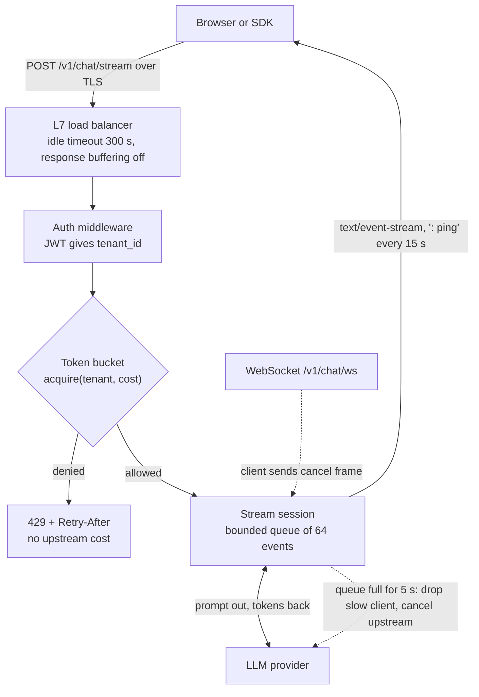

# Intuition & Mental Model

An LLM-backed API is not a normal CRUD API. A request can last 30 seconds, produce output one token at a time, and cost real money per call. Three things follow:

1. **Stream, don't wait.** Users judge speed by time-to-first-token, not total time. Server-Sent Events (SSE) push tokens over plain HTTP; WebSockets add a two-way channel when the client must interrupt or send follow-ups on the same connection.
2. **Admission control is a product feature.** If one tenant can burn the whole GPU/LLM quota, everyone else sees outages. A **token bucket** gives each tenant a steady refill rate plus a burst allowance, and rejects the rest quickly with `429` and `Retry-After`.
3. **Slow consumers are your problem.** A client on hotel Wi-Fi that reads slowly will make server buffers grow. Bound every buffer and cut off clients that fall behind.

# Production Architecture & Data Flow

Request states: ADMITTED, STREAMING, then COMPLETED, CANCELLED, CLIENT_SLOW, or UPSTREAM_ERROR.

# Architectural Trade-Off Matrix

| Approach | Latency | Scalability | Implementation Complexity | Cost |
|---|---|---|---|---|
| **SSE over HTTP/1.1-2** | Fast first token; one-way only | Excellent: stateless, works through CDNs and proxies with buffering off | Low | Low |
| **WebSockets** | Fastest for bidirectional/interrupts | Good, but sticky state, harder LB and auth refresh | Medium-High | Medium (connection-held memory) |
| **Long polling / chunked JSON** | Worst: perceived latency is full completion | Poor: many reconnects | Low | Medium-High (wasted requests) |

Rate limiting alternatives: **token bucket** (burst + steady rate, chosen), fixed window (cheap, allows 2x burst at boundaries), sliding-window log (exact but O(n) memory per key).

# Enterprise War Stories & Edge Cases

**1. Streaming that wasn't.** Everything worked in dev, but in production users saw the whole answer after 20 s. An nginx ingress and a corporate proxy buffered responses. *Remediation:* `X-Accel-Buffering: no`, `Cache-Control: no-cache`, gzip disabled for `text/event-stream`, heartbeat comments every 15 s, and an end-to-end synthetic check that measures time-to-first-byte through the real ingress.

**2. One noisy tenant took the platform down.** A customer script looped on the API with retries and no backoff; a global limiter starved all other tenants. *Remediation:* per-tenant buckets keyed by `tenant_id` (not IP, because NAT hides many users), plan-based capacity and refill, `429` with `Retry-After`, and a cost-weighted acquire (long prompts consume more tokens).

**3. Zombie streams burning money.** Clients closed their tab but the server kept generating for 60 s; thousands of abandoned generations inflated the LLM bill 18%. *Remediation:* detect disconnects (`request.is_disconnected()`, WebSocket close), propagate `CancelledError` to the upstream call, wrap generation in `try/finally` that releases the semaphore and records tokens actually used.
