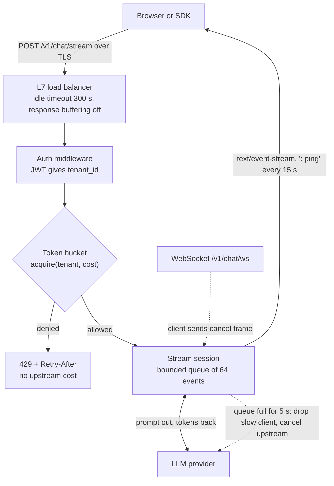

> **Syllabus lessons for this module:** full teaching notes for every topic are in [Syllabus Topic Write-ups](#syllabus-topic-write-ups); the topic-to-code map is in the [Syllabus Coverage Map](#syllabus-coverage-map) and [COVERAGE.md](../../COVERAGE.md).

# Intuition & Mental Model

An LLM-backed API is not a normal CRUD API. A request can last 30 seconds, produce output one token at a time, and cost real money per call. Three things follow:

1. **Stream, don't wait.** Users judge speed by time-to-first-token, not total time. Server-Sent Events (SSE) push tokens over plain HTTP; WebSockets add a two-way channel when the client must interrupt or send follow-ups on the same connection.
2. **Admission control is a product feature.** If one tenant can burn the whole GPU/LLM quota, everyone else sees outages. A **token bucket** gives each tenant a steady refill rate plus a burst allowance, and rejects the rest quickly with `429` and `Retry-After`.
3. **Slow consumers are your problem.** A client on hotel Wi-Fi that reads slowly will make server buffers grow. Bound every buffer and cut off clients that fall behind.

# Production Architecture & Data Flow



Request states: ADMITTED, STREAMING, then COMPLETED, CANCELLED, CLIENT_SLOW, or UPSTREAM_ERROR.

# Architectural Trade-Off Matrix

| Approach | Latency | Scalability | Implementation Complexity | Cost |
|---|---|---|---|---|
| **SSE over HTTP/1.1-2** | Fast first token; one-way only | Excellent: stateless, works through CDNs and proxies with buffering off | Low | Low |
| **WebSockets** | Fastest for bidirectional/interrupts | Good, but sticky state, harder LB and auth refresh | Medium-High | Medium (connection-held memory) |
| **Long polling / chunked JSON** | Worst: perceived latency is full completion | Poor: many reconnects | Low | Medium-High (wasted requests) |

Rate limiting alternatives: **token bucket** (burst + steady rate, chosen), fixed window (cheap, allows 2x burst at boundaries), sliding-window log (exact but O(n) memory per key).

# Enterprise War Stories & Edge Cases

**1. Streaming that wasn't.** Everything worked in dev, but in production users saw the whole answer after 20 s. An nginx ingress and a corporate proxy buffered responses. *Remediation:* `X-Accel-Buffering: no`, `Cache-Control: no-cache`, gzip disabled for `text/event-stream`, heartbeat comments every 15 s, and an end-to-end synthetic check that measures time-to-first-byte through the real ingress.

**2. One noisy tenant took the platform down.** A customer script looped on the API with retries and no backoff; a global limiter starved all other tenants. *Remediation:* per-tenant buckets keyed by `tenant_id` (not IP, because NAT hides many users), plan-based capacity and refill, `429` with `Retry-After`, and a cost-weighted acquire (long prompts consume more tokens).

**3. Zombie streams burning money.** Clients closed their tab but the server kept generating for 60 s; thousands of abandoned generations inflated the LLM bill 18%. *Remediation:* detect disconnects (`request.is_disconnected()`, WebSocket close), propagate `CancelledError` to the upstream call, wrap generation in `try/finally` that releases the semaphore and records tokens actually used.


# Syllabus Topic Write-ups

This module teaches how to build the HTTP layer that sits between clients and your data or models: how requests are read and validated, how code is wired together, how browsers are allowed to call you, how lists and writes scale, how GraphQL differs from REST, how APIs change over time without breaking customers, and how you test and debug all of it. A Forward Deployed Engineer is often the person who stands up an integration API inside a customer's environment in days, and the quality of validation, pagination, versioning and tests decides whether that API survives its first real traffic. Interviewers use these topics to check that you can reason about correctness and failure, not just call a framework.

**How to study this module**

The topics build on each other, so read them in this order.

1. Topics 1 and 2 (path and query parameters, Pydantic validation) first. They explain how raw text becomes trusted, typed data, and every later topic assumes it.
2. Topic 3 (dependency injection) next, because tests, sessions and shared clients in topics 5, 11 and 12 rely on it.
3. Topic 4 (CORS) and topic 5 (CRUD) show the browser-facing and data-facing sides of a REST API.
4. Topics 6 to 9 are one GraphQL arc: schema design, resolvers, the N+1 problem and DataLoader, then queries versus mutations. Read them together.
5. Topic 10 (versioning) applies to both REST and GraphQL and is easiest once you have seen both.
6. Topics 11 to 13 (unit tests, fixtures and mocking, coverage) are one testing arc. Topics 14 and 15 (debugging, IDE extensions) are the daily tooling around it.

Numbers marked as examples are invented to make arithmetic concrete. Product and version specific names, options and defaults (FastAPI, Pydantic, Strawberry, Graphene, VS Code extensions, coverage tools) should be checked against current documentation before you rely on them.

**Module cheat sheet**

| Must-know | One-line answer |
|---|---|
| Path vs query parameter | The path identifies one resource, the query string filters, sorts or pages a collection. |
| 400 vs 404 vs 422 | 400 is a malformed request, 404 is no such route or resource, 422 is a well-formed request whose values fail validation (FastAPI default). |
| Pydantic lax vs strict | Lax coerces compatible input such as "12" to 12, strict rejects it. |
| Why separate create, update, response models | Clients must not set server-owned fields and responses must not leak internal ones. |
| Dependency injection payoff | Handlers receive what they need, so setup and teardown live in one place and tests swap in fakes. |
| Same origin | Same scheme, host and port; CORS relaxes the browser rule and does nothing against curl or servers. |
| Preflight | An OPTIONS request the browser sends first for non-simple requests to ask if the real request is allowed. |
| Offset vs keyset pagination | Offset scans and discards skipped rows, keyset seeks past the last seen key using an index. |
| N+1 problem | One query for the list plus one per item; fix with batching (DataLoader) or eager loading. |
| Query vs mutation execution | Top-level query fields may run in parallel, top-level mutation fields run serially in written order. |
| Breaking vs additive change | Adding an optional field is safe; removing, renaming or retyping a field breaks clients. |
| Line vs branch coverage | Line asks whether a line ran, branch asks whether both outcomes of every decision ran. |
| Mock vs fake vs stub | A stub returns canned answers, a fake is a working lightweight substitute, a mock also verifies how it was called. |
| Launch vs attach | Launch starts the program under the debugger, attach connects to a process already running. |

### 1. Path and query parameters

**What you will be able to do**

- Explain the difference between path and query parameters to a non-engineer in two minutes.
- Trace how a URL is split, matched, converted and validated, and predict the error response.
- Declare typed, bounded parameters in FastAPI and spot unsafe ones in a code review.
- Choose between path, query, body and header for a given piece of input.

**Prerequisites**

Basic HTTP: methods (GET, POST), status codes, and what a URL is. No earlier module topic is required.

**The idea from first principles**

A web API has to answer two questions about every request: which thing are you talking about, and how do you want it presented. Imagine a library desk. You hand over a call number (which book) and say "just the first chapter, large print" (how). The call number is the path parameter. The presentation hints are the query parameters.

Technically, a URL looks like `scheme://host/path?query#fragment`. The path is a sequence of segments separated by slashes. The query string is a list of `key=value` pairs separated by `&`. The fragment stays in the browser and is never sent to the server. Special characters are percent-encoded, so a space becomes `%20` and a literal ampersand inside a value becomes `%26`.

The convention is that the path identifies a resource (one claim, one customer) and the query string narrows or shapes a collection (filter by status, sort, page). The convention exists for practical reasons. Paths are the unit of routing, authorization rules and caching, and they appear in links. Query strings are optional by nature, so adding a new filter later does not break existing clients.

The naive approach is to take whatever text arrives and pass it along. That fails because everything in a URL is text. `/items/abc` is text too, and if it reaches the database layer you get an exception and a 500 response, which tells the client that your server is broken when the client made a mistake. Worse, unchecked text can carry injection payloads or absurd sizes. The real approach is to declare, for each parameter, a type and constraints, and let the framework convert and check before your handler runs. Failures return a client error that names the offending field, so the caller can fix it.

Terms to hold on to. A path parameter is a named variable segment in a route template such as `{item_id}`. A query parameter is a named optional or required pair after the question mark. A validation error is a structured report of which inputs failed which rules. Pagination is returning a collection in bounded slices.

**How it works, step by step**

1. The client sends `GET /items/42?limit=500&tag=a&tag=b`. The server receives the path `/items/42` and the raw query string `limit=500&tag=a&tag=b` separately.
2. The router compares the path against route templates. Static segments must match exactly. `{item_id}` captures one segment as the string `"42"`. If no template matches, the answer is 404.
3. Conversion. The framework reads the annotation on `item_id` (for example `int`) and tries to convert `"42"`. If it cannot, it records an error with location (`path`, `item_id`), a message and a type.
4. The query string is parsed. A key that appears more than once (`tag=a&tag=b`) becomes a list only if the parameter is declared as a list. A key that is absent takes its default, or yields a missing-field error if required.
5. Constraints are checked after conversion: `ge=1` means greater than or equal to 1, `le=100` means less than or equal to 100.
6. All errors found are collected. If there are any, the framework returns 422 with the list and never calls your handler. Otherwise it calls the handler with typed values.

Worked calculation. Suppose the declared bound is `limit` between 1 and 100, default 10. Request `?limit=500`: conversion gives integer 500, the check `500 <= 100` fails, error recorded. Request `?limit=` (empty): conversion of the empty string to int fails, error recorded. Request with no limit: default 10 is used and validation of the default is skipped by convention. A database that returns 100 rows of 1 KB each (example) sends 100 KB; an unbounded limit of 1,000,000 would try to produce 1 GB, which shows why the bound matters.

Route order matters in many frameworks. If `/items/{item_id}` is declared before `/items/me`, then the request `/items/me` matches the first template and fails integer conversion.

**Worked example 1: small and hand-traceable**

Route: `GET /books/{book_id}` with `book_id: int` (ge=1) and `year: int | None = None`. Trace three requests.

- `GET /books/7?year=1999`. Router matches, `book_id` becomes 7, `year` becomes 1999. Handler runs with (7, 1999).
- `GET /books/0`. Router matches, 0 converts to an integer, but `ge=1` fails. Response 422, error at location path then `book_id`, message says the value must be greater than or equal to 1.
- `GET /books/seven?year=abc`. Router matches, `book_id` fails conversion, `year` fails conversion. One response lists both errors. The client fixes both in one attempt instead of discovering them one at a time.

Now `GET /bookz/7`. No template matches, so the answer is 404 and no validation happens at all. This is the cleanest way to see the difference between 404 (the route does not exist) and 422 (the route exists but a value is invalid).

**Worked example 2: enterprise scenario**

An insurer exposes claim documents to a partner portal. The claim id identifies the resource. Status and page size shape the list. Page forward using a keyset cursor.

```python
from typing import Literal
from fastapi import FastAPI, Path, Query

app = FastAPI()

@app.get("/claims/{claim_id}/documents")
def list_documents(
    claim_id: int = Path(ge=1),
    status: Literal["open", "closed"] = "open",
    limit: int = Query(20, ge=1, le=100),
    after_id: int = 0,
):
    return {"claim_id": claim_id, "status": status,
            "limit": limit, "after_id": after_id}
```

Commentary. `Path(ge=1)` rejects zero and negative ids before any query runs. `Literal["open", "closed"]` limits status to two values, so a request with `status=pending` is rejected with a 422 listing the allowed values, and nobody can smuggle arbitrary text into a SQL filter. `Query(20, ge=1, le=100)` gives a default of 20 and a hard ceiling of 100. `after_id` is the cursor from the last page (see topic 5).

Validation is not authorization. A caller with a valid token for claim 41 can still ask for claim 42, so the handler or a dependency must check that this caller may see this claim, and return 404 or 403 accordingly. Also log the route template (`/claims/{claim_id}/documents`) rather than the full URL, so personal data in query strings does not spread through logs.

**Hands-on practice**

Exercise 1 (easy). A route is `/orders/{order_id}` with `order_id: int`. What happens for `/orders/12.5`, and what for `/orders/`?

Solution: `12.5` is text that cannot convert to an integer under strict integer parsing, so the router matches but conversion fails and the answer is 422. `/orders/` has an empty final segment, so the template does not match and the framework either redirects to the no-slash form or returns 404 depending on configuration. Check your framework's trailing slash behavior, because a redirect can turn a POST into a GET in some clients.

Exercise 2 (medium). Design the parameters for `GET /customers` so that clients can filter by `country`, sort by `created_at` ascending or descending, and page safely.

Solution: `country: str | None` with a length of 2 and uppercase pattern, `sort: Literal["created_at", "-created_at"] = "-created_at"`, `limit: int = Query(25, ge=1, le=100)`, and `cursor: str | None` (opaque). Only whitelisted sort fields are allowed, because building `ORDER BY` from raw input is an injection risk. Unknown parameters can be rejected so cache keys do not multiply.

Exercise 3 (hard). A support engineer sees API keys in the access logs of a gateway. The client sends `GET /v1/report?api_key=...`. Write the remediation plan.

Solution: Move the key to the Authorization header, support both for a deprecation window and log a warning when the query form is used, rotate every key that appeared in logs because log retention means it is already exposed, scrub or redact the existing logs according to policy, configure the gateway to drop query strings from access logs, and add a test that fails the build if a route reads a secret from the query. Tell customers about the rotation with a deadline.

**Alternatives and trade-offs**

| Where the input goes | Good for | Cost or risk |
|---|---|---|
| Path | Identity, stable links, routing rules | Required, URL changes break clients |
| Query string | Optional filters, sort, paging | Logged everywhere, size limits, cache key explosion |
| Body | Large or structured or sensitive input | GET bodies are unreliable, so reads become POSTs |
| Header | Auth, tracing, version | Invisible in links, easy to forget |

Choose the path for identity, the query for optional narrowing, the body when data is sensitive or big, and headers for cross-cutting concerns. The technique of declared parameters is the wrong tool when the query language is rich (nested boolean filters): then accept a structured body or use GraphQL (topic 6).

**Where it goes wrong in production**

- Unbounded limit. Symptom: one request saturates the database and memory. Root cause: no upper bound. Diagnose with slow query logs and response size metrics. Fix: `le=100`, default small, and a server-side cap regardless of validation.
- Secrets or personal data in URLs. Symptom: tokens appear in logs and analytics. Root cause: convenience. Diagnose by grepping logs for known key prefixes. Fix: use headers and bodies, redact logs.
- Route shadowing. Symptom: `/items/search` answers 422 about an id. Root cause: a parameterized route declared first. Diagnose by listing routes in order. Fix: declare static routes first and add a test.
- Insecure direct object reference. Symptom: a user changes an id and reads someone else's record. Root cause: type validation mistaken for authorization. Fix: ownership checks in a dependency, and tests with two users.
- Cache fragmentation. Symptom: a CDN hit rate near zero. Root cause: arbitrary parameter order and unknown keys. Fix: reject unknown parameters and normalize order.

**Do not confuse**

404 means the route or resource does not exist. 422 means the route exists but a value failed validation. 400 means the request was malformed at a lower level, such as broken JSON. Also, an optional parameter with a default is not the same as a nullable one: omitting it and sending an explicit null are different inputs.

**How interviewers probe this**

1. What is the difference between a path parameter and a query parameter?
2. What status do you return for `/items/abc`, and why?
3. How would you page a list that can reach millions of rows?
4. A user edits the id in the URL and sees someone else's data. What happened?
5. When would you use a POST for a read-only search?
6. What goes wrong if an API key is placed in the query string?
7. How would you let clients sort without creating an injection risk?
8. Trap: "If the framework validates the id type, is the endpoint secure?"

**Model answer (60-90 seconds)**

"A path parameter identifies a specific resource, like the claim id in `/claims/42`. A query parameter narrows or shapes a collection, such as status, sort order or page size. Both arrive as text, so I declare types and constraints and let the framework convert and validate before my code runs. In FastAPI a bad value produces a 422 listing every failing field, which is better than a 500 from the database. I always cap page size and give it a small default, and I whitelist sort fields. Type validation is not authorization, so I still check that the caller may see that record. I keep secrets out of URLs because gateways and browsers log them. The trade-off is that very rich filters get awkward in a query string, and then I accept a structured body or use GraphQL. The limit of all this is that it checks shape, not meaning: a valid id can still be the wrong customer's."

**Quick-fire answers**

- Q: Path vs query parameter? A: Path identifies the resource and is required. Query filters, sorts or pages and is usually optional.
- Q: Status for `/items/abc`? A: 422 in FastAPI, since the route exists and the value is invalid. Some hand-built APIs use 400. It must never be a 500.
- Q: Paging millions of rows? A: Capped page size with keyset pagination and an opaque cursor, because offset slows down with depth.
- Q: Edited id shows another user's data? A: Missing object-level authorization. Validation checks shape, authorization checks permission.
- Q: POST for read-only search? A: When filters are large, nested or sensitive, because query strings are length limited and logged.
- Q: API key in the query? A: It leaks through logs, proxies, browser history and referrer headers.
- Q: Safe sorting? A: Accept a short enum of allowed fields and map each to a known column, never splice raw text into SQL.
- Q: Framework validated the type, so is it secure? A: No. Type checks do not cover authorization, rate limits or business rules.

**Recap in five lines**

- Path = which resource, query = how to present a collection, fragment never reaches the server.
- Everything arrives as text; declare types and bounds so bad input becomes a 422, not a 500.
- Always cap page size and whitelist sort fields.
- Validation is not authorization; check ownership per object.
- Keep secrets and personal data out of URLs.

### 2. Pydantic data validation

**What you will be able to do**

- Explain why Python type hints alone do not protect an API, and what Pydantic adds.
- Trace a payload through field validation, coercion and model validation by hand.
- Design separate create, patch and response models and justify each.
- Choose between lax and strict handling for a given field and avoid money-as-float bugs.

**Prerequisites**

Topic 1 (declared parameters and 422 responses). Basic Python classes and type hints.

**The idea from first principles**

Every API is a border crossing. Data arrives from outside your trust boundary as bytes, and your code needs it as clean values with known types. Think of a customs officer who checks each traveler against a list of rules before letting them in, and writes down every violation, not just the first.

Python type hints are labels, not locks. `price: int` does not stop `"abc"` from being passed in at runtime. The naive approach is to sprinkle `if` checks through handlers. That fails in three ways: checks get forgotten in some handlers, error messages differ everywhere, and the rules are not available as documentation for clients.

Pydantic centralizes this. You describe the shape once as a model, a class with annotated fields. The library validates input against it, converts values where allowed, and either returns a typed instance or raises a single error object listing every problem. FastAPI uses the same model to read the body, return 422 on failure and publish a machine-readable schema for documentation.

Terms. A model is a class whose annotated attributes are fields. Validation checks input against types and constraints. Coercion is converting compatible input, such as the string `"12"` to the integer 12. Lax mode (the default) coerces; strict mode refuses unless the type is exact. A validator is a function that runs custom checks or normalization on a field (field validator) or on the whole model (model validator). Serialization is turning a model back into plain data for a response. The notes here follow Pydantic v2 naming; verify against current documentation.

**How it works, step by step**

1. The framework reads the request body and parses JSON into dicts, lists, strings, numbers. Broken JSON fails here.
2. For each declared field Pydantic looks up the input by name (or alias). A missing required field is an error. A missing optional field takes its default.
3. Before-validators, if any, run on the raw input.
4. The value is converted to the declared type under lax or strict rules. Lists and nested models are validated recursively, and error locations include the path, such as `("body", "items", 2, "qty")`.
5. Constraints are checked: `min_length`, `max_length`, `gt`, `ge`, `lt`, `le`, patterns.
6. After-validators run on the typed value, for example lowercasing a tag.
7. Once all fields are processed, model validators run for cross-field rules, such as `end` after `start`.
8. If any errors were recorded, a validation error with the full list is raised. Each entry has a location, a human message and a machine type. FastAPI returns it as 422.
9. Otherwise you receive a model instance with correct types.

Worked calculation with floats. Add three prices of 0.10 in binary floating point: 0.1 + 0.1 + 0.1 gives 0.30000000000000004, which is not equal to 0.3. If a system multiplies by 100 and truncates, the result is 30.000000000000004 which truncates to 30 here, but a different sum such as 0.7 plus 0.1 gives 0.7999999999999999 and truncates to 79 cents. That is why money should be an integer count of minor units (cents) or `Decimal`.

**Worked example 1: small and hand-traceable**

Model: `name: str` with `min_length=1`; `price_cents: int` with `gt=0`; `tags: list[str] = []`. Input: `{"name": "", "price_cents": "12", "tag": ["a"]}` with `extra="forbid"`.

- Field `name`: present, a string, length 0 fails `min_length=1`. Error recorded.
- Field `price_cents`: input is the string `"12"`. Lax mode converts to integer 12, then `12 > 0` passes. No error. In strict mode this would be an error.
- Field `tags`: missing, default empty list used.
- Unknown key `tag`: `extra="forbid"` records an error for the extra field. Without it, the typo would be silently dropped and `tags` would stay empty.

Result: two errors (name too short, extra field `tag`), reported together in one 422. The client fixes both at once. Change the input to `{"name": "pen", "price_cents": 12}` and you get an instance with `tags == []`.

**Worked example 2: enterprise scenario**

A bank onboarding API accepts account creation, partial updates and returns a read model. Three models keep responsibilities apart.

```python
from pydantic import BaseModel, ConfigDict, Field, field_validator

class AccountCreate(BaseModel):
    model_config = ConfigDict(extra="forbid")
    holder_name: str = Field(min_length=1, max_length=80)
    currency: str = Field(min_length=3, max_length=3)

    @field_validator("currency")
    @classmethod
    def upper(cls, v: str) -> str:
        return v.upper()

class AccountPatch(BaseModel):
    model_config = ConfigDict(extra="forbid")
    holder_name: str | None = None

class AccountOut(BaseModel):
    id: int
    holder_name: str
    currency: str
```

Commentary. `AccountCreate` forbids unknown fields and normalizes currency so `usd` and `USD` are stored identically. It contains no `id`, so a client cannot choose its own key. `AccountPatch` makes everything optional; in the handler, `patch.model_dump(exclude_unset=True)` returns only the fields the client actually sent, so omitted fields stay untouched, while an explicit `null` can still be told apart from absence. `AccountOut` lists exactly what may leave the system, so an internal `risk_score` column can never leak by accident. On the route, set the response model to `AccountOut` so the framework filters the returned object through it.

Still keep database constraints (NOT NULL, unique, check) as a last line of defence, because other code paths may write to the same table.

**Hands-on practice**

Exercise 1 (easy). A model has `age: int` with `ge=0, le=130`. Predict the outcome for inputs `"42"`, `42.0`, `42.5` and `"forty"` in lax mode.

Solution: `"42"` converts to 42 and passes. `42.0` is a float with no fractional part, and lax mode accepts it as 42. `42.5` has a fractional part, so conversion to int fails. `"forty"` cannot parse. Strict mode would reject `"42"` and `42.0` as well. Verify exact coercion tables in the documentation, because they are a common source of surprise.

Exercise 2 (medium). Write the model-level rule that a booking must have `check_out` after `check_in`, and describe what error the client sees.

Solution: add a model validator that runs after fields are valid and compares the two dates, raising a value error with a clear message when `check_out <= check_in`. Because it runs after field validation, both fields are already real dates. The client sees a 422 whose location is the body as a whole (not a single field) and the message you wrote. Mention that you should compare timezone-aware values consistently.

Exercise 3 (hard). Your API accepted `{"role": "admin"}` on user update because someone reused the create model for PATCH. Describe the fix and the regression test.

Solution: split into `UserPatch` without `role`, keep `extra="forbid"` so a client sending `role` gets a 422, and handle role changes through a separate admin-only endpoint with its own authorization. Add a test that sends `{"role": "admin"}` as an ordinary user and asserts a 422 (or 403 on the admin route) and that the stored role is unchanged. Search the codebase for other places where one model is used for both input and output.

**Alternatives and trade-offs**

| Option | Strength | Weakness |
|---|---|---|
| Pydantic models | Rich types, clear errors, schema generation | CPU per request, coercion surprises |
| Dataclasses plus manual checks | No dependency | You write and test every rule |
| JSON Schema validation | Language-neutral contract | Weaker conversion into Python types |
| Database constraints only | Cannot be bypassed | Late, cryptic errors, bad data already crossed layers |

Use Pydantic at the edge, constraints in the database as the backstop, and strict mode where silent coercion is dangerous (identifiers, flags). For internal hot paths that handle millions of already-trusted records, validation may be skipped or batched, but never for data crossing the trust boundary.

**Where it goes wrong in production**

- Silent coercion. Symptom: `"true"` or `1` accepted as a boolean and a flag flips. Root cause: lax mode. Diagnose by replaying odd inputs against a test instance. Fix: strict types on sensitive fields.
- Float money. Symptom: totals off by a cent. Fix: integer cents or `Decimal`, with a reconciliation test.
- One model for everything. Symptom: clients overwrite `id` or `role`, or responses expose internal flags. Fix: separate input and output models and an explicit response model.
- Naive datetimes. Symptom: timestamps shift by hours between services. Fix: require timezone-aware values and store UTC.
- Heavy validators. Symptom: p99 latency rises, validators calling the network. Fix: keep validators pure and fast, move lookups into the service layer.
- Oversized payloads. Symptom: memory spikes. Fix: body size limit at the proxy and `max_length` on lists and strings.

**Do not confuse**

Validation checks shape and rules. Sanitization rewrites data (trimming, escaping). Authorization decides whether the caller may act. A Pydantic model is not an ORM model: merging them couples your public contract to your table layout. Serialization (model to JSON) is also separate from validation (input to model).

**How interviewers probe this**

1. What does Pydantic do that type hints do not?
2. What is the difference between lax and strict mode?
3. How do you validate a rule that spans two fields?
4. How do you implement PATCH so omitted fields stay unchanged?
5. Design the models for create, update and read of an account.
6. What breaks when you migrate from Pydantic v1 to v2?
7. How would you validate a 50 MB upload or a list of 100,000 items?
8. Trap: "If Pydantic validated it, is it safe to put into a SQL string?"

**Model answer (60-90 seconds)**

"Type hints are not enforced at runtime. Pydantic reads them and enforces them: it parses incoming data, converts compatible values, checks constraints and returns either a clean typed object or a complete list of errors. In an API that means bad input is rejected with a 422 before it reaches business logic. I use separate models for create, patch and response, so clients cannot set server-owned fields and internal columns do not leak. I set extra to forbid so typos fail loudly, and I use field and model validators for normalization and cross-field rules. The trade-offs are CPU per request and coercion: lax mode will turn the string '12' into 12, so for identifiers and flags I use strict types. For money I use integer cents. And validation is not a substitute for parameterized queries or database constraints, which remain the last line of defence."

**Quick-fire answers**

- Q: What does Pydantic add over type hints? A: Runtime enforcement, conversion and structured errors, plus a schema for documentation.
- Q: Lax vs strict? A: Lax converts compatible values like "12" to 12. Strict requires the exact type.
- Q: Cross-field rule? A: A model-level validator that runs after the individual fields pass.
- Q: PATCH semantics? A: Dump with `exclude_unset=True` and apply only the fields the client sent.
- Q: Models for an account? A: Create with required fields and no id, Patch with all optional, Out with id and read-only fields.
- Q: v1 to v2? A: Renamed methods such as `validator` to `field_validator` and `dict()` to `model_dump()`, plus behavior differences in coercion. Use the migration guide.
- Q: Huge uploads and lists? A: Limit body size at the proxy, set `max_length` on collections, stream large files instead of validating them as one model.
- Q: Validated means safe for SQL? A: No. Always use parameterized queries. Validation reduces risk but is not the defense.

**Recap in five lines**

- Pydantic turns untrusted input into typed objects or a full list of errors.
- Lax coerces, strict does not; choose per field.
- Separate create, patch and response models; forbid extra fields.
- Money is integer cents or Decimal, datetimes are timezone-aware.
- Keep database constraints and parameterized queries as the backstop.

### 3. Dependency injection

**What you will be able to do**

- Define dependency injection and explain its benefit to a skeptical colleague.
- Trace how a framework resolves a chain of providers and caches within a request.
- Write a yielding provider for a session and override it in a test, cleaning up afterward.
- Decide which resources are per request and which live for the whole application.

**Prerequisites**

Topics 1 and 2. Python functions and context managers (`with`) at a basic level.

**The idea from first principles**

Picture a chef who must grow the vegetables, build the oven and hire the dishwasher before every dinner. Nothing gets cooked. A better kitchen delivers the ingredients and tools to the chef, who just cooks. Dependency injection is that delivery: a function declares what it needs and something else supplies it.

Without it, a handler creates its own database connection. That fails in four ways. Connections leak when someone forgets to close one, until a pool of, say, 20 (example) is exhausted and the API hangs. Setup code is copied into every handler. Tests cannot replace the real database without patching internals. And swapping an implementation means editing every handler.

Terms. A dependency is anything the handler needs: a session, a repository, the current user, a settings object. A provider is the function or class that builds a dependency. The container is the machinery that resolves providers into values (in FastAPI, the framework itself). Scope is how long a built value lives: per call, per request, or per application. Teardown is cleanup that runs when the scope ends.

In FastAPI you write a provider as an ordinary function and mark a handler parameter with `Depends(provider)`. A provider can itself declare `Depends` parameters, forming a tree. A provider written with `yield` runs its setup before the handler and the code after `yield` as teardown.

**How it works, step by step**

1. At startup FastAPI inspects each handler signature and records parameters declared with `Depends`.
2. On a request it resolves the tree depth first. If `get_service` needs `get_repo`, which needs `get_session`, then the session is built first, then the repo, then the service.
3. Within one request, a provider used in several places is called once and the result reused, because per-request caching is on by default.
4. The handler runs with the built values.
5. After the response is produced, teardown runs for yielding providers in reverse order of creation: service, repo, session. Consult the current documentation for exactly how teardown timing relates to sending the response in your version.
6. In tests, `app.dependency_overrides[provider] = replacement` makes the container call the replacement wherever the original was declared. Clear the dictionary afterward.

Worked calculation. A request needs `current_user` and `repo`, and both depend on `get_session`. Without caching you would open 2 sessions per request. At 500 requests per second (example), that is 1,000 pool checkouts per second against a pool of 20, so each checkout can be held for at most 20 ms on average before the pool is saturated (by Little's Law, concurrency equals rate times time held: 1,000 per second times 0.02 s equals 20 in use). With caching it is 500 per second, so each session may be held 40 ms for the same pool. Caching doubles your headroom for free.

Scopes. Per request is the default. Per application means creating the object once in the application's start-up hook, storing it on application state, and handing it out with a tiny provider.

**Worked example 1: small and hand-traceable**

```python
from fastapi import Depends, FastAPI

app = FastAPI()
calls = []

def get_session():
    calls.append("open")
    try:
        yield "S"
    finally:
        calls.append("close")

def get_repo(s: str = Depends(get_session)):
    calls.append("repo")
    return f"repo({s})"

def get_user(s: str = Depends(get_session)):
    calls.append("user")
    return f"user({s})"

@app.get("/me")
def me(repo: str = Depends(get_repo), user: str = Depends(get_user)):
    calls.append("handler")
    return {"repo": repo, "user": user}
```

Trace one request to `/me`. Resolution: `get_repo` needs the session, so `open` is recorded, then `repo`. `get_user` also needs the session, but it is cached, so no second `open`; `user` is recorded. Then `handler`. Teardown runs the code after `yield`, recording `close`. The list ends as `open, repo, user, handler, close`: one open and one close for the whole request. If you declare `Depends(get_session, use_cache=False)` in one place, you would see a second open and close pair.

**Worked example 2: enterprise scenario**

A telecom billing API shares one HTTP client for a rating service across all requests. Creating a client per request would repeat TCP and TLS handshakes and waste sockets.

```python
from contextlib import asynccontextmanager
from fastapi import Depends, FastAPI, Request
import httpx

@asynccontextmanager
async def lifespan(app: FastAPI):
    app.state.rating = httpx.AsyncClient(timeout=5.0)
    yield
    await app.state.rating.aclose()

app = FastAPI(lifespan=lifespan)

def get_rating_client(request: Request) -> httpx.AsyncClient:
    return request.app.state.rating

@app.get("/usage/{line_id}")
async def usage(line_id: int,
                client: httpx.AsyncClient = Depends(get_rating_client)):
    resp = await client.get(f"https://rating.internal/lines/{line_id}")
    return resp.json()
```

Commentary. The lifespan function runs once: code before `yield` at start-up, code after at shutdown, so the client is created once and closed cleanly. `get_rating_client` is a one-line provider that reads the shared client from application state, which keeps handlers decoupled from where it lives. The timeout of 5 seconds (example) prevents a slow upstream from holding workers forever. In a test, override `get_rating_client` with a function returning a fake object whose `get` returns canned data, so no network is touched. Verify the lifespan syntax against the version of FastAPI you use.

**Hands-on practice**

Exercise 1 (easy). Why does a yielding provider use `try` and `finally`?

Solution: if the handler raises, the exception is thrown into the provider at the `yield` point. Without `finally`, the cleanup line after `yield` would be skipped on errors, leaking the session. With `finally`, cleanup always runs.

Exercise 2 (medium). Write a pytest fixture that overrides a repository provider with a fake and removes the override afterward.

Solution: define a fixture that sets `app.dependency_overrides[get_repo] = lambda: FakeRepo()`, `yield`s a test client, and in teardown calls `app.dependency_overrides.clear()`. Because teardown runs even when the test fails, the override never leaks into the next test. Using `clear()` removes all overrides; if you want to remove only one, `pop` that key.

Exercise 3 (hard). Under load, the API hangs although the database is healthy. Pool size is 20, each request opens a session in a sync `def` provider and the handler also does a 300 ms upstream call. Diagnose.

Solution: by Little's Law, concurrent sessions equals arrival rate times hold time. At 100 requests per second (example) and 0.3 s hold, 30 sessions are needed, more than the pool of 20, so requests queue and then time out. The session is held while waiting on the upstream call. Fixes: acquire the session only around database work (a narrower scope), use an async client for the upstream call, size the pool to measured need, and add pool wait-time metrics. Also check that sync providers are not saturating the framework's thread pool.

**Alternatives and trade-offs**

| Approach | Pros | Cons |
|---|---|---|
| Framework DI (`Depends`) | Little code, declarative, easy overrides | Tied to the framework, implicit call graph |
| Manual constructor injection | Explicit, framework-free | More wiring code |
| Module-level globals | Simplest | Hard to test, hidden coupling, shared mutable state |
| DI container library | Rich lifecycles and scopes | Extra dependency and concepts |

Use `Depends` for web-layer concerns (auth, session, settings) and plain constructors for domain code, so business logic can be tested with no web framework at all. DI is the wrong tool for values that are truly constant: a plain module constant is clearer.

**Where it goes wrong in production**

- Leaked connections. Symptom: requests hang when the pool is full. Root cause: sessions opened without teardown. Diagnose with pool metrics and open connection counts in the database. Fix: yielding provider with `finally`.
- Blocking sync provider. Symptom: latency spikes under load. Root cause: a `def` provider runs in a limited thread pool and slow work fills it. Diagnose with thread pool saturation and async profiling. Fix: use async drivers or size the pool deliberately.
- Shared session across requests. Symptom: odd transaction errors under concurrency. Root cause: a session stored in a global. Fix: one session per request.
- Override leakage. Symptom: a test passes alone and fails in the suite. Root cause: overrides not cleared. Fix: teardown in a fixture.
- Circular dependencies. Symptom: errors at resolution. Fix: make providers a tree and move shared logic to a third provider.
- Per-request creation of heavy clients. Symptom: high connection churn and latency. Fix: create once in the lifespan.

**Do not confuse**

Dependency injection is a technique: pass collaborators in. Dependency inversion is a design principle: high-level code depends on abstractions. A service locator fetches things from a global registry, hiding dependencies, whereas injection puts them visibly in the signature. `Depends` is also not middleware: middleware wraps every request and sees the raw request and response, while a dependency is declared per route and supplies typed values.

**How interviewers probe this**

1. What is dependency injection and why use it?
2. How do you test a handler that needs a database?
3. How is `Depends` different from middleware?
4. How would you share one HTTP client across requests safely?
5. What happens when a dependency opens a connection and never closes it?
6. Design the layering for auth, a session and a service in a FastAPI app.
7. What breaks when a sync dependency does blocking work under load?
8. Trap: "Is a global database object just as good, since it is simpler?"

**Model answer (60-90 seconds)**

"Dependency injection means a function declares what it needs and something else supplies it. In FastAPI I write providers and mark parameters with Depends. The framework resolves them per request, reuses duplicates within the request, and runs teardown for providers that yield. The payoff is that handlers stay small, cleanup is in one place, and in tests I override a provider with a fake instead of patching internals. The trade-off is that the call graph is implicit, so I keep providers simple and keep business logic in plain classes that take their collaborators in the constructor. Expensive shared resources like an HTTP client I create once in the lifespan and expose through a small provider. The mistakes I watch for are leaked sessions, sync providers blocking the thread pool, and overrides that leak between tests. A global is simpler at first, but it hides coupling and makes testing painful."

**Quick-fire answers**

- Q: What is DI? A: Supplying a function's collaborators from outside rather than creating them inside it.
- Q: Testing with a database? A: Override the session or repository provider with a fake or an in-memory database, and clear overrides afterward.
- Q: Depends vs middleware? A: Middleware runs on every request around the whole app. A dependency is declared per route and returns values the handler uses.
- Q: Share an HTTP client? A: Create it once in the lifespan, keep it on application state and return it from a provider.
- Q: Connection never closed? A: Pool exhaustion and hangs. Use a yielding provider with `finally`.
- Q: Layering? A: An auth provider yields the user, a session provider yields a session, a service takes a repository, and handlers only call the service.
- Q: Blocking sync dependency under load? A: It occupies the limited worker thread pool, so latency climbs for everyone. Use async I/O or tune the pool.
- Q: Is a global just as good? A: It works until you test or scale; it hides dependencies, shares state and makes overrides hard.

**Recap in five lines**

- DI means handlers receive their collaborators instead of building them.
- Providers form a tree, resolved per request with caching, torn down in reverse order.
- Yielding providers with `finally` prevent leaks.
- Per-application resources belong in the lifespan, per-request ones in providers.
- Tests override providers and always clear the overrides.

### 4. CORS middleware

**What you will be able to do**

- Explain CORS and the same-origin policy to a non-engineer in two minutes.
- Decide whether a request triggers a preflight and write the headers that satisfy it.
- Configure explicit, credential-safe CORS and test it with curl.
- Debug the classic "CORS error" that is really a server error.

**Prerequisites**

HTTP headers and methods. Topic 3 helps for the middleware idea but is not required.

**The idea from first principles**

Suppose you are logged in to your bank in one browser tab and you open a hostile page in another. Your browser automatically attaches your bank cookies to any request sent to the bank. If the hostile page could read the bank's responses, it could steal your balance. The browser's defence is the same-origin policy: a page may read responses only from its own origin.

An origin is the triple scheme, host and port. `https://app.example.com` and `https://api.example.com` differ in host. `https://app.example.com` and `https://app.example.com:8443` differ in port. The naive fix for legitimate cross-origin use, such as a React app calling a separate API, is to disable the policy, which would expose everyone. CORS (Cross-Origin Resource Sharing) is the controlled opt-in: the server tells the browser which origins may read its responses, using headers. The browser enforces it. The server simply declares.

Two key facts follow. First, CORS is enforced only by browsers. curl, a script or another server ignores it completely, so it is not an access control for your API. Second, a blocked response is blocked after the request may already have reached your server and executed, so CORS does not stop side effects of simple requests.

Terms. A simple request is one the web platform already allowed before CORS existed: GET, HEAD or POST with only safelisted headers and form-style content types. A preflight is an extra `OPTIONS` request the browser sends before any non-simple request, asking permission. Credentials means cookies, HTTP authentication or TLS client certificates sent cross-origin.

**How it works, step by step**

1. The page runs `fetch("https://api.example.com/items", {method: "PATCH", headers: {...}})`. The browser adds an `Origin` header holding the page's origin.
2. The browser decides whether the request is simple. A PATCH, a JSON content type, or an `Authorization` header all make it non-simple.
3. For a non-simple request it first sends the preflight: `OPTIONS /items` with `Origin`, `Access-Control-Request-Method: PATCH` and `Access-Control-Request-Headers: authorization,content-type`.
4. The server answers, typically with 200 or 204, and headers: `Access-Control-Allow-Origin` naming the origin, `Access-Control-Allow-Methods`, `Access-Control-Allow-Headers`, optionally `Access-Control-Max-Age` (how long the browser may cache the answer, in seconds), and `Access-Control-Allow-Credentials: true` if credentials are allowed.
5. If the answer permits the request, the browser sends the real PATCH.
6. On the real response, the browser again checks `Access-Control-Allow-Origin` before letting JavaScript read the body. A mismatch produces the console CORS error.
7. If the response differs by origin, the server also sends `Vary: Origin` so caches keep separate copies.

Worked calculation. A preflight adds one round trip. With 80 ms round-trip time (example), a non-simple call costs 160 ms instead of 80 ms on a cold start. With `Access-Control-Max-Age` of 600 seconds (example; browsers cap the maximum, so check current limits), a user who makes 50 calls in ten minutes pays the preflight once and saves 49 round trips, about 3.9 seconds.

With credentials, the allowed origin must be the exact origin, not `*`. The specification forbids the wildcard with credentials.

**Worked example 1: small and hand-traceable**

Page origin `https://app.example.com`. API at `https://api.example.com`. Policy: allowed origin list contains only `https://app.example.com`, methods GET and POST and PATCH, headers `Authorization` and `Content-Type`.

- Request A: `GET /items` with no custom headers. Simple. The browser sends it with `Origin`. The response includes `Access-Control-Allow-Origin: https://app.example.com`. JavaScript can read it.
- Request B: `PATCH /items/7` with `Content-Type: application/json`. Non-simple. Preflight lists method PATCH and header `content-type`. The server's answer includes both, so the real request goes ahead.
- Request C: same as B but from `https://evil.example`. The preflight answer has no `Access-Control-Allow-Origin` for that origin, so the browser never sends the PATCH.
- Request D: from curl, with any `Origin` header. curl does not enforce anything, so the response is received regardless. That proves CORS is not authentication.

**Worked example 2: enterprise scenario**

A hospital network has a records portal (React) on `https://portal.hospital.example` and a records API on `https://records-api.hospital.example`. The API uses a bearer token and no cookies. Configure FastAPI and verify preflight.

```python
from fastapi.middleware.cors import CORSMiddleware

app.add_middleware(
    CORSMiddleware,
    allow_origins=["https://portal.hospital.example"],
    allow_methods=["GET", "POST", "PATCH"],
    allow_headers=["Authorization", "Content-Type"],
    max_age=600,
)
```

```bash
curl -i -X OPTIONS https://records-api.hospital.example/patients \
  -H "Origin: https://portal.hospital.example" \
  -H "Access-Control-Request-Method: PATCH" \
  -H "Access-Control-Request-Headers: authorization,content-type"
```

Commentary. The origin list names one origin, which is exactly the portal. Because a bearer token goes in a header and not a cookie, `allow_credentials` is not needed, which also avoids the wildcard-with-credentials trap. The curl command simulates what the browser sends in step 3; a correct reply includes the allowed origin, the methods and headers, and `Vary: Origin`. A response with no CORS headers means the origin is not allowed. Parameter names such as `max_age` belong to the middleware version you use; verify in the docs. Remember to also test in a real browser, where cache and header behavior differ.

**Hands-on practice**

Exercise 1 (easy). Are `http://site.com` and `https://site.com` the same origin? What about `https://site.com` and `https://site.com:443`?

Solution: different schemes, so different origins. The second pair is the same origin, because 443 is the default port for HTTPS and browsers normalize it.

Exercise 2 (medium). A partner site and your own SPA both call your API; the SPA uses cookie sessions. Write the policy.

Solution: allow-list the SPA origin and the partner origin explicitly. Turn on credentials only for responses to the SPA origin, echo that exact origin (never `*`), add `Vary: Origin`, and give the partner API keys instead of cookies. Set SameSite on cookies and add CSRF protection, because CORS does not stop cross-site form posts that browsers treat as simple requests.

Exercise 3 (hard). Users see a CORS error on `POST /orders`, but the server logs show a 500 for each. Find the cause.

Solution: the exception handler produced the 500 response outside the CORS middleware layer, so the error response lacked CORS headers and the browser reported CORS instead of the status. Open the network tab to see the real status, reproduce with curl to see the error body, fix the underlying bug, and fix middleware ordering so error responses also carry CORS headers. Add a test asserting that a 500 response still includes the allow-origin header for an allowed origin.

**Alternatives and trade-offs**

| Option | Latency | Complexity | Risk |
|---|---|---|---|
| Explicit CORS allow-list | Extra preflight, reduced by max-age | Low | Misconfiguration |
| Same-origin reverse proxy (page and API under one origin) | No preflight | Medium (routing, cookies) | Simplest security model |
| Wildcard without credentials | Same as CORS | Lowest | Fine only for public data |
| Server-to-server call (backend for frontend) | None for browser | Medium | Hides API from the browser |

Choose a same-origin proxy when you control both ends and want fewer moving parts. Choose explicit CORS for separate front ends or third parties. CORS is the wrong tool for protecting an API from non-browser abuse: use authentication, rate limits and authorization.

**Where it goes wrong in production**

- CORS error hiding a server error. Symptom: console shows CORS while logs show 500 or 401. Root cause: error responses lack CORS headers. Diagnose in the network tab and with curl. Fix: apply CORS around error handling.
- Duplicate headers. Symptom: the browser complains of multiple allowed-origin values. Root cause: gateway and app both add them. Fix: configure one layer.
- Reflecting any origin with credentials. Symptom: a hostile site reads authenticated responses. Fix: strict allow-list.
- Preflight rejected by authentication. Symptom: every non-simple call fails. Root cause: browsers do not send credentials on preflight, so OPTIONS gets 401. Fix: answer OPTIONS before auth.
- Missing `Vary: Origin`. Symptom: intermittent failures behind a CDN. Fix: add it.
- Wildcard subdomain patterns that match attacker-controlled hosts. Fix: match exact origins.

**Do not confuse**

CORS relaxes the same-origin policy for reads; it is not authentication. CSRF is an attack where a hostile page makes the browser send authenticated requests, and CORS does not prevent it for simple requests. The same-origin policy is the rule, CORS is the exception mechanism.

**How interviewers probe this**

1. What is an origin, and what is CORS protecting?
2. What is a preflight and when does it happen?
3. Why can you not combine a wildcard origin with credentials?
4. Does CORS protect your API from attackers?
5. A front end shows a CORS error but the server logged a 500. What do you do?
6. Design cross-origin access for a SPA, a partner site and a mobile app.
7. What breaks when a CDN caches a CORS response?
8. Trap: "We set the allowed origin to star, so any website can call our authenticated API, right?"

**Model answer (60-90 seconds)**

"An origin is scheme plus host plus port. Browsers stop a page from reading responses from a different origin unless the server opts in through CORS headers. Simple requests just need an allow-origin header on the response. Anything with JSON, an Authorization header or a method like PATCH makes the browser send an OPTIONS preflight first, and the server must list the allowed methods and headers; I let the browser cache that with max-age. With credentials the server must name the exact origin, and I add Vary: Origin. The key limit is that CORS is enforced only by browsers, so it protects users from hostile pages and does nothing to protect my API from curl, so I still need authentication and authorization. In practice I keep an explicit allow-list per environment, handle preflight before auth, and make sure error responses carry the headers too."

**Quick-fire answers**

- Q: What is an origin and what is CORS protecting? A: Origin is scheme, host and port. The same-origin policy protects users from hostile pages reading their authenticated data; CORS is the controlled exception.
- Q: Preflight? A: An OPTIONS request sent by the browser before non-simple requests to ask whether the method and headers are allowed.
- Q: No wildcard with credentials? A: The specification forbids it, since any site could then use the user's cookies. Name the exact origin.
- Q: Does CORS protect the API? A: No. Only browsers enforce it. Use authentication.
- Q: CORS error but server 500? A: Check the network tab and logs. The error response probably lacks CORS headers; fix the bug and the middleware order.
- Q: Design? A: Allow-list the SPA origin (with credentials if cookies), give partners API keys or their own origins, and mobile apps need no CORS.
- Q: CDN caching? A: Without Vary: Origin the CDN may serve one origin's allow header to another origin, causing intermittent failures.
- Q: Star means any site can call my authenticated API? A: With star the browser will not send credentials, so authenticated cookie flows fail; but a bearer token held by script could still be used by any script that has it. It is too permissive for private APIs.

**Recap in five lines**

- Same origin means same scheme, host and port.
- CORS is a server-declared, browser-enforced permission for cross-origin reads.
- Non-simple requests trigger an OPTIONS preflight, cacheable with max-age.
- Credentials require an exact origin and Vary: Origin.
- CORS is not authentication or CSRF protection.

### 5. Building scalable CRUD endpoints

**What you will be able to do**

- Map CRUD operations to verbs and status codes and defend each choice.
- Explain idempotency and make retried creates safe.
- Compute why offset pagination slows down and implement keyset pagination.
- Prevent lost updates with versions or ETags.

**Prerequisites**

Topics 1 to 3: typed parameters, validated models, injected sessions. Basic SQL.

**The idea from first principles**

CRUD is the plain vocabulary of data: create, read, update, delete. In a REST API each noun (an order, a customer) gets a URL, and the HTTP verb says what to do to it. The analogy is a filing cabinet: the drawer label is the URL, and the verb is whether you add a file, read one, change one or shred one.

Doing this at toy scale is easy. Doing it at scale means answering questions the toy ignores. What happens when the table has 5 million rows (example) and a client asks for the list? What if the network drops after the server saved an order but before the client got the answer, and the client retries? What if two users edit the same record at the same time? The naive implementation returns everything, creates duplicates on retry and lets the last writer silently win.

Terms. Idempotent means that repeating the same request leaves the system in the same final state as doing it once. GET, PUT and DELETE are defined as idempotent, POST is not, and PATCH depends on its design. Pagination returns a collection in bounded slices. A cursor is a token marking where the last slice ended. Optimistic concurrency lets writers proceed and detects conflicts on save using a version number or an ETag (an opaque tag identifying a representation's version). A conflict is reported as 409, and a failed precondition such as `If-Match` as 412.

Status codes teach clients what happened: 201 Created with a `Location` header for a new resource, 200 for a successful read or update, 204 No Content for a delete, 404 when the id is unknown, 409 for a duplicate or state conflict, 422 for invalid values.

**How it works, step by step**

1. Model the resource with a stable identifier and three shapes: create input, update input and read output (topic 2).
2. Validate input, then check authorization for the specific record.
3. Create: insert, return 201, `Location: /items/{id}` and the stored representation. For retry safety, accept an `Idempotency-Key` header: store the key with the response on first use, and return the stored response if the key is seen again.
4. Read: fetch by key, 404 if absent.
5. Update: load, apply only supplied fields, save. Include a version: `UPDATE ... SET ..., version = version + 1 WHERE id = :id AND version = :v`. If zero rows were updated, someone else changed it, so return 412 or 409.
6. Delete: remove or mark deleted, return 204. Deleting an already deleted resource should be harmless for retries.
7. List: cap `limit`, order by a unique key, return a cursor for the next page.

Cost model. Offset paging `LIMIT 20 OFFSET 4000000` makes the database walk 4,000,020 index entries and discard 4,000,000 before returning 20. At an example rate of 10 million entries per second, that is 0.4 seconds for one page and it grows linearly with depth. Keyset paging `WHERE id > :last ORDER BY id LIMIT 20` seeks into the index at `last` in about log(n) steps, so for 5 million rows roughly 23 comparisons (log base 2 of 5,000,000 is about 22.3) plus reading 20 rows, independent of how deep you are.

When sort keys repeat, use a tuple: order by `(created_at, id)` and compare tuples so the order is total and no row is skipped or repeated.

**Worked example 1: small and hand-traceable**

A table has ids 1 to 10. Page size 3, keyset by id ascending.

- Request 1: no cursor. Query: `WHERE id > 0 ORDER BY id LIMIT 4`. Rows 1,2,3,4. Return 1,2,3 (the extra row proves another page exists). Cursor is 3.
- Request 2: `WHERE id > 3 ... LIMIT 4`. Rows 4,5,6,7. Return 4,5,6, cursor 6.
- Meanwhile someone inserts id 11 and deletes id 5 between requests. Request 3 with cursor 6 still returns 7,8,9 with no repeats and no skips of rows after the cursor.

Compare with offset: page 2 is `OFFSET 3`. If row 2 is deleted after page 1 was served, rows shift up, and row 4 moves to position 3, so page 2 skips row 4 entirely. That is the instability of offset under writes.

Now optimistic concurrency. Record version 5. Alice and Bob both read version 5. Alice saves with `WHERE version = 5`, success, version becomes 6. Bob saves with `WHERE version = 5`, zero rows match, so Bob gets 412 and must reload.

**Worked example 2: enterprise scenario**

A manufacturer lists purchase orders newest first, 50 per page, to a procurement dashboard. The index is on `(created_at DESC, id DESC)`.

```sql
SELECT id, created_at, status
FROM purchase_orders
WHERE (created_at, id) < ($1, $2)
ORDER BY created_at DESC, id DESC
LIMIT 51;
```

Commentary. The row comparison `(created_at, id) < ($1, $2)` is supported by PostgreSQL and some other databases; others need an expanded `OR` condition, so check yours. `$1` and `$2` come from the previous page's last row, carried in an opaque base64 cursor so clients do not build it themselves. `LIMIT 51` fetches one extra row: if 51 come back, there is a next page, and the cursor is built from row 50. This avoids a count query. If clients need a total, compute it separately, cache it, or show an approximate figure, since exact counts on very large tables are expensive. Matching the index order to the `ORDER BY` lets the database read the index in order rather than sorting.

For creating orders, the client sends `Idempotency-Key: <uuid>`. The server stores the key and the response in a table with a unique constraint on the key. A retry after a timeout hits the constraint and returns the stored response, so no duplicate order exists.

**Hands-on practice**

Exercise 1 (easy). Give the verb and status for creating a customer, reading one that does not exist, deleting one, and creating one with an email that already exists.

Solution: POST returns 201 with a Location header. GET of a missing id returns 404. DELETE returns 204. A duplicate email returns 409 (or 422 if your convention treats it as a validation failure), with a body naming the field.

Exercise 2 (medium). Offset page 20,000 at size 50 on a 10 million row table is slow. Estimate the rows discarded and propose the change.

Solution: offset is 19,999 times 50, which is 999,950 rows discarded for each request. Replace it with keyset on a unique ordered key, add or confirm an index matching the order, return a cursor, and keep offset only for small admin tables. If product insists on page numbers, restrict how deep users can jump.

Exercise 3 (hard). A payment POST times out client side. The client retries, and finance finds a double charge. Design the fix and say what to do about the in-flight race when two retries arrive at once.

Solution: require an `Idempotency-Key`. On receipt, insert the key into a table with a unique constraint inside the same transaction as the payment. Two concurrent retries race on the unique constraint: one wins and processes, the other fails the insert and then waits or reads the winner's stored result. Store the final response against the key, expire keys after a period (for example 24 hours, an example), and return 409 or the stored response if the same key arrives with a different payload. Also reconcile with the payment provider's own idempotency support.

**Alternatives and trade-offs**

| Approach | Strength | Weakness |
|---|---|---|
| Offset paging | Jump to page N, trivial | Slow deep pages, unstable under writes |
| Keyset paging | Fast at any depth, stable | No random page jump, needs unique sort key |
| Bulk export job | Handles huge extracts | Asynchronous, more moving parts |
| PUT vs PATCH | PUT is simple and idempotent | PUT requires the whole object |

Offset suits small admin tables. Keyset suits feeds and large tables. Bulk extraction belongs in a background job writing a file, not in an HTTP list. CRUD over HTTP is the wrong tool for workflows with many steps, where a command-style endpoint (`POST /orders/42/cancel`) is clearer.

**Where it goes wrong in production**

- Duplicate creates on retry. Symptom: two orders after a timeout. Root cause: non-idempotent POST retried. Diagnose by looking for duplicate natural keys. Fix: idempotency key.
- Lost updates. Symptom: one user's edit silently overwrites another's. Fix: version column or ETag with `If-Match`.
- Deep offset slowness. Symptom: page 50,000 takes seconds and database CPU climbs. Fix: keyset.
- Missing index on the sort column. Symptom: list endpoint slows as data grows. Diagnose with the query plan. Fix: index matching the `ORDER BY`.
- N+1 queries in list serialization. Symptom: a page of 50 causes 51 queries (topic 8). Fix: join or batch related data.
- Leaking fields. Symptom: internal columns in responses. Fix: response models.

**Do not confuse**

PUT replaces the whole resource, PATCH changes part of it. 409 signals a conflict with current state, such as a duplicate, while 412 signals that a client-supplied precondition (`If-Match`) failed. Idempotent is not the same as safe: DELETE is idempotent but not safe, because it changes state; GET is both. Soft delete (flag a row) differs from hard delete (remove it) in storage, privacy and recovery implications.

**How interviewers probe this**

1. Which verb and status code for each CRUD operation?
2. What does idempotent mean, and which verbs are idempotent?
3. Why is offset pagination a problem at scale?
4. How do you stop two users overwriting each other's edits?
5. A client retries a payment POST after a timeout. What do you do?
6. Design a list endpoint for 100 million rows with filters and sorting.
7. What breaks when the sort column is not unique?
8. Trap: "DELETE is idempotent, so the second DELETE should return 204 too, right?"

**Model answer (60-90 seconds)**

"CRUD maps to POST, GET, PATCH or PUT, and DELETE on a resource URL, with 201 plus a Location header for creates, 204 for deletes, 404 for missing and 409 for conflicts. To scale I do three things. Lists are paginated with a hard maximum, and I use keyset pagination on a unique ordered key, because offset gets slower the deeper you go and can skip rows when data changes. Updates use PATCH with a version or ETag check so concurrent edits are detected with a 412. And any POST where a duplicate is harmful accepts an idempotency key, so a retry after a timeout returns the original result. The trade-off with keyset is that you lose jumping to arbitrary pages, so for small admin tables I may still use offset. I index the sort column and never return more than a page. For long multi-step operations I would use a command endpoint or a background job instead of forcing them into CRUD."

**Quick-fire answers**

- Q: Verbs and codes? A: POST 201 with Location, GET 200, PATCH or PUT 200, DELETE 204, missing 404, duplicate 409, bad value 422.
- Q: Idempotent? A: Repeating the request gives the same final state. GET, PUT and DELETE are idempotent, POST is not.
- Q: Offset problem? A: The database scans and discards skipped rows, so cost grows with depth, and concurrent writes shift pages.
- Q: Overwriting edits? A: Optimistic concurrency with a version or ETag; a stale write gets 412 and the client reloads.
- Q: Payment retry? A: An idempotency key with a unique constraint, storing the outcome so a retry returns the same result.
- Q: 100M-row list? A: Keyset on an indexed unique sort key, capped page size, opaque cursor, and cached or approximate totals.
- Q: Non-unique sort column? A: Rows with equal values can be skipped or repeated between pages. Add a unique tiebreaker such as the id.
- Q: Second DELETE returns 204? A: Either is acceptable: idempotent means the final state is the same. Many APIs return 204 again, others return 404. Document it and make clients tolerant.

**Recap in five lines**

- Verbs and status codes are a contract: 201 + Location, 204, 404, 409, 412.
- Idempotency keys make retried POSTs safe.
- Keyset pagination costs the same at any depth; offset cost grows with offset.
- Versions or ETags detect lost updates.
- Always cap page size, index the sort order and use response models.

### 6. Designing GraphQL schemas and object types using Python frameworks like Strawberry or Graphene

**What you will be able to do**

- Explain GraphQL and when it beats REST, in two minutes, to a non-engineer.
- Read and write a schema in SDL (schema definition language) with object types, input types, enums and non-null markers.
- Build the same schema code-first in Strawberry and recognize it in Graphene.
- Review a schema for over-exposure, bad nullability and missing pagination or limits.

**Prerequisites**

Topic 2 (typed models) and topic 5 (REST CRUD and pagination), so you can compare. Python type hints.

**The idea from first principles**

A mobile screen shows an author's name and the titles of their books. With REST you may call `/authors/1`, then `/authors/1/books`, getting back many fields the screen never uses (over-fetching) and needing several round trips (under-fetching). You could add a custom endpoint for that screen, but every new screen then needs backend work.

GraphQL moves the choice to the client. There is typically one endpoint. The client sends a query that names the exact fields it wants, and the server returns a JSON object with that same shape. Think of a restaurant where, instead of fixed set meals, you tick the dishes you want on a form and get exactly that tray.

For that to work the server must publish a typed contract: the schema. The schema lists the types the API can return, the fields on each, and the entry points. There are two root types: `Query` (reads) and `Mutation` (writes); a third, `Subscription`, pushes updates. Because the schema is typed and introspectable, tools can autocomplete queries, validate them before sending, and generate documentation and client types.

Terms. An object type is a named set of fields, such as `Author`. A field has a type, and a type can be a scalar (`Int`, `Float`, `String`, `Boolean`, `ID`), an enum, an object, or a list. An exclamation mark means non-null: `String!` always has a value. An input type is an object used only for arguments, in mutations. An interface or union lets a field return one of several types. A resolver is the code that produces a field's value (topic 7). Introspection lets clients ask the server to describe its schema.

Two styles exist. Code-first builds the schema from code: Strawberry reads Python classes and annotations, Graphene uses classes with attribute fields. Schema-first writes SDL and attaches resolvers to it (Ariadne is an example). Both produce an equivalent schema; choose by team preference.

**How it works, step by step**

1. Model the domain from the client's point of view. Ask which screens exist and which entities and relationships they show, not what tables you have.
2. Define object types and their fields. Decide nullability for each. A non-null field that fails to resolve forces the error to bubble up and null out the nearest nullable parent, so make fields non-null only when you can always supply them.
3. Define the roots: query fields for entry points (`authors`, `author(id:)`), mutation fields for each business action (`addBook`).
4. Define input types for mutation arguments and payload types for results.
5. Add pagination for any list that can grow. The common pattern is connections with cursors (the Relay-style convention), or at minimum a `limit` argument with a hard maximum.
6. Add safeguards: query depth limit, query cost or complexity limit, timeouts, and optionally persisted queries (only pre-approved queries are accepted).
7. Publish. The client sends an HTTP POST with a JSON body holding `query`, optional `variables` and optional `operationName`. The server returns JSON with `data` and, if anything went wrong, `errors`.
8. Evolve by adding fields and marking old ones deprecated, rather than versioning the whole API (topic 10).

Worked calculation (depth cost). Suppose `Author` has `books`, `Book` has `author`, and both are unbounded lists or links. A hostile query nests `authors { books { author { books { author { name } } } } }`. If each list returns 100 items (example), depth 5 touches up to 100 times 100 times 100 times 100, which is 100 million objects. A depth limit of, say, 6 and a pagination cap of 50 (examples) bound the worst case; cost analysis assigns a weight to each list field and rejects expensive queries before running them.

**Worked example 1: small and hand-traceable**

Schema in SDL:

```graphql
type Author {
  id: ID!
  name: String!
  books: [Book!]!
}
type Book {
  id: ID!
  title: String!
}
type Query {
  authors: [Author!]!
}
```

Data: Author 1 "Ada" with books "Notes" and "Engine". Query: `{ authors { name books { title } } }`.

Trace. The root `authors` resolves to one author. For that author, `name` resolves to "Ada" and `books` to two books, for each of which `title` is resolved. The response is `{"data": {"authors": [{"name": "Ada", "books": [{"title": "Notes"}, {"title": "Engine"}]}]}}`. The `id` fields exist in the schema but were not asked for, so they are not returned: that is the client choosing the shape.

Now change the query to ask for `{ authors { name publisher } }`. The server validates against the schema before running anything and returns an error that `publisher` is not a field on `Author`, with no data fetched. This pre-execution validation is a benefit of the typed schema.

**Worked example 2: enterprise scenario**

A bank's relationship-manager app shows a customer with accounts and recent transactions. The mobile team wants one call. The schema must avoid exposing internal columns (such as a risk score) and must protect the core system.

```python
import strawberry

@strawberry.type
class Account:
    id: strawberry.ID
    masked_number: str
    balance_cents: int

@strawberry.type
class Customer:
    id: strawberry.ID
    name: str

    @strawberry.field
    def accounts(self, limit: int = 20) -> list[Account]:
        limit = min(limit, 50)
        return load_accounts(self.id, limit)

@strawberry.input
class UpdateEmailInput:
    customer_id: strawberry.ID
    email: str

@strawberry.type
class Query:
    @strawberry.field
    def customer(self, id: strawberry.ID) -> Customer | None:
        return load_customer(id)

schema = strawberry.Schema(query=Query)
```

Commentary. `Account` exposes a masked number and money as integer cents, never the raw account number. The `accounts` field takes a `limit` and clamps it to a maximum of 50 inside the resolver, whatever the client sends, because nothing else enforces it. `customer` returns `Customer | None` so that an unknown id yields null, not an error. `UpdateEmailInput` is an input type for a mutation, defined here for completeness. `load_accounts` and `load_customer` are placeholders for your data layer. The resolver signature and how the context is declared vary by framework version, so verify against the Strawberry documentation. In Graphene the same schema would be class definitions with `graphene.ObjectType`, `graphene.Field` and `graphene.List`; the SDL printed from both would match.

Authorization belongs in resolvers or a permission layer on every path to an object, since the same `Account` may be reachable from several fields.

**Hands-on practice**

Exercise 1 (easy). Mark nullability: a `Book` always has a title, may lack a subtitle, and `books` on `Author` is a list that is always present but may be empty.

Solution: `title: String!`, `subtitle: String`, `books: [Book!]!`. The inner exclamation means no null entries, the outer means the list itself is never null; an empty list `[]` is allowed.

Exercise 2 (medium). Write the SDL for a mutation that adds a book and returns the new book and the author, using an input type.

Solution: `input AddBookInput { authorId: ID!, title: String! }`, `type AddBookPayload { book: Book!, author: Author! }`, `type Mutation { addBook(input: AddBookInput!): AddBookPayload! }`. A payload type leaves room to add fields such as `warnings` later without breaking clients.

Exercise 3 (hard). Your schema has `Query.orders: [Order!]!` returning all orders, and `Order.customer: Customer!` with `Customer.orders: [Order!]!`. Production CPU spikes. Redesign.

Solution: the list is unbounded and the cycle allows deep nesting. Change `orders` to a connection with `first` (max 50) and `after` cursor, make `Customer.orders` a connection too, add a depth limit (for example 7) and a cost limit, add timeouts, and consider persisted queries for the first-party apps. Log operation names and costs to find offenders. Fields such as `Order.customer` should use batching (topic 8).

**Alternatives and trade-offs**

| Approach | Latency | Scalability | Complexity | Risk |
|---|---|---|---|---|
| REST | One call per resource, cache-friendly | Easy to cache and rate limit per URL | Low | Over- and under-fetching |
| GraphQL | One round trip for a screen | Needs query cost control, harder HTTP caching | Medium to high | Expensive queries, N+1, exposure |
| gRPC | Very low, binary | Excellent service to service | Medium | Not browser-native without a proxy |
| Backend for frontend (REST per client) | One call per screen | Moderate | Medium, one per client | Duplication |

Choose GraphQL for varied clients with changing data needs (several mobile and web apps). Choose REST for simple, cacheable, resource-oriented APIs and public APIs where consumers are unknown. GraphQL is the wrong tool for file transfer, streaming bulk data and very simple CRUD services.

**Where it goes wrong in production**

- Table-shaped schema. Symptom: clients depend on internal columns, and every migration breaks them. Root cause: exposing tables one-to-one. Fix: design types around client needs and use deprecation to evolve.
- Unbounded queries. Symptom: CPU or database spikes from a single request. Root cause: no depth, cost or pagination limits. Diagnose by logging operation name, depth and duration. Fix: limits, timeouts, persisted queries.
- Wrong nullability. Symptom: one failing field blanks a whole screen. Root cause: non-null on a field that can fail, such as one calling another service. Fix: make fragile fields nullable.
- HTTP 200 hides errors. Symptom: dashboards show no errors while users see failures. Root cause: GraphQL returns 200 with an `errors` array. Fix: monitor the `errors` array and operation names.
- Missing authorization on nested paths. Symptom: a field reachable through a second path leaks data. Fix: authorize at the object or resolver level, with tests that traverse every path.
- Introspection and verbose errors in production leaking internals. Fix: restrict as policy requires and mask internal exception text.

**Do not confuse**

An input type (arguments only) differs from an object type (results only). A query in GraphQL is a read operation, which differs from the word as used for SQL. A schema differs from a database schema: it describes the API contract, not storage. Code-first and schema-first differ in authoring style, not in capability.

**How interviewers probe this**

1. What problem does GraphQL solve compared with REST?
2. What are the root types and what does non-null mean?
3. Strawberry versus Graphene: how do they differ?
4. How do you stop clients from running a very expensive query?
5. How would you design the schema for a mobile banking home screen?
6. What breaks when you make a field non-null and its source fails?
7. How do you evolve a GraphQL API without breaking clients?
8. Trap: "GraphQL is faster than REST, correct?"

**Model answer (60-90 seconds)**

"GraphQL is a query language where the client names exactly the fields it wants from a single endpoint, and the server publishes a typed schema describing what is available. The schema has object types, input types, enums, and two roots: Query for reads and Mutation for writes. I build it code-first, with Strawberry from Python type annotations or Graphene from classes, and both give an equivalent schema. I design types around what screens need, not around tables, I choose nullability carefully because a failing non-null field nulls its parent, and I paginate every list. The trade-off is flexibility versus control: clients can write expensive queries and HTTP caching is harder, so I add depth and cost limits, timeouts and sometimes persisted queries. I evolve with additive fields and deprecation. GraphQL is not automatically faster; it saves round trips and over-fetching, but the server can still be slow, so for a simple cacheable API I would use REST."

**Quick-fire answers**

- Q: Problem solved vs REST? A: Over-fetching, under-fetching and many round trips; the client picks fields in one request.
- Q: Root types and non-null? A: Query, Mutation and Subscription; `!` means the field is never null, and a failing non-null field nulls the nearest nullable parent.
- Q: Strawberry vs Graphene? A: Strawberry builds the schema from type annotations and dataclasses, Graphene from classes with field attributes. The resulting schemas are equivalent.
- Q: Expensive queries? A: Depth limit, cost analysis, pagination caps, timeouts, rate limits and optionally persisted queries.
- Q: Mobile home screen design? A: A `viewer` entry point with accounts and recent items as paginated connections, masked values, nullable fragile fields, and batched loading behind it.
- Q: Non-null field fails? A: The error propagates up to the nearest nullable parent, possibly blanking much of the response.
- Q: Evolving? A: Add fields, mark old ones deprecated, track usage per field, and remove only when usage is zero.
- Q: Faster than REST? A: Not inherently. It reduces round trips and payload size, but it adds parsing and risks like N+1, so measure.

**Recap in five lines**

- GraphQL lets the client choose fields from a typed schema through one endpoint.
- Roots are Query, Mutation (and Subscription); `!` marks non-null.
- Design types for client needs and choose nullability deliberately.
- Paginate lists and limit depth and cost.
- Evolve by adding and deprecating, and monitor the `errors` array.

### 7. Writing efficient data resolvers

**What you will be able to do**

- Explain what a resolver is and how many times each one runs for a given query.
- Count resolver calls and database queries for a query by hand.
- Write async, thin resolvers that use context for sessions and loaders.
- Spot slow or unsafe resolvers in review.

**Prerequisites**

Topic 6 (schema and object types). Basic `async` and `await` in Python.

**The idea from first principles**

A GraphQL response is built like a form being filled in. The schema is the form, the query says which boxes to fill, and each box has a clerk who knows how to get its value. The clerk is the resolver: a function that produces the value of exactly one field on one parent object.

The engine walks the query. For the root field it calls the resolver once. For each object returned, it then calls the resolvers of the requested child fields, once per object. For a field that returns a list, every item in the list gets its own child resolvers called. This is the crucial fact: resolvers run per parent object, so the cost of a nested field is multiplied by the number of parents.

If a nested resolver runs a database query, that query runs once per parent. With 50 authors (example) and a `books` resolver that queries the database, that is 50 queries, which is the N+1 problem (topic 8). The naive approach therefore does not fail on small data in development, and fails in production when lists are long.

Efficient resolvers do three things. They fetch in bulk instead of per object. They avoid doing work for fields the client did not request (the engine already skips resolvers for unrequested fields, but code that preloads everything defeats this). And they are thin: they gather arguments and call a data layer rather than containing SQL, so logic is testable and reusable.

Terms. A resolver takes the parent object, the arguments and a context. The context is a per-request container for things such as the database session, the current user and loaders. The default resolver simply reads an attribute or dictionary key with the field's name, which is why plain fields cost nothing. Info is an object describing the current field and the selection set (which child fields were asked for). Look-ahead means inspecting the selection set to decide, for example, which columns or joins to load.

**How it works, step by step**

1. The server parses the query and validates it against the schema.
2. It executes the root selection: calls each root resolver (queries may run these concurrently).
3. For each result, it executes the requested sub-selection: for an object, the field resolvers run (siblings can run concurrently if async); for a list, it does this for every item.
4. Each resolver may be sync or async. Async resolvers awaiting I/O let the event loop interleave other fields. A sync resolver that does slow I/O blocks the loop, or in some frameworks runs on a thread pool.
5. Results are collected and coerced to the declared types. If a resolver raises an error, it is recorded in the `errors` list with its path, and the field becomes null (or, if non-null, the null propagates to the parent).
6. The final `data` and `errors` are serialized.

Worked count. Query: `{ authors { name books { title } } }` with 3 authors, who have 2, 0 and 4 books.

- `authors`: 1 call.
- `name`: 3 calls (default resolver, no I/O).
- `books`: 3 calls. If each queries the database: 3 queries, plus 1 for `authors` gives 4 (that is N+1 with N = 3).
- `title`: 6 calls (2 + 0 + 4), default resolver, no I/O.

Total resolver invocations: 1 + 3 + 3 + 6 = 13, and database queries 4. With a batching loader on `books`, queries drop to 2: one for authors and one for all their books.

**Worked example 1: small and hand-traceable**

```python
log = []

class Author:
    def __init__(self, id, name): self.id, self.name = id, name

def resolve_authors():
    log.append("authors")
    return [Author(1, "Ada"), Author(2, "Bo")]

def resolve_books(author):
    log.append(f"books({author.id})")
    return ["b" + str(author.id)]
```

Plain Python simulating the engine: it calls `resolve_authors()` once, then loops over the two authors calling `resolve_books` for each. The log is `["authors", "books(1)", "books(2)"]`. Three calls, 1 + N with N = 2. Now imagine `resolve_books` taking a list of author objects and doing one query: the log would be `["authors", "books([1,2])"]`. Same output, two calls. That is exactly the shape of a batched resolver.

Failure trace: if `resolve_books(2)` raises an exception, the response still contains Ada's books; Bo's `books` is null (if nullable) with an entry in `errors` whose path is `authors, 1, books`. If `books` were `[Book!]!` (non-null), the null would propagate to the `Author` item and then to the list entry, which, if the list is `[Author!]!`, nulls the whole `authors` field.

**Worked example 2: enterprise scenario**

A telecom customer service tool shows a subscriber, their lines and the current plan per line. Lines come from the subscriber database, plans from a separate catalog service, so a naive per-line HTTP call to the catalog multiplies latency.

```python
import strawberry

@strawberry.type
class Line:
    id: int
    number: str
    plan_code: str

    @strawberry.field
    async def plan(self, info) -> "Plan | None":
        return await info.context["plan_loader"].load(self.plan_code)

@strawberry.type
class Plan:
    code: str
    name: str
```

Commentary. `plan` is async and does not call the catalog directly: it asks the per-request `plan_loader` stored in the context. All `load` calls made while resolving a subscriber's 8 lines (example) are collected and sent as one batched catalog request with the distinct plan codes, so if 8 lines share 3 plans, the catalog receives 3 codes in one call, not 8 calls. Fields `number` and `plan_code` come from the already loaded row at no cost. The loader is created per request when the context is built, so cached plans are never shared between users. Name annotation style (`"Plan | None"` as a forward reference) and how context is declared depend on the framework version; verify in the documentation. Always set a timeout on the catalog client; otherwise a slow catalog makes every subscriber query slow.

If the catalog is down, make `plan` nullable so the rest of the subscriber view still loads, and return a clear error entry.

**Hands-on practice**

Exercise 1 (easy). Query `{ authors { name } }` with 100 authors. How many resolver calls and how many queries?

Solution: `authors` once, `name` 100 times with the default resolver (no I/O), so 101 invocations but only 1 database query (the one inside `authors`).

Exercise 2 (medium). Count resolver invocations and queries for `{ authors { books { reviews { score } } } }` with 10 authors, 5 books each, 3 reviews each, if both `books` and `reviews` resolvers query per parent.

Solution: queries: 1 for authors, 10 for books (one per author), 50 for reviews (one per book), total 61. With a loader on each level: 1 + 1 + 1 = 3 queries. Resolver invocations: `authors` 1, `books` 10, `reviews` 50, `score` 150 (default), total 211.

Exercise 3 (hard). Review this resolver: it receives a user id, makes an HTTP call to a pricing service, and is defined on `Product.price`, which is requested for every item in a 200-item list. What do you do?

Solution: that is 200 sequential or concurrent HTTP calls per query. Options: batch with a loader if the service has a bulk endpoint (one call with 200 ids), add a short-lived cache keyed by product and price list, set a timeout and make the field nullable so failure degrades gracefully, bound the list size with pagination, and consider precomputing prices. If the service has no bulk endpoint, ask for one, because concurrency alone just moves load to the service.

**Alternatives and trade-offs**

| Approach | Latency | Complexity | Risk |
|---|---|---|---|
| Per-field loaders (batching) | Good, 1 query per level | Medium | Loader lifecycle bugs |
| Look-ahead with joins in the parent resolver | Best, fewest queries | Higher, couples resolvers to selection | Cartesian row blowup |
| Precomputed or materialized read model | Lowest read latency | High, needs refresh logic | Stale data |
| Plain per-object resolvers | Fine for tiny lists | Lowest | N+1 under load |

Use loaders by default, look-ahead for the hottest paths, and a read model when the same expensive shape is read constantly. Resolvers are the wrong place for business rules or transactions; keep them in a service layer.

**Where it goes wrong in production**

- Per-row I/O in a list field. Symptom: latency grows linearly with page size. Root cause: HTTP or database call per parent. Diagnose with tracing (span per resolver) and query counts. Fix: loaders or bulk endpoints.
- Blocking calls in async resolvers. Symptom: whole server stalls under load. Root cause: sync library call on the event loop. Fix: async client or a thread pool executor.
- Shared mutable context. Symptom: one user sees another's data. Root cause: loaders or caches stored globally. Fix: create per request.
- Missing timeouts and fallbacks. Symptom: a slow dependency makes all queries slow. Fix: timeouts, circuit breaker, nullable fields.
- Authorization only at the top. Symptom: nested fields leak. Fix: check permissions in the resolver that returns the object, or in a shared permission class.
- Eager preloading everything. Symptom: heavy queries even for tiny selections. Fix: load only what the selection needs.

**Do not confuse**

A resolver differs from a REST handler: it serves one field of an object graph, not one whole URL. Resolver concurrency (several fields at once on the event loop) differs from parallelism (several CPU cores). The default resolver (attribute read) differs from a custom resolver that does I/O.

**How interviewers probe this**

1. What is a resolver and what arguments does it receive?
2. How many times does a resolver run for a list of 50 parents?
3. Why do resolvers belong in a thin layer?
4. How do you share a database session across resolvers in one request?
5. How do you avoid doing work for fields the client did not ask for?
6. What breaks when a sync, blocking function is used in an async resolver?
7. Design resolvers for a screen that merges data from three services.
8. Trap: "Resolvers run in parallel, so per-row calls are fine, right?"

**Model answer (60-90 seconds)**

"A resolver is the function that produces one field's value for one parent object. The engine walks the query and calls resolvers per parent, so a nested field's cost is multiplied by the number of parents. That is why a resolver that queries the database for each author causes N+1 queries. I keep resolvers thin: they read arguments, take the session and loaders from the per-request context, and call a data layer. For nested lists I use batching loaders so a level costs one query. I write resolvers async for I/O, never block the event loop, and set timeouts on every upstream call. I make fragile fields nullable so one failing dependency does not blank the response. For the hottest paths I may use look-ahead to join only what was selected. The limit is that concurrency does not remove load: running 50 per-row calls concurrently still sends 50 calls to the backend, so batching is the real fix."

**Quick-fire answers**

- Q: What is a resolver and what does it receive? A: A function that returns one field's value. It gets the parent object, the arguments and info or context, depending on framework.
- Q: 50 parents? A: A child resolver runs 50 times, once per parent.
- Q: Why thin? A: It keeps SQL and rules in a testable data layer and keeps resolvers easy to review for performance.
- Q: Share a session? A: Put it in the per-request context created when the request starts and closed when it ends.
- Q: Avoid unneeded work? A: Resolve each field lazily and use the selection set (look-ahead) to load only requested relations.
- Q: Sync call in async resolver? A: It blocks the event loop, stalling every request on that worker. Use an async client or a thread executor.
- Q: Three-service screen? A: One loader per backend, concurrent field resolution, timeouts, nullable fragile fields, and partial results with errors.
- Q: Parallel so per-row is fine? A: No. The backend still receives N calls; batching reduces load, concurrency only hides latency.

**Recap in five lines**

- A resolver produces one field of one parent; nested resolvers run once per parent.
- Count calls by multiplying: list size times fields.
- Keep resolvers thin and async; take resources from per-request context.
- Batch nested lookups with loaders; set timeouts; make fragile fields nullable.
- Concurrency hides latency, batching reduces load.

### 8. Handling N+1 query problems

**What you will be able to do**

- Define N+1 and compute its cost by hand for a given list and latency.
- Explain how a DataLoader batches and caches, and implement a correct batch function.
- Detect N+1 in logs, traces and tests.
- Choose between DataLoader, eager loading and a read model.

**Prerequisites**

Topic 7 (resolvers run per parent) and basic SQL joins and `IN` lists.

**The idea from first principles**

Imagine a shop assistant sent to fetch 100 items from a warehouse. One assistant could walk in once and bring everything on a list. Instead, you send them 100 times, one item per trip. Each trip is short, but the walking adds up. That is N+1: one query to get a list of N things, then N additional queries, one for each thing's related data.

Why it hides. Each query is fast alone (2 ms in our example), and in development with 5 rows it is invisible. In production with 100 rows and a database in another network zone, round-trip time dominates: 101 queries at 2 ms each take about 202 ms, while two queries (one for the list and one batched for all related rows) take roughly 4 ms plus a little more transfer time. The extra cost is round trips and connection use, not the database's compute.

Why GraphQL makes it easy. Resolvers run per parent and the client picks nested fields, so a harmless-looking query such as `authors { books { title } }` creates the problem automatically. The same happens in REST with ORMs: iterating a list and touching a lazy relationship on each item triggers a query per item.

The idea of the fix is to collect all the keys you need first, then fetch them in one go. A DataLoader does this automatically. It is a small per-request object with a batch function. When resolvers call `load(key)`, the loader does not run the query immediately. It waits for the current tick of the event loop to finish (so all sibling resolvers have had a chance to call `load`), then calls the batch function once with the list of distinct keys. It hands each caller its own result and remembers results for the rest of the request.

Terms. A batch function takes a list of keys and returns a list of results in the same order and length. Deduplication means a key requested twice is fetched once. A per-request cache means repeated loads of the same key return the same result without a second fetch. Eager loading means asking the ORM to fetch related rows up front (a join or a second batched query).

**How it works, step by step**

1. During execution, 100 `books` resolvers each call `loader.load(author_id)`. Each call returns a pending future immediately and the key is queued.
2. When the event loop finishes the current round of work (the tick), the loader dispatches: it takes the queued distinct keys, for example `[1, 2, ..., 100]`.
3. It calls the batch function once, which runs `SELECT * FROM books WHERE author_id = ANY($1)` (PostgreSQL syntax; others use `IN (...)`).
4. The batch function groups rows by author id and returns a list aligned to the key order, with an empty list for authors with no books.
5. The loader resolves each pending future with its slice. Resolvers continue.
6. If the same key is loaded again in this request, the cached result is returned.

Worked calculation. 100 authors, 2 ms per query (examples). Naive: 1 + 100 = 101 queries, 202 ms of round trips if sequential. Batched: 2 queries. If the batched books query takes 6 ms because it returns more rows, total is about 2 + 6 = 8 ms, roughly 25 times faster. If keys are duplicated, say 100 books each referencing one of 10 authors, loading the author for each book triggers 100 `load` calls but the batch function receives only 10 distinct keys: one query for 10 rows.

Batch size limit. Some databases limit parameters; if keys can reach tens of thousands, set a maximum batch size so the loader splits into several calls.

**Worked example 1: small and hand-traceable**

Authors 1 and 2. Books: (10, author 1), (11, author 1), (12, author 2). The loader receives keys `[1, 2, 1]` in one tick.

- Dedup: distinct keys `[1, 2]`.
- Batch function runs one query for both and gets rows 10, 11, 12.
- Group: `{1: [10, 11], 2: [12]}`.
- Return aligned results for the distinct keys: `[[10, 11], [12]]`.
- The third `load(1)` receives the same list `[10, 11]` as the first.

Order trap. If the database returns rows ordered arbitrarily and the batch function returns lists in row order instead of key order, author 1 could receive author 2's books with no error. That is why the batch function must build a dictionary by key and then produce results by iterating the keys.

```python
from collections import defaultdict
from strawberry.dataloader import DataLoader

async def load_books(author_ids: list[int]):
    rows = await db.fetch(
        "SELECT * FROM books WHERE author_id = ANY($1)", author_ids)
    grouped = defaultdict(list)
    for r in rows:
        grouped[r["author_id"]].append(r)
    return [grouped[a] for a in author_ids]

books_loader = DataLoader(load_fn=load_books)
```

The `defaultdict` makes missing authors return an empty list, and grouping in one pass is linear, not a scan of all rows per key.

**Worked example 2: enterprise scenario**

An insurer's claims screen lists 50 claims, each with its adjuster and its latest note. In production, a trace shows 101 database calls for one request and p95 latency of 900 ms (example). Fix and prove it.

Step 1, detect: enable query logging for the request, or a trace with a span per statement; count statements per request. Step 2, fix: create two loaders per request (adjusters by id, latest note by claim id) in the context factory, so they are created fresh for each request. Step 3, guard against regression with a test that counts statements:

```python
async def test_claims_query_uses_two_queries(client, query_counter):
    resp = await client.post("/graphql", json={"query": CLAIMS_QUERY})
    assert resp.status_code == 200
    assert query_counter.count <= 4
```

Commentary. `query_counter` is a fixture that wraps the database connection and counts statements for the test; you write it once for your data layer. The bound of 4 is the expected number (claims, adjusters, notes, and maybe one for authorization) with headroom; tighten it to the exact count once known. Ensure the loaders are created per request because the cache would otherwise hold one user's rows for another. And authorization filters must be inside the batched query, since batching must never bypass row-level access rules.

**Hands-on practice**

Exercise 1 (easy). A list of 30 orders, each loading its customer separately at 3 ms per query. Compute naive and batched time, assuming the batched query takes 5 ms.

Solution: naive is 1 + 30 = 31 queries; if the first costs 3 ms, total is 31 times 3 = 93 ms. Batched is 2 queries: 3 + 5 = 8 ms. Speedup is about 11.6 times.

Exercise 2 (medium). Keys requested in one tick are `[5, 3, 5, 9, 3]`. The batch function receives the deduplicated keys. What does it receive, and what must it return if row 9 does not exist?

Solution: it receives `[5, 3, 9]` (first-seen order, dedup). It must return three results in that order: result for 5, result for 3, and for 9 either `None` (for a single-object loader) or an empty list (for a one-to-many loader). It must not return fewer items than keys, which would raise an error or misalign results.

Exercise 3 (hard). Your loader is a module-level global. Users report seeing another tenant's data occasionally. Explain and fix.

Solution: the loader's cache lives for the life of the process, so a value loaded for tenant A is returned to tenant B for the same key, and keys such as small ids collide across tenants. Fix by creating loaders in the per-request context, adding the tenant id to the query's filter (and to the key if the loader is shared by design), and write a test where two requests with different tenants query the same id and get different results. Also audit for other global caches.

**Alternatives and trade-offs**

| Approach | Latency | Complexity | Risk |
|---|---|---|---|
| DataLoader batching | 1 query per level | Medium | Lifecycle and ordering bugs |
| ORM eager loading (join or select-in) | 1 or 2 queries | Low in ORM-based code | Join row duplication with several collections |
| Look-ahead in the parent resolver | Fewest queries | Higher | Couples code to the selection |
| Read model or cache | Lowest | High | Staleness |

A join can multiply rows: an author with 10 books and 20 awards joined to both returns 200 rows. A second batched query per relationship (select-in style) avoids that. Choose DataLoader in GraphQL, eager loading in ORM-driven REST, and a read model for constantly repeated expensive shapes. Batching is the wrong tool when each item needs a different expensive computation that cannot be combined.

**Where it goes wrong in production**

- Global loader. Symptom: cross-user or stale data. Root cause: cache outlives the request. Fix: per-request creation.
- Misordered batch results. Symptom: wrong children under parents with no error. Root cause: results returned in row order. Fix: build a dictionary and return by key order.
- Huge `IN` lists. Symptom: database errors or slow plans. Root cause: tens of thousands of keys. Fix: maximum batch size.
- Nested N+1 hidden at depth. Symptom: query count still grows after fixing one level. Root cause: only the first level uses a loader. Diagnose with statement counts per request. Fix: loaders at each relationship.
- Batching that ignores permissions. Symptom: rows visible that should not be. Fix: put row-level filters in the batch query.
- Sync code in a loader. Symptom: no batching. Root cause: keys loaded one at a time without a shared tick. Fix: async resolvers calling the loader concurrently.

**Do not confuse**

N+1 differs from a single slow query: the count of queries is the problem, not the duration of each. DataLoader caching differs from HTTP caching: it lives for one request. Batching (combining keys) differs from caching (remembering results), though a loader does both. Eager loading in an ORM differs from GraphQL look-ahead, though both aim to fetch related rows up front.

**How interviewers probe this**

1. What is the N+1 problem?
2. How does a DataLoader solve it?
3. Why must the batch function return results in key order?
4. How do you detect N+1 in an existing service?
5. Why must a DataLoader be per request?
6. How would you prevent N+1 from reappearing after a refactor?
7. What breaks when a join is used to fix N+1 for two collections at once?
8. Trap: "N+1 is only a database problem, so adding an index fixes it."

**Model answer (60-90 seconds)**

"N+1 is when loading a list costs one query for the list plus one query per item for related data. With 100 authors that is 101 queries instead of 2, and since each is a network round trip, it can turn 4 milliseconds into 200. GraphQL makes it easy because resolvers run per parent. The standard fix is a DataLoader: resolvers call load with a key, the loader waits until the current event-loop tick ends, then calls one batch function with all distinct keys, for example a WHERE author_id IN query, and gives each caller its own result. The batch function must return results aligned to the key order, with empty results for missing keys. The loader is created per request so its cache cannot leak data across users. I find N+1 with query logs or traces and prevent regressions with a test that counts statements. The limit is that a loader reduces round trips, not row volume, and for ORM-based code eager loading may be simpler."

**Quick-fire answers**

- Q: What is N+1? A: One query for a list plus one per item for related data, so N+1 round trips instead of 2.
- Q: How does a DataLoader solve it? A: It queues keys during a tick, calls one batch function with distinct keys, and distributes results, with a per-request cache.
- Q: Why key order? A: Each caller is matched to its result by position, so a different order silently gives wrong data.
- Q: Detect it? A: Statement logging per request, tracing, and APM views that show repeated similar queries.
- Q: Per request? A: Its cache would otherwise be shared across users, leaking data or serving stale values.
- Q: Prevent regressions? A: Tests that assert the statement count for key queries, and alerts on queries per request.
- Q: Join for two collections? A: Rows multiply (10 books times 20 awards gives 200 rows), so use separate batched queries instead.
- Q: Only a database problem? A: No. An index speeds each query but not the number of round trips; the fix is batching or eager loading.

**Recap in five lines**

- N+1 is one list query plus one query per item; the cost is round trips.
- A DataLoader batches keys within a tick, dedupes and caches per request.
- The batch function returns results in key order, empty for missing keys.
- Create loaders per request and keep authorization inside the batch query.
- Detect with query counts and guard with tests that assert them.

### 9. Executing queries vs mutations

**What you will be able to do**

- Explain how queries and mutations differ in meaning and in execution order.
- Write operations with variables and operation names, and predict the response.
- Design mutations with input and payload types and safe retry behavior.
- Explain partial failure in a GraphQL response.

**Prerequisites**

Topics 6 to 8 (schema, resolvers, loaders).

**The idea from first principles**

In a bank there is a difference between looking at your balance and moving money. Looking can be done by many people at once and in any order. Moving money has to happen in a defined order: you must deposit before you withdraw against it. GraphQL builds that distinction into the language. A query asks for data and promises to change nothing. A mutation changes data and is allowed to return the new state.

Both normally travel as an HTTP POST to the same endpoint, with a body containing the operation text, optional `variables` and an optional `operationName`. The difference is in the schema (separate root types) and in the execution rules of the specification. Fields at the top level of a query may be resolved in parallel, because reads do not interfere. Fields at the top level of a mutation are resolved one at a time in the order written, each finishing before the next starts. Fields below the top level are free to run concurrently in either case.

Why not just use queries for everything? Because tools, caches and humans rely on the signal. A client library may retry or cache queries automatically and must never do so for mutations. Gateways may allow a read-only role to execute queries only. And the serial guarantee lets a client send `createOrder` followed by `payOrder` in one request knowing the second runs after the first.

Terms. An operation is a query, mutation or subscription document. Variables are typed external values referenced as `$name`, so the query text stays constant and values are not spliced into strings (which also avoids injection). An operation name labels the operation for logs and metrics. An input type carries mutation arguments. A payload type is the mutation's return object, often with the changed entity and a list of user-facing errors. A subscription is a third operation type for server push, usually over WebSockets.

**How it works, step by step**

1. The client posts `{ "query": "...", "variables": {...}, "operationName": "AddBook" }`.
2. The server parses and validates the document against the schema, including the variable types.
3. It picks the operation to run (by `operationName` when the document holds several).
4. For a query it resolves the top-level fields, possibly concurrently, then descends.
5. For a mutation it resolves the first top-level field completely (including its sub-selection), then the second, and so on, in document order.
6. Errors are collected with their paths. The response always has the shape `{ "data": ..., "errors": [...] }` where either may be present, and HTTP status is typically 200 even when `errors` is present. Check your server's behavior for parse and validation failures.
7. The client inspects both `data` and `errors`.

Worked timing. Two top-level query fields each take 100 ms (example). Concurrent: about 100 ms total. Two top-level mutation fields each take 100 ms: serial, about 200 ms total. Each mutation field also runs in its own unit; the specification does not make a request transactional, so if the second fails the first is not automatically undone unless your code wraps them.

**Worked example 1: small and hand-traceable**

```graphql
mutation AddTwo($a: Int!, $b: Int!) {
  first: addBook(authorId: $a, title: "One") { id title }
  second: addBook(authorId: $b, title: "Two") { id title }
}
```

Variables `{"a": 1, "b": 2}`. The aliases `first` and `second` let the same field be called twice in one response.

- Validate: variables are non-null integers, field `addBook` exists on Mutation.
- Run `first`: insert a book for author 1, say id 31, return `{id: 31, title: "One"}`.
- Run `second` only after `first` completes: insert a book for author 2, id 32.
- Response: `{"data": {"first": {"id": 31, "title": "One"}, "second": {"id": 32, "title": "Two"}}}`.

Now suppose author 2 does not exist and `addBook` raises an error. The response has `first` populated, `second` null, and an `errors` entry with path `["second"]`, provided `addBook` is nullable. If its return type were non-null, the null would propagate to the whole `data`. The first book is already saved, which is why mutations should be designed so partial success is understood.

**Worked example 2: enterprise scenario**

A telecom self-service app lets customers change their plan. The mutation must be safe to retry on a flaky mobile network, must not double-charge, and must return the updated line so the UI refreshes without a second request.

```graphql
mutation ChangePlan($input: ChangePlanInput!) {
  changePlan(input: $input) {
    line { id number plan { code name } }
    userErrors { field message }
  }
}
```

Variables: `{"input": {"lineId": "L-42", "planCode": "P-10", "requestId": "7f3c-example"}}`.

Commentary. The `input` object keeps arguments extensible. `requestId` is a client-generated unique value used as an idempotency key: the server stores it with the outcome, and a retry with the same id returns the stored result instead of changing the plan twice. The payload returns the new `line` (and nested `plan`) so the client needs no follow-up read. `userErrors` carries expected business failures, such as "plan not available for this line", as data the UI can show, while unexpected failures use the top-level `errors`. The server writes the change and records the request id in one database transaction. A retry that arrives while the first is running either waits or fails on the unique constraint and then reads the stored result. The mutation is named so logs and dashboards can group it. Mutations must use POST, never GET, so browsers and crawlers never trigger them by loading a link.

**Hands-on practice**

Exercise 1 (easy). Which of `authors`, `addBook`, `markNotificationSeen` belong in the Query root?

Solution: only `authors`. `addBook` changes data, so it is a mutation. `markNotificationSeen` also changes state, so it too must be a mutation even though it feels like a read.

Exercise 2 (medium). A mutation request holds `deposit` then `withdraw`. The client's network drops after sending. Describe what happened on the server and how to make retry safe.

Solution: the server may have run neither, one or both operations, since the client saw no response. Retrying blindly can deposit twice. Give each mutation a client-generated request id stored with the result; on retry the server detects the id and returns the stored outcome. Alternatively combine the pair into a single `transfer` mutation executed in one transaction, which also removes the partial-success state.

Exercise 3 (hard). Monitoring shows a 0.1 percent error rate, yet users report many failures. Why, and what do you change?

Solution: GraphQL returns HTTP 200 even when the body contains an `errors` array, so HTTP-level monitoring misses them. Add monitoring on the response body: count responses with `errors`, tag by operation name and error code, and alert on rates. Add error codes in `extensions`, log operation names, and make the gateway or server set a non-200 status for whole-request failures such as parse errors where appropriate. Also review whether business failures should be `userErrors` payload data so they are separated from system errors.

**Alternatives and trade-offs**

| Approach | Strength | Weakness |
|---|---|---|
| GraphQL mutations | One request, returns new state, typed | No built-in transaction, HTTP caching irrelevant |
| REST verbs on resources | Natural idempotency (PUT, DELETE), HTTP semantics | Several round trips for composite actions |
| Command endpoints (`POST /orders/42/pay`) | Clear intent, easy retry design | Many endpoints |
| Async commands with a job id | Handles long operations | Client must poll or subscribe |

Choose GraphQL mutations when a client composes several related changes and needs the new state back. Choose a command endpoint or a job for long-running work (a report that takes minutes). Mutations are the wrong tool for bulk imports of millions of rows; use an upload and a background job.

**Where it goes wrong in production**

- Writes inside a query resolver. Symptom: caches or prefetching trigger side effects; read replicas receive writes. Root cause: a "read" that marks something seen. Fix: make it a mutation.
- Duplicate effects on retry. Symptom: double charges or duplicate records after timeouts. Root cause: no idempotency. Fix: request ids with unique constraints.
- Errors invisible to monitoring. Symptom: dashboards green while users fail. Root cause: HTTP 200 with errors. Fix: body-level metrics.
- Partial success surprises. Symptom: first mutation saved, second failed. Root cause: serial fields are not a transaction. Fix: combine into one mutation or compensate.
- GET for mutations or for queries with sensitive data. Symptom: CSRF or logged data. Fix: POST only for mutations, and keep sensitive variables out of URLs.
- Giant batched mutations. Symptom: timeouts and lock contention. Fix: limit counts and use background jobs.

**Do not confuse**

A query is a read-only operation, and a mutation is a state-changing one, but both are plain HTTP POSTs to one endpoint. The root `Query` type differs from a query operation text that you send, though they correspond. A user error (expected, returned as data) differs from a system error (unexpected, in `errors`). Serial execution of mutation fields differs from a transaction: order is guaranteed, atomicity is not.

**How interviewers probe this**

1. What is the difference between a query and a mutation?
2. How are top-level mutation fields executed compared with query fields?
3. What does a GraphQL response look like when part of it fails?
4. How do you make a mutation safe to retry?
5. Design the mutation for changing a customer's plan, including its return type and errors.
6. What breaks if a query resolver writes data?
7. How would you monitor errors when the status is always 200?
8. Trap: "Mutation fields run serially, so the whole request is a transaction."

**Model answer (60-90 seconds)**

"A query reads data and a mutation changes it. They are separate root types in the schema, but both normally go to one endpoint as an HTTP POST. The execution rule is that top-level query fields may be resolved in parallel, while top-level mutation fields run one after another in the order written, so a client can send create then pay in one request. Mutations take an input type and return a payload with the new state, which saves a second read, plus a list of user errors for expected business failures. The response can contain both data and errors, with HTTP 200, so I monitor the errors array, not just status codes. For safety I give mutations a request id as an idempotency key because networks retry. The limit is that serial execution is not a transaction: if the second field fails, the first stays applied unless I design one mutation to do both in a transaction."

**Quick-fire answers**

- Q: Query vs mutation? A: A query reads and must not change state. A mutation changes state and returns the result. They are separate root types.
- Q: Execution difference? A: Top-level query fields may run in parallel, top-level mutation fields run serially in document order.
- Q: Partial failure response? A: `data` holds what succeeded, failed fields are null, and `errors` lists each failure with its path. Non-null failures propagate upward.
- Q: Safe retry? A: A client-generated request id stored with the outcome and a unique constraint, so repeats return the stored result.
- Q: Plan change design? A: Input type with line, plan and request id; payload with the updated line and user errors; one transaction on the server.
- Q: Query resolver writes? A: Caches, retries and prefetching can trigger side effects. Writes belong in mutations.
- Q: Monitor with status 200? A: Count responses with `errors`, tag by operation name and code, and alert on rates.
- Q: Serial means transaction? A: No. Order is guaranteed, atomicity is not. Wrap related changes in one mutation and one database transaction.

**Recap in five lines**

- Queries read, mutations write; both are usually POSTs to one endpoint.
- Top-level query fields may run in parallel, mutation fields run serially.
- Responses can hold `data` and `errors`; check both and monitor the body.
- Use input and payload types, user errors for business failures and request ids for retries.
- Serial execution is not atomicity; design a single transactional mutation when needed.

### 10. Implementing URL-based vs Header-based API versioning

**What you will be able to do**

- Classify a change as breaking or additive and decide whether it needs a new version.
- Compare URL, header, media type and date-based versioning and choose one with reasons.
- Implement version routing with defaults and clear error responses.
- Plan a deprecation and sunset with telemetry.

**Prerequisites**

Topic 5 (REST resources) and topic 6 (GraphQL evolution by deprecation).

**The idea from first principles**

You publish an API and 300 customers write code against it (example). Next quarter you want to rename a field, change a type or remove an endpoint. If you just change it, all 300 integrations break on the same day, and many cannot be fixed that quickly because they live in other companies' release cycles. Versioning is how you promise: the old behavior keeps working under an old label while the new behavior is available under a new one, and customers move when they are ready.

First decide whether you need a version at all. Additive changes are usually safe: a new endpoint, a new optional request field, a new field in a response (clients are expected to ignore fields they do not know, the tolerant reader principle). Breaking changes are not: removing or renaming a field, changing a type or unit, making an optional field required, changing error formats, changing the meaning of a status code, tightening validation. Even changing the default sort order can break a client. The best versioning strategy is to avoid breaking changes in the first place, and use versions for the ones you cannot avoid.

Then decide where the version label lives. The caller must say which version it wants, and that signal can be in the URL path (`/v1/items/1`), a custom header (`X-API-Version: 2`), a media type in the `Accept` header (`application/vnd.example.v2+json`), a query parameter, or a date pinned to the account (some large providers pin each account to the API date when it signed up, with an override header).

Terms. A breaking change breaks existing correct clients. Deprecation means announcing that a version will go away. Sunset is the date after which it stops working. Content negotiation is the HTTP mechanism where the client states, through `Accept`, the representation it wants.

**How it works, step by step**

1. Inventory the change and classify it. If additive, ship it in place and document it.
2. If breaking, create the new version while keeping the old one unchanged. Share business logic between versions, and put differences in thin translation layers (request and response mappers), not in copied code.
3. Choose the signalling mechanism and the rules for edge cases: what happens when no version is sent (usually the oldest stable version, so existing clients keep working), when the version is unknown (400 listing supported versions), and when both URL and header disagree (pick a precedence, for example the URL wins, and document it).
4. Route: extract the version from the request, look up the handler set, call it. In FastAPI you can mount separate routers under `/v1` and `/v2`, or read a header in a dependency that chooses the implementation.
5. Make caches aware. If the version is in a header or `Accept`, add `Vary` for that header so shared caches do not serve one version's body to another client.
6. Measure: log the version on every request and track usage per version and per customer.
7. Deprecate: add `Deprecation` and `Sunset` response headers (the `Sunset` header is defined in RFC 8594; the `Deprecation` header has been standardized more recently, so verify), send emails to the affected customers, publish a migration guide and a date.
8. Retire only when usage is near zero or after the committed date, and leave a clear error pointing to the new version.

Worked planning calculation (example numbers). 300 customers. Day 0 announce. By day 90, 60 percent have migrated (180). By day 180, 90 percent (270). 30 remain, so the account team contacts them individually. Sunset set at day 270 with a brownout (a planned short outage of the old version, for instance one hour) at day 240 to flush out forgotten integrations. Telemetry decides whether the date holds.

**Worked example 1: small and hand-traceable**

Routes: `/v1/items/{id}` returns `{"id": 1, "price": 9.99}`; v2 returns `{"id": 1, "price_cents": 999}`. Rules: URL beats header; no version means v1; unknown means 400.

- `GET /v1/items/1`: URL says 1. Return the v1 shape.
- `GET /items/1` with header `X-API-Version: 2`: no URL version, header says 2. Return the v2 shape.
- `GET /items/1`, no header: default v1. Return the v1 shape. Old clients are unaffected.
- `GET /items/1` with `X-API-Version: 9`: unknown. Return 400 with a body such as `{"error": "unsupported version", "supported": [1, 2]}`.
- `GET /v1/items/1` with `X-API-Version: 2`: both given, URL wins, return v1. The server can log a warning about the conflict.

Both versions call the same service function; only the response mapper differs, so a bug fix applies to both.

```bash
curl https://api.example.com/v1/items/1
curl https://api.example.com/items/1 -H "X-API-Version: 2"
curl https://api.example.com/items/1 -H "Accept: application/vnd.example.v2+json"
```

**Worked example 2: enterprise scenario**

An insurer's policy API serves broker systems whose release cycles are slow. The team needs to change `premium` from a decimal string in dollars to integer cents and add a required `coverage_start` field on creation. Both are breaking.

```python
from fastapi import APIRouter, FastAPI, Response

app = FastAPI()
v1 = APIRouter(prefix="/v1")
v2 = APIRouter(prefix="/v2")

@v1.get("/policies/{pid}")
def get_policy_v1(pid: int, response: Response):
    response.headers["Deprecation"] = "true"
    response.headers["Sunset"] = "Sat, 31 Oct 2026 23:59:59 GMT"
    p = policy_service.get(pid)
    return {"id": p.id, "premium": f"{p.premium_cents / 100:.2f}"}

@v2.get("/policies/{pid}")
def get_policy_v2(pid: int):
    p = policy_service.get(pid)
    return {"id": p.id, "premium_cents": p.premium_cents}

app.include_router(v1)
app.include_router(v2)
```

Commentary. Both routers use the same `policy_service`, so business rules exist once. The v1 handler converts cents back to the old string format; this is the translation layer. Deprecation and Sunset headers tell machines and humans that v1 is ending (the date is an example and the exact header formats should be checked against the RFCs). Request logging records `/v1` versus `/v2` per broker, so account managers can see who still uses v1. For the new required `coverage_start` on creation, v1 supplies a default derived from the creation date inside its mapper, so v1 clients are not forced to send it. URL versioning was chosen here because brokers test with curl and Postman, support needs to see the version in logs, and routing at the gateway is simple.

**Hands-on practice**

Exercise 1 (easy). Classify each: add optional field `nickname` to a response; rename `zip` to `postal_code`; make `phone` required on create; add a new endpoint.

Solution: additive (no version): optional response field, new endpoint. Breaking: the rename and making `phone` required, since existing correct clients would fail or lose data. For a rename you can sometimes ship both fields during a transition, which is additive.

Exercise 2 (medium). Design the header-based rules: default, unknown and conflicting versions. Write the 400 body.

Solution: default to the oldest supported version when the header is absent; return 400 for an unknown value with `{"error": "unsupported_version", "requested": "9", "supported": ["1", "2"]}`; when the URL and header disagree, the URL wins and the response includes a `Warning`-style log entry server side. Add `Vary: X-API-Version` to responses so caches separate them.

Exercise 3 (hard). Plan the retirement of v1 for 300 customers with 12 percent still on v1 two months before sunset.

Solution: 12 percent is 36 customers. Pull per-customer v1 traffic from logs, rank by volume, assign account owners, email and call each with a migration guide and a sandbox, offer help for the top 10 by traffic, schedule a brownout one month before sunset (example: 30 minutes, then 2 hours), watch error and traffic during it, and escalate holdouts to management. If a critical customer cannot meet the date, extend only for them behind a flag, with a firm new date, rather than delaying everyone.

**Alternatives and trade-offs**

| Approach | Visibility | Cache and routing | Complexity | Risk |
|---|---|---|---|---|
| URL path (`/v1`) | High, in logs and links | Simple, gateway-friendly | Low | Version baked into every link, tendency to bump too often |
| Custom header | Low unless logged | Needs `Vary` | Medium | Easy to forget, hard to try in a browser |
| Media type (`Accept`) | Low | Needs `Vary: Accept` | Higher | Tooling support varies, REST purists like it |
| Date-pinned per account | Low | Handled by server | High | Needs a robust compatibility layer |
| No versions, only additive evolution | Not applicable | Simplest | Discipline | Requires strict compatibility rules |

Choose URL versioning for public or partner APIs with diverse clients. Choose headers for internal APIs where gateways and client libraries are controlled. For GraphQL, prefer additive evolution with field deprecation instead of versioning the whole endpoint. Versioning is the wrong tool for fixing bugs: a bug fix that clients depend on may be breaking, but the answer is communication, not an automatic new version.

**Where it goes wrong in production**

- Version sprawl. Symptom: five live versions and slow delivery. Root cause: bumping for small changes. Fix: additive-first rules and a maximum supported count.
- Silent default to latest. Symptom: clients break when a new version ships. Root cause: unversioned calls route to newest. Fix: default to oldest stable, or require an explicit version.
- Caches mixing versions. Symptom: a client receives another version's body. Root cause: header versioning without `Vary`. Fix: add `Vary`.
- Copied code per version. Symptom: a bug fixed in v2 remains in v1. Root cause: forked logic. Fix: shared service plus thin mappers.
- Sunset without telemetry. Symptom: surprise outages for forgotten integrations. Fix: per-customer version usage, brownouts, direct contact.
- Webhook and event payloads unversioned. Symptom: consumers break on payload changes. Fix: version event schemas too.

**Do not confuse**

An API version differs from an application release version: many releases may ship under one API version. A schema version differs from a database migration version. Deprecation (still works, will go away) differs from sunset (stops working at a date). A breaking change differs from a behavior change that is technically compatible but surprises clients, which you should also announce.

**How interviewers probe this**

1. Why version an API, and when is a version not needed?
2. Compare URL, header and media type versioning.
3. What should happen when the client sends no version, or an unknown one?
4. How do you keep two versions maintainable?
5. How would you retire a version used by 300 customers?
6. What breaks when you version by header and sit behind a CDN?
7. How do you handle versioning in GraphQL?
8. Trap: "Any change to the API requires a new version, right?"

**Model answer (60-90 seconds)**

"Versioning lets me change an API without breaking existing clients. First I check whether I need one: additive changes like a new optional field are safe, but removing, renaming or retyping a field is breaking. For breaking changes I run both versions side by side. URL versioning puts the version in the path, which is visible in logs, easy to route and easy to test with curl, but the version ends up in every link. Header versioning keeps URLs stable and allows finer evolution, but it is invisible in logs unless I record it, easy to forget, and needs a Vary header for caches. I define defaults: no version means the oldest stable, unknown means a 400 listing supported versions. I keep logic in a shared service with thin mappers per version, log usage per customer, send Deprecation and Sunset headers, and retire only with telemetry, communication and a brownout. For public partner APIs I would choose URL versioning; for GraphQL I prefer additive changes with deprecation."

**Quick-fire answers**

- Q: Why version, and when not? A: To keep old clients working while changing behavior. Additive changes, such as new optional fields, do not need a version.
- Q: URL vs header vs media type? A: URL is visible and simple, header keeps URLs stable but is easy to forget and needs `Vary`, media type is most REST-pure but has uneven tool support.
- Q: No version or unknown? A: No version routes to the oldest stable so old clients keep working. Unknown gets a 400 that lists supported versions.
- Q: Maintainability? A: One service layer with thin per-version request and response mappers, plus tests per version.
- Q: Retiring a version? A: Measure usage per customer, announce with dates, send Deprecation and Sunset headers, offer migration help, brownout, then remove.
- Q: Header plus CDN? A: Without `Vary` on the version header, the cache can serve one version to another client.
- Q: GraphQL? A: Add fields, deprecate old ones, track field usage and remove them only when unused; a whole new schema version is a last resort.
- Q: Any change needs a version? A: No. Only breaking changes do. Additive changes ship in place and clients must ignore unknown fields.

**Recap in five lines**

- Classify changes: additive ships in place, breaking needs a version.
- URL versions are visible and simple, header versions are flexible but easy to forget and need `Vary`.
- Define defaults: no version means oldest stable, unknown means 400 with the list.
- Share logic across versions with thin mappers.
- Retire with telemetry, Deprecation and Sunset headers, communication and a brownout.

### 11. Unit testing fundamentals

**What you will be able to do**

- Explain what a unit test is, how it differs from integration and end-to-end tests, and why the mix matters.
- Write tests in the arrange, act, assert shape with good names, boundary cases and error paths.
- Test a FastAPI endpoint with the test client.
- Recognize and fix flaky, order-dependent and over-coupled tests.

**Prerequisites**

Topics 1 to 3 (endpoints, models, dependencies). Basic Python functions and classes.

**The idea from first principles**

Every change to code risks breaking something that used to work. A person can check by hand a few times, but not on every commit, and not across hundreds of behaviors. A test is a small program that runs your code with known input and checks the result, so the computer does the checking in seconds, every time.

Think of a smoke detector. It does not prevent fires, but it tells you early and cheaply. A unit test is a very local detector: it exercises one small piece, such as a function that computes a discount or a handler that validates input, with everything else held still. When it fails, you know where to look.

The naive approach is manual checking after changes, or tests that start the whole system with a real database and network. Manual checks do not scale and are skipped under deadline. Large end-to-end tests are slow (minutes), fragile (any environment hiccup fails them) and vague (a failure could be anywhere). The test pyramid is the usual guidance: many fast unit tests at the base, fewer integration tests that check components working together (for example the API with a real database), and very few end-to-end tests through the real user interface. The proportions are a guide, not a law.

Terms. A unit test checks one behavior of a small piece of code in isolation. Arrange, act, assert is the three-part shape: set up inputs, call the code, check the outcome. A test runner (unittest from the standard library, or pytest) discovers and runs tests and reports results. An assertion is a check that fails the test if false. Deterministic means the same result every run. Flaky means a test sometimes fails without any code change. A regression is a bug that returns after being fixed; a regression test pins it down.

**How it works, step by step**

1. Choose one behavior: "ten percent off 1,000 cents gives 900".
2. Name the test after the behavior, for example `test_ten_percent_off_1000_cents_gives_900`. A failing name should tell you what broke.
3. Arrange: build the inputs and any needed objects. Keep it minimal.
4. Act: call the code under test once.
5. Assert: check the result, and only what matters for this behavior.
6. Repeat for boundaries and errors: zero, one, maximum, just over the maximum, empty input, invalid input, and each branch of an `if`.
7. Run with `python3 -m unittest -v` or `pytest -q`. Runners discover tests by naming convention: unittest finds `test*` methods in `TestCase` subclasses; pytest finds `test_*` functions in files named `test_*.py`.
8. Wire the run into CI so no change merges with failing tests.

Worked calculation (boundary choice). A function `apply_discount(cents, pct)` computes `cents - cents * pct // 100` using integer arithmetic, where `//` is floor division. Consider `apply_discount(999, 15)`. Step by step: `999 * 15 = 14985`; `14985 // 100 = 149` (floor); `999 - 149 = 850`. A rounding rule matters: exact 15 percent of 999 is 149.85, so floor discount of 149 gives the customer 0.85 cents less discount than exact. A good test pins the chosen rule with this example, since rounding changes are exactly what silently alter invoices.

Good boundary cases for `pct`: 0 (no change), 100 (free), 101 (should be rejected), negative values (rejected). For `cents`: 0 and 1 (smallest nonzero).

**Worked example 1: small and hand-traceable**

```python
import unittest

def apply_discount(cents: int, pct: int) -> int:
    if not 0 <= pct <= 100:
        raise ValueError("pct must be 0..100")
    return cents - cents * pct // 100

class DiscountTests(unittest.TestCase):
    def test_ten_percent_off_1000(self):
        self.assertEqual(apply_discount(1000, 10), 900)

    def test_zero_percent_changes_nothing(self):
        self.assertEqual(apply_discount(1000, 0), 1000)

    def test_rounding_floors_the_discount(self):
        self.assertEqual(apply_discount(999, 15), 850)

    def test_over_100_percent_rejected(self):
        with self.assertRaises(ValueError):
            apply_discount(1000, 101)
```

Trace. Test 1: `1000 * 10 = 10000`, `// 100 = 100`, `1000 - 100 = 900`, equals 900, pass. Test 2: `1000 * 0 // 100 = 0`, result 1000, pass. Test 3: from the calculation above, 850, pass. Test 4: `101` fails the range check, `ValueError` is raised inside the `with` block, `assertRaises` catches it, pass. Mutate the code by changing `//` to `/`: test 3 now computes 149.85 and returns 849.15, a float, and fails (849.15 is not 850), proving the test catches the change. Run with `python3 -m unittest -v`.

**Worked example 2: enterprise scenario**

An insurer's quote API computes a premium and rejects invalid ages. The team tests the endpoint without starting a server, using the framework's test client, and overrides the rating dependency (topic 3) with a fake.

```python
import pytest
from fastapi.testclient import TestClient
from app.main import app, get_rating

@pytest.fixture
def client():
    app.dependency_overrides[get_rating] = lambda: FakeRating(base_cents=10_000)
    yield TestClient(app)
    app.dependency_overrides.clear()

@pytest.mark.parametrize("age,expected", [(18, 12_000), (40, 10_000), (70, 15_000)])
def test_quote_by_age(client, age, expected):
    r = client.post("/quotes", json={"age": age})
    assert r.status_code == 200
    assert r.json()["premium_cents"] == expected

def test_underage_rejected(client):
    r = client.post("/quotes", json={"age": 17})
    assert r.status_code == 422
```

Commentary. The fixture overrides the rating provider and clears it afterward, so tests are isolated. `parametrize` runs the same test body for three age bands, reported as three separate tests, so a failure names the failing age. The expected values come from the business rules (examples here) written independently of the code, not copied from the code's output. The 422 test checks the error path: invalid input never reaches the rating logic. `FakeRating` is a small test double you write. The test client runs the app in-process, so there is no network and the suite finishes in milliseconds. Verify the test client's import path and behavior against your FastAPI version.

**Hands-on practice**

Exercise 1 (easy). Write a test name and the three AAA parts for a function `is_valid_iban_length(s)` that returns true for strings of length 15 to 34.

Solution: name `test_length_15_is_valid`. Arrange `s = "A" * 15`. Act `result = is_valid_iban_length(s)`. Assert `result is True`. Add companions for 14 (false), 34 (true), 35 (false): the boundaries on both sides.

Exercise 2 (medium). A test passes alone but fails when the whole suite runs. List three likely causes and the first diagnostic step.

Solution: shared mutable state (a module-level list or a cache), leftover dependency overrides or patches, and database rows left by an earlier test. First step: run the failing test with the preceding tests (pytest `-x` and ordering options, or run pairs) to find the polluter, or run with random ordering to expose the dependency. Fix by isolating state in fixtures with cleanup.

Exercise 3 (hard). The suite takes 14 minutes and fails randomly about once in 20 runs. Plan the clean-up.

Solution: measure first (the runner's duration report lists the slowest tests). Move network and real database use out of unit tests via fakes. Replace sleeps with controllable clocks. Find flaky tests by rerunning them repeatedly, and quarantine them with an owner and deadline rather than ignoring them. Run tests in parallel once they are isolated. Keep a small set of integration tests with real services. Track suite time and flake rate as numbers, and fail the build on regression. Goal numbers (examples): unit suite under 2 minutes, flake rate under 0.1 percent.

**Alternatives and trade-offs**

| Test level | Speed | Confidence | Cost to maintain | Use for |
|---|---|---|---|---|
| Unit | Milliseconds | Local logic | Low | Rules, parsing, edge cases |
| Integration | Seconds | Components together, real database | Medium | Queries, migrations, framework wiring |
| End to end | Minutes | Whole user journey | High, fragile | A few critical flows |
| Manual or exploratory | Slow | Finds unknown problems | High per run | New features, usability |

Choose many unit tests for logic and a moderate number of integration tests for database and API behavior; reserve end to end for the money paths. Tests are the wrong tool for proving the absence of all bugs, and for verifying performance or security properties by themselves, which need load tests and reviews.

**Where it goes wrong in production**

- Flaky tests. Symptom: random red builds, people rerun and ignore. Root cause: real clocks, randomness, network, shared state, ordering. Diagnose by rerunning in a loop. Fix: inject clocks and seeds, isolate state, quarantine with an owner.
- Tests coupled to implementation. Symptom: every refactor breaks many tests. Root cause: asserting on internal calls and private details. Fix: assert on behavior and public results.
- Assertion-free tests. Symptom: high coverage, bugs ship. Root cause: code runs but nothing is checked. Fix: review for assertions, consider mutation testing.
- Passing on SQLite, failing on PostgreSQL. Symptom: green tests, red production. Root cause: different SQL behavior. Fix: run integration tests on the production database engine, for example in a container.
- Slow suites. Symptom: developers skip tests. Root cause: heavy setup per test. Fix: share read-only fixtures, fakes, parallelism.
- Expected values copied from output. Symptom: tests confirm bugs. Fix: derive expectations independently from the specification.

**Do not confuse**

Unit versus integration versus end to end differ in how much real infrastructure is involved. A unit test differs from TDD (test-driven development), which is a workflow of writing the test first. A test double is the umbrella for stubs, fakes and mocks (topic 12). Code coverage (topic 13) measures what ran, which differs from what was verified.

**How interviewers probe this**

1. What makes a good unit test?
2. What is the test pyramid and why is its shape that way?
3. How do you test an endpoint without running a server?
4. A test is flaky. How do you find the cause?
5. How would you test a function that depends on the current time?
6. How do you decide which cases to test for a function with numeric input?
7. What breaks when tests share state or depend on order?
8. Trap: "We have 95 percent coverage, so the code is well tested."

**Model answer (60-90 seconds)**

"A unit test runs one small piece of code with known input and checks the result automatically, so I can refactor and ship with confidence. A good one tests a single behavior, has a name that describes it, and follows arrange, act, assert. I cover the happy path, boundaries such as zero, the maximum and just over it, and the error paths. I keep tests deterministic and isolated: no real clock, network or shared state, so they do not flake. For an endpoint I use the framework's test client with dependencies overridden by fakes, so the test runs in-process in milliseconds. In terms of mix I want many fast unit tests, fewer integration tests against the real database engine, and only a handful of end-to-end tests for critical journeys. The limit is that tests show the presence of checked behavior, not the absence of bugs; coverage tells me what ran, not what was verified."

**Quick-fire answers**

- Q: Good unit test? A: One behavior, clear name, arrange-act-assert, deterministic, fast, and independent of other tests.
- Q: Test pyramid? A: Many unit tests, fewer integration tests, very few end-to-end tests, because lower levels are faster, cheaper and more precise when they fail.
- Q: Endpoint without a server? A: Use the framework test client in-process and override dependencies with fakes.
- Q: Flaky test? A: Rerun it in a loop, check time, randomness, network, shared state and ordering, then isolate or inject the nondeterministic part.
- Q: Time dependency? A: Pass the clock in as a parameter or dependency, or freeze time with a library, so the test controls it.
- Q: Numeric input cases? A: Boundaries (min, max, just outside), zero, typical values, invalid values, and each branch.
- Q: Shared state? A: Tests pass or fail depending on what ran before. Isolate with fixtures that create and clean up their own state.
- Q: 95 percent coverage means well tested? A: No. It shows lines executed, not whether assertions are meaningful or the risky paths are covered.

**Recap in five lines**

- A unit test checks one behavior quickly and deterministically.
- Use arrange, act, assert, behavior names, boundaries and error paths.
- Prefer many unit, some integration, few end-to-end tests.
- Isolate state, clocks and the network to avoid flakiness.
- Coverage is not quality; assertions are.

### 12. Fixtures and mocking

**What you will be able to do**

- Define fixtures and test doubles (dummy, stub, fake, spy, mock) and pick the right one.
- Write pytest fixtures with setup, teardown and sensible scope.
- Script failures with mocks, such as two timeouts followed by success, and assert on the calls.
- Patch the correct target and avoid over-mocking.

**Prerequisites**

Topic 11 (unit testing basics) and topic 3 (dependency injection, since overriding providers is the main seam).

**The idea from first principles**

A good test needs a controlled world: known data, no surprises, and nothing leaking afterward. A real payment gateway fails that test in four ways. It is slow, it costs money, it may be down, and you cannot make it fail on command. You want to ask, "what does my code do when the gateway times out twice?" and a real gateway will not oblige.

The answer is to substitute stand-ins. Think of a flight simulator: the pilot practises engine failure without a real engine failing. In testing, the stand-ins are called test doubles, and they come in kinds. A dummy is passed but never used (a placeholder argument). A stub returns canned answers. A fake is a real, working but simplified implementation, such as an in-memory repository instead of a database. A spy records how it was called, while still doing its job. A mock is pre-programmed with expectations and verifies the calls.

A fixture is the prepared state a test needs: a fresh database, a sample user, a configured app. It is built before the test and cleaned up afterward. The cleanup matters as much as the setup, because leftovers from one test create hidden dependencies for the next.

The naive approach is to build the world inside every test, copying setup lines, and to patch things ad hoc. That gives long tests, duplicated setup and forgotten cleanup. Fixtures centralize setup and teardown, and doubles make behavior controllable. The risk is the opposite excess: a test that mocks every collaborator verifies only that your code calls the mocks the way you wrote it, and says nothing about whether the system works. The guideline is to replace things at the boundary with the outside world (network, clock, third parties), and to use real objects for your own logic.

**How it works, step by step**

1. Identify the seam: where your code meets something slow, costly or nondeterministic (HTTP client, payment SDK, clock, random).
2. Pick the double. Need data only: stub. Need working behavior with state: fake. Need to verify a call happened with certain arguments: mock or spy.
3. Write the fixture: in pytest, a function marked `@pytest.fixture`. Code before `yield` is setup, after is teardown, and the yielded value is passed to tests that name the fixture as a parameter.
4. Choose scope: function (default, a new one per test), class, module or session. Wider scope is faster but risks shared state. Use wide scopes only for expensive read-only things.
5. Put shared fixtures in `conftest.py` so tests in the folder find them without imports.
6. Patch where the name is looked up. If `service.py` does `from mail import send_email`, then the name `send_email` now lives in `service`, so patch `service.send_email`, not `mail.send_email`.
7. Script behavior: `side_effect` can be an exception, a function, or a list consumed one item per call (exceptions in the list are raised, other values returned).
8. Assert on outcomes first (return value, saved state), and on calls second (`assert_called_once_with`, `await_count`).
9. Use `autospec` (or `create_autospec`) so the mock has the same signature as the real object; calls with wrong arguments then fail the test, which prevents drift.

Worked calculation (retry). A client retries up to 3 attempts with delays of 0.5 s, 1 s (examples). A real test would wait 1.5 s of sleeps per case. With the sleep function replaced, it takes microseconds. If you have 40 such tests, that is 60 seconds saved per run (40 times 1.5). The mock `client = AsyncMock(side_effect=[TimeoutError, TimeoutError, "ok"])` returns: call 1 raises, call 2 raises, call 3 returns "ok". Expected `await_count` is 3.

**Worked example 1: small and hand-traceable**

```python
from unittest.mock import AsyncMock
import asyncio

async def fetch_with_retry(client, attempts=3):
    for i in range(attempts):
        try:
            return await client()
        except TimeoutError:
            if i == attempts - 1:
                raise

client = AsyncMock(side_effect=[TimeoutError, TimeoutError, "ok"])
print(asyncio.run(fetch_with_retry(client)))   # ok
print(client.await_count)                      # 3
```

Trace. Call 1, `i = 0`: the mock raises `TimeoutError`, caught, `i` is not the last (2), loop continues. Call 2, `i = 1`: raises again, caught, continue. Call 3, `i = 2`: returns "ok", the function returns. Output "ok" then 3. Change the list to three `TimeoutError`s: call 3 raises, the `except` sees `i == 2`, re-raises, so the caller receives the error: that is the exhaustion path. Change `attempts` to 2 with the original list and the third value is never used, so `await_count` is 2 and the error is raised. Those three small variations cover success, retry-then-success and exhaustion.

**Worked example 2: enterprise scenario**

A bank's transfer service sends a confirmation email after a successful transfer. Tests must prove that a transfer saves state and sends exactly one email, and that an email failure does not roll back the transfer. Use a fake repository and a patched email sender.

```python
import pytest
from unittest.mock import patch
from app import service

class FakeRepo:
    def __init__(self): self.rows = []
    def save(self, t): self.rows.append(t)

@pytest.fixture
def repo():
    r = FakeRepo()
    yield r
    r.rows.clear()

def test_transfer_saves_and_emails_once(repo):
    with patch("app.service.send_email") as send:
        service.transfer(repo, src="A", dst="B", cents=500)
    assert repo.rows == [("A", "B", 500)]
    send.assert_called_once()

def test_email_failure_does_not_roll_back(repo):
    with patch("app.service.send_email", side_effect=ConnectionError):
        service.transfer(repo, src="A", dst="B", cents=500)
    assert len(repo.rows) == 1
```

Commentary. `FakeRepo` is a fake: a simple in-memory stand-in with real behavior (it stores rows), so assertions check state. The fixture yields it and clears it on teardown. `patch("app.service.send_email")` targets the name inside `service`, matching how `service` imported it. The first test asserts on state (`repo.rows`) and then that the email was sent once. The second uses `side_effect=ConnectionError` to simulate failure and asserts the transfer was still saved, which documents the intended policy (this assumes `service.transfer` catches the email error; if your design differs, the test states the rule you chose). Module paths here are illustrative.

**Hands-on practice**

Exercise 1 (easy). Name the kind of double: an in-memory dict-based repository; a function that always returns `{"rate": 1.1}`; an object that records the list of emails it was asked to send.

Solution: the in-memory repository is a fake. The constant function is a stub. The recording object is a spy (or a mock if it also asserts expectations).

Exercise 2 (medium). Your test patches `mail.send_email` but the real email is still sent. `service.py` has `from mail import send_email`. Why, and what is the fix?

Solution: `from mail import send_email` copies the name into `service`'s namespace at import time. Patching `mail.send_email` replaces the attribute on the `mail` module, but `service.send_email` still points to the original. Patch `service.send_email` (where it is looked up). Alternatively change `service` to `import mail` and call `mail.send_email(...)`, which makes patching the source work, but patching at the use site is the general rule.

Exercise 3 (hard). A session-scoped fixture creates a database connection and one test leaves rows behind. Later tests fail intermittently depending on order. Redesign.

Solution: keep the expensive connection session scoped, but give each test a function-scoped fixture that starts a transaction (or a savepoint) and rolls it back in teardown, so each test sees a clean state. If the code under test commits internally, truncate the touched tables in teardown, or use a fresh schema per test worker. Add a check in CI that runs tests in random order to catch leakage early, and use unique identifiers in test data so parallel workers do not collide.

**Alternatives and trade-offs**

| Approach | Realism | Speed | Maintenance | Risk |
|---|---|---|---|---|
| Mocks (call verification) | Low | Fast | Break on refactors | Over-mocking, drift from the real API |
| Fakes (in-memory implementations) | Medium | Fast | Must be kept faithful | Behavior diverges from production |
| Real dependency in a container (database) | High | Slower | Infrastructure setup | Flakiness from environment |
| Contract tests or recorded responses | Medium to high | Fast once recorded | Re-record on change | Stale recordings |

Use fakes for your own storage layer, mocks or stubs for third parties at the boundary, real containers for integration tests of queries, and contract tests to keep fakes honest against the real service. Mocking is the wrong tool for verifying SQL or framework behavior, because the mock will agree with whatever you wrote.

**Where it goes wrong in production**

- Mock drift. Symptom: tests pass, production call fails with a wrong argument or renamed method. Root cause: mock accepts anything. Fix: `autospec`, contract tests against a sandbox.
- Wrong patch target. Symptom: the real service is called in tests. Root cause: patched where defined, not where used. Fix: patch the importing module's name.
- Leaking state via wide-scope fixtures. Symptom: order-dependent failures. Fix: function scope or rollback per test.
- Over-mocking. Symptom: refactors break tests, bugs still ship. Root cause: every collaborator mocked. Fix: use real objects for your own logic.
- Async mock mistakes. Symptom: "object cannot be used in await" errors. Root cause: a sync mock used for an async function. Fix: `AsyncMock` (patch picks it for async functions in recent Python versions).
- Fakes diverging from the database. Symptom: green tests, failing production on constraints or ordering. Fix: a few integration tests with the real engine.

**Do not confuse**

A stub supplies data, a mock verifies interactions, a fake provides working behavior, and a spy records calls. `mock` as a noun for any double is common speech; interviewers usually want you to separate them. A fixture (prepared state) differs from a double (stand-in object), though fixtures often create doubles. `monkeypatch` (pytest's reversible attribute setter) and `unittest.mock.patch` overlap in purpose.

**How interviewers probe this**

1. What is a fixture and why use one?
2. What is the difference between a stub, a fake and a mock?
3. Where do you patch an imported function?
4. How would you test retry logic without waiting?
5. When is mocking harmful?
6. How do you keep tests isolated when they share an expensive database?
7. What breaks when a mock no longer matches the real API?
8. Trap: "I mock the database in every test, so my tests are fast and complete."

**Model answer (60-90 seconds)**

"A fixture is the prepared state a test needs, built before the test and cleaned up after, for example a fresh in-memory repository, and in pytest it is a function with yield for teardown. A test double replaces a real dependency. I distinguish a stub that returns canned data, a fake that is a working simplified implementation like an in-memory repository, and a mock that also verifies how it was called. I use doubles at the boundary with the outside world, such as payment gateways, email and the clock, so tests are fast, free and can simulate failures like two timeouts then success. I patch the name where it is looked up, I use autospec so mocks cannot drift from the real signature, and I assert on outcomes before interactions. The risk is over-mocking: if everything is mocked, the test only verifies the mocks. So I keep my own logic real and add a few integration tests against the real database engine."

**Quick-fire answers**

- Q: Fixture? A: Prepared test state with setup and guaranteed teardown, shared through the framework instead of copied into each test.
- Q: Stub vs fake vs mock? A: Stub returns canned values, fake is a lightweight working implementation, mock verifies calls and arguments.
- Q: Patch target? A: Where the name is looked up, which is the module that imported it, not where it was defined.
- Q: Retry without waiting? A: Mock the callable with `side_effect` for failures then success, and replace the sleep function, then assert the call count.
- Q: When harmful? A: When every collaborator is mocked, so the test checks only the mocks, or when mocking hides SQL and framework behavior.
- Q: Isolation with a shared database? A: Session-scoped connection plus a per-test transaction rolled back in teardown, or truncation of touched tables.
- Q: Drift? A: Real calls fail while tests pass. Use autospec and contract tests against a sandbox.
- Q: Mock the database everywhere? A: Fast, but not complete: it cannot find bad SQL, missing indexes or constraint behavior. Add integration tests.

**Recap in five lines**

- A fixture builds test state and guarantees cleanup; choose the narrowest scope that is fast enough.
- Stub returns data, fake behaves, mock verifies, spy records.
- Patch where the name is looked up and use autospec.
- Replace boundaries (network, clock), keep your own logic real.
- Back mocks with a few integration or contract tests.

### 13. Test coverage analysis

**What you will be able to do**

- Define line, branch and path coverage and compute the percentages by hand.
- Run coverage.py and pytest-cov, read the Missing column and set a sensible gate.
- Explain why high coverage does not prove quality, and what to add (mutation testing, review).
- Configure coverage for async code, subprocesses and generated files.

**Prerequisites**

Topics 11 and 12 (writing tests and using fixtures).

**The idea from first principles**

After writing tests, a natural question is: which parts of my code do these tests never touch? Code that no test runs cannot have been verified, so it is where bugs hide. Coverage tools answer that question by watching the program while the tests run and recording which lines executed. Think of walking through a building with a flashlight and then looking at which rooms stayed dark.

Coverage is a map of what is untested, which is useful, but it is not a score for test quality. A test that calls a function and asserts nothing lights up every line. Equally, a line can run without exercising the outcome that matters: `x = a / b` is covered by a test with `b = 2`, but the failure at `b = 0` was never exercised.

Kinds of coverage. Statement or line coverage: the share of executable statements that ran. Branch coverage: for each decision (`if`, loop condition, `and`/`or` short-circuit in some tools), whether each outcome happened. Branch coverage is stronger because an `if` without an `else` can be fully line-covered while its false outcome never ran. Path coverage counts distinct routes through the code and grows exponentially with decisions, so it is rarely measured exactly. Condition coverage and MC/DC (modified condition/decision coverage) go deeper and appear in safety-critical standards.

The tools. In Python, coverage.py measures execution (by tracing, and in newer versions possibly using the interpreter's monitoring facilities, which affects speed but not the result). The pytest-cov plugin wraps coverage.py for pytest. Output forms: terminal table, HTML report, XML for other tools, and a Missing column listing line numbers that never ran.

**How it works, step by step**

1. Run the test suite under the measurement tool: `python3 -m coverage run --branch -m unittest` or `python3 -m pytest --cov=myapp --cov-branch`.
2. The tool records executed lines (and arcs, meaning line-to-line transitions, when branch measurement is on) into a data file.
3. Analysis compares executed lines with the lines the tool considers executable (it parses the source to find statements; comments and blank lines are ignored).
4. Report: per file, statements, missed, branches, partial branches, percentage, and Missing lines.
5. Read the gaps. For each missing line decide: write a test, delete dead code, or mark intentionally untested code with a pragma comment (`# pragma: no cover`) and a reason.
6. Gate in CI: `--fail-under=80` returns a non-zero exit code below the threshold. Prefer also a gate on changed lines (diff coverage, with tools such as diff-cover) so new code is covered even when the global number is high.
7. Configure in `pyproject.toml` or `.coveragerc`: `source` (what to measure), `omit` (what to skip), and for subprocess or multi-process runs, `parallel` mode followed by combining the data files.

Formula with branches (as coverage.py reports it): `total = (executed statements + executed branches) / (statements + branches)`.

Worked calculation. Function:

```python
def label(x):
    if x > 0:
        return "pos"
    return "non-pos"
```

It has 3 statements (the `if`, the first `return`, the second `return`) plus the `def` line that runs at import time; count executable body statements as 3 for the example. It has 2 branches from the `if` (true, false). Test: `label(5)` only. Executed statements: the `if` and `return "pos"`, so 2 of 3: 66.7 percent line coverage. Executed branches: 1 of 2 (only true). Combined: `(2 + 1) / (3 + 2) = 3/5 = 60 percent`. Adding a test `label(-1)` brings it to `(3 + 2) / (3 + 2) = 100 percent`. The Missing column before the second test lists the line of `return "non-pos"`.

**Worked example 1: small and hand-traceable**

Source, with line numbers:

```python
1  def shipping(weight, express):
2      if weight <= 0:
3          raise ValueError("bad weight")
4      cost = 5 + weight * 2
5      if express:
6          cost += 10
7      return cost
```

Tests: `shipping(2, False)` only. Trace: line 2 false, skip line 3, line 4 runs (cost 9), line 5 false, skip line 6, line 7 runs. Executed statements: 2, 4, 5, 7 (4 of 6 executable statements: 2, 3, 4, 5, 6, 7). Line coverage 66.7 percent, Missing lines 3 and 6. Branches: two decisions, four outcomes; executed: line 2 false, line 5 false, so 2 of 4. Combined `(4 + 2) / (6 + 4) = 60 percent`. Add `shipping(2, True)` (covers line 6 and the true side of line 5) and `shipping(0, False)` expecting `ValueError` (covers line 3 and the true side of line 2). Now 100 percent. Note that these two tests are exactly the express and invalid-weight behaviors you would want anyway, which shows coverage guiding you to meaningful cases.

Commands:

```bash
python3 -m coverage run --branch -m unittest
python3 -m coverage report -m --fail-under=80
python3 -m pytest --cov=myapp --cov-branch --cov-report=term-missing
```

**Worked example 2: enterprise scenario**

A payments team has 91 percent coverage but an outage came from the retry and timeout code, which is excluded from measurement by an `omit` pattern added "temporarily" two years ago. They want coverage to guide, not decorate. Plan and configuration:

```toml
[tool.coverage.run]
source = ["payments"]
branch = true

[tool.coverage.report]
fail_under = 85
show_missing = true
exclude_also = [
    "if TYPE_CHECKING:",
    "raise NotImplementedError",
]
```

Commentary. `source` makes coverage measure the package even for files no test imports, so unimported modules appear as 0 percent instead of vanishing. `branch = true` turns on branch measurement. `fail_under` sets the gate; 85 is an example and should be ratcheted up as the team improves. `exclude_also` lists patterns that are legitimately not executed at runtime; the old blanket `omit` for the retry module is removed, which immediately drops the total to 82 and shows the retry code at 30 percent. The team then writes tests that script timeouts with mocks (topic 12), including exhaustion and non-retryable errors, which take the module to 95 percent and, more importantly, pin the behavior that failed in the outage. They add a diff-coverage gate (for example 90 percent of changed lines, an example) so new code is tested. Option names in configuration files vary with tool versions; check the coverage.py documentation.

**Hands-on practice**

Exercise 1 (easy). A file has 40 statements and the tests execute 30. What is the line coverage and what does the Missing column show?

Solution: 30 / 40 = 75 percent. The Missing column lists the line numbers of the 10 statements that did not execute (compressed into ranges such as `12-15, 31`).

Exercise 2 (medium). A function has 2 `if` statements with no `else` and 5 statements total. One test executes 4 statements, taking the true side of one `if` and the false side of the other. Compute line, branch and combined coverage.

Solution: line = 4/5 = 80 percent. Branches: 4 outcomes total, 2 executed, so 50 percent. Combined: `(4 + 2) / (5 + 4) = 6/9 = 66.7 percent`. Branch coverage reveals the weakness that line coverage hides.

Exercise 3 (hard). The team proposes enforcing 100 percent coverage. Argue for and against and propose a policy.

Solution: for: no untested code slips by, and gaps are visible. Against: it encourages low-value tests of trivial code, assertion-free tests to turn lines green, and widespread pragma exclusions, and the last few percent cost much for little risk reduction. Policy: a global floor (for example 80 percent, an example) that ratchets up, branch coverage on, a stricter gate on changed lines, higher expectations for risky modules (money, security, retries), review of the Missing column in pull requests, periodic mutation testing on critical modules to check that tests detect changes, and justified pragmas only.

**Alternatives and trade-offs**

| Technique | What it tells you | Cost | Limit |
|---|---|---|---|
| Line coverage | What ran | Low | Ignores outcomes and assertions |
| Branch coverage | Whether both sides of decisions ran | Low to moderate | Still ignores data values |
| Mutation testing | Whether tests detect small code changes | High (many runs) | Slow, best on critical modules |
| Code review and risk analysis | Whether the right things are tested | Human time | Subjective |
| Production monitoring and canaries | Whether behavior is right in reality | Ongoing | After the fact |

Use line plus branch coverage as a cheap map, mutation testing selectively for high-risk code, and review for judgment. Coverage is the wrong tool for deciding that a module is safe; it can only show that a module is untested.

**Where it goes wrong in production**

- Gaming the metric. Symptom: high percentage, bugs in covered code. Root cause: tests without assertions. Diagnose by sampling tests and running a mutation tool. Fix: review, mutation testing.
- Hidden modules. Symptom: total looks healthy but important files are absent. Root cause: `omit` rules or unimported files not measured. Fix: set `source` and review omit lists.
- Missing coverage for async or subprocess code. Symptom: lines run in worker processes show as uncovered. Root cause: data from child processes not collected. Fix: enable parallel mode and combine data files; check concurrency settings for threads, greenlets and multiprocessing.
- Threshold-driven junk tests. Symptom: tests that assert on trivial getters. Fix: focus on risky paths, use diff coverage.
- Flaky coverage numbers. Symptom: the gate fails randomly. Root cause: nondeterministic tests or parallel runs not combined. Fix: deterministic tests and combined data.
- Coverage drops from untested new files. Symptom: sudden fall after a merge. Fix: diff coverage gate and measuring the whole source tree.

**Do not confuse**

Line coverage differs from branch coverage, and neither equals path coverage. Coverage differs from test quality. Statement coverage counts statements while the report's lines may include multi-line statements as one. `# pragma: no cover` excludes lines from measurement, which differs from skipping a test.

**How interviewers probe this**

1. What does test coverage measure?
2. What is the difference between line and branch coverage?
3. Compute coverage for this small function and these tests.
4. What threshold would you set and how would you enforce it in CI?
5. Why does high coverage not guarantee good tests, and what else do you use?
6. How do you measure coverage for multiprocess or async code?
7. What breaks when a team chases 100 percent?
8. Trap: "Our coverage is 100 percent, so we cannot have bugs in that module."

**Model answer (60-90 seconds)**

"Coverage measures which lines, and with branch measurement which decision outcomes, were executed while the tests ran. I use coverage.py or pytest-cov. Line coverage is executed statements over total statements, and branch coverage checks that both sides of each if happened, so an if without an else can be fully line covered but only half branch covered. I read the Missing column to see untested lines, and then decide per gap whether to write a test, delete dead code or exclude it with a reason. In CI I gate with fail-under, for example 80, and a stricter check on changed lines. The key limit is that coverage shows what ran, not what was verified: a test with no assertions raises coverage without finding bugs. So I focus on risky paths like errors, retries and permission checks, and for critical modules I add mutation testing, which checks that tests actually fail when the code is changed."

**Quick-fire answers**

- Q: What does coverage measure? A: Which lines, and optionally branches, executed during the tests.
- Q: Line vs branch? A: Line asks whether a statement ran. Branch asks whether each outcome of each decision happened, which catches untested else paths.
- Q: Compute? A: Line coverage is executed over total statements. With branches, combined is (executed statements plus executed branches) over (statements plus branches), as coverage.py reports.
- Q: Threshold and CI? A: A floor such as 80 percent that ratchets up, branch on, plus a diff-coverage gate on changed lines; failing under the threshold fails the build.
- Q: High coverage not guarantee quality? A: Assertion-free tests execute code without checking it. Add review and mutation testing.
- Q: Multiprocess or async? A: Use parallel mode and combine data files, and configure the concurrency option for threads or greenlets. Async code itself is measured normally.
- Q: Chasing 100 percent? A: Low-value tests, gaming, many exclusions, and cost with little risk reduction.
- Q: 100 percent means no bugs? A: No. Coverage cannot see missing tests for unhandled inputs, wrong assertions or integration problems.

**Recap in five lines**

- Coverage is a map of untested code, not a quality score.
- Branch coverage is stronger than line coverage; combined formula uses both counts.
- Read the Missing column and decide: test, delete or justified exclude.
- Gate with a floor and a changed-lines check.
- Add review and mutation testing for risky code.

### 14. Debugging configurations

**What you will be able to do**

- Explain how a debugger works and when it beats print statements and logs.
- Write VS Code launch and attach configurations for a FastAPI app and for tests.
- Debug a containerized or remote process safely.
- Diagnose why a breakpoint is not hit.

**Prerequisites**

Topics 1 to 3 (an API to run) and 11 (tests to debug). Familiarity with the terminal.

**The idea from first principles**

When code gives a wrong answer, you need to see its internal state at the moment it goes wrong. The cheap way is adding print statements: edit, rerun, read, repeat. That works for tiny cases, but each loop is slow, prints change timing, and you must remember to remove them (and avoid printing secrets). A debugger lets you pause the running program at a chosen line, look at every variable, evaluate expressions, and step forward one line at a time, like pausing a film to examine a frame.

Terms. A breakpoint is a marker that pauses execution when reached. Stepping means advancing: step over (run the current line, treat calls as one step), step into (enter the called function), step out (run until the current function returns). The call stack is the chain of function calls that led here. A watch expression is a value you track at every pause. A conditional breakpoint pauses only when an expression is true (for example `customer_id == 4711`). A logpoint prints a message when hit without stopping and without editing code. An exception breakpoint pauses when an error is raised.

How the pieces fit. In VS Code, the editor talks to a debug adapter using the Debug Adapter Protocol. For Python, the adapter is debugpy, which runs inside or alongside your program. A launch configuration in `.vscode/launch.json` tells the editor how to start your program under the debugger (launch) or how to connect to an already running one (attach).

The naive way to debug an API is to run it normally and inspect output. The real way is to start the server under the debugger, set a breakpoint in the handler, send the failing request, and inspect. Complications are specific to servers: auto-reloaders spawn a child process, multiple workers run several processes, containers hide the process behind a network boundary, and the code in the container lives at a different path than on your machine.

**How it works, step by step**

1. Create `.vscode/launch.json` with a configuration: `type` (`debugpy`), `request` (`launch` or `attach`), what to run (`program`, or `module` with `args` for something like uvicorn), `cwd`, `env`, and `justMyCode`.
2. Start debugging. The editor starts debugpy, which starts your program (launch) or connects to a listening debugpy (attach).
3. Set breakpoints by clicking the gutter. Right-click for conditions, hit counts or logpoints.
4. Trigger the code path (send the request, run the test).
5. At the pause, inspect the variables pane, call stack and watches; use the debug console to evaluate expressions.
6. Step, find the incorrect state, work backward to its cause by moving up the call stack.
7. Fix the code, rerun, and add a regression test (topic 11).

For servers: start with a single process and the reloader disabled while debugging (for example run uvicorn without `--reload`), because with reload the code runs in a child process, and with several workers the request may land in a process that has no breakpoint attached to it.

For remote or container processes: start the app as `python -m debugpy --listen 127.0.0.1:5678 --wait-for-client -m uvicorn app.main:app`, publish or forward the port, and use an attach configuration with `pathMappings` mapping your local folder to the container path. Bind to loopback and reach it through an SSH tunnel or `kubectl port-forward` rather than exposing the port. Verify the exact options against the debugpy and VS Code documentation for your versions.

Worked reasoning (conditional breakpoint cost). A loop handles 100,000 orders and one is wrong. Stopping at every iteration at 2 seconds per look is 200,000 seconds, about 55 hours. A conditional breakpoint `order.total < 0` stops only at the bad one: one pause. A logpoint writing `{order.id} {order.total}` produces a log of 100,000 lines you can search, without stopping. Choose the condition when you know what is wrong, the logpoint when you want evidence.

**Worked example 1: small and hand-traceable**

```python
def total(items):
    t = 0
    for it in items:
        t += it["price"] * it["qty"]
    return t

print(total([{"price": 5, "qty": 2}, {"price": 3, "qty": 0}, {"price": 7}]))
```

The third item has no `qty`, so the program raises `KeyError: 'qty'` at line 4. With a debugger: set a breakpoint on line 4 and run. Pause 1: `it = {"price": 5, "qty": 2}`, `t = 0`; step over: `t = 10`. Pause 2: `it` has `qty` 0, `t` stays 10. Pause 3: `it = {"price": 7}`; the variables pane shows no `qty` key. You now know the cause: input data is missing a field, not a bug in the arithmetic. Better still, set an exception breakpoint for `KeyError` and run once: execution stops at the raise with the offending `it` visible. Decision: validate input (topic 2) so such data is rejected at the edge with a 422, and add a test for the missing-field case.

**Worked example 2: enterprise scenario**

A bank's FastAPI service returns wrong totals for one customer only. Locally, run the API under the debugger with these configurations.

```json
{
  "version": "0.2.0",
  "configurations": [
    {
      "name": "API: uvicorn",
      "type": "debugpy",
      "request": "launch",
      "module": "uvicorn",
      "args": ["app.main:app", "--port", "8000"],
      "cwd": "${workspaceFolder}",
      "env": {"APP_ENV": "local"},
      "justMyCode": true
    },
    {
      "name": "Tests: current file",
      "type": "debugpy",
      "request": "launch",
      "module": "pytest",
      "args": ["-x", "${file}"],
      "justMyCode": true
    },
    {
      "name": "Attach: container",
      "type": "debugpy",
      "request": "attach",
      "connect": {"host": "localhost", "port": 5678},
      "pathMappings": [
        {"localRoot": "${workspaceFolder}", "remoteRoot": "/app"}
      ]
    }
  ]
}
```

Commentary. The first runs the server through the `uvicorn` module with no reloader, so breakpoints bind in the same process. `cwd` makes imports and relative file paths behave as in normal runs, and `env` sets non-secret variables (never put secrets in this committed file). `justMyCode: true` skips library frames while stepping; switch it to false to step into a library when you suspect it. The second debugs the test in the current file and stops at the first failure. The third attaches to a process started in a container with debugpy listening on port 5678 (published to localhost); `pathMappings` tells the debugger that `/app/...` in the container is your workspace so breakpoints match. Then set a conditional breakpoint in the handler on `customer_id == 4711`, replay that customer's request, and inspect the line-item list where the total is computed. Finding: a discount applied to a refunded line. Fix and add a regression test with that data.

**Hands-on practice**

Exercise 1 (easy). Which stepping command do you use to skip over a call to `requests.get(...)` and which to look inside `calculate_tax(...)`?

Solution: step over for the library call (treat it as one step) and step into for `calculate_tax`. Use step out to leave a function you entered by mistake.

Exercise 2 (medium). You set a breakpoint in a handler but it never hits when you run `uvicorn app.main:app --reload --workers 4` under the debugger. List causes and fixes.

Solution: with reload the code runs in a child process spawned by the reloader, and with several workers in different processes, so the debugger attached to the parent never sees the request. Remove `--reload` and use one worker while debugging. Other causes: the file you set the breakpoint in is not the one imported (a duplicate copy or path mismatch), `justMyCode` excluded the frame, or the breakpoint is on a line that is not executable (a comment or blank).

Exercise 3 (hard). Production container misbehaves only under real traffic. You may not stop the process for long. Describe a safe approach.

Solution: avoid pausing production processes. Prefer observability: structured logs with correlation ids, traces, metrics and sampled request capture. If you must inspect, use a non-intrusive sampler (tools such as py-spy can show stacks of a running process without pausing it; verify availability and permissions) or reproduce in staging using the same image with captured, anonymized traffic and attach debugpy there through a tunnel. If a debug port is ever opened, bind it to loopback, restrict access via port-forward, limit its lifetime with an approved change record, and close it afterwards. Remember that variables may contain personal data.

**Alternatives and trade-offs**

| Technique | Strength | Weakness |
|---|---|---|
| Interactive debugger | Full state, fast iteration | Needs a reproducible case and a single process |
| Print or logging | Works anywhere, persists | Slow loop, noise, may leak data |
| pdb and `breakpoint()` | No IDE needed | Terminal only, easy to commit by mistake |
| Tracing and profiling | Shows real behavior under load | Setup cost, indirect |
| Post-mortem (core or exception reports) | Finds the cause after the fact | Needs capture in place |

Use the debugger for local reproducible bugs, logging and tracing for production and concurrency issues, and profilers for performance questions. A debugger is the wrong tool for timing-dependent races, where pausing changes behavior (heisenbugs), and for anything in live production.

**Where it goes wrong in production**

- Breakpoint never hit. Symptom: debugger runs, nothing pauses. Root cause: reloader child process, multiple workers, path mismatch in containers, or the wrong interpreter. Diagnose with a logpoint or `breakpoint()` and by checking the process list. Fix: single process, correct `pathMappings`, correct interpreter.
- Exposed debug port. Symptom: an open listening port in a running service. Root cause: debugpy bound to all interfaces. Impact: remote code execution for anyone who can connect. Fix: bind to loopback, tunnel, remove from production images.
- Leftover `breakpoint()` in committed code. Symptom: a service hangs waiting for input. Root cause: forgotten call. Fix: lint rule to forbid it, and set `PYTHONBREAKPOINT=0` in production.
- Secrets in variables and logs. Symptom: tokens visible in the variables pane, shared screens or logpoint output. Fix: keep secrets out of local configs, mask in logs, avoid screen sharing during debugging.
- Heisenbugs. Symptom: bug disappears under the debugger. Root cause: pause changes timing. Fix: logging with timestamps, tracing, deterministic reproduction of the race.
- Committed launch files with machine-specific paths or secrets. Fix: use `${workspaceFolder}` and environment files excluded from version control.

**Do not confuse**

Launch (the debugger starts the program) differs from attach (the debugger joins one that is already running). A breakpoint (pauses) differs from a logpoint (logs without stopping). `justMyCode` true skips library code, false steps into it. A debugger (live inspection) differs from a profiler (where time goes) and from logging (history of events).

**How interviewers probe this**

1. What can a debugger do that print statements cannot?
2. What is the difference between launch and attach?
3. How do you debug a FastAPI app running in Docker?
4. A breakpoint is not hit. What do you check?
5. What are conditional breakpoints and logpoints, and when do you use each?
6. How would you debug an issue that only appears in production?
7. What breaks when you debug with several workers or the auto-reloader?
8. Trap: "To debug production quickly, I will expose the debug port on the public interface."

**Model answer (60-90 seconds)**

"A debugger lets me pause a running program at a breakpoint, inspect variables and the call stack, and step line by line, which is much faster than adding prints and rerunning. In VS Code, launch.json defines configurations: a launch configuration starts the program under debugpy, for example the uvicorn module with arguments, while an attach configuration connects to a process already listening, which is how I debug inside a container, with path mappings from my workspace to the container path. For servers I use one process and no auto-reloader, because otherwise the code runs in a child process and the breakpoint is never hit. I use conditional breakpoints to stop only for the failing customer and logpoints when I want evidence without stopping. The limits are that debuggers need a reproducible case, they change timing for race conditions, and they do not belong on live production. There I use logs, traces and sampling tools, and I never expose a debug port publicly."

**Quick-fire answers**

- Q: Debugger vs prints? A: Pause, inspect all state, evaluate expressions and step without editing code or leaving prints behind.
- Q: Launch vs attach? A: Launch starts the program under the debugger. Attach connects to a process that is already running and listening.
- Q: Debug in Docker? A: Start debugpy in the container listening on a port, publish or tunnel the port to loopback, and attach with path mappings.
- Q: Breakpoint not hit? A: Check for the reloader or multiple workers, path mappings, interpreter, `justMyCode` and whether the line is executable.
- Q: Conditional breakpoint vs logpoint? A: Conditional stops only when an expression is true, logpoint prints a message without stopping.
- Q: Production-only issue? A: Use logs, traces, metrics, safe samplers, or reproduce in staging; avoid pausing live processes.
- Q: Workers or reloader? A: The request may be handled in a process the debugger is not attached to; use a single process without reload.
- Q: Expose the debug port publicly? A: Never. It allows remote code execution. Bind to loopback and tunnel with controlled access.

**Recap in five lines**

- A debugger pauses, inspects and steps; use it for reproducible local bugs.
- launch.json defines launch and attach configurations; attach needs path mappings in containers.
- Use one process and no reloader when debugging servers.
- Conditional breakpoints and logpoints save time; never expose a debug port.
- In production prefer logs, traces and safe sampling.

### 15. Essential IDE extensions

**What you will be able to do**

- Explain what an extension adds, and the protocols behind language support and debugging.
- Choose a short, justified extension set for Python API work and share it with the team.
- Make editor, pre-commit and CI use the same lint and format rules.
- Assess extension risk and apply an enterprise policy.

**Prerequisites**

Topics 11 to 14 (tests, coverage and debugging are what the extensions plug into). Basic VS Code use.

**The idea from first principles**

An editor on its own shows text. A productive environment tells you, as you type, that a name is undefined, that an argument has the wrong type, that formatting is off, and lets you run tests and a debugger without leaving the window. Extensions add these abilities. The reason it matters is cost of feedback: an undefined variable caught as you type costs seconds, the same mistake found in CI costs minutes and a context switch, and found in production costs an incident.

Two protocols explain much of the magic. The Language Server Protocol (LSP) lets one language server (a separate program that understands Python) provide completion, go to definition, hover types, rename and diagnostics to any editor. Pylance is the Python language server in VS Code (based on the Pyright type checker). The Debug Adapter Protocol (DAP) does the same for debugging, with debugpy for Python (topic 14). Linters check code for likely errors and style, formatters rewrite code to a consistent layout, and type checkers verify type hints. Ruff is a fast tool that does both linting and formatting.

The naive approach is each developer configuring their own editor, so formatting and checks differ, reviews fill with style comments and CI fails on things people did not see locally. The better approach is a shared, committed configuration. The editor extension is a convenience that runs the same tool, with the same version and the same configuration file, that pre-commit and CI run. The editor is the first line of defence, never the only one.

Terms. An extension is a plugin that runs with your user's permissions inside the editor. A workspace setting is a configuration stored in the project (`.vscode/settings.json`). Recommended extensions are listed in `.vscode/extensions.json` and VS Code offers to install them. A dev container is a container definition that includes the tools and extensions, so everyone develops in the same environment. Workspace Trust is a VS Code feature that restricts what an opened folder may run until you trust it.

**How it works, step by step**

1. Pick categories, not a long list: language support and type checking (Python plus Pylance), lint and format (Ruff), debugging (debugpy, installed with the Python extension tooling), testing integration (the Python extension's test explorer for pytest or unittest), REST client for `.http` files, GraphQL support for `.graphql` files, YAML and JSON schema support, Git history and a coverage-gutter viewer if useful.
2. Put tool configuration in the repository: `pyproject.toml` for Ruff (line length, rule selection), pytest and coverage settings. The tool reads this file, so editor, hook and CI agree.
3. Add `.vscode/extensions.json` recommendations and `.vscode/settings.json` for team defaults such as format on save and the test framework.
4. Pin tool versions in the project's dependencies (and in pre-commit configuration), because an editor extension may bundle a different version of Ruff than CI uses, producing differing results.
5. Enforce in pre-commit hooks and in CI with the same commands (`ruff check`, `ruff format --check`, type checker, tests). Failing CI is the authority; the editor shows problems earlier.
6. For consistency across machines, add a dev container definition listing extensions and settings.
7. Review extensions: publisher, install count, permissions, update frequency, and your security team's allow-list. Verify identifiers in the marketplace, since names change.

Worked calculation (cost of feedback). Suppose a team of 8 each introduces 3 style or undefined-name mistakes per week (example). Caught in the editor: about 10 seconds each. Caught in CI: about 6 minutes each, including the wait and context switch. Per week: editor 8 times 3 times 10 s = 240 s (4 minutes). CI: 8 times 3 times 360 s = 8,640 s (144 minutes, 2.4 hours). Over 48 weeks that is about 115 hours saved. The numbers are illustrative, but the ratio, roughly 36 times, is the point.

**Worked example 1: small and hand-traceable**

Project configuration shared by editor, hook and CI:

```toml
[tool.ruff]
line-length = 100

[tool.ruff.lint]
select = ["E", "F", "I"]
```

`E` is pycodestyle errors, `F` is pyflakes (undefined names, unused imports), `I` is import sorting (rule codes as documented by Ruff; verify). Now the file:

```python
import os
import sys

def greet(name):
    return "hi " + nam
```

Trace. The editor extension runs Ruff on save. It reports `F401` for unused imports `os` and `sys` (grey squiggles, with quick fixes) and `F821 undefined name 'nam'` as an error squiggle on line 5. You fix the typo before running anything. If you skipped the editor, the same `ruff check` in the pre-commit hook would block the commit, and CI would fail the pull request, with identical messages because all three read the same `pyproject.toml`. The editor setting `"editor.formatOnSave": true` with Ruff as the Python formatter then lays out the file to the shared style, so diffs contain only real changes.

**Worked example 2: enterprise scenario**

A hospital network's integration team of 25 uses locked-down laptops. Security allows only extensions from approved publishers, and the team wants new joiners productive on day one. Repository files:

```json
{
  "recommendations": [
    "ms-python.python",
    "ms-python.vscode-pylance",
    "charliermarsh.ruff",
    "humao.rest-client",
    "GraphQL.vscode-graphql"
  ]
}
```

```json
{
  "[python]": {
    "editor.defaultFormatter": "charliermarsh.ruff",
    "editor.formatOnSave": true
  },
  "python.testing.pytestEnabled": true,
  "python.analysis.typeCheckingMode": "basic"
}
```

Commentary. The first file is `.vscode/extensions.json`: VS Code offers to install these when the folder opens. Identifiers must be verified in the marketplace and against the security team's allow-list, since publishers rename and typosquatted look-alikes exist. The second is `.vscode/settings.json`: Ruff formats on save for Python, tests use pytest, and the type checker runs in basic mode (a deliberately gentle level to adopt first). `humao.rest-client` lets developers keep `.http` request files next to code, but those files must never contain real tokens; use variables from an untracked file. For the locked-down laptops the team also provides a dev container with the same extensions and pinned tool versions, so the environment is identical and the tooling is installed from an internal mirror. The CI pipeline runs `ruff check`, `ruff format --check`, the tests with coverage, and a type check, so a developer without extensions still cannot merge failing code.

**Hands-on practice**

Exercise 1 (easy). Distinguish linter, formatter and type checker with one example each.

Solution: a linter flags suspicious code, for example an unused import. A formatter rewrites layout, for example breaking a long line. A type checker uses annotations to catch mismatches, for example passing a `str` where an `int` is required. Ruff covers lint and format, Pylance and mypy cover types.

Exercise 2 (medium). The editor shows no lint errors but CI fails with Ruff errors. Give three causes and the fix.

Solution: different Ruff versions (extension bundles one version, CI pins another), different configuration (editor ignoring `pyproject.toml`, or a user setting overriding it), or the editor checking only open files while CI checks the whole repo. Fix: pin the version in project dependencies and pre-commit, point the extension at the project's configuration, run `ruff check .` locally before pushing, and treat CI as authoritative.

Exercise 3 (hard). Draft the extension policy for a regulated company.

Solution: an allow-list of publishers and extension identifiers approved by Security, with an owner and review cadence; installation from an internal mirror or managed marketplace where required; Workspace Trust enabled; no extensions that send source code to external services unless approved (this includes AI assistants and telemetry settings); automatic update policy with review of changes for high-permission extensions; recommended set committed per repository; dev containers for reproducibility; quarterly audit of installed extensions; incident process for removing a compromised extension. Explain that extensions run with the user's permissions, so a malicious one can read files and tokens.

**Alternatives and trade-offs**

| Option | Strength | Weakness |
|---|---|---|
| VS Code with extensions | Flexible, large ecosystem, low cost | Trust decisions per extension, version drift |
| Full IDE (PyCharm) | Integrated features, less to assemble | Heavier, licensing for some editions |
| Terminal editor with LSP | Light, scriptable | Setup effort, less visual debugging |
| Cloud or dev-container workspace | Identical environments, controlled | Needs connectivity and platform, latency |
| No editor tooling, CI only | Nothing to install | Slow feedback, noisy reviews |

Choose the editor your team knows, and standardize the tools (Ruff, type checker, pytest) behind it. Editor-only checks are the wrong tool for enforcement: they depend on one person's setup.

**Where it goes wrong in production**

- Malicious or compromised extension. Symptom: unexpected network calls or credential theft. Root cause: extensions run with user permissions and update automatically. Diagnose with the security team's inventory and network monitoring. Fix: allow-list, review, Workspace Trust, pin versions where possible.
- Version drift between editor and CI. Symptom: green locally, red in CI. Fix: pinned tool versions in project files and shared configuration.
- Two formatters fighting. Symptom: the file reformats back and forth, noisy diffs. Root cause: Black and Ruff formatter both enabled. Fix: choose one formatter per language.
- Wrong interpreter selected. Symptom: false import errors or missing packages in the editor. Fix: select the project's virtual environment and record it in documentation.
- Slow editor. Symptom: lag, high CPU. Root cause: too many extensions, indexing a huge workspace. Fix: prune, exclude folders such as virtual environments and build output from analysis.
- Secrets in committed settings or REST client files. Fix: variables from untracked files, secret scanning in CI.

**Do not confuse**

LSP (language intelligence) differs from DAP (debugging). A linter differs from a formatter and from a type checker. Recommended extensions (a suggestion) differ from enforced checks (CI). A VS Code extension differs from a Python package: the first runs in the editor, the second in your program, though one extension may call the other.

**How interviewers probe this**

1. Which extensions would you set up for Python API work, and why?
2. What is the difference between a linter, a formatter and a type checker?
3. How do you make sure everyone uses the same lint and format rules?
4. What are the security risks of extensions?
5. How do editor checks relate to CI checks?
6. How would you onboard a new developer in an hour?
7. What breaks when the editor and CI use different tool versions?
8. Trap: "Our extension flags nothing, so the code is clean."

**Model answer (60-90 seconds)**

"For Python API work I want a few categories: the Python extension with Pylance for completion and type checking, Ruff for linting and formatting, debugging through debugpy, test explorer integration, a REST client for sending requests from files, and GraphQL and YAML support if the project uses them. The value is fast feedback: catching an undefined name as I type costs seconds, in CI minutes. To keep everyone aligned I commit the tool configuration in pyproject.toml, recommended extensions in extensions.json, and team settings like format on save, and I pin the Ruff version so the editor, pre-commit hook and CI agree. The trade-off is trust and overhead: every extension runs with my user's permissions, so in an enterprise I install only approved publishers and keep the list short. The limit is that editor checks are a convenience, not enforcement: CI runs the same linter, formatter and tests, so results do not depend on one person's setup."

**Quick-fire answers**

- Q: Extension set? A: Python with Pylance, Ruff, debugpy, test integration, a REST client, GraphQL and YAML support as needed.
- Q: Linter vs formatter vs type checker? A: Linter flags likely errors and style issues, formatter rewrites layout, type checker validates type annotations.
- Q: Same rules for everyone? A: Commit configuration in `pyproject.toml`, share settings and recommendations in the repo, pin tool versions, and enforce with pre-commit and CI.
- Q: Security risks? A: Extensions run with the user's permissions and may exfiltrate code or tokens, or be typosquatted. Use allow-lists, Workspace Trust and review.
- Q: Editor vs CI? A: The editor gives early feedback, CI is the authority. Both should run the same tool, version and config.
- Q: Onboarding in an hour? A: A dev container or documented setup with pinned tools, recommended extensions, and a make or script command that runs lint, tests and the app.
- Q: Version mismatch? A: Differing results between local and CI, wasted time and mistrust. Pin versions and use shared configuration.
- Q: Nothing flagged means clean? A: No. Linters see only what their rules cover; tests, review and type checks are still needed.

**Recap in five lines**

- Extensions give fast feedback through LSP (language) and DAP (debugging).
- Keep the set short: Python and Pylance, Ruff, debugpy, tests, REST and GraphQL tools.
- Share configuration in the repo and pin versions so editor, hook and CI agree.
- Extensions run with your permissions; use allow-lists and Workspace Trust.
- CI enforces, the editor only helps early.

# Syllabus Coverage Map

Every bullet of the external syllabus for "Modern API Development" and where this module teaches it. Names refer to `lab.py` (banners `# ---- Syllabus extension: ... ---`). Run `python3 lab.py` offline (needs only `pydantic`); FastAPI, Strawberry, Graphene and debugpy are optional and imported lazily, with a typed `MissingDependencyError` carrying an install hint if absent.

| # | Site topic | Where it is taught |
|---|---|---|
| 1 | Path and query parameters | `lab.py`: `MiniRouter` (typed `{item_id:int}` path params), `ListQuery` (validated query string), `install_extension_routes()` (FastAPI `Path`/`Query`) |
| 2 | Pydantic data validation | `lab.py`: `ItemCreate`, `ItemPatch`, `validate_model()` to typed 422; existing `ChatRequest`, `BucketConfig` |
| 3 | Dependency injection | `lab.py`: `Depends`, `DependencyContainer.overrides`, `DependencyScope`, `get_repo()`/`get_service()`; test `test_di_override_cleanup_and_cache` |
| 4 | CORS middleware | `lab.py`: `CorsPolicy`, `evaluate_cors()` (preflight), `cors_middleware()`; FastAPI `CORSMiddleware` in `install_extension_routes()` |
| 5 | Building scalable CRUD endpoints | `lab.py`: `ItemRepository`, `ItemService`, `Page` (offset pagination), `build_v2_router()`, `h_*_item` handlers |
| 6 | Designing GraphQL schemas and object types using Python frameworks like Strawberry or Graphene | `lab.py`: `GObject`/`GField`/`GraphQLSchema.sdl()`, `build_library_schema()` (offline); `build_strawberry_schema()`, `build_graphene_schema()` (lazy adapters) |
| 7 | Writing efficient data resolvers | `lab.py`: `_r_authors`, `_r_books_batched`, `_r_book_author_batched`, `execute_graphql()` |
| 8 | Handling N+1 query problems | `lab.py`: `DataLoader`, `BookStore.query_log`; `extension_demo()` logs `queries_before` 9 vs `queries_after` 2 |
| 9 | Executing queries vs mutations | `lab.py`: `execute_graphql()` (queries concurrent, mutations serial), `_r_add_book`, mutation demo and `test_graphql_n_plus_one_and_mutation` |
| 10 | Implementing URL-based vs Header-based API versioning | `lab.py`: `VersionedApi` (`/v1/...`, `X-API-Version`, `Accept: application/vnd.lab.vN+json`), `build_api()`; `/items/{id}` header route in `install_extension_routes()` |
| 11 | Unit testing fundamentals | `lab.py`: `ItemApiTests` (13 `unittest` tests), `run_self_tests()` executed by the demo |
| 12 | Fixtures and mocking | `lab.py`: `asyncSetUp`/`addCleanup`/`subTest` fixtures, `unittest.mock` (`AsyncMock`, `patch.object`, `patch.dict`) in `test_retry_recovers_with_mock`, `test_dataloader_batches_and_dedupes` |
| 13 | Test coverage analysis | `lab.py`: `measure_self_test_coverage()` (stdlib `trace` + `dis`); README Concept notes for `coverage.py`/`pytest-cov` commands |
| 14 | Debugging configurations | README Concept notes (launch.json); `lab.py`: `LAUNCH_JSON`, `LaunchFile` validation, `enable_debug_hooks()`, `demo_debug_and_ide()` |
| 15 | Essential IDE extensions | README Concept notes; `lab.py`: `EXTENSIONS_JSON` validated by `ExtensionsFile` in `demo_debug_and_ide()` |

## Concept notes

**1. Path vs query parameters.** The path identifies the resource (`/v2/items/7`); the query string filters or shapes the answer (`/v2/items?limit=10&offset=20&q=widget`). Everything arrives as text, so declare types: `{item_id:int}` rejects `/items/abc` (404 here, 422 in FastAPI) and `ListQuery` rejects `limit=0` with a 422 listing the field. FastAPI equivalent: `item_id: int = Path(ge=1)`, `limit: int = Query(10, ge=1, le=100)`.

**2. Pydantic validation.** Models are the contract: `Field` constraints, `field_validator` for normalisation (tags are lowercased and de-duplicated), `model_validator` for cross-field rules (a PATCH must change something), `extra="forbid"` so typos fail loudly. Return a stable 422 body (`loc`, `msg`, `type`).

**3. Dependency injection.** A handler declares what it needs (`service = Depends(get_service)`); the framework builds it. Benefits: one place to open/close a DB session (a `yield` dependency), per-request caching, and tests that replace a provider: `container.overrides[get_repo] = fake_repo` (FastAPI: `app.dependency_overrides[get_repo] = fake_repo`).

**4. CORS.** Browsers enforce it, servers only declare it. A "simple" request just gets `Access-Control-Allow-Origin`. A request with JSON content type, an `Authorization` header or a method like PATCH triggers a **preflight**: `OPTIONS` with `Origin`, `Access-Control-Request-Method` and `Access-Control-Request-Headers`; the answer must list the allowed method/headers and may set `Access-Control-Max-Age` so the browser caches it. With credentials you cannot answer `*`: echo the exact origin and add `Vary: Origin`. A denied origin gets no CORS headers. Never allow `*` plus cookies; list origins explicitly.

**5. CRUD that scales.** `POST` creates (201 + `Location`), `GET` reads, `PATCH` partially updates, `DELETE` removes (204), duplicates give 409, unknown ids 404. Always paginate lists with a hard maximum `limit`. Offset pagination (used here) is simple but slow and unstable on huge tables; keyset ("after id X") is the usual upgrade. Wrap storage calls in bounded retries with jittered backoff, as `ItemService` does.

**6-9. GraphQL.** One endpoint, the client names the fields. The schema (`GraphQLSchema.sdl()` prints it) has object types (`Author`, `Book`) and two roots: `Query` (reads) and `Mutation` (writes). A **resolver** produces one field's value. Queries may resolve fields concurrently; mutations at the top level run one after another. **N+1**: `authors { books }` with a per-author books query costs 1 + N queries (9 for 8 authors). A **DataLoader** collects the keys requested in the same tick and issues one batched query (`WHERE author_id IN (...)`), so the cost is 2. Create loaders per request, never globally (caching across users leaks data). Sample operations:
```graphql
query { authors { name books { title } } }
mutation { addBook(authorId: 2, title: "Fresh") { id title author { name } } }
```
Real frameworks: `pip install strawberry-graphql` (type-annotation style) or `pip install graphene` (class-attribute style). `build_strawberry_schema()` and `build_graphene_schema()` build the same schema and reuse the same DataLoader; the demo runs them when installed.

**10. API versioning.** URL-based (`/v1/items/1`): visible, cache- and curl-friendly, easy routing, but the version is part of every link. Header-based (`X-API-Version: 2` or `Accept: application/vnd.lab.v2+json`): stable URLs and finer-grained evolution, but invisible in logs/browsers and easy to forget. Rules used here: URL beats header; no version means the oldest (existing clients keep working); unknown version gives 400 with the list of supported ones; a deprecated version answers with `Deprecation: true` and a `Sunset` date.

**11-12. Unit tests, fixtures, mocks.** Test one behaviour per test; name tests by the behaviour. A *fixture* is the prepared world: `asyncSetUp` builds a fresh repository and DI override per test, `addCleanup` undoes global changes. Use `unittest.mock.AsyncMock(side_effect=[error, error, "ok"])` to script failures, `patch.object(random, "uniform", return_value=0.0)` to remove sleeps, `assert_awaited_once_with(...)` to prove batching, `subTest` for table-driven cases. Run them:
```bash
python3 -m unittest -v lab                     # standard library
python3 -m pytest -q lab.py                    # if pytest is installed
```
pytest-style fixture for the same repo (requires `pytest`, `pytest-asyncio` for async tests):
```python
@pytest.fixture
def container():
    c = DependencyContainer()
    yield c
    c.overrides.clear()
```

**13. Coverage analysis.** Coverage tells you which lines ran, not whether assertions are good. Commands (coverage.py and pytest-cov):
```bash
python3 -m coverage run --branch -m unittest lab    # collect
python3 -m coverage report -m --fail-under=80        # table + missing line numbers
python3 -m coverage html                             # browse htmlcov/index.html
python3 -m pytest --cov=lab --cov-branch --cov-report=term-missing --cov-fail-under=80
```
Read the "Missing" column, then decide: write a test, or mark truly unreachable code with `# pragma: no cover`. Aim for risky paths (errors, retries, permissions), not 100 percent. `measure_self_test_coverage()` shows the idea using only the standard library; it prints per-function results (the demo functions score 0 because the unit tests do not call them, which is correct).

**14. Debugging configurations (VS Code).** Put this in `.vscode/launch.json` (the same text the lab validates as `LAUNCH_JSON`):
```json
{
  "version": "0.2.0",
  "configurations": [
    {"name": "Lab: run module", "type": "debugpy", "request": "launch",
     "program": "${workspaceFolder}/modules/02_api_backend/lab.py", "console": "integratedTerminal", "justMyCode": true},
    {"name": "API: uvicorn lab:app", "type": "debugpy", "request": "launch", "module": "uvicorn",
     "args": ["lab:app", "--port", "8000"], "cwd": "${workspaceFolder}/modules/02_api_backend",
     "env": {"LAB_LOG_LEVEL": "DEBUG"}, "justMyCode": false},
    {"name": "Tests: current file (unittest)", "type": "debugpy", "request": "launch", "module": "unittest",
     "args": ["-v", "${file}"], "console": "integratedTerminal"},
    {"name": "Attach: debugpy on 5678", "type": "debugpy", "request": "attach",
     "connect": {"host": "localhost", "port": 5678}}
  ]
}
```
Use breakpoints, conditional breakpoints and logpoints (right-click the gutter) instead of `print`. `justMyCode: false` lets you step into libraries. To debug a process that is already running (container, remote box), start it with `python -m debugpy --listen 127.0.0.1:5678 --wait-for-client lab.py` and use the Attach configuration; inside containers you also need a port mapping and `pathMappings`. Python's built-in `breakpoint()` opens pdb (`PYTHONBREAKPOINT=0` disables it). Never expose a debug port on a public interface.

**15. Essential IDE extensions (VS Code).** Share them with the team via `.vscode/extensions.json` (`recommendations`):
- `ms-python.python`, `ms-python.vscode-pylance`, `ms-python.debugpy`: Python language support, type checking, debugging.
- `charliermarsh.ruff`: fast linter/formatter; `ms-python.mypy-type-checker`: static types.
- `GraphQL.vscode-graphql`: syntax and schema-aware completion for `.graphql` files.
- `humao.rest-client`: send HTTP requests from `.http` files next to the code.
- `ryanluker.vscode-coverage-gutters`: show coverage from `coverage xml` in the editor margin.
- `eamodio.gitlens` (blame/history), `ms-azuretools.vscode-docker`, `redhat.vscode-yaml` (Kubernetes/CI YAML).
Useful settings (`.vscode/settings.json`): `"python.testing.pytestEnabled": true` or `"python.testing.unittestEnabled": true`, and `"python.analysis.typeCheckingMode": "basic"`. Keep the list short: each extension is something to trust and update.
