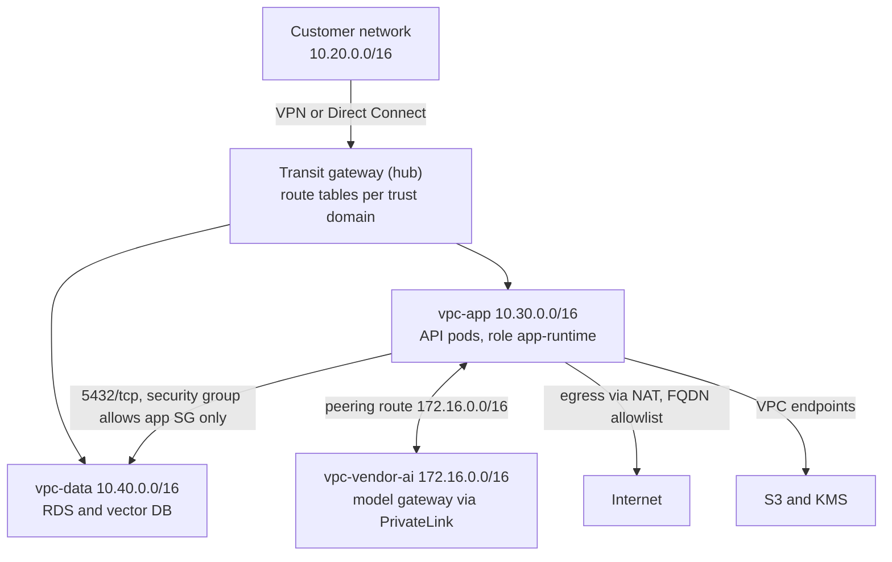
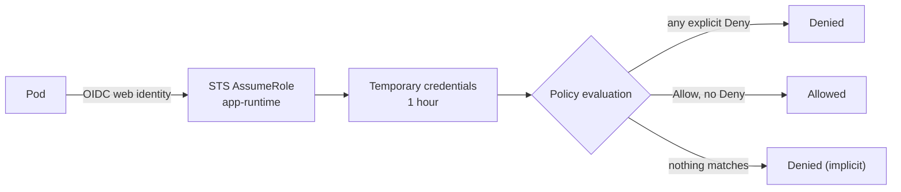

> **Syllabus lessons for this module:** full teaching notes for every topic are in [Syllabus Topic Write-ups](#syllabus-topic-write-ups); the topic-to-code map is in the [Syllabus Coverage Map](#syllabus-coverage-map) and [COVERAGE.md](../../COVERAGE.md).

# Intuition & Mental Model

A cloud network is a set of private rooms (VPCs) with doors (routes) and bouncers (security groups, IAM). Most enterprise AI deployments fail not on the model but on the **plumbing**: "the app in the vendor's VPC can't reach the customer's database," or "the model endpoint is reachable from the internet and the auditor found it."

Three ideas carry 90% of the work:
1. **Routing is longest-prefix-match.** Traffic goes to the most specific route. Peering adds a route; it does not magically connect everything.
2. **Peering is not transitive.** If A peers with B and B peers with C, A cannot reach C through B. Hub-and-spoke needs a transit gateway or explicit peerings.
3. **IAM is deny-by-default and explicit-deny-wins.** Permissions are evaluated as: any matching Deny → denied; else any matching Allow → allowed; else denied. Over-broad wildcards (`s3:*` on `*`) are how data leaks happen.

For a Forward Deployed Engineer this is client-facing: you will sit with a customer network team and must quickly show CIDR overlaps, route paths, and least-privilege roles.

# Production Architecture & Data Flow





Network decision order: route lookup (longest prefix match), then NACL, then security group, then the service's IAM policy, then the resource policy.

# Architectural Trade-Off Matrix

| Approach | Latency | Scalability | Implementation Complexity | Cost |
|---|---|---|---|---|
| **VPC peering (1:1)** | Lowest, no hop through an appliance | Poor at scale: n(n-1)/2 links, non-transitive, no overlapping CIDRs | Low for 2-3 VPCs, painful beyond | Cheapest: data transfer only |
| **Transit Gateway hub-and-spoke** | +~1 ms, one managed hop | Excellent: thousands of attachments, central route tables | Medium | Hourly attachment fee + per-GB processing |
| **PrivateLink / VPC endpoints** | Low; one-directional service exposure | Excellent: allows overlapping CIDRs, consumer sees only one endpoint | Medium | Per-endpoint hourly + per-GB |

# Enterprise War Stories & Edge Cases

**1. Overlapping CIDRs killed a pilot.** A bank's on-prem range `10.0.0.0/8` overlapped the vendor's default `10.0.0.0/16` VPC. Peering was impossible, and renumbering production took 6 weeks. *Remediation:* publish a CIDR plan before kickoff, check overlaps programmatically (as in the lab), default to non-RFC1918-collision ranges (e.g. `100.64/10` or documented slices), and fall back to PrivateLink, which tolerates overlap.

**2. The wildcard role that exported the customer's data lake.** An "AI-pipeline" role had `s3:*` on `*` for convenience. A prompt-injection in a summarizer tool call listed and copied buckets across accounts. *Remediation:* least-privilege per-bucket-prefix policies, explicit Deny on `s3:PutObject` outside approved buckets, permissions boundaries, `aws:SourceVpce` conditions so credentials work only from the endpoint, and access analyzer in CI.

**3. "Peering works, but the DB is unreachable."** The route existed in only one direction; the data VPC's route table lacked the return route and the security group allowed only the peer's CIDR, not the app SG. Packets arrived and replies were dropped. *Remediation:* a checklist of five layers (routes both ways, NACL, SG, DNS resolution over peering, IAM) and a reachability analyzer run in the runbook before escalating.

# Syllabus Topic Write-ups

This module teaches the plumbing that every enterprise AI deployment sits on: virtual machines, object storage, managed databases, serverless functions, private networks, firewalls, identity and access policies, and the billing controls that keep the cost of all of it visible. A Forward Deployed Engineer is usually the person in the room with the customer's network and security teams, so you are expected to read a route table, spot a world-open firewall rule, explain why an IAM policy does nothing, and estimate a monthly bill, often on a whiteboard. The examples use AWS. Command flags, console labels, limits and prices change over time, so treat every snippet as a template and confirm exact syntax, limits and prices against current AWS documentation before running anything on a real account.

**How to study this module**
Read the topics in this order, because later ones build on earlier ones.
1. Topic 5 (VPCs) first. Address ranges and subnets are the vocabulary for everything else.
2. Topic 6 (public vs private routing), then topic 7 (NAT). Together they explain how traffic leaves and enters a network.
3. Topic 8 (security groups). It adds the per-resource firewall on top of routing.
4. Topic 1 (virtual machines) and topic 3 (managed databases). Both are resources you place into the network you now understand.
5. Topic 2 (storage lifecycle) and topic 4 (serverless functions). These are managed services that sit outside your subnets but still need access control.
6. Topics 9, 10 and 11 (least privilege, identity policies, cross-account roles) in that order: principle, then the JSON that implements it, then how it crosses account boundaries.
7. Topics 12 and 13 (billing console, budgets) last. They are the control loop that tells you whether everything above is behaving.

**Module cheat sheet**

| Must-know | One-line answer |
|---|---|
| What makes a subnet public | A route table entry sending `0.0.0.0/0` to an internet gateway, plus a public IP on the instance. The name means nothing. |
| Where the NAT gateway lives | In a public subnet, because it needs its own route to the internet gateway. Private subnets point their default route at it. |
| Security group vs NACL | Security group: stateful, allow-only, attached to a network interface. NACL: stateless, allow and deny, attached to a subnet. |
| Usable addresses in a subnet | Total minus 5 reserved by AWS, so a `/24` gives 251 and a `/28` gives 11. |
| Routing rule | Longest prefix match: the most specific matching route wins. |
| CIDR size | A `/n` block holds 2^(32-n) addresses, so `/16` is 65,536 and `/24` is 256. |
| Peering transitivity | Peering is not transitive. Use a transit gateway for hub-and-spoke. Overlapping CIDRs cannot peer. |
| IAM evaluation | Explicit Deny wins, otherwise an Allow is needed, otherwise implicit deny. Boundaries and SCPs cap what Allows can grant. |
| Cross-account access | Two halves must agree: the trust policy on the target role and an `sts:AssumeRole` permission on the caller. Credentials are temporary. |
| Confused deputy fix | An external ID condition in the trust policy when a third party assumes your role. |
| IMDSv2 | The metadata service requires a session token (`HttpTokens=required`), which blunts SSRF-to-credentials attacks. |
| Multi-AZ vs read replica | Multi-AZ is a synchronous standby for availability. A read replica is asynchronous and for read scaling. |
| Lambda delivery semantics | At-least-once, so handlers must be idempotent and failures need a dead-letter queue. |
| Budgets and billing | Budgets alert but do not stop spend. Billing data lags, and tags appear in reports only after activation as cost allocation tags. |

### 1. Provisioning virtual machines
**What you will be able to do**
- Explain what a virtual machine is and what each launch decision (image, type, subnet, security group, identity, tags) controls.
- Read an instance type name such as `c5.xlarge` and say what it implies.
- Estimate the monthly cost of a fleet by hand and name three ways to lower it.
- Explain IMDSv2 and why requiring it matters, in two minutes, to a non-engineer.
- Spot an unsafe or untagged launch in a Terraform or CLI review.

**Prerequisites**
Basic idea of an IP address and a firewall. Subnets and security groups are taught in topics 5 and 8; you can read this topic first and return for the networking detail.

**The idea from first principles**
Start with the problem. A company wants to run software but does not want to buy, rack and maintain a physical server for every workload. A physical server is usually too big for one application, takes weeks to procure, and sits idle most of the time. Virtualization solves this by letting software called a hypervisor split one physical machine into several isolated virtual machines (VMs), each of which believes it owns a whole computer with its own CPU, memory, disk and network card. A cloud provider runs millions of these slices and rents them by the second.

An everyday analogy is an apartment building. The building (physical host) is shared, each apartment (VM) has its own lock and utilities meter, and you rent only what you need. You can move out and the apartment is cleaned and re-let. The analogy also shows the risks: a noisy neighbour can affect you on some instance types, and if you leave the door unlocked (a bad firewall rule) strangers walk in.

On AWS a VM is an EC2 instance. Define the terms precisely. An AMI (Amazon Machine Image) is a template holding a root disk snapshot, which contains the operating system and any pre-installed software, plus launch settings. An instance type is a named bundle of virtual CPUs, memory, network bandwidth and storage options. A subnet is a slice of your private network in one availability zone (a physically separate data center within a region), and placing the instance in a subnet decides which network and zone it lives in. A security group is a firewall attached to the instance. An instance profile wraps an IAM role so that software on the instance can call AWS APIs with temporary credentials. Tags are key-value labels.

The naive approach is to click through the console, pick whatever looks right, and open every port to make it work. It fails in three ways. It is not repeatable, so the next engineer cannot recreate the machine. It is not reviewable, so nobody checks for unsafe choices before launch. And it produces anonymous resources: months later a finance review finds 40 running instances and nobody can say whose they are. The real approach is to treat the launch as code (Terraform, CloudFormation or a CLI script in version control), with guardrails that make unsafe choices impossible.

**How it works, step by step**
1. Choose the AMI. Prefer an image your organization builds and patches, with agents (monitoring, session access) pre-installed. A random public image might contain anything. Image IDs are region-specific.
2. Choose the instance type. In `c5.xlarge`, `c` is the family (compute optimized), `5` the generation, `xlarge` the size. Other common families are `m` (general purpose, balanced CPU to memory), `r` (memory optimized), `g` and `p` (GPU). Size doubles roughly with each step: `large`, `xlarge`, `2xlarge`. Start from measured load, not guesses.
3. Choose placement. The subnet fixes the zone and network. Whether the instance receives a public IP depends on the subnet's auto-assign setting, and whether that IP is usable depends on the subnet's route table (topic 6).
4. Attach security groups. They are stateful allow-lists (topic 8). A new instance should accept traffic only from the sources it needs.
5. Attach an instance profile so the software gets short-lived credentials from the instance metadata service (IMDS), a local HTTP endpoint at `169.254.169.254`. Never place long-lived access keys on the machine.
6. Set metadata options. IMDSv1 answers any plain GET request. IMDSv2 first requires a PUT request to obtain a session token with a time to live, then requires that token in a header on each read. A typical server-side request forgery (SSRF) bug, where an attacker tricks the application into fetching a URL of the attacker's choice, usually can only issue a simple GET, so it cannot obtain the token and cannot steal the role credentials.
7. Choose storage. The root disk (an EBS volume) should be encrypted. Data that must outlive the instance belongs on a separate volume or in a managed service, since instance storage can vanish when the instance stops.
8. Tag and launch. Tags such as `owner` and `cost-center` feed cost reports (topic 12) and access policies.

Worked cost calculation using an illustrative rate of 0.17 USD per hour (not a quote). A month has about 730 hours (8,760 hours in a year divided by 12). One instance running all month costs 0.17 x 730 = 124.10 USD. A fleet of 12 costs 12 x 124.10 = 1,489.20 USD. If a commitment discount of 30 percent applies to the steady portion (an example figure), the same fleet costs 1,489.20 x 0.70 = 1,042.44 USD. If an engineer forgets 10 test instances for a quarter, that is 10 x 124.10 x 3 = 3,723 USD of waste. Each lever is real: right-size (smaller type), commit (Savings Plans or Reserved Instances for steady use), use spot capacity for interruptible work, and stop what is idle.

**Worked example 1: small and hand-traceable**
Trace the IMDSv2 exchange on a running instance, line by line.

```bash
TOKEN=$(curl -s -X PUT "http://169.254.169.254/latest/api/token" \
  -H "X-aws-ec2-metadata-token-ttl-seconds: 21600")
curl -s -H "X-aws-ec2-metadata-token: $TOKEN" \
  http://169.254.169.254/latest/meta-data/instance-id
```

State 1: the first request is a PUT with a TTL header. The metadata service returns a random token string and remembers it for 21,600 seconds (6 hours). State 2: the second request is a GET carrying that token in a header, and the service answers with the instance ID. If the token header is missing and `HttpTokens=required`, the service returns an authorization error. Now picture the attack: an app has a bug that fetches any URL a user supplies. The attacker supplies `http://169.254.169.254/latest/meta-data/iam/security-credentials/`. Under IMDSv1 the GET succeeds and leaks credentials. Under IMDSv2 the plain GET has no token and fails, and the attacker cannot make the app send a PUT with a custom header through this bug. That is the whole protection, and it is why it is cheap and worth requiring everywhere.

**Worked example 2: enterprise scenario**
An insurer runs a claims-document parser on a small EC2 fleet in a private subnet. The platform team defines it in Terraform so every launch has the same guardrails.

```hcl
resource "aws_instance" "parser" {
  ami                    = var.hardened_ami_id
  instance_type          = "c5.xlarge"
  subnet_id              = var.private_app_subnet_id
  vpc_security_group_ids = [var.parser_sg_id]
  iam_instance_profile   = var.parser_profile_name
  metadata_options {
    http_tokens   = "required"
    http_endpoint = "enabled"
  }
  root_block_device { encrypted = true }
  tags = { owner = "claims-platform", "cost-center" = "cc-42" }
}
```

Commentary. `subnet_id` pins the machine to a private subnet, so it has no public IP by default. `metadata_options` forces IMDSv2. `iam_instance_profile` gives the parser read access to one claims bucket and nothing else. `encrypted = true` protects the disk at rest. The tags make the instance attributable. A weekly audit finds anything missing an owner:

```bash
aws ec2 describe-instances --filters "Name=instance-state-name,Values=running" \
  --query 'Reservations[].Instances[].[InstanceId,Tags[?Key==`owner`]|[0].Value]' \
  --output text
```

Rows where the second column is `None` are untagged. In real estates this check usually runs on a schedule and opens a ticket, and an organization-level policy blocks launches without the required tags. For high availability the team would not launch a single instance; it would use a launch template with an auto scaling group spanning subnets in two or more zones behind a load balancer, with health checks replacing failed machines.

**Hands-on practice**
Exercise 1 (easy): `r5.2xlarge` costs 0.50 USD per hour in an example price list. What is the monthly cost for 3 instances at 730 hours?
Solution: one instance is 0.50 x 730 = 365 USD. Three is 3 x 365 = 1,095 USD per month.

Exercise 2 (medium): A review finds an instance with `HttpTokens=optional` that runs a web app which fetches user-supplied image URLs. Explain the risk and give the fix.
Solution: The app has an SSRF exposure. An attacker can make it request the metadata service, and with IMDSv1 enabled that returns the role's temporary credentials, which the attacker can use from outside. Fix: set `HttpTokens=required` (use `aws ec2 modify-instance-metadata-options --instance-id i-... --http-tokens required`), reduce the role's permissions to the minimum, validate and restrict URLs the app may fetch (block link-local addresses), and consider setting the hop limit to 1 so containers cannot proxy requests.

Exercise 3 (hard): Design the launch for a stateless API tier that must survive a zone outage and handle traffic that varies 5x through the day. State the pieces and one cost control.
Solution: a launch template (AMI, type, profile, IMDSv2, tags), an auto scaling group with minimum 2 and a maximum that covers peak, spanning private subnets in two zones, behind an application load balancer in public subnets with health checks, security groups where the app accepts traffic only from the load balancer group, scaling on a metric such as average CPU or requests per target. Cost control: run the baseline on committed capacity (Savings Plan) and the variable portion on on-demand or spot, with a budget alert (topic 13).

**Alternatives and trade-offs**

| Option | Control | Latency | Cost model | Operational burden | Choose when |
|---|---|---|---|---|---|
| EC2 VM | Full OS control | Always warm | Pay while running | You patch, scale and secure | Special software, GPUs, steady long-running services |
| Containers (ECS/EKS) | Process level | Fast scheduling | Better packing of many services | Cluster to operate | Many small services |
| Lambda | Code only | Cold starts | Pay per call | Lowest | Short, bursty work |
| Managed service (RDS, etc.) | Configuration | Warm | Premium over raw VM | Lowest | When a managed version exists |

A VM is the wrong tool when a managed service already does the job (do not hand-run a database on EC2 without a reason) or when the work is short and spiky enough that idle capacity dominates the bill.

**Where it goes wrong in production**
- Untagged sprawl. Symptom: the bill grows and nobody claims it. Cause: tags optional at launch. Diagnose: group Cost Explorer by tag and look at the untagged bucket. Fix: require tags with policy and a launch template, and report tag coverage weekly.
- Credential theft via IMDSv1. Symptom: API calls from unknown IPs using an instance role. Cause: SSRF plus optional tokens. Diagnose: CloudTrail shows the role used from outside AWS. Fix: require IMDSv2, rotate by terminating the instance, shrink the role.
- Snowflake servers. Symptom: nobody dares reboot a machine. Cause: manual configuration. Diagnose: no code or image reproduces it. Fix: bake images and launch from code.
- Wrong subnet. Symptom: a "private" machine answers on the internet. Cause: public subnet plus public IP. Diagnose: describe the instance for a public IP and check the route table. Fix: pin the subnet in code and review route tables.
- Capacity errors at launch. Symptom: an insufficient capacity error for a specific type in a zone. Cause: the zone has run out. Diagnose: retry another zone or type. Fix: allow several instance types and zones in the auto scaling group.

**Do not confuse**
An AMI and an instance: the AMI is the template, the instance is a running copy. Stopping and terminating: stopping keeps the root volume and can restart, terminating deletes the instance and, by default, its root volume. Instance profile and IAM role: the role holds permissions, the profile is the wrapper that attaches it to an instance.

**How interviewers probe this**
1. What decisions go into launching an EC2 instance?
2. What is IMDSv2 and why require it?
3. How does an instance get S3 access without stored keys?
4. How would you stop untagged instances from appearing at all?
5. How would you cut the cost of a steady 50-instance fleet?
6. Design: an API tier that survives a zone failure and scales with load.
7. What breaks when an instance has a public IP but cannot be reached?
8. Trap: "Is a bigger instance always safer for performance?"

**Model answer (60-90 seconds)**
"A VM is a virtualized computer rented from a shared physical host. On AWS, launching one means choosing an image, an instance type, a subnet, security groups, storage, an instance profile for identity, and tags. I define it in Terraform so every launch is reviewable and repeatable. Three controls matter most to me. First, IMDSv2 required, so the metadata service needs a session token and an SSRF bug cannot easily steal role credentials. Second, an IAM role with least privilege instead of stored keys. Third, mandatory owner and cost-center tags so finance can attribute spend. The trade-off is control against effort: a VM gives me full OS control, but I patch and scale it, so for bursty or small workloads I would prefer containers or functions. For a claims parser I would use a private subnet, no public IP, an encrypted disk and an auto scaling group across two zones. The limit is that a single instance is a single point of failure, so I never run one alone in production."

**Quick-fire answers**
- Q: What decisions go into a launch? A: Image, instance type, subnet, security groups, disk, instance profile, metadata options and tags. Each controls a different risk: software, capacity, network, firewall, persistence, identity, credential safety and cost attribution.
- Q: What is IMDSv2? A: A session-token metadata service. Callers do a PUT to get a token and send it in a header, which blocks the simple GET an SSRF bug can usually make. Require it with `HttpTokens=required`.
- Q: S3 access without keys? A: Attach an instance profile with a role scoped to the bucket. The SDK fetches temporary credentials from the metadata service and refreshes them automatically.
- Q: Preventing untagged instances? A: Enforce required tags through launch templates and organization policy conditions, and audit coverage regularly. Detective checks alone leave a gap.
- Q: Cutting the cost of 50 steady instances? A: Right-size from utilization data, cover the steady base with Savings Plans or Reserved Instances, move interruptible work to spot, and turn off idle machines.
- Q: Zone-resilient API tier? A: Launch template, auto scaling group across two or more zones, a load balancer with health checks, and an app security group that trusts only the load balancer.
- Q: Public IP but unreachable? A: Check the route to an internet gateway, the security group, the NACL and the OS firewall. A public IP alone does nothing.
- Q: Bigger instance always better? A: No. It costs more and may not help if the bottleneck is I/O, a database or a single thread. Measure first and scale the actual constraint.

**Recap in five lines**
- A VM launch is eight decisions: image, type, placement, firewall, identity, metadata options, storage, tags.
- Launch from code and require IMDSv2, an encrypted disk, a least-privilege role and tags.
- Monthly cost is hourly rate x about 730; levers are right-sizing, commitments, spot and shutting down idle capacity.
- Never rely on one instance: use an auto scaling group across zones.
- Prefer managed services or functions when they fit, because a VM brings patching and scaling work.


### 2. Object storage lifecycle policies
**What you will be able to do**
- Explain what object storage is and how it differs from a disk or a database.
- Write a lifecycle rule that transitions and expires data, including the often-forgotten multipart and noncurrent-version cases.
- Compute by hand whether a transition saves or loses money, including minimum storage duration effects.
- Design a retention scheme for data with different legal retention periods.

**Prerequisites**
Basic idea of files and cost per gigabyte. Topic 12 (billing) shows how to see storage cost by service; topic 10 covers the bucket policies that protect the data.

**The idea from first principles**
Start with the problem. Applications generate data that is very valuable on day one and almost never read after a few months: logs, exports, backups, scanned documents. Keeping all of it on fast storage costs money forever, and deleting it by hand is a chore nobody owns. Like a warehouse, you keep today's shipments by the door and move older stock to the back shelves, and eventually you throw some away. A lifecycle policy automates that movement.

Object storage (Amazon S3) stores data as objects, each made of the bytes, a key (its name, such as `logs/2026/10/app.log`) and metadata, inside a bucket. There are no folders in a real sense; a prefix is just the start of a key. You cannot edit part of an object, you replace it whole. It scales to enormous sizes and is designed for very high durability, which is why it is the default home for logs, backups and data lakes.

Storage classes trade price per gigabyte stored against price and speed of reading. From hot to cold: Standard (frequent access), Standard-IA (infrequent access, cheaper to store, with a per-GB retrieval fee), Glacier Instant Retrieval, Glacier Flexible Retrieval and Deep Archive (cheapest to store, with retrieval taking minutes to hours and fees). Colder classes also usually carry a minimum storage duration, a billing floor, and a minimum billable object size. Verify current classes and numbers in the AWS documentation.

The naive approach is to leave everything in Standard and delete manually. It fails because storage only grows, so cost grows linearly forever, and because manual cleanup scripts are forgotten or run with the wrong filter. The lifecycle policy approach moves the decision to a declarative rule attached to the bucket, which the platform executes for you.

**How it works, step by step**
1. A lifecycle configuration is a list of rules on a bucket. Each rule has an ID, a status (Enabled or Disabled), a filter and one or more actions.
2. The filter selects objects by key prefix, by object tags, by object size, or by a combination. An empty filter selects the whole bucket.
3. Actions include: transition to another storage class after N days; expire (delete) the current version after N days; transition or expire noncurrent versions (old versions in a versioned bucket) after N days; delete expired delete markers; abort incomplete multipart uploads after N days from initiation.
4. The clock is the object's age counted from its creation (or, for noncurrent versions, from the moment it became noncurrent). S3 evaluates rules asynchronously in the background, so actions take effect around the due date rather than at an exact second, and you are not billed for the cold class until the transition occurs.
5. Transitions only go colder. Moving from Standard to Standard-IA needs the object to be at least 30 days old. Transitions must be ordered in time: if the rule says Glacier at day 90, an IA step must come before it.
6. Expiration on an unversioned bucket deletes the object permanently. On a versioned bucket it inserts a delete marker and the previous version becomes noncurrent; a separate noncurrent-version rule is what finally removes the bytes.
7. A multipart upload is how large objects are uploaded in parts. If it is never completed, the parts remain, invisible in normal listings, and are billed. An abort rule cleans them up.

Worked calculation with example price ratios. Suppose a cold class costs one fifth of Standard per GB-month, and measure in "units" where 1 TB in Standard for 1 month is 1 unit. Keeping 1 TB for 12 months in Standard costs 12 units. A rule that holds it 1 month in Standard and then transitions costs 1 + 11 x (1/5) = 1 + 2.2 = 3.2 units, a saving of (12 - 3.2) / 12 = 73 percent. Now add a minimum duration of 90 days in the cold class. An object that transitions at day 30 and is deleted at day 45 is billed 30 days Standard plus the full 90 days cold: in units of 1 TB, 1 + 3 x 0.2 = 1.6 units, against 1.5 units had it simply stayed in Standard for 45 days. The transition lost money. The rule of thumb is that data must live long enough in the cold class to amortize the floor and the transition request fee.

**Worked example 1: small and hand-traceable**
A bucket has one rule: prefix `tmp/`, expire after 7 days, and another rule: prefix `logs/`, transition to Standard-IA at day 30, expire at day 90. Trace three objects.

State at day 0: `tmp/a.csv` (created day 0), `logs/app1.log` (created day 0), `logs/app2.log` (created day 40), all in Standard. At day 8, `tmp/a.csv` is older than 7 days, so it is deleted (it is eligible from day 7). At day 31, `logs/app1.log` is 31 days old, so it moves to Standard-IA. `logs/app2.log` is only 0 days old at day 40 (it was just created) and 31 days old at day 71, when it also transitions. At day 90 and later, `logs/app1.log` is 90 days old and expires, while `logs/app2.log` expires at day 130. Notice that app1 spent 60 days (day 30 to 90) in IA, which clears the 30-day minimum, so the transition was worthwhile. Had the expiry been at day 45, the 30-day floor would still apply for the 15 days, a small loss.

**Worked example 2: enterprise scenario**
A hospital network ships application and audit logs to S3. Compliance requires 7 years for audit logs but only 90 days for debug logs. Versioning is on. The team writes three rules and aborts stale multipart uploads.

```json
{"Rules":[
 {"ID":"debug-logs","Status":"Enabled","Filter":{"Prefix":"logs/debug/"},
  "Expiration":{"Days":90},
  "NoncurrentVersionExpiration":{"NoncurrentDays":7},
  "AbortIncompleteMultipartUpload":{"DaysAfterInitiation":7}},
 {"ID":"audit-logs","Status":"Enabled","Filter":{"Prefix":"logs/audit/"},
  "Transitions":[{"Days":30,"StorageClass":"STANDARD_IA"},
                 {"Days":180,"StorageClass":"GLACIER"}],
  "Expiration":{"Days":2555}}]}
```

Apply it with `aws s3api put-bucket-lifecycle-configuration --bucket hospital-logs --lifecycle-configuration file://lifecycle.json`. Commentary. The debug rule expires current versions at 90 days and removes old versions a week after they become noncurrent, so versioning does not silently double the bill. The audit rule keeps the first 30 days hot for incident investigation, moves to infrequent access, then archives at 180 days. `2555` days is about 7 years (7 x 365 = 2,555, ignoring leap days, so Legal should confirm the real requirement). A lifecycle rule is not a legal hold: for mandated retention, pair it with Object Lock (WORM, write once read many) and bucket versioning so that nobody, including an administrator, can delete audit records early. Always test a new expiration rule on a copy or a narrow prefix first, because deletions cannot be undone without versioning.

**Hands-on practice**
Exercise 1 (easy): A teammate writes a rule that moves objects from Standard to Standard-IA after 10 days. Will it work?
Solution: No. Moving from Standard to Standard-IA requires the object to be at least 30 days old, so the rule is rejected. The practical habit is to look up the current minimums for each class before choosing day counts.

Exercise 2 (medium): 200 TB of logs, each object is read for 14 days and rarely after. Cold class is one quarter of Standard price. Compare keeping everything for 12 months in Standard against transitioning at day 30. Ignore requests and retrieval.
Solution: Treat data as a steady 200 TB. Standard for 12 months is 200 x 12 = 2,400 TB-months at price 1.0 = 2,400 units. With the rule: 1 month Standard (200 units) plus 11 months cold at 0.25 each (200 x 11 x 0.25 = 550 units) = 750 units. Saving 1,650 units, about 69 percent. Check retrieval needs before committing.

Exercise 3 (hard): Design retention for three datasets: debug logs (30 days), financial audit records (7 years, immutable), and ML training snapshots (rarely read, keep 2 years, may be needed within 24 hours).
Solution: Use three prefixes or separate buckets. Debug: expire at 30 days, abort multipart at 7, noncurrent expire at 7. Financial: Object Lock in compliance mode for 7 years, transition to a cold archive class after the active window, no expiration before 7 years, restricted bucket policy and MFA delete discipline. Training snapshots: transition to Glacier Flexible or Deep Archive after 30 days if a retrieval time within hours is acceptable (Deep Archive standard retrieval is measured in hours; verify), expire at 730 days. Document each rule with its owner and legal basis.

**Alternatives and trade-offs**

| Option | Cost | Complexity | Risk | Choose when |
|---|---|---|---|---|
| Lifecycle rules | Free to configure, small request fees | Low | Wrong day counts, accidental deletion | Access decays predictably with age |
| Intelligent-Tiering | Per-object monitoring fee | Very low | Poor fit for tiny or short-lived objects | Access pattern unknown or changing |
| Manual or scripted cleanup | Engineer time | High | Forgotten, error-prone | Rarely |
| Delete at the source (shorter log retention) | Cheapest | Low | Loss of evidence | When the data has no value past N days |

Lifecycle is the wrong tool when objects are small and numerous (request and minimum-size charges dominate), when access is unpredictable, or when you need to guarantee immutability rather than automate cleanup.

**Where it goes wrong in production**
- Surprise deletion. Symptom: an application cannot find recent files. Cause: an expiration filter matched the wrong prefix or an empty filter matched the whole bucket. Diagnose: read the lifecycle JSON and check S3 access logs. Fix: restore from versions, narrow filters, enable versioning, and review rule changes in code review.
- Retrieval bill shock. Symptom: a spike in storage line items after an analytics run. Cause: queries scanned archived data. Diagnose: Cost Explorer by usage type. Fix: align transition ages with access and keep queryable data hot.
- Minimum duration charges. Symptom: cold storage costs more than expected. Cause: short-lived objects were transitioned. Fix: expire before transition or leave in Standard.
- Invisible spend. Symptom: bucket cost does not match visible object sizes. Cause: incomplete multipart uploads and noncurrent versions. Diagnose: storage lens or list multipart uploads. Fix: abort and noncurrent expiration rules.
- Request-fee explosion. Symptom: large transition charges on a bucket with billions of tiny files. Cause: per-object request pricing. Fix: batch small files into larger archives and use size filters.

**Do not confuse**
Expiration and transition: expiration deletes, transition only changes the storage class. Versioning and lifecycle: versioning keeps old copies, lifecycle decides when to move or remove them. Lifecycle and Object Lock: lifecycle automates cost, Object Lock prevents deletion.

**How interviewers probe this**
1. What is a lifecycle policy and what actions can it take?
2. What are minimum storage durations and why do they matter?
3. How do versioning and delete markers interact with expiration?
4. How would you cut storage cost for a 500 TB log bucket?
5. Design retention for data with 90-day and 7-year requirements.
6. What breaks when a rule is applied to the wrong prefix or an empty filter?
7. How do you recover data a rule deleted?
8. Trap: "Does a lifecycle expiration meet our seven-year retention obligation?"

**Model answer (60-90 seconds)**
"A lifecycle policy is a bucket-level set of rules that moves objects to cheaper storage classes or deletes them as they age. I select objects by prefix, tag or size and set transitions and an expiration, and S3 applies them in the background. The trade-off is cost against access: colder classes cost less per GB but add retrieval fees, minimum storage durations and per-object request charges, so short-lived or frequently read data should stay hot. I also add rules to abort incomplete multipart uploads and to expire noncurrent versions, because both bill silently. For a hospital's logs I would keep debug logs 90 days, move audit logs to infrequent access at 30 days and archive at 180, and protect audit records with Object Lock, since lifecycle only automates cost and does not enforce retention. The limit is that rules are evaluated asynchronously and deletions are irreversible without versioning, so I test on a narrow prefix first and confirm all numbers against current AWS documentation."

**Quick-fire answers**
- Q: What can a rule do? A: Transition to colder classes, expire current versions, transition or expire noncurrent versions, remove expired delete markers, and abort incomplete multipart uploads. Selection is by prefix, tag or size.
- Q: Why do minimum durations matter? A: Deleting early still bills for the minimum, so short-lived objects can cost more in cold classes than in Standard. Pick transition ages longer than the floor.
- Q: Versioned bucket expiration? A: Expiration adds a delete marker and the old version becomes noncurrent. A noncurrent-version rule removes the bytes permanently.
- Q: Cutting a 500 TB log bucket? A: Measure access patterns, transition aged logs to colder classes, expire what policy allows, abort stale uploads, and consider compression and batching small files.
- Q: 90-day and 7-year requirements? A: Separate prefixes or buckets with separate rules, plus Object Lock for the 7-year data so it cannot be deleted early.
- Q: Wrong prefix? A: Data is deleted or archived unexpectedly. Mitigate with versioning, filter review and staged rollout, and restore from noncurrent versions.
- Q: Recovering deleted data? A: If versioning was on, remove the delete marker or restore the noncurrent version. Without versioning, only backups or replication help.
- Q: Does expiration meet retention? A: No. Expiration deletes at a date; retention needs enforcement such as Object Lock and a policy Legal approved. Lifecycle is a cost tool.

**Recap in five lines**
- Lifecycle rules automate moving objects to cheaper classes and deleting them by age.
- Transitions go only colder; colder classes bring retrieval fees and minimum storage durations.
- Always add rules for incomplete multipart uploads and noncurrent versions.
- Savings come from the ratio of price and time spent cold; short-lived objects can lose money.
- Retention obligations need Object Lock and legal sign-off, not just a rule.

### 3. Managed relational databases setup
**What you will be able to do**
- Explain what a managed relational database does for you and what remains your job.
- Choose and justify settings: Multi-AZ, encryption, backups, subnet group, access.
- Size connection limits by hand and decide when a pooler is needed.
- Distinguish Multi-AZ from read replicas and explain what happens during a failover.
- Run the audit command that finds unsafe databases in an account.

**Prerequisites**
VPCs and subnets (topic 5), security groups (topic 8). Basic SQL knowledge helps but is not required.

**The idea from first principles**
Start with the problem. Business data, such as orders or loans, must be stored so that it is correct, queryable and never lost. A relational database stores data in tables with rules (schema, constraints) and answers questions in SQL. Running one yourself means you must install it, tune it, patch it, back it up, copy it to a standby, monitor disk space and handle a failed disk at 2 a.m. Think of owning a car versus using a taxi service: with the car you do the servicing; with the taxi you tell the driver where to go. A managed database is closer to a leased car with a maintenance contract: you still decide where to drive, but the provider does the servicing.

Amazon RDS runs engines such as PostgreSQL, MySQL, MariaDB, Oracle and SQL Server on instances the provider operates. The provider handles operating system and engine patching in maintenance windows, automated backups, standby replication and failover, and basic monitoring. You still own the schema, indexes, query performance, capacity decisions, access control and the application's behaviour when a failover happens. Define a few terms. An availability zone (AZ) is a physically separate data center in a region. Failover is switching from a failed primary to a standby. RPO (recovery point objective) is how much data you can afford to lose, and RTO (recovery time objective) is how long you can afford to be down.

The naive approach is a single database instance in a public subnet with a simple password and no backups, because it is the fastest way to get an app working. It fails on every axis: a disk or zone failure means downtime and data loss, an internet-reachable port invites attacks, and a bad migration cannot be undone. The managed setup replaces those with private networking, Multi-AZ, encryption and tested recovery.

**How it works, step by step**
1. Network placement. Create a DB subnet group, a named list of private subnets in at least two zones. The instance receives an endpoint DNS name resolving to a private address.
2. Access control. The instance's security group allows the database port (5432 for PostgreSQL, 3306 for MySQL) only from the application's security group. Mark the instance not publicly accessible.
3. Encryption. Encryption at rest uses a KMS key and must be chosen at creation. To encrypt an existing unencrypted instance you snapshot it, copy the snapshot with encryption, and restore, which implies a cutover. Enforce encryption in transit through a parameter group setting that requires TLS.
4. Multi-AZ. The primary writes to storage and replicates synchronously to a standby in another zone, meaning a write is acknowledged only after both have it. On failure, the provider promotes the standby and updates the endpoint's DNS record, typically in one to two minutes (illustrative). The application must reconnect and must not cache DNS indefinitely.
5. Backups. Automated backups take a daily snapshot and archive transaction logs, which enables point-in-time recovery (PITR) to any second within the retention period (up to 35 days, a documented maximum; verify). A restore always creates a new instance.
6. Read replicas. These are separate instances replicating asynchronously, meaning the primary does not wait. They offload reads but can lag behind, so they are for reporting and tolerant reads. They are not the availability mechanism.
7. Credentials. Using the managed master password option lets the service store and rotate the admin secret in Secrets Manager, so passwords never sit in shell history or code.
8. Connections. Each database connection uses memory on the server. Capacity check: 40 pods x pool of 10 connections = 400 connections. If `max_connections` is 300, 100 connection attempts fail at peak. Fixes are smaller pools, a larger instance, or a connection pooler such as RDS Proxy or PgBouncer.

Worked RPO and cost calculation. With Multi-AZ synchronous replication the RPO for an instance failure is effectively zero (committed transactions exist on the standby), and the RTO is the failover time, about 90 seconds in this example. With PITR the RPO for a human error is limited by log archiving, commonly within about five minutes (verify). Cost: a db.m5.large at an illustrative 0.18 USD per hour is 0.18 x 730 = 131.40 USD per month single-AZ, and Multi-AZ roughly doubles compute to 262.80 USD, plus storage and backup beyond the free allotment.

**Worked example 1: small and hand-traceable**
Trace a failover. State 0: clients connect to `loans.abc123.us-east-1.rds.amazonaws.com`, which resolves to the primary in zone a; the standby in zone b is in sync. Step 1: at 14:00:00 the primary host fails. Step 2: the monitoring system detects the failure, which takes some seconds. Step 3: the standby in zone b is promoted to primary. Step 4: the endpoint's DNS record now points to zone b's address, with a short TTL. Step 5: clients with open connections see errors and must reconnect; a client that cached the old address for 10 minutes keeps failing for 10 minutes. State 1: at about 14:01:30 new connections succeed. Any transaction that was in flight and not committed was rolled back and must be retried by the app. This trace shows why retry with backoff and low DNS caching belong in the client.

**Worked example 2: enterprise scenario**
A bank's loan-origination service needs a PostgreSQL database with no public exposure, encryption, and two weeks of recovery.

```bash
aws rds create-db-instance --db-instance-identifier loans-prod \
  --engine postgres --db-instance-class db.m5.large --allocated-storage 200 \
  --master-username app_admin --manage-master-user-password \
  --storage-encrypted --multi-az --no-publicly-accessible --deletion-protection \
  --backup-retention-period 14 --db-subnet-group-name private-db-subnets \
  --vpc-security-group-ids sg-0a1b2c3d

aws rds describe-db-instances --query \
 'DBInstances[].[DBInstanceIdentifier,MultiAZ,PubliclyAccessible,StorageEncrypted,BackupRetentionPeriod]' \
 --output table
```

Commentary. `--manage-master-user-password` keeps the admin password out of the command and the team's history. `--no-publicly-accessible` and the private subnet group remove internet reachability. `--deletion-protection` blocks accidental deletion. `--backup-retention-period 14` gives 14 days of PITR. The second command is the fleet audit: any row showing `False` for Multi-AZ in production, `True` for public access, `False` for encryption or `0` for retention is a finding. For forced TLS, set the parameter group's force-SSL parameter (for PostgreSQL, `rds.force_ssl`; verify the name for your engine). To recover from a bad migration at 14:05 use `aws rds restore-db-instance-to-point-in-time --source-db-instance-identifier loans-prod --target-db-instance-identifier loans-restore --restore-time 2026-10-24T14:04:00Z` and then copy the needed data from the new instance or repoint the application after validation.

**Hands-on practice**
Exercise 1 (easy): An audit shows `MultiAZ=False, PubliclyAccessible=True` on a production database. State the two risks.
Solution: No Multi-AZ means a zone or host failure causes downtime until a manual restore. Public accessibility means the endpoint resolves to a public address and, if the security group is loose, it is attackable. Fix both: enable Multi-AZ, disable public access, and restrict the security group to the app group.

Exercise 2 (medium): 60 pods each with a pool of 8 connections; the DB `max_connections` is 400, and you plan to scale to 100 pods. Is it safe?
Solution: now 60 x 8 = 480, already above 400, so errors occur. At 100 pods, 800. Options: reduce pool size (a pool of 4 gives 400 at 100 pods, but leaves no headroom for admin or other clients), use a pooler to multiplex many client connections onto fewer server connections, or choose a larger instance with a higher limit. A pooler is the usual answer.

Exercise 3 (hard): Design the database layer for a regulated app with RPO of zero for instance failures, RTO under 5 minutes, and a requirement to recover from user error within the last 7 days.
Solution: Multi-AZ RDS (synchronous standby gives RPO zero for host or zone failure; DNS failover gives an RTO of a minute or two), backup retention of at least 7 days (14 is safer) for PITR against user error, deletion protection, encryption with a managed key, private subnets, SG-to-SG access, a pooler, alarms on replication, storage and connections, plus a quarterly restore drill. Consider a cross-region snapshot copy if a regional disaster is in scope.

**Alternatives and trade-offs**

| Option | Availability | Scale | Complexity | Cost | Choose when |
|---|---|---|---|---|---|
| RDS Multi-AZ | High, automatic failover | Vertical plus read replicas | Low | About 2x single-AZ compute | Standard transactional workloads |
| Aurora | Higher, storage replicated across zones | Better read scaling | Medium | Higher, I/O pricing varies | Large or spiky workloads |
| Self-managed on EC2 | You build it | Anything | High | Cheap hardware, costly people | Unsupported engine or extension |
| DynamoDB | Very high | Horizontal | Different data model | Pay per request | Key-value access at huge scale |

A managed relational database is the wrong tool for huge write-heavy key-value traffic, for analytics over terabytes (use a warehouse), or for extensions the service does not allow.

**Where it goes wrong in production**
- Connection exhaustion. Symptom: "too many connections" during a scale-out. Cause: pods times pool size exceeds the limit. Diagnose: the connections metric against the max. Fix: pooler, smaller pools, larger instance.
- Public exposure. Symptom: an audit or scan reports an open database endpoint. Cause: public flag or world-open security group. Diagnose: describe-instances plus security group review. Fix: private subnets, SG on app group only.
- Failover pain. Symptom: errors for minutes after a failover. Cause: cached DNS or no retry logic. Diagnose: client logs. Fix: retries with backoff, short DNS caching, game-day tests.
- Accidental deletion or bad migration. Symptom: missing data. Cause: no deletion protection, long untested migrations. Fix: deletion protection, PITR, test migrations on a restored copy.
- Disk full. Symptom: writes fail. Cause: no storage autoscaling or alarm. Fix: enable storage autoscaling and free-space alarms.

**Do not confuse**
Multi-AZ and read replica: Multi-AZ is a synchronous standby for failover and is not readable in the standard instance setup; a read replica is asynchronous and serves reads. Backup and replica: a replica copies mistakes instantly, a backup lets you go back in time.

**How interviewers probe this**
1. What does a managed database do for you, and what is still your job?
2. Multi-AZ versus read replica?
3. How does point-in-time recovery work?
4. How do you stop clients from connecting without TLS?
5. How would you size connections for 100 pods?
6. Design a highly available, private database for a regulated app.
7. What breaks during a failover, and how do you make the app survive it?
8. Trap: "We have Multi-AZ, so we do not need backups, right?"

**Model answer (60-90 seconds)**
"RDS is a managed relational database: AWS patches, backs up and fails over, while I own schema, queries, capacity and access. For production I use Multi-AZ, which keeps a synchronous standby in another zone and flips DNS if the primary fails, so no committed data is lost and recovery takes a minute or two. Read replicas are different: they are asynchronous and exist to scale reads. I put the database in private subnets, allow the port only from the app security group, encrypt at rest, force TLS through the parameter group, keep seven to fourteen days of backups for point-in-time recovery, and turn on deletion protection. Trade-offs are cost, roughly double compute for Multi-AZ, and connection limits, so I add a pooler. The limit is that failover is not instant and the app must reconnect, so I test it before go-live."

**Quick-fire answers**
- Q: What stays your job? A: Schema, queries, indexes, capacity planning, access control and the application's retry behaviour. The provider handles patching, backups and failover mechanics.
- Q: Multi-AZ vs replica? A: Multi-AZ is a synchronous standby for availability. A replica is asynchronous for read scaling and can lag, though it can be promoted in a disaster.
- Q: PITR? A: Daily snapshots plus archived transaction logs let you restore to a chosen second within retention, always into a new instance.
- Q: Enforce TLS? A: Set the engine's require-SSL parameter in the parameter group and require TLS in client connection strings.
- Q: Sizing for 100 pods? A: Multiply pods by pool size and compare with `max_connections`. If it exceeds the limit, shrink pools or add a pooler.
- Q: HA regulated design? A: Private subnets across two zones, Multi-AZ, encryption, SG-to-SG access, 7 to 14 days of backups, audit logging and restore drills.
- Q: Failover breakage? A: Open connections drop and cached DNS points at the old host. Clients need reconnect with backoff and low DNS caching.
- Q: Multi-AZ replaces backups? A: No. A standby copies bad writes and deletes instantly. Only backups and PITR protect against human error.

**Recap in five lines**
- Managed means the provider runs the engine; you still own schema, capacity, access and app behaviour.
- Production baseline: private, encrypted, Multi-AZ, 7 to 14 days of backups, deletion protection.
- Multi-AZ is for availability; replicas are for reads; backups are for mistakes.
- Check connections: pods x pool size must fit under `max_connections`, or use a pooler.
- Test failover and restore before you need them.


### 4. Event-driven serverless function basics
**What you will be able to do**
- Explain event-driven architecture and serverless functions to a non-engineer in two minutes.
- Distinguish synchronous, asynchronous and poll-based invocation and say how each handles failure.
- Compute required concurrency with Little's Law and spot a downstream overload.
- Write an idempotent handler and configure retries and a dead-letter queue.

**Prerequisites**
IAM roles at a basic level (topic 9 and 10) and a queue as a concept. Billing and budgets (topics 12 and 13) apply because function cost scales with invocations.

**The idea from first principles**
Start with the problem. Much business work happens in response to something: a file arrives, an order is placed, a timer fires. A traditional server waits for those things around the clock, so you pay for it when nothing is happening and you must size it for the busiest moment. Compare a restaurant that keeps ten chefs on duty all night with one that calls in a chef only when an order arrives and pays per dish. The second model is serverless: you give the provider your code, and it runs only when triggered.

An event is a record that something happened, such as "object created in bucket X". An event source produces events; a function is a short piece of code that handles one event or one batch. AWS Lambda is the main example. You pick memory (CPU scales with it), a timeout (a documented maximum of 15 minutes), and a role. You do not manage servers, patching or scaling; the platform adds copies of your function as events arrive, each in its own isolated execution environment.

The central difficulty is that distributed systems fail partially. A message can be delivered, the function can crash halfway, and the platform will try again. Delivery guarantees therefore matter. At-most-once delivery may lose events. At-least-once delivery never loses events but may deliver duplicates. Exactly-once is very hard to guarantee end to end. Most queues and event buses give at-least-once, so the correct design assumption is that every handler will sometimes see the same event twice, and it must be idempotent, meaning running it twice with the same input has the same effect as running it once.

The naive approach is to write the handler as if each event arrives once: charge the card, send the email, write the row. It fails the first time a retry or duplicate occurs, producing double charges or duplicate emails. The real approach adds idempotency, bounded retries, a dead-letter queue (DLQ) to hold events that keep failing, and alarms.

**How it works, step by step**
1. Invocation styles. Synchronous: the caller (for example an API gateway) waits for the result and sees errors directly. Asynchronous: the caller hands the event to Lambda, which queues it internally and retries failures, by default twice with delays between attempts. Poll-based: Lambda polls a source such as an SQS queue or a stream and invokes your function with a batch of records.
2. Execution environment. If no idle environment exists, the platform creates one: it downloads your code, starts the runtime and runs your initialization code. That delay is the cold start. Idle environments are reused for later events (warm starts), so database clients and SDK clients should be created outside the handler function.
3. The handler runs with the event and a context object, bounded by the timeout. If it returns normally the event is considered handled. If it raises an error or times out, the retry rules for that invocation style apply.
4. With SQS as the source, a message that fails becomes visible again after the visibility timeout and is received again. The queue's redrive policy sends it to a DLQ after a set number of receives. The visibility timeout must be longer than the function timeout (AWS guidance suggests a comfortable multiple; check current documentation), otherwise a message is redelivered while still being processed.
5. With asynchronous invocation, after retries are exhausted the event goes to the configured on-failure destination or DLQ; with none, it is dropped.
6. For batch sources, one bad record can fail the whole batch. Partial batch response lets the function report only the failed record IDs so the rest are not reprocessed (verify the exact feature name and field in current documentation).
7. Idempotency. Derive a stable key (the event ID or a business key such as order ID), do a conditional write that succeeds only if the key is new, and skip the work if it already exists.

Little's Law relates the numbers: concurrency = arrival rate x average duration. At 50 events per second and 0.4 seconds per event (example numbers) you need 50 x 0.4 = 20 concurrent executions. If each execution holds a database connection and the database allows 15, you will exhaust it, so cap the function's reserved concurrency at 15 or put a queue and a pooler in front. A second calculation: 1,000 uploads per minute is about 16.7 per second; at 3 seconds per file that is 50 concurrent executions.

**Worked example 1: small and hand-traceable**
A queue holds one message, id `m1`, with visibility timeout 30 seconds, redrive policy `maxReceiveCount = 3`, and a handler that crashes on odd attempts (example behaviour). Trace.
- Attempt 1 (t=0): message received, now invisible. Handler crashes at t=2. The message stays invisible until t=30.
- t=30: visible again. Attempt 2: handler succeeds this time, but before it deletes the message it is killed by a timeout. The message reappears at t=60 (receive count 2, effect already applied once).
- t=60: Attempt 3 (receive count 3). Without idempotency the side effect runs a second time. With a conditional write on `m1`, the claim fails, the handler skips the work and returns success, and the message is deleted.
- Had attempt 3 also failed, a fourth receive would exceed `maxReceiveCount`, and the message would move to the DLQ with its body intact.
The trace shows the two protections: the conditional write prevents duplicate effects, and the redrive policy prevents infinite retry loops.

**Worked example 2: enterprise scenario**
A telecom receives usage-record files. Uploads land in S3, which publishes to SQS, and a function processes each message. The handler claims each record in DynamoDB with a conditional write.

```python
import json
import boto3
from botocore.exceptions import ClientError

table = boto3.resource("dynamodb").Table("processed-events")

def handler(event, context):
    for record in event["Records"]:
        body = json.loads(record["body"])
        try:
            table.put_item(
                Item={"event_id": body["id"]},
                ConditionExpression="attribute_not_exists(event_id)",
            )
        except ClientError as err:
            if err.response["Error"]["Code"] == "ConditionalCheckFailedException":
                continue
            raise
        process_usage_file(body)
```

Commentary. The table and client are created at module level so warm invocations reuse them. `attribute_not_exists` makes the write succeed only for the first claim. `ConditionalCheckFailedException` means a duplicate, so the handler skips it quietly; any other error is re-raised so the message is retried. The weakness: if `process_usage_file` fails after the claim, the retry will skip it and the work is lost. A more robust design stores a status (pending with an expiry, then done), or performs the claim and the business write in one transaction, or makes `process_usage_file` itself idempotent by writing results under a deterministic key. Operationally, set the queue's redrive policy to a DLQ, alarm on DLQ depth above zero, and set the function's reserved concurrency so a backlog cannot overwhelm the billing database. A retry configuration for asynchronous invocation looks like `aws lambda put-function-event-invoke-config --function-name process-upload --maximum-retry-attempts 2` with an on-failure destination configured as well (verify flags in current documentation).

**Hands-on practice**
Exercise 1 (easy): Average duration 200 ms and 30 requests per second. How many concurrent executions?
Solution: concurrency = 30 x 0.2 = 6.

Exercise 2 (medium): A function takes up to 60 seconds, and the queue's visibility timeout is 30 seconds. What happens and what is the fix?
Solution: after 30 seconds the message becomes visible and is delivered again while the first invocation is still running, producing duplicates and wasted work. Set the visibility timeout above the function timeout (for example 6 x 60 = 360 seconds by common guidance, verify), and still keep the handler idempotent.

Exercise 3 (hard): Design a pipeline that processes 1,000 documents per minute, each taking 6 seconds, writing to a database allowing 25 connections, with no loss and no duplicate side effects.
Solution: arrival is 1,000 / 60 = 16.7 per second; at 6 seconds each, required concurrency is about 100, which exceeds 25 connections. Put SQS between the upload and the function (buffering), cap reserved concurrency at 25 (throughput is then 25 / 6 = 4.2 per second, or 250 per minute, which is too slow), so either speed up each task, use a pooler such as RDS Proxy to multiplex many functions onto 25 connections, or increase database capacity. Add an idempotency key per document, a DLQ with an alarm and a redrive policy, and a visibility timeout greater than the function timeout. The key lesson is that the downstream limit, not the function platform, sets the real throughput.

**Alternatives and trade-offs**

| Option | Latency | Scale | Complexity | Cost | Choose when |
|---|---|---|---|---|---|
| Lambda | Cold starts, milliseconds to seconds | Very elastic | Low to medium | Pay per use | Bursty, short tasks |
| Containers (ECS/EKS) | Always warm | Scales in minutes | Medium to high | Pay while running | Steady load, long jobs |
| VM with a queue worker | Always warm | Manual | Medium | Pay while running | Special runtime or heavy dependencies |
| Step Functions orchestration | Per-step overhead | High | Medium | Per transition | Multi-step workflows with retries and state |

Serverless is the wrong tool for jobs longer than the time limit, for steady high-volume traffic where a reserved server is cheaper, for latency-critical paths that cannot tolerate cold starts, and for workloads needing large local state.

**Where it goes wrong in production**
- Duplicate side effects. Symptom: double emails or charges. Cause: at-least-once delivery and non-idempotent handlers. Diagnose: duplicate IDs in downstream logs. Fix: idempotency keys, conditional writes.
- Poison message loop. Symptom: the same record fails repeatedly and blocks a batch. Cause: no DLQ or batch-wide failure. Diagnose: queue age and receive count metrics. Fix: redrive to DLQ, partial batch responses, alarms.
- Downstream overload. Symptom: database errors during bursts. Cause: function concurrency scaled past the database limit. Diagnose: concurrency and connection metrics. Fix: reserved concurrency, pooler, queue buffering.
- Timeouts mid-work. Symptom: partial results and redelivery. Cause: work longer than the timeout or visibility timeout mismatch. Fix: break work into steps or use containers, set timeouts coherently.
- Cold-start latency on a user path. Symptom: periodic slow responses. Cause: new environments after idle periods. Fix: smaller packages, provisioned concurrency, or another compute model.

**Do not confuse**
Retries and a DLQ: retries re-attempt the event; a DLQ stores what finally failed for replay. Concurrency and throughput: concurrency is simultaneous executions, throughput is completions per second; duration links them. At-least-once and exactly-once: the platform guarantees the former, your idempotency produces the effect of the latter.

**How interviewers probe this**
1. What does event-driven mean, and what is a cold start?
2. Why must handlers be idempotent?
3. What is a DLQ and how does it differ from retries?
4. Synchronous versus asynchronous versus poll-based invocation?
5. How would you size concurrency for a given rate?
6. Design: process uploaded documents at 1,000 per minute without losing any.
7. What breaks when the downstream API is slow?
8. Trap: "Lambda scales infinitely, so we do not need to worry about capacity."

**Model answer (60-90 seconds)**
"A serverless function is code the platform runs in response to an event, billed per invocation and duration, with no idle server for me to manage. Triggers can be synchronous calls, asynchronous events, or poll-based sources such as SQS. What matters in production is failure handling. Delivery is at least once, so the same event can arrive twice, and I make handlers idempotent with a key and a conditional write. Failures get bounded retries, then land in a dead-letter queue that I alarm on and can replay. The trade-offs are cold starts, a fifteen-minute limit, and the risk that scaling out outruns my database, so I cap concurrency and size it with Little's Law, arrival rate times duration. For document uploads I would put an SQS queue between S3 and the function, set the visibility timeout above the function timeout, and monitor queue age and the DLQ. The limit is that long, steady or latency-sensitive workloads belong on containers."

**Quick-fire answers**
- Q: What is a cold start? A: Extra latency when a new execution environment must be created and initialized, typically after idle time or during scale-out. Warm environments skip it.
- Q: Why idempotent? A: Delivery is at least once and retries re-run handlers, so duplicates are normal. Idempotency makes a repeat harmless.
- Q: DLQ vs retries? A: Retries re-attempt a failing event a few times. The DLQ holds the event that still failed so it can be inspected and replayed.
- Q: Invocation styles? A: Synchronous returns errors to the caller. Asynchronous is queued by the platform with automatic retries. Poll-based means Lambda reads batches from a queue or stream.
- Q: Sizing concurrency? A: Arrival rate times average duration, from Little's Law. Compare it with downstream limits and cap reserved concurrency accordingly.
- Q: Upload pipeline design? A: S3 to SQS to function, with idempotency, concurrency cap, DLQ, redrive policy and alarms. About 17 events per second at 1,000 per minute.
- Q: Slow downstream? A: Durations grow, concurrency piles up and timeouts cause retries and more load. Buffer in a queue, cap concurrency and use backoff.
- Q: Scales infinitely? A: No. There are account and regional concurrency limits and downstream systems usually cap first. Scaling out can cause the outage.

**Recap in five lines**
- Event-driven functions run on demand and bill per use; cold starts and time limits are the cost.
- Assume at-least-once delivery and make every handler idempotent.
- Use bounded retries, a DLQ, a redrive policy and alarms on DLQ depth.
- Concurrency = arrival rate x duration; the downstream limit sets real throughput.
- Choose containers for long, steady or latency-critical work.

### 5. Creating virtual private clouds
**What you will be able to do**
- Convert CIDR notation to address counts and usable hosts by hand.
- Design a three-tier, multi-zone VPC address plan with room to grow.
- Detect overlapping ranges before they break peering or VPN.
- Explain default routing inside a VPC and why address planning is hard to undo.

**Prerequisites**
Binary and bits at a basic level, and the idea of an IP address. This topic is the foundation for topics 6, 7 and 8.

**The idea from first principles**
Start with the problem. Hundreds of applications in a company need to talk to each other and to the internet, but each must be isolated from the others and from strangers. If every machine shared one flat network, one compromise could reach everything. A VPC is a private, software-defined network that belongs to your account, like a gated office campus with its own street numbers and its own security desk. Inside it you decide the street layout (subnets) and which doors lead outside (gateways and routes).

An IP address is a 32-bit number, written as four bytes, for example `10.30.4.9`. CIDR (classless inter-domain routing) notation `10.30.0.0/16` describes a block of addresses: the `/16` says the first 16 bits are fixed as the network prefix and the remaining 16 bits can vary. The block therefore contains 2^(32-16) = 65,536 addresses. The three private ranges reserved by a widely documented standard (RFC 1918) are `10.0.0.0/8`, `172.16.0.0/12` and `192.168.0.0/16`; they are not routed on the public internet, so every organization reuses them. That reuse is exactly why overlaps happen when two networks later need to be joined.

A subnet is a smaller block carved from the VPC range, living in exactly one availability zone. Every subnet gets a route table, a list of destination ranges and where to send them. A VPC automatically includes a `local` route covering its own range, so all subnets can reach each other with no configuration, subject to firewalls.

The naive approach is to accept the default VPC or create one with a small range such as a `/24` "because it is only a pilot". It fails when the pilot succeeds: 256 addresses (251 usable per subnet after AWS reserves five) disappear fast once containers, load balancers and endpoints each take addresses, and renumbering a live network is among the most disruptive changes in cloud work. The real approach is to plan address space for the whole organization, across accounts, regions and on-premises, before the first deployment, and to leave generous room.

**How it works, step by step**
1. Count addresses. With prefix length n, the block has 2^(32-n) addresses. Each step of one bit halves or doubles it: `/16` is 65,536, `/20` is 4,096, `/24` is 256, `/28` is 16.
2. Choose the VPC block from private ranges, and check it against every network you may connect: on-premises ranges, other VPCs, partner networks. AWS permits VPC blocks between `/16` and `/28` (verify current limits and secondary blocks).
3. Carve subnets. They must not overlap, and each sits in one zone. AWS reserves 5 addresses in each subnet (network address, VPC router, DNS, one reserved for future use, and the broadcast address), so usable = 2^(32-n) - 5.
4. Associate a route table with each subnet. The `local` route is automatic. Decide per tier which other routes exist (topic 6).
5. Attach gateways when needed: an internet gateway for public subnets, NAT gateways for private egress, VPN or Direct Connect gateways, a transit gateway for many VPCs, and endpoints for AWS services.
6. Add security groups and NACLs (topic 8) and tag everything.

Worked planning calculation. Take `10.30.0.0/16`. Give each subnet a `/20`. Each `/20` is 2^12 = 4,096 addresses, 4,091 usable. A `/16` holds 2^(20-16) = 16 such subnets. Use six now: public a and b, application a and b, data a and b. That leaves ten spare for new tiers or zones. Check the Kubernetes consumption: a cluster whose pods each take a VPC address and runs 600 pods plus 100 nodes needs about 700 addresses, so a `/24` application subnet (251 usable) is far too small while a `/20` is comfortable. Compare with overlap checking: `10.30.0.0/16` and `10.30.128.0/17` overlap because the second lies entirely within the first; `10.30.0.0/16` and `10.31.0.0/16` do not.

**Worked example 1: small and hand-traceable**
Carve `10.0.0.0/24` into four equal subnets. Four subnets need 2 extra bits, so the new prefix is /26, each with 2^(32-26) = 64 addresses. Subnet 1: `10.0.0.0/26` covers `10.0.0.0` to `10.0.0.63`. Subnet 2: `10.0.0.64/26` covers `.64` to `.127`. Subnet 3: `10.0.0.128/26` covers `.128` to `.191`. Subnet 4: `10.0.0.192/26` covers `.192` to `.255`. In subnet 1 AWS reserves `.0` (network), `.1` (router), `.2` (DNS), `.3` (reserved) and `.63` (broadcast), so the first usable host is `10.0.0.4` and usable count is 64 - 5 = 59. The sum of the four blocks equals the original 256, with no gaps and no overlaps, which is the check you do on the whiteboard.

**Worked example 2: enterprise scenario**
A manufacturer connects five plants by VPN to AWS. On-premises uses pieces of `10.0.0.0/8`. Before creating anything, the cloud team checks a candidate range against every known on-premises block.

```python
import ipaddress

onprem = [ipaddress.ip_network(n) for n in ("10.0.0.0/16", "10.10.0.0/16", "10.20.0.0/16")]
candidate = ipaddress.ip_network("10.30.0.0/16")
print([str(n) for n in onprem if candidate.overlaps(n)])
subnets = list(candidate.subnets(new_prefix=20))
print(len(subnets), subnets[0], subnets[1])
```

Commentary. `overlaps` returns true if two networks share any address, so the list comprehension prints the conflicts; an empty list means the candidate is safe against those blocks. `subnets(new_prefix=20)` slices the `/16` into sixteen `/20` blocks, printing `16 10.30.0.0/20 10.30.16.0/20`. After checking, create the network with `aws ec2 create-vpc --cidr-block 10.30.0.0/16` and `aws ec2 create-subnet --vpc-id vpc-0abc1234 --cidr-block 10.30.0.0/20 --availability-zone us-east-1a`, tagging each with tier and zone. Record the allocation in a shared registry (a spreadsheet or an IPAM tool) so another team cannot assign the same block. The plan uses a distinct block for each environment (for example `10.30.0.0/16` for production application and `10.40.0.0/16` for data), so they can be peered or attached to a transit gateway later without renumbering. If a partner already uses an overlapping range, renumbering is the clean fix; PrivateLink (exposing one service through an endpoint) is the escape hatch because it does not need routable, non-overlapping ranges.

**Hands-on practice**
Exercise 1 (easy): How many usable addresses does a `/27` subnet have in AWS?
Solution: 2^(32-27) = 32 addresses, minus 5 reserved = 27 usable.

Exercise 2 (medium): Does `172.16.0.0/16` overlap with `172.16.128.0/17`? Does `10.1.0.0/16` overlap with `10.2.0.0/16`?
Solution: the first pair overlaps, because `172.16.128.0/17` covers `172.16.128.0` to `172.16.255.255`, which lies inside `172.16.0.0/16`. The second pair does not: `10.1.x.x` and `10.2.x.x` are different second octets.

Exercise 3 (hard): Plan address space for three accounts (prod, staging, dev), each needing six subnets across two zones with up to 3,000 hosts per application subnet, while an on-premises network uses `10.0.0.0/12`. Give the ranges.
Solution: `10.0.0.0/12` covers `10.0.0.0` to `10.15.255.255`, so avoid second octets 0 to 15. 3,000 hosts needs at least a `/20` (4,091 usable); a `/21` has 2,043, too small. Give each account a `/16`: prod `10.32.0.0/16`, staging `10.33.0.0/16`, dev `10.34.0.0/16`. Inside each, use `/20` subnets: public a `10.32.0.0/20`, public b `10.32.16.0/20`, app a `10.32.32.0/20`, app b `10.32.48.0/20`, data a `10.32.64.0/20`, data b `10.32.80.0/20`, leaving `10.32.96.0` onward for growth. Repeat the pattern for staging and dev. No overlaps with on-premises, and a transit gateway can attach all.

**Alternatives and trade-offs**

| Option | Isolation | Scalability | Complexity | Choose when |
|---|---|---|---|---|
| One VPC per environment or account | Strong blast-radius limit | Needs connectivity design | Medium | Regulated or multi-team estates |
| One large shared VPC | Weaker, shared routing | Simple at first | Low | Small teams |
| Many VPCs with transit gateway | Strong, central control | Thousands of attachments | Medium to high | Enterprise hub-and-spoke |
| Peering only | Strong | Poor beyond a few VPCs (n(n-1)/2 links, non-transitive) | Low for 2 to 3 | Few VPCs, lowest latency |

A VPC-per-team design is the wrong tool when the number of VPCs would make the connectivity mesh unmanageable; use a transit gateway then, or share subnets through the organization's resource sharing.

**Where it goes wrong in production**
- Overlapping CIDRs. Symptom: peering or VPN cannot be created, or traffic goes to the wrong network. Cause: no central address plan. Diagnose: compare ranges. Fix: renumber, or use PrivateLink or NAT-based translation.
- Address exhaustion. Symptom: pods or instances fail to start with address errors. Cause: subnets too small. Diagnose: available IP counts per subnet. Fix: add larger subnets or secondary CIDR blocks.
- Single-zone design. Symptom: a zone outage takes the whole application down. Cause: all subnets in one zone. Fix: two or three zones per tier.
- Default VPC in production. Symptom: wide-open defaults and unexpected public IPs. Fix: purpose-built VPCs and removing the default where policy allows.
- Subnet too small for load balancers or endpoints. Symptom: a load balancer fails to scale. Fix: reserve headroom.

**Do not confuse**
VPC and subnet: the VPC is the whole address space boundary; a subnet is a zone-bound slice. CIDR prefix and subnet mask: they express the same split, `/24` equals `255.255.255.0`. Peering and transit gateway: peering is a point-to-point link, non-transitive; a transit gateway is a hub that can route between many attachments.

**How interviewers probe this**
1. What is a CIDR block, and how many addresses does a `/24` hold?
2. Why does AWS reserve five addresses per subnet?
3. How do subnets in a VPC reach each other?
4. Carve `10.0.0.0/24` into four subnets.
5. Design a three-tier VPC for a bank across two zones.
6. How do you connect two networks whose ranges overlap?
7. What breaks when a Kubernetes cluster outgrows its subnets?
8. Trap: "Two private ranges can always be peered because they are both RFC 1918."

**Model answer (60-90 seconds)**
"A VPC is a logically isolated network where I choose the private address space. I write it in CIDR, for example `10.30.0.0/16`, which is 2 to the 16th, or 65,536 addresses, and split it into subnets, each in one zone. AWS keeps five addresses per subnet, so a `/24` has 251 usable. A built-in local route lets subnets reach each other, and I control everything else with route tables, gateways, security groups and NACLs. The decision I take most seriously is the address plan, because overlapping ranges make peering or VPN impossible and renumbering a live network is painful. For a bank I would use public, application and data tiers in at least two zones, with generously sized subnets, a central IP registry and one VPC per environment. The limit is that if an overlap already exists, renumbering or PrivateLink are the only paths, not peering."

**Quick-fire answers**
- Q: Addresses in a `/24`? A: 2^(32-24) = 256 total, and 251 usable in AWS after the 5 reserved ones.
- Q: Why 5 reserved? A: Network address, VPC router, DNS service, one reserved for future use, and the broadcast address.
- Q: How do subnets reach each other? A: Every route table has an implicit local route for the VPC range, so traffic stays inside the VPC, subject to security groups and NACLs.
- Q: Carving `/24` into four? A: Add two bits to get `/26`: `.0`, `.64`, `.128` and `.192` blocks of 64 addresses each, 59 usable per subnet.
- Q: Bank VPC design? A: Public, application and data subnets in at least two zones, non-overlapping ranges recorded in a registry, a private data tier, and endpoints for AWS services.
- Q: Overlapping networks? A: Renumber if possible. Otherwise use PrivateLink for service-level access or a NAT-based translation layer.
- Q: Cluster outgrows subnets? A: Pods or nodes fail to get addresses. Add larger subnets or secondary CIDR blocks and plan pod networking.
- Q: RFC 1918 always peerable? A: No. Peering and VPN need non-overlapping ranges, and everyone reuses the same private ranges, which is why overlaps are common.

**Recap in five lines**
- A `/n` block holds 2^(32-n) addresses; AWS reserves 5 per subnet.
- Plan address space for the whole organization before the first deployment.
- Subnets are zone-bound slices; an automatic local route connects them.
- Use public, application and data tiers across at least two zones with room to grow.
- Overlaps block peering and VPN; renumber or fall back to PrivateLink.


### 6. Public vs private subnet routing
**What you will be able to do**
- Say exactly what makes a subnet public and prove it from a route table.
- Apply longest prefix match to any destination by hand.
- Explain why an internet gateway route alone does not give internet access.
- Place a three-tier application into public, private and isolated subnets and justify each choice.

**Prerequisites**
CIDR and subnets (topic 5).

**The idea from first principles**
Start with the problem. A network has machines that must be reachable from the internet (a web load balancer) and machines that must never be (a database). If connectivity were decided only by firewall rules, a single mistake in a rule would expose everything. A second, structural layer is better: make the path itself not exist. Think of a building. The lobby has a door onto the street. The back offices have no door to the street at all; people reach them only through the lobby. Even if someone props a window open in the back, there is no road to it.

In a VPC the "roads" are routes. A route table is an ordered-by-specificity list of rules, each saying "traffic to this destination range goes to this target". Every subnet is associated with exactly one route table. A target can be `local` (stay inside the VPC), an internet gateway, a NAT gateway, a peering connection, a transit gateway, a VPN gateway or an endpoint. The internet gateway (IGW) is the VPC's door to the public internet and also performs a one-to-one translation between a public IP address and the instance's private IP.

Define the terms. The default route `0.0.0.0/0` matches every address, so it is the "everything else" rule. A public subnet is a subnet whose route table sends `0.0.0.0/0` to an IGW. A private subnet has no route to an IGW. Some teams distinguish a private subnet with a NAT route (outbound only) from an isolated subnet with no default route at all.

The naive approach is to label subnets by name ("public-1") and assume the name enforces behaviour. It does not. A subnet named private whose table has an IGW route is public. The real test is always the route table, plus whether the instance has a public IP.

**How it works, step by step**
1. A packet leaves an instance. The VPC router looks up the destination in the route table of the instance's subnet.
2. It selects all routes whose range contains the destination, and picks the one with the longest prefix, meaning the largest `/n`, the most specific. This is longest prefix match.
3. The route's target decides what happens: `local` keeps traffic inside the VPC; `igw-` sends it to the internet gateway; `nat-` to a NAT gateway; `pcx-` to a peered VPC; `tgw-` to a transit gateway; a `vpce-` or prefix-list route to a gateway endpoint. A route whose target no longer exists shows as `blackhole` and silently drops traffic.
4. For the IGW path, the instance needs a public IPv4 address (auto-assigned or an Elastic IP). The IGW translates source and destination between public and private addresses. No public IP means the packet leaves with a private source and is dropped upstream.
5. Return traffic needs the same: the reply must find a route back to the sender. One-way routes cause half-open connections.
6. Security groups and NACLs then decide whether the traffic is allowed, after routing.

Worked longest-prefix lookups. Route table: `10.30.0.0/16 local`, `10.40.0.0/16 pcx-1`, `10.40.5.0/24 vpn-1`, `0.0.0.0/0 igw-1`.
- Destination `10.30.7.7`: matches `10.30.0.0/16` and `0.0.0.0/0`. Longest is /16, so `local`.
- Destination `10.40.9.1`: matches `10.40.0.0/16` and the default. Longest is /16, so `pcx-1`.
- Destination `10.40.5.20`: matches `10.40.0.0/16` (16), `10.40.5.0/24` (24) and the default (0). Longest is /24, so `vpn-1`.
- Destination `8.8.8.8`: matches only the default, so `igw-1`.

**Worked example 1: small and hand-traceable**
Two subnets, A and B. A's table: `10.0.0.0/16 local`, `0.0.0.0/0 igw-1`. B's table: `10.0.0.0/16 local`. Instance a1 in A has a public IP; b1 in B has only a private IP. Trace a1 calling `93.184.216.34` (an example public address): the lookup matches only the default, goes to `igw-1`, the IGW rewrites the source to a1's public IP, and the reply is translated back. a1 works. Trace b1 calling the same address: only `10.0.0.0/16` exists, which does not contain the destination, so there is no matching route and the packet is dropped. b1 cannot reach the internet. Trace the internet calling b1's private address: private addresses are not routable on the internet, so nothing arrives. Trace a1 to b1: both are inside `10.0.0.0/16`, so the `local` route delivers it, subject to security groups. Finally trace the internet calling a1's public IP: the IGW translates to a1's private address and delivers, if the security group allows. Now remove a1's public IP and the same route table gives a1 no inbound or outbound internet path, which shows why the IP matters as much as the route.

**Worked example 2: enterprise scenario**
A retailer runs a web application. The load balancer sits in public subnets in two zones. Application servers sit in private subnets, with outbound access through NAT. The database sits in isolated subnets with no default route. To audit what any subnet's table does:

```bash
aws ec2 describe-route-tables --filters Name=association.subnet-id,Values=subnet-0a1b2c3d \
  --query 'RouteTables[].Routes[].[DestinationCidrBlock,GatewayId,NatGatewayId,State]' \
  --output table
```

Commentary. The filter selects the table associated with that subnet. A row with destination `0.0.0.0/0` and a gateway ID starting `igw-` marks a public subnet. A `nat-` ID marks private with NAT. Only a `local` row marks isolated. A `State` of `blackhole` marks a broken route. Subnets without an explicit association silently use the VPC's main route table, so a careless edit to the main table can make everything public. Associate every subnet explicitly, and keep the main table minimal. Creating a public route is `aws ec2 create-route --route-table-id rtb-0a1b2c3d --destination-cidr-block 0.0.0.0/0 --gateway-id igw-0a1b2c3d`, a change that should require review since it changes exposure. For the retailer, the structural result is that even if someone opens the database port to the world in a security group, there is still no route from the internet to the isolated subnet.

**Hands-on practice**
Exercise 1 (easy): Table: `10.0.0.0/16 local`, `0.0.0.0/0 igw-1`. Where does `10.0.3.5` go, and `1.1.1.1`?
Solution: `10.0.3.5` matches /16 and /0; the longer wins, so local. `1.1.1.1` matches only /0, so `igw-1`.

Exercise 2 (medium): Instances in a subnet with an IGW default route cannot reach the internet. List the checks in order.
Solution: (1) does the instance have a public or Elastic IP? (2) is the subnet associated with the table you think it is (look for the main table fallback)? (3) is the IGW attached to the VPC and the route state active? (4) does the security group allow the outbound traffic (default groups allow all egress, but some are tightened)? (5) does the NACL allow outbound and the ephemeral return ports? (6) does the OS firewall or DNS resolution fail instead? Reachability Analyzer can test a path and report which component blocks it.

Exercise 3 (hard): Peering VPC A (`10.1.0.0/16`) and VPC B (`10.2.0.0/16`) was created; A can start connections to B, but B's replies never arrive. Diagnose.
Solution: peering needs a route in both directions. A's table has `10.2.0.0/16 pcx-1`, but B's table lacks `10.1.0.0/16 pcx-1`, so replies have no route and are dropped. Add the return route in every relevant route table of B. Also confirm security groups allow the A range or group and that NACLs permit both directions. Remember peering is non-transitive, so if C peers with B, A still cannot reach C through B.

**Alternatives and trade-offs**

| Subnet type | Inbound from internet | Outbound | Extra cost | Choose when |
|---|---|---|---|---|
| Public | Possible with public IP | Direct | None | Load balancers, bastions, NAT gateways |
| Private with NAT | None | Via NAT | NAT hourly plus per-GB | Application servers needing outbound |
| Isolated | None | None (endpoints only) | Endpoint costs | Databases, sensitive data |

Public subnets give the lowest latency and cost; NAT subnets are the usual application default; isolated subnets minimize exposure at the cost of requiring VPC endpoints for AWS service access. Structural isolation is the wrong tool alone: it does not replace security groups, IAM or encryption.

**Where it goes wrong in production**
- Accidental public subnet. Symptom: a "private" tier answers on the internet. Cause: an IGW route added to a shared table. Diagnose: route table audit. Fix: separate tables per tier, change review, a config rule that flags IGW routes in private tables.
- Main route table surprise. Symptom: a new subnet behaves unexpectedly. Cause: no explicit association. Fix: explicit associations only.
- One-way routing. Symptom: connections hang. Cause: return route missing. Diagnose: Reachability Analyzer, flow logs. Fix: routes in both directions.
- Blackhole routes. Symptom: traffic silently dropped after cleanup. Cause: target deleted. Diagnose: route state. Fix: monitor route state and tidy up.
- Public IPs in private tiers. Symptom: instances have public addresses. Cause: auto-assign enabled. Fix: disable auto-assign in those subnets.

**Do not confuse**
Route table and security group: the route table decides where a packet can go, the security group decides whether it is allowed. Internet gateway and NAT gateway: the IGW provides two-way public connectivity for instances with public IPs, the NAT gateway gives private instances outbound-only access. Private subnet and isolated subnet: private may still reach out through NAT, isolated cannot.

**How interviewers probe this**
1. What makes a subnet public?
2. Explain longest prefix match with an example.
3. Does a route to an internet gateway alone give internet access?
4. Where would you put a database, and why?
5. Design the routing for a three-tier app with an on-premises link.
6. What breaks when peering works in only one direction?
7. How do you audit an account for accidentally public subnets?
8. Trap: "The subnet is called private, so it is safe."

**Model answer (60-90 seconds)**
"Public versus private is decided by the route table. A subnet is public if its table has a default route to an internet gateway, and instances there also need a public IP. A private subnet has no such route, so nothing from the internet can initiate a connection. Routing uses longest prefix match: of all matching routes, the most specific wins, so the VPC's own range beats the default route. I put only load balancers in public subnets, application servers in private subnets with outbound through NAT, and databases in isolated subnets with no default route. The trade-off is cost and complexity, since NAT and endpoints cost money, but the structural isolation limits the damage if a security group is misconfigured. The limit is that routing is only one layer, so I still use security groups, least-privilege IAM and encryption, and I verify paths with a reachability tool."

**Quick-fire answers**
- Q: What makes a subnet public? A: A route sending `0.0.0.0/0` to an internet gateway, and instances with public IPs. The subnet name has no effect.
- Q: Longest prefix match? A: Of all routes whose range contains the destination, the one with the largest prefix length wins, so `/24` beats `/16` beats `/0`.
- Q: Is an IGW route enough? A: No. The instance needs a public or Elastic IP, and the security group and NACL must allow the traffic.
- Q: Database placement? A: An isolated or private subnet reachable only from the app security group, with no internet route.
- Q: Three-tier routing? A: Public tier to the IGW, application tier to NAT for outbound, data tier local only, plus a VPN or transit route to on-premises.
- Q: One-way peering? A: Requests arrive but replies have no route back. Add the return route and confirm security groups and NACLs.
- Q: Auditing for public subnets? A: Describe route tables, flag any `0.0.0.0/0` to an `igw-` target on tables of private tiers, and run it on a schedule or as a config rule.
- Q: "Private" by name? A: Names are labels only. The route table and public IP assignment decide exposure.

**Recap in five lines**
- Route tables decide public or private: IGW default route means public.
- Longest prefix match picks the most specific route.
- Public routing also needs a public IP and allowing firewall rules.
- Use public for load balancers, private with NAT for apps, isolated for data.
- Add routes both ways and verify with a reachability tool.

### 7. Outbound traffic via NAT
**What you will be able to do**
- Explain what NAT does to a packet and why replies still find their way back.
- Place a NAT gateway correctly and wire the routes on both sides.
- Estimate monthly NAT cost and name ways to cut it.
- Design egress for a regulated workload that may reach only approved destinations.

**Prerequisites**
Public and private subnets and route tables (topic 6), CIDR (topic 5).

**The idea from first principles**
Start with the problem. Private servers must be unreachable from the internet, yet they still need to reach out: to download security patches, call a payment API, or send telemetry. Giving them public IPs would make them reachable, which defeats the point. NAT (network address translation) is the receptionist model: employees in the back office have no public phone numbers, but when one of them makes an outside call, the switchboard places the call under the company's public number and routes the answer back to the right desk. Outsiders can answer calls but cannot ring a specific desk uninvited.

Technically, a NAT gateway is a managed device with a public Elastic IP address that sits in a public subnet. When an internal host opens a connection, the gateway rewrites the packet's source address (private IP and port) to its own public IP and a port it chooses, and records the mapping in a table. Replies arrive at the gateway's public IP and port, the gateway looks up the mapping, rewrites the destination back to the internal host and forwards it. A packet from the internet that matches no mapping is dropped. That is why NAT is outbound-only by construction and not by a rule someone could mistype.

The naive approach is to place the gateway in a private subnet, or to forget routes on one side. It fails silently: connections simply time out, with no error that points at the cause. The real design needs two routes: the private subnet's table sends `0.0.0.0/0` to the NAT gateway, and the NAT gateway's own (public) subnet table sends `0.0.0.0/0` to the internet gateway.

**How it works, step by step**
1. Create an Elastic IP (a static public address) and a NAT gateway in a public subnet.
2. In the private subnet's route table, add `0.0.0.0/0` targeting the NAT gateway.
3. A private instance `10.30.16.5` opens a connection to `203.0.113.10:443` (an example public address). The route lookup sends it to the NAT gateway.
4. The NAT gateway rewrites the source to its Elastic IP (for example `198.51.100.7`) and a chosen source port such as 1024, records `10.30.16.5:40000 <-> 198.51.100.7:1024`, and forwards it through its own subnet's route to the IGW.
5. The remote server sees the connection come from `198.51.100.7` and replies there.
6. The gateway receives the reply, finds the mapping, rewrites the destination to `10.30.16.5:40000` and forwards it. The security group of the private instance allows the reply because it is stateful.
7. Unsolicited inbound packets have no mapping and are dropped.

Worked cost calculation using illustrative rates of 0.045 USD per gateway-hour and 0.045 USD per GB processed (check current pricing). One gateway: 730 x 0.045 = 32.85 USD per month. One per zone in three zones: 3 x 32.85 = 98.55 USD. Data: if the fleet sends 5 TB (5 x 1,024 = 5,120 GB) through NAT, 5,120 x 0.045 = 230.40 USD. Total about 328.95 USD. If 4 TB of that goes to S3, a gateway endpoint (which has no hourly charge and no per-GB processing charge for the gateway type; verify) removes 4,096 x 0.045 = 184.32 USD from the bill. That is why checking NAT data volume by destination is a standard cost review.

**Worked example 1: small and hand-traceable**
Setup: private subnet `10.30.16.0/20` (route: `0.0.0.0/0 -> nat-1`), public subnet `10.30.0.0/20` containing `nat-1` (route: `0.0.0.0/0 -> igw-1`), NAT Elastic IP `198.51.100.7`. Trace one request.
Step 1: instance `10.30.16.5:40000` sends to `203.0.113.10:443`.
Step 2: the lookup in the private table matches `0.0.0.0/0`, so the packet goes to `nat-1`.
Step 3: `nat-1` stores the mapping and sends `198.51.100.7:1024 -> 203.0.113.10:443`; the public subnet's table routes it to `igw-1`.
Step 4: the server replies `203.0.113.10:443 -> 198.51.100.7:1024`.
Step 5: `nat-1` finds the mapping and sends `203.0.113.10:443 -> 10.30.16.5:40000` into the private subnet.
Now break it: delete the public subnet's IGW route. Step 3 fails, the request leaves `nat-1` but has no route out, and the client waits until timeout. Move `nat-1` into the private subnet and the same failure occurs, because that subnet has no IGW route. These two silent failures are the classic interview scenario.

**Worked example 2: enterprise scenario**
A bank's batch workers in private subnets call a partner API over the internet and read from S3. The partner allows only fixed source IPs.

```bash
aws ec2 create-nat-gateway --subnet-id subnet-public1 --allocation-id eipalloc-0a1b2c3d
aws ec2 create-route --route-table-id rtb-private1 \
  --destination-cidr-block 0.0.0.0/0 --nat-gateway-id nat-0a1b2c3d
aws ec2 create-vpc-endpoint --vpc-id vpc-0abc1234 \
  --service-name com.amazonaws.us-east-1.s3 --route-table-ids rtb-private1
```

Commentary. The first command creates the gateway in a public subnet using a pre-allocated Elastic IP; that fixed address is what the partner puts on its allowlist. The second makes the private subnet's default route use the gateway. The third creates a gateway-type VPC endpoint for S3 and adds a more specific route (a prefix list for S3) to the private table; by longest prefix match, S3-bound traffic uses the endpoint and bypasses the NAT, saving cost and keeping the traffic on the AWS network. In production the bank would repeat the NAT and route pair in each zone with per-zone private route tables, so a zone failure does not remove egress for the others. For regulatory control, NAT alone allows any destination; the bank would route egress through a firewall or proxy with a domain allowlist, since a compromised workload could otherwise send data anywhere.

**Hands-on practice**
Exercise 1 (easy): Which subnet type must a NAT gateway be created in, and why?
Solution: a public subnet, because the gateway needs a route to the internet gateway and its own public address to forward traffic.

Exercise 2 (medium): Compute the monthly cost of 2 NAT gateways and 2 TB processed at 0.05 USD per hour and 0.05 USD per GB (examples).
Solution: gateway hours 2 x 730 x 0.05 = 73 USD. Data 2 x 1,024 x 0.05 = 102.40 USD. Total 175.40 USD.

Exercise 3 (hard): A workload calls only three vendor domains but runs behind NAT, and the auditor says "NAT is not an egress control". Explain and propose a design.
Solution: NAT translates addresses but filters nothing, so any destination is reachable. Add domain-based filtering: route the private default through a network firewall or a proxy that allows only the three domains by name (many IPs sit behind a domain, so IP allowlists drift), keep the NAT behind it for the fixed source IP, log all denies, and add alarms. Use gateway and interface endpoints for AWS services so they never traverse the internet. Test by attempting an unapproved destination.

**Alternatives and trade-offs**

| Option | Cost | Availability | Complexity | Choose when |
|---|---|---|---|---|
| NAT gateway per zone | Highest, fully managed | Zone-resilient | Low | Production default |
| Single shared NAT | Lower | Single zone point of failure and cross-zone charges | Low | Development and test |
| NAT instance | Cheap at small scale | You manage it | High | Rare, special needs |
| VPC endpoints | Free (gateway type) or per-endpoint hourly | High | Medium | Traffic to AWS services |
| Egress firewall or proxy | Higher | Needs design | High | Domain allowlists and inspection |

NAT is the wrong tool when workloads only talk to AWS services (use endpoints), when you need domain-level control (use a firewall), or when you need inbound connections (use a load balancer).

**Where it goes wrong in production**
- Outbound calls hang. Symptom: timeouts, no error. Cause: NAT in a private subnet or the public subnet lacking an IGW route. Diagnose: Reachability Analyzer and route tables. Fix: correct placement and routes.
- Surprise bill. Symptom: NAT data line items dominate. Cause: bulk traffic to S3 or container image pulls through NAT. Diagnose: flow logs or Cost Explorer by usage type. Fix: gateway and interface endpoints.
- Single-NAT outage. Symptom: all zones lose egress when one fails. Cause: one shared gateway. Fix: one per zone with per-zone route tables.
- Port exhaustion. Symptom: intermittent timeouts to one destination under high connection counts (a gateway has a documented limit on simultaneous connections to a single destination, on the order of tens of thousands; verify). Diagnose: the gateway's port allocation error metric. Fix: reuse connections, spread across gateways, add addresses.
- Data exfiltration. Symptom: unexpected outbound data. Cause: unrestricted egress. Fix: domain filtering and flow-log monitoring.

**Do not confuse**
NAT gateway and internet gateway: the NAT gateway rewrites private sources for outbound only; the IGW provides public routing for instances that hold public IPs. NAT and a firewall: NAT translates, a firewall decides what is allowed. Source NAT and PrivateLink: NAT hides sources outbound, PrivateLink exposes one service privately.

**How interviewers probe this**
1. Why do private servers need NAT, and how does it work?
2. Where must a NAT gateway be placed, and what two routes are needed?
3. Why one NAT per zone?
4. How do you reduce NAT data cost?
5. Design egress for a regulated workload that can call only three vendors.
6. What breaks when a NAT gateway sits in the wrong subnet?
7. A single partner IP allowlist is required. How do you satisfy it?
8. Trap: "NAT makes outbound traffic secure."

**Model answer (60-90 seconds)**
"NAT lets instances in private subnets start outbound connections without being reachable from the internet. A NAT gateway lives in a public subnet and has an Elastic IP. The private route table sends the default route to it. It rewrites the source address and port, records the mapping, and translates replies back, so unsolicited inbound packets have no mapping and are dropped. The common failure is putting the gateway in a private subnet, or forgetting the public subnet's internet gateway route, which makes calls hang with no error. I run one per zone for resilience, accept the hourly and per-GB charge, and push S3 and DynamoDB traffic through gateway endpoints to cut cost. NAT also gives partners a fixed IP to allowlist. The limit is that NAT filters nothing, so for regulated workloads I add domain-level egress filtering with a firewall."

**Quick-fire answers**
- Q: What does NAT do? A: Rewrites private source addresses to a public one and maps replies back, for outbound connections only.
- Q: Placement and routes? A: In a public subnet. Private table sends `0.0.0.0/0` to the NAT, and the public subnet's table sends `0.0.0.0/0` to the IGW.
- Q: Why per zone? A: A zone failure must not remove egress for other zones, and cross-zone traffic adds data charges.
- Q: Reducing NAT cost? A: Gateway endpoints for S3 and DynamoDB, interface endpoints for other AWS services, and avoiding needless internet pulls.
- Q: Three allowed vendors? A: Route egress through a firewall or proxy with a domain allowlist and logging. NAT alone only provides a fixed source IP.
- Q: NAT in the wrong subnet? A: It has no path to the internet gateway, so outbound traffic silently times out.
- Q: Partner IP allowlist? A: Give the partner the NAT gateway's Elastic IPs, one per zone, and keep them stable.
- Q: NAT is secure? A: It blocks unsolicited inbound traffic but allows any outbound destination, so it does not prevent exfiltration.

**Recap in five lines**
- NAT gives private hosts outbound-only internet access by rewriting source addresses.
- The gateway sits in a public subnet; both the private and public tables need the right default route.
- Run one per zone; costs are hourly plus per GB.
- Use endpoints for AWS service traffic and a firewall for domain control.
- Wrong placement fails silently as timeouts.

### 8. Configuring strict security groups
**What you will be able to do**
- Explain what stateful means and show how reply traffic is handled.
- Design group-to-group rules for a three-tier application.
- Find and remove world-open rules with a command and a schedule.
- Contrast security groups with NACLs and explain when each applies.

**Prerequisites**
Subnets and routing (topics 5 and 6).

**The idea from first principles**
Start with the problem. Even inside a network where routes exist, you do not want every machine to talk to every other one. A web server should talk to the application tier; only the application tier should talk to the database. A firewall that is attached to each resource, not just to the network edge, limits how far an intruder can move after getting a foothold. A security group is a per-resource virtual firewall. Think of a building where every room has its own badge reader and a list of who may enter, instead of one guard at the front door.

Define terms. An ingress rule controls inbound traffic; an egress rule controls outbound. A rule lists a protocol, a port range and a source or destination, which can be a CIDR block, a prefix list or another security group. Security groups only allow; there are no deny rules. Anything not matched is dropped. They are stateful: the group remembers connections, so if an inbound request is allowed, the reply is allowed automatically, and vice versa.

The naive approach is to open ports to `0.0.0.0/0` during debugging "just for now", or to allow whole CIDR ranges because it is easy. It fails because "for now" becomes permanent, automated scanners probe new public addresses within minutes, and CIDR-based rules go stale as instances scale. The strict approach allows only the required ports from only the required sources, preferably expressed as security group references so that access follows membership, not addresses.

**How it works, step by step**
1. Each network interface has one or more security groups. A resource's effective rule set is the union of all rules in all attached groups.
2. For inbound traffic, if any rule matches protocol, port and source, the traffic is allowed and the connection is tracked. Otherwise it is dropped.
3. Reply traffic for a tracked connection is allowed regardless of rules, which is statefulness. New connections in the opposite direction are evaluated against the other direction's rules.
4. A rule whose source is a security group means "any interface carrying that group". Instances joining or leaving the group automatically gain or lose access.
5. By default, a new group allows all outbound traffic and no inbound traffic. Sensitive tiers should restrict outbound too.
6. The order of evaluation along a path is: route table, NACL (subnet level, stateless), then security group.
7. A NACL is stateless: it evaluates each packet independently, uses numbered allow and deny rules, and needs explicit rules for return traffic, including ephemeral ports (commonly 1024 to 65535).

Worked chain for a three-tier app. `sg-alb`: inbound 443 from `0.0.0.0/0`. `sg-app`: inbound 8080 from `sg-alb`. `sg-db`: inbound 5432 from `sg-app`. A request from the internet to the database port: no route to the isolated subnet, and `sg-db` has no matching rule, so it is dropped twice over. A request from a compromised web machine in some other group to the database port: not in `sg-app`, dropped. A request from any instance in `sg-app` to port 5432: allowed. Scaling the app tier from 4 to 40 instances requires no rule edits, because the new instances carry `sg-app`.

**Worked example 1: small and hand-traceable**
Rules: `sg-app` inbound TCP 8080 from `sg-alb`, outbound all. Trace a client request through. Step 1: a client sends to the ALB on 443, allowed by `sg-alb`. Step 2: the ALB opens a new connection to an app instance on 8080. The app group evaluates inbound: source is an interface with `sg-alb`, port 8080 matches, allowed, and the connection is tracked. Step 3: the app responds. No inbound rule is needed for the reply because the connection is tracked. Step 4: now an administrator tries SSH on port 22 from the internet to the app instance. No rule matches port 22, so the packet is dropped. Step 5: add an inbound rule `22 from 0.0.0.0/0`. Port 22 now accepts connections from anywhere. Step 6: remove that rule and the exposure ends. This shows that the exposure is exactly the set of rules, which makes it auditable.

**Worked example 2: enterprise scenario**
A hospital network exposes a patient portal. Only the load balancer is internet-facing; administrators use Session Manager instead of SSH.

```bash
aws ec2 authorize-security-group-ingress --group-id sg-app \
  --protocol tcp --port 8080 --source-group sg-alb
aws ec2 authorize-security-group-ingress --group-id sg-db \
  --protocol tcp --port 5432 --source-group sg-app
aws ec2 revoke-security-group-ingress --group-id sg-app \
  --protocol tcp --port 22 --cidr 0.0.0.0/0
aws ec2 describe-security-groups --filters Name=ip-permission.cidr,Values=0.0.0.0/0 \
  --query 'SecurityGroups[].[GroupId,GroupName]' --output text
```

Commentary. The first two lines build the chain: the app trusts the load balancer group and the database trusts the app group. The third removes an old world-open SSH rule. The last is a scheduled audit that lists every group containing a rule open to the whole internet; the expected result is only the load balancer group, on 443. Administrators open a shell with `aws ssm start-session --target i-0abc1234` through the Systems Manager agent, which needs no inbound port at all and records the session, so SSH can be closed completely. For a regulated environment, also restrict egress on the database group, enable flow logs, and add an automated remediation or alarm when a world-open rule appears.

**Hands-on practice**
Exercise 1 (easy): Why does the database group not need an outbound rule for replies to the app?
Solution: security groups are stateful, so replies for an allowed inbound connection are permitted automatically.

Exercise 2 (medium): A group allows inbound 3306 from `10.0.0.0/8`. Why is that weak, and what is better?
Solution: it allows every machine in a huge range, including unrelated teams and compromised hosts. Reference the app tier's security group instead, so only members of that group can connect, and so scaling needs no edits.

Exercise 3 (hard): A NACL on the data subnet allows inbound 5432 from the app subnet but the application times out. The security groups are correct. Explain and fix.
Solution: NACLs are stateless. The inbound rule lets the request in, but the reply travels to the client's ephemeral port (say 51000) and there is no outbound rule allowing it, so the reply is dropped. Add an outbound rule allowing TCP 1024 to 65535 to the app subnet CIDR, and mirror the logic for the other direction. Alternatively use the default allow-all NACL and rely on security groups, adding a NACL only for coarse guardrails.

**Alternatives and trade-offs**

| Control | Stateful | Scope | Rule types | Use for |
|---|---|---|---|---|
| Security group | Yes | Network interface | Allow only | Primary per-resource control |
| NACL | No | Subnet | Allow and deny, ordered | Coarse guardrails, blocking a hostile CIDR |
| Network firewall | Yes | Traffic path | Rich, domain and signature | Inspection and egress filtering |
| Host firewall | Yes | Single machine | Allow and deny | Defense in depth |

Security groups are the daily tool. NACLs add a blunt backstop but need ephemeral-port rules. A network firewall adds inspection at higher cost and operational effort. Security groups are the wrong tool for explicit deny (use NACLs) or for domain filtering (use a firewall).

**Where it goes wrong in production**
- World-open admin or database ports. Symptom: scan alerts or brute-force logs. Cause: temporary rule never removed. Diagnose: audit for `0.0.0.0/0`. Fix: remove, add detective controls and automated remediation.
- Rule sprawl. Symptom: hundreds of unexplained CIDR rules. Cause: ad hoc edits. Fix: infrastructure as code, descriptions, SG references.
- Unrestricted egress. Symptom: malware calls out. Cause: default allow-all outbound. Fix: restrict egress on sensitive tiers and filter domains.
- NACL breaks replies. Symptom: intermittent or one-way failures. Cause: stateless rules without ephemeral ports. Fix: allow return ports or keep NACLs simple.
- Rule limits. Symptom: cannot add rules. Cause: per-group limits reached with many CIDRs. Fix: prefix lists and group references.

**Do not confuse**
Security group and NACL: security groups are stateful, allow-only and per interface; NACLs are stateless, ordered allow or deny and per subnet. Stateful and stateless: stateless filters must permit both request and reply explicitly. Security group and IAM: a security group governs network packets, IAM governs API calls; an open port and an allowed API call are separate questions.

**How interviewers probe this**
1. What does stateful mean for a security group?
2. Security group versus NACL?
3. Why reference a security group instead of a CIDR?
4. How do you find and remove world-open rules?
5. Design the security groups for a three-tier app.
6. What breaks when a NACL blocks ephemeral ports?
7. How would you replace SSH access completely?
8. Trap: "A deny rule in a security group blocks the bad IP."

**Model answer (60-90 seconds)**
"A security group is a stateful allow-list firewall on a network interface. Stateful means I allow the request and the reply is automatically permitted, and there are no deny rules, so anything not allowed is dropped. Strict means only the ports needed, from only the sources needed. My pattern is group-to-group references: the load balancer group accepts 443 from the internet, the app group accepts its port only from the load balancer group, and the database group accepts 5432 only from the app group. That scales without editing IPs. I use Session Manager rather than open SSH and I audit for any `0.0.0.0/0` rules on a schedule. NACLs are stateless and subnet-wide, so I use them only as a coarse backstop. The limit is that security groups cannot deny or filter by domain, so for those I add NACLs or a firewall."

**Quick-fire answers**
- Q: What does stateful mean? A: The group tracks connections, so reply traffic for an allowed connection is permitted without a separate rule.
- Q: SG vs NACL? A: A security group is stateful, allow-only and attached to an interface. A NACL is stateless, supports allow and deny, and applies to a subnet.
- Q: Why group references? A: Access follows group membership as instances scale, with no IP maintenance, and the intent is readable.
- Q: Finding world-open rules? A: Describe security groups filtered on `0.0.0.0/0`, review each, revoke what is not a load balancer web port, and alarm on new ones.
- Q: Three-tier design? A: ALB from the internet on 443, app from the ALB group, DB from the app group, restricted egress, no SSH.
- Q: NACL blocking ephemeral ports? A: Replies use high ports, so a stateless NACL needs outbound rules for roughly 1024 to 65535 or the replies are dropped.
- Q: Replacing SSH? A: Session Manager through the SSM agent, which needs no inbound ports, with logging and IAM-based access.
- Q: Deny in a security group? A: There are none. Use a NACL deny rule or a firewall to block a specific source.

**Recap in five lines**
- Security groups are stateful allow-lists on network interfaces; unmatched traffic is dropped.
- Prefer group-to-group references over CIDR ranges.
- Never leave SSH or database ports open to `0.0.0.0/0`; audit for it regularly.
- NACLs are stateless subnet filters and need return-port rules.
- Restrict egress on sensitive tiers and use Session Manager instead of SSH.


### 9. Principle of least privilege
**What you will be able to do**
- Define least privilege and explain the cost of ignoring it with a concrete breach scenario.
- Run a granted-versus-used analysis and produce a tighter policy from it.
- Name the guardrail layers (boundaries, SCPs, conditions, explicit denies) and what each is for.
- Spot privilege-escalation patterns such as `iam:PassRole` on `*` in a review.

**Prerequisites**
Basic idea of users, roles and API calls. Topic 10 teaches the policy JSON in detail; topic 11 covers crossing accounts.

**The idea from first principles**
Start with the problem. Every credential eventually leaks: it gets committed to a repository, printed in a log, stolen through a vulnerable app, or phished. You cannot reduce the probability to zero, so you reduce the damage. Think of keys in a hotel. A housekeeper's key opens the rooms on one floor for one shift. A master key that opens every room and the safe turns a lost key into a catastrophe. Least privilege means giving each person, application and role the smallest set of permissions needed to do its job, for the shortest time, and nothing more.

Define terms. A principal is whoever makes a request (a user, a role, a service). A permission is an action on a resource, for example `s3:GetObject` on one bucket path. The blast radius is how much can be harmed if a principal is compromised. A permission is "used" if the principal actually made the corresponding API call; "granted" is what the policy allows. The gap between granted and used is excess privilege.

The naive approach is to start broad to get things working ("give it `s3:*` on `*`, we will tighten later") and never come back. It fails because later never arrives, the project moves on, and the broad role is copied into the next project. In the war story from this module, an over-broad pipeline role let a prompt-injected summarizer tool list and copy buckets across the account. The role had been granted far more than it ever used.

The practical approach is a loop. Start with something that works, observe what it actually calls, replace the policy with only those calls (narrowed to specific resources), verify that every legitimate action still works, and keep guardrails that make over-broad grants impossible in the first place.

**How it works, step by step**
1. Inventory the principal and its policies: managed and inline policies attached to the role, plus any permissions boundary and organization-level controls.
2. Collect usage evidence. IAM can report when a role last used each service (service last accessed data), and for some services at action level. CloudTrail records every API call, and IAM Access Analyzer can draft a policy from a role's CloudTrail activity over a chosen period. Verify the exact features in current documentation.
3. Diff granted against used. Anything granted but unused over a meaningful window (for example 90 days, an illustrative threshold) is a candidate to remove. Choose a window that covers rare jobs such as quarterly reports.
4. Rewrite the policy: list only used actions, scope resources to specific ARNs or prefixes, add conditions (source VPC endpoint, MFA, tags, organization ID).
5. Test the new policy before applying it, using a non-production account or the policy simulator, and then in production with monitoring ready to widen quickly.
6. Add guardrails that hold even if someone writes a bad policy later: permissions boundaries (a ceiling on what a role may ever be granted), service control policies at the organization level, and explicit Deny statements for dangerous actions (for example disabling logging, leaving the approved regions).
7. Watch for escalation paths: `iam:PassRole` on `*` lets a principal hand a powerful role to a service it controls; `iam:CreatePolicyVersion`, `iam:AttachRolePolicy` and `sts:AssumeRole` on broad targets can all lead to administrator rights.
8. Repeat on a schedule, because applications change.

Worked calculation. A role grants 40 actions across `s3`, `dynamodb`, `sqs`, `kms` and `ec2`. CloudTrail over 90 days shows 6 distinct actions used, all on 2 resources out of the 30 resources the policy allows. Excess action ratio: (40 - 6) / 40 = 85 percent. Resource scope: 2 of 30 used, so 28 / 30 = 93 percent of the resource reach is unused. If a leaked credential could previously read 30 resources with 40 actions and can now read 2 resources with 6 actions, the reachable surface shrinks to (6 x 2) / (40 x 30) = 12 / 1,200 = 1 percent of what it was, a crude but useful illustration of blast-radius reduction.

**Worked example 1: small and hand-traceable**
A role `report-job` has a policy allowing `s3:*` on `*`. CloudTrail for 90 days shows: `s3:GetObject` on `arn:aws:s3:::acme-reports/in/*` and `s3:PutObject` on `arn:aws:s3:::acme-reports/out/*`, nothing else. Granted: all S3 actions on all resources. Used: two actions on two prefixes. Tight policy:

```json
{"Version":"2012-10-17","Statement":[
 {"Effect":"Allow","Action":"s3:GetObject","Resource":"arn:aws:s3:::acme-reports/in/*"},
 {"Effect":"Allow","Action":"s3:PutObject","Resource":"arn:aws:s3:::acme-reports/out/*"}]}
```

Verify with the simulator that the two needed calls are allowed and a delete is not:

```bash
aws iam simulate-principal-policy \
  --policy-source-arn arn:aws:iam::111122223333:role/report-job \
  --action-names s3:GetObject s3:DeleteObject \
  --resource-arns arn:aws:s3:::acme-reports/in/a.csv
```

Expected result: `s3:GetObject` allowed, `s3:DeleteObject` implicitly denied. The job also lists the bucket on startup, which CloudTrail would have shown; had it been missed, the first run after tightening would fail with AccessDenied, and the fix would be to add `s3:ListBucket` on the bucket ARN with a prefix condition. That is why verifying and monitoring after a change is part of the method.

**Worked example 2: enterprise scenario**
An insurer runs an AI pipeline whose summarizer tool role originally had `s3:*` on `*`, as in the module's war story. After an incident review the platform team does the following. First, they generate a usage-based draft from 90 days of CloudTrail and review it by hand, removing anything unexpected. Second, they replace the role policy with per-bucket-prefix permissions and add a condition that the credentials only work through the company's VPC endpoint:

```json
{"Version":"2012-10-17","Statement":[
 {"Effect":"Allow","Action":["s3:GetObject"],
  "Resource":"arn:aws:s3:::claims-docs/inbox/*",
  "Condition":{"StringEquals":{"aws:SourceVpce":"vpce-0123456789abcdef0"}}},
 {"Effect":"Allow","Action":["s3:PutObject"],
  "Resource":"arn:aws:s3:::claims-summaries/out/*"},
 {"Effect":"Deny","Action":"s3:PutObject",
  "NotResource":["arn:aws:s3:::claims-summaries/out/*"]}]}
```

Commentary. The first statement allows reading only one inbox prefix and only through the approved endpoint, so a stolen key used from a laptop fails. The second allows writing only to the summaries prefix. The explicit Deny with `NotResource` means that even if somebody later attaches another policy granting `s3:PutObject` broadly, writes outside the approved location remain denied, because explicit Deny wins. Third, a permissions boundary on all pipeline roles caps what they can ever have, and an organization policy denies actions outside approved regions. Fourth, they add Access Analyzer checks in the CI pipeline so a policy with wildcards or external access fails review. Finally, they put the summarizer behind application-level controls, since least privilege limits damage from prompt injection but does not stop the injected instruction from using whatever access remains.

**Hands-on practice**
Exercise 1 (easy): A role grants `dynamodb:*` on one table. Logs show it only calls `GetItem` and `Query`. Write the least-privilege action list.
Solution: `["dynamodb:GetItem","dynamodb:Query"]` on the table ARN (and `table/index/*` if it queries indexes).

Exercise 2 (medium): Your granted list is 25 actions and 5 are used. What fraction should be removed, and what could make this removal risky?
Solution: 20 / 25 = 80 percent. Risk: rarely run jobs (quarterly, annual) that did not appear in the observation window; emergency or break-glass actions; actions used only by other principals sharing the role. Mitigate with a longer window, interviews with owners, a staged rollout and fast widening.

Exercise 3 (hard): A developer asks for `iam:PassRole` on `*` so a deployment tool can create Lambda functions. Explain the risk and a safer grant.
Solution: PassRole lets the caller attach any role to a service resource it can create. With `*`, it could create a Lambda with an administrator role and run arbitrary code as that role, which is privilege escalation. Safer: allow `iam:PassRole` only on the specific role ARNs the tool needs, with a condition `iam:PassedToService` set to `lambda.amazonaws.com`, and protect those target roles with permissions boundaries so even a passed role cannot exceed a ceiling.

**Alternatives and trade-offs**

| Approach | Security | Effort | Risk of breakage | Choose when |
|---|---|---|---|---|
| Start broad, tighten from usage data | Improves over time | Medium | Medium | Existing systems with unknown needs |
| Write tight policies from design | Highest | Higher up front | Missed permissions at first | New systems you understand |
| Broad roles with strong guardrails (boundaries, SCPs) | Medium | Low | Low | Sandbox and developer accounts |
| Just-in-time elevated access | High | Higher tooling | Low | Human admin tasks |

Strict least privilege is the wrong tool when it blocks incident response (keep an audited break-glass path) or when the cost of maintaining thousands of tiny policies outweighs the risk (use boundaries and templates to scale).

**Where it goes wrong in production**
- Permanent broad roles. Symptom: audit finds administrator access on application roles. Cause: "tighten later". Diagnose: Access Analyzer and last-accessed reports. Fix: usage-based rewrite and guardrails.
- Breakage after tightening. Symptom: a quarterly job fails with AccessDenied. Cause: observation window missed it. Diagnose: CloudTrail AccessDenied events. Fix: add the specific permission and extend the window next time.
- Escalation through PassRole or policy edits. Symptom: a low-privilege user becomes administrator. Cause: permissions to create or attach policies or pass roles broadly. Fix: scope those actions and add boundaries.
- Long-lived keys. Symptom: leaked access keys used for months. Cause: static credentials. Fix: roles with temporary credentials, rotation, alarms on key age.
- Shared roles. Symptom: cannot tell which application used a permission. Cause: one role for many services. Fix: one role per workload.

**Do not confuse**
Authentication and authorization: authentication proves who you are, authorization decides what you may do. Least privilege and zero trust: least privilege limits permissions, zero trust additionally verifies every request and does not trust network location. Permissions boundary and policy: the boundary is a ceiling, the policy is a grant; the effective permissions are the overlap.

**How interviewers probe this**
1. What is least privilege and why does it matter?
2. How do you find which permissions a role really uses?
3. What is a permissions boundary and how does it differ from a policy?
4. Design a process to move a fleet from broad roles to least privilege.
5. What breaks when you tighten a policy too aggressively?
6. Why is `iam:PassRole` on `*` dangerous?
7. How do conditions such as source VPC endpoint help?
8. Trap: "If we have network segmentation, we do not need least privilege."

**Model answer (60-90 seconds)**
"Least privilege means every identity gets only the permissions its job needs, on specific resources, for as short a time as possible. It matters because credentials leak, and the size of the incident equals what the leaked credential could do. My process is a loop: start with a working policy, collect usage evidence from CloudTrail and last-accessed data, diff granted against used, and rewrite the policy with specific actions and resource ARNs, adding conditions like a source VPC endpoint. I verify with the policy simulator and monitor for AccessDenied after rollout. I add guardrails that survive bad policies: permissions boundaries, organization-level service control policies and explicit denies. The trade-off is engineering effort and the risk of breaking rare jobs, so I tighten in stages and keep an audited break-glass path. The limit is that least privilege reduces damage but does not prevent misuse of the access that remains, so I pair it with monitoring."

**Quick-fire answers**
- Q: What is least privilege? A: Granting only the actions and resources needed for a job, for the shortest time. It limits the blast radius of a leaked credential.
- Q: Finding used permissions? A: Use IAM last-accessed data, CloudTrail history and Access Analyzer policy generation, then diff granted against used over a window that covers rare jobs.
- Q: Boundary vs policy? A: A policy grants permissions. A boundary sets a maximum, so the effective permissions are what both allow.
- Q: Moving a fleet? A: Inventory roles, rank by risk, generate usage-based drafts, review with owners, test in non-production, roll out in stages, add boundaries and CI checks.
- Q: Over-tightening failure? A: Rare jobs get AccessDenied. Watch CloudTrail denies, widen narrowly and keep a fast safe path to change policy.
- Q: PassRole on `*`? A: It lets a caller attach any role, including administrator, to a resource it creates, which escalates privilege. Scope it to specific roles and services.
- Q: Source VPC endpoint condition? A: It makes credentials usable only from traffic through your endpoint, so a stolen key used elsewhere fails.
- Q: Segmentation replaces it? A: No. Network controls and IAM are independent layers, and a compromised workload inside the network still acts with its role's permissions.

**Recap in five lines**
- Least privilege shrinks the blast radius of the leak you cannot prevent.
- Loop: observe usage, diff granted against used, rewrite, verify, repeat.
- Scope to specific actions and resource ARNs and add conditions.
- Use boundaries, SCPs and explicit denies as guardrails against future bad policies.
- Watch escalation paths such as PassRole and policy-editing permissions.

### 10. Creating identity policies
**What you will be able to do**
- Read any IAM identity policy and say exactly what it allows or denies.
- Write a correct policy with the right ARNs, actions and conditions.
- Evaluate a request against several policies and decide the result by hand.
- Find the common mistakes (bucket versus object ARN, wildcards, missing conditions) in a review.

**Prerequisites**
Least privilege (topic 9) for the motivation. Basic JSON.

**The idea from first principles**
Start with the problem. A cloud account exposes hundreds of services and thousands of actions through APIs. Someone has to state, precisely and in a form the platform can enforce, who may call which action on which resource under which conditions. That statement is the identity policy. It is like a rulebook handed to a security guard: each rule names the action, the thing it applies to, and any special conditions, and the guard follows the book literally.

An identity policy is a JSON document attached to an identity: a user, a group or a role. It contains statements. Each statement has an Effect (Allow or Deny), one or more Actions (such as `s3:GetObject`), one or more Resources (ARNs, the unique names of things), and optionally a Condition that must be true for the statement to apply. An ARN (Amazon Resource Name) looks like `arn:aws:s3:::my-bucket/reports/*`. By contrast, a resource policy is attached to the resource itself (a bucket, a key, a queue) and names who may use it. A trust policy is a special resource policy on a role that says who may assume it (topic 11).

The default is deny. A principal can do nothing until an Allow says otherwise. An explicit Deny always overrides any Allow. Across the layers that may apply (service control policies, permissions boundaries, session policies, identity policies, resource policies), the effective permission within a single account is, roughly: an explicit Deny anywhere means denied; otherwise there must be an Allow from an identity policy or a resource policy, and where a boundary or SCP applies, the action must also be allowed by it. Cross-account access additionally needs both sides to agree (topic 11).

The naive approach is to write `"Action": "*", "Resource": "*"` or an `s3:*` shortcut. It works, so it feels fine, and it grants administrator or near-administrator rights. A different naive error is to make the policy too narrow in the wrong way, for example granting `s3:GetObject` on the bucket ARN, which silently matches nothing because object actions apply to the object ARN `bucket/*`.

**How it works, step by step**
1. Decide the exact API actions required, from usage evidence or the service's documentation (the service authorization reference lists each action and the resource types it supports).
2. Choose resource ARNs at the narrowest level the action supports. Some actions need the bucket ARN (`s3:ListBucket`), others the object ARN (`s3:GetObject`), and a few only support `*`.
3. Add conditions where they reduce risk: source VPC endpoint (`aws:SourceVpce`), required TLS (`aws:SecureTransport`), MFA (`aws:MultiFactorAuthPresent`), resource or principal tags, organization ID (`aws:PrincipalOrgID`), and `s3:prefix` for listing.
4. Add explicit Deny statements for guardrails that must never be overridden.
5. Validate: policy syntax and common errors with IAM Access Analyzer validation, behaviour with the policy simulator.
6. Attach to a role (or group), not directly to individual users where possible.

Evaluation walk-through. Request: role R calls `s3:GetObject` on `arn:aws:s3:::acme/reports/q3.csv` from outside the approved VPC endpoint. Policy has Statement 1: Allow `s3:GetObject` on `arn:aws:s3:::acme/reports/*`. Statement 2: Deny any S3 action unless `aws:SourceVpce` equals the endpoint. Evaluate: does any Deny match? Statement 2's condition (not from the endpoint) is true, so it matches and the result is denied, regardless of Statement 1. Now repeat from inside the endpoint: Statement 2 does not apply, Statement 1 allows, the result is allowed. Now ask for `s3:DeleteObject` from inside: no statement matches, so it is implicitly denied.

**Worked example 1: small and hand-traceable**
Policy:

```json
{"Version":"2012-10-17","Statement":[
 {"Sid":"ListReports","Effect":"Allow","Action":"s3:ListBucket",
  "Resource":"arn:aws:s3:::acme",
  "Condition":{"StringLike":{"s3:prefix":["reports/*"]}}},
 {"Sid":"ReadReports","Effect":"Allow","Action":"s3:GetObject",
  "Resource":"arn:aws:s3:::acme/reports/*"},
 {"Sid":"DenyPlainHttp","Effect":"Deny","Action":"s3:*",
  "Resource":["arn:aws:s3:::acme","arn:aws:s3:::acme/*"],
  "Condition":{"Bool":{"aws:SecureTransport":"false"}}}]}
```

Trace four requests. (1) `ListBucket` on `acme` with prefix `reports/2026/`: statement ListReports matches (action, resource, prefix condition true), no Deny matches (HTTPS), result Allow. (2) `GetObject` on `acme/reports/q3.csv` over HTTPS: ReadReports matches, Allow. (3) `GetObject` on `acme/finance/payroll.csv`: the resource does not match `reports/*`, no Allow matches, implicit deny. (4) `GetObject` on `acme/reports/q3.csv` over plain HTTP: ReadReports allows but DenyPlainHttp matches (`SecureTransport` is false), explicit Deny wins, denied. Note that if ReadReports had used `arn:aws:s3:::acme` as its resource, request 2 would fail: `GetObject` is an object-level action, so a bucket ARN never matches it.

**Worked example 2: enterprise scenario**
A bank's reporting application, running as role `report-app`, must read monthly reports from one bucket and write results to another, only from inside the VPC, and its administrators must never be able to disable it through this role.

```bash
aws iam create-policy --policy-name report-app-access --policy-document file://policy.json
aws iam attach-role-policy --role-name report-app \
  --policy-arn arn:aws:iam::111122223333:policy/report-app-access
aws iam simulate-principal-policy \
  --policy-source-arn arn:aws:iam::111122223333:role/report-app \
  --action-names s3:GetObject s3:PutObject \
  --resource-arns arn:aws:s3:::bank-reports/2026/09/summary.csv
```

with `policy.json` containing Allow statements for `s3:GetObject` on `arn:aws:s3:::bank-reports/*`, `s3:PutObject` on `arn:aws:s3:::bank-results/out/*`, `s3:ListBucket` on the two bucket ARNs with prefix conditions, and a Deny on `iam:*` and `organizations:*`.

Commentary. The first command creates a managed policy (reusable and versioned) from the file; the second attaches it to the role, not a user, so every instance of the application gets the same rights. The simulator check proves the real calls are allowed before release and can also assert that unwanted actions such as `s3:DeleteObject` return an implicit deny; run it in CI. Managed policies have a size limit (6,144 characters for a standalone managed policy; verify), so large permission sets use several policies, and tags or naming prefixes plus conditions instead of long resource lists. Run IAM Access Analyzer's policy validation on the file before attaching, which catches syntax problems, overly permissive wildcards and invalid action names. An inline policy is embedded in one role, with a lifecycle tied to it; a managed policy is a standalone object attachable to many identities.

**Hands-on practice**
Exercise 1 (easy): Why does `Allow s3:GetObject` on `arn:aws:s3:::acme` do nothing?
Solution: `GetObject` applies to objects, so the resource must be an object ARN such as `arn:aws:s3:::acme/*`. The bucket ARN identifies the bucket itself, which this action never matches.

Exercise 2 (medium): A policy has Allow `ec2:*` on `*` and Deny `ec2:TerminateInstances` on `*`. Can the principal terminate instances?
Solution: No. An explicit Deny overrides any Allow, so termination is denied while all other EC2 actions remain allowed.

Exercise 3 (hard): Write a policy that lets a role read objects under `data/` only when the request comes through VPC endpoint `vpce-0abc`, and denies everything on the bucket if the request is not HTTPS. Then say which request is allowed: read from the endpoint over HTTPS, read from the endpoint over HTTP, read from a laptop over HTTPS.
Solution: Statement 1: Allow `s3:GetObject` on `arn:aws:s3:::bkt/data/*` with Condition `StringEquals: {"aws:SourceVpce": "vpce-0abc"}`. Statement 2: Deny `s3:*` on `arn:aws:s3:::bkt` and `arn:aws:s3:::bkt/*` with Condition `Bool: {"aws:SecureTransport": "false"}`. Results: endpoint plus HTTPS is allowed; endpoint plus HTTP is denied by Statement 2; laptop plus HTTPS has no matching Allow (condition fails), so implicit deny.

**Alternatives and trade-offs**

| Mechanism | Attached to | Best for | Limitation |
|---|---|---|---|
| Identity policy | User, group, role | Granting a principal permissions | Cannot grant cross-account alone |
| Resource policy | The resource | Cross-account access, public or VPC-restricted access | Per-service support varies |
| Permissions boundary | User or role | Ceiling for delegated administration | Grants nothing by itself |
| Service control policy | Organization unit or account | Organization-wide guardrails | Does not grant, only limits |
| Attribute-based access (tags) | Policy conditions | Scaling access across many resources | Requires disciplined tagging |

Identity policies are the wrong tool for granting another account's principal access (use a resource policy or a role trust) and for blanket organization rules (use SCPs).

**Where it goes wrong in production**
- Silent no-op policies. Symptom: AccessDenied despite an Allow. Cause: wrong ARN level (bucket versus object), typo in action, missing condition key. Diagnose: policy simulator, CloudTrail error message. Fix: correct the ARN and action.
- Wildcard sprawl. Symptom: Access Analyzer flags broad access. Cause: `Action: *` or `Resource: *`. Fix: enumerate actions and scope resources.
- Deny surprises. Symptom: a legitimate request is denied. Cause: an explicit Deny or SCP elsewhere. Diagnose: evaluate all layers, check the error text, which often names the type of policy. Fix: adjust the Deny condition.
- Size limits. Symptom: policy rejected as too large. Cause: huge resource lists. Fix: prefixes, tags and conditions.
- Policy drift. Symptom: console edits differ from code. Cause: manual changes. Fix: manage policies as code and alert on out-of-band changes.

**Do not confuse**
Identity policy and resource policy: one attaches to who is asking, the other to the thing being accessed. Identity policy and trust policy: the identity policy says what a role can do, the trust policy says who can become the role. Allow and Deny: no Allow means implicit deny; an explicit Deny cannot be overridden.

**How interviewers probe this**
1. What are the elements of an IAM policy statement?
2. How does AWS evaluate Allow and Deny together?
3. Why might a policy with an Allow still produce AccessDenied?
4. Identity policy versus resource policy versus trust policy?
5. Write a policy giving read-only access to one prefix of one bucket.
6. What breaks when a resource policy and an identity policy disagree across accounts?
7. How do you test a policy before production?
8. Trap: "Adding `s3:*` is fine because the bucket is private."

**Model answer (60-90 seconds)**
"An identity policy is a JSON document attached to a user, group or role. It has statements, each with an Effect, Actions, Resources and optional Conditions. Evaluation starts from deny: a request is allowed only if some statement allows it and no statement, in any layer, explicitly denies it. Boundaries and organization policies cap what can be granted. I write policies from the action list the workload actually needs, scoped to precise ARNs, and I watch the difference between bucket and object ARNs, because a `GetObject` allowed on the bucket ARN silently does nothing. I add conditions such as source VPC endpoint and TLS-only, and I test with the policy simulator and Access Analyzer validation before attaching to a role. The trade-off is maintenance effort, so I use managed policies and tags to scale. The limit is size and complexity, which is why I keep one role per workload."

**Quick-fire answers**
- Q: Statement elements? A: Effect, Action, Resource, and optionally Condition and Sid. Principal appears in resource and trust policies, not in identity policies.
- Q: Allow and Deny together? A: Default deny. An explicit Deny anywhere wins. Otherwise an Allow is needed, and boundaries and SCPs must also permit the action.
- Q: Allow but still denied? A: Check the ARN level, action spelling, conditions, an explicit Deny, boundaries, SCPs, session policies and the resource policy.
- Q: Three policy types? A: Identity policies say what a principal can do, resource policies say who can use a resource, and trust policies say who can assume a role.
- Q: Read-only on one prefix? A: Allow `s3:GetObject` on `bucket/prefix/*` and `s3:ListBucket` on the bucket with an `s3:prefix` condition.
- Q: Cross-account disagreement? A: Both sides must allow. If either the resource policy or the caller's identity policy lacks the grant, access fails.
- Q: Testing policies? A: Use the policy simulator, Access Analyzer validation and a non-production account, and watch CloudTrail denies after rollout.
- Q: `s3:*` fine on a private bucket? A: No. It still grants delete and policy-change actions, so a leaked credential could destroy or expose data.

**Recap in five lines**
- A statement is Effect, Action, Resource and optional Condition; the default is deny.
- Explicit Deny always wins; boundaries and SCPs only limit.
- Match ARN level to action: bucket ARN for list, object ARN for get and put.
- Use conditions (VPC endpoint, TLS, MFA, tags) to narrow access.
- Test with the simulator and validation, and manage policies as code.

### 11. Assuming cross-account roles
**What you will be able to do**
- Explain role assumption, temporary credentials and why they beat long-lived keys.
- Write a trust policy and the matching caller permission, and say which fails when access is denied.
- Explain the confused deputy problem and the external ID defense.
- Walk through a role-chaining or multi-account access design and its limits.

**Prerequisites**
Identity policies (topic 10) and least privilege (topic 9).

**The idea from first principles**
Start with the problem. Large organizations split workloads across many AWS accounts: production, staging, logging, security, one per team. Each account is a hard boundary for permissions and billing, which is good, but people and services need to act across them: an auditor reading production logs, a CI system deploying into staging, a vendor monitoring your environment. Creating a separate user and permanent access keys in every account is a nightmare: keys leak, never rotate and are impossible to revoke cleanly. A better model is a visitor badge. You sign in once at your home office, show your ID at another site, and receive a temporary badge scoped to what you need that expires on its own.

In AWS the badge is a role. A role is an identity with permissions but no password or permanent keys. A principal that is allowed to assume the role calls the Security Token Service (STS) `AssumeRole` API and receives temporary credentials: an access key ID, a secret key and a session token, valid for a limited time (a default of one hour, with a role setting for the maximum session duration, commonly up to 12 hours; chained roles are limited to one hour; verify current limits). Every call made with those credentials is attributed to the role session in CloudTrail, including the session name, which gives you an audit trail of who did what.

Two documents control this, and both must agree. The trust policy on the target role (in the account being accessed) names who may assume it. The caller's own identity policy (in the caller's account) must allow `sts:AssumeRole` on that role's ARN. Within one account, one side can be enough in some cases, but across accounts both are required. Think of it as the host expecting you and your employer authorizing you to visit.

The naive approach is to create IAM users with access keys in the target account and share them. It fails on rotation, attribution (everyone appears as the same user), revocation and leakage. A second naive error is a trust policy that names the entire account root with no conditions, which lets any principal in that account that has `sts:AssumeRole` permission use the role, including principals added later.

**How it works, step by step**
1. In the target account (say 111122223333), create a role `audit-reader`. Attach a permissions policy limiting what it can do (for example read-only access to logs).
2. Write the trust policy: Principal naming the caller (a specific role in account 444455556666 is better than the account root), Action `sts:AssumeRole`, and Conditions such as an external ID, MFA, source IP or organization ID.
3. In the caller's account, give the caller an identity policy allowing `sts:AssumeRole` on `arn:aws:iam::111122223333:role/audit-reader`.
4. The caller makes the `AssumeRole` call with a role ARN and a session name. STS checks both policies, and returns temporary credentials.
5. The caller uses those credentials, which carry only the role's permissions (the caller's own permissions are not added). The credentials expire automatically.
6. Role chaining: if the credentials are used to assume yet another role, the new session is limited to one hour.
7. Revocation: you can edit the trust policy to remove the caller, and you can add an explicit Deny based on the token issue time to invalidate existing sessions.

The confused deputy problem. A vendor service (the deputy) assumes roles in many customers' accounts. If an attacker knows your role ARN, they could register it in the vendor's product as their own, and the vendor, trusted by your role, would act on your account on the attacker's behalf. An external ID is a secret value the vendor issues per customer; your trust policy requires it (`sts:ExternalId`). The vendor uses the correct ID only for the correct customer, so an attacker cannot make the vendor use your role without knowing your ID.

Worked calculation of session limits: a role has a maximum session duration of 4 hours and a user assumes it directly, requesting 4 hours. The credentials last 4 hours. If that session then assumes a second role, that second session lasts at most 1 hour, even if the second role allows 12. A batch job needing 3 hours should therefore assume the target role directly from a base identity (or refresh credentials periodically) instead of chaining through an intermediate role.

**Worked example 1: small and hand-traceable**
Account A (444455556666) has role `ci-runner`. Account B (111122223333) has role `deploy` with this trust policy and permissions limited to updating one service.

```json
{"Version":"2012-10-17","Statement":[{"Effect":"Allow",
 "Principal":{"AWS":"arn:aws:iam::444455556666:role/ci-runner"},
 "Action":"sts:AssumeRole"}]}
```

Trace. Step 1: `ci-runner` calls `AssumeRole` for `arn:aws:iam::111122223333:role/deploy` with session name `build-1042`. Step 2: STS checks the trust policy on `deploy`: principal matches `ci-runner`, action matches, result so far allowed. Step 3: STS checks that `ci-runner` has an identity policy allowing `sts:AssumeRole` on that ARN. Suppose it does not: the call fails with AccessDenied even though the trust policy is fine. Add the permission, retry: success, credentials returned. Step 4: the job calls `ecs:UpdateService` with the temporary credentials, permitted by the role's permissions policy. Step 5: it attempts `s3:DeleteBucket`, which the role does not allow, so it is denied. Step 6: CloudTrail in account B shows the call by `assumed-role/deploy/build-1042`, tracing back to `ci-runner`. Remove `ci-runner` from the trust policy and the next assume attempt fails.

**Worked example 2: enterprise scenario**
A bank hires a security vendor to audit its production account read-only. The bank creates a role with an external ID, scoped to read-only and to the vendor's specific role rather than its whole account.

```json
{"Version":"2012-10-17","Statement":[{"Effect":"Allow",
 "Principal":{"AWS":"arn:aws:iam::444455556666:role/vendor-auditor"},
 "Action":"sts:AssumeRole",
 "Condition":{"StringEquals":{"sts:ExternalId":"ext-demo-1"}}}]}
```

```bash
aws iam create-role --role-name audit-reader --assume-role-policy-document file://trust.json
aws iam attach-role-policy --role-name audit-reader \
  --policy-arn arn:aws:iam::aws:policy/SecurityAudit
aws sts assume-role --role-arn arn:aws:iam::111122223333:role/audit-reader \
  --role-session-name vendor-audit --external-id ext-demo-1
```

Commentary. The trust policy names the exact vendor role, so only that principal can assume it, and the external ID blocks confused-deputy attacks (the ID shown is a harmless example; real ones are random and unique per customer). `SecurityAudit` is an AWS-managed policy giving broad read-only security metadata access; confirm in current documentation that it matches what the audit needs, and prefer a narrower custom policy if possible. The output includes an access key ID, secret and session token that the vendor exports as environment variables, or the vendor configures a CLI profile with `role_arn`, `source_profile` and `external_id` so the SDK assumes and refreshes automatically. The bank adds conditions for MFA or source IP where the vendor can meet them, enables CloudTrail so every session is recorded, sets a modest maximum session duration, and reviews the trust policy periodically. If the vendor relationship ends, deleting the role or its trust statement revokes access immediately.

**Hands-on practice**
Exercise 1 (easy): `AssumeRole` fails with AccessDenied. The trust policy names the caller. What else should you check first?
Solution: the caller's own identity policy must allow `sts:AssumeRole` on that role ARN. Also check conditions (external ID, MFA, source IP) in the trust policy and any SCP or boundary that blocks `sts:AssumeRole`.

Exercise 2 (medium): A role has maximum session duration 8 hours. A user's session requests 10 hours. What happens?
Solution: the request is rejected because the requested duration exceeds the role's maximum. Request up to 8 hours, or raise the role's maximum if policy permits.

Exercise 3 (hard): Design access for an internal platform team to reach 50 accounts without 50 sets of keys, with an audit trail and the ability to cut off a single person quickly.
Solution: federate identities through the organization's single sign-on (an identity provider) so people sign in once and receive access to permission sets that map to roles in each account; keep a central identity account where possible; give each account a standard set of roles (read-only, operator, break-glass) with least-privilege policies and trust limited to the identity provider or central role; require MFA through the identity provider; use short session durations; record all sessions in CloudTrail aggregated to a logging account; revoke by removing the person's group membership in the identity provider and, if urgent, applying a deny on tokens issued before a time. Confirm exact product features in current documentation.

**Alternatives and trade-offs**

| Option | Security | Operations | Audit trail | Choose when |
|---|---|---|---|---|
| Assume role with temporary credentials | High, short-lived | Moderate setup | Per-session names | Default for cross-account and service access |
| IAM users with keys in each account | Low, long-lived secrets | High (rotation) | Weak attribution | Avoid |
| Federation via SSO | High, central control | Low per user once set up | Strong | Human access at scale |
| Resource policy sharing (for example bucket policy) | Good, no assume needed | Per-resource | Via caller identity | Single resource shared across accounts |
| PrivateLink or API-level sharing | High, network-scoped | Higher | Service-dependent | Exposing a service rather than account access |

Role assumption is the wrong tool for sharing one S3 bucket with a partner (a bucket policy is simpler) and for applications that need constant access beyond session limits without refresh logic.

**Where it goes wrong in production**
- Trust policy too broad. Symptom: unexpected principals in CloudTrail assuming the role. Cause: Principal is the account root with no condition. Diagnose: Access Analyzer external access findings. Fix: name specific roles, add conditions.
- Missing caller permission. Symptom: AccessDenied though the trust policy is correct. Cause: the caller lacks `sts:AssumeRole` or an SCP blocks it. Fix: add the permission and check SCPs.
- Expired credentials in long jobs. Symptom: failures after an hour. Cause: chaining limit or session duration. Diagnose: error text `ExpiredToken`. Fix: refresh credentials, assume directly, raise duration where allowed.
- Confused deputy exposure. Symptom: a vendor accesses the wrong customer's account. Cause: no external ID. Fix: per-customer random external IDs and conditions.
- Poor attribution. Symptom: cannot tell who used a role. Cause: identical session names or shared sessions. Fix: require session names tied to a person or job via conditions such as `sts:RoleSessionName`, and use identity-provider-based sessions.

**Do not confuse**
Trust policy and permissions policy: trust says who may become the role, permissions say what the role may do. AssumeRole and AssumeRoleWithWebIdentity: the first starts from AWS credentials, the second from an OpenID Connect token such as a Kubernetes service account or a CI system. Role and user: a role has no permanent credentials. External ID and password: the external ID is not a secret credential on its own; it prevents deputy confusion and works only together with the principal condition.

**How interviewers probe this**
1. What is a role, and how does assuming one work?
2. Which two policies must allow a cross-account assume, and what does each say?
3. What is the confused deputy problem and how does an external ID help?
4. Why is a trust policy naming `:root` risky?
5. Design access from a CI system into 20 accounts without long-lived keys.
6. What breaks when you chain roles for a three-hour job?
7. How do you revoke a vendor's access immediately?
8. Trap: "Our trust policy trusts account B, so only account B's admins can assume this role."

**Model answer (60-90 seconds)**
"A role is an identity with permissions but no permanent keys. To use a role in another account, a caller asks STS for temporary credentials with AssumeRole. Two sides must agree: the trust policy on the target role names who may assume it, and the caller's identity policy allows `sts:AssumeRole` on that role's ARN. The credentials expire, usually in an hour, and every action is logged in CloudTrail under the session name, which gives me attribution and clean revocation. For third parties I add an external ID condition to stop the confused deputy problem, and I name the specific caller role instead of the whole account. The trade-off is setup effort and session limits, since chained roles cap at one hour. I prefer this to IAM users with keys, and for humans I use federated SSO. The limit is that a broad trust policy undermines everything, so I audit trusts with Access Analyzer."

**Quick-fire answers**
- Q: What is a role and how is it assumed? A: An identity with permissions and no permanent keys. A trusted principal calls STS `AssumeRole` and receives temporary credentials that expire.
- Q: Which two policies? A: The target role's trust policy (who may assume) and the caller's identity policy allowing `sts:AssumeRole` on that role. Cross-account access needs both.
- Q: Confused deputy? A: A trusted third party is tricked into using its access on someone else's behalf. An external ID, unique per customer and required in the trust policy, prevents it.
- Q: Why not trust `:root`? A: It delegates the decision to that account, so any principal there with `sts:AssumeRole` permission can assume the role, including future ones. Name specific roles and add conditions.
- Q: CI into 20 accounts? A: Use OIDC federation from the CI system to assume a role per account, scoped by repository and branch conditions, with short sessions and no stored keys.
- Q: Three-hour chained job? A: Chained sessions are limited to one hour. Assume the target role directly with a longer allowed duration or refresh credentials.
- Q: Revoking a vendor? A: Remove them from the trust policy or delete the role, and use a deny on tokens issued before a time to kill active sessions.
- Q: Trust account B? A: Not enough on its own. Account B's own policies must also allow the assume, but a `:root` trust still lets any B principal granted that permission use it, so name specific principals.

**Recap in five lines**
- A role gives temporary credentials via STS instead of long-lived keys.
- Cross-account assume needs both a trust policy and a caller permission.
- Name specific principals and add conditions; use an external ID for third parties.
- Chained sessions last at most one hour; plan long jobs accordingly.
- CloudTrail session names give attribution; removing the trust revokes access.


### 12. Navigating the AWS Billing console
**What you will be able to do**
- Find, in the console and from the CLI, what you were charged for and which team owns it.
- Explain unblended, blended and amortized cost, and when each matters.
- Compute tag coverage and use it to drive accountability.
- Investigate a surprise bill in a structured way within ten minutes.

**Prerequisites**
Resources from topics 1 to 7 (VMs, storage, databases, functions, NAT) are what generate the lines on the bill. Tagging is introduced in topic 1.

**The idea from first principles**
Start with the problem. Cloud pricing is usage-based and spread across hundreds of services, each with its own units (instance hours, GB-months, requests, gigabytes transferred). A bill with thousands of line items, arriving after the money is spent, is useless unless you can slice it by the questions the business asks: which service, which region, which team, which project, and what changed since last month. Think of a phone bill. The total tells you almost nothing; the itemized call list tells you who called where. Billing tools are the itemization and the filters.

Know the main places and what each is for. Menu names and layout change over time, so use the console search box for Billing and Cost Management and verify against current documentation. The dashboard shows month-to-date spend and a forecast. The Bills page shows the invoice view for a chosen month, by service and region, including credits and taxes. Cost Explorer is the interactive chart tool: you filter and group by service, region, linked account, usage type or tag, over daily or monthly periods. Cost allocation tags are labels you must activate before they appear in cost data. Budgets and anomaly detection are the alerting side (topic 13). Cost and Usage Reports, a detailed data export, feed deeper analysis in a warehouse.

Cost has several definitions. Unblended cost is the price actually charged for usage on the day. Blended cost averages rates across accounts in an organization and is rarely what you want. Amortized cost spreads upfront commitment payments (such as Reserved Instances and Savings Plans) across the period they cover, which is better for understanding true run-rate. Net cost accounts for discounts and credits. Choose the view that answers the question: unblended for what hit the invoice, amortized for engineering unit economics.

The naive approach is to look only at the total at month end. It fails because the total hides which service jumped, the delay means the money is spent, and without tags nobody can attribute the spend. Also naive is assuming data is real time. Billing data arrives with a delay, often up to a day, and tags only apply to spend after they are activated, so recently created or recently activated tags show gaps.

**How it works, step by step**
1. Start at the dashboard or Bills page and set the month. Read total, then break down by service. The top three services usually explain most of the bill (the 80/20 pattern).
2. Open Cost Explorer. Enable it once (data begins after enabling). Choose the time range and granularity (daily helps find spikes), the metric (unblended or amortized), then group by Service. Click the biggest bar and group by Usage Type to see the specific charge, for example data transfer or NAT gateway hours.
3. Group by Region to spot unexpected regions, which can indicate a forgotten experiment or a compromised key.
4. Group by Linked Account or by a tag such as `cost-center` to find the owner. Spend without the tag appears as an empty or untagged bucket.
5. Activate user-defined tags as cost allocation tags in the Billing console. Activation can take up to about a day to apply, and only affects usage from that point on.
6. Compare periods: this month against last, or this week against the same week last month, to find what changed.
7. Export or query the data programmatically for automation: the Cost Explorer API from the CLI or SDK, or the detailed usage report in a data warehouse.

Worked tag-coverage calculation. Monthly spend is 80,000 USD (example). Spend carrying the `cost-center` tag totals 62,000 USD. Tag coverage = 62,000 / 80,000 = 0.775, or 77.5 percent. Untagged spend is 18,000 USD, 22.5 percent. If the target is 95 percent, the gap is (0.95 x 80,000) - 62,000 = 76,000 - 62,000 = 14,000 USD of spend that must acquire tags. Break the untagged 18,000 down by service: if 11,000 is data transfer and NAT (which cannot be tagged directly), the practical fix is to allocate shared costs by rule (for example proportionally to tagged compute) or to split the shared network into per-team resources.

**Worked example 1: small and hand-traceable**
A month's cost by service (example numbers): EC2 12,000; NAT gateways and data transfer 6,500; RDS 5,000; S3 2,500; Lambda 300; everything else 700. Total = 12,000 + 6,500 + 5,000 + 2,500 + 300 + 700 = 27,000. Shares: EC2 44.4 percent, networking 24.1 percent, RDS 18.5 percent, S3 9.3 percent. Last month networking was 2,000. Change = +4,500, a 225 percent increase, so networking is the story, not the largest line. Drill into networking by usage type: NAT gateway data processing is 4,700 of the 6,500. Group that by day: a jump begins on the 12th. Check what was deployed on the 12th: a new job began pulling large container images and datasets from the internet through NAT. The fix is a gateway endpoint for S3, an image cache or interface endpoint for the container registry, and a budget alert on NAT data. Notice the method: total, by service, compare periods, usage type, by day, correlate with a change.

**Worked example 2: enterprise scenario**
A bank's finance team wants monthly charges by cost center for September 2026 and wants engineers to see the same data. They use Cost Explorer from the CLI grouped by a tag.

```bash
aws ce get-cost-and-usage \
  --time-period Start=2026-09-01,End=2026-10-01 \
  --granularity MONTHLY --metrics UnblendedCost \
  --group-by Type=TAG,Key=cost-center \
  --query 'ResultsByTime[].Groups[].[Keys[0],Metrics.UnblendedCost.Amount]' \
  --output text
```

Commentary. `Start` is inclusive and `End` is exclusive, so this covers all of September. `--group-by Type=TAG,Key=cost-center` groups by the activated tag; keys come back in the form `cost-center$cc-42`, and untagged spend appears as `cost-center$` with an empty value, which is the number to drive down. `UnblendedCost` reports the charged price; use `AmortizedCost` to spread commitments. The `--query` expression flattens the response into two columns that can be pasted into a spreadsheet. The same call with `Type=DIMENSION,Key=SERVICE` gives the by-service view. Cost Explorer API requests carry a small per-request charge, so scheduled jobs should not run them excessively (verify current pricing). The team schedules a weekly report that posts tag coverage and the top ten untagged resource types to a shared channel, and a policy requires tags at launch (topic 1) so coverage rises over time.

**Hands-on practice**
Exercise 1 (easy): Spend is 40,000 USD, of which 30,000 USD is tagged. Compute tag coverage.
Solution: 30,000 / 40,000 = 0.75, so 75 percent coverage and 10,000 USD untagged.

Exercise 2 (medium): Last month's bill was 50,000 USD and this month's is 58,000 USD. By service, EC2 went from 20,000 to 21,000, S3 from 5,000 to 5,200, and data transfer from 3,000 to 9,800. Which explains the increase, and what is the next step?
Solution: total change is +8,000. EC2 +1,000, S3 +200, data transfer +6,800, which is 85 percent of the increase. Next, group data transfer by usage type, region and day to find the source (for example cross-region or internet egress, NAT processing), correlate with deployments, and fix with endpoints, caching or architecture changes.

Exercise 3 (hard): A tag `project` was activated on 15 October. On 1 November, finance asks for October spend by project, and the report shows 60 percent untagged. Explain and suggest a remedy.
Solution: cost allocation tags apply only to usage after activation, so 1 to 14 October is untagged in the data. Activation can also lag. Remedies: report using a window starting from the activation date for per-project numbers, estimate the first half using the second half's proportions with the caveat stated, allocate by account or by resource-level tags in the detailed usage report, and activate the tags before launching resources in future. Also check resources that cannot be tagged (data transfer, support) and allocate those by rule.

**Alternatives and trade-offs**

| Tool | Detail | Effort | Latency | Choose when |
|---|---|---|---|---|
| Console Bills page | By service and region, invoice-accurate | Lowest | Daily | Month-end review |
| Cost Explorer (console or API) | Flexible filters and groups | Low | About a day | Investigation and weekly review |
| Cost and Usage Report in a warehouse | Line-item, resource-level | High | Hours to a day | FinOps analytics, chargeback |
| Third-party cost tools | Cross-cloud, recommendations | Medium, license cost | Varies | Multi-cloud estates |

Billing console views are the wrong tool for real-time spend control (billing data lags) and for per-request cost attribution inside a shared service (add application-level metering).

**Where it goes wrong in production**
- Untagged spend. Symptom: a large unattributed bucket. Cause: tags optional, not activated, or untaggable shared costs. Diagnose: group by tag. Fix: enforce at launch, activate tags, allocate shared costs by rule.
- Looking only at totals. Symptom: surprises at month end. Cause: no weekly service-level review. Fix: scheduled report by service and daily trend alerts.
- Wrong cost view. Symptom: numbers do not match finance. Cause: blended versus unblended versus amortized. Fix: agree one definition per report and label it.
- Stale or missing data. Symptom: yesterday's spike absent. Cause: billing data delay and activation lag. Fix: use delayed data for trends, use metrics and budget forecasts for faster signals.
- Hidden regions or accounts. Symptom: unexpected spend in a region nobody uses. Cause: forgotten experiments or a compromised credential. Diagnose: group by region and linked account. Fix: SCPs restricting regions, alarms, cleanup.

**Do not confuse**
Unblended, blended and amortized cost: charged price, averaged rate, and commitment spread over time. Cost Explorer and Budgets: Explorer is analysis after the fact, Budgets is alerting against a target. Tags and cost allocation tags: a tag is a label on a resource, but it appears in billing data only after being activated as a cost allocation tag.

**How interviewers probe this**
1. Where would you look to find out why this month's bill rose?
2. What is the difference between unblended and amortized cost?
3. Why does a tag not show up in cost reports?
4. How do you attribute shared costs such as NAT or support to teams?
5. How would you design chargeback for 30 teams?
6. What breaks if you rely on the billing console for real-time cost control?
7. How would you detect cost from a compromised key?
8. Trap: "Our total is under budget, so there are no cost problems."

**Model answer (60-90 seconds)**
"I start at the Bills page or Cost Explorer and group the month by service, because a few services usually explain most of the bill. Then I compare with the previous period to find what changed, drill into usage type to see the specific charge, like NAT data processing or cross-region transfer, and group by daily trend to find the day it started, which I correlate with a deployment. To find owners I group by an activated cost allocation tag such as cost-center, and I track tag coverage, which is tagged spend divided by total. Tags only apply from activation onward and data lags by up to a day. I use unblended cost for the invoice and amortized cost to spread commitments for unit economics. The same data comes from the Cost Explorer CLI for automation. The limit is the lag, so for fast signals I add budget forecast alerts and anomaly detection."

**Quick-fire answers**
- Q: Investigating a rise? A: Group by service, compare with last period, drill into usage type, then by day and region, and correlate with deployments.
- Q: Unblended vs amortized? A: Unblended is what was charged on the day. Amortized spreads upfront commitment payments over their term, giving a truer run-rate.
- Q: Tag not showing? A: It must be activated as a cost allocation tag, only usage after activation is covered, and data can lag by up to a day.
- Q: Shared costs? A: Allocate by rule, such as proportional to tagged compute or usage metrics, or split shared resources into per-team ones.
- Q: Chargeback for 30 teams? A: Enforce tags or use accounts per team, activate tags, report by tag and linked account, allocate shared costs by agreed rules, and publish monthly.
- Q: Real-time control? A: Billing data lags, so use budget forecasts, anomaly detection and service metrics for earlier signals, and guardrails that block expensive actions.
- Q: Compromised key cost? A: Look for unexpected regions, services or usage types in Cost Explorer, set anomaly detection, and restrict regions with organization policy.
- Q: Under budget means fine? A: No. A total can hide a growing line, wasted spend or an unowned bucket; review by service and tag.

**Recap in five lines**
- Work from total to service to usage type to day to owner.
- Cost Explorer groups and filters; the Bills page shows the invoice.
- Tags need activation, apply only afterwards, and data lags.
- Choose unblended for invoices and amortized for commitments.
- Track tag coverage and automate the report from the CLI.

### 13. Setting automated budget thresholds
**What you will be able to do**
- Create a cost budget with actual and forecasted alerts and explain what each threshold means.
- Compute a month-end forecast by hand and decide whether to alert.
- Explain what a budget can and cannot do, and add the missing controls.
- Route alerts so someone actually acts on them.

**Prerequisites**
Billing console and cost data (topic 12). SNS or chat integration is a helpful but optional extra.

**The idea from first principles**
Start with the problem. Cloud spend is elastic: a runaway job, a leaked access key running crypto miners or a misconfigured autoscaler can burn thousands of dollars over a weekend. A monthly review is far too slow. You need a smoke alarm: something that watches spend continuously and shouts when it crosses a line, ideally before the money is gone. A budget is that alarm. You state the amount you expect to spend, and it notifies people when actual or predicted spend crosses chosen percentages of it.

Define terms. A budget has a type (cost is the common one; usage, reservation and savings plan coverage also exist), a time period (monthly, quarterly, annual), an amount, optional filters (a tag, a service, an account) and notifications. A notification has a type: ACTUAL, meaning spend so far has crossed the threshold, or FORECASTED, meaning the projected end-of-period spend is expected to cross it. It has a threshold, usually a percentage of the budget, and subscribers: email addresses or an SNS topic (a message channel that can feed chat tools or paging systems).

Two honest limits shape everything. First, a budget alerts; it does not stop spending by itself. AWS Budgets can run budget actions, such as attaching a restrictive IAM or service control policy or stopping certain resources, when thresholds are crossed, but those must be set up deliberately and carry the risk of disrupting production; verify current capabilities in documentation. Second, billing data lags, so an alert can arrive hours after the cause, and forecasts need some history to be meaningful.

The naive approach is a single alert at 100 percent of budget, sent to one person's inbox. It fails because by the time spend reaches 100 percent the damage is done, the person may be on holiday, and there is no early warning of a trend. The better approach layers thresholds (for example 50, 80 and 100 percent actual plus a forecast alert), sends them to a shared channel with an owner, and pairs them with preventive controls.

**How it works, step by step**
1. Define scope: whole account, a linked account, a tag such as `cost-center`, or a service. Narrow budgets give faster, more actionable signals than one giant account budget.
2. Set the period and amount, based on last month's actuals plus planned change, not a guess.
3. Add notifications: actual at 50 percent (informational), actual at 80 percent (warning), actual at 100 percent (breach), forecasted at 100 percent (early warning of a breach to come).
4. Choose subscribers: a team distribution list and an SNS topic wired to chat or paging. Avoid single individuals.
5. The service evaluates spend as billing data arrives, a few times a day, so alert latency is hours, not minutes. Each alert fires when the threshold is first crossed in the period.
6. Forecast logic: the service projects month-end spend from recent usage patterns and needs some history before it can forecast (several weeks of usage is typical; verify).
7. Optionally add budget actions and complementary tools: anomaly detection (machine-learned detection of unusual spend), service quotas, and organization policies that block expensive resources or regions.
8. Test the path by creating a low budget and confirming that alerts reach people, then respond with a runbook: identify the service, check recent changes, stop or cap the cause.

Worked forecast calculation. Budget 5,000 USD for a 30-day month. On day 10, actual spend is 2,400 USD. Simple linear run rate = 2,400 / 10 = 240 USD per day. Projected month end = 240 x 30 = 7,200 USD. Forecast percent = 7,200 / 5,000 = 144 percent, so a forecasted-100-percent alert fires on day 10, while actual spend is only 48 percent of budget (2,400 / 5,000), well before the 50 percent actual alert. Without the forecast alert the first warning would come at 2,500 USD on about day 10.4 (2,500 / 240) and the 100 percent alert on day 20.8, leaving only 9 days to react. Choosing a 5,000 budget with the 80 percent actual alert at 4,000 USD, hit on day 16.7 (4,000 / 240), shows how forecast alerts buy time.

**Worked example 1: small and hand-traceable**
Budget 1,000 USD monthly; alerts: actual 50, 80 and 100 percent plus forecasted 100 percent. Daily spend (example): days 1 to 9 at 20 USD per day, then a runaway job from day 10 at 120 USD per day. Ignore billing lag for the trace. End-of-day totals: day 9 is 180; day 10 is 300; day 11 is 420; day 12 is 540; day 13 is 660; day 14 is 780; day 15 is 900; day 16 is 1,020.
- Days 1 to 9: spend is 18 percent and a linear forecast is 20 x 30 = 600 (60 percent). No alerts.
- End of day 10: forecast = 300 / 10 x 30 = 900 (90 percent). Still no alert.
- End of day 11: forecast = 420 / 11 x 30 = about 1,145 (114 percent). The forecasted alert fires here, with actual spend at only 42 percent. (Real forecast models differ from a linear average; this is an illustration.)
- During day 12: total crosses 500, so the 50 percent actual alert fires.
- During day 15: total crosses 800, so the 80 percent alert fires. During day 16 it crosses 1,000 and the 100 percent alert fires.
The lesson is that actual-spend thresholds are lagging indicators, while the forecast alert gave about four days of extra warning before the breach.

**Worked example 2: enterprise scenario**
A platform team owns a shared AI workload with a monthly budget of 5,000 USD (example) tagged `cost-center=cc-42`. They want alerts at 50, 80 and 100 percent actual and a forecast alert, delivered to email and an SNS topic that feeds the team's chat channel.

```bash
aws budgets create-budget --account-id 111122223333 \
  --budget file://budget.json \
  --notifications-with-subscribers file://notifications.json
```

```json
{"BudgetName":"platform-monthly",
 "BudgetLimit":{"Amount":"5000","Unit":"USD"},
 "TimeUnit":"MONTHLY","BudgetType":"COST",
 "CostFilters":{"TagKeyValue":["user:cost-center$cc-42"]}}
```

```json
[{"Notification":{"NotificationType":"FORECASTED","ComparisonOperator":"GREATER_THAN",
   "Threshold":100,"ThresholdType":"PERCENTAGE"},
  "Subscribers":[{"SubscriptionType":"EMAIL","Address":"finops@example.com"},
                 {"SubscriptionType":"SNS","Address":"arn:aws:sns:us-east-1:111122223333:cost-alerts"}]}]
```

Commentary. `BudgetType` COST with a monthly period and a limit amount defines the target. The `CostFilters` entry scopes the budget to a tag, using the `user:` prefix for user-defined tags and the `key$value` format; verify the exact filter syntax in current documentation, and note the tag must be activated first (topic 12). The notifications file is a list; the entry shown is the forecast alert, and the same structure repeats with `ACTUAL` and thresholds 50, 80 and 100. The SNS topic needs a policy allowing the budgets service to publish, and a subscription to the chat integration. Use a shared distribution list for the email subscriber so the alert does not die in a vacation inbox. Pair this with preventive controls: an organization policy denying large GPU instance types outside approved accounts, region restrictions, and an on-call runbook entry for what to do when the forecast alert fires: check Cost Explorer by service for the last 48 hours, look for new resources and anomalous usage types, and shut down the cause.

**Hands-on practice**
Exercise 1 (easy): Budget 2,000 USD. At 80 percent actual, how much has been spent?
Solution: 0.8 x 2,000 = 1,600 USD.

Exercise 2 (medium): Budget 3,000 USD for a 30-day month. On day 6 actual spend is 1,200 USD. Would a forecasted 100 percent alert fire using a linear run rate?
Solution: daily rate = 1,200 / 6 = 200 USD. Projected = 200 x 30 = 6,000 USD = 200 percent of budget. Yes, the forecast alert fires, with actual spend at only 40 percent.

Exercise 3 (hard): A leaked key starts GPU instances costing 400 USD per hour at 02:00 on Saturday. Billing data lags about 6 hours, alerts are checked a few times daily, and the budget is 10,000 USD per month, currently at 3,000 USD. Estimate the earliest realistic alert and the damage before response, and list additional controls.
Solution: the spend starts at 02:00 but appears in billing data only after the lag, around 08:00, by which time 6 x 400 = 2,400 USD has been incurred. Alerts are evaluated a few times a day, so if a person acts at about 12:00 (10 hours in), 10 x 400 = 4,000 USD has been incurred, taking the month to 7,000 USD, or 70 percent of the budget. The 50 percent actual alert (5,000 USD) would be crossed after 5 hours of the leak (3,000 + 5 x 400), but only visible after the lag. A forecast alert would trigger earlier once the model sees the spike, but is still late. The budget is a slow tool for this case, so add: organization policies denying GPU instance launches outside approved roles and regions, anomaly detection, CloudTrail-based alarms on unusual API activity, short-lived credentials instead of access keys, low service quotas for GPU capacity, and budget actions that attach a deny policy at a threshold, tested carefully.

**Alternatives and trade-offs**

| Control | Speed | Prevents spend | Effort | Choose when |
|---|---|---|---|---|
| Budget alerts (actual and forecast) | Hours of lag | No, alerts only | Low | Baseline for every account |
| Budget actions | Hours of lag | Yes, after trigger | Medium, risk of disruption | Sandbox and development accounts |
| Anomaly detection | Hours to a day | No | Low | Spotting unusual patterns without a fixed target |
| Service quotas and organization policies | Immediate | Yes | Medium | Blocking expensive resource types and regions |
| Manual monthly review | Weeks | No | Low | Never alone |

Budgets are the wrong tool for hard spend caps (AWS has no built-in hard cap on an account; use quotas, policies and actions) and for fast incident detection (use CloudTrail and metrics alarms).

**Where it goes wrong in production**
- Alerts that nobody reads. Symptom: a breach discovered at invoice time. Cause: single-person inbox, filtered emails. Diagnose: check subscriber list and delivery. Fix: shared channel, SNS to chat, named owner and runbook.
- Alert after the damage. Symptom: a spike larger than the budget before notice. Cause: billing lag and only actual thresholds. Fix: forecast alerts, anomaly detection and preventive policies.
- Budget never updated. Symptom: constant noise or constant silence. Cause: static amount while the business grows. Fix: review quarterly and set from actuals.
- One account-wide budget. Symptom: cannot tell who caused the breach. Cause: no scoping. Fix: budgets per tag, service or linked account.
- Over-aggressive budget actions. Symptom: production stopped at a threshold. Cause: an action that denies or stops critical resources. Fix: use actions on non-production only, and test.

**Do not confuse**
Actual and forecasted alerts: actual is what you have spent, forecasted is a projection that can warn early and can also be wrong. Budget and quota: a budget measures money after the fact, a quota limits resource counts up front. Alert and control: an alert tells a human, a control (policy, quota, action) changes what is possible.

**How interviewers probe this**
1. What is an AWS budget and what notifications can it send?
2. Why include a forecasted alert, and how is the forecast computed in principle?
3. Does a budget stop spending?
4. How would you set up budgets for 20 teams sharing an account?
5. A leaked key spent 20,000 USD over a weekend despite a budget. What went wrong and what would you add?
6. How do you route alerts so they get acted on?
7. How would you design a hard cost cap for a sandbox account?
8. Trap: "We have a budget at 100 percent, so we are protected from overruns."

**Model answer (60-90 seconds)**
"A budget is a spend target with notifications. I create a monthly cost budget, scoped by account or a cost allocation tag, and set actual alerts at 50, 80 and 100 percent plus a forecasted 100 percent alert. The forecast is the early warning: if I have spent 2,400 on day 10 of a 5,000 budget, a linear run rate projects 7,200, so the alert fires while actual spend is under half the budget. Alerts go to a shared channel through SNS and a distribution list, not one person, with a runbook. The trade-off is that a budget only alerts, and billing data lags by hours, so it cannot catch a fast leak. I add preventive controls: organization policies restricting expensive instance types and regions, service quotas, anomaly detection, and short-lived credentials. For sandboxes I may add budget actions that attach a deny policy. The limit is that AWS has no built-in hard cap, so controls and monitoring have to do that job."

**Quick-fire answers**
- Q: What is a budget? A: A spend or usage target with notifications at thresholds on actual or forecasted values, scoped by account, tag or service, and sent to email or SNS.
- Q: Why a forecast alert? A: It projects month-end spend from the current run rate, so it warns early, before actual spend crosses the line.
- Q: Does it stop spending? A: No. Budgets alert. Budget actions can apply restrictive policies, but need careful setup, and billing lag delays everything.
- Q: Budgets for 20 teams? A: One per team scoped by tag or linked account with consistent thresholds, shared channel routing, and an owner for each.
- Q: Leaked key and a weekend loss? A: Lag and slow thresholds let spend run. Add region and instance-type restrictions, quotas, anomaly detection, CloudTrail alarms and short-lived credentials.
- Q: Routing alerts? A: SNS to chat and paging, a shared distribution list, a named owner, a runbook and a periodic test.
- Q: Hard cap for a sandbox? A: Combine low quotas, organization policy limits, a budget action that denies new resource creation at a threshold, and automatic cleanup of old resources.
- Q: 100 percent budget protects? A: No. That alert arrives at the breach, with lag, and it does not block anything. Use forecasts and preventive controls.

**Recap in five lines**
- A budget sets a target and alerts on actual and forecasted spend, usually at 50, 80 and 100 percent.
- Forecast alerts are the leading indicator: projected spend = daily rate x days in period.
- Budgets alert only, and billing data lags by hours.
- Send alerts to shared channels with an owner and a runbook.
- Add quotas, policies and anomaly detection for real prevention.

# Syllabus Coverage Map

All pointers are in `modules/03_cloud_networking/`. "Section" names are the `# ---- Syllabus extension: ... ---` banners in `lab.py`; `extension_demo()` runs every one of them offline.

| # | Site topic | Where it is taught |
|---|---|---|
| 1 | Provisioning virtual machines | `lab.py`, section "provisioning virtual machines": `VmLaunchSpec` (validator, IMDSv2 and tag rules), `pick_instance` and `monthly_cost` (sizing and cost), `vm_cli`, `vm_terraform`, `validate_vm_artifacts`. README: Concept notes, "Provisioning virtual machines" |
| 2 | Object storage lifecycle policies | `lab.py`, section "object storage lifecycle policies": `LifecycleRule`, `lifecycle_findings`, `apply_lifecycle` (age-based simulator), `lifecycle_json`, `lifecycle_from_json`. README: Concept notes, "Object storage lifecycle policies" |
| 3 | Managed relational databases setup | `lab.py`, section "managed relational databases setup": `DbInstanceConfig`, `audit_db_config`, `db_cli`, `db_terraform`, `validate_db_artifacts`. README: Concept notes, "Managed relational databases" |
| 4 | Event-driven serverless function basics | `lab.py`, section "event-driven serverless function basics": `EventPattern`, `EventDispatcher` (retries, idempotency, dead-letter queue), `invoke_lambda_boto3` (lazy adapter). README: Concept notes, "Event-driven functions" |
| 5 | Creating virtual private clouds | `lab.py`, section "creating VPCs ...": `carve_subnets`, `VpcDesign`, `build_three_tier_vpc`, `validate_design`, `vpc_cli`, `validate_vpc_cli`; existing `Vpc`, `Topology.validate_peerings` (CIDR overlap). README: first mermaid diagram |
| 6 | Public vs private subnet routing | `lab.py`: `classify_subnet` (public / private-with-nat / isolated), `internet_can_initiate`, existing `longest_prefix_match`. README: Concept notes, "VPC, subnets and NAT" |
| 7 | Outbound traffic via NAT | `lab.py`: `egress_path` (NAT must sit in a public subnet whose table reaches the internet gateway), `validate_design`. README: Concept notes, "VPC, subnets and NAT" |
| 8 | Configuring strict security groups | `lab.py`, section "configuring strict security groups": `audit_security_groups`, `tighten_world_rules`, `sg_revoke_cli`; existing `SecurityRule`, `sg_allows`. README: Concept notes, "Strict security groups" |
| 9 | Principle of least privilege | `lab.py`, section "principle of least privilege ...": `analyze_least_privilege` (granted vs used diff), `verify_tightened`; existing `evaluate_iam`. README: Intuition (point 3) and war story 2 |
| 10 | Creating identity policies | `lab.py`: `to_iam_json`, `validate_iam_json`, `from_iam_json` (round trip). README: Concept notes, "Identity policies" |
| 11 | Assuming cross-account roles | `lab.py`, section "assuming cross-account roles": `TrustPolicy`, `can_assume`, `audit_trust_policy`, `trust_json`, `assume_role_cli`, `assume_role_boto3` (lazy adapter). README: second mermaid diagram and Concept notes, "Cross-account roles" |
| 12 | Navigating the AWS Billing console | README only for the click path: Concept notes, "Billing console walkthrough". Code for the same data: `lab.py`, section "AWS Billing console ...": `cost_explorer_cli`, `fetch_costs_boto3`, `rollup_by_tag`, `rollup_by_service` |
| 13 | Setting automated budget thresholds | `lab.py`: `Budget`, `BudgetMonitor` (50/80/100% actual plus forecast alerts), `forecast_month_end`, `budget_artifacts`, `validate_budget_artifacts`. README: Concept notes, "Budgets" |

## Concept notes

Placeholders such as `ami-...`, `sg-...` and account `111122223333` are examples. Check flags against `aws <service> <command> help` for your CLI version before running anything against a real account.

### Provisioning virtual machines
A VM launch is a handful of decisions: image (AMI), instance type, subnet, security groups, disk, identity (instance profile) and tags. The lab's `VmLaunchSpec` refuses launches that skip tags (`owner`, `cost-center`) or turn off IMDSv2. IMDSv2 (`HttpTokens=required`) makes the metadata service need a session token, which blocks the common SSRF-to-credentials attack.

- Console: EC2, Launch instance, fill the same fields. Good for learning, bad for repeatability.
- CLI (what `vm_cli` emits):
  ```bash
  aws ec2 run-instances --image-id ami-0123456789abcdef0 --instance-type c5.xlarge \
    --subnet-id subnet-0a1b2c3d --security-group-ids sg-0a1b2c3d --count 1 \
    --metadata-options HttpTokens=required,HttpEndpoint=enabled \
    --tag-specifications 'ResourceType=instance,Tags=[{Key=owner,Value=platform},{Key=cost-center,Value=cc-42}]'
  ```
- Terraform (what `vm_terraform` emits): an `aws_instance` with `metadata_options { http_tokens = "required" }` and an encrypted `root_block_device`.
- Whether the VM gets a public IP is decided by the subnet's auto-assign setting and its route table, not by the VM spec alone (see the subnet notes).
- Sizing: `pick_instance` picks the cheapest catalog type that fits the workload plus headroom. The demo uses made-up rates; load real prices from the provider's price list.

### Object storage lifecycle policies
A lifecycle rule moves objects to colder storage classes as they age and finally deletes them. `apply_lifecycle` evaluates a rule set against sample objects of different ages.

- Transitions must go colder and later in time. Moving to `STANDARD_IA` needs at least 30 days in `STANDARD` first.
- Colder classes bill a minimum storage duration (`MIN_STORAGE_DAYS` in the lab: 30 for `STANDARD_IA`, 90 for `GLACIER_IR` and `GLACIER`, 180 for `DEEP_ARCHIVE`). Expiring sooner than that still costs the minimum, which `lifecycle_findings` flags.
- Also set `AbortIncompleteMultipartUpload` (abandoned uploads are invisible but billed) and a noncurrent-version expiration on versioned buckets.
- Apply with:
  ```bash
  aws s3api put-bucket-lifecycle-configuration --bucket my-bucket --lifecycle-configuration file://lifecycle.json
  ```
  where `lifecycle.json` looks like:
  ```json
  {"Rules": [{"ID": "logs", "Status": "Enabled", "Filter": {"Prefix": "logs/"},
    "Transitions": [{"Days": 30, "StorageClass": "STANDARD_IA"}, {"Days": 90, "StorageClass": "GLACIER"}],
    "Expiration": {"Days": 365}, "NoncurrentVersionExpiration": {"NoncurrentDays": 30},
    "AbortIncompleteMultipartUpload": {"DaysAfterInitiation": 7}}]}
  ```

### Managed relational databases
A managed database (RDS) removes patching, backups and failover from your plate but not design decisions. `audit_db_config` checks the ones that matter:

- **Multi-AZ** keeps a standby in a second AZ and fails over automatically; required for production. The DB subnet group must span at least two AZs.
- **Private only:** `--no-publicly-accessible`, in private subnets, reachable from the app's security group only.
- **Encryption** at rest must be chosen at creation. **Backups:** retention of 7 or more days for production (0 turns automated backups off). **Deletion protection** on.
- **Parameter group:** force TLS (`rds.force_ssl=1` for PostgreSQL, `require_secure_transport=ON` for MySQL) and size `max_connections` above pods times pool size.
- **Admin password:** `--manage-master-user-password` lets the service keep it in Secrets Manager instead of in your shell history.
  ```bash
  aws rds create-db-instance --db-instance-identifier orders-prod --engine postgres --db-instance-class db.m5.large \
    --allocated-storage 100 --master-username app_admin --manage-master-user-password \
    --db-subnet-group-name app-db-subnets --vpc-security-group-ids sg-0a1b2c3d \
    --multi-az --storage-encrypted --no-publicly-accessible --deletion-protection --backup-retention-period 14
  aws rds modify-db-parameter-group --db-parameter-group-name orders-pg16 \
    --parameters "ParameterName=rds.force_ssl,ParameterValue=1,ApplyMethod=immediate"
  ```

### Event-driven functions
A function reacts to an event instead of running all the time. Three rules make it production-safe, and `EventDispatcher` demonstrates each:

1. **Match precisely.** An `EventPattern` selects events by source, type and detail fields (same idea as an EventBridge rule's event pattern).
2. **Assume at-least-once delivery.** The same event can arrive twice, so handlers must be idempotent; the dispatcher skips an already-processed event id.
3. **Fail visibly.** Transient errors are retried with backoff (asynchronous Lambda invocations retry at most twice). Poison events and exhausted retries go to a dead-letter queue instead of vanishing.
   ```bash
   aws lambda put-function-event-invoke-config --function-name order-fn --maximum-retry-attempts 2 \
     --destination-config '{"OnFailure":{"Destination":"arn:aws:sqs:us-east-1:111122223333:order-dlq"}}'
   ```

### VPC, subnets and NAT
A VPC is your private address space (`10.50.0.0/16`). Subnets are slices of it, each in one AZ. **What makes a subnet public or private is its route table**, not its name:

| Subnet type | Default route (`0.0.0.0/0`) | Reachable from internet | Can reach internet |
|---|---|---|---|
| Public | internet gateway (`igw-`) | yes, if instances have a public IP | yes |
| Private with NAT | NAT gateway (`nat-`) | no | yes, outbound only |
| Isolated | none | no | no (use VPC endpoints for AWS services) |

- The NAT gateway itself lives in a **public** subnet, because it needs a route to the internet gateway. A NAT in a private subnet silently has no egress; `validate_design` rejects it.
- One NAT per AZ survives an AZ failure; a single shared NAT is cheaper but is a single point of failure and adds cross-AZ traffic.
- AWS reserves 5 addresses in every subnet, so a `/24` gives 251 usable hosts and a `/28` only 11.
- Console: VPC, Create VPC, "VPC and more" builds subnets, route tables, internet gateway and NAT in one wizard. CLI skeleton (full script from `vpc_cli`):
  ```bash
  VPC_ID=$(aws ec2 create-vpc --cidr-block 10.50.0.0/16 --query Vpc.VpcId --output text)
  aws ec2 create-subnet --vpc-id "$VPC_ID" --cidr-block 10.50.0.0/24 --availability-zone us-east-1a
  aws ec2 create-internet-gateway && aws ec2 attach-internet-gateway --internet-gateway-id "$IGW_ID" --vpc-id "$VPC_ID"
  aws ec2 create-nat-gateway --subnet-id "$SUBNET_PUBLIC_A" --allocation-id "$EIP_A"
  aws ec2 create-route --route-table-id "$RT_PRIVATE_A" --destination-cidr-block 0.0.0.0/0 --nat-gateway-id "$NAT_A"
  ```

### Strict security groups
Security groups are stateful allow-lists attached to network interfaces. Strict means: no inbound rule from `0.0.0.0/0` or `::/0` except web ports on a load balancer, and sensitive ports (SSH 22, RDP 3389, databases, Redis, Docker API 2375) reachable only from a specific security group or a known CIDR. Prefer **SG-to-SG references** over CIDRs so scaling does not need rule edits, and prefer SSM Session Manager over opening SSH at all. `audit_security_groups` flags the offenders; remove one with:
```bash
aws ec2 revoke-security-group-ingress --group-id sg-0a1b2c3d --protocol tcp --port 22 --cidr 0.0.0.0/0
```
Console: EC2, Security Groups, select the group, Edit inbound rules.

### Least privilege and identity policies
Least privilege means a role can do exactly what it has been observed to need. Practical loop: start with a working but broad policy, collect what it actually calls (CloudTrail, or IAM Access Analyzer policy generation and last-accessed data), diff granted against used (`analyze_least_privilege`), replace the policy with the tight one, and re-verify that every real call still works (`verify_tightened`). Keep explicit Deny guardrails. Watch for `iam:PassRole` on `*`, which enables privilege escalation.

An identity policy is a JSON document attached to a user, group or role:
```json
{"Version": "2012-10-17", "Statement": [{"Sid": "S0", "Effect": "Allow",
  "Action": ["s3:GetObject", "s3:ListBucket"],
  "Resource": ["arn:aws:s3:::acme-docs", "arn:aws:s3:::acme-docs/*"],
  "Condition": {"StringEquals": {"aws:SourceVpce": "vpce-123"}}}]}
```
```bash
aws iam create-policy --policy-name docs-reader --policy-document file://policy.json
aws iam attach-role-policy --role-name app-runtime --policy-arn arn:aws:iam::111122223333:policy/docs-reader
```
Managed policies are limited to 6,144 characters, which `validate_iam_json` checks.

### Cross-account roles
To let account B act inside account A, **both sides** must agree: A's role has a trust policy naming B as a principal, and B's caller has an identity policy allowing `sts:AssumeRole` on that role ARN. For third parties add an **external ID** (prevents the confused-deputy problem), and consider MFA, source-IP and organization conditions. Role chaining caps a session at one hour.
```json
{"Version": "2012-10-17", "Statement": [{"Effect": "Allow",
  "Principal": {"AWS": ["arn:aws:iam::444455556666:root"]}, "Action": "sts:AssumeRole",
  "Condition": {"StringEquals": {"sts:ExternalId": "ext-demo-1"}}}]}
```
```bash
aws iam create-role --role-name audit-reader --assume-role-policy-document file://trust.json
aws sts assume-role --role-arn arn:aws:iam::111122223333:role/audit-reader --role-session-name vendor-audit --external-id ext-demo-1
```

### Billing console walkthrough
Open the console and search for **Billing and Cost Management**. Labels move occasionally, so use the console search box if a page is not where described.
1. **Bills**: the invoice view by service and region for a chosen month. Start here to see what you owe.
2. **Cost Explorer**: turn it on once, then group by Service, Region or a tag and filter by date. This is where you find the biggest line item.
3. **Cost allocation tags**: activate your user-defined tags (for example `cost-center`). Activated tags can take up to 24 hours to appear in reports, and only spend after activation is grouped by them. Untagged spend shows up as one bucket, which `rollup_by_tag` reports as tag coverage.
4. **Budgets**: create a cost budget and its alert thresholds.
5. CLI equivalent of step 2: `aws ce get-cost-and-usage --time-period Start=2026-10-01,End=2026-11-01 --granularity MONTHLY --metrics UnblendedCost --group-by Type=TAG,Key=cost-center`.

### Budgets
A budget has a limit and notifications. The lab models the common set: actual spend at 50%, 80% and 100%, plus a forecasted 100% alert that warns before you overspend. `BudgetMonitor` fires each alert once per period.
```bash
aws budgets create-budget --account-id 111122223333 --budget file://budget.json --notifications-with-subscribers file://notifications.json
```
```json
{"BudgetName": "platform-monthly", "BudgetLimit": {"Amount": "1000", "Unit": "USD"}, "TimeUnit": "MONTHLY", "BudgetType": "COST"}
```
Each entry of `notifications.json` pairs a `Notification` (`NotificationType` ACTUAL or FORECASTED, `ComparisonOperator` GREATER_THAN, `Threshold`, `ThresholdType` PERCENTAGE) with `Subscribers` (for example `{"SubscriptionType": "EMAIL", "Address": "finops@example.com"}`).
