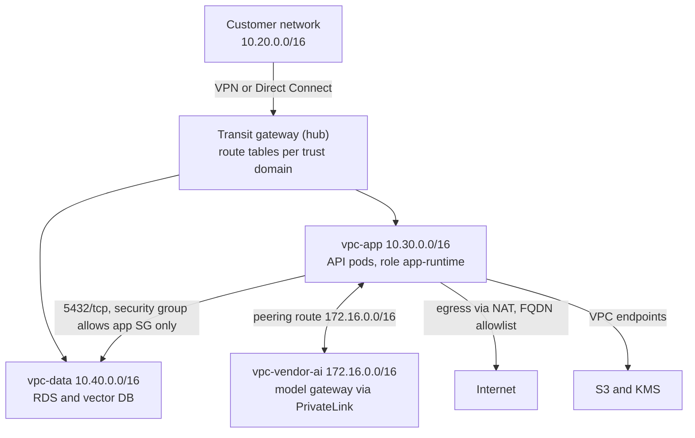
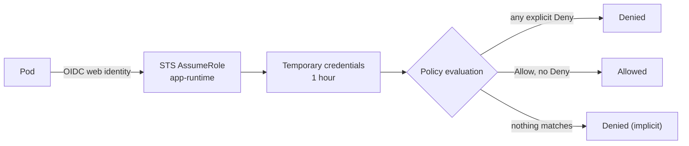

# Intuition & Mental Model

A cloud network is a set of private rooms (VPCs) with doors (routes) and bouncers (security groups, IAM). Most enterprise AI deployments fail not on the model but on the **plumbing**: "the app in the vendor's VPC can't reach the customer's database," or "the model endpoint is reachable from the internet and the auditor found it."

Three ideas carry 90% of the work:
1. **Routing is longest-prefix-match.** Traffic goes to the most specific route. Peering adds a route; it does not magically connect everything.
2. **Peering is not transitive.** If A peers with B and B peers with C, A cannot reach C through B. Hub-and-spoke needs a transit gateway or explicit peerings.
3. **IAM is deny-by-default and explicit-deny-wins.** Permissions are evaluated as: any matching Deny → denied; else any matching Allow → allowed; else denied. Over-broad wildcards (`s3:*` on `*`) are how data leaks happen.

For a Forward Deployed Engineer this is client-facing: you will sit with a customer network team and must quickly show CIDR overlaps, route paths, and least-privilege roles.

# Production Architecture & Data Flow

Network decision order: route lookup (longest prefix match), then NACL, then security group, then the service's IAM policy, then the resource policy.

# Architectural Trade-Off Matrix

| Approach | Latency | Scalability | Implementation Complexity | Cost |
|---|---|---|---|---|
| **VPC peering (1:1)** | Lowest, no hop through an appliance | Poor at scale: n(n-1)/2 links, non-transitive, no overlapping CIDRs | Low for 2-3 VPCs, painful beyond | Cheapest: data transfer only |
| **Transit Gateway hub-and-spoke** | +~1 ms, one managed hop | Excellent: thousands of attachments, central route tables | Medium | Hourly attachment fee + per-GB processing |
| **PrivateLink / VPC endpoints** | Low; one-directional service exposure | Excellent: allows overlapping CIDRs, consumer sees only one endpoint | Medium | Per-endpoint hourly + per-GB |

# Enterprise War Stories & Edge Cases

**1. Overlapping CIDRs killed a pilot.** A bank's on-prem range `10.0.0.0/8` overlapped the vendor's default `10.0.0.0/16` VPC. Peering was impossible, and renumbering production took 6 weeks. *Remediation:* publish a CIDR plan before kickoff, check overlaps programmatically (as in the lab), default to non-RFC1918-collision ranges (e.g. `100.64/10` or documented slices), and fall back to PrivateLink, which tolerates overlap.

**2. The wildcard role that exported the customer's data lake.** An "AI-pipeline" role had `s3:*` on `*` for convenience. A prompt-injection in a summarizer tool call listed and copied buckets across accounts. *Remediation:* least-privilege per-bucket-prefix policies, explicit Deny on `s3:PutObject` outside approved buckets, permissions boundaries, `aws:SourceVpce` conditions so credentials work only from the endpoint, and access analyzer in CI.

**3. "Peering works, but the DB is unreachable."** The route existed in only one direction; the data VPC's route table lacked the return route and the security group allowed only the peer's CIDR, not the app SG. Packets arrived and replies were dropped. *Remediation:* a checklist of five layers (routes both ways, NACL, SG, DNS resolution over peering, IAM) and a reachability analyzer run in the runbook before escalating.
