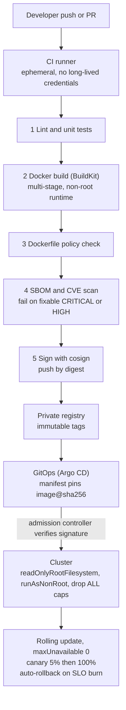

> **Syllabus lessons for this module:** full teaching notes for every topic are in [Syllabus Topic Write-ups](#syllabus-topic-write-ups); the topic-to-code map is in the [Syllabus Coverage Map](#syllabus-coverage-map) and [COVERAGE.md](../../COVERAGE.md).

# Intuition & Mental Model

A container image is a **sealed shipping box**: the same bytes run on a laptop, in CI and in the customer's cluster. In enterprise work the box is also an audit artifact. Security teams ask: what is inside, who built it, was it scanned, and can it run as root? A CI/CD pipeline is the **assembly line with inspectors**: every commit passes the same gates (lint, test, build, scan, sign) and nothing reaches production by hand.

Key habits:
1. **Multi-stage builds.** Compile and install in a fat "builder" stage; copy only the results into a slim runtime stage. Smaller image, fewer CVEs, no compilers for an attacker to use.
2. **Least privilege at runtime.** Non-root user, read-only root filesystem, dropped Linux capabilities, no secrets baked into layers.
3. **Pin and verify.** Pin base images by digest, lock dependencies with hashes, sign images, and fail the pipeline on critical vulnerabilities.
4. **Gates are code.** The lab lints a Dockerfile and evaluates pipeline gates programmatically, so policy is testable.

# Production Architecture & Data Flow



Boundaries: CI network pushes to the registry, the production cluster pulls from it. Secrets arrive only through workload identity, never in image layers.

# Architectural Trade-Off Matrix

| Approach | Latency (build/deploy) | Scalability | Implementation Complexity | Cost |
|---|---|---|---|---|
| **Multi-stage Docker + distroless/slim runtime** | Fast pulls (~60-150 MB), cached builds | Excellent | Medium: need debug strategy (no shell) | Low |
| **Single-stage "fat" image** | Slow pulls (1+ GB), slow cold starts | Poor: large attack surface multiplies per node | Low | Medium: registry egress + node disk |
| **Buildpacks / managed build (Cloud Native Buildpacks, Cloud Build)** | Medium | Excellent: standardized across teams | Low-Medium; less control of layers | Medium: platform fees |

# Enterprise War Stories & Edge Cases

**1. API key in a layer.** A developer ran `COPY .env .` then `RUN rm .env`; the secret stayed in an earlier layer and was extracted from the public-pull-through cache. *Remediation:* rotate the key, use BuildKit `--mount=type=secret`, add `.dockerignore`, and a pipeline gate that scans layers for secrets and fails the build.

**2. `latest` took production down.** A rollback pulled `python:3.12` which had moved to a new minor with a changed OpenSSL, breaking a client's TLS inspection. Two "identical" builds differed. *Remediation:* pin base images by digest, renovate-style PRs to bump them, immutable tags in the registry, and reproducibility checks comparing SBOMs.

**3. Pods OOMKilled only under load.** The image ran fine in CI, but the cgroup memory limit (512Mi) was lower than the Python process plus model cache. Kubernetes restarted pods in a loop, and the rolling update stalled at 0% available. *Remediation:* load-test with production limits in CI, size requests from measured RSS, set `maxUnavailable: 0` with readiness probes so a bad version never replaces healthy pods, and automated rollback on error-rate burn.

# Syllabus Topic Write-ups

This module teaches how software gets packaged into container images, run as several cooperating containers, deployed to a managed AWS service (ECS on Fargate), and shipped automatically by a GitHub Actions pipeline. A Forward Deployed Engineer is often the person who turns a working prototype on a laptop into something a customer's security, platform and operations teams will accept. That means answering questions about what is inside the image, how it scales, how it is released and how credentials are handled. Vendor-specific names, flags and limits change over time, so verify exact syntax and numbers against current Docker, AWS and GitHub documentation before relying on them.

**How to study this module**
Read the topics in order, because each builds on the one before. The study path:
1. Topics 1 and 2 (Dockerfiles, Compose) give you the image and the local multi-container picture.
2. Topic 3 (volumes and networking) explains how containers store data and talk to each other, which you need before Topic 4.
3. Topic 4 (FastAPI container) applies 1 to 3 to a real service and introduces health endpoints, which Topics 7 and 8 depend on.
4. Topics 5 to 8 (serverless containers, task definitions, load balancers, auto-scaling) move that service onto AWS. Read 5 for the big picture, 6 for the blueprint, 7 for traffic and health, 8 for elasticity.
5. Topics 9 to 12 (workflow YAML, triggers, secrets, CD to AWS) automate the whole thing. Read 9 and 10 first, 11 before 12, since the deployment pipeline needs secure credentials.

**Module cheat sheet**

| Must-know | One-line answer |
|---|---|
| Image vs container | An image is an immutable stack of read-only layers; a container is a running process started from it with a thin writable layer on top. |
| Layer cache rule | A changed instruction invalidates its own layer and every layer after it, so put slow-changing steps first. |
| Multi-stage build | Build in a fat stage, copy only the artifacts into a slim final stage; smaller image, fewer CVEs, no compilers. |
| depends_on vs health | `depends_on` alone waits for start; `condition: service_healthy` waits for the healthcheck to pass. |
| Volume vs bind mount | A named volume is Docker-managed and suits databases; a bind mount maps a host path and suits dev and read-only config. |
| Liveness vs readiness | Liveness asks "should this be restarted?"; readiness asks "should it receive traffic right now?". |
| Execution role vs task role | The execution role lets ECS pull the image, fetch secrets and write logs; the task role is what your application code runs as. |
| Health check detection time | Roughly interval multiplied by the unhealthy threshold (example: 10 s x 2 = about 20 s). |
| Target tracking formula | desired = ceil(current x metric / target), clamped between minimum and maximum capacity. |
| Scale out fast, in slow | A short scale-out cooldown absorbs spikes; a long scale-in cooldown prevents flapping. |
| Triggers | `on:` decides which events start a workflow; filters on branch, tag and path narrow it; `if:` decides per job. |
| OIDC vs stored keys | OIDC swaps a signed GitHub token for short-lived AWS credentials, so no long-lived key exists to leak. |
| Safe rollout | Rolling update with a circuit breaker and rollback, plus waiting for service stability, turns a bad release into an automatic revert. |

### 1. Writing optimized Dockerfiles
**What you will be able to do**
- Explain to a non-engineer in two minutes what an image layer is and why build order matters.
- Reorder a slow Dockerfile so a code-only change rebuilds in seconds, and say which layers re-run.
- Convert a single-stage Dockerfile into a multi-stage one and justify the size and security gain.
- Spot secrets, floating tags and shell-form `CMD` in a code review.

**Prerequisites**
Basic command-line use and the idea of a program with dependencies (for example a Python app with a `requirements.txt`). No earlier module topic is needed; this is the starting point of the module.

**The idea from first principles**
Imagine packing a lunch box every morning. If you rebuild the entire meal from raw ingredients each day, you waste time. A smarter cook prepares the slow items (rice, soup) once, stores them, and only assembles the fast item (a fresh salad) each morning. A Dockerfile build works like that, and the cache is the fridge.

An image is a read-only template made of ordered layers. Each filesystem-changing instruction (`RUN`, `COPY`, `ADD`) produces one layer that records the files it added or changed. A container is a running process started from an image, with a thin writable layer on top that is discarded when the container is removed. Because layers are content-addressed and shared, two images with the same base share those bytes on disk and on the wire.

The naive way to write a Dockerfile is to copy the whole project and then install dependencies. That fails in practice because the layer cache is positional: when one instruction changes, Docker must rebuild that layer and every later one, since later layers were built on top of the old result. If your source code is copied before the dependency install, every one-line code edit changes the copied files and forces a full reinstall. Developers pay that cost on every build, and CI pays it on every push.

The fix is ordering by volatility: base image first, then system packages, then the dependency manifest, then the dependency install, then application code. A second idea, the multi-stage build, separates "what I need to build" from "what I need to run". Compilers, headers and build caches belong in a throwaway stage; the shipped image should contain only the runtime and the results. Every package you leave out is one fewer thing to patch and one fewer tool an attacker can use.

**How it works, step by step**
1. Docker sends the build context (a directory, filtered by `.dockerignore`) to the builder.
2. It reads instructions top to bottom. For each, it computes a cache key from the instruction text, the parent layer, and for `COPY` and `ADD` a checksum of the copied file contents (not timestamps).
3. If a layer with that key exists, it is reused and the step is skipped. The first miss rebuilds that layer, and all later layers are rebuilt regardless of whether their own inputs changed.
4. With multiple `FROM` lines, each starts a new stage. `COPY --from=<stage>` copies files from an earlier stage. Only the last stage (or the one named by `--target`) becomes the tagged image.
5. The result is a manifest listing the layers and configuration (user, entrypoint, environment). Pushing uploads only layers the registry does not already hold.

Worked calculation (all numbers illustrative). Steps: base image cached 0 s; apt packages cached 0 s; `pip install` 120 s; code copy 1 s. Naive order, copy everything then install: a code edit invalidates the copy layer, so install re-runs, total 0 + 0 + 1 + 120 = 121 s. Optimized order: copy only `requirements.txt`, install, then copy code. A code edit changes only the final layer, total 1 s. Saved per build: 120 s. With 40 pushes a day across a team, that is 40 x 120 = 4,800 s, which is 80 minutes of CI time per day, plus the developer waiting time.

Size arithmetic (illustrative): a full Python image with compilers is 1,000 MB; the slim runtime with prebuilt wheels is 150 MB. Pulling to 20 nodes moves 20 x 1,000 = 20,000 MB versus 20 x 150 = 3,000 MB, about 6.7 times less traffic.

**Worked example 1: small and hand-traceable**
Dockerfile, with layer numbers:

```dockerfile
FROM python:3.12-slim
WORKDIR /app
COPY requirements.txt .
RUN pip install --no-cache-dir -r requirements.txt
COPY app ./app
CMD ["python", "-m", "app.main"]
```

Trace three builds. Build A (first ever): every instruction misses, so six steps run. Build B (you edit `app/main.py`): `FROM`, `WORKDIR`, `COPY requirements.txt` and `RUN pip install` all hit, because the manifest checksum is unchanged. `COPY app` misses (file checksum changed), so it and the `CMD` metadata step rebuild. Only one cheap filesystem layer is rebuilt. Build C (you add a line to `requirements.txt`): `COPY requirements.txt` misses, which forces `RUN pip install`, `COPY app` and everything after to rebuild. The expensive step re-runs, which is correct, since the dependencies changed.

**Worked example 2: enterprise scenario**
A bank's fraud-scoring team ships a Python API that depends on a library needing a C compiler. Security wants no compilers in production and a non-root user.

```dockerfile
FROM python:3.12-slim AS builder
WORKDIR /build
RUN apt-get update && apt-get install -y --no-install-recommends build-essential \
    && rm -rf /var/lib/apt/lists/*
COPY requirements.txt .
RUN pip wheel --no-cache-dir --wheel-dir /wheels -r requirements.txt

FROM python:3.12-slim
RUN useradd --uid 10001 --no-create-home appuser
WORKDIR /app
COPY --from=builder /wheels /wheels
COPY requirements.txt .
RUN pip install --no-cache-dir --no-index --find-links=/wheels -r requirements.txt
COPY app ./app
USER 10001
CMD ["uvicorn", "app.main:app", "--host", "0.0.0.0", "--port", "8000"]
```

Commentary: the builder stage installs compilers and builds wheels, then is discarded. The final stage installs from those wheels with no network index, so the build is repeatable and offline. The wheels stay in one layer of the final image; if size matters, a bind mount in the same `RUN` avoids that (check the current BuildKit syntax). `apt-get update` and `install` share one `RUN`, and the apt lists are removed in the same layer, because deleting files in a later layer does not shrink earlier layers. `USER 10001` uses a numeric ID so Kubernetes `runAsNonRoot` checks can verify it. The exec-form `CMD` makes uvicorn PID 1 so it receives SIGTERM.

**Hands-on practice**
Exercise 1 (easy): This Dockerfile copies `.` before `pip install`. Which steps re-run after a one-line code edit, and how do you fix it?
Solution: The `COPY .` layer changes, so `pip install` re-runs. Fix by copying `requirements.txt`, running install, then `COPY . .`. After the fix, only the final copy layer rebuilds.

Exercise 2 (medium): Your image is 1.2 GB. `docker history` shows a 700 MB layer from `apt-get install build-essential`. Plan a reduction.
Solution: Move compilation to a builder stage, build wheels there, copy wheels into a slim final stage, and install from them with no index. The compiler layer stays in the discarded stage. Expect the final image to fall by about the compiler layer size (illustrative: 1.2 GB to about 500 MB), and more with trimmed dependencies.

Exercise 3 (hard): A teammate wrote `COPY .env .` then `RUN rm .env` to remove a secret. Explain why this is still a leak and give a correct approach.
Solution: Layers are additive. The `COPY` layer contains `.env`; the later `RUN rm` adds a layer that hides the file from the merged view but the earlier layer is still in the image and downloadable. Correct approach: add `.env` to `.dockerignore`, pass build-time secrets with BuildKit secret mounts (`RUN --mount=type=secret,...`, check current syntax), inject runtime secrets from the platform, and rotate any key that was ever pushed.

**Alternatives and trade-offs**

| Approach | Build speed | Size and risk | Complexity | Choose when |
|---|---|---|---|---|
| Single-stage slim | Fast | Medium, build tools remain | Low | Pure Python, no compile step |
| Multi-stage slim | Fast with cache | Small | Medium | Default for services |
| Distroless or minimal final stage | Fast | Smallest, no shell | Higher: debugging needs ephemeral tools | Regulated or internet-facing workloads |
| Buildpacks | Medium | Standardized, less layer control | Low | Many teams, little Docker expertise |

Alpine images are small but use musl libc, which can break or slow prebuilt Python wheels, so slim Debian-based images are the safer default. The technique is the wrong tool when the real cost is elsewhere, for example tests that take 15 minutes; layer tuning will not fix that.

**Where it goes wrong in production**
- Cache never hits. Symptom: every build re-installs dependencies. Cause: `COPY . .` before install, or a changing `ARG` (commit SHA, timestamp) defined early. Diagnose: `docker build` output without `CACHED` lines. Fix: reorder; move volatile values to the end.
- Secret baked into a layer. Symptom: a scanner or a pulled image reveals credentials. Cause: copying env files. Diagnose: `docker history` and layer scanning. Fix: dockerignore, secret mounts, rotation.
- Non-reproducible builds. Symptom: two builds of one commit behave differently. Cause: floating base tag and unpinned dependencies. Fix: pin base images by digest, lock dependencies with hashes, bump through reviewed pull requests.
- Slow, bloated pulls. Symptom: cold starts and deploys take minutes. Cause: build tools and caches left in the final image. Fix: multi-stage, `--no-cache-dir`, clean apt lists in the same `RUN`.
- Ignored shutdown signals. Symptom: deployments wait the full kill timeout. Cause: shell-form `CMD` runs under `/bin/sh`, which may not forward SIGTERM. Fix: exec form.

**Do not confuse**
`COPY` vs `ADD`: `COPY` copies files; `ADD` also downloads URLs and unpacks archives, which is surprising, so prefer `COPY`. `CMD` vs `ENTRYPOINT`: ENTRYPOINT is the fixed executable, CMD supplies default arguments that `docker run` can override. Image vs container: a template versus a running instance of it.

**How interviewers probe this**
1. What is a layer and what invalidates the cache?
2. Why copy `requirements.txt` before the rest of the code?
3. What is a multi-stage build and what does it buy you?
4. How do you keep secrets out of an image?
5. Trap: "If I `rm` a file in a later `RUN`, does the image get smaller?"
6. Design: your CI build takes 12 minutes and the image is 1.8 GB. What do you do, in order?
7. What breaks when `apt-get update` and `apt-get install` are separate `RUN` lines?
8. Hard: how would you make builds reproducible and auditable for a regulated customer?

**Model answer (60-90 seconds)**
"A Dockerfile builds an image as a stack of layers, and Docker caches each layer. The rule is that when an instruction's inputs change, that layer and everything after it rebuilds. So I order instructions from least to most volatile: base image, system packages, dependency manifest, dependency install, then application code. A code edit then reuses the expensive install layer. On top of that I use a multi-stage build: a builder stage with compilers produces wheels, and the runtime stage copies only those, which reduces size and vulnerabilities. I use a dockerignore so git history and env files never enter the build context, run as a numeric non-root user, and use exec-form CMD so signals reach the process. The trade-off is debuggability, since a minimal image has no shell, so I plan an ephemeral debug container. For example, on a fraud API this cut a code-only rebuild from minutes to seconds. The limit is that layer tuning only fixes build time, not slow tests or heavy dependencies."

**Quick-fire answers**
- Q: What is a layer and what invalidates the cache? A: A layer is the filesystem diff made by one instruction. A changed instruction, or changed copied file contents, invalidates that layer and all later ones.
- Q: Why copy the manifest first? A: So the install layer's cache key depends only on the manifest. Code edits then skip the install.
- Q: What is multi-stage? A: Several `FROM` stages in one file where only the last ships. You copy artifacts across, leaving compilers and caches behind.
- Q: Secrets out of an image? A: Dockerignore, BuildKit secret mounts at build time, runtime injection from a secret store, and rotation if leaked. Never `COPY` them.
- Q: Does `rm` in a later `RUN` shrink the image? A: No. Earlier layers keep the bytes, so deletion must happen in the same `RUN` that created the files.
- Q: 12-minute build design? A: Measure first, reorder for cache, add CI cache, go multi-stage, drop unused dependencies, and split slow tests into parallel jobs.
- Q: Split apt lines? A: The cached `update` layer goes stale, so a later `install` may use an old index and fail. Combine them and clear the lists.
- Q: Reproducible builds? A: Pin base by digest, lock dependencies with hashes, record an SBOM, build in CI only, sign images, and keep tags immutable.

**Recap in five lines**
- Layers are cached in order; one change rebuilds everything below it.
- Order from slowest-changing to fastest-changing: base, packages, manifest, install, code.
- Multi-stage builds ship only the runtime and the results.
- Use dockerignore, non-root numeric users, exec-form CMD and pinned bases.
- Deleting in a later layer never removes data from an earlier one.

### 2. Managing multi-container environments
**What you will be able to do**
- Write a Compose file with an API, a database and a one-shot migration job, started in the right order.
- Explain the difference between a container being started, healthy and completed, and pick the right `depends_on` condition.
- Diagnose a "connection refused at boot" failure and fix it with healthchecks and retries.
- Say clearly when Compose is the right tool and when you move to ECS or Kubernetes.

**Prerequisites**
Topic 1 (images and containers). You should be comfortable running `docker build` and `docker run`.

**The idea from first principles**
A restaurant kitchen has several stations: grill, fryer, dessert. Each works independently, but they must start in a sensible order and hand dishes over at the right moment. Starting each container by hand with `docker run` is like phoning each station separately and hoping they sync.

A real application is the same. A web API needs a database, perhaps a cache and a background worker. You can start each with `docker run`, creating networks, volumes and environment variables by hand, but the command lines get long, easy to get wrong and impossible to share. Docker Compose solves this by describing the whole stack declaratively in one YAML file, so that `docker compose up` produces the same environment for every engineer and every CI run.

Terms. A service is a template for one or more containers (for example `api`). A project is the set of services defined in one Compose file. A healthcheck is a command Docker runs inside a container at an interval to decide if it is healthy. Compose creates a default user-defined network per project, so services find each other by service name.

The naive approach is relying on `depends_on` to mean "wait until ready". It does not. In its basic form it only orders container start: the database container has started, but Postgres may still be initializing and refusing connections. An API that tries to connect at boot then crashes. The real fix has two parts: tell Compose how to detect readiness (a healthcheck plus `condition: service_healthy`) and make the application retry connections, because production platforms offer no such ordering at all.

**How it works, step by step**
1. Compose parses the main file and any override files into one resolved configuration. `docker compose config` prints that result and catches syntax and reference errors.
2. It builds a graph from `depends_on`. A cycle (A needs B, B needs A) has no valid order and is rejected.
3. It creates networks and named volumes, then starts services in dependency order.
4. For each dependency it applies the condition: `service_started` proceeds as soon as the process starts; `service_healthy` waits until the healthcheck reports healthy; `service_completed_successfully` waits for a one-shot container to exit with code 0.
5. A healthcheck runs every `interval`; after `retries` consecutive failures the container is marked unhealthy. A `start_period` can give a slow service time before failures count.
6. `docker compose down` removes containers and networks. Named volumes remain unless `-v` is given.

Worked calculation (illustrative). Postgres needs 8 s to accept connections. Healthcheck interval is 5 s with the first check at 5 s, so checks run at 5 s (fail), 10 s (pass). It becomes healthy at about 10 s. With `service_started` the API starts at 0 s, tries to connect, fails and exits. With `service_healthy` the API starts at about 10 s, 2 s after the database is truly ready, and succeeds. To tolerate a database that takes 60 s, set `retries` so interval x retries is at least 60 s, for example 5 s x 12 = 60 s.

**Worked example 1: small and hand-traceable**
Three services: `db` (no dependencies), `migrate` (needs `db` healthy), `api` (needs `migrate` completed successfully).

Trace of `docker compose up -d`:
- t = 0 s: network created, `db` starts. `migrate` and `api` wait.
- t = 5 s: first healthcheck, Postgres still initializing, status "starting".
- t = 10 s: healthcheck passes, `db` becomes healthy. `migrate` starts.
- t = 13 s: `migrate` runs its SQL and exits with code 0. `api` starts.
- Failure variant: if `migrate` exits with code 1, `api` is never started and `up` reports the failure. That is the desired behavior, since an API against an unmigrated schema is worse than no API.

**Worked example 2: enterprise scenario**
An insurer's claims team wants a local stack for engineers: API, Postgres, and a migration job, with the database password kept out of the committed file.

```yaml
services:
  db:
    image: postgres:16
    environment:
      POSTGRES_PASSWORD_FILE: /run/secrets/db_pw
    secrets: [db_pw]
    volumes:
      - pgdata:/var/lib/postgresql/data
    healthcheck:
      test: ["CMD-SHELL", "pg_isready -U postgres"]
      interval: 5s
      retries: 12
  migrate:
    build: .
    command: ["python", "-m", "app.migrate"]
    depends_on:
      db:
        condition: service_healthy
  api:
    build: .
    ports:
      - "127.0.0.1:8000:8000"
    depends_on:
      migrate:
        condition: service_completed_successfully
secrets:
  db_pw:
    file: ./secrets/db_pw.txt
volumes:
  pgdata:
```

Commentary: `POSTGRES_PASSWORD_FILE` makes the official Postgres image read the password from a file, and the file is mounted via Compose secrets, so the value is not in the YAML or in `docker inspect` environment output. The healthcheck uses `pg_isready`, which ships in the image. The named volume keeps data across `down`. The API publishes only to loopback. Pinned `postgres:16` avoids surprise major upgrades. Verify the secrets syntax against your Compose version.

**Hands-on practice**
Exercise 1 (easy): Your API container exits at start with "connection refused" to `db`. The Compose file has `depends_on: [db]`. What is wrong?
Solution: The short form only waits for the container to start. Add a `healthcheck` to `db` and change to `depends_on: db: condition: service_healthy`. Also add retry logic in the app.

Exercise 2 (medium): Add a Redis cache that the API needs, but only for optional features. Should the API wait for Redis health?
Solution: If the feature is optional the API should start without Redis and degrade gracefully. Use `service_started` or no dependency, and let the application handle absence. Hard dependencies (database) use `service_healthy`; soft ones should not block boot.

Exercise 3 (hard): Two engineers run the stack and one gets "port is already allocated" on 5432. Explain and fix.
Solution: Both stacks, or a local Postgres, publish host port 5432, and only one process can bind a given host port. The database does not need host publication at all, since the API reaches it by service name on the Compose network. Remove the `ports` entry for `db`, or if host access is needed, bind to loopback with a different host port such as `127.0.0.1:5433:5432`.

**Alternatives and trade-offs**

| Option | Strength | Weakness | Choose when |
|---|---|---|---|
| Compose | One file, quick, ideal for dev and CI | Single host, no autoscaling or cross-host healing | Local stacks and integration tests |
| Kubernetes | Multi-host, self-healing, large ecosystem | High operational complexity | Large fleets, many teams |
| ECS | Managed scheduling, AWS-native | AWS-specific model | AWS shops wanting less ops than Kubernetes |
| Test-library containers started from test code | Clean state per test | Per-language library | Integration tests needing isolation |

Compose is the wrong tool for production scale-out or for workloads that must survive host failure. Even for small teams, keep dev and production configuration separate through override files, because Compose behavior and ECS behavior differ.

**Where it goes wrong in production**
- Boot crash loop. Symptom: API exits and restarts while the database initializes. Cause: only `depends_on` ordering. Diagnose: `docker compose logs api` shows connection errors in the first seconds. Fix: healthcheck plus condition, and in-app retries with backoff.
- Silent data loss. Symptom: database empty after a teardown. Cause: `down -v` or no named volume. Fix: declare volumes, avoid `-v` unless intended.
- Secrets in the repository. Symptom: password committed in YAML. Cause: inline `environment`. Fix: secret files or an external secret manager, plus a pre-commit scanner.
- Misleading health. Symptom: healthy but failing queries. Cause: the check only tests that the port is open. Diagnose: run a real query in the check. Fix: use a check that exercises the service.
- Version drift. Symptom: works for one engineer, fails for another. Cause: floating tags like `latest`. Fix: pin tags or digests.

**Do not confuse**
Started vs healthy vs completed: process running, healthcheck passing, exited with code 0. Compose vs orchestrator: Compose runs containers on one host; an orchestrator schedules and heals across many hosts. `build:` vs `image:`: build from local source versus pull a prebuilt image.

**How interviewers probe this**
1. What problem does Compose solve?
2. Does `depends_on` guarantee a dependency is ready?
3. How do containers in a Compose project find each other?
4. How do you run a database migration before the app starts?
5. Trap: "Compose with `restart: always` is production-ready, right?"
6. Design: give a new engineer a one-command environment for a service with five dependencies, including seed data.
7. What breaks when a healthcheck command is not installed in the image?
8. Hard: your integration tests are flaky on CI because services start unevenly. Walk through the fix.

**Model answer (60-90 seconds)**
"Compose describes a multi-container application declaratively. I define services, networks and volumes in one file, and `compose up` creates them in dependency order. The detail people miss is that `depends_on` only orders container start. To wait for readiness I add a healthcheck to the dependency, such as `pg_isready` for Postgres, and use the healthy condition. For one-shot jobs like migrations I use the completed-successfully condition, so the app never starts against a bad schema. Containers talk over the project network by service name. I use Compose for local development and integration tests in CI. I would not use it for production scale, because it targets one host and offers no scheduling across machines or automatic recovery from host failure. In production I would run the same images on ECS or Kubernetes. A limit to remember: even with ordering, I still add connection retries in the app, because production platforms do not give me that ordering."

**Quick-fire answers**
- Q: What problem does Compose solve? A: It replaces many hand-typed `docker run` commands with one shareable file that creates networks, volumes and containers consistently.
- Q: Does depends_on guarantee readiness? A: No. It orders start only, unless you add a `service_healthy` condition backed by a healthcheck.
- Q: How do services find each other? A: By service name through Docker's DNS on the project's user-defined network.
- Q: Migration before app? A: A one-shot migration service, with the app depending on `service_completed_successfully`.
- Q: Is `restart: always` production-ready? A: No. It restarts crashed containers on one host, but gives no multi-host scheduling, rolling deploys or capacity management.
- Q: One-command environment? A: Pinned images, healthchecks, a migration and seed job, secrets from files, documented overrides, and a short wrapper script or Makefile target.
- Q: Missing healthcheck binary? A: The check fails permanently and the container shows unhealthy, which blocks dependents. Use tools present in the image or a small script.
- Q: Flaky CI? A: Add healthchecks and health conditions, make tests wait for readiness, add app-level retries, and avoid fixed sleeps.

**Recap in five lines**
- Compose declares services, networks and volumes in one file for one host.
- `depends_on` alone orders start only; use health or completed conditions for readiness.
- Services reach each other by name on the project network.
- Use it for dev and CI; move to ECS or Kubernetes for production.
- Always add application retries, since production offers no start ordering.

### 3. Volume mounting and networking
**What you will be able to do**
- Explain where a container's data lives and why it vanishes without a mount.
- Choose between a named volume, a bind mount and tmpfs for a given need.
- Design a network layout where the database cannot be reached from outside, and say which ports to publish.
- Spot a Docker socket mount or a world-published database port in a review and explain the risk.

**Prerequisites**
Topic 1 (images, layers, the writable layer) and Topic 2 (Compose services and the project network).

**The idea from first principles**
Think of a container as a hotel room. Everything you leave inside is cleared when you check out. If you want to keep something, you put it in a locker the hotel does not clean. A volume is that locker. Networking is the hotel's phone system: each room can call another by name without knowing the room number, and the front desk decides which outside lines are open.

Technically, a container sees the image layers (read-only) plus a thin writable layer on top. Anything the app writes to a normal path goes into that writable layer, which is deleted with the container. That is fine for caches and temporary files and disastrous for a database. A mount overlays a path in the container with storage that lives elsewhere: a named volume (a directory Docker creates and manages), a bind mount (an existing host path), or tmpfs (memory, gone at stop).

The naive approach, running a database with no mount, works until the first redeploy, when every row disappears. The second naive approach, mounting your host's project folder everywhere, works for development and then leaks host details, hits permission problems and ties the container to one machine's layout.

For networking, a bridge network is a virtual switch on the host. On a user-defined bridge network Docker runs an embedded DNS resolver, so the name `db` resolves to the database container's address. The default bridge network does not give name resolution between containers, which is why Compose creates a user-defined network for you. Publishing a port with `-p` or `ports:` adds a rule that forwards traffic from the host to the container. Leaving the host IP out means the port listens on all host interfaces, which on a cloud VM can mean the public internet.

**How it works, step by step**
1. At start, the runtime assembles the container's root filesystem from image layers plus a fresh writable layer.
2. Each mount is overlaid at its target path. Writes under that path go to the volume, host directory or memory, bypassing the writable layer.
3. A named volume is created on first use and kept until explicitly removed. Removing the container leaves it in place.
4. For networking, Docker attaches the container to each listed network and registers its name with that network's DNS. Containers on a shared network resolve each other by service name; containers with no shared network cannot reach each other.
5. A published port `HOST_IP:HOST_PORT:CONTAINER_PORT` installs a forwarding rule. The left side is the host, the right side is inside the container.
6. A network marked `internal` has no route to the outside, so containers on it can talk to each other but cannot reach the internet or be reached from it.

Worked calculation (illustrative). A Postgres container writes 2 GB of data. With no volume, the data sits in the writable layer: after `docker rm`, 2 GB is gone. With a named volume `pgdata`, `docker rm` removes the container but `docker volume ls` still lists `pgdata` holding 2 GB, and a new container mounting it sees the data. Exposure arithmetic: if a VM has 1 public IP and you publish `5432:5432`, the number of internet-reachable database ports is 1. With `127.0.0.1:5432:5432` it is 0.

**Worked example 1: small and hand-traceable**
Networks: `frontend` and `backend`. Services: `web` on `frontend`; `api` on both; `db` on `backend` only.

Reachability trace:
- `web` resolves `api`: they share `frontend`, so yes.
- `web` resolves `db`: no shared network, so the name does not resolve and no route exists.
- `api` resolves `db`: shared `backend`, yes, connects to `db:5432`.
- Host port check: only `web` publishes `80:80`. Nothing publishes 5432, so a port scan of the host finds only port 80.
- Compromise trace: an attacker who takes over `web` can reach `api` over HTTP but has no network path to `db`, so they must also compromise `api` first.

**Worked example 2: enterprise scenario**
A hospital network runs an imaging-metadata API. The database must be unreachable from outside, data must survive redeploys, the root filesystem must be immutable, and the config is supplied by the host.

```yaml
services:
  db:
    image: postgres:16
    volumes:
      - pgdata:/var/lib/postgresql/data
    networks: [backend]
  api:
    build: .
    read_only: true
    tmpfs:
      - /tmp
    volumes:
      - ./config:/etc/app:ro
    ports:
      - "127.0.0.1:8000:8000"
    networks: [backend, frontend]
networks:
  backend:
    internal: true
  frontend: {}
volumes:
  pgdata:
```

Commentary: `pgdata:/var/lib/postgresql/data` is the named volume at Postgres's data directory. `read_only: true` makes the API's root filesystem immutable, so malware cannot drop files; `tmpfs: /tmp` gives it a writable scratch area in memory. The config bind mount ends with `:ro`, so the app cannot modify it. The API publishes only on loopback, so a reverse proxy on the host can reach it but the network cannot. The database sits on an internal network and publishes nothing. In production on ECS you would replace the Postgres container with a managed database and use network security groups for the same isolation.

**Hands-on practice**
Exercise 1 (easy): After `docker compose down` your database rows are still there; after `docker compose down -v` they are gone. Why?
Solution: `down` removes containers and networks but leaves named volumes. `-v` also removes named volumes declared in the file, deleting the data.

Exercise 2 (medium): Your API container cannot resolve `db` even though both run. `docker network inspect` shows `api` on `bridge` and `db` on `backend`. Fix it.
Solution: They share no network. Attach both to one user-defined network (the Compose default does this automatically when no networks are specified). The default `bridge` also lacks name resolution, so a user-defined network is required.

Exercise 3 (hard): A security review flags `ports: - "5432:5432"` on the database and `/var/run/docker.sock:/var/run/docker.sock` on a monitoring container. Write the findings and the remediation.
Solution: Finding 1: the database is published on all interfaces; if the host has a public address, anyone can attempt connections, and credentials become the only barrier. Remediation: remove the mapping, or bind to `127.0.0.1`, and rely on the internal network; add security groups in cloud. Finding 2: access to the Docker socket lets a container create privileged containers that mount the host filesystem, which is equivalent to root on the host. Remediation: avoid the mount, use an agent that reads metrics another way, or put a socket proxy that allows only read-only endpoints, and run the container non-root with dropped capabilities.

**Alternatives and trade-offs**

| Storage choice | Persistence | Portability | Risk | Choose when |
|---|---|---|---|---|
| Named volume | Survives container removal | Docker-managed | Lost on `down -v`, tied to one host | Databases in dev and single-host setups |
| Bind mount | Host-dependent | Needs the host path to exist | Permission mismatches, host path exposure | Live code reload, read-only config |
| tmpfs | Gone at stop | Fast, memory-backed | Consumes RAM | Scratch files, sensitive temporary data |
| Managed database or network file store | Durable beyond any host | Best | Cost, network latency | Production state |

In production, container hosts are disposable, so durable state belongs in a managed service. Local volumes are the wrong tool when tasks can be rescheduled to another machine, because the data stays behind.

**Where it goes wrong in production**
- Data loss on redeploy. Symptom: empty database after deploy. Cause: no volume at the data directory, so writes went to the writable layer. Diagnose: `docker inspect` shows no mount at that path. Fix: mount explicitly, or move to a managed database.
- Permission denied on bind mounts. Symptom: app cannot write or read mounted files. Cause: container UID differs from the host owner. Diagnose: `ls -ln` on the host. Fix: align UIDs or fix ownership, mount read-only where writing is not needed.
- Exposed database. Symptom: login attempts from the internet in logs. Cause: published to all interfaces. Fix: loopback binding, internal networks, cloud security groups.
- Docker socket mount. Symptom: none until compromise. Cause: tooling convenience. Fix: remove, or use a restricted proxy.
- Name not resolving. Symptom: "could not translate host name". Cause: services on different networks or the default bridge. Diagnose: `docker network inspect`. Fix: share a user-defined network.
- Disk full. Symptom: host disk exhausted by unused volumes and images. Fix: prune deliberately and monitor.

**Do not confuse**
`EXPOSE` vs `-p`: `EXPOSE` is documentation metadata; `-p` actually publishes. Host port vs container port: in `8080:80`, 8080 is the host and 80 the container. Volume vs bind mount: Docker-managed storage versus a specific host path. Default bridge vs user-defined bridge: only the latter gives name-based discovery.

**How interviewers probe this**
1. Where does a container write data by default, and what happens when it is removed?
2. Volume vs bind mount: when do you use each?
3. How does one container reach another by name?
4. What does `-p 8000:8000` do and why might you add `127.0.0.1:`?
5. Trap: "I put the database on an internal network, so I do not need a password."
6. Design: lay out networks for a web tier, an API and a database, including what is published.
7. What breaks when you run three replicas that share one database volume?
8. Hard: why is mounting the Docker socket dangerous, and what would you do instead?

**Model answer (60-90 seconds)**
"A container's writable layer is deleted with the container, so anything that must survive goes on a mount. For databases I use a named volume, which Docker manages and which outlives the container. For development I use bind mounts for live code and read-only config. For networking, I put services on user-defined networks where Docker's DNS resolves service names, so the API connects to the hostname `db` and never to an IP. I separate tiers: the database sits on an internal backend network and publishes no ports, and only the entry tier publishes, ideally bound to a specific interface. The trade-off is that volumes are tied to one host, so in production I would use a managed database or network storage, because tasks can move between machines. Two risks I always flag are the Docker socket mount, which is effectively root on the host, and `down -v`, which deletes named volumes. Network isolation reduces blast radius but does not replace authentication."

**Quick-fire answers**
- Q: Where does a container write by default? A: Into its thin writable layer, which is deleted when the container is removed.
- Q: Volume vs bind mount? A: A volume is Docker-managed storage that suits data; a bind mount maps a chosen host path and suits dev code and config.
- Q: How does one container reach another? A: By service name, resolved by Docker's embedded DNS on a shared user-defined network.
- Q: What does -p do? A: It forwards a host port to a container port. Prefixing an IP restricts which host interface listens.
- Q: Internal network instead of a password? A: No. Network isolation limits exposure; authentication and least privilege still apply, because another container on the network could be compromised.
- Q: Network layout? A: Frontend and backend networks, backend internal, only the entry point published, database reachable only from the API.
- Q: Three replicas on one volume? A: Most databases allow one writer per data directory, so you get lock errors or corruption. Use replication or a managed service.
- Q: Why not mount the socket? A: Docker API access lets a container start privileged containers that mount the host, which equals host root. Use read-only proxies or avoid it.

**Recap in five lines**
- Writable layers die with the container; volumes persist.
- Named volumes for data, bind mounts for dev and config, tmpfs for scratch.
- User-defined networks give name-based discovery; the default bridge does not.
- Publish only what outsiders need, and bind to loopback when possible.
- Never mount the Docker socket casually, and treat `down -v` as destructive.

### 4. Containerizing FastAPI backends
**What you will be able to do**
- Write a production-style Dockerfile and start command for a FastAPI service.
- Explain liveness, readiness and startup checks and design the right probe for a given service.
- Choose the number of uvicorn workers per container and justify it with memory arithmetic.
- Trace a graceful shutdown during a rolling deploy.

**Prerequisites**
Topic 1 (Dockerfiles), Topic 3 (ports and networks). Basic knowledge of Python web frameworks helps.

**The idea from first principles**
A shop needs two signals. The sign on the door says open or closed (readiness: should customers be sent in?). A separate alarm system checks whether the shop owner is still alive and responsive (liveness: should we call someone to replace them?). Mixing the two causes trouble: if the shop closes briefly because the supplier is late, you do not want the alarm company to fire the owner.

FastAPI is a Python framework for writing web APIs. It speaks ASGI, an asynchronous interface between Python web servers and applications. uvicorn is an ASGI server: it listens on a socket, parses HTTP and calls your app. Containerizing means packaging the app, its dependencies and the exact start command so the same bytes run everywhere.

The naive container works on a laptop and fails in production in three common ways. It binds to `127.0.0.1`, which is the container's own loopback, so a load balancer cannot connect. It has no health endpoints, so the platform cannot tell a working task from a hung one. And it starts through a shell wrapper, so shutdown signals never reach the server and deployments drop requests.

Probes carry a decision. A liveness probe answers "is the process stuck?" and the platform's response is to restart. A readiness probe answers "can this instance do useful work now?" and the response is to stop or start sending traffic. A startup check tolerates slow boot (for example loading a model). If liveness checks the database, a database outage makes every task look dead and the platform restarts all of them at once, turning a partial outage into a total one.

**How it works, step by step**
1. The Dockerfile installs dependencies in a cached layer, copies the app, sets a numeric non-root user and uses exec-form `CMD`, so uvicorn is PID 1 and gets signals directly.
2. uvicorn binds `0.0.0.0:8000`: all interfaces inside the container's network namespace. The platform maps this to the outside.
3. The platform polls the readiness endpoint. Until it returns success, the task receives no traffic. A grace period stops failed early checks from killing a slow-starting task.
4. The platform polls liveness (if configured). Repeated failures trigger a restart.
5. On deploy or scale-in, the platform deregisters the task from the load balancer, sends SIGTERM, waits up to a stop timeout, then sends SIGKILL.
6. On SIGTERM uvicorn stops accepting new connections and lets in-flight requests finish.

Worked calculation (illustrative). A model-backed API holds 1.2 GB resident memory per process. Three uvicorn workers in one container need about 3 x 1.2 = 3.6 GB before any request memory. A task limited to 2 GB would be OOM-killed. Choose one worker per 2 GB task (1.2 GB used, 0.8 GB headroom) and run three tasks: total 3.6 GB, but a crash or restart loses one third of capacity instead of all. Throughput planning: if one worker handles 20 requests per second at the target latency (example), then 3 tasks give 60 requests per second, and 120 requests per second needs 6 tasks.

**Worked example 1: small and hand-traceable**
Probe behavior trace for one task during start (illustrative timings, grace period 60 s, model loads in 40 s):
- t = 0 s: container starts, uvicorn begins loading the model. Readiness returns 503. Load balancer sends no traffic.
- t = 10 s and 20 s: readiness still 503. Because the grace period is 60 s, the platform ignores the failures.
- t = 40 s: model loaded, readiness returns 200. After the required number of healthy checks the task joins the pool.
- t = 90 s: database goes down. Readiness (which checks the database) returns 503, so the task leaves the pool but is not killed. Liveness (process only) still returns 200, so no restart.
- t = 100 s: database recovers, readiness returns 200, task rejoins automatically.

**Worked example 2: enterprise scenario**
A telecom runs a customer-churn scoring API. Readiness verifies the database; liveness checks nothing external.

```python
from fastapi import FastAPI, Response

app = FastAPI()

@app.get("/healthz")
def healthz():
    return {"status": "ok"}

@app.get("/readyz")
def readyz(response: Response):
    if not db_is_reachable():
        response.status_code = 503
        return {"status": "not ready"}
    return {"status": "ready"}
```

```dockerfile
FROM python:3.12-slim
WORKDIR /app
COPY requirements.txt .
RUN pip install --no-cache-dir -r requirements.txt
COPY app ./app
USER 10001
EXPOSE 8000
CMD ["uvicorn", "app.main:app", "--host", "0.0.0.0", "--port", "8000"]
```

Commentary: `db_is_reachable` stands for your own connectivity check, for example a short query with a tight timeout. Returning 503 tells the load balancer to withhold traffic. `/healthz` is deliberately trivial. The Dockerfile's `EXPOSE` documents the port; the `--port` flag decides it, so keep them equal. Exec form makes uvicorn PID 1. Test with `docker build -t churn-api .`, `docker run --rm -p 8000:8000 churn-api` and `curl -f http://127.0.0.1:8000/healthz`.

**Hands-on practice**
Exercise 1 (easy): The container runs but `curl localhost:8000` from the host fails with connection reset. The app was started with `--host 127.0.0.1`. Why?
Solution: Loopback inside the container is only reachable from inside that container's network namespace. Published ports forward to the container's external interface, so the app must listen on `0.0.0.0`.

Exercise 2 (medium): Pick the worker count. A task has 2 vCPU and 4 GB. Each worker uses 700 MB.
Solution: Memory allows floor(4000 / 700) = 5 workers, but CPU bound Python workers beyond about one per vCPU add little, so choose 2 workers using 1.4 GB, leaving headroom. Alternatively, use two 1-vCPU tasks with one worker each, which gives simpler restarts. Verify with a load test.

Exercise 3 (hard): After a downstream service slows, every task goes unready simultaneously and the whole API returns 503. Redesign the probes.
Solution: Readiness should check only dependencies required for most requests, with short timeouts and caching of the result for a few seconds. Remove optional or slow dependencies from readiness and handle them with timeouts, circuit breakers and graceful degradation inside request handling. Keep liveness dependency-free. Add alerting on dependency latency, so the team sees the cause rather than only the symptom.

**Alternatives and trade-offs**

| Option | Strength | Weakness | Choose when |
|---|---|---|---|
| One uvicorn process per container | Simple, orchestrator handles restarts and limits | One core per container | Default on ECS or Kubernetes |
| Gunicorn managing uvicorn workers | Worker supervision, multi-core use | More config, more memory | Larger single containers or VMs |
| Function service with an adapter | Scales to zero, no hosts | Cold starts, run-time limits | Bursty short requests |
| Hand-rolled server setup | Full control | Maintenance burden | Rarely justified |

Containers are the wrong choice when you need sub-second scale from zero for rare short requests; a function service fits better.

**Where it goes wrong in production**
- 502 or 503 from the load balancer. Symptom: targets unhealthy right after deploy. Cause: loopback binding, mismatched ports, or health path returning 404. Diagnose: `docker run` locally and curl; check target group health reasons. Fix: bind `0.0.0.0`, align ports, fix the path.
- Restart storm. Symptom: all tasks restart during a database blip. Cause: liveness depends on the database. Fix: dependency-free liveness.
- Failed deploys on slow start. Symptom: tasks killed while loading a model. Cause: no grace period. Fix: grace period above startup time, or load lazily with readiness false.
- Dropped requests during deploy. Symptom: client errors at each release. Cause: shell-form `CMD` swallows SIGTERM, or stop timeout too short. Fix: exec form, graceful shutdown, enough stop timeout and deregistration delay.
- Event loop stalls. Symptom: health checks time out under load. Cause: blocking calls inside `async def` handlers. Diagnose: latency spikes with low CPU. Fix: async clients or thread pool for blocking work.

**Do not confuse**
Liveness vs readiness vs startup: restart decision, traffic decision, boot tolerance. `EXPOSE` vs `--port`: metadata versus the actual listener. `0.0.0.0` vs `127.0.0.1`: all interfaces versus loopback only. Process vs worker vs task: an OS process, a uvicorn serving process, and one running copy of the container on ECS.

**How interviewers probe this**
1. Why bind to `0.0.0.0` in a container?
2. What is the difference between liveness and readiness?
3. How many uvicorn workers would you run per container, and why?
4. How does graceful shutdown work during a rolling deploy?
5. Trap: "My readiness probe checks every downstream service so it is thorough."
6. Design: containerize a model-serving API that takes 40 seconds to load and needs 3 GB of memory.
7. What breaks when a handler makes a blocking database call inside an async route?
8. Hard: how do you avoid a thundering herd of restarts after a shared dependency outage?

**Model answer (60-90 seconds)**
"I package FastAPI with uvicorn into a slim image: dependencies in a cached layer, app code after, a numeric non-root user, and an exec-form CMD so the server is PID 1 and receives SIGTERM. It binds to 0.0.0.0, because loopback inside a container is unreachable from the load balancer. I expose two endpoints. Liveness is trivial and dependency-free, so an outage downstream does not cause mass restarts. Readiness checks what the service needs to do real work, so the load balancer only routes to ready tasks. I run one worker per container and scale horizontally, which keeps restarts and memory limits simple, unless a task has several vCPUs and I have budgeted memory per worker. For slow-loading models I set a grace period above startup time. The limit is that readiness checks must stay cheap and narrow; a probe that touches every dependency can take the whole fleet out of rotation at once."

**Quick-fire answers**
- Q: Why 0.0.0.0? A: Loopback inside a container is visible only within that container's network namespace, so external traffic cannot reach it.
- Q: Liveness vs readiness? A: Liveness triggers a restart of a stuck process; readiness decides whether the instance receives traffic.
- Q: Workers per container? A: Usually one, scaling with container count. Use more only for multi-vCPU tasks and when memory per worker fits.
- Q: Graceful shutdown? A: The platform deregisters the task, sends SIGTERM, uvicorn drains in-flight requests, and SIGKILL follows only after the stop timeout.
- Q: Readiness that checks everything? A: It risks removing every task at once when one optional dependency slows. Check only critical dependencies, with short timeouts.
- Q: 40-second model? A: Load at start, return not-ready until loaded, set a grace period above 40 s, and size memory for the model plus requests.
- Q: Blocking call in async route? A: It blocks the event loop so all requests, including health checks, stall. Use async libraries or a thread pool.
- Q: Restart storms? A: Keep liveness dependency-free, add jittered backoff and retries, use circuit breakers, and cap restart rates with deployment settings.

**Recap in five lines**
- Package the app, dependencies and start command; bind to 0.0.0.0.
- Use exec-form CMD so SIGTERM reaches the server.
- Liveness is dependency-free; readiness checks critical dependencies only.
- One worker per container, scale by task count, budget memory per worker.
- Allow a startup grace period and drain requests on shutdown.

### 5. Serverless container concepts
**What you will be able to do**
- Define "serverless container" and say exactly what the provider manages and what you still own.
- Choose between Lambda, Fargate and EC2-backed containers for a workload, with reasons.
- Estimate and compare cost shapes for bursty versus steady workloads.
- Explain cold starts, task sizing and why you size from measured usage.

**Prerequisites**
Topics 1 and 4 (building and running a containerized service). Basic idea of a virtual machine.

**The idea from first principles**
Owning a car means you pay for insurance, parking and servicing whether you drive or not. A taxi charges only when you ride, but costs more per kilometre. Running your own servers is the car; serverless is the taxi. Which is cheaper depends on how much you ride.

Traditionally, to run a container you rent virtual machines, install a container runtime, patch the operating system, decide how many machines you need and keep them healthy. That is real work: capacity planning, security patching, and unused capacity you pay for. "Serverless containers" means you give the platform an image and a size, and it finds the machine. Servers still exist; you just do not manage them.

On AWS the main service is Fargate, which runs Amazon ECS or EKS tasks without you managing hosts. You declare vCPU and memory per task, and you pay for the resources the task requests while it runs. The related option, AWS Lambda, runs short event-driven functions (and can run container images) with strict time and memory limits, and can scale to zero. Running containers on your own EC2 instances gives the most control, including GPUs and special hardware, at the cost of managing the fleet.

The naive decision is "serverless is always cheaper and simpler" or the reverse. The real answer depends on workload shape: spiky and low-volume favors pay-per-use; steady and high-utilization often favors owned capacity, because the provider's convenience margin is paid every hour. Team size matters too: a team of three can run a dozen services on Fargate, but would struggle to patch and scale a fleet of hosts.

**How it works, step by step**
1. You build an image and push it to a registry (ECR on AWS).
2. You define the task: image, vCPU, memory, networking, roles. The platform accepts only certain CPU and memory pairings (check the current table).
3. You ask the service to run N copies. The scheduler finds capacity and starts each task in its own isolated environment with its own network interface.
4. The platform pulls the image, starts the container and, if configured, registers it with a load balancer.
5. Billing accrues for the requested vCPU and memory from when the task starts until it stops (check current billing rules, such as minimums and image-pull time).
6. You scale by changing the task count, either manually or through auto-scaling.

Cost-shape calculation using made-up prices for illustration only. Suppose a task costs 4 dollars per day to run continuously on Fargate and an equivalent share of an owned instance costs 2.50 dollars per day at full utilization, but your instances only reach 50 percent utilization. Effective instance cost per useful task is 2.50 / 0.5 = 5 dollars per day, which is higher than 4. At 80 percent utilization, 2.50 / 0.8 = 3.13 dollars per day, which is lower. The break-even utilization here is 2.50 / 4 = 62.5 percent. These figures are invented to show the method; use your real price sheet.

**Worked example 1: small and hand-traceable**
Choose a runtime for three workloads using four questions: How long does one run last? How bursty is traffic? Is the service always on? Any special hardware?
- Workload A, a webhook handler that runs 200 ms, a few hundred times a day, with idle periods of hours: short, bursty, no special hardware, so a function service (Lambda) fits and costs almost nothing when idle.
- Workload B, an API with persistent connections serving traffic all day: always on, long-lived connections, so Fargate fits.
- Workload C, a model inference service that needs a GPU: Fargate generally does not offer the specialised hardware you need (verify current support), so choose EC2-backed ECS or EKS with GPU instances.

**Worked example 2: enterprise scenario**
A manufacturer runs three workloads: a nightly 40-minute batch reconciliation, a customer-facing API with steady daytime load, and a PDF-rendering worker triggered by uploads.

Decision record:
- Nightly 40-minute batch: exceeds typical function limits, so run it as a scheduled Fargate task that starts, runs and stops. Cost accrues only for 40 minutes a day.
- Customer API: Fargate service behind a load balancer, two tasks minimum, auto-scaling on CPU. Reason: steady, long-running, small team.
- PDF worker: short jobs per upload; if each takes under a few minutes and fits memory limits, a function triggered by storage events is simplest. If rendering needs a large binary and more memory than the function limit allows, use a Fargate worker pulling from a queue.
- Revisit in six months: if the API consistently runs above the break-even utilization on a reserved fleet, compare against EC2 capacity with a real price sheet.

Commentary: the decision is driven by run time, burstiness, hardware and team capacity, not by fashion. Every choice states its revisit condition.

**Hands-on practice**
Exercise 1 (easy): Name two things you no longer manage on Fargate versus EC2-backed containers.
Solution: Host operating system patching and cluster capacity planning (choosing and scaling instances). You still own the image, task size, networking, IAM and application security.

Exercise 2 (medium): A job takes 25 minutes and runs hourly. Function limit is 15 minutes (verify current limits). What do you choose and why?
Solution: A scheduled container task (Fargate), since the run exceeds the function limit. Alternatively split the job into steps under the limit with a queue, but that adds complexity. Fargate keeps the job as written and bills for 25 minutes per hour.

Exercise 3 (hard): Your team's Fargate bill is 9,000 dollars a month (example) for an API running 24x7 at 70 percent CPU. A colleague proposes EC2. How do you decide?
Solution: Gather real numbers: current task-hours, instance prices for equivalent capacity, expected utilization after bin-packing, reserved or savings plan options, and the staff time to patch and scale hosts. Compute break-even utilization as in the example. Include operational risk and the cost of an engineer's time. If savings are small compared with the added operational load, stay on Fargate and use savings plans or right-sizing; if savings are large and a platform team exists, migrate gradually.

**Alternatives and trade-offs**

| Option | Latency | Scalability | Complexity | Cost shape | Choose when |
|---|---|---|---|---|---|
| Function service (Lambda) | Cold starts possible | Very fast, scales to zero | Lowest | Pay per request and duration | Short, bursty, event-driven |
| Fargate | Task start takes seconds to a minute | Good, task by task | Low to medium | Pay for reserved task size while running | Always-on services, long jobs |
| EC2-backed ECS or EKS | Fast once running | Excellent but you manage it | High | Cheapest at steady high utilization | GPUs, special networking, huge fleets |
| Kubernetes on your own hosts | Same as EC2 | Excellent | Highest | Depends on staffing | Multi-cloud or platform-team shops |

Serverless containers are the wrong tool for sub-second scaling from zero, for specialised hardware, or for very large steady fleets where a small percentage saving is large money.

**Where it goes wrong in production**
- Bill surprise. Symptom: spend climbs after a traffic bug. Cause: auto-scaling with no maximum, or oversized tasks. Diagnose: cost reports by service and task count graphs. Fix: set maximum capacity, right-size from measured use, budget alerts.
- Cold-start latency. Symptom: first requests slow after idle. Cause: image pull and runtime start. Fix: smaller images, minimum capacity of at least one warm task, or provisioned options for functions.
- Task killed for memory. Symptom: tasks stop with out-of-memory reasons. Cause: guessed sizing. Diagnose: stopped-task reasons and memory graphs. Fix: size from measured peak plus headroom.
- Hidden limits. Symptom: failures at scale. Cause: account quotas, IP addresses in subnets, image pull throttling. Fix: check quotas early, size subnets, use a regional registry.
- Wrong runtime choice. Symptom: workarounds piling up (timeouts, chunking). Cause: using a function for long jobs. Fix: move to a container task.

**Do not confuse**
Serverless vs "no servers": servers exist but are not yours to manage. Fargate vs ECS: ECS is the orchestrator; Fargate is a way to run its tasks without hosts. Task vs service: one run of a blueprint versus the controller that keeps N tasks alive. Container image functions vs container services: both use images but have very different limits and scaling behavior.

**How interviewers probe this**
1. What does "serverless container" mean and what do you still manage?
2. When would you pick Lambda, Fargate or EC2?
3. How is Fargate billed in general terms?
4. What is a cold start and how do you reduce it?
5. Trap: "Serverless is always cheaper."
6. Design: choose a runtime strategy for a batch job, a steady API and a bursty webhook handler.
7. What breaks when auto-scaling has no maximum?
8. Hard: argue for or against moving a large steady fleet from Fargate to EC2.

**Model answer (60-90 seconds)**
"Serverless containers mean I supply an image and a size, and the platform supplies and patches the machines. On AWS that is mainly Fargate for ECS or EKS tasks. I still own the image, the task sizing, networking, IAM and application security. The mechanism is that I define a task with vCPU and memory, ask for N copies, and the scheduler finds capacity and bills me for the size I requested while tasks run. The trade-off is operational simplicity against unit cost: for spiky or small workloads it is usually cheaper once you count engineering time, while for large steady fleets owned instances can win because you are not paying the convenience margin around the clock. I pick Lambda for short event-driven work, Fargate for always-on services and long jobs, and EC2-backed containers for GPUs or special hardware. For example, a steady customer API on Fargate and a nightly batch as a scheduled task. The limit is that I must size from measurement, not guesses, and set a maximum so a bug cannot run up spend."

**Quick-fire answers**
- Q: What does serverless container mean? A: You provide an image and a size; the provider manages hosts, patching and placement. You still own the image, sizing, roles, networking and app security.
- Q: Lambda, Fargate or EC2? A: Lambda for short event-driven work, Fargate for always-on services and long jobs, EC2-backed for GPUs, special hardware or very large steady fleets.
- Q: How is Fargate billed? A: By the vCPU and memory a task requests for the time it runs. Check current pricing rules.
- Q: Cold start? A: Delay when a new task or function instance must start and pull an image. Reduce it with smaller images and a warm minimum capacity.
- Q: Always cheaper? A: No. Pay-per-use wins for spiky or low-volume loads, owned capacity can win at steady high utilization.
- Q: Mixed workloads design? A: Scheduled container task for the long batch, Fargate service for the steady API, and a function or queue worker for the bursty events.
- Q: No maximum on scaling? A: A runaway load or bug can scale to the account limits and run up a huge bill. Always set a max and budget alerts.
- Q: Move from Fargate to EC2? A: Compare real utilization-adjusted unit costs plus staffing and operational risk; migrate only if the saving clearly exceeds the added burden.

**Recap in five lines**
- Serverless containers: you own image and size, the provider owns hosts.
- Fargate bills for requested task size while running.
- Choose by run time, burstiness, hardware needs and team size.
- Break-even utilization decides owned versus managed at steady load.
- Size from measurements and set maximum capacity.

### 6. Configuring task definitions
**What you will be able to do**
- Read an ECS task definition and say what every top-level field controls.
- Pick a valid Fargate CPU and memory pairing and justify the size from measured usage.
- Explain the execution role versus the task role and assign permissions to each correctly.
- Diagnose a task that will not start or is killed, from its stopped reason.

**Prerequisites**
Topic 1 (images), Topic 4 (ports and health endpoints) and Topic 5 (Fargate and task sizing).

**The idea from first principles**
A task definition is a recipe card for a kitchen robot. It says which dish (image), how big a pot (CPU and memory), which burners (ports), what ingredients to fetch (environment and secrets) and where to write the log. The robot (ECS) follows the card exactly each time, so every task is identical. If the card is wrong, every copy fails in the same way, which is why most ECS problems trace back to this one file.

Terms. A task definition is a versioned blueprint, identified by a family name and a revision number (for example `api:7`). Registering a change creates a new revision; old revisions are immutable. A task is one running instance of a definition. A service keeps a chosen number of tasks running. A container definition is one container inside the task; a task can hold several, sharing a network interface and starting together.

Two identities matter. The execution role is used by ECS itself, before and around your code, to pull the image from the registry, fetch secrets and write logs. The task role is the identity your application code receives at runtime, used for calls such as reading from an S3 bucket. Mixing them up is the classic error: giving the task role registry permissions does nothing for image pulls, and giving the execution role bucket access does nothing for your code.

The naive approach is guessing: pick 4 GB because it sounds safe, use the `latest` tag, put a database password in a plain environment variable and grant a broad role. This fails in four ways: you overpay, you cannot roll back or reproduce a release, the secret shows in the console and API output, and a compromised container can do far more than it should.

**How it works, step by step**
1. You write JSON with a family, network mode, compatibility, task-level `cpu` and `memory`, the two role ARNs and a list of container definitions.
2. For Fargate, `networkMode` is `awsvpc` (each task gets its own network interface and IP) and `requiresCompatibilities` includes `FARGATE`.
3. Task `cpu` and `memory` must be a supported pair, for example 256 CPU units (0.25 vCPU) with 512, 1024 or 2048 MiB, 512 with 1024 to 4096 MiB, 1024 with 2048 to 8192 MiB. Verify the current table in the documentation.
4. Each container definition names the image (use an immutable tag, such as a commit SHA, or a digest), port mappings, `essential` flag, environment, `secrets` and a log configuration.
5. `secrets` entries reference a Secrets Manager or Parameter Store ARN in `valueFrom`; ECS injects the value at start using the execution role.
6. `register-task-definition` stores a new revision. A service update pointing to that revision starts the rollout.

Worked calculation (illustrative). Measured peak memory of the API is 380 MiB under load, plus a spike margin of 25 percent: 380 x 1.25 = 475 MiB. Pick the smallest valid pair that fits: 256 CPU units allows 512 MiB, which covers 475 MiB but leaves only 37 MiB of headroom. A safer choice is 256 CPU units with 1024 MiB, or 512 CPU with 1024 MiB if CPU is also a limit. Cost scales with the size you request, so doubling memory from 512 to 1024 MiB roughly doubles the memory component of the bill; choose from data, not instinct. If a task has two containers (app 380 MiB, sidecar 100 MiB) the task total must cover 480 MiB plus margin.

**Worked example 1: small and hand-traceable**
Validate this task definition by hand:

```json
{"family":"api","networkMode":"awsvpc","requiresCompatibilities":["FARGATE"],
 "cpu":"256","memory":"256",
 "containerDefinitions":[{"name":"api","image":"api:latest","essential":true}]}
```

Findings, in order: (1) Memory 256 with CPU 256 is not a supported pair (minimum for 256 CPU is 512), so registration is rejected. (2) The image tag `latest` is mutable, so rollbacks and audits break. (3) No `executionRoleArn`, so ECS cannot pull from a private registry or write logs. (4) No `portMappings`, so a load balancer has nothing to target. (5) No log configuration, so output is lost. Corrected: memory 512 or more, an immutable tag, an execution role, a port mapping on 8000 and an `awslogs` configuration.

**Worked example 2: enterprise scenario**
A bank's payments API needs a database password from Secrets Manager, reads one S3 bucket for reference data, and must log centrally.

```json
{"family":"payments-api","requiresCompatibilities":["FARGATE"],"networkMode":"awsvpc",
 "cpu":"512","memory":"1024",
 "executionRoleArn":"arn:aws:iam::111122223333:role/payments-exec",
 "taskRoleArn":"arn:aws:iam::111122223333:role/payments-task",
 "containerDefinitions":[{"name":"api","essential":true,
  "image":"111122223333.dkr.ecr.us-east-1.amazonaws.com/payments-api:9f3c2ab",
  "portMappings":[{"containerPort":8000}],
  "secrets":[{"name":"DB_PASSWORD","valueFrom":"arn:aws:secretsmanager:us-east-1:111122223333:secret:payments/db-AbCdEf"}],
  "logConfiguration":{"logDriver":"awslogs","options":{
   "awslogs-group":"/ecs/payments-api","awslogs-region":"us-east-1","awslogs-stream-prefix":"api"}}}]}
```

Commentary: the image tag is a commit SHA, so each revision maps to one build. `secrets` uses `valueFrom` so the password never appears in the definition. The execution role needs permission to read that specific secret, pull from the registry and write to the log group; the task role needs only read access to the one bucket. Separating them limits damage: code compromise gives S3 read, not the ability to read other secrets or push images. Register with `aws ecs register-task-definition --cli-input-json file://taskdef.json`. Check log group existence and field names in current documentation.

**Hands-on practice**
Exercise 1 (easy): A task stops immediately with "CannotPullContainerError". List three causes.
Solution: The execution role lacks registry pull permission; the image tag or repository does not exist; or the task has no network path to the registry (private subnet without a NAT gateway or registry VPC endpoints). Check the stopped task's reason, the role policy and the route tables.

Exercise 2 (medium): Your container is killed with exit code 137 under load, though CPU is fine. What happened and what do you change?
Solution: Exit code 137 means the process was killed by SIGKILL, commonly the out-of-memory killer when the container exceeds its memory limit. Check memory graphs, raise the task or container memory to measured peak plus margin, and look for leaks or oversized caches. Also confirm the container-level hard limit is not lower than the task limit.

Exercise 3 (hard): Design the roles for a service that reads one S3 prefix, writes to one SQS queue and needs a database secret.
Solution: The execution role gets registry pull, log writes and `GetSecretValue` on only the database secret's ARN (injection happens at start). The task role gets `s3:GetObject` on `arn:aws:s3:::bucket/prefix/*`, `s3:ListBucket` restricted by a prefix condition if needed, and `sqs:SendMessage` on the one queue ARN. No wildcard resources, no admin policies, and each role trusted only by the ECS tasks service principal.

**Alternatives and trade-offs**

| Option | Strength | Weakness | Choose when |
|---|---|---|---|
| Raw task definition JSON | Exact control, easy to diff | Verbose, easy to misconfigure | Learning, CI pipelines that render the file |
| Infrastructure as code (Terraform, CDK, CloudFormation) | Reviewable, repeatable | Learning curve | Any team-owned production service |
| Higher-level app-runner style service | Very little configuration | Less control, fewer options | Simple web apps with standard needs |
| Kubernetes pod spec | Portable, rich features | More concepts to master | Multi-cloud or existing Kubernetes platform |

A hand-edited definition is the wrong tool for anything long-lived; use code review and version control so changes are traceable.

**Where it goes wrong in production**
- Out-of-memory kills. Symptom: tasks restart with exit 137. Cause: undersized memory. Diagnose: stopped reasons and memory metrics. Fix: size from measured peak with margin.
- Image cannot be pulled. Symptom: tasks fail before starting. Cause: missing execution role permission, bad tag, no network path. Fix: correct role, tag, and routes or endpoints.
- Secret access denied. Symptom: task stops with a secret retrieval error. Cause: execution role lacks permission, or wrong ARN or region. Fix: grant on the exact ARN; check the key policy if a customer-managed key is used.
- Wrong role used. Symptom: application gets access denied calling AWS APIs. Cause: permissions on the execution role instead of the task role. Fix: attach to the task role.
- Unreproducible rollback. Symptom: "rolled back" version behaves differently. Cause: `latest` tag moved. Fix: immutable tags or digests, one revision per build.
- Log gap. Symptom: no logs in console. Cause: missing log group or missing permission. Fix: create the group and grant write access.

**Do not confuse**
Execution role vs task role: infrastructure actions before and around the container versus your code's runtime permissions. Task definition vs task vs service: blueprint, running instance, controller. Revision vs tag: the definition version versus the image version. `environment` vs `secrets`: plain values visible in the definition versus references to a secret store.

**How interviewers probe this**
1. What is in a task definition?
2. What is the difference between the execution role and the task role?
3. How do you pass a database password to a container on ECS?
4. How do you choose CPU and memory for a task?
5. Trap: "I will just give the task role AdministratorAccess so it works."
6. Design: write the task definition and roles for an API that reads S3 and a secret.
7. What breaks when two containers in one task are both marked essential and one crashes?
8. Hard: a rollback to revision 6 behaves differently from the original revision 6. Why?

**Model answer (60-90 seconds)**
"A task definition is the versioned blueprint for ECS tasks: the images, CPU and memory, ports, network mode, environment and secrets, logging and two IAM roles. Each change creates a new immutable revision, and a service points at a revision. On Fargate the network mode is awsvpc and CPU and memory must be a supported pair. The two roles are the part people mix up: the execution role is used by ECS to pull the image, read secrets and write logs, while the task role is what my application code uses to call AWS APIs. I keep secrets in a secret store and reference them by ARN, tag images with the commit SHA so every revision maps to one build, and size memory from measured peak plus margin. The trade-off is control versus convenience; I would generate this from infrastructure as code rather than editing JSON by hand. A limit is that a wrong value fails every task identically, so I validate in CI before registering."

**Quick-fire answers**
- Q: What is in a task definition? A: Family, network mode, compatibility, CPU and memory, role ARNs and container definitions with image, ports, environment, secrets and logging.
- Q: Execution vs task role? A: The execution role lets ECS pull images, inject secrets and write logs. The task role is the permission set your running code uses.
- Q: Passing a password? A: Reference a Secrets Manager or Parameter Store ARN in `secrets` with `valueFrom`; the execution role must be allowed to read it.
- Q: Choosing CPU and memory? A: Measure peak under realistic load, add margin, choose the smallest valid pair, and re-measure after releases.
- Q: Admin access for convenience? A: No. Scope each role to specific actions and resources; broad roles turn a code bug into an account compromise.
- Q: Role and definition design? A: Execution role limited to pull, logs and one secret; task role limited to the bucket prefix; image tagged by SHA.
- Q: Two essential containers? A: If any essential container stops, ECS stops the whole task. Mark only the containers the task cannot live without as essential.
- Q: Different rollback behavior? A: If the revision uses a mutable tag, the image behind it changed. Use immutable tags or digests.

**Recap in five lines**
- A task definition is an immutable, versioned blueprint; changes create revisions.
- Fargate needs awsvpc networking and a valid CPU and memory pair.
- Execution role serves ECS; task role serves your code.
- Use secret references and immutable image tags.
- Size from measurement and validate before registering.

### 7. Load balancer integration
**What you will be able to do**
- Draw an Application Load Balancer, listener, rule, target group and task flow on a whiteboard.
- Configure health checks and compute how long it takes to detect a failure and to admit a new task.
- Wire an ECS service to a target group correctly, including target type, ports and security groups.
- Explain deregistration delay and why it matters for graceful deploys.

**Prerequisites**
Topic 4 (health endpoints), Topic 5 (Fargate) and Topic 6 (task definitions and port mappings).

**The idea from first principles**
A restaurant host at the door sends each arriving party to a table with a free waiter and stops seating tables where the waiter has gone home. Without the host, customers crowd one door or knock on closed tables. A load balancer is that host: it spreads requests across copies of a service and stops sending traffic to unhealthy copies.

On AWS the usual choice for HTTP and HTTPS is the Application Load Balancer (ALB), which works at the request level (layer 7). Terms. A listener waits on a port and protocol, for example HTTPS on 443. Rules on a listener match request attributes such as the path or host header and carry an action: forward, redirect or return a fixed response. A target group is a pool of destinations that receive forwarded traffic, with its own health check. A target is one destination, which for Fargate is a task's IP address.

The naive alternative is giving each service instance a public address and letting clients choose. That fails on several fronts: clients cannot know which copies are healthy, scaling requires updating every client, TLS must be configured everywhere, and the instances are exposed to the internet. A load balancer centralizes all of that.

Health checks decide membership. The load balancer probes each target on a path at an interval. A target becomes unhealthy after a number of consecutive failures (the unhealthy threshold) and healthy again after a number of consecutive passes (the healthy threshold). These two numbers and the interval control how quickly failures are noticed and how quickly new capacity is admitted. A grace period on the service tells ECS to ignore failing health checks while a task is starting, so slow starters are not killed.

**How it works, step by step**
1. A client connects to the load balancer's DNS name; the listener terminates TLS using a certificate.
2. The load balancer evaluates listener rules in priority order. All condition types in a rule must match; the first matching rule's action runs. If none match, the default action runs.
3. A forward action picks a healthy target from the target group, by default in round-robin fashion (other algorithms exist; verify current options), and proxies the request.
4. In the background the load balancer probes every target's health path at the configured interval and updates each target's state.
5. When ECS starts a new task, it registers the task's IP in the target group. The task receives traffic only after passing the healthy threshold.
6. When ECS stops a task, it deregisters it. The load balancer stops sending new requests but keeps existing ones for the deregistration delay (verify the default), so in-flight requests can finish.
7. If no target in a group is healthy, the load balancer may send traffic to all targets anyway rather than none (fail-open behavior); do not rely on it.

Worked calculation (illustrative). Health check interval 10 s, unhealthy threshold 2, healthy threshold 2, timeout 4 s. Time to detect a dead task is about interval x unhealthy threshold = 10 x 2 = 20 s (worst case just under that plus the timeout). Time to admit a new healthy task after it starts answering is about 10 x 2 = 20 s. Total from task start to receiving traffic if the app needs 30 s to boot: 30 + 20 = 50 s. The service health check grace period must exceed this boot time plus the first passes; here 60 s works, while 30 s would kill tasks mid-startup. Timeout must stay below the interval (4 < 10).

**Worked example 1: small and hand-traceable**
One listener on port 80 with two rules and a default.
- Rule priority 10: path starts with `/api/*`, forward to target group `api-tg`.
- Rule priority 20: host header equals `admin.example.com`, forward to `admin-tg`.
- Default: fixed response 404.

Trace three requests. Request A, `GET /api/orders` on any host: rule 10 matches, forwarded to `api-tg`. Request B, `GET /` on host `admin.example.com`: rule 10 fails (path), rule 20 matches, forwarded to `admin-tg`. Request C, `GET /` on another host: no rule matches, default returns 404. Now suppose `api-tg` has three targets and one fails two consecutive health checks: that target becomes unhealthy within about 20 s and the other two share the load.

**Worked example 2: enterprise scenario**
An insurer's quote API runs on Fargate with four tasks behind an ALB. Deployments must not drop requests.

```bash
aws elbv2 create-target-group --name quote-api --protocol HTTP --port 8000 \
  --vpc-id vpc-0a1b2c3d --target-type ip --health-check-path /readyz \
  --health-check-interval-seconds 10 --health-check-timeout-seconds 4 \
  --healthy-threshold-count 2 --unhealthy-threshold-count 2
aws elbv2 modify-target-group-attributes --target-group-arn "$TG_ARN" \
  --attributes Key=deregistration_delay.timeout_seconds,Value=30
aws ecs create-service --cluster prod --service-name quote-api \
  --task-definition quote-api --desired-count 4 --launch-type FARGATE \
  --load-balancers targetGroupArn=$TG_ARN,containerName=api,containerPort=8000 \
  --health-check-grace-period-seconds 60 \
  --network-configuration "awsvpcConfiguration={subnets=[subnet-0a1b2c3d],securityGroups=[sg-0a1b2c3d],assignPublicIp=DISABLED}"
```

Commentary: `--target-type ip` is required because awsvpc tasks are registered by IP. The health path is the readiness endpoint, so a task with a broken database connection is taken out of rotation. A 30 s deregistration delay gives in-flight requests time to finish, and should be at least as long as the slowest normal request. The 60 s grace period covers boot time plus the healthy threshold. The task security group must allow inbound traffic from the load balancer's security group on port 8000, otherwise every health check fails. Verify flag names against current CLI help.

**Hands-on practice**
Exercise 1 (easy): Tasks are started and killed in a loop. The health check path is `/health`, and the app serves `/healthz`. Diagnose.
Solution: The probe gets 404, which counts as failure, so the target is unhealthy and ECS replaces it repeatedly. Fix the health path to `/healthz` (or the readiness path) and verify the matcher accepts the success codes.

Exercise 2 (medium): Compute the worst-case time before a crashed task stops receiving traffic with interval 15 s, unhealthy threshold 3, timeout 5 s.
Solution: Detection takes about 15 x 3 = 45 s, plus up to one timeout of 5 s for the last probe: roughly 50 s. During that time a share of requests fail. To shorten, reduce interval or threshold (more probe load and more false positives), and add client retries for idempotent requests.

Exercise 3 (hard): Deploys cause a burst of 502 errors even though health checks pass. Find the cause and fix.
Solution: Likely the app is killed before in-flight requests finish, or keep-alive connections are held to a task being stopped. Check the stop timeout, deregistration delay and the application's idle connection timeout. Fix by ensuring the app handles SIGTERM gracefully, setting a deregistration delay above the longest request, and making the app's keep-alive timeout longer than the load balancer's idle timeout so the app never closes connections the load balancer still considers open.

**Alternatives and trade-offs**

| Option | Latency | Scalability | Complexity | Choose when |
|---|---|---|---|---|
| Application Load Balancer | Low, adds a small hop | High, managed | Low to medium | HTTP and HTTPS services, path and host routing |
| Network Load Balancer | Very low, layer 4 | Very high | Medium | Non-HTTP protocols, static IPs, extreme throughput |
| API gateway in front | Adds latency | High, managed | Medium | Auth, throttling, per-client plans, many backends |
| Service discovery without a load balancer | None extra | Limited | Medium | Internal east-west calls with client-side balancing |

A load balancer is the wrong tool for stateful protocols that need a stable single endpoint per client, unless you configure stickiness deliberately and accept uneven load.

**Where it goes wrong in production**
- Restart loop from health checks. Symptom: tasks cycle every few minutes. Cause: wrong path, wrong port or auth required. Diagnose: target group health reasons. Fix: correct path and expected status codes.
- Tasks killed during startup. Symptom: tasks stop before becoming healthy. Cause: grace period shorter than boot time. Fix: set the grace period above boot plus healthy threshold time.
- All targets unhealthy. Symptom: users see errors. Cause: security group blocks the load balancer, or the target port differs from the container port. Fix: allow the load balancer's security group and align ports.
- Uneven load. Symptom: one task is hot. Cause: long-lived connections or stickiness. Fix: review algorithm and connection reuse, shorten connection lifetimes.
- Errors on deploys. Symptom: spikes of 502 or 504. Cause: abrupt shutdown or deregistration delay too short. Fix: graceful shutdown plus suitable delay.

**Do not confuse**
Listener vs rule vs target group: where to listen, how to decide, where to send. ALB vs NLB: request-aware layer 7 versus connection-level layer 4. Health check grace period vs deregistration delay: tolerating a starting task versus letting a stopping task finish. Liveness vs load balancer health check: restart decision versus traffic decision.

**How interviewers probe this**
1. What does a load balancer do and why use one in front of a service?
2. Explain listener, rule and target group.
3. How does a health check decide a target is unhealthy, and how long does that take?
4. Why does a Fargate service need an `ip` target type?
5. Trap: "If all targets are unhealthy the load balancer returns errors." (Check the fail-open behavior.)
6. Design: how would you perform a zero-downtime deployment behind an ALB?
7. What breaks when the grace period is shorter than the app's startup time?
8. Hard: you see 502s only during deployments. Walk through your investigation.

**Model answer (60-90 seconds)**
"A load balancer distributes requests across copies of a service and removes unhealthy copies from rotation. On AWS I would use an Application Load Balancer for HTTP. A listener accepts traffic on a port, rules match on path or host and choose an action, and a target group holds the destinations, which for Fargate are task IPs. Each target is health-checked on a path like the readiness endpoint, and the time to detect a failure is roughly the interval times the unhealthy threshold. During a deployment ECS registers new tasks, which receive traffic after passing the healthy threshold, and deregisters old ones, which drain for the deregistration delay. The trade-off is a small extra hop and some configuration, against no client awareness of scaling or failures. Typical mistakes are a wrong health path, a grace period shorter than startup, and a security group that blocks the load balancer. A limit is that the load balancer only knows what the health check tells it, so the check must reflect real readiness."

**Quick-fire answers**
- Q: What does a load balancer do? A: It spreads requests over healthy copies of a service, terminates TLS, and hides scaling and failures from clients.
- Q: Listener, rule, target group? A: A listener accepts connections on a port; rules match request attributes and pick an action; a target group is the pool of destinations with a health check.
- Q: How long to detect an unhealthy target? A: About interval times unhealthy threshold, for example 10 s x 2 = 20 s, plus up to one timeout.
- Q: Why ip target type? A: Fargate tasks in awsvpc mode have their own network interface and IP, so they register by IP rather than by instance.
- Q: All targets unhealthy? A: The load balancer can fail open and route to all targets, so users may still get errors from broken tasks. Do not rely on it; fix health.
- Q: Zero-downtime deploy? A: Start new tasks first, let them pass health checks, drain old ones with a deregistration delay, keep minimum healthy capacity, and enable circuit breaker rollback.
- Q: Grace period too short? A: ECS marks the starting task unhealthy and kills it, causing a restart loop. Set it above boot time plus healthy checks.
- Q: 502s only on deploy? A: Check graceful shutdown, stop timeout, deregistration delay, keep-alive versus idle timeouts, and whether tasks are replaced before new ones are healthy.

**Recap in five lines**
- ALB flow: listener, ordered rules, target group, healthy target.
- Health check timing: interval x threshold gives detection time.
- Fargate targets are IPs; align ports and security groups.
- Grace period protects slow starters; deregistration delay protects in-flight requests.
- Point health checks at real readiness.

### 8. Auto-scaling policy configuration
**What you will be able to do**
- Explain target tracking, step scaling and scheduled scaling and choose between them.
- Compute the desired task count from the target tracking formula by hand.
- Set minimum, maximum and cooldowns with reasons, and predict how a load spike plays out.
- Diagnose flapping, slow scale-out and runaway scaling.

**Prerequisites**
Topic 5 (Fargate and tasks), Topic 7 (load balancer and request counts).

**The idea from first principles**
A supermarket opens more checkouts when queues form and closes them when it is quiet. Open too slowly and customers abandon; close too eagerly and you reopen five minutes later. Auto-scaling is the manager's rule for that. In software the checkouts are task copies, the queue is a metric such as CPU or requests per task, and the rule is a policy.

A fixed task count wastes money at night and fails at noon. A person watching dashboards is slow and cannot work around the clock. So you attach a policy to the service: Application Auto Scaling adjusts the service's desired count between a minimum and a maximum based on metrics. The scalable target defines the range and the thing being scaled (the service's desired count). The policy defines the rule.

Target tracking is the simplest policy: pick a metric and a target value, such as average CPU 60 percent, and the system adds or removes tasks to keep the metric near the target. Step scaling reacts to alarm thresholds with defined step sizes (add 2 above 70 percent, add 4 above 85 percent). Scheduled scaling changes capacity at known times, such as before a daily batch of traffic. Queue-driven workers often scale on backlog per worker.

The naive approach is scaling on a metric that does not reflect load, or with no limits. CPU is wrong for a service waiting on slow downstream calls, since CPU stays low while latency grows. And with no maximum, a bug (a retry storm, a loop) scales the fleet up until quotas or the budget stop it. Cooldowns exist because metrics lag: after adding tasks, the average takes time to fall, and acting again too soon overshoots.

**How it works, step by step**
1. Register the service's desired count as a scalable target with minimum and maximum capacity.
2. Create a policy with a metric (a predefined one such as average service CPU, average memory, or ALB request count per target, or a custom metric), a target value and cooldowns.
3. The service publishes metrics to the monitoring system; alarms managed by the policy compare the metric to the target.
4. When the metric is above target, compute a new desired count. The common approximation is desired = ceil(current x metric / target), clamped to [min, max].
5. Scale out is applied quickly; scale in is deliberately cautious. Scale-out cooldown prevents repeated additions before new tasks affect the metric; scale-in cooldown (longer) prevents removing capacity during short dips.
6. ECS starts or stops tasks; newly started tasks still need image pull, boot and health check time before they help.

Worked calculation (illustrative). 4 tasks, average CPU 90 percent, target 60 percent. desired = ceil(4 x 90 / 60) = ceil(6.0) = 6. After 6 tasks share the same total load, expected average CPU is 4 x 90 / 6 = 60 percent. Scale-in: 6 tasks at 30 percent, target 60: ceil(6 x 30 / 60) = ceil(3.0) = 3 tasks, expected CPU 60 percent. With min 2 and max 10, the results stay in range. A spike needing 14 tasks is clamped to 10 and the metric stays above target, so alarm that you are at max. Little's Law gives a second sanity check: concurrent requests L = arrival rate x time per request. At 200 requests per second and 0.1 s each, L = 20 in flight; if one task handles 5 concurrent requests comfortably, you need 4 tasks, and 6 with a 50 percent safety margin.

**Worked example 1: small and hand-traceable**
Policy: target 60 percent CPU, min 2, max 10, scale-out cooldown 60 s, scale-in cooldown 300 s (illustrative). Time trace, where total demand is measured in CPU-percent summed across tasks (so 3 tasks sharing 180 give 60 each):
- t = 0: 2 tasks, total demand 180, so 90 percent each. Over target, desired = ceil(2 x 90 / 60) = ceil(3.0) = 3. Scale out to 3.
- t = 90 s: the new task starts and passes health checks; CPU per task is 180 / 3 = 60 percent. Stable.
- t = 600 s: total demand drops to 60, so 3 tasks run at 20 percent each. Scale-in is allowed only after the 300 s scale-in cooldown. desired = ceil(3 x 20 / 60) = ceil(1.0) = 1, which is clamped up to the minimum of 2. Scale to 2.
- Flapping check: if the scale-in cooldown were 10 s, a brief dip could remove tasks, then the load returns and tasks must be re-added with 60 to 90 s of overload.

**Worked example 2: enterprise scenario**
A telecom's billing-query API sees a morning peak at 8:30 as call-center staff log in. It runs on Fargate behind an ALB.

```bash
aws application-autoscaling register-scalable-target \
  --service-namespace ecs --scalable-dimension ecs:service:DesiredCount \
  --resource-id service/prod/billing-api --min-capacity 3 --max-capacity 20
aws application-autoscaling put-scaling-policy --policy-name billing-cpu60 \
  --service-namespace ecs --scalable-dimension ecs:service:DesiredCount \
  --resource-id service/prod/billing-api --policy-type TargetTrackingScaling \
  --target-tracking-scaling-policy-configuration file://policy.json
```
```json
{"TargetValue": 60.0,
 "PredefinedMetricSpecification": {"PredefinedMetricType": "ECSServiceAverageCPUUtilization"},
 "ScaleOutCooldown": 60, "ScaleInCooldown": 300}
```

Commentary: minimum 3 keeps capacity across availability zones and absorbs one task failure. Maximum 20 caps spend and protects the database from connection overload; it comes from a load test of the database, not from a guess. Target 60 percent leaves headroom for the 60 to 90 s it takes new tasks to start. The staff login peak is predictable, so add a scheduled action that raises the minimum to 8 at 08:15 and lowers it afterward; target tracking then handles the unexpected part. If the API is latency-bound rather than CPU-bound, use an ALB request-count-per-target metric (it needs a resource label identifying the load balancer and target group; check the documentation for the format).

**Hands-on practice**
Exercise 1 (easy): 5 tasks, average CPU 30 percent, target 60, min 2. What is the desired count?
Solution: ceil(5 x 30 / 60) = ceil(2.5) = 3. Within [2, max], so 3 tasks. Expected CPU 5 x 30 / 3 = 50 percent, under target, so stable.

Exercise 2 (medium): Peak load is 300 requests per second, average request time 0.2 s, each task safely holds 8 concurrent requests. Minimum tasks at peak, with 40 percent headroom?
Solution: Little's Law: L = 300 x 0.2 = 60 concurrent requests. Tasks needed = 60 / 8 = 7.5, so 8. With 40 percent headroom: 60 x 1.4 = 84, 84 / 8 = 10.5, so 11 tasks. Set max at least 11, and check downstream limits.

Exercise 3 (hard): After a deploy the service oscillates between 4 and 8 tasks every few minutes. Diagnose and fix.
Solution: Likely causes: scale-in cooldown too short; target too close to normal load; or new tasks take long to become useful so the metric stays high, triggering repeated scale-out. Check metrics versus task start time. Fixes: lengthen scale-in cooldown, lower the target for more headroom, shorten startup (smaller image, faster boot), consider a metric that reacts better, and ensure a new revision does not increase CPU per request unexpectedly.

**Alternatives and trade-offs**

| Approach | Reaction speed | Complexity | Risk | Choose when |
|---|---|---|---|---|
| Target tracking | Reactive, minutes | Low | Metric lag, wrong metric | Default for most services |
| Step scaling | Reactive, tunable | Medium | Hand-tuned thresholds drift | Need different responses for small and large spikes |
| Scheduled scaling | Proactive | Low | Wrong when patterns change | Predictable daily or weekly peaks |
| Queue-backlog scaling | Reactive, workload aware | Medium | Needs a custom metric | Workers consuming a queue |
| Fixed capacity | None | Lowest | Wasted money or outages | Tiny or very stable services |

Auto-scaling is the wrong tool when the bottleneck is a shared resource (a database), since more tasks make the problem worse.

**Where it goes wrong in production**
- Flapping. Symptom: task count oscillates. Cause: short cooldowns or a tight target. Diagnose: scaling activity history. Fix: longer scale-in cooldown, more headroom.
- Too slow for spikes. Symptom: errors while scaling catches up. Cause: slow start, high target, or lag. Fix: lower target, warm minimum, scheduled scaling, faster boot.
- Runaway scale. Symptom: huge bill. Cause: no maximum, or a retry storm raising CPU. Fix: maximum capacity, budget alerts, rate limits.
- Wrong metric. Symptom: users slow, CPU low. Cause: I/O-bound service. Fix: scale on request count or latency or queue depth.
- Downstream overload. Symptom: database connection errors during scale-out. Cause: each task opens a pool. Fix: cap max tasks to connection capacity, use a proxy or smaller pools.

**Do not confuse**
Scaling out vs scaling up: more copies versus bigger copies. Target tracking vs step scaling: the system computes the size of the change versus you define it. Cooldown vs health check grace period: spacing scaling actions versus tolerating startup. Minimum capacity vs desired count: the floor versus the current setting.

**How interviewers probe this**
1. Why auto-scale, and what does a policy control?
2. Explain target tracking and compute a desired count.
3. Why scale out fast and scale in slowly?
4. How do you choose the minimum and maximum?
5. Trap: "Scale on CPU for every service."
6. Design: scaling for an API with a predictable 9 a.m. peak and unpredictable bursts.
7. What breaks when you scale tasks but the database connection limit is fixed?
8. Hard: you see flapping. Explain causes and a systematic fix.

**Model answer (60-90 seconds)**
"Auto-scaling adjusts the number of tasks to match demand, so we are not paying for idle capacity or struggling at peak. On ECS, Application Auto Scaling changes the service's desired count between a minimum and a maximum. The simplest policy is target tracking: I choose a metric and a target, for example 60 percent average CPU, and the system computes desired capacity as roughly the current count times the metric over the target, rounded up and clamped to the range. I scale out quickly with a short cooldown and scale in slowly with a longer one, because metrics lag and removing capacity too early causes flapping. I set the minimum for availability across zones, at least two, and the maximum from downstream limits and budget. For predictable peaks I add scheduled actions. The limit is that scaling does not help if the bottleneck is shared, like a database, or if I pick a metric like CPU for an I/O-bound service."

**Quick-fire answers**
- Q: Why auto-scale? A: To match capacity to demand automatically, saving cost off-peak and protecting availability at peak.
- Q: Target tracking and formula? A: Keep a metric near a target; desired is roughly ceil(current x metric / target), within min and max. For 4 tasks at 90 percent against 60, that is 6.
- Q: Why fast out and slow in? A: Under-capacity hurts users immediately, while extra capacity only costs a little. Slow scale-in avoids flapping from short dips.
- Q: Min and max? A: Minimum from availability needs (at least two across zones) and baseline load; maximum from load tests of dependencies, quotas and budget.
- Q: CPU for every service? A: No. I/O-bound services need request count, latency or queue depth. CPU can stay low while users wait.
- Q: Predictable peak design? A: Scheduled scaling raises the floor before the peak, and target tracking covers variation above it.
- Q: Fixed database limit? A: More tasks open more connections and can overload the database. Cap max tasks, use smaller pools or a connection proxy.
- Q: Flapping fix? A: Look at activity history, lengthen scale-in cooldown, add headroom in the target, shorten startup time and check metric choice.

**Recap in five lines**
- Application Auto Scaling changes desired count within a min and max.
- Target tracking: desired is about ceil(current x metric / target).
- Scale out fast, scale in slowly, using cooldowns.
- Pick a metric that reflects load, and cap capacity by downstream limits.
- Combine scheduled scaling for known peaks with target tracking for the rest.

### 9. Creating workflow YAML files
**What you will be able to do**
- Read and write a GitHub Actions workflow with triggers, jobs, steps, environment variables and job dependencies.
- Explain runners, jobs, steps and the difference between `uses` and `run`.
- Apply least-privilege `permissions`, timeouts and pinned actions to a workflow.
- Find the indentation or expression mistakes that make a workflow fail to start.

**Prerequisites**
Topic 1 (what is being built) and Topic 4 (what is being tested). Basic YAML: key-value pairs, lists and indentation.

**The idea from first principles**
Imagine a factory where, whenever a new part arrives, an inspector automatically runs the same checklist and stamps the result. No one has to remember. Continuous integration (CI) is that checklist for code: every change is built and tested automatically before people review it. GitHub Actions is GitHub's built-in way to define and run such checklists.

The naive approach is a document that says "run the tests before merging". Under pressure people skip steps, run them on different machines with different versions, or forget entirely. A team merging 20 pull requests a day (an example) cannot rely on memory. The pipeline must be code in the repository, run on clean machines, and visible on every pull request.

Terms. A workflow is a YAML file in `.github/workflows/`. Its `on` section lists the events that trigger it. A workflow contains jobs; each job runs on its own fresh virtual machine called a runner (for example `ubuntu-latest`) and by default jobs run in parallel. A job is a list of steps that run in order on that runner. A step either runs a shell command (`run`) or calls a reusable action (`uses`), which is packaged code, such as the official checkout action. Steps in one job share the runner's filesystem; separate jobs do not, so sharing files between jobs needs artifacts or a registry. `needs:` makes one job wait for others.

YAML is whitespace-sensitive. Indentation shows nesting, tabs are not allowed, and an unquoted value such as `on` or `3.10` can be misread as a boolean or a number, which is why version strings are quoted.

**How it works, step by step**
1. A matching event happens, for example a pull request is opened. GitHub reads workflow files from the relevant commit.
2. For each workflow whose `on` matches, GitHub creates a run. It evaluates job-level conditions (`if`) and the dependency graph from `needs`.
3. Jobs with no unmet dependencies are queued, each on a fresh runner.
4. On the runner, steps execute in order. Each step either runs a shell command or an action. A failing step fails the job and, by default, skips later steps unless `if: always()` or `if: failure()` is set.
5. Expressions in `${{ ... }}` are evaluated by GitHub before the step runs, which allows access to contexts such as `github`, `secrets`, `env` and `needs`.
6. Job outputs and artifacts pass information between jobs. When all jobs end, the run reports success or failure on the commit or pull request.

Worked calculation (illustrative). Three independent jobs take 4, 6 and 3 minutes. Run in parallel, wall-clock time is max(4, 6, 3) = 6 minutes; sequentially it would be 4 + 6 + 3 = 13 minutes. If a deploy job needing all three takes 5 minutes, the total is 6 + 5 = 11 minutes. Billing minutes (if you pay for runner time) add across jobs: 4 + 6 + 3 + 5 = 18 runner-minutes, so parallelism improves latency but not cost.

**Worked example 1: small and hand-traceable**

```yaml
name: ci
on:
  pull_request:
jobs:
  lint:
    runs-on: ubuntu-latest
    steps:
      - uses: actions/checkout@v4
      - run: echo linting
  test:
    runs-on: ubuntu-latest
    needs: lint
    steps:
      - uses: actions/checkout@v4
      - run: echo testing
```

Trace: a pull request opens. The workflow `ci` starts. `lint` has no dependencies, so it starts at once on runner 1: step 1 checks out the code, step 2 prints. `test` waits because of `needs: lint`. When `lint` succeeds, `test` starts on a different fresh runner 2, so it must check out the code again. If `lint` fails, `test` is skipped, and the pull request shows a failed check. Removing the `needs` line would make both start at once on separate runners.

**Worked example 2: enterprise scenario**
A bank's platform team defines a standard CI workflow for a Python service: least-privilege token, bounded run time, pinned actions and cached dependencies.

```yaml
name: ci
on:
  pull_request:
    branches: [main]
permissions:
  contents: read
jobs:
  test:
    runs-on: ubuntu-latest
    timeout-minutes: 15
    steps:
      - uses: actions/checkout@v4
      - uses: actions/setup-python@v5
        with:
          python-version: "3.12"
          cache: pip
      - run: pip install -r requirements.txt
      - run: pytest -q
```

Commentary: `permissions: contents: read` limits the automatic `GITHUB_TOKEN` to reading the repository, so a compromised step cannot push code. `timeout-minutes` stops a hung job from burning minutes. The quoted `"3.12"` avoids YAML reading it as a float where `3.10` would become `3.1`. The setup action's `cache` option stores pip downloads between runs (check the action's documentation). For strict supply-chain posture, pin third-party actions to a full commit SHA rather than a movable tag; tags such as `v4` can be re-pointed. Many organizations add a dependency-update bot to bump pins through reviewed pull requests.

**Hands-on practice**
Exercise 1 (easy): Add a job `build` that runs only after `test` succeeds.
Solution: Add a job with `needs: test`, its own `runs-on` and steps. Remember that it runs on a fresh runner, so it needs its own checkout step.

Exercise 2 (medium): A workflow fails immediately with a syntax error. The file contains a tab character before `runs-on`. Explain and fix.
Solution: YAML forbids tabs for indentation, so the parser cannot read the structure. Replace the tab with spaces and use an editor setting that converts tabs to spaces; a workflow linter in an editor or pre-commit hook catches this before pushing.

Exercise 3 (hard): The `deploy` job needs the image tag produced by the `build` job. How do you pass it, and what is the trap?
Solution: Write the tag to the job's outputs: a step writes `tag=...` to the file named by the `GITHUB_OUTPUT` environment variable, the job maps it under `outputs`, and the deploy job reads it as `needs.build.outputs.tag`. The trap is assuming the runner's filesystem or environment variables carry over; each job has a fresh runner. Also avoid putting secrets in outputs, since outputs are visible to dependent jobs and may appear in logs.

**Alternatives and trade-offs**

| Option | Strength | Weakness | Choose when |
|---|---|---|---|
| GitHub Actions | Integrated with the repository, large action ecosystem | Tied to GitHub, third-party action risk | Code is on GitHub |
| Jenkins | Highly customizable, self-hosted | You maintain servers and plugins | Strict on-premises requirements |
| GitLab CI or other hosted CI | Integrated where the code lives | Platform specific | Code is on that platform |
| Cloud-native pipelines (CodePipeline and similar) | Close to cloud resources | Different model, less ecosystem | AWS-only shops wanting one vendor |

Workflow YAML is the wrong place for large amounts of logic; put complex steps in scripts that can be run and tested locally and call them from the workflow.

**Where it goes wrong in production**
- Workflow does not run. Symptom: no checks on a pull request. Cause: YAML error, wrong path, or trigger mismatch. Diagnose: the Actions tab shows a parse error, or no run. Fix: lint the YAML, confirm the file is in `.github/workflows/` and the `on` filters match.
- Supply-chain compromise. Symptom: unexpected behavior after an action update. Cause: unpinned third-party action. Fix: pin to commit SHA and update by reviewed pull request.
- Over-privileged token. Symptom: a step can push or modify releases. Cause: default broad permissions. Fix: set top-level `permissions` to the minimum and elevate per job.
- Hung or runaway job. Symptom: huge run times and bills. Cause: no timeout. Fix: set `timeout-minutes` on every job and consider `concurrency` to cancel superseded runs.
- Flaky pipeline. Symptom: random failures. Cause: unpinned tool versions or tests sharing state. Fix: pin versions, isolate tests, fix or quarantine flaky ones.
- Expression injection. Symptom: arbitrary commands run from a pull request title. Cause: untrusted event data interpolated directly into a `run` script. Fix: pass it through an environment variable and treat it as data.

**Do not confuse**
Workflow vs job vs step: the file, an isolated runner task, one command or action. `uses` vs `run`: call a packaged action versus run a shell command. Runner vs job: the machine versus the work done on it. Artifacts vs cache: outputs passed between jobs or kept after a run versus speed-up data restored between runs.

**How interviewers probe this**
1. What is a GitHub Actions workflow, job and step?
2. How do you make one job wait for another?
3. Do jobs share files? How do you pass data between them?
4. What is the difference between `uses` and `run`?
5. Trap: "Pinning actions to `@v4` is the safest option."
6. Design: build a CI pipeline for a Python service that must finish in under 5 minutes.
7. What breaks when a pull request title is interpolated into a `run` command?
8. Hard: how would you standardize pipelines across 80 repositories?

**Model answer (60-90 seconds)**
"A workflow is a YAML file in the repository's workflows folder that says when to run, through the `on` triggers, and what to do, as jobs made of steps. Each job runs on its own fresh runner, in parallel by default, and `needs` orders them. A step runs either a shell command or a packaged action. The reason this matters is consistency: every pull request gets the same checks on a clean machine, instead of relying on people remembering. I harden workflows by setting least-privilege `permissions`, a timeout on each job, and pinning third-party actions, ideally to a commit SHA. I put real logic in scripts so it can be run locally. The trade-off is lock-in to GitHub and the risk of third-party actions. A limit to remember is that jobs do not share a filesystem, so I pass data with outputs or artifacts, and I never interpolate untrusted event data directly into scripts."

**Quick-fire answers**
- Q: Workflow, job, step? A: A workflow is the YAML file with triggers. Jobs run on separate runners. Steps are the commands or actions inside a job.
- Q: Make a job wait? A: Use `needs: other-job`. Without it jobs start in parallel.
- Q: Do jobs share files? A: No, each gets a fresh runner. Use job outputs for small values and artifacts for files.
- Q: `uses` vs `run`? A: `uses` calls a reusable action; `run` executes a shell command on the runner.
- Q: Is `@v4` the safest pin? A: No. A tag can be moved. Pin to a full commit SHA and update through reviewed pull requests.
- Q: Five-minute pipeline? A: Parallelize lint and tests, cache dependencies, run only affected tests, use path filters and keep images small.
- Q: Title in a `run` command? A: It lets a crafted title inject shell commands. Pass it via an environment variable and treat it as data.
- Q: 80 repositories? A: Use reusable workflows or templates, central policy checks, and an update bot, with a documented exception process.

**Recap in five lines**
- A workflow is YAML in `.github/workflows/` with triggers and jobs.
- Jobs run on fresh runners, in parallel unless `needs` orders them.
- Steps are `run` commands or `uses` actions.
- Harden with least-privilege permissions, timeouts and pinned actions.
- Never put untrusted event data directly into scripts.

### 10. Triggering automated builds
**What you will be able to do**
- Write `on:` sections using push, pull request, manual and scheduled triggers with branch, tag and path filters.
- Predict which jobs run for a given event, including conditions with `if:`.
- Explain why a workflow did not run, using the filter rules.
- Describe the security risks of fork pull requests and `pull_request_target`.

**Prerequisites**
Topic 9 (workflow structure). Familiarity with git branches, tags and pull requests.

**The idea from first principles**
A security guard decides who may enter a building and which doors they may use. A trigger is that guard for your pipeline: it decides which events start a run, and then job conditions decide which work happens. Without careful triggers you either miss runs that matter or run expensive pipelines for irrelevant changes.

Consider a team where every push starts a 20-minute build and deploy. A typo fix in the documentation triggers it, a draft branch triggers it, and a deploy can even run from a feature branch. That wastes time and money and creates risk. Good triggers make the pipeline fit the change: tests on every pull request, deploys only from the main branch, and no build when only documentation changed.

Terms. An event is something that happens in GitHub: a push, a pull request opening or updating, a manual run request (`workflow_dispatch`), a schedule (cron in UTC), a release, and others. A filter narrows an event: `branches`, `tags` and `paths` (with ignore variants). A job-level condition `if:` decides whether a job runs using expressions over contexts such as `github.ref` and `github.event_name`. Concurrency settings stop duplicate runs.

Rules worth memorizing. For a `pull_request` event, the `branches` filter matches the base branch (where the change is going), not the source. A run starts only if the event passes every filter present. If a workflow filters only on `branches`, a tag push does not start it. In glob patterns `*` does not cross `/` while `**` does. A `paths` filter requires at least one changed file to match; patterns starting with `!` exclude. Workflows triggered by a push made using the default `GITHUB_TOKEN` generally do not start other workflows, to prevent loops, except manual and repository dispatch events.

**How it works, step by step**
1. An event arrives with details: type, branch or tag name, changed files, actor.
2. GitHub finds workflow files on the relevant commit and checks each `on:` section.
3. For each trigger, it applies filters in combination. If the event type is listed and all filters present pass, the workflow starts a run.
4. Within the run, each job's `if:` is evaluated. Jobs whose conditions are false are skipped, as are jobs that depend (via `needs`) on skipped or failed jobs unless conditions say otherwise.
5. Remaining jobs execute per the dependency graph.
6. For pull requests from forks, secrets are not provided to `pull_request` runs and the token is read-only by default; `pull_request_target` runs in the context of the base repository and does have access, which is why checking out and running untrusted fork code there is dangerous.

Worked calculation (illustrative). A team pushes 60 commits a day, of which 15 only touch `docs/`. A full run costs 12 runner-minutes. Without a path filter: 60 x 12 = 720 minutes. With `paths-ignore: docs/**`: 45 x 12 = 540 minutes, saving 180 minutes a day, about 25 percent. Over 20 working days that is 3,600 minutes. Adding concurrency cancellation, if 10 of the remaining runs are superseded by a newer push within a minute and cancel early (averaging 2 minutes used), saves roughly 10 x (12 - 2) = 100 minutes more per day.

**Worked example 1: small and hand-traceable**

```yaml
on:
  pull_request:
    branches: [main]
  push:
    branches: [main]
    tags: ["v*"]
    paths-ignore: ["docs/**"]
jobs:
  test:
    runs-on: ubuntu-latest
    steps:
      - run: echo test
  deploy:
    if: github.ref == 'refs/heads/main'
    needs: test
    runs-on: ubuntu-latest
    steps:
      - run: echo deploy
```

Trace five events. (1) A pull request from `feature/x` into `main`: the pull_request trigger passes (base is `main`); `test` runs; `deploy` is skipped because the ref is the pull request ref, not `refs/heads/main`. (2) A push to `main` changing `app/api.py`: push trigger passes the branch and path filters; `test` runs, then `deploy` runs. (3) A push to `main` changing only `docs/guide.md`: `paths-ignore` excludes every changed file, so no run. (4) A push of tag `v1.2.0`: matches `tags`; but a tag push is not on `refs/heads/main`, so `test` runs and `deploy` is skipped (change the condition if tags should deploy). (5) A push to branch `dev`: no trigger matches; nothing runs.

**Worked example 2: enterprise scenario**
An insurer wants: tests on every pull request, deployment to staging on merge to `main`, production deployment only on a release tag, nightly security scanning, and a manual button for hotfix rebuilds.

```yaml
on:
  pull_request:
    branches: [main]
  push:
    branches: [main]
    tags: ["v*.*.*"]
  schedule:
    - cron: "0 3 * * *"
  workflow_dispatch:
concurrency:
  group: ci-${{ github.ref }}
  cancel-in-progress: ${{ github.event_name == 'pull_request' }}
jobs:
  test:
    runs-on: ubuntu-latest
    steps:
      - run: echo test
  deploy-staging:
    needs: test
    if: github.event_name == 'push' && github.ref == 'refs/heads/main'
    runs-on: ubuntu-latest
    steps:
      - run: echo staging
  deploy-prod:
    needs: test
    if: startsWith(github.ref, 'refs/tags/v')
    runs-on: ubuntu-latest
    environment: production
    steps:
      - run: echo prod
```

Commentary: the cron runs at 03:00 UTC daily, so convert time zones. `concurrency` groups runs per ref and cancels superseded pull request runs, while never cancelling a deployment. `deploy-prod` is gated by a tag condition and a protected `environment`, which can require a human approval. A nightly scheduled run executes on the default branch, and the scheduled event also matches no `if` for deployment, so only tests run. Verify expression and cron behavior against current GitHub documentation.

**Hands-on practice**
Exercise 1 (easy): Which events start `on: push: branches: [main]` when you push tag `v1` from a commit on main?
Solution: None. A branch-only filter does not match tag pushes. Add `tags: ["v*"]` to run on tags.

Exercise 2 (medium): `paths: ["app/**"]` is set. A push changes `README.md` and `app/main.py`. Does it run? What if it changes only `README.md`?
Solution: It runs in the first case, because at least one changed file matches. In the second case nothing matches, so there is no run. Note that path filters are not evaluated for tag pushes.

Exercise 3 (hard): A contributor forks the repository and opens a pull request. Your team needs the tests to use a secret to call a test API. Describe a safe design.
Solution: Fork pull requests run without secrets under `pull_request`, which is intentional. Safe options: run tests against mocks for fork contributions; or have a maintainer review the code and then trigger a trusted run (for example by pushing the branch to the main repository, or through a labeled workflow with environment approval) that uses a test-only low-privilege secret. Avoid `pull_request_target` that checks out and executes fork code, since it combines untrusted code with secrets.

**Alternatives and trade-offs**

| Strategy | Benefit | Risk | Choose when |
|---|---|---|---|
| Run everything on every push | Simple, nothing missed | Slow and costly | Very small repositories |
| Path and branch filters | Saves time and money | A filter mistake silently skips needed runs | Monorepos and docs-heavy repos |
| Tag-based releases | Explicit, auditable deploys | Needs release discipline | Production deploys |
| Scheduled runs | Catches drift and new vulnerabilities | Runs even when nothing changed | Security scans, dependency checks |
| Manual dispatch | Human control | Human error | Hotfixes, one-off rebuilds |

Filters are the wrong tool when the changed files do not map cleanly to what to test (for example shared libraries); there, compute affected components in a script instead.

**Where it goes wrong in production**
- Workflow silently does not run. Symptom: no checks. Cause: filter mismatch, such as branches-only filter on a tag push. Diagnose: compare the event to each filter; check the Actions tab. Fix: add the right filter or event.
- Required check never reports. Symptom: pull request blocked forever. Cause: path filter skipped the workflow but branch protection requires the check. Fix: always run a lightweight check job or use a pattern that reports a success status.
- Deploy from the wrong branch. Symptom: feature branch reaches production. Cause: missing `if` or environment rule. Fix: gate deploy jobs on `github.ref` and a protected environment.
- Secret exposure via fork pull requests. Symptom: leaked token. Cause: `pull_request_target` running untrusted code. Fix: do not execute fork code with secrets.
- No chained runs. Symptom: a workflow that should start after another does not. Cause: push made with the default `GITHUB_TOKEN` does not trigger workflows. Fix: use a different trigger such as `workflow_run`, or an app token, with care.
- Runaway duplicates. Symptom: queue of obsolete runs. Cause: no concurrency control. Fix: concurrency groups with cancel-in-progress for pull requests only.

**Do not confuse**
`push` vs `pull_request`: runs on the pushed commit versus on the merge of the pull request with its base. `pull_request` vs `pull_request_target`: untrusted context without secrets versus base context with secrets. Trigger filters vs job `if`: decide whether the workflow starts versus whether a job inside it runs. `branches` in a pull request: matches the base branch.

**How interviewers probe this**
1. How do you make a workflow run on pull requests and on pushes to main only?
2. What do `branches`, `tags` and `paths` filters do and how do they combine?
3. How do you run a workflow manually or on a schedule?
4. How do you deploy only from main?
5. Trap: "Why does my tag push not run my workflow that has `branches: [main]`?"
6. Design: trigger strategy for a monorepo with five services.
7. What breaks when a required status check is skipped by a path filter?
8. Hard: explain the security issue with `pull_request_target`.

**Model answer (60-90 seconds)**
"The `on` section decides which events start a workflow, and filters narrow them: `branches`, `tags` and `paths`. A run starts only if the event passes every filter present. For pull requests, `branches` matches the base branch. Inside the workflow, job-level `if` conditions and `needs` decide which jobs run. My usual design is tests on every pull request, deploy to staging on pushes to main, deploy to production from a version tag through a protected environment, a nightly scheduled scan, and a manual dispatch for rebuilds. I add path filters to skip documentation-only changes and concurrency groups to cancel superseded pull request runs. The trade-off is that filters can silently skip runs that matter, so I keep required checks reporting. Security-wise, fork pull requests run without secrets, and I avoid `pull_request_target` with untrusted code. A limit: pushes made with the default token do not trigger further workflows."

**Quick-fire answers**
- Q: Pull requests and main pushes only? A: `on: pull_request: branches: [main]` plus `push: branches: [main]`.
- Q: How do filters combine? A: All filters present must pass. `branches` and `tags` select refs, `paths` requires at least one matching changed file.
- Q: Manual or scheduled? A: Add `workflow_dispatch` for a manual button, and `schedule` with cron in UTC.
- Q: Deploy only from main? A: Gate the deploy job with `if: github.ref == 'refs/heads/main'`, and use a protected environment.
- Q: Tag push not running? A: A branches-only filter does not match tag pushes. Add a `tags` filter.
- Q: Monorepo design? A: Path filters per service workflow or a change-detection job that outputs which services to build, plus shared libraries mapped to dependents.
- Q: Skipped required check? A: The check never reports, so the pull request is blocked. Use an always-running aggregator job or avoid path filters for required checks.
- Q: `pull_request_target` risk? A: It runs with base repository secrets and write permissions, so executing fork code there lets an attacker steal them. Never run untrusted code in that context.

**Recap in five lines**
- `on:` picks events; filters narrow them; all present filters must pass.
- Pull request `branches` matches the base branch.
- Job `if:` and `needs:` decide which jobs run.
- Deploy only from protected refs and environments.
- Fork pull requests run without secrets; avoid `pull_request_target` with untrusted code.

### 11. Managing GitHub secrets
**What you will be able to do**
- Choose the right scope (repository, environment, organization) for a secret and explain approval gates.
- Explain why masking is not a security boundary and name the common ways secrets leak from workflows.
- Set up OpenID Connect (OIDC) trust between GitHub and AWS and write a trust policy that pins repository and environment.
- Respond correctly to a leaked credential.

**Prerequisites**
Topic 9 (workflow structure), Topic 10 (triggers and fork behavior) and Topic 6 (IAM roles).

**The idea from first principles**
A house key left under the doormat is available to anyone who looks. A hotel key card that stops working after checkout is much safer, even if someone copies it. Credentials in pipelines face the same choice: long-lived keys that work forever if leaked, or short-lived tokens that expire in an hour.

A secret is a value that grants access, such as an API token or cloud key. It must not appear in code, logs, images or screenshots. A token committed to a repository is effectively public: automated scanners watch new commits and public repositories and can find it within minutes. Rotating after a leak is slow, disruptive and may require hunting down every place the token was used.

GitHub stores encrypted secrets at three scopes. Repository secrets are available to workflows in one repository. Environment secrets are available only to jobs that target that named environment, and an environment can require manual approval or restrict which branches may deploy, so a production credential is released only after a person approves. Organization secrets are shared across selected repositories. The narrowest scope that works is the safest.

The naive approach is storing an AWS access key as a secret and using it forever. That key never expires, has whatever permissions it was given (often too many), and if leaked works from anywhere. The better design avoids stored cloud keys entirely using OIDC. GitHub can issue each workflow run a short-lived signed identity token stating which repository, branch or environment is running. AWS is configured to trust GitHub as an identity provider and to let a specific role be assumed only by tokens with matching claims. The workflow exchanges the token for temporary credentials that expire, so there is nothing long-lived to steal.

**How it works, step by step**
1. An admin creates a secret in the repository, environment or organization settings, or by command line. GitHub encrypts it; the value cannot be read back.
2. A workflow references it as `${{ secrets.NAME }}`. The safest pattern is to map it to an environment variable on the one step that needs it.
3. At run time GitHub supplies the value to the runner and registers it for masking: exact matches in logs are replaced with asterisks.
4. Masking only matches known exact strings. A transformed copy (base64-encoded, split, reversed) is not recognised and can leak into logs.
5. For OIDC to AWS: the job declares `permissions: id-token: write`. The AWS credentials action requests a token from GitHub and calls the AWS Security Token Service to assume the role using web identity.
6. AWS checks the role's trust policy: the token's issuer, the audience, and conditions on the `sub` (subject) claim, for example `repo:acme/fde-api:environment:production`. If all match, it returns temporary credentials valid for a short time.
7. Subsequent steps use those credentials. When the job ends, they expire.

Worked calculation (illustrative). Compare exposure windows. A static key created in January and leaked in June is usable for 5 months, until someone notices and rotates. An OIDC credential with a 1-hour lifetime leaked at the worst moment is usable for at most 60 minutes, and only if the attacker can also satisfy network and policy conditions. If a team has 40 repositories each with a static key rotated yearly, that is 40 long-lived credentials to track; with OIDC it is 0 stored keys and 40 trust conditions to review. The `sub` claim pattern matters: `repo:acme/*` matches all repositories in the organization (illustrative), so one compromised repository could assume the role; `repo:acme/fde-api:environment:production` matches exactly one.

**Worked example 1: small and hand-traceable**
Secret `STRIPE_KEY` is set at environment `production`.

```yaml
jobs:
  deploy:
    runs-on: ubuntu-latest
    environment: production
    steps:
      - run: ./deploy.sh
        env:
          STRIPE_KEY: ${{ secrets.STRIPE_KEY }}
```

Trace: a push to a feature branch starts the workflow. The job targets the `production` environment, which is restricted to `main`, so the job is blocked and never receives the secret. On a push to `main`, the environment requires a reviewer; the job waits. After approval the job runs and only the `deploy.sh` step sees `STRIPE_KEY`. If the script does `echo "$STRIPE_KEY"`, the log shows asterisks. If it does `echo "$STRIPE_KEY" | base64`, the encoded string is not masked and the secret is effectively printed.

**Worked example 2: enterprise scenario**
A bank deploys to AWS from GitHub Actions and wants no stored AWS keys, with only the `production` environment of one repository able to assume the deploy role.

```json
{"Version": "2012-10-17", "Statement": [{"Effect": "Allow",
  "Principal": {"Federated": "arn:aws:iam::111122223333:oidc-provider/token.actions.githubusercontent.com"},
  "Action": "sts:AssumeRoleWithWebIdentity",
  "Condition": {"StringEquals": {
    "token.actions.githubusercontent.com:aud": "sts.amazonaws.com",
    "token.actions.githubusercontent.com:sub": "repo:acme/payments-api:environment:production"}}}]}
```
```yaml
permissions:
  id-token: write
  contents: read
steps:
  - uses: aws-actions/configure-aws-credentials@v4
    with:
      role-to-assume: arn:aws:iam::111122223333:role/payments-deploy
      aws-region: us-east-1
```

Commentary: the `Principal` names the GitHub OIDC provider registered in the account. The `aud` condition makes sure the token was minted for AWS. The `sub` condition pins one repository and one environment, so other repositories, forks and non-production jobs cannot assume the role. The workflow requests `id-token: write` only on the deploy job. The role's permission policy (separate from this trust policy) should allow only the deployment actions needed, such as registering a task definition and updating one service, plus passing the two specific task roles. Verify claim formats and condition keys in current GitHub and AWS documentation, since subject claim customization options exist.

**Hands-on practice**
Exercise 1 (easy): Why should a production database password be an environment secret rather than a repository secret?
Solution: Environment secrets are released only to jobs that target that environment, which can require approval and branch restrictions. A repository secret is available to any workflow in the repository, including feature branches and any job that declares it.

Exercise 2 (medium): A step prints `echo $TOKEN | rev` for debugging and the log shows the token reversed. Explain why and what to do.
Solution: Masking compares against the exact secret string; the reversed string differs, so it is not masked. Remove the debug line, treat the token as exposed in logs, rotate it, and restrict log access. Do not print secrets or transformed copies, and avoid shell tracing when secrets are in scope.

Exercise 3 (hard): A trust policy has `sub` condition `StringLike: repo:acme/*`. Explain the risk and rewrite it for the `payments-api` repository's production environment.
Solution: Any repository in the `acme` organization, including a new or less-protected one, could request tokens that match, and assume the role; an attacker who compromises any such repository can reach production AWS. Use `StringEquals` with `repo:acme/payments-api:environment:production`. Also confirm the `aud` condition, limit the role's permissions, and require environment approvals so that matching the claim also needs a human gate.

**Alternatives and trade-offs**

| Approach | Security | Operations | Choose when |
|---|---|---|---|
| Static cloud keys as secrets | Weak: long-lived, broad, rotates rarely | Simple at first | Last resort, legacy |
| OIDC federation to the cloud | Strong: short-lived, scoped by claims | Initial setup effort | Default for AWS, Azure, GCP deploys |
| External secret manager (Secrets Manager, Vault) fetched at runtime | Strong, central rotation and audit | More moving parts | Application runtime secrets, not only CI |
| Self-hosted runners with machine identity | Strong if hardened | You maintain runners | Private network access needs |

GitHub secrets are the wrong place for application runtime secrets in production; the running service should fetch its own from a secret manager using its task role.

**Where it goes wrong in production**
- Secret leaked in a log. Symptom: credential visible in a run log. Cause: printing a transformed value, shell tracing, or a tool that echoes environment. Diagnose: search logs; use secret scanning. Fix: delete the run logs where possible, rotate immediately, remove the print.
- Secret committed to the repository. Symptom: alert from secret scanning or cloud provider. Cause: developer error. Fix: rotate first, then remove from history, add pre-commit and push protection.
- Over-broad OIDC trust. Symptom: unexpected role assumptions from other repositories. Cause: wildcard `sub`. Diagnose: audit trust policies and CloudTrail events. Fix: pin repository and environment.
- Fork or untrusted code with secrets. Symptom: secret exfiltrated through a pull request. Cause: running untrusted code in a privileged trigger. Fix: no secrets for fork runs, review before privileged runs.
- Secret never rotated. Symptom: ex-employee still holds access. Cause: no rotation process. Fix: short-lived federation, scheduled rotation, ownership records.
- Overly powerful deploy role. Symptom: a pipeline compromise affects the entire account. Fix: least-privilege role per service and environment.

**Do not confuse**
Masking vs protection: masking hides exact matches in logs; it does not prevent exfiltration. Repository vs environment vs organization secrets: breadth of access and presence of approval gates. Trust policy vs permission policy: who may assume a role versus what the role may do. Execution secrets in CI vs runtime secrets in the service: pipeline credentials versus what the running application reads.

**How interviewers probe this**
1. What is a GitHub secret and how does a workflow use one?
2. What are the three scopes and when would you use environment secrets?
3. Does masking make it safe to print a secret?
4. What is OIDC and why is it better than storing AWS keys?
5. Trap: "Our secrets are safe because GitHub masks them."
6. Design: authenticate GitHub Actions to AWS with no stored keys, for several repositories and environments.
7. What breaks when the trust policy `sub` claim uses a wildcard?
8. Hard: a production key was exposed in a build log. Walk through the response.

**Model answer (60-90 seconds)**
"A secret is a credential that must stay out of code, logs and images. GitHub stores encrypted secrets at repository, environment and organization scope and exposes them to workflows as `secrets.NAME`; I use environment secrets for production so a job only receives them after approval and from allowed branches, and I map them to environment variables on the single step that needs them. Masking only hides exact matches, so a base64 or reversed copy would still leak. For AWS I avoid stored keys entirely and use OIDC: the job requests an identity token, AWS validates it against a role trust policy that pins the audience and the subject, for example the repository and the production environment, and returns short-lived credentials. The trade-off is initial setup effort against a much smaller exposure window. The limit is that the trust policy must be tight; a wildcard subject lets any repository in the organization assume the role. If a secret leaks I rotate first and investigate second."

**Quick-fire answers**
- Q: What is a GitHub secret? A: An encrypted value stored at repository, environment or organization scope and exposed to workflows as `secrets.NAME`; it cannot be read back through the UI.
- Q: Scopes and environment secrets? A: Repository for one repo, organization for shared, environment for deploy credentials. Environments add approvals and branch rules.
- Q: Masking safe? A: No. It only hides exact strings in logs. Transformed copies are not masked, and it does not stop deliberate exfiltration.
- Q: What is OIDC and why better? A: GitHub issues a signed short-lived identity token per run; AWS trades it for temporary credentials by trust policy. No long-lived key exists to leak.
- Q: Masking is enough? A: It is only one layer. Add scoping, approvals, least privilege, no printing, secret scanning and rotation.
- Q: Keyless AWS design? A: Register the GitHub OIDC provider, create one role per service and environment with an exact `sub` condition, grant minimal permissions, and request `id-token: write` only in deploy jobs.
- Q: Wildcard `sub`? A: Any matching repository can assume the role, so one weakly protected repo becomes a path into production. Pin repo and environment.
- Q: Leaked key response? A: Revoke or rotate immediately, check access logs for misuse, remove the exposure, find root cause, and add controls such as push protection.

**Recap in five lines**
- Secrets live at repository, environment or organization scope; prefer the narrowest, with environment gates for production.
- Masking hides exact matches only; never print secrets or derived values.
- OIDC replaces stored AWS keys with short-lived credentials.
- Pin the trust policy to exact repository and environment claims.
- If a secret leaks, rotate first.

### 12. Continuous deployment to AWS
**What you will be able to do**
- Describe a complete pipeline from commit to running tasks on ECS, with every stage's purpose.
- Compute how a rolling update proceeds from `minimumHealthyPercent` and `maximumPercent`.
- Configure rollback with the deployment circuit breaker and roll back manually.
- Explain the difference between continuous delivery and continuous deployment, and between rolling and blue/green strategies.

**Prerequisites**
Topics 6 to 8 (task definitions, load balancers, scaling), Topic 9 and 10 (workflows and triggers) and Topic 11 (OIDC credentials).

**The idea from first principles**
Shipping software by hand is like moving house by carrying one box at a time while keeping the family fed in the old house: slow and easy to mess up. Continuous deployment is a conveyor belt with quality checks and an automatic undo.

Continuous delivery means every change that passes the pipeline is ready to release, with a human pressing the button. Continuous deployment goes one step further: a change that passes is released automatically. Small, frequent, automated releases are easier to understand, test and reverse than large occasional ones, because when something breaks only a small amount of change is to blame.

A typical pipeline for ECS has these stages. Test the code. Build the container image and tag it with the commit SHA. Push it to a registry (ECR). Obtain a new task definition revision that points at that image. Update the ECS service to the new revision. Wait until the service is stable. Each stage is a gate: a failure stops everything after it.

The naive approach is a script that pushes `latest` and forces a restart. It cannot be rolled back precisely because `latest` moved, it reports success before the new tasks are healthy, and a broken release replaces healthy tasks. The robust approach pairs immutable image tags and task definition revisions with a rolling deployment that never removes healthy capacity until replacements are healthy, and with an automatic rollback if the new version cannot become healthy.

**How it works, step by step**
1. A push to `main` triggers the workflow; the test job runs first.
2. The build job assumes an AWS role through OIDC, logs in to ECR, builds the image and pushes it tagged with the commit SHA.
3. The deploy job renders the task definition: it copies the current definition and replaces the image field with the new tag.
4. The deploy action registers the rendered definition as a new revision and updates the service to use it. The job targets a protected environment, so approvals can apply.
5. ECS performs a rolling update. Two settings control it: `minimumHealthyPercent` (the share of desired tasks that must stay healthy during the deployment) and `maximumPercent` (the cap on running plus pending tasks as a share of desired). ECS starts new tasks, waits for them to pass load balancer health checks, then stops old ones.
6. The deployment circuit breaker watches for tasks that repeatedly fail to start or become healthy. If it trips and rollback is enabled, ECS returns the service to the last completed deployment.
7. The workflow waits for service stability and reports success only when the new deployment is steady.

Worked calculation (illustrative). Desired count 4, `minimumHealthyPercent` 100, `maximumPercent` 200. Minimum healthy tasks = ceil(4 x 100 / 100) = 4: ECS may not stop any old task until it has 4 healthy ones. Maximum tasks = 4 x 200 / 100 = 8. So ECS can start up to 4 new tasks at once alongside the 4 old ones. Once 4 new tasks are healthy, it stops the old 4. Peak cost during deployment is double capacity for a short time. With `minimumHealthyPercent` 50 and `maximumPercent` 100, the minimum is 2 and the maximum is 4: ECS must first stop 2 old tasks to make room, so capacity drops to 50 percent during the rollout, which is cheaper but risky. With both at 100 there is no room to start anything and the deployment stalls.

**Worked example 1: small and hand-traceable**
Service of 3 tasks on revision 10 (good). Deploy revision 11 with the settings 100 and 200 (min healthy 3, max 6).
- t = 0: 3 tasks of rev 10 serving.
- t = 10 s: ECS starts 3 tasks of rev 11 (total 6, the cap). Old tasks keep serving.
- t = 60 s: rev 11 tasks pass health checks and join the target group.
- t = 70 s: ECS drains and stops the 3 rev 10 tasks. Healthy count never fell below 3.
- Failure variant: rev 11 crashes at start because of a missing environment value. New tasks keep failing health checks; the old 3 keep serving the whole time. The circuit breaker trips after repeated failed starts and rolls back to rev 10. Users saw no outage; the pipeline reports failure.

**Worked example 2: enterprise scenario**
A bank deploys its payments API from GitHub Actions to ECS on merge to `main`, through a protected production environment, with rollback.

```yaml
permissions:
  id-token: write
  contents: read
jobs:
  deploy:
    runs-on: ubuntu-latest
    environment: production
    steps:
      - uses: actions/checkout@v4
      - uses: aws-actions/configure-aws-credentials@v4
        with:
          role-to-assume: arn:aws:iam::111122223333:role/payments-deploy
          aws-region: us-east-1
      - id: render
        uses: aws-actions/amazon-ecs-render-task-definition@v1
        with:
          task-definition: taskdef.json
          container-name: api
          image: 111122223333.dkr.ecr.us-east-1.amazonaws.com/payments-api:${{ github.sha }}
      - uses: aws-actions/amazon-ecs-deploy-task-definition@v2
        with:
          task-definition: ${{ steps.render.outputs.task-definition }}
          service: payments-api
          cluster: prod
          wait-for-service-stability: true
```

Commentary: OIDC supplies temporary credentials with no stored key. The image is tagged with `github.sha`, so each deployment points to exactly one build. The render step writes the new image into the task definition; the deploy step registers it and updates the service. `wait-for-service-stability` makes the job fail if the service does not settle, so a broken release is not reported as success. The service itself should have the circuit breaker enabled with rollback, set at service creation or update (for example `deploymentCircuitBreaker={enable=true,rollback=true}`); verify action versions and input names in their current documentation. Manual rollback is a redeploy of a previous revision: `aws ecs update-service --cluster prod --service payments-api --task-definition payments-api:41`.

**Hands-on practice**
Exercise 1 (easy): Desired count 6, min healthy 50 percent, max 150 percent. How many tasks may run at most, and how many must stay healthy?
Solution: Maximum = 6 x 1.5 = 9 tasks. Minimum healthy = ceil(6 x 0.5) = 3. So ECS can go up to 9 running while ensuring at least 3 healthy, which allows aggressive replacement but cuts capacity to half.

Exercise 2 (medium): A deployment step reports success, but users get 502 errors 2 minutes later. The pipeline ran `update-service --force-new-deployment` and finished. What was missing?
Solution: The pipeline did not wait for stability, so success reflected only that the request was accepted. Add a wait (`aws ecs wait services-stable` or the deploy action's wait input), health-check on the readiness endpoint, circuit breaker with rollback, and post-deploy smoke tests. Also check the grace period and the image tag used.

Exercise 3 (hard): Design a safe release process for a payments service with a requirement of near-zero failed requests and a fast revert.
Solution: Use immutable SHA tags and task revisions; tests and image scan before deploy; OIDC with a narrowly scoped role; protected environment approval; and a deployment strategy with new tasks healthy before old tasks stop (min healthy 100, max 200) or blue/green with a test listener and weighted shift (for example via CodeDeploy), with automatic rollback on alarms for error rate and latency. Drain with a deregistration delay, make database migrations backward compatible so the previous revision still works, and keep the previous revision number for a one-command rollback. Verify with smoke tests and watch metrics after release.

**Alternatives and trade-offs**

| Strategy | Safety | Cost during deploy | Complexity | Choose when |
|---|---|---|---|---|
| Rolling update (ECS default) | Good with health checks and breaker | Small extra capacity | Low | Most services |
| Blue/green (for example with CodeDeploy) | Very good, instant switch back | Double capacity for a time | Medium to high | High-risk services, need for test traffic |
| Canary | Limits blast radius with a small traffic share | Small extra | Medium to high | Large user base, strong metrics and alarms |
| Manual deploy | Depends on the person | None | Low | Prototypes only |

Automated deployment is the wrong tool when the database schema cannot support both old and new code at once; fix migrations first or use a planned maintenance process.

**Where it goes wrong in production**
- Success reported, release broken. Symptom: green pipeline, failing service. Cause: no wait for stability. Fix: wait, plus smoke tests and alarms.
- Cannot roll back precisely. Symptom: rollback behaves differently. Cause: mutable tags. Fix: SHA tags, previous revision redeploy.
- Stalled deployment. Symptom: rollout never completes. Cause: min healthy 100 and max 100, or no capacity or IP addresses. Diagnose: service events. Fix: allow headroom and check subnet IP space and quotas.
- Migration breaks old tasks. Symptom: errors during overlap. Cause: incompatible schema change shipped with code. Fix: expand then contract migrations over separate releases.
- Over-powerful deploy role. Symptom: pipeline compromise reaches beyond one service. Fix: scoped role, environment approvals, OIDC subject pinning.
- Failed rollback. Symptom: breaker trips but the old revision also fails. Cause: dependency or secret changed externally. Fix: test rollback paths and keep config changes backward compatible.

**Do not confuse**
Continuous delivery vs continuous deployment: ready to release with a manual step versus released automatically. Rolling vs blue/green vs canary: gradual replacement in place, a full parallel environment with a switch, and a small traffic share to the new version. Task definition revision vs image tag: the ECS blueprint version versus the container build. Circuit breaker rollback vs manual rollback: automatic reaction to failing deployments versus a deliberate redeploy of an earlier revision.

**How interviewers probe this**
1. Describe the stages of a pipeline that deploys a container to ECS.
2. What do `minimumHealthyPercent` and `maximumPercent` control?
3. How do you roll back a bad deployment?
4. Why tag images with the commit SHA?
5. Trap: "The pipeline is green, so the release is healthy."
6. Design: continuous deployment for a payments API with near-zero downtime and approval for production.
7. What breaks when a database migration is not backward compatible?
8. Hard: compare rolling, blue/green and canary for this service and choose.

**Model answer (60-90 seconds)**
"Continuous deployment automatically ships a change that has passed its checks. For an ECS service my pipeline runs tests, assumes an AWS role through OIDC so there are no stored keys, builds the image, tags it with the commit SHA, pushes to ECR, renders a new task definition with that image, registers it and updates the service, then waits for the service to become stable. ECS does a rolling update governed by minimum healthy and maximum percent; with 100 and 200 it starts new tasks alongside old ones and removes old tasks only after the new ones pass health checks, so capacity never drops. The deployment circuit breaker with rollback returns to the last good revision if the new tasks cannot become healthy. The trade-off is brief extra capacity cost, and for higher risk I would consider blue/green or canary. The limit is that rollback only works if database changes are backward compatible, so I ship migrations in expand and contract steps."

**Quick-fire answers**
- Q: Pipeline stages? A: Test, build and tag image by SHA, scan, push to ECR, render and register task definition, update service, wait for stability, smoke test.
- Q: What do the percents control? A: Minimum healthy is the share of desired tasks that must stay healthy; maximum is the cap on running plus pending tasks. With 4 tasks at 100 and 200, you can run up to 8 and must keep 4 healthy.
- Q: Rollback? A: Enable the circuit breaker with rollback for automatic revert, or manually update the service to the previous task definition revision.
- Q: SHA tags? A: They make every deployment traceable to one build and make rollback exact, since the tag never moves.
- Q: Green pipeline means healthy? A: No. It may only mean the update was accepted. Wait for stability, run smoke tests and watch alarms.
- Q: Payments design? A: Immutable images, scoped OIDC role, protected environment, healthy-before-stop rolling or blue/green with alarms, backward-compatible migrations and a rehearsed rollback.
- Q: Incompatible migration? A: During overlap, old and new code share one schema and one breaks. Use expand then contract across releases.
- Q: Rolling vs blue/green vs canary? A: Rolling is simplest and cheap; blue/green gives an instant switch back at double capacity; canary limits risk to a small traffic share but needs good metrics. Choose by risk and observability.

**Recap in five lines**
- Pipeline: test, build, SHA-tag, push, render task definition, update service, wait for stability.
- Rolling update uses minimum healthy and maximum percent to keep capacity.
- Circuit breaker with rollback reverts failing releases automatically.
- Use OIDC, scoped roles and protected environments.
- Backward-compatible migrations make rollback possible.

# Syllabus Coverage Map

All pointers are in `modules/04_containers_cicd/`. "Section" names are the `# ---- Syllabus extension: ... ---` banners in `lab.py`; `extension_demo()` runs every one of them offline (no PyYAML: the lab ships a small YAML parser and emitter).

| # | Site topic | Where it is taught |
|---|---|---|
| 1 | Writing optimized Dockerfiles | `lab.py`, section "writing optimized Dockerfiles": `optimization_findings`, `simulate_build_cache` (which steps re-run after a code edit); existing `parse_dockerfile`, `lint_dockerfile` (security rules); `FASTAPI_DOCKERFILE` vs `NAIVE_DOCKERFILE`. README: Concept notes, "Optimized Dockerfiles"; Intuition point 1 |
| 2 | Managing multi-container environments | `lab.py`, section "multi-container environments ...": `load_compose`, `validate_compose`, `startup_layers` (depends_on ordering and cycles), `simulate_startup`, `compose_to_docker_run`. README: Concept notes, "Compose" |
| 3 | Volume mounting and networking | `lab.py`: `parse_volume`, `volume_report`, `can_reach` (shared user-defined network), `parse_port`, published-port and docker.sock checks in `validate_compose`. README: Concept notes, "Volumes and networking" |
| 4 | Containerizing FastAPI backends | `lab.py`, section "containerizing FastAPI backends": `FASTAPI_APP_PY` (`/healthz`, `/readyz`), `FASTAPI_DOCKERFILE` (checked by `lint_dockerfile`), `fastapi_contract_check`, `run_fastapi_smoke_test` (lazy adapter). README: Concept notes, "FastAPI container" |
| 5 | Serverless container concepts | `lab.py`: `choose_runtime`, `WorkloadProfile`, `smallest_fargate_size`. README: Concept notes, "Serverless containers" |
| 6 | Configuring task definitions | `lab.py`, section "serverless container concepts and configuring task definitions": `TaskDefinition`, `validate_task_definition`, `FARGATE_MEMORY_MIB`, `taskdef_json`, `validate_taskdef_json`. README: Concept notes, "Task definitions" |
| 7 | Load balancer integration | `lab.py`, section "load balancer integration": `TargetGroup`, `HealthTracker`, `LoadBalancerSim` (rules, weights, fail-open), `check_service_wiring`, `ecs_service_cli`. README: Concept notes, "Load balancer integration" |
| 8 | Auto-scaling policy configuration | `lab.py`, section "auto-scaling policy configuration": `ScalingPolicy`, `desired_capacity`, `simulate_autoscaling` (cooldowns), `scaling_artifacts`, `validate_scaling_artifacts`. README: Concept notes, "Auto-scaling" |
| 9 | Creating workflow YAML files | `lab.py`, section "workflow YAML": `Workflow`/`WfJob`/`WfStep` models, `build_ci_cd_workflow`, `emit_yaml`, `parse_yaml`, `validate_workflow`. README: Concept notes, "Workflow YAML" |
| 10 | Triggering automated builds | `lab.py`, section "triggering automated builds": `workflow_triggers` (push, pull_request, branch/tag/path filters), `gh_glob`, `eval_condition`, `jobs_to_run`. README: Concept notes, "Build triggers"; existing mermaid diagram (CI stages) |
| 11 | Managing GitHub secrets | `lab.py`, section "managing GitHub secrets": `validate_secret_name`, `collect_secret_refs`, `reconcile_secrets`, `LogMasker`, secret-handling rules in `validate_workflow`, `github_oidc_trust`, `oidc_allows`, `audit_oidc_trust`. README: Concept notes, "GitHub secrets and OIDC" |
| 12 | Continuous deployment to AWS | `lab.py`, section "continuous deployment to AWS with rollback": `build_ci_cd_workflow` (test, build, deploy jobs), `plan_rolling_deploy`, `deploy_with_rollback`, `ecs_deploy_boto3` (lazy adapter). README: Concept notes, "Continuous deployment"; existing mermaid diagram (canary, auto-rollback) |

## Concept notes

Examples use placeholder names and account `111122223333`. Check flags against `aws <service> <command> help` and your Docker version before running them for real.

### Optimized Dockerfiles
Docker caches each instruction as a layer and re-runs everything after the first changed layer. So order from least to most frequently changing: base image, system packages, dependency manifest, dependency install, app code. The lab's `NAIVE_DOCKERFILE` copies the whole project before `pip install`, so every code edit re-installs dependencies; `FASTAPI_DOCKERFILE` copies `requirements.txt` first, so a code edit re-runs zero `RUN` steps (`simulate_build_cache` shows 1 expensive step versus 0).

- Multi-stage builds: install in a builder stage, copy only results into a slim runtime stage.
- Add a `.dockerignore` (`.git`, `.env`, `__pycache__`, `node_modules`) so secrets and junk never enter the build context.
- `pip install --no-cache-dir`; clean `/var/lib/apt/lists` in the same `RUN` that installs packages.
- With BuildKit, keep a package cache across builds without baking it into the image: `RUN --mount=type=cache,target=/root/.cache/pip pip install -r requirements.txt`.
- Inspect: `docker build -t fde-api .`, `docker history fde-api`, `docker image ls fde-api` (size).

### Compose
Compose describes a multi-container app in one file. Key fields: `services`, `depends_on` (with `condition: service_healthy` to wait for readiness, not just start), `healthcheck`, `volumes`, `networks`, `ports`.
```bash
docker compose config      # validate and print the resolved file
docker compose up -d       # create networks, volumes and containers in dependency order
docker compose ps          # state, including health
docker compose logs -f api
docker compose down        # remove containers and networks, keep named volumes
docker compose down -v     # also delete named volumes (data loss)
```
`validate_compose` rejects dependency cycles, unknown services, undeclared volumes or networks, duplicate host ports, and `service_healthy` on a service with no healthcheck. It warns on floating image tags, secrets written in the file, data ports published to every interface and `docker.sock` mounts. `compose_to_docker_run` shows the plain `docker network create` and `docker run` commands compose saves you from writing.

### Volumes and networking
- **Named volume** (`pgdata:/var/lib/postgresql/data`): managed by Docker, survives container removal. Use for databases.
- **Bind mount** (`./config:/etc/app:ro`): a host path; add `:ro` for config. Never bind `/var/run/docker.sock` (it is root on the host).
- **Anonymous / writable layer**: lost when the container is removed. With `read_only: true` the root filesystem is immutable and only mounted paths (or `tmpfs`) are writable.
- Containers on the same **user-defined network** reach each other by service name through Docker's DNS; containers on different networks cannot. Put the database on a `backend` network (`internal: true` blocks outside access) and publish only the web tier. Publish with `127.0.0.1:8000:8000` when only the host needs access.
- Equivalent plain Docker: `docker network create backend`, then `docker run -d --network backend -v pgdata:/var/lib/postgresql/data -p 127.0.0.1:5432:5432 postgres:16`.

### FastAPI container
The app exposes two probes: `/healthz` (liveness: process is up, no dependencies) and `/readyz` (readiness: dependencies reachable, used by the load balancer). The image runs `uvicorn app.main:app --host 0.0.0.0 --port 8000` as a non-root numeric user. Binding `127.0.0.1` inside a container makes the app unreachable from outside. `fastapi_contract_check` proves the Dockerfile and the app agree (module path copied, `EXPOSE` equals `--port`, the `HEALTHCHECK` URL is a real route). Run it locally:
```bash
docker build -t fde-api . && docker run --rm -p 8000:8000 fde-api
curl -f http://127.0.0.1:8000/healthz
```
The slim image has no `curl`, so the `HEALTHCHECK` uses Python's `urllib`.

### Serverless containers
"Serverless container" means you supply an image and the platform supplies the servers: AWS Fargate runs ECS or EKS tasks without you managing hosts. Pick by workload (`choose_runtime`): Lambda for short event-driven work (up to 15 minutes and 10 GiB of memory, scales to zero); Fargate for long-running or always-on services, long-lived connections and jobs beyond Lambda limits; EC2-backed ECS/EKS when you need GPUs or larger shapes than Fargate offers. You pay for the CPU and memory you reserve per task, so size the task from measured usage, and for steady 24x7 load compare against EC2 using your own price sheet.

### Task definitions
A task definition is the blueprint for a task: containers, CPU/memory, networking, roles, logs and secrets. Fargate rules the lab enforces:
- Task `cpu`/`memory` must be a valid pair (units/MiB): 256 with 512, 1024 or 2048; 512 with 1024 to 4096; 1024 with 2048 to 8192; 2048 with 4096 to 16384 (1 GiB steps); 4096 with 8192 to 30720; 8192 with 16384 to 61440 (4 GiB steps); 16384 with 32768 to 122880 (8 GiB steps).
- `networkMode` is `awsvpc`; `requiresCompatibilities` is `FARGATE`.
- The **execution role** pulls the image, reads secrets and writes logs; the **task role** is what your application code uses at runtime. Keep them separate.
- Secrets come from `secrets[].valueFrom` (Secrets Manager or SSM Parameter Store ARN), never `environment`.
- `awslogs` needs `awslogs-group`, `awslogs-region` and `awslogs-stream-prefix`.
```bash
aws ecs register-task-definition --cli-input-json file://taskdef.json
```

### Load balancer integration
An Application Load Balancer listener evaluates rules in priority order (all condition types must match; any value within a type may match), then the default action. Rules forward to a **target group** (weighted if several), redirect, or return a fixed response. Targets are health-checked: marked healthy after N consecutive passes and unhealthy after M failures (`HealthTracker`); time to detect failure is `interval x unhealthy threshold`. If no target in a group is healthy the load balancer sends traffic to all targets (fail-open) rather than none. Set the health check timeout below the interval. Fargate (awsvpc) tasks need an `ip` target group.
```bash
aws elbv2 create-target-group --name api --protocol HTTP --port 8000 --vpc-id vpc-0a1b2c3d --target-type ip \
  --health-check-path /readyz --health-check-interval-seconds 10 --health-check-timeout-seconds 4 \
  --healthy-threshold-count 2 --unhealthy-threshold-count 2 --matcher HttpCode=200-299
aws elbv2 modify-target-group-attributes --target-group-arn "$TG_ARN" --attributes Key=deregistration_delay.timeout_seconds,Value=30
aws ecs create-service --cluster fde --service-name fde-api --task-definition fde-api --desired-count 4 --launch-type FARGATE \
  --network-configuration "awsvpcConfiguration={subnets=[subnet-0a1b2c3d],securityGroups=[sg-0a1b2c3d],assignPublicIp=DISABLED}" \
  --load-balancers targetGroupArn=$TG_ARN,containerName=api,containerPort=8000 --health-check-grace-period-seconds 60 \
  --deployment-configuration "deploymentCircuitBreaker={enable=true,rollback=true},maximumPercent=200,minimumHealthyPercent=100"
```
Common miss: the grace period must cover container start plus time to become healthy, or the service kills tasks that are still warming up (`check_service_wiring`).

### Auto-scaling
Target tracking keeps a metric near a target: desired tasks = ceil(current tasks x metric / target), clamped to min and max. The lab's `simulate_autoscaling` is a simplified model (not AWS's exact algorithm): scale out is gated by a short cooldown so spikes are absorbed quickly; scale in by a longer cooldown so the fleet does not flap. In the demo a 60-second scale-out cooldown saturates 2 ticks of a load spike versus 5 for a 600-second one.
```bash
aws application-autoscaling register-scalable-target --service-namespace ecs --scalable-dimension ecs:service:DesiredCount \
  --resource-id service/fde/fde-api --min-capacity 2 --max-capacity 10
aws application-autoscaling put-scaling-policy --policy-name fde-api-tt --service-namespace ecs \
  --scalable-dimension ecs:service:DesiredCount --resource-id service/fde/fde-api \
  --policy-type TargetTrackingScaling --target-tracking-scaling-policy-configuration file://policy.json
```
```json
{"TargetValue": 60.0, "PredefinedMetricSpecification": {"PredefinedMetricType": "ECSServiceAverageCPUUtilization"},
 "ScaleOutCooldown": 60, "ScaleInCooldown": 300}
```
`ALBRequestCountPerTarget` needs a `ResourceLabel` of the form `app/<lb-name>/<lb-id>/targetgroup/<tg-name>/<tg-id>`.

### Workflow YAML
GitHub Actions reads `.github/workflows/*.yml`. The lab builds the workflow as typed Python objects (`Workflow`, `WfJob`, `WfStep`), emits YAML with its own emitter, parses it back and validates it. Shape of the generated `ci-cd.yml` (abridged):
```yaml
name: ci-cd
on:
  push:
    branches:
      - main
    paths:
      - "app/**"
  pull_request:
    branches:
      - main
  workflow_dispatch: {}
permissions:
  contents: read
jobs:
  test:
    runs-on: ubuntu-latest
    steps:
      - name: Check out
        uses: actions/checkout@v4
      - name: Test
        run: pytest -q
        env:
          API_TOKEN: ${{ secrets.INTEGRATION_API_TOKEN }}
```
Habits `validate_workflow` checks: explicit least-privilege `permissions`, `timeout-minutes`, pinned action versions (pin the full commit SHA for strict supply-chain posture; the lab reports mutable tags as findings), no secrets inside `run:` scripts, no untrusted event data (PR titles, branch names) interpolated into scripts, and protected `environment` plus `needs` on deploy jobs.

### Build triggers
`on:` decides when a run starts. `push` and `pull_request` accept `branches`, `tags` and `paths` filters, and a run starts only if the event passes all of them. For a pull request, `branches` matches the base branch. `paths` runs the workflow only when at least one changed file matches (a `!` pattern excludes); path filters are not evaluated for tag pushes. A workflow with only a `branches` filter does not run for tag pushes. In globs `*` stops at `/` and `**` crosses it. `workflow_dispatch` adds a manual button; `schedule` takes cron. Job-level `if:` (for example `github.ref == 'refs/heads/main'`) and `needs:` then decide which jobs run: `jobs_to_run` shows that a docs-only pull request starts nothing, an app-code pull request runs only `test`, and a push to `main` runs `test`, `build`, `deploy`.

### GitHub secrets and OIDC
Secrets are encrypted values available to workflows as `${{ secrets.NAME }}`. Scope: repository, **environment** (best for production: needs approval and only that job sees it) or organization.
```bash
gh secret set INTEGRATION_API_TOKEN                    # prompts for the value; nothing lands in shell history
gh secret set AWS_DEPLOY_ROLE_ARN --env production
gh secret list
```
- Names: letters, digits, underscore; no leading digit; cannot start with `GITHUB_` (`validate_secret_name`).
- GitHub masks registered secret values in logs, but not transformed copies (base64, substrings, reversed). Never print a secret or derived value, never enable `set -x` while secrets are in scope, and pass secrets through `env:` rather than interpolating into scripts (`LogMasker` and `validate_workflow` demonstrate and check this).
- Best practice for AWS: store **no AWS keys at all**. Use OIDC: the workflow requests `id-token: write`, `aws-actions/configure-aws-credentials` exchanges GitHub's token for short-lived credentials of an IAM role whose trust policy pins the repository and branch or environment:
```json
{"Version": "2012-10-17", "Statement": [{"Effect": "Allow",
  "Principal": {"Federated": "arn:aws:iam::111122223333:oidc-provider/token.actions.githubusercontent.com"},
  "Action": "sts:AssumeRoleWithWebIdentity",
  "Condition": {"StringEquals": {
    "token.actions.githubusercontent.com:aud": "sts.amazonaws.com",
    "token.actions.githubusercontent.com:sub": "repo:acme/fde-api:environment:production"}}}]}
```
A `sub` condition that is missing or too wide (`repo:acme/*`) lets other repositories assume the role; `audit_oidc_trust` flags both.

### Continuous deployment
The generated pipeline: pull requests run tests only; a push to `main` runs tests, builds and pushes the image to ECR tagged with the commit SHA, then deploys to ECS (`render-task-definition` swaps the image into the task definition, `deploy-task-definition` registers it and waits for service stability) through a protected `production` environment. AWS access is the OIDC role above. Rolling update: `maximumPercent` allows extra new tasks, `minimumHealthyPercent` keeps old healthy tasks serving; with both at 100 there is no room to start anything, which `plan_rolling_deploy` rejects. The ECS deployment circuit breaker with rollback stops a failing rollout and restores the last good version. Manual rollback is a re-deploy of the previous revision:
```bash
aws ecs update-service --cluster fde --service fde-api --task-definition fde-api:41
```
