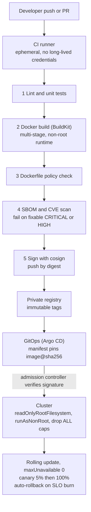

# Intuition & Mental Model

A container image is a **sealed shipping box**: the same bytes run on a laptop, in CI and in the customer's cluster. In enterprise work the box is also an audit artifact. Security teams ask: what is inside, who built it, was it scanned, and can it run as root? A CI/CD pipeline is the **assembly line with inspectors**: every commit passes the same gates (lint, test, build, scan, sign) and nothing reaches production by hand.

Key habits:
1. **Multi-stage builds.** Compile and install in a fat "builder" stage; copy only the results into a slim runtime stage. Smaller image, fewer CVEs, no compilers for an attacker to use.
2. **Least privilege at runtime.** Non-root user, read-only root filesystem, dropped Linux capabilities, no secrets baked into layers.
3. **Pin and verify.** Pin base images by digest, lock dependencies with hashes, sign images, and fail the pipeline on critical vulnerabilities.
4. **Gates are code.** The lab lints a Dockerfile and evaluates pipeline gates programmatically, so policy is testable.

# Production Architecture & Data Flow

Boundaries: CI network pushes to the registry, the production cluster pulls from it. Secrets arrive only through workload identity, never in image layers.

# Architectural Trade-Off Matrix

| Approach | Latency (build/deploy) | Scalability | Implementation Complexity | Cost |
|---|---|---|---|---|
| **Multi-stage Docker + distroless/slim runtime** | Fast pulls (~60-150 MB), cached builds | Excellent | Medium: need debug strategy (no shell) | Low |
| **Single-stage "fat" image** | Slow pulls (1+ GB), slow cold starts | Poor: large attack surface multiplies per node | Low | Medium: registry egress + node disk |
| **Buildpacks / managed build (Cloud Native Buildpacks, Cloud Build)** | Medium | Excellent: standardized across teams | Low-Medium; less control of layers | Medium: platform fees |

# Enterprise War Stories & Edge Cases

**1. API key in a layer.** A developer ran `COPY .env .` then `RUN rm .env`; the secret stayed in an earlier layer and was extracted from the public-pull-through cache. *Remediation:* rotate the key, use BuildKit `--mount=type=secret`, add `.dockerignore`, and a pipeline gate that scans layers for secrets and fails the build.

**2. `latest` took production down.** A rollback pulled `python:3.12` which had moved to a new minor with a changed OpenSSL, breaking a client's TLS inspection. Two "identical" builds differed. *Remediation:* pin base images by digest, renovate-style PRs to bump them, immutable tags in the registry, and reproducibility checks comparing SBOMs.

**3. Pods OOMKilled only under load.** The image ran fine in CI, but the cgroup memory limit (512Mi) was lower than the Python process plus model cache. Kubernetes restarted pods in a loop, and the rolling update stalled at 0% available. *Remediation:* load-test with production limits in CI, size requests from measured RSS, set `maxUnavailable: 0` with readiness probes so a bad version never replaces healthy pods, and automated rollback on error-rate burn.
