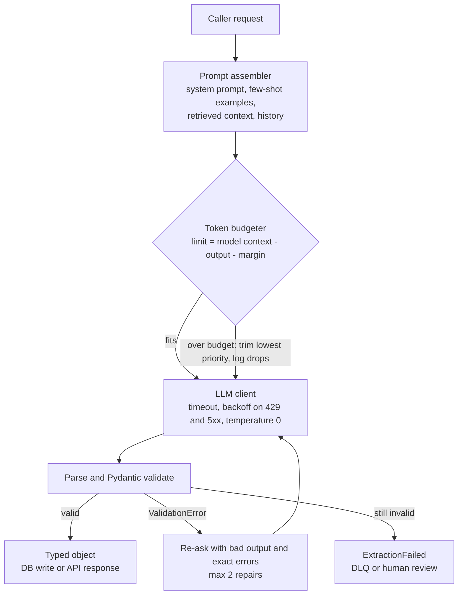

# Intuition & Mental Model

An LLM is a very capable intern with **no memory between conversations and a desk of fixed size**. The desk is the *context window*: everything the model can consider (system prompt, retrieved documents, chat history, and the answer it is writing) must fit on it. You pay per token for what goes on the desk, and quality drops when the desk is cluttered or the key paper is buried in the middle.

Two practical consequences:
1. **Context is a budget.** Count tokens before you call. Reserve room for the output. Decide in advance what gets cut first (old chat turns before the system prompt; low-score chunks before high-score ones).
2. **Free text is a bug in a pipeline.** Downstream code needs typed data, not prose. Ask for JSON that matches a Pydantic schema, validate it, and when validation fails send the *exact validation error* back to the model for a bounded number of repairs. This is the pattern libraries like Instructor implement; the lab builds it from scratch so you know what is under the hood.

Temperature near 0 gives repeatable extraction; higher values add variety. Neither removes the need for validation, because models can still emit a wrong date or an invented enum.

# Production Architecture & Data Flow

Metrics at every hop: input tokens, output tokens, cost, latency, repair count. Only the LLM client talks to the provider, and PII redaction (Module 13) happens before it.

# Architectural Trade-Off Matrix

| Approach | Latency | Scalability | Implementation Complexity | Cost |
|---|---|---|---|---|
| **Prompt + JSON mode + Pydantic validate/repair loop (Instructor-style)** | One call typically, +1 on repair | High; stateless | Low-Medium | Low: occasional repair call |
| **Native function/tool calling or constrained decoding (schema-enforced)** | One call, slightly higher first-token latency for grammar compilation | High | Low if provider supports; vendor lock-in | Low; fewer failed parses |
| **Free-text + regex/post-processing** | One call | Medium: brittle as outputs vary | High over time (regex whack-a-mole) | Hidden: engineer time and silent bad data |

# Enterprise War Stories & Edge Cases

**1. Silent truncation of a contract.** A 180-page contract was stuffed into the prompt; the provider truncated the middle, and the model answered "no termination clause" confidently. *Remediation:* count tokens locally before calling, fail loudly when over budget, chunk with map-reduce or retrieval, and test with needle-in-the-middle probes at 25/50/75% depth.

**2. The invoice date that was a hallucination.** An extraction pipeline accepted `{"due_date": "2024-02-30"}` because the schema typed it as `str`. Payments were scheduled for a nonexistent date. *Remediation:* use `date` types, cross-field validators (due date >= issue date), enums for currency, and route validation failures to review instead of "fixing" them silently.

**3. Retry loop cost explosion.** A repair loop with no cap re-asked 40 times on an impossible schema, with growing history each time, producing a four-figure bill in an hour. *Remediation:* hard cap of 2 repairs, send only the last bad output plus errors (not the full history), per-request token and cost ceilings, and an alert on repair-rate > 5%.
