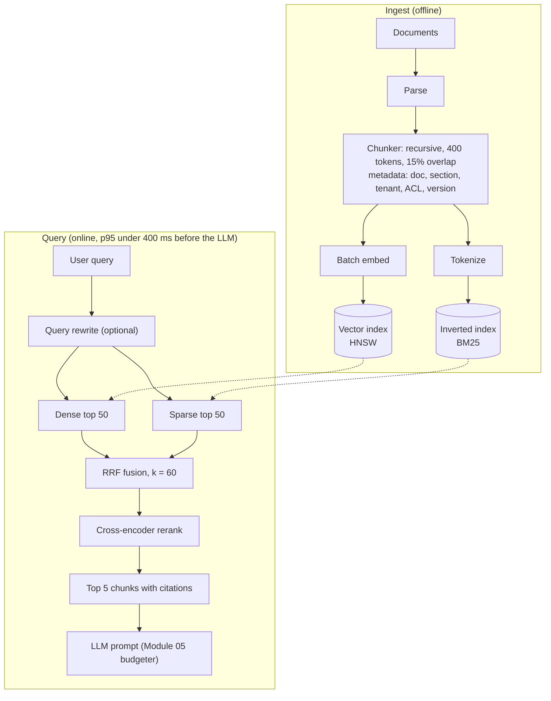

# Intuition & Mental Model

RAG (retrieval-augmented generation) is **open-book exam prep for the model**: find the right pages, put them on the desk, answer from them. Most RAG failures are retrieval failures, not generation failures: the right page never made it to the desk.

Why one search method is not enough:
- **Keyword search (BM25)** is great at exact things: part numbers, error codes, names, "Section 4.2(b)". It misses paraphrases.
- **Vector search** understands meaning ("car" ≈ "automobile") but can blur exact identifiers.
- **Hybrid** runs both and merges rankings. **Reciprocal Rank Fusion (RRF)** merges by *rank*, not raw score, so you never have to calibrate BM25 scores against cosine similarities: `score(d) = Σ 1 / (k + rank_i(d))`, k≈60.
- **Cross-encoder reranking** takes the top ~50 candidates and reads query and passage *together*, which is slower but much more accurate than comparing precomputed vectors. Use it only on the shortlist.
- **Chunking** decides what a "page" is. Too small loses context; too big dilutes the match and wastes tokens. Overlap protects ideas that straddle a boundary.

# Production Architecture & Data Flow

Tenant and ACL filters are applied inside both retrievers (Module 12). Re-indexing builds a new index and swaps an alias (blue/green), so updates are never partial.

# Architectural Trade-Off Matrix

| Approach | Latency | Scalability | Implementation Complexity | Cost |
|---|---|---|---|---|
| **Dense-only vector search** | Lowest (~10-30 ms ANN) | High with HNSW/IVF sharding | Low | Low; embedding + vector DB RAM |
| **Hybrid (BM25 + dense + RRF)** | +10-20 ms (parallel) | High; two indices to maintain | Medium | Low-Medium |
| **Hybrid + cross-encoder rerank** | +50-150 ms | Medium: rerank is the throughput bottleneck (GPU) | Medium-High | Medium-High (GPU inference) |

# Enterprise War Stories & Edge Cases

**1. The error code nobody could find.** A support copilot used dense-only retrieval; queries like `ERR_4471_TLS` returned generic TLS articles, never the KB page with that exact code. *Remediation:* add BM25 and fuse with RRF, tokenizer that preserves underscores and digits, and an eval set of exact-identifier queries that gates releases.

**2. Chunk boundaries split the refund policy.** Fixed 1,000-character chunks cut "Refunds are available within 30 days" from "except for enterprise contracts." The model quoted half a rule. *Remediation:* structure-aware chunking (headings, tables intact), 10-20% overlap, parent-document retrieval (match small, return the enclosing section), and chunk-level citations so reviewers can spot the gap.

**3. Stale index, confident wrong answers.** Documents were updated, but the nightly re-embed job had been failing silently for three weeks. The assistant cited the superseded pricing sheet. *Remediation:* index freshness SLO (max document age lag) with an alert, versioned chunks with `valid_to`, blue/green re-indexing with a canary query set, and showing source dates in answers.
