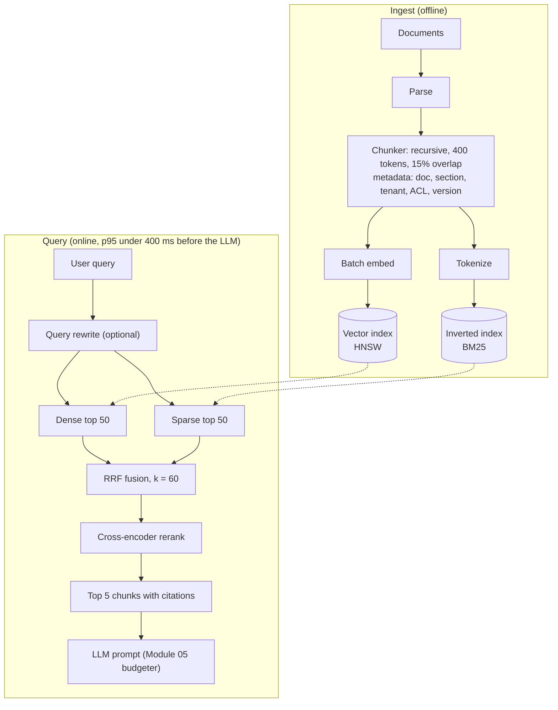

> **Syllabus lessons for this module:** full teaching notes for every topic are in [Syllabus Topic Write-ups](#syllabus-topic-write-ups); the topic-to-code map is in the [Syllabus Coverage Map](#syllabus-coverage-map) and [COVERAGE.md](../../COVERAGE.md).

# Intuition & Mental Model

RAG (retrieval-augmented generation) is **open-book exam prep for the model**: find the right pages, put them on the desk, answer from them. Most RAG failures are retrieval failures, not generation failures: the right page never made it to the desk.

Why one search method is not enough:
- **Keyword search (BM25)** is great at exact things: part numbers, error codes, names, "Section 4.2(b)". It misses paraphrases.
- **Vector search** understands meaning ("car" ≈ "automobile") but can blur exact identifiers.
- **Hybrid** runs both and merges rankings. **Reciprocal Rank Fusion (RRF)** merges by *rank*, not raw score, so you never have to calibrate BM25 scores against cosine similarities: `score(d) = Σ 1 / (k + rank_i(d))`, k≈60.
- **Cross-encoder reranking** takes the top ~50 candidates and reads query and passage *together*, which is slower but much more accurate than comparing precomputed vectors. Use it only on the shortlist.
- **Chunking** decides what a "page" is. Too small loses context; too big dilutes the match and wastes tokens. Overlap protects ideas that straddle a boundary.

# Production Architecture & Data Flow



Tenant and ACL filters are applied inside both retrievers (Module 12). Re-indexing builds a new index and swaps an alias (blue/green), so updates are never partial.

# Architectural Trade-Off Matrix

| Approach | Latency | Scalability | Implementation Complexity | Cost |
|---|---|---|---|---|
| **Dense-only vector search** | Lowest (~10-30 ms ANN) | High with HNSW/IVF sharding | Low | Low; embedding + vector DB RAM |
| **Hybrid (BM25 + dense + RRF)** | +10-20 ms (parallel) | High; two indices to maintain | Medium | Low-Medium |
| **Hybrid + cross-encoder rerank** | +50-150 ms | Medium: rerank is the throughput bottleneck (GPU) | Medium-High | Medium-High (GPU inference) |

# Enterprise War Stories & Edge Cases

**1. The error code nobody could find.** A support copilot used dense-only retrieval; queries like `ERR_4471_TLS` returned generic TLS articles, never the KB page with that exact code. *Remediation:* add BM25 and fuse with RRF, tokenizer that preserves underscores and digits, and an eval set of exact-identifier queries that gates releases.

**2. Chunk boundaries split the refund policy.** Fixed 1,000-character chunks cut "Refunds are available within 30 days" from "except for enterprise contracts." The model quoted half a rule. *Remediation:* structure-aware chunking (headings, tables intact), 10-20% overlap, parent-document retrieval (match small, return the enclosing section), and chunk-level citations so reviewers can spot the gap.

**3. Stale index, confident wrong answers.** Documents were updated, but the nightly re-embed job had been failing silently for three weeks. The assistant cited the superseded pricing sheet. *Remediation:* index freshness SLO (max document age lag) with an alert, versioned chunks with `valid_to`, blue/green re-indexing with a canary query set, and showing source dates in answers.


# Syllabus Topic Write-ups

This module teaches how a retrieval system finds the right passages in a large body of enterprise documents, from splitting documents into chunks, through vector and keyword search, to hybrid fusion and reranking. Retrieval quality sets the ceiling on every RAG answer, so a Forward Deployed Engineer who can diagnose it, measure it and explain the trade-offs is the person who rescues a failing pilot at a customer. Each topic below is a self-contained lesson with worked calculations, exercises with solutions, failure modes and interview practice. Numbers marked as examples are illustrative, so replace them with measurements from your own data, and verify vendor-specific names and limits against current documentation.

**How to study this module**

Read the topics in this order, because later ones lean on earlier ones. Do the exercises with pen and paper before reading the solutions.

1. Topics 1 and 2 (chunking and overlap): what the unit of retrieval is.
2. Topics 3, 4 and 7 (vector representations, dimensionality, distance metrics): what the numbers mean and what they cost.
3. Topics 5 and 11 (BM25 and keyword search): the sparse side, and why exact matching still matters.
4. Topics 6, 8 and 9 (indexes, metadata filtering, provisioning): how vectors are stored, searched safely and deployed.
5. Topic 10 (end-to-end retrieval) and topic 14 (metrics): build the baseline and measure it. Do this before any improvement.
6. Topics 12 and 13 (hybrid fusion and RRF), then topics 15 and 16 (cross-encoder reranking and its API integration): the improvements, each justified by measurements from step 5.

**Module cheat sheet**

| Must-know | One-line answer |
|---|---|
| Chunk size trade-off | Small chunks match precisely but lack context, large chunks blur the embedding and cost prompt tokens. Tune on labeled questions. |
| Overlap cost | Storage factor = size / (size - overlap), so 40 words on 200 adds 25 percent. Too much overlap crowds results with duplicates. |
| Sparse versus dense | Sparse matches exact terms, dense matches meaning, and enterprise queries need both. |
| Vector memory | bytes = vectors x dims x bytes per value. 24M x 768 x 4 = 73.7 GB in float32, about 18.4 GB in int8, before index overhead. |
| BM25 | IDF x saturating term frequency x length normalisation, with k1 (saturation) and b (length). Stored as an inverted index. |
| Flat versus IVF versus HNSW | Flat is exact but linear, IVF scans nprobe of nlist clusters, HNSW walks a layered graph with efSearch breadth. ANN trades recall for speed. |
| Cosine, dot product, Euclidean | On unit vectors all rank the same, since squared distance = 2 - 2 x cosine. Configure the metric the model documents. |
| Pre-filter versus post-filter | Pre-filtering inside the search returns k allowed results, post-filtering can return fewer or none and is unsafe for access control. |
| Weighted fusion | Min-max normalise each list, then alpha x dense + (1 - alpha) x sparse. Never add raw scores. |
| RRF | score = sum of 1 / (k + rank), k = 60 by default, ranks start at 1, uses ranks only so no normalisation is needed. |
| Precision, recall, MRR, nDCG | Precision@k = relevant in top k / k, recall@k = relevant in top k / all relevant, MRR = mean of 1 / first relevant rank, nDCG rewards early graded hits. |
| Bi-encoder versus cross-encoder | Bi-encoder embeds separately (fast, precomputable), cross-encoder reads the pair together (accurate, one pass per candidate). |
| Reranking pipeline | Retrieve about 50 candidates for recall, rerank to 5 for precision. Recall of the first stage is the ceiling. |
| Reranker API resilience | Timeout, deadline, retry only 429 and 5xx with backoff and jitter, and fall back to the fused order on failure. |

### 1. Fixed-size and semantic chunking

**What you will be able to do**

- Explain to a non-engineer in two minutes why documents are cut into chunks before search.
- Compute by hand how many chunks a document produces for a given size, and how many tokens a retrieved set costs.
- Choose between fixed-size, recursive and semantic chunking for a given document type and defend the choice.
- Spot a chunking defect (split table, split rule and exception, oversize chunk) from a bad retrieval result.
- Design an evaluation that proves one chunking strategy beats another on your own data.

**Prerequisites**

Basic Python and the idea of an embedding (a list of numbers representing meaning). Embeddings are taught in topic 3 of this module, so skim that first if the word is new.

**The idea from first principles**

Imagine a 400-page policy manual and a clerk who answers questions from it. The clerk cannot read 400 pages for every question, so you give the clerk an index of short passages and ask them to pull the five most useful ones. A retrieval system works the same way. The unit of storage and retrieval is a passage, and we call it a chunk.

Why not index whole documents? Two reasons. First, an embedding model compresses a text into one vector. A vector for 50 pages averages dozens of ideas, so it sits near none of them and matches nothing well. Second, a language model has a limited context window and you pay per token, so returning 50 pages to answer a one-line question wastes money and buries the answer. Embedding models also have a maximum input length, and text beyond it is cut off or rejected, so a hard ceiling exists anyway.

Why not index single sentences? A sentence such as "This does not apply to joint accounts" is meaningless alone. Chunks need enough surrounding text to stand on their own, which is the central tension: small chunks are precise but lack context, large chunks have context but blurry meaning.

Terms. A token is the unit a model reads, roughly three quarters of an English word (a rule of thumb that varies by tokenizer). Chunk size is the target length in tokens or words. Fixed-size chunking cuts every N units regardless of content. Recursive chunking uses a ranked list of separators (paragraph break, line break, sentence end, space) and splits on the biggest one that keeps pieces under the limit. Semantic chunking uses embeddings to find topic shifts and cuts there. Structure-aware chunking uses the document's own markup (headings, clauses, table rows).

The naive approach, cutting every 200 words, fails because language does not respect word counts. A cut can land in the middle of a sentence, between a rule and its exception, or between a table header and its rows. The real approaches try to cut where the text itself changes topic.

**How it works, step by step**

Fixed-size:

1. Split the text into words (or tokens with the model's tokenizer).
2. Take the first N units as chunk 1, the next N as chunk 2, and so on.
3. The last chunk is whatever remains. Number of chunks = ceil(total / N).

Recursive:

1. Define separators in priority order, for example blank line, newline, ". ", space.
2. Split on the first separator. Any piece still over the limit is split again with the next separator.
3. Merge adjacent small pieces back together until adding another would exceed the target.
4. Result: chunks that mostly end at paragraph or sentence ends.

Semantic:

1. Split into sentences.
2. Embed every sentence (n sentences means n embedding calls).
3. Compute cosine similarity between each sentence and the next, giving n - 1 values.
4. Mark a boundary where similarity is below a threshold, or at the largest drops (for example the bottom 10 percent of values).
5. Enforce a minimum and maximum chunk size so a noisy dip does not create one-sentence chunks and a long uniform stretch does not become one huge chunk.

Worked calculation with invented numbers. A document has 1,150 words. Fixed size N = 300 gives ceil(1150 / 300) = ceil(3.83) = 4 chunks: three of 300 words and one of 250. If a retrieval returns top 5 chunks at 300 words, and one word is about 1.33 tokens, the context cost is 5 x 300 x 1.33 = 1,995 tokens. At 150-word chunks the same five hits cost about 998 tokens but carry half the context each.

**Worked example 1: small and hand-traceable**

Seven sentences with similarities between neighbours (invented): s1-s2 0.90, s2-s3 0.85, s3-s4 0.40, s4-s5 0.88, s5-s6 0.30, s6-s7 0.90. Threshold 0.5.

1. Scan the six values. 0.90 and 0.85 are above 0.5, so s1, s2, s3 stay together.
2. 0.40 is below 0.5, so cut after s3. Chunk A = s1 to s3.
3. 0.88 is above, so s4 and s5 stay together.
4. 0.30 is below, so cut after s5. Chunk B = s4 to s5.
5. Remaining s6 and s7 form chunk C.

Result: [s1 s2 s3], [s4 s5], [s6 s7]. If the minimum chunk size is 3 sentences, chunk B and chunk C would merge (B is too small, merge it with the nearer neighbour, here C because 0.30 is the weaker break, giving [s4 s5 s6 s7]). This shows why a threshold alone is not enough and size guards are needed.

**Worked example 2: enterprise scenario**

A retail bank indexes product terms and conditions: prose sections, fee tables and numbered clauses. The team finds that a question about overdraft fees returns half of a fee table. They change the pipeline: tables are extracted as one chunk each with their header repeated, prose is split by headings then by sentences up to 150 words, and each chunk carries its section title.

```python
import re

def sentence_chunks(text, max_words=150):
    sentences = re.split(r"(?<=[.!?])\s+", text.strip())
    chunks, current, count = [], [], 0
    for s in sentences:
        n = len(s.split())
        if current and count + n > max_words:
            chunks.append(" ".join(current))
            current, count = [], 0
        current.append(s)
        count += n
    if current:
        chunks.append(" ".join(current))
    return chunks

def build_records(section_title, text):
    return [
        {"text": f"{section_title}. {c}", "section": section_title}
        for c in sentence_chunks(text)
    ]
```

Commentary: the regular expression splits after sentence-ending punctuation followed by whitespace; it will mis-split abbreviations such as "approx." so production code uses a real sentence splitter. The size guard flushes the current chunk before adding a sentence that would overflow it. Prefixing the section title gives every chunk its context, which helps both embedding and the model reading it. Storing the section as metadata also allows filtering and citation.

**Hands-on practice**

Exercise 1 (easy). A 2,500-word document is chunked at 300 words with no overlap. How many chunks, and how long is the last?

Solution: 2,500 / 300 = 8.33, so ceil gives 9 chunks. Eight chunks use 2,400 words, leaving 100 words for the last chunk.

Exercise 2 (medium). Consecutive similarities are 0.92, 0.35, 0.88, 0.90, 0.41, 0.87 over seven sentences. Threshold 0.5, minimum 2 sentences. Give the chunks.

Solution: 0.35 is the second value, so cut after sentence 2. 0.41 is the fifth value, so cut after sentence 5. Raw chunks: [1 2], [3 4 5], [6 7]. All have at least 2 sentences, so no merge is needed.

Exercise 3 (hard). Your embedding model accepts 512 tokens. You add a 20-token title prefix to each chunk and want 15 percent headroom. What word target do you set, assuming 1.33 tokens per word?

Solution: usable tokens = 512 x 0.85 = 435.2. Subtract the prefix: 415. Words = 415 / 1.33 = 312. Round down to about 300 words. The 1.33 figure is an assumption, so verify with the real tokenizer on sample chunks and set a hard truncation check in the pipeline.

**Alternatives and trade-offs**

| Strategy | Ingest cost | Strength | Weakness | Choose when |
|---|---|---|---|---|
| Fixed-size | Lowest | Predictable, simple, fast | Cuts sentences and tables | Uniform text, huge volume, quick baseline |
| Recursive | Low | Respects paragraphs and sentences | Depends on separators | Default for prose |
| Semantic | One embedding per sentence | Topic-pure chunks | Threshold tuning, uneven sizes, extra cost | Long documents with frequent topic shifts |
| Structure-aware | Parser work | Best for contracts, manuals, HTML, tables | Needs per-format parsing | Structured enterprise documents |

Chunking is the wrong tool when the question needs the whole document (summarising a 40-page report). Use a map-reduce summary or a long-context model instead. For questions that need small precision but wide context, consider parent-child retrieval: match small chunks, return the enclosing section.

**Where it goes wrong in production**

- Symptom: answers miss an exception or condition. Cause: a boundary split a rule from its exception. Diagnose: print the top chunks and read them. Fix: structure-aware splitting plus small overlap.
- Symptom: fee tables return nonsense. Cause: rows separated from the header. Diagnose: look for chunks that begin mid-table. Fix: keep tables whole or repeat headers.
- Symptom: a long chunk containing the answer ranks low. Cause: diluted embedding. Diagnose: compare its score with a manually trimmed version. Fix: smaller chunks or parent-child retrieval.
- Symptom: silent quality loss or ingest errors. Cause: chunks above the embedding model limit. Diagnose: log token counts per chunk. Fix: count with the model tokenizer and enforce a maximum.
- Symptom: semantic chunking gives one-sentence and 2,000-word chunks. Cause: threshold too sensitive or too lax. Diagnose: histogram of chunk sizes. Fix: min and max size, percentile thresholds.

**Do not confuse**

- Chunk size versus context window: chunk size is how big each stored piece is, the context window is how much the model can read at once. Several chunks must fit in the window together with the question and instructions.
- Chunking versus tokenization: tokenization splits text into model units for reading, chunking splits documents into retrievable passages.

**How interviewers probe this**

- What is chunking and why do we do it?
- What are the trade-offs of small versus large chunks?
- How does semantic chunking work and what does it cost?
- How would you chunk a contract with numbered clauses and tables?
- Retrieval finds the right document but the answer is wrong. How do you decide whether chunking is the cause?
- Design chunking for 10 million mixed documents and show it works.
- What breaks when you change the chunking strategy on a live index?
- Trap: "Semantic chunking is always better, right?"

**Model answer (60-90 seconds)**

"Chunking is how I split documents into retrievable passages, because the retriever returns chunks and the model only sees what comes back. Fixed-size chunking cuts every N tokens, which is cheap and predictable but can cut a sentence or separate a rule from its exception. Recursive chunking splits on paragraph, then sentence, then word boundaries, which respects structure. Semantic chunking embeds each sentence and cuts where neighbouring similarity drops, so each chunk is about one topic, at the cost of one embedding per sentence. The core trade-off is size: small chunks match precisely but lack context, large chunks keep context but blur the embedding and cost more prompt tokens. For a bank's terms documents I would parse structure first, keep tables whole, prefix each chunk with its section title, and start around 200 to 400 words. The limit is that no strategy wins in general, so I would compare them on labeled questions using recall@k and answer coverage."

**Quick-fire answers**

- Q: What is chunking and why? A: Splitting documents into passages for embedding and retrieval. Whole documents blur meaning and waste context, single sentences lack context.
- Q: Small versus large chunks? A: Small ones are precise but thin, large ones carry context but dilute the embedding and cost more tokens. Tune on labeled questions.
- Q: How does semantic chunking work? A: Embed sentences, compute similarity between neighbours, cut where it drops, with min and max size guards. Cost is one embedding per sentence.
- Q: Chunking a contract with tables? A: Parse by clause and heading, keep each table whole with its header, and store section metadata for citation and filtering.
- Q: Is chunking the cause of a wrong answer? A: Read the retrieved chunks. If the needed fact is split, diluted or absent, it is chunking. If present but ignored, look at ranking or the prompt.
- Q: Design at 10 million documents? A: Per-format parsers, recursive default, a labeled query set, a strategy comparison on recall@k, then monitoring chunk size and token counts.
- Q: What breaks on a strategy change? A: Chunk ids and offsets change, so citations, caches and evals break. Rebuild in a new index and swap after testing.
- Q: Is semantic always better? A: No. It costs more and can create uneven chunks, and on well-structured text recursive often matches it. Measure.

**Recap in five lines**

- A chunk is the unit of storage and retrieval, so chunk quality caps answer quality.
- Small chunks are precise, large chunks hold context, and the model input limit is a hard ceiling.
- Fixed-size is cheap, recursive respects structure, semantic cuts at topic shifts and costs an embedding per sentence.
- Tables, clauses and code need structure-aware handling, and chunks should carry section titles.
- Choose a strategy by measuring recall@k on your own labeled questions.

### 2. Overlap optimization

**What you will be able to do**

- Explain why a boundary can destroy an answer and how overlap repairs it.
- Calculate index growth from an overlap setting, and the extra storage it implies.
- Run an overlap sweep and pick a value from the results.
- Recognise duplicate crowding in retrieval results and fix it.

**Prerequisites**

Topic 1 (chunking) of this module, and basic arithmetic on counts and bytes.

**The idea from first principles**

Picture cutting a long strip of wallpaper into panels. If a pattern runs across the cut, you lose the picture where the two panels meet. Chunking has the same flaw. A fact that sits across a cut, such as "Refunds are available within 30 days" at the end of one chunk and "except for sale items" at the start of the next, is split into two chunks that each tell half the story. A user asking about refunds on sale items may retrieve only the first chunk and get a confidently wrong answer.

Overlap is the repair: the end of one chunk is repeated at the start of the next, so anything near a boundary is whole in at least one chunk. Think of it as printing a small strip of the previous panel on the next panel.

The naive fix is to make chunks huge so there are fewer boundaries. That moves the problem into dilution and prompt cost (topic 1). Another naive fix, overlapping by half the chunk, makes the corpus twice as large and fills result lists with near-identical text.

Terms. Overlap is the number of units shared between neighbouring chunks, either absolute (40 words) or relative (20 percent of size). Step, also called stride, is size minus overlap, the distance the window moves forward. Index bloat or storage factor is size divided by step. Near-duplicate crowding means several top-k slots taken by chunks that are mostly the same text. Answer coverage means the share of gold answers whose full supporting text appears inside at least one retrieved chunk.

**How it works, step by step**

1. Choose size S and overlap O. Compute the step T = S - O.
2. Chunk 1 covers units 0 to S - 1. Chunk 2 covers T to T + S - 1. Chunk k covers (k - 1) x T to (k - 1) x T + S - 1.
3. Every unit away from the document edges appears in about S / T chunks.
4. Number of chunks for a document of L units is about ceil((L - S) / T) + 1 for L at least S.
5. Index growth equals S / T. Vectors, text storage and embedding calls grow by the same factor.
6. Measure: for a range of O values, rebuild chunks, run retrieval over labeled questions, and record coverage, recall@k and duplicate rate.
7. Choose the smallest O at which coverage stops improving meaningfully.

Worked calculation. A corpus has 2,000,000 words. Size 200.

- O = 0: T = 200, chunks about 10,000, factor 1.00.
- O = 20: T = 180, chunks about 11,111, factor 1.11.
- O = 40: T = 160, chunks 12,500, factor 1.25.
- O = 100: T = 100, chunks 20,000, factor 2.00.

At 768 dimensions in float32, one vector is 3,072 bytes. Going from 10,000 to 12,500 chunks adds 2,500 x 3,072 = 7,680,000 bytes, about 7.7 MB of vectors. Small here, but at 200 million words it is 100 times larger, plus text storage, embedding API cost and index build time.

**Worked example 1: small and hand-traceable**

Words numbered 0 to 19. Size 8, overlap 2, so step 6.

1. Chunk 1: words 0 to 7.
2. Chunk 2: words 6 to 13 (starts at 6).
3. Chunk 3: words 12 to 19 (starts at 12).
4. Next start would be 18, giving words 18 to 19 only, a short tail chunk (some implementations drop it or keep it).

A key phrase occupying words 7 and 8 straddles the boundary between chunk 1 (ends at 7) and chunk 2 (starts at 6). With overlap, chunk 2 starts at 6, so it contains 6, 7 and 8, and the phrase is whole. Without overlap chunk 2 would start at 8 and the phrase would be cut. Words 6 and 7 appear in both chunks; that is the duplicated cost.

**Worked example 2: enterprise scenario**

A telecom assistant answers questions on plan terms. Cancellation fees are stated in one sentence and exceptions in the next, and evaluators found 9 of 60 test questions failing because the pair was split. The team sweeps overlap and records two numbers from retrieval over the 60 labeled questions (all counts here are an invented illustration).

```python
def chunk(words, size, overlap):
    step = size - overlap
    return [" ".join(words[i:i + size]) for i in range(0, len(words), step)]

def coverage(chunks, gold_texts):
    return sum(any(g in c for c in chunks) for g in gold_texts) / len(gold_texts)

for overlap in (0, 20, 40, 60):
    cs = chunk(words, 200, overlap)
    print(overlap, len(cs), round(coverage(cs, gold_texts), 2))
```

Commentary: the step is the only line that changes behaviour. The coverage function is a simplified proxy, because it only checks whether a gold string exists inside any chunk, not whether retrieval ranks it. If the printed coverage rose 0.85, 0.97, 0.98, 0.98, the team would choose 20 words, since 40 and 60 add storage without improvement. A full evaluation then runs real retrieval and also counts how often two top-5 hits come from the same place, which exposes duplicate crowding.

**Hands-on practice**

Exercise 1 (easy). Size 300 and overlap 60. What is the step, and the storage factor?

Solution: step = 300 - 60 = 240. Factor = 300 / 240 = 1.25, so 25 percent more chunks and vectors.

Exercise 2 (medium). A 1,000-word document, size 250, overlap 50. List the chunk start positions and count.

Solution: step = 200. Starts at 0, 200, 400, 600, 800. The chunk starting at 800 covers 800 to 1,049 so it is cut at 999 (200 words). Five chunks (a trailing chunk starting at 1,000 would be empty). Words 200 to 249 appear in chunks 1 and 2, and so on.

Exercise 3 (hard). Your top 5 results frequently contain 3 chunks from the same page at 50 percent overlap. Propose a fix with numbers.

Solution: duplicate crowding comes from overlap above what is needed. Reduce overlap to 10 to 20 percent (factor 1.11 to 1.25), sweep to confirm coverage holds, and add a post-retrieval step that merges chunks whose offset ranges overlap or are adjacent, keeping the best score. Retrieve top 10 before merging so five distinct sources remain after deduplication.

**Alternatives and trade-offs**

| Approach | Storage cost | Benefit | Risk | Choose when |
|---|---|---|---|---|
| No overlap | 1.0x | Clean, no duplicates | Boundary losses | Boundaries already at sections |
| Fixed overlap (10-20 percent) | 1.11x to 1.25x | Cheap protection | Some duplicates | Default for flowing prose |
| Sentence-aligned boundaries | About 1.0x | Never cuts a sentence | Needs good splitting | Clean prose with short sentences |
| Parent-child retrieval | Higher | Precision plus wide context | More components | Answers need surrounding section |

Overlap is the wrong tool when the loss is semantic rather than positional. If the answer sits three paragraphs from its qualifier, no practical overlap helps, and you need larger parent context or retrieval of neighbouring chunks.

**Where it goes wrong in production**

- Symptom: the same passage appears two or three times in the prompt. Cause: high overlap. Diagnose: count shared offsets among results. Fix: lower overlap and merge adjacent hits.
- Symptom: storage and embedding bills higher than forecast. Cause: factor never computed. Diagnose: compare chunk counts to source size. Fix: pick overlap by sweep, not default.
- Symptom: citations point to the wrong page. Cause: overlapping chunks claim the same text. Diagnose: inspect offsets. Fix: store start and end offsets and cite the best-scoring one.
- Symptom: no measurable gain from overlap. Cause: chunks already end at section boundaries. Diagnose: sweep shows flat curve. Fix: use zero overlap.
- Symptom: tests pass but production fails on new document types. Cause: the sweep used one type. Diagnose: segment the evaluation by document type. Fix: per-type settings.

**Do not confuse**

- Overlap versus stride: overlap is shared units, stride (step) is how far the window moves. Stride = size - overlap.
- Overlap versus duplication: overlap is intentional boundary protection, duplication is the same document ingested twice, which needs deduplication by content hash.

**How interviewers probe this**

- What is chunk overlap and why does it exist?
- What does 20 percent overlap cost in storage?
- How do you choose an overlap value?
- Why might more overlap reduce precision?
- Retrieval returns near-duplicate chunks. What do you do?
- Design an experiment that sets chunk size and overlap for a new corpus.
- What breaks if you change overlap on a live index?
- Trap: "Always use 50 percent overlap to be safe."

**Model answer (60-90 seconds)**

"Overlap means neighbouring chunks share some text, so a fact that straddles a boundary is intact in at least one chunk. Mechanically it is a sliding window whose step is size minus overlap. The cost is that every unit appears in size divided by step chunks, so 40 words of overlap on 200-word chunks stores 25 percent more vectors and text. The second cost is near-duplicate crowding, where several top results are the same passage and the prompt fills with repeats, which can lower precision. I choose it empirically: build labeled questions, sweep overlap at zero, ten, twenty and thirty percent, track answer coverage, recall@k and duplicate rate, and take the smallest value where coverage plateaus. If chunks already follow section boundaries the right answer may be zero. In production I would store offsets and merge adjacent hits before building the prompt."

**Quick-fire answers**

- Q: What is overlap? A: Text repeated at the end of one chunk and the start of the next so boundary-straddling facts stay whole.
- Q: Storage cost of 20 percent overlap? A: Step is 0.8 of size, so factor 1 / 0.8 = 1.25, about 25 percent more chunks.
- Q: How to choose a value? A: Sweep on labeled queries, track coverage and recall, choose the smallest value where coverage stops rising.
- Q: Why can precision drop? A: Near-duplicate chunks take several top-k slots and push distinct evidence out.
- Q: Duplicates in results? A: Lower overlap, retrieve more and merge chunks with overlapping offsets, keep the best score.
- Q: Experiment design? A: Fix a labeled query set segmented by document type, vary size and overlap on a grid, record coverage, recall@k, duplicate rate and cost, choose the cheapest passing setting.
- Q: Changing overlap live? A: Chunk ids and offsets change, so rebuild into a new index, compare on the eval set, then swap.
- Q: Is 50 percent safe? A: No. It doubles the index and floods results with duplicates, for little gain beyond a small overlap.

**Recap in five lines**

- Overlap repeats boundary text so facts that straddle a cut survive in one chunk.
- Step = size - overlap, and storage factor = size / step.
- Too much overlap inflates cost and crowds results with near-duplicates.
- Pick overlap by sweeping on labeled queries and taking the smallest value where coverage plateaus.
- Store offsets so you can deduplicate, merge adjacent hits and cite correctly.

### 3. Understanding vector representations

**What you will be able to do**

- Explain sparse and dense vectors to a non-engineer using a library analogy.
- Compute a dot product and cosine similarity by hand for small vectors, sparse and dense.
- Say what an embedding model is trained to do and why vectors from two models cannot be mixed.
- Choose sparse, dense or hybrid for a query mix and plan a safe embedding model migration.

**Prerequisites**

Comfort with lists, dictionaries and the dot product of two lists (multiply matching entries, add them up). No machine learning background is needed.

**The idea from first principles**

A computer cannot compare meanings, only numbers. So the first problem of search is turning text into numbers in a way that makes similar things come out similar. There are two broad answers.

The first answer is the index card catalogue. Give every word in the vocabulary its own slot. A document becomes a row of counts, one count per word. This is a sparse vector: with a 50,000-word vocabulary the row is 50,000 long, but a short document uses perhaps 100 slots, so nearly everything is zero and we store only the non-zero entries. Two texts are similar if they share words. This is fast, exact and explainable, and it fails on vocabulary mismatch. "Car" and "automobile" occupy different slots and share nothing, so a user who types "get my money back" will not match a document that says "refund".

The second answer is the librarian who understands topics. A neural network called an embedding model reads text and outputs a short list of numbers, typically a few hundred to a few thousand, so that texts with similar meaning get lists that point in similar directions. This is a dense vector: every slot is non-zero. "Get my money back" and "refund policy" land close together even though they share no words. The price is that individual slots have no human meaning, the model is a black box, and rare strings such as part number "XQ-7731-B" can be blurred because the model has seen few examples and maps them near generic neighbours.

Precise terms. A vector is an ordered list of numbers. Dimensionality is its length. Sparse means mostly zeros and stored as term-to-weight pairs. Dense means every position holds a value and the whole list is stored. An embedding is a dense vector produced by a model that represents the meaning of an input. The embedding space is the coordinate system defined by that specific model, so similarity is only meaningful between vectors from the same model.

Why can models not be mixed? Each model learns its own arbitrary coordinate system. Slot 7 in model A has no relation to slot 7 in model B, even if both output 768 numbers. Comparing them gives numbers that look valid and mean nothing.

**How it works, step by step**

How a dense embedding is produced and used:

1. Tokenise: split the text into sub-word pieces (for example "refunds" may become "refund" and "s").
2. Run the pieces through the network to get one vector per piece, shaped by the surrounding words.
3. Pool: combine them into one vector for the whole text, commonly by averaging, and often scale to length 1 (normalise).
4. Training, done once by the model provider: use pairs of texts that belong together (a question and its answer passage) and pull their vectors closer, while pushing unrelated texts apart. This is called contrastive training.
5. Index time: embed every chunk and store the vectors.
6. Query time: embed the question with the same model and find the closest stored vectors.

How a sparse vector is produced: tokenise, normalise (lowercase), count or weight each term, store non-zero pairs. Weighting schemes such as BM25 (topic 5) refine the counts.

Worked calculation with invented 3-dimensional vectors. Query q = [0.8, 0.1, 0.6]. Document A ("refund policy") = [0.7, 0.2, 0.7]. Document B ("parking rules") = [-0.1, 0.9, 0.0].

- Dot product q.A = 0.8 x 0.7 + 0.1 x 0.2 + 0.6 x 0.7 = 0.56 + 0.02 + 0.42 = 1.00.
- Dot product q.B = 0.8 x -0.1 + 0.1 x 0.9 + 0.6 x 0 = -0.08 + 0.09 + 0 = 0.01.
- Lengths: |q| = sqrt(0.64 + 0.01 + 0.36) = sqrt(1.01) = 1.005. |A| = sqrt(0.49 + 0.04 + 0.49) = 1.010. |B| = sqrt(0.01 + 0.81) = 0.906.
- Cosine q,A = 1.00 / (1.005 x 1.010) = 0.985. Cosine q,B = 0.01 / (1.005 x 0.906) = 0.011.

Document A is almost parallel to the query and B is nearly perpendicular. Real models do this in hundreds of dimensions.

**Worked example 1: small and hand-traceable**

Sparse retrieval over three tiny documents. Query: "refund policy" gives {refund: 1, policy: 1}.

- Doc 1 "refund policy for card purchases": {refund: 1, policy: 1, card: 1, purchases: 1}.
- Doc 2 "parking rules": {parking: 1, rules: 1}.
- Doc 3 "money back guarantee": {money: 1, back: 1, guarantee: 1}.

Dot products: Doc 1 = 1 x 1 + 1 x 1 = 2 (only shared terms contribute). Doc 2 = 0. Doc 3 = 0. A dense model would also score Doc 3 high, because "money back guarantee" is close in meaning to a refund. This is the vocabulary mismatch gap in one example. In the other direction, a query "XQ-7731-B" matches nothing in a dense model reliably but gives an exact hit in sparse retrieval.

**Worked example 2: enterprise scenario**

An insurer's claims assistant must find "water damage exclusions" when users type "burst pipe coverage", and also find clause "EX-114" when an adjuster types that code. The team builds two retrievers over the same chunks: a dense one and a BM25 one (topic 5), and merges their results (topics 12 and 13). They also record, with the index, exactly which model produced the vectors, so that a later model upgrade cannot silently mix spaces.

```python
index_meta = {
    "embedding_model": "example-embedding-model-v1",
    "dims": 768,
    "normalised": True,
    "created": "2026-10-01",
}

def check_compatible(query_model_name, meta):
    if query_model_name != meta["embedding_model"]:
        raise RuntimeError("query embedded with a different model than the index")
```

Commentary: the model name here is a placeholder, so record whatever your provider documents, including any version. The check refuses to run a query whose vector came from a different model. Without it the system returns plausible-looking but meaningless neighbours, which is much harder to notice than an error. The normalised flag tells the index which metric setting is correct (topic 7).

**Hands-on practice**

Exercise 1 (easy). Compute the dot product of sparse vectors {refund: 2, card: 1} and {refund: 1, policy: 3, card: 2}.

Solution: shared terms are refund and card. 2 x 1 + 1 x 2 = 4. The term "policy" appears in only one vector, so it contributes 0.

Exercise 2 (medium). Compute cosine similarity of [1, 2, 2] and [2, 0, 1].

Solution: dot = 2 + 0 + 2 = 4. |a| = sqrt(1 + 4 + 4) = 3. |b| = sqrt(4 + 0 + 1) = 2.236. Cosine = 4 / (3 x 2.236) = 4 / 6.708 = 0.596.

Exercise 3 (hard). You must move 5 million chunks from model A to model B. Re-embedding runs at 500 chunks per second (an example rate). Describe a migration with no downtime and the time needed for embedding.

Solution: embedding time = 5,000,000 / 500 = 10,000 seconds, about 2.8 hours (plus index build). Create a second index tagged with model B, embed all chunks into it in the background while production serves model A, run the labeled query set against both indexes and confirm recall is at least as good, then switch the query path to model B and its index in one configuration change, keeping model A's index for a rollback window. New or changed documents during the migration go to both indexes until the switch.

**Alternatives and trade-offs**

| Representation | Strength | Weakness | Cost | Choose when |
|---|---|---|---|---|
| Sparse (BM25, term weights) | Exact terms, explainable, no model | No synonyms | Cheap | Identifiers, codes, short factual terms |
| Dense (embeddings) | Meaning, paraphrase, multilingual | Blurs rare strings, opaque | Model inference, vector memory | Natural-language questions |
| Learned sparse | Term matching with learned expansion | Newer tooling, more complex | Model inference | You want one sparse index with some semantics |
| Hybrid | Covers both failure modes | Two indexes and a merge step | Highest | Mixed enterprise queries |

Dense vectors are the wrong tool when exactness matters more than meaning: invoice numbers, SKUs, statute citations. Sparse is the wrong tool when users phrase the same need in many ways.

**Where it goes wrong in production**

- Symptom: relevance drops after a model upgrade. Cause: query and document vectors from different models. Diagnose: compare the model recorded on the index with the query path. Fix: versioned indexes and blue/green migration.
- Symptom: users cannot find items by SKU. Cause: dense model blurs rare tokens. Diagnose: run a set of exact-identifier queries. Fix: add sparse retrieval or an exact-match path.
- Symptom: non-English queries perform poorly. Cause: English-centred model. Diagnose: evaluate per language. Fix: multilingual model, tested on each language.
- Symptom: domain jargon is mapped to wrong neighbours. Cause: the model never saw the domain. Diagnose: inspect nearest neighbours of key terms. Fix: hybrid, glossary expansion, or domain fine-tuning if justified.
- Symptom: huge memory use from sparse vectors stored as dense arrays. Cause: wrong data structure. Diagnose: check memory per document. Fix: store only non-zero terms.

**Do not confuse**

- Sparse versus dense: sparse has one slot per term and is mostly zero, dense is a short learned list with no zeros expected.
- Embedding versus encoding of text such as one-hot or counts: an embedding is learned to place related meanings close, a count vector is just bookkeeping of words.
- Same dimension count versus same space: two models both emitting 768 numbers do not share a space.

**How interviewers probe this**

- What is the difference between sparse and dense representations?
- What does an embedding model learn during training?
- Why can you not search an index built with model A using queries embedded by model B?
- Why still use keyword search in an embedding world?
- What do individual dimensions of an embedding mean?
- Design retrieval for a corpus full of part numbers where users also ask natural questions.
- What breaks when the provider deprecates your embedding model?
- Trap: "Dense retrieval understands meaning, so exact matching is obsolete."

**Model answer (60-90 seconds)**

"A vector representation maps text to numbers so that we can measure similarity. A sparse vector has a slot per vocabulary term and is mostly zero, so it matches exact words fast and explainably but misses synonyms. A dense vector comes from an embedding model trained with pairs of related texts, so that related meanings land near each other; it handles paraphrase, but individual dimensions are not interpretable and rare strings such as part numbers can blur. Each model defines its own coordinate system, so vectors are only comparable within one model, and a model change means re-embedding and swapping the index. I would use dense for natural questions, sparse for identifiers, and usually both with a merge step. The limit is that hybrid costs two indexes, so I would confirm the gain on labeled queries before paying for it."

**Quick-fire answers**

- Q: Sparse versus dense? A: Sparse is one slot per term, mostly zeros, exact matching. Dense is a compact learned vector capturing meaning.
- Q: What does the model learn? A: Through contrastive training, to place texts that belong together close and unrelated texts far apart.
- Q: Why can models not be mixed? A: Each defines its own coordinate system, so distances across models are meaningless even at equal dimensions.
- Q: Why keep keyword search? A: Exact identifiers, codes and rare terms, which dense models blur, plus explainability.
- Q: What do dimensions mean? A: Individually nothing interpretable. Meaning is in the overall geometry.
- Q: Design for part numbers and questions? A: Hybrid: BM25 and dense in parallel, fuse with RRF, evaluate on both query types separately.
- Q: Model deprecated? A: Build a new index with the replacement model in the background, validate on the eval set, switch with a rollback window.
- Q: Is exact matching obsolete? A: No. Dense search is weak on rare tokens and cannot guarantee that an exact string is found.

**Recap in five lines**

- Sparse vectors have one slot per term and match exact words; dense vectors are learned and match meaning.
- Dense models are trained so related texts have nearby vectors, but dimensions carry no readable meaning.
- Similarity is only valid between vectors from the same model, so record the model with the index.
- Dense misses rare identifiers and sparse misses synonyms, which is the case for hybrid.
- Plan model migrations as a new index, an evaluation and a switch.

### 4. Dimensionality trade-offs

**What you will be able to do**

- Compute raw vector memory for any corpus size, dimension and numeric precision.
- Explain what quantization and truncation do, and what each risks.
- Choose a dimension and precision by measuring recall against cost.
- Diagnose an out-of-memory or recall-regression problem related to vector size.

**Prerequisites**

Topic 3 (vector representations). Bytes and gigabytes arithmetic.

**The idea from first principles**

Dimensionality is how many numbers describe each item. Think of describing a person. With two numbers (height, weight) many people look alike. With twenty (add age, hair colour, profession and so on) you can tell almost everyone apart, but the description costs more to store and takes longer to compare. Embeddings are the same. More dimensions give the model more room to place different meanings far apart, so near neighbours are less likely to be confused. After some point the extra room is hardly used, and returns diminish.

The cost side is exact. Every vector must be stored, and every distance computation touches every dimension. A float32 number takes 4 bytes. Multiply by dimensions and by the number of vectors and you have the raw memory. For a small collection nobody cares. For tens of millions of chunks, vector memory becomes the largest line on the infrastructure bill, because fast search keeps vectors in RAM.

Naive responses fail in different ways. Picking the biggest model "for quality" can multiply memory by four or more without a measurable recall gain on your queries. Picking the smallest model to save money can lose recall on exactly the hard queries that matter. The professional approach is to measure the quality curve, then buy the smallest configuration that meets the target.

Terms. Precision (numeric) is how many bits represent each value: float32 (32 bits), float16 (16), int8 (8), binary (1). Quantization maps values to fewer bits. Scalar quantization applies this per value, for example converting each float to one of 256 integer levels (int8) using a stored scale. Product quantization splits each vector into sub-vectors and replaces each with a short code that points to the nearest entry in a learned codebook. Truncation means keeping only the first d dimensions of an embedding, which is only sound for models trained so that early dimensions carry the most information (often called Matryoshka-style training, so verify the model documentation). Recall@k is the share of the true top-k neighbours that the system returns.

**How it works, step by step**

1. Raw memory: bytes = N x d x b, where N is vectors, d dimensions, b bytes per value.
2. Add index overhead. A graph index such as HNSW stores neighbour links per vector (order of 100 bytes or more per vector depending on settings, an example scale) and an IVF index stores centroids and lists. Replicas multiply everything.
3. Choose the reduction: smaller model, truncation, scalar int8 (4x smaller than float32), product quantization (often 10x to 30x or more), or binary (32x).
4. Measure recall@k of the reduced setup against the full-precision exact search on a sample of queries.
5. Optional rescoring: search the compressed index for, say, 100 candidates, then re-rank those using full-precision vectors held on disk, recovering most of the lost recall.
6. Select the cheapest option that meets the recall target on the hardest queries, not just the average.

Worked calculation, with N = 24,000,000.

- d = 768, float32: 24,000,000 x 768 x 4 = 73,728,000,000 bytes = 73.7 GB.
- d = 768, int8: 24,000,000 x 768 x 1 = 18,432,000,000 = 18.4 GB (plus a small per-vector scale).
- d = 384, float32: 36.9 GB. d = 384, int8: 9.2 GB.
- Product quantization at 96 bytes per vector: 24,000,000 x 96 = 2.3 GB (an example setting).
- Binary at 768 dims: 768 bits = 96 bytes per vector, also 2.3 GB, with larger recall loss unless rescored.

**Worked example 1: small and hand-traceable**

Scalar int8 quantization of a tiny vector with values in the range -1 to 1. Map the range to integers -127 to 127 with scale 127.

- Vector [0.50, -0.25, 0.90].
- Quantized: 0.50 x 127 = 63.5, rounds to 64; -0.25 x 127 = -31.75, rounds to -32; 0.90 x 127 = 114.3, rounds to 114. Stored as [64, -32, 114] in 3 bytes instead of 12.
- Decoded: 64 / 127 = 0.504, -32 / 127 = -0.252, 114 / 127 = 0.898.

Each value is off by at most about 0.004. Rankings change only when two candidates were that close already, which is why int8 usually costs a small recall drop. Real systems store the scale per vector or per collection.

**Worked example 2: enterprise scenario**

A hospital network embeds 5 million clinical note chunks. The platform team has a 64 GB RAM node budget per replica. They compare three configurations on 200 labeled queries (an example size) measuring recall@10 against exact full-precision search.

```python
def vector_gb(n, dims, bytes_per_value):
    return n * dims * bytes_per_value / 1e9

options = {"1024d float32": (1024, 4), "512d float32": (512, 4), "1024d int8": (1024, 1)}
for name, (dims, width) in options.items():
    print(name, round(vector_gb(5_000_000, dims, width), 1), "GB")
```

The output is 20.5, 10.2 and 5.1 GB. Commentary: all three fit in 64 GB raw, but index overhead and two replicas matter, so int8 leaves much more headroom for growth. Suppose measurement showed recall@10 of 0.97, 0.95 and 0.96 respectively (invented numbers). The team picks int8 at 1024 dimensions. They also examine the worst-performing queries, because averages hide failures on rare drug names, which are exactly the queries that matter clinically.

**Hands-on practice**

Exercise 1 (easy). Raw memory for 10 million vectors at 1,536 dimensions in float32.

Solution: 10,000,000 x 1,536 x 4 = 61,440,000,000 bytes = 61.4 GB.

Exercise 2 (medium). Same corpus with int8, and with truncation to 768 dimensions in int8. What is each as a fraction of the original?

Solution: int8 at 1,536: 15.4 GB, one quarter. int8 at 768: 7.7 GB, one eighth.

Exercise 3 (hard). You have 100 million chunks, a 256 GB node, and need 0.95 recall@10. The 1,536-dimension float32 option needs 614 GB raw. Propose a plan.

Solution: float32 raw is 100,000,000 x 1,536 x 4 = 614.4 GB, which does not fit. Int8 gives 153.6 GB raw, which fits but leaves about 100 GB for index overhead and growth, which may be tight with graph links. Options: truncate to 768 dimensions if the model supports it (76.8 GB at int8), or use product quantization in memory with full vectors on disk for rescoring. Evaluate each against exact search on the labeled set, choose the cheapest option reaching 0.95 on hard queries, and shard across nodes if needed.

**Alternatives and trade-offs**

| Lever | Memory saving | Recall risk | Complexity | Choose when |
|---|---|---|---|---|
| Smaller model or fewer dims | Proportional to dims | Moderate | Low, needs re-embed | Early design stage |
| Truncation (supported models) | Proportional | Low if documented | Low | Model supports it |
| Scalar int8 | 4x vs float32 | Small | Low | First thing to try |
| Product quantization | 10x to 30x or more | Larger | Medium | Hundreds of millions of vectors |
| Binary plus rescoring | 32x | Large without rescoring | Medium | Huge scale, tight memory |
| Disk index with RAM cache | Large | Small with rescoring | Higher | Memory budget fixed |

Compression is the wrong tool when the collection is small. Under a few hundred thousand vectors, full precision costs little, so the added complexity buys nothing.

**Where it goes wrong in production**

- Symptom: out-of-memory crashes after growth. Cause: budget counted raw vectors only. Diagnose: compare resident memory to raw size. Fix: include overhead and replicas, quantize, shard.
- Symptom: recall drops after truncating dimensions. Cause: the model was not trained for truncation. Diagnose: recall comparison against full dimensions. Fix: use only documented sizes.
- Symptom: latency grows with corpus size. Cause: distance computation scales with N x d. Diagnose: profile per-query time. Fix: quantize, reduce dims, increase shards.
- Symptom: evaluation looks fine but users complain about rare terms. Cause: eval set dominated by easy queries. Diagnose: segment by query type. Fix: add hard queries and measure per segment.
- Symptom: cannot change dimension later. Cause: index fixed at creation. Diagnose: attempted upsert errors. Fix: plan a rebuild into a new index.

**Do not confuse**

- Quantization versus dimensionality reduction: quantization keeps all dimensions with fewer bits each, reduction keeps fewer dimensions at full precision.
- Truncation versus PCA: truncation drops trailing dimensions and is valid only for models trained for it, PCA computes a new projection fitted to your data.
- Raw size versus real size: indexes add overhead, replicas multiply.

**How interviewers probe this**

- How much RAM do 10 million 768-dimension float32 vectors need?
- What is quantization and what does it cost?
- Does doubling the dimensions double quality?
- Your index no longer fits in memory. What are your options?
- How do you decide between two embedding models of different sizes?
- Design a vector store for 500 million documents with a fixed budget.
- What breaks when you change the dimension of a live index?
- Trap: "Higher dimensions are always better."

**Model answer (60-90 seconds)**

"Dimensionality is the length of each embedding. Memory is vectors times dimensions times bytes per value, so 24 million 768-dimension float32 vectors are about 73.7 GB before index overhead. More dimensions give more room to separate meanings, but returns diminish and cost grows linearly in memory and search time. The levers are a smaller model, truncation when the model is trained for it, scalar int8 quantization, which is four times smaller for usually a small recall loss, and product quantization or disk-based indexes with rescoring at very large scale. The trade-off is recall against cost, so I measure recall@k against exact search on labeled queries, including hard ones, and pick the cheapest setting meeting the target. A limit is that these choices are fixed at index creation, so a change means a rebuild."

**Quick-fire answers**

- Q: Memory for 10M x 768 float32? A: 10,000,000 x 768 x 4 = 30.7 GB raw, before index overhead and replicas.
- Q: What is quantization and its cost? A: Storing each value in fewer bits. Memory falls (4x for int8), recall drops slightly, and rescoring can recover it.
- Q: Does doubling dims double quality? A: No. Gains diminish and depend on the model and data. Measure.
- Q: Index does not fit in RAM? A: Quantize, truncate if supported, shard, or use a disk-based index with full-precision rescoring.
- Q: Choosing between two models? A: Compare recall@k on your labeled queries and compute memory and latency cost for each, then pick the cheapest that passes.
- Q: Design for 500M documents? A: Compression such as PQ or int8 with rescoring, sharding, replica count for availability, and a measured recall target. Verify vendor capabilities.
- Q: Changing dimension live? A: Not possible in place. Build a new index, re-embed, validate, and switch.
- Q: Higher always better? A: No. After a point cost grows with no measurable benefit, and some tasks lose nothing at smaller sizes.

**Recap in five lines**

- Memory = vectors x dims x bytes per value, and real usage is higher after index overhead and replicas.
- int8 quantization cuts float32 memory by 4x for a small recall loss; PQ and binary go further with more risk.
- Truncation is only safe for models trained to support it.
- Decide by measuring recall against exact search on hard queries, then choose the cheapest passing setup.
- Dimension and precision are fixed at index creation, so decide before launch.

### 5. BM25 sparse matrices

**What you will be able to do**

- Write the BM25 formula from memory and explain each term, including k1, b and IDF.
- Compute a BM25 score by hand for a small corpus.
- Explain why a sparse matrix or inverted index makes keyword search fast.
- Diagnose analyzer mismatch, stale statistics and length-bias problems.

**Prerequisites**

Topic 3 (sparse versus dense) of this module. Natural logarithm and basic algebra.

**The idea from first principles**

Suppose you search a company wiki for "refund policy". A first idea is to count how many times those words appear in each page and rank by count. That works poorly for three reasons. First, common words such as "the" and "policy" (in a policy wiki) appear everywhere and tell you nothing, while a rare word such as "chargeback" tells you a lot. Second, repetition has diminishing value: a page that says "refund" 20 times is not ten times more relevant than one that says it twice. Third, a long page mentions everything eventually, so raw counts favour long pages.

BM25 fixes all three. It is the standard keyword ranking function, used by Lucene-based engines such as Elasticsearch and OpenSearch, and it has been a strong baseline for decades. Its parts: inverse document frequency (IDF) weights rare terms higher, a saturating term frequency curve gives diminishing returns for repetition, and length normalisation discounts long documents.

Terms. Term frequency (tf) is how many times a term appears in a document. Document frequency (n) is the number of documents containing the term. N is the total number of documents. Document length (dl) is the number of tokens in the document, and avgdl is the corpus average. k1 controls saturation, commonly around 1.2 (typical range roughly 1.2 to 2). b controls how strongly length matters, commonly 0.75, where 0 means ignore length and 1 means full normalisation.

The sparse matrix view. Build a table with one row per term and one column per document. Cell (t, d) holds the BM25 weight of term t in document d. Nearly all cells are zero, because most terms do not appear in most documents, so we store only the non-zero cells, along with a row pointer for each term. This storage is the inverted index: for each term, a list of (document id, weight) pairs. Search then reads only the rows for the query terms.

**How it works, step by step**

The formula for one query term t in document d:

score(t, d) = IDF(t) x tf x (k1 + 1) / (tf + k1 x (1 - b + b x dl / avgdl))

A common IDF form (Lucene-style) is IDF(t) = ln(1 + (N - n + 0.5) / (n + 0.5)). Other engines use slightly different variants, so numbers differ between systems. The document score is the sum over query terms.

Indexing:

1. Tokenise and normalise each document with one shared analyzer (lowercase, optional stemming, stop words).
2. Count tf per term per document, document lengths, N and n per term.
3. Compute avgdl.
4. Store postings: term to list of (doc id, tf or precomputed weight). Many engines store tf and compute the final score at query time using stored statistics.

Querying:

1. Run the same analyzer on the query.
2. For each query term, fetch its posting list.
3. Add each posting's score into an accumulator keyed by document id.
4. Return the documents with the highest accumulated scores.

Worked calculation. N = 1,000, n = 10, tf = 3, k1 = 1.2, b = 0.75.

- IDF = ln(1 + (1000 - 10 + 0.5) / (10 + 0.5)) = ln(1 + 94.33) = ln(95.33) = 4.557.
- Document of average length (dl / avgdl = 1): denominator = 3 + 1.2 x (1 - 0.75 + 0.75 x 1) = 3 + 1.2 = 4.2. Numerator = 3 x 2.2 = 6.6. Fraction = 1.571. Score = 4.557 x 1.571 = 7.16.
- Document twice as long (dl / avgdl = 2): denominator = 3 + 1.2 x (0.25 + 1.5) = 3 + 2.1 = 5.1. Fraction = 6.6 / 5.1 = 1.294. Score = 4.557 x 1.294 = 5.90.

Same tf, but the longer document scores lower. That is length normalisation at work.

**Worked example 1: small and hand-traceable**

Corpus of N = 4 documents, every document 100 tokens long (so dl = avgdl). Query: "refund policy". "refund" appears in 2 documents, "policy" in 1.

- IDF(refund) = ln(1 + (4 - 2 + 0.5) / (2 + 0.5)) = ln(2) = 0.693.
- IDF(policy) = ln(1 + (4 - 1 + 0.5) / (1 + 0.5)) = ln(3.333) = 1.204.
- With dl = avgdl the tf factor is tf x 2.2 / (tf + 1.2). For tf = 1 it is 1.000. For tf = 2 it is 2 x 2.2 / 3.2 = 1.375.

Document 1 has refund tf = 2 and policy tf = 1: 0.693 x 1.375 + 1.204 x 1.000 = 0.953 + 1.204 = 2.157. Document 2 has refund tf = 1: 0.693 x 1.000 = 0.693. Documents 3 and 4 contain neither term: 0.

Ranking: document 1 (2.157), document 2 (0.693). The rare word "policy" is worth more than a repeated "refund".

**Worked example 2: enterprise scenario**

A manufacturer searches maintenance manuals. Technicians type exact error codes like "E4021". Dense embeddings tend to blur such strings, but BM25 gives the rare token a high IDF so the pages containing it come first. The team also found that a short "release notes" page mentioning the code once was outranking the detailed troubleshooting chapter, a symptom of length normalisation being too aggressive for their short-versus-long mix.

```python
import math

def idf(N, n):
    return math.log(1 + (N - n + 0.5) / (n + 0.5))

def bm25_term(tf, dl, avgdl, idf_value, k1=1.2, b=0.75):
    return idf_value * tf * (k1 + 1) / (tf + k1 * (1 - b + b * dl / avgdl))

i = idf(1000, 10)
print(round(bm25_term(3, 100, 100, i), 2))   # average length document
print(round(bm25_term(3, 200, 100, i), 2))   # twice average length
```

Commentary: the first call reproduces 7.16 and the second 5.90. The team ran a small sweep of b (for example 0.3, 0.5, 0.75) on labeled error-code queries and found a lower b fit their long troubleshooting chapters better. In an Elasticsearch-style engine this is a similarity setting on the field, but verify the exact configuration syntax in the current documentation.

**Hands-on practice**

Exercise 1 (easy). N = 200, n = 20. Compute IDF with the Lucene-style formula.

Solution: (200 - 20 + 0.5) / (20 + 0.5) = 180.5 / 20.5 = 8.805. ln(1 + 8.805) = ln(9.805) = 2.283.

Exercise 2 (medium). With IDF = 0.693, k1 = 1.2, b = 0.75, tf = 2: compute the score when dl / avgdl is 0.5 and when it is 2.

Solution: for 0.5: denominator = 2 + 1.2 x (0.25 + 0.375) = 2 + 0.75 = 2.75; fraction = 4.4 / 2.75 = 1.6; score = 0.693 x 1.6 = 1.109. For 2: denominator = 2 + 1.2 x (0.25 + 1.5) = 2 + 2.1 = 4.1; fraction = 4.4 / 4.1 = 1.073; score = 0.744. The short document scores about 49 percent higher.

Exercise 3 (hard). Show saturation: with dl = avgdl and k1 = 1.2 compute the tf factor for tf = 1, 2, 5, 10 and state its upper limit. Then say what b = 0 changes.

Solution: factor = tf x 2.2 / (tf + 1.2). tf 1: 2.2 / 2.2 = 1.000. tf 2: 4.4 / 3.2 = 1.375. tf 5: 11 / 6.2 = 1.774. tf 10: 22 / 11.2 = 1.964. As tf grows the factor approaches k1 + 1 = 2.2, so repetition has a cap. With b = 0 the length term disappears: denominator = tf + k1, so documents are ranked as if all were the same length, which favours long documents that simply contain more repetitions.

**Alternatives and trade-offs**

| Method | Strength | Weakness | Cost | Choose when |
|---|---|---|---|---|
| TF-IDF | Simple, interpretable | No saturation, weak length handling | Cheapest | Teaching, tiny corpora |
| BM25 | Strong baseline, tunable, explainable | No synonyms or meaning | Cheap, inverted index | Identifiers, exact phrases, baseline |
| Dense retrieval | Meaning and paraphrase | Blurs rare terms | Model plus vector memory | Natural-language questions |
| Learned sparse | Exact terms plus learned expansion | Model and tooling needed | Medium | Wanting semantic reach inside a sparse index |

BM25 is the wrong tool when users describe needs with vocabulary your documents never use, and when you need cross-language matching without translation.

**Where it goes wrong in production**

- Symptom: searching "ERR-4021" returns nothing even though documents contain it. Cause: the analyzer splits hyphens at index time but not at query time, or the reverse. Diagnose: run the analyzer on both strings and compare tokens. Fix: one shared analyzer.
- Symptom: rankings drift after a large ingest. Cause: stale statistics (N, n, avgdl). Diagnose: compare scores before and after refresh. Fix: refresh statistics or rebuild after bulk changes.
- Symptom: tiny pages dominate results. Cause: strong length normalisation with a mix of very short and long pages. Diagnose: inspect lengths of top hits. Fix: tune b, or split or merge fields.
- Symptom: good results in English, poor in other languages. Cause: wrong stemmer or stop-word list. Diagnose: analyze sample text per language. Fix: per-language analyzers.
- Symptom: common words dominate. Cause: stop words kept and domain terms with low IDF. Diagnose: view term contributions per hit. Fix: stop-word list or phrase boosting.

**Do not confuse**

- BM25 versus TF-IDF: BM25 adds saturation and tunable length normalisation.
- Sparse matrix versus inverted index: the same data viewed two ways, as a term-by-document table with only non-zero cells, or as per-term posting lists.
- IDF versus tf: IDF is a corpus-level rarity weight, tf is a per-document count.

**How interviewers probe this**

- What does BM25 compute, and what are k1 and b?
- Why does IDF matter?
- Why is the matrix stored sparsely, and how does a query use it?
- BM25 or embeddings for part numbers?
- Your BM25 results degrade after a big ingest. Why?
- Design keyword search for a multilingual document set.
- What breaks if indexing and querying use different analyzers?
- Trap: "BM25 is outdated since embeddings exist."

**Model answer (60-90 seconds)**

"BM25 is a keyword ranking function. For each query term it multiplies an inverse document frequency, so rare terms count more, by a saturating term frequency, so the tenth repetition adds little, with length normalisation so long documents are not favoured for being long. k1 sets how fast repetition saturates and b sets how much length matters. Stored as a sparse term-by-document matrix, which is an inverted index, a query only reads the posting lists for its own terms, so it stays fast on large corpora. The trade-off is that it knows nothing about meaning, so synonyms are missed. I use it for identifiers, exact phrases and as the sparse half of hybrid search. The common failure is an analyzer mismatch between indexing and querying, so I would test the tokens both sides produce."

**Quick-fire answers**

- Q: What do k1 and b do? A: k1 sets term-frequency saturation, b sets length normalisation strength from 0 (none) to 1 (full).
- Q: Why IDF? A: Rare terms discriminate between documents better, so they should weigh more.
- Q: Why sparse storage? A: Most term-document cells are zero, and a query touches only the rows of its terms.
- Q: Part numbers? A: BM25 or hybrid. Exact rare tokens are its strength and a weakness of dense models.
- Q: Degradation after big ingest? A: Corpus statistics changed, so cached or stale weights misrank. Refresh or reindex.
- Q: Multilingual design? A: Per-language analyzers and fields, language detection at index and query time, and evaluation per language.
- Q: Different analyzers? A: Tokens do not match, so terms silently fail to hit. Use one shared analyzer and test it.
- Q: Outdated? A: No. It remains a strong baseline and complements dense retrieval on exact terms.

**Recap in five lines**

- BM25 = IDF x saturating term frequency x length normalisation, summed over query terms.
- k1 caps repetition benefit (limit k1 + 1), b controls length normalisation.
- Stored as an inverted index so queries read only the posting lists they need.
- Strong on exact and rare terms, blind to synonyms, so it pairs well with dense search.
- Share one analyzer for indexing and querying and refresh statistics after bulk changes.

### 6. Index creation

**What you will be able to do**

- Explain why exact nearest-neighbour search does not scale and what approximate indexes trade away.
- Describe how flat, IVF and HNSW indexes work, with their main tuning knobs.
- Compute IVF scan fractions and reason about recall versus nprobe by hand.
- Pick an index type and parameters for a given corpus size and recall target.

**Prerequisites**

Topics 3, 4 and 7 (vectors, dimensionality, distance metrics). Basic big-O thinking.

**The idea from first principles**

You have 10 million vectors and a query vector. The exact answer to "which stored vectors are closest" is to compute the distance to every vector and sort. That is called a flat or brute-force scan. Its cost is N x d multiplications per query: for 1 million vectors at 768 dimensions, about 768 million multiply-adds, roughly tens to hundreds of milliseconds on a CPU depending on hardware and vectorisation (a rough order of magnitude, not a benchmark). At 10 million it is ten times worse. A flat scan is exact, simple and perfectly adequate for small collections, and it is also the ground truth against which you measure everything else.

The way out is approximate nearest neighbour (ANN) search: build a structure in advance so a query examines only a small fraction of vectors, accepting that it may occasionally miss the true nearest neighbour. Think of a library: you do not read every spine, you go to the right floor, then the right shelf. You might misjudge the floor, but you save enormous time.

Terms. Recall@k for an index is the fraction of the true top-k neighbours (from an exact search) that the approximate search returns. Index build time is the one-off cost to construct the structure. Query latency is time per search. IVF (inverted file) clusters vectors with k-means into nlist cells, each with a centroid, and at query time scans only the nprobe cells whose centroids are nearest to the query. HNSW (hierarchical navigable small world) builds a layered graph in which each vector links to near neighbours, with sparser upper layers acting as express lanes. Product quantization (PQ) compresses vectors (topic 4) and is often combined with IVF.

**How it works, step by step**

Flat:

1. Store all vectors.
2. Compute the distance from the query to each, keep the best k. Exact.

IVF:

1. Training: run k-means on a sample to get nlist centroids.
2. Add: assign each vector to its nearest centroid and put it in that cell's list.
3. Query: compute distances from the query to the nlist centroids, pick the nprobe closest cells, scan only vectors in those cells, return the top k.
4. Cost per query is about nlist centroid distances plus (nprobe / nlist) x N vector distances, assuming balanced cells. A common rule of thumb sets nlist near sqrt(N).
5. Raising nprobe raises recall and cost, with nprobe = nlist equal to flat search.

HNSW:

1. Insertion: each new vector draws a random top layer (most land on layer 0 only, few go higher). It is linked to up to M nearby vectors per layer, found by searching with a candidate list of size efConstruction.
2. Query: enter at the top layer, move greedily to the neighbour closest to the query until no improvement, drop a layer, repeat, and at the bottom layer run a best-first search keeping efSearch candidates, then return the top k.
3. Raising efSearch raises recall and latency. Raising M and efConstruction improve graph quality but cost memory and build time.

Worked calculation (IVF). N = 1,000,000, nlist = 1,024, nprobe = 8. Fraction scanned = 8 / 1,024 = 0.78 percent, so about 7,800 vectors plus 1,024 centroid comparisons, about 8,800 distance computations instead of 1,000,000, roughly 113 times fewer (assuming balanced cells).

**Worked example 1: small and hand-traceable**

Two-dimensional toy IVF with nlist = 2 (everything is on a line for simplicity). Centroids c1 = 0 and c2 = 10. Vectors: a = 1 (cell c1), b = 5.5 (closer to 10 than 0, since 4.5 < 5.5, so cell c2), d = 9 (cell c2).

Query q = 4.9.

1. Distances to centroids: |4.9 - 0| = 4.9 and |4.9 - 10| = 5.1. The nearest centroid is c1.
2. With nprobe = 1 we scan only cell c1, containing a = 1. Distance 3.9. Result: a.
3. True nearest neighbour: b at distance 0.6. We missed it because b sits on the other side of the cell boundary.
4. With nprobe = 2 we also scan cell c2, find b (0.6) and d (4.1), and return b. Correct, at the cost of scanning everything.

This is the classic IVF failure: queries near a cell boundary. More probes fix it at a cost.

**Worked example 2: enterprise scenario**

A SaaS vendor stores 5 million support-article chunks of 768 dimensions in an existing PostgreSQL database with the pgvector extension. Flat scans take too long, so they add an HNSW index. The metric operator must match the index operator class and the metric the embedding model was trained for.

```sql
CREATE EXTENSION IF NOT EXISTS vector;
CREATE TABLE chunks (
  id bigserial PRIMARY KEY,
  tenant_id text NOT NULL,
  body text NOT NULL,
  embedding vector(768)
);
CREATE INDEX chunks_embedding_idx ON chunks
  USING hnsw (embedding vector_cosine_ops) WITH (m = 16, ef_construction = 64);
SET hnsw.ef_search = 100;
SELECT id FROM chunks ORDER BY embedding <=> $1 LIMIT 5;
```

Commentary: vector(768) fixes the dimension at table creation. The index uses cosine operator class and the query uses the cosine distance operator, and a mismatch would silently skip the index or use the wrong metric. m and ef_construction are build-time graph settings; ef_search is a query-time recall and latency knob. These names are from pgvector as I know it, so verify syntax and defaults against the current documentation. The team then measures recall against an exact scan on 500 sampled queries and raises ef_search until recall meets the target.

**Hands-on practice**

Exercise 1 (easy). N = 4,000,000, nlist = 2,000, nprobe = 10. What fraction of vectors is scanned and how many?

Solution: 10 / 2,000 = 0.5 percent. 0.005 x 4,000,000 = 20,000 vectors, plus 2,000 centroid comparisons.

Exercise 2 (medium). Index A returns these top-5 ids: 4, 9, 2, 7, 1. The exact top-5 is 4, 2, 9, 3, 7. Compute recall@5.

Solution: overlap = {4, 9, 2, 7} = 4 items. Recall@5 = 4 / 5 = 0.8.

Exercise 3 (hard). You need recall of at least 0.95 at under 20 ms for 20 million vectors. Describe the tuning process.

Solution: build an exact top-10 ground truth for a sample of about 1,000 real queries. Build the candidate index (HNSW as a starting point, or IVF with PQ if memory is tight). Sweep the query-time knob (efSearch or nprobe) and record recall@10 and p95 latency at each value. Choose the smallest setting that reaches 0.95 recall. If latency exceeds 20 ms at that setting, increase M or build quality, add shards or replicas, or compress vectors with rescoring, then repeat. Re-run after data growth, since recall can drift.

**Alternatives and trade-offs**

| Index | Recall | Query speed | Memory | Build and update | Choose when |
|---|---|---|---|---|---|
| Flat | Exact | Linear in N | Vectors only | Trivial | Under a few hundred thousand vectors, or as ground truth |
| IVF (with or without PQ) | Tunable via nprobe | Fast | Low, especially with PQ | Needs training, rebalancing | Very large, memory-constrained |
| HNSW | High at modest ef | Very fast | High (graph links) | Slower build, inserts fine | Default for managed vector databases |
| Disk-based graph | High with rescoring | Moderate | Low RAM | Complex | Corpus larger than RAM |

The technique is the wrong tool when your filter leaves only a tiny subset of the data, where an exact scan of the allowed vectors can beat graph traversal (see topic 8).

**Where it goes wrong in production**

- Symptom: good demo, poor results at scale. Cause: recall was never measured against exact search. Diagnose: compare with a flat scan on sampled queries. Fix: add a recall test to CI.
- Symptom: results quietly mediocre. Cause: index metric differs from the model's intended metric. Diagnose: read the model card and index config. Fix: rebuild with the right metric.
- Symptom: recall decays as data grows. Cause: IVF centroids trained on old data. Diagnose: cell size imbalance and recall tests. Fix: retrain and rebuild periodically.
- Symptom: memory spikes during build. Cause: HNSW build holds the whole graph plus vectors. Diagnose: monitor build memory. Fix: size for build, not only for serving.
- Symptom: deletes leave gaps and recall falls. Cause: graph indexes handle deletions by marking. Diagnose: track deleted fraction. Fix: scheduled compaction or rebuild.

**Do not confuse**

- Recall of the index versus recall of the retrieval system: index recall measures how well ANN approximates exact search, system recall measures whether the relevant documents are found at all (topic 14).
- nlist versus nprobe: nlist is fixed at build time, nprobe is chosen per query.
- efConstruction versus efSearch: build-time quality versus query-time breadth.

**How interviewers probe this**

- Why not just compare the query against every vector?
- How does IVF work and what do nlist and nprobe control?
- How does HNSW search a graph and what does efSearch do?
- How do you measure whether an ANN index is good enough?
- Design an index plan for 50 million vectors with a latency target.
- What breaks when the corpus grows tenfold after the index was built?
- What happens if the index metric does not match the model?
- Trap: "ANN returns the true nearest neighbours, just faster."

**Model answer (60-90 seconds)**

"A vector index finds nearby vectors without comparing against every one. A flat index scans everything: exact, linear cost, fine for small collections, and my ground truth for testing. IVF clusters vectors into nlist cells with k-means and at query time scans only the nprobe cells nearest the query, so it examines a small fraction of the data, at the risk of missing neighbours that sit across a cell boundary. HNSW builds a layered graph and walks greedily from sparse top layers to dense bottom ones, with efSearch controlling breadth. The central trade-off is recall against latency and memory: more probes or higher ef means better recall and slower queries, and HNSW costs more RAM. I would choose HNSW by default, IVF with PQ when memory is the constraint, and I would always measure recall against an exact scan on real queries. Metric and dimension are fixed at creation, so changes mean a rebuild."

**Quick-fire answers**

- Q: Why not scan everything? A: Cost is N x d per query, which becomes too slow at millions of vectors. ANN trades small recall loss for large speed gains.
- Q: What do nlist and nprobe control? A: nlist is the number of clusters built at index time, nprobe is how many clusters are searched per query. Higher nprobe means more recall and more cost.
- Q: How does HNSW search? A: Greedy descent through layers from sparse to dense, then best-first search at the bottom with a candidate list of size efSearch.
- Q: How to judge an ANN index? A: Compare its top-k against exact search on sampled real queries for recall@k, plus p95 latency and memory.
- Q: Plan for 50M vectors? A: Pick HNSW or IVF-PQ by memory budget, shard, build ground truth, sweep the query knob to reach the recall target within latency, then monitor.
- Q: Corpus grows tenfold? A: IVF centroids and cell sizes drift, HNSW memory and build times grow, so retrain or rebuild and re-measure.
- Q: Metric mismatch? A: Rankings quietly degrade, because distances are computed in a way the model was not trained for.
- Q: ANN is exact? A: No. It is approximate by design and can miss true neighbours, which is why recall must be measured.

**Recap in five lines**

- Flat search is exact but linear; it is right for small data and for ground truth.
- IVF scans only nprobe of nlist clusters; HNSW walks a layered graph with efSearch breadth.
- Every ANN index trades recall against speed and memory, so measure recall versus exact search.
- Dimension and metric are fixed at creation; changing them means a rebuild.
- Retrain or rebuild as data grows, and watch deletions and boundary misses.

### 7. Distance metrics (Cosine, Euclidean)

**What you will be able to do**

- Define cosine similarity, Euclidean distance and dot product, and compute each by hand.
- Prove (in a few lines) why all three give the same ranking on unit-length vectors.
- Pick and configure the right metric for an embedding model and explain what goes wrong if you do not.
- Explain the difference between a similarity and a distance and convert between them.

**Prerequisites**

Topic 3 (vector representations) and the dot product. Square roots and basic geometry.

**The idea from first principles**

Search needs a definition of "close". For points on a map, close means a short straight line. For documents, there are two sensible ideas. One is the straight-line distance between the two points in the embedding space. The other is whether the two arrows point the same way, regardless of how long they are.

A flashlight analogy helps. Two flashlight beams pointing at the same spot are similar even if one is brighter. Brightness is vector length, direction is the topic. For text, direction usually carries the meaning and length is mostly an accident of the text (for example how many words it contains or how the model scales its output). So comparing direction and ignoring length is often what we want.

Terms. The dot product of vectors a and b is the sum of products of matching entries: a.b = a1 x b1 + a2 x b2 + ... It grows with both alignment and length. The norm (length) of a is |a| = sqrt(a1 squared + a2 squared + ...). Cosine similarity is a.b / (|a| x |b|), the cosine of the angle between them, ranging from -1 (opposite) to 1 (same direction). Euclidean distance is sqrt of the sum of squared differences, the straight-line gap, where smaller means closer. A unit vector has length 1. Normalising means dividing a vector by its norm to make it unit length.

A similarity is bigger when things are closer (cosine, dot product). A distance is smaller when things are closer (Euclidean). Databases often expose cosine distance, defined as 1 minus cosine similarity, so that "smaller is closer" holds throughout.

The naive approach, picking whichever metric is the database default, is dangerous because the embedding model was trained under one metric and its geometry makes that metric meaningful. Using another on non-normalised vectors changes rankings, quietly.

**How it works, step by step**

1. Dot product: a.b = sum of a_i x b_i.
2. Norm: |a| = sqrt(a.a).
3. Cosine similarity: cos = a.b / (|a| |b|).
4. Euclidean distance: d = |a - b| = sqrt(sum of (a_i - b_i) squared).
5. Key identity: |a - b| squared = |a| squared + |b| squared - 2 a.b.
6. If both vectors have length 1, this becomes |a - b| squared = 2 - 2 a.b = 2 - 2 cos. A bigger cosine always means a smaller distance, and the dot product equals the cosine. So the three metrics produce identical rankings.
7. Practical rule: normalise at ingest and query time (many embedding APIs already return unit vectors, so check), then any of the three works. Use the metric the model documents, and prefer dot product on unit vectors if it is the fastest option in your engine.

Worked calculation. a = [3, 4], b = [4, 3].

- Dot product = 12 + 12 = 24.
- |a| = 5, |b| = 5. Cosine = 24 / 25 = 0.96.
- Euclidean = sqrt((3 - 4) squared + (4 - 3) squared) = sqrt(2) = 1.414.
- Normalised: a' = [0.6, 0.8], b' = [0.8, 0.6]. Dot = 0.48 + 0.48 = 0.96 (same as cosine). Squared distance = (-0.2) squared + 0.2 squared = 0.08, and 2 - 2 x 0.96 = 0.08. The identity checks out.

**Worked example 1: small and hand-traceable**

Unnormalised vectors where the metrics disagree. Query q = [1, 0]. D1 = [2, 0] (same direction, double length). D2 = [0.9, 0.1].

- Dot product: q.D1 = 2.0. q.D2 = 0.9. Ranking: D1 first.
- Cosine: q,D1 = 2 / (1 x 2) = 1.000. q,D2 = 0.9 / (1 x 0.9055) = 0.994. Ranking: D1 first.
- Euclidean: |q - D1| = |[-1, 0]| = 1.0. |q - D2| = |[0.1, -0.1]| = 0.141. Ranking: D2 first.

Euclidean disagrees because D1 is far away in absolute terms, even though it points exactly the right way. If you normalise D1 to [1, 0] and D2 to [0.994, 0.110], Euclidean distances become 0 and 0.110, so D1 wins and all three agree. This is why normalising makes the choice a non-issue.

**Worked example 2: enterprise scenario**

An insurer builds claims search on a managed vector database. The embedding model documentation says vectors are produced for cosine similarity. The platform engineer creates the index with the default metric, which in that product is Euclidean, and a month later adjusters report mediocre relevance. The audit finds some vectors from a second ingestion path are not normalised (a batch job averaged embeddings), so lengths vary and Euclidean ranks short vectors first. The fix is to set the index metric to cosine and normalise in the pipeline so the property cannot regress.

```python
import math

def l2_normalize(v):
    n = math.sqrt(sum(x * x for x in v))
    if n == 0:
        raise ValueError("zero vector cannot be normalised")
    return [x / n for x in v]

def dot(a, b):
    return sum(x * y for x, y in zip(a, b))

a = l2_normalize([3.0, 4.0])
b = l2_normalize([4.0, 3.0])
print(round(dot(a, b), 2))
```

Commentary: the zero-vector check matters because an empty text embedding or a failed model call can produce zeros, and dividing by zero would crash or poison the index. The final print gives 0.96, matching the hand calculation. In a database the same decision appears as a metric setting at index creation (for example cosine, euclidean or dot-product options); exact names vary, so check the vendor documentation. In pgvector as I know it the operators are <-> for Euclidean distance, <#> for negative inner product and <=> for cosine distance, which you should verify.

**Hands-on practice**

Exercise 1 (easy). Compute the cosine similarity of [1, 0] and [1, 1].

Solution: dot = 1. |[1, 0]| = 1, |[1, 1]| = sqrt(2) = 1.414. Cosine = 1 / 1.414 = 0.707, an angle of 45 degrees.

Exercise 2 (medium). Vectors are unit length and their cosine similarity is 0.8. What is the Euclidean distance?

Solution: squared distance = 2 - 2 x 0.8 = 0.4. Distance = sqrt(0.4) = 0.632. Cosine distance (1 - cos) would be 0.2, a different number, so know which one the database reports.

Exercise 3 (hard). A model is trained so that vector length encodes document popularity and is meant to be used with raw dot product. Your team normalises everything for cosine. What changes, and how would you check?

Solution: normalising discards length, so popularity no longer influences ranking. Documents that were boosted by magnitude lose that boost, and ranking depends on direction only. To check, run the labeled query set with both setups (raw dot product and cosine on normalised vectors), compare nDCG and look at whether popular documents dropped. Follow the model's documented metric over general rules of thumb.

**Alternatives and trade-offs**

| Metric | Reads | Properties | Choose when |
|---|---|---|---|
| Cosine | Direction only | Scale-invariant, range -1 to 1 | Text embeddings, mixed lengths |
| Dot product | Direction and length | Fastest on unit vectors, favours long vectors otherwise | Normalised vectors, or models trained for it |
| Euclidean (L2) | Straight-line gap | Sensitive to length, intuitive geometry | Models trained with L2, spatial or numeric features |
| Manhattan (L1), Hamming | Per-coordinate gaps, bit differences | Specialised | Binary or sparse codes |

Metric choice is the wrong lever when relevance is poor for other reasons. Fixing chunking or adding hybrid retrieval gains more than switching between cosine and dot on unit vectors, which changes nothing.

**Where it goes wrong in production**

- Symptom: mediocre relevance with correct-looking code. Cause: index metric differs from the one the model expects. Diagnose: compare index config with the model card, test on labeled queries with both. Fix: recreate the index.
- Symptom: short or long documents dominate. Cause: unnormalised vectors with dot product or Euclidean. Diagnose: print vector norms for the index. Fix: normalise at ingest and query.
- Symptom: similarity thresholds behave inconsistently. Cause: confusing cosine similarity (0.8 is close) with cosine distance (0.8 is far). Diagnose: check the units the database returns. Fix: standardise on one and document it.
- Symptom: NaN scores or crashes. Cause: zero vectors from failed embeddings. Diagnose: scan for zero norms. Fix: validate before insert.
- Symptom: queries and documents use different normalisation. Cause: the query path skips the step the ingest path applies. Diagnose: compare norms at both. Fix: one shared embed function.

**Do not confuse**

- Cosine similarity versus cosine distance: similarity of 0.9 is close, distance of 0.9 is far (distance = 1 - similarity).
- Similarity versus distance in general: bigger is better versus smaller is better.
- Euclidean distance versus squared Euclidean: the squared form ranks identically and avoids a square root, so engines often use it internally.

**How interviewers probe this**

- What is the difference between cosine similarity and Euclidean distance?
- When do cosine, dot product and Euclidean rank identically?
- Why normalise embeddings?
- Which metric should I configure on the index?
- Design a check that catches a metric or normalisation mismatch before users notice.
- What breaks if documents are normalised but queries are not?
- Why might a model deliberately be used with dot product on unnormalised vectors?
- Trap: "Cosine distance and cosine similarity are the same number."

**Model answer (60-90 seconds)**

"A distance metric defines what close means. Cosine similarity compares direction by dividing the dot product by the product of lengths, so it ignores magnitude. Euclidean distance is the straight-line gap and is sensitive to length. Dot product mixes both. The useful fact is that for unit-length vectors, squared Euclidean distance equals two minus two times cosine, and the dot product equals the cosine, so all three produce the same ranking. In practice I normalise at ingest and query, configure the index with the metric the embedding model documents, and treat any mismatch as a bug. The limit is that some models use magnitude deliberately, so normalising them would throw information away. For a claims search I would validate with a small labeled set that the configured metric performs at least as well as the alternatives."

**Quick-fire answers**

- Q: Cosine versus Euclidean? A: Cosine compares angle and ignores length, Euclidean measures straight-line distance and is affected by length.
- Q: When do they rank identically? A: On unit-length vectors, since squared distance = 2 - 2 x cosine and dot product equals cosine.
- Q: Why normalise? A: It removes length effects, makes metrics interchangeable and makes dot product a fast cosine.
- Q: Which metric to configure? A: The one the embedding model documents, usually cosine or dot product on normalised vectors.
- Q: Check for mismatch? A: Assert vector norms near 1 in a pipeline test, compare index config with the model card, and run a labeled query regression.
- Q: Docs normalised, queries not? A: With unit-length documents, the query length scales every score equally, so the ranking for one query is unchanged, but absolute scores and similarity thresholds are off. Normalise both sides so scores are comparable.
- Q: Why dot product deliberately? A: Some models encode confidence or popularity in length and are trained for dot product, so normalising would remove that signal.
- Q: Same number? A: No. Distance is 1 minus similarity, so they move in opposite directions.

**Recap in five lines**

- Cosine = direction only, Euclidean = straight-line gap, dot product = direction and length.
- On unit vectors, squared distance = 2 - 2 x cosine, so all three rank the same.
- Normalise at ingest and query, and configure the metric the model documents.
- Similarity (bigger is closer) and distance (smaller is closer) are different scales.
- A metric mismatch degrades relevance silently, so test for it.

### 8. Metadata filtering

**What you will be able to do**

- Explain pre-filtering, post-filtering and filtered ANN, and why the difference matters for correctness and security.
- Calculate how many candidates a post-filter must fetch to return k results at a given selectivity.
- Design a multi-tenant and access-controlled retrieval scheme.
- Diagnose empty or short result lists caused by filtering.

**Prerequisites**

Topic 6 (index creation) for how ANN indexes work, and the idea of key-value metadata.

**The idea from first principles**

Vector search answers "what is similar to this question". Enterprise questions also carry conditions: only documents for this customer, only the current policy version, only English, only things this user is allowed to read. Those conditions are structured facts about each chunk, not meaning, so we store them as metadata beside the vector (fields such as tenant_id, doc_type, language, valid_from, acl_group) and apply them as a filter.

Filtering matters for two separate reasons. Relevance: restricting to the right product line removes plausible but wrong matches. Security: in a multi-tenant system, customer A must never receive customer B's text. A leaked chunk in a prompt is a data breach, even if the answer never quotes it directly, because the model can paraphrase it.

The naive approach is to search first and filter afterwards in application code. Suppose you retrieve the top 10 by similarity, then drop anything the user may not see. If the user is allowed to see only 5 percent of the corpus, the expected number of survivors is 0.5, so many queries return nothing, and the system behaves as if the answer does not exist. Worse, the pattern can reveal restricted content: an empty or short result, or a latency difference, tells a user that something relevant exists.

Terms. Metadata (payload, attributes) is a set of fields stored with each vector. Selectivity is the fraction of records that pass the filter (a 5 percent filter is highly selective). Pre-filtering applies the condition during the search so only allowed records are candidates. Post-filtering retrieves the top candidates first and removes disallowed ones afterwards. Filtered ANN is the engine's mechanism for pre-filtering inside an approximate index, for example checking the condition while traversing a graph. Access control list (ACL) metadata lists the groups or users allowed to read a chunk.

**How it works, step by step**

1. At ingest, attach metadata to each chunk: source, tenant, type, language, version dates, ACL groups. Decide the schema up front.
2. Declare which fields are filterable and, where the database supports it, create payload or secondary indexes on them. Unindexed filters can be slow.
3. At query time, build the filter from trusted context, such as the authenticated user's tenant and group membership, never from text the user typed.
4. The engine searches with the filter. Implementations vary: some check the filter during graph traversal, some restrict an IVF scan to matching entries, some scan allowed records exhaustively when the allowed set is small. Check how your database does it.
5. Return the top k among allowed records only.
6. Log the filter used for audit.

Worked calculation (post-filter failure). Corpus selectivity p = 0.05 (5 percent of chunks are allowed). You ask the index for the top 10.

- Expected survivors = 10 x 0.05 = 0.5.
- Probability that none of the 10 pass, assuming independence = (1 - 0.05) to the power 10 = 0.95^10 = 0.599, so about 60 percent of queries return nothing.
- To expect k = 10 survivors you must fetch about k / p = 10 / 0.05 = 200 candidates, and more to be safe. That is why post-filtering needs oversampling, and why pre-filtering is the correct default.

**Worked example 1: small and hand-traceable**

Six chunks with scores against a query and a tenant tag: A (0.95, tenant X), B (0.93, X), C (0.90, X), D (0.88, Y), E (0.80, Y), F (0.70, Y). The user belongs to tenant Y and asks for the top 2.

- Post-filter with top 3 first: candidates A, B, C, all tenant X, filtered out. Result: empty. Wrong, and the system implies Y has no relevant data.
- Pre-filter: consider only D, E, F. Top 2 are D (0.88) and E (0.80). Correct.

The post-filter also has a security side: before filtering, the system handled tenant X's text in memory and in logs. Pre-filtering never touches it.

**Worked example 2: enterprise scenario**

A SaaS vendor serves 400 customers from one shared index. Each chunk carries tenant_id and a list of acl_groups. Queries are built server side from the authenticated session. Tiny tenants have only a few hundred chunks, and approximate graph search with a very selective filter can struggle (the matching nodes may be poorly connected), so the retrieval layer falls back to an exact scan over allowed ids when the allowed set is small.

```python
def dot(a, b):
    return sum(x * y for x, y in zip(a, b))

def search(query_vec, vectors, allowed_ids, k, ann_search, small_limit=5000):
    if len(allowed_ids) <= small_limit:
        ranked = sorted(allowed_ids, key=lambda i: dot(query_vec, vectors[i]), reverse=True)
        return ranked[:k]
    return ann_search(query_vec, k, allowed_ids)   # pseudocode: the engine's filtered ANN call
```

Commentary: allowed_ids comes from a trusted lookup (tenant and group membership), never from the request body. Below the threshold the exact scan guarantees correctness and returns exactly k results if k allowed records exist. The threshold of 5,000 is an illustrative number to tune by benchmark. The ann_search call is generic pseudocode, since each vendor has its own filter syntax (check the documentation of Pinecone, Qdrant or pgvector). Separately, for the strongest isolation, some teams use one namespace or collection per tenant instead of a filter, at the cost of more objects to manage.

**Hands-on practice**

Exercise 1 (easy). 2 percent of chunks match a filter. You post-filter the top 50. How many survivors do you expect?

Solution: 50 x 0.02 = 1 survivor on average.

Exercise 2 (medium). You need 5 results with a post-filter at 10 percent selectivity. How many candidates should you fetch for 5 expected survivors, and what is the chance of fewer than 5 if you fetch exactly that many (rough estimate)?

Solution: 5 / 0.10 = 50 candidates. With 50 candidates and p = 0.1, survivors are binomial with mean 5, so the chance of fewer than 5 is about 43 percent (roughly, the probability of 4 or fewer). Oversample, for example 100 candidates, or pre-filter.

Exercise 3 (hard). Design access control so a user in groups G1 and G2 sees only permitted chunks, and a revoked user loses access within minutes.

Solution: store acl_groups on every chunk at ingest, derived from the source system's permissions. At query time resolve the user's current groups from the identity provider (cached for a few minutes at most) and apply a filter of the form acl_groups contains any of the user's groups. Enforce it inside the search (pre-filter), then re-check permissions at the source for the final cited documents if the policy requires it. Sync permission changes from the source via events or a periodic job, and monitor the sync lag as an SLO. Test with a canary document each group can and cannot see.

**Alternatives and trade-offs**

| Approach | Correctness | Latency | Complexity | Choose when |
|---|---|---|---|---|
| Pre-filter inside the index | Exact k results | Good, may degrade at high selectivity | Needs engine support | Default |
| Post-filter with oversampling | Can return fewer than k | Wasted work | Simple | Weak filters (most records pass), non-security hints |
| Namespace or collection per tenant | Strong isolation | Excellent per tenant | Many indexes to manage | Strict isolation, moderate tenant count |
| Exact scan of allowed set | Exact | Linear in allowed size | Easy | Small allowed sets |

Filtering is the wrong mechanism when permissions are too dynamic or fine grained to mirror as metadata. In that case retrieve broadly and check authorisation at the source before showing anything, accepting extra latency.

**Where it goes wrong in production**

- Symptom: sporadic empty results for small tenants. Cause: post-filter or poor filtered ANN at high selectivity. Diagnose: compare results with an exact filtered scan. Fix: pre-filter, brute-force fallback, per-tenant namespace.
- Symptom: a user sees another tenant's content. Cause: filter built from user input or missing on one code path. Diagnose: audit logs and canary documents. Fix: centralise filter construction in the data access layer, test every path.
- Symptom: stale access after a permission change. Cause: ACL metadata updated nightly. Diagnose: measure sync lag. Fix: event-driven updates and a lag alert.
- Symptom: slow filtered queries. Cause: filter field not indexed. Diagnose: query plans or database metrics. Fix: create payload indexes on filter fields.
- Symptom: documents vanish from search. Cause: metadata type mismatch, such as dates stored as strings in some records. Diagnose: query by field and inspect types. Fix: validate the schema at ingest.

**Do not confuse**

- Metadata filtering versus semantic search: filters are exact conditions on structured fields, similarity is fuzzy.
- Authentication versus authorisation: the first proves who the user is, the second decides what they may see, and the filter enforces the second.
- Pre-filter versus post-filter: before versus after candidate selection, with different correctness guarantees.

**How interviewers probe this**

- What is metadata filtering and why use it?
- What is the difference between pre-filtering and post-filtering?
- How do you enforce tenant isolation in a shared vector index?
- Why can very selective filters hurt approximate search?
- Design permission-aware retrieval for a company with document-level ACLs that change daily.
- What breaks if the tenant filter is applied only in application code after retrieval?
- How do you test that no data leaks across tenants?
- Trap: "Post-filtering is fine since the results are removed anyway."

**Model answer (60-90 seconds)**

"Metadata filtering restricts vector search to records matching structured attributes such as tenant, document type, language or ACL group. It matters for relevance and, more importantly, for access control. The correct pattern is pre-filtering, where the condition is applied inside the index query. Post-filtering retrieves the top k first and then removes records, so with a selective filter it returns fewer than k results or none, and the work done on forbidden records can leak information. As an example, at 5 percent selectivity a top-10 post-filter returns about half a result on average. The trade-off is that very selective filters can hurt approximate-index recall, so I would add an exact scan fallback for small allowed sets, or separate namespaces per tenant for strict isolation. I would build the filter from the authenticated session only, and test it with canary documents."

**Quick-fire answers**

- Q: What is it and why? A: Applying conditions on stored attributes during search, for relevance and for access control.
- Q: Pre versus post? A: Pre applies the filter inside the search so k allowed results are returned. Post filters after retrieving top k, which can return too few or none.
- Q: Tenant isolation? A: A mandatory server-built tenant filter on every query, or a namespace or collection per tenant for stronger isolation.
- Q: Why selective filters hurt? A: Few matching nodes means graph traversal may not reach them, lowering recall, so use brute force or per-tenant structures.
- Q: Design for changing ACLs? A: ACL groups as metadata, groups resolved from the identity provider at query time, event-driven sync, lag monitoring, and a source-side check where required.
- Q: Filter only in application code? A: Unfiltered data was retrieved and handled, results can be empty or leak existence, and one missed path is a breach.
- Q: Test for leaks? A: Canary documents per tenant and group, automated cross-tenant query tests, and audit logs of filters.
- Q: Post-filtering is fine? A: No. It is not safe for security, and it breaks result counts at high selectivity.

**Recap in five lines**

- Metadata filters narrow search by structured attributes for both relevance and security.
- Pre-filtering inside the search is the safe default; post-filtering loses results and can leak.
- Expected post-filter survivors = fetched x selectivity, so oversample by k / p if you must.
- Build filters from authenticated context, centralise them, and test with canary documents.
- Very selective filters need an exact fallback or separate namespaces.

### 9. Cloud vector database provisioning

**What you will be able to do**

- Explain what provisioning a managed vector index involves and which settings are fixed forever once chosen.
- Write an idempotent provisioning routine with a drift check, and explain each decision in it.
- Estimate the capacity and cost drivers of an index from corpus size, dimension, replicas and overhead.
- Describe how to handle credentials, environments, readiness and rollback for a vector database.

**Prerequisites**

Topics 4, 6 and 7 of this module (dimensions, index types, metrics). Familiarity with environment variables and CI jobs.

**The idea from first principles**

A managed vector database such as Pinecone or Qdrant Cloud is a service you rent: you ask it to create an index with a name, a vector dimension, a distance metric and some capacity settings, and from then on your application writes and queries vectors over an API. Provisioning is the act of creating and configuring that index and the access around it.

Why does this deserve a lesson? Because the default way to do it, clicking through a web console, produces three problems. First, drift: the development index gets 768 dimensions, the staging one 1024 because someone tried a different model, and production has a third setting nobody remembers. Second, irreproducibility: after an incident nobody can rebuild the environment from scratch. Third, risk: some settings cannot be changed later. Dimension and metric are normally fixed at creation, as are in many products the cloud region and certain capacity modes. A wrong choice means creating a new index and re-ingesting all data.

Think of it as buying a filing cabinet whose drawer size cannot be changed after delivery. You want the order form written down, reviewed, and checked against what actually arrived.

Terms. Declarative means you describe the desired end state (an index named X with dimension 768 and cosine metric) and let a tool make reality match, instead of describing the clicks. Idempotent means running the routine twice has the same effect as running it once: the second run finds the index and does nothing. Drift is a difference between what is declared and what exists. Serverless or on-demand capacity means the provider scales storage and compute and bills by usage, while provisioned or pod-based capacity means you choose the size (shards, replicas, node type) and pay for it whether used or not. Shards split data across machines for scale, replicas copy data for availability and read throughput. Verify which modes and terms your vendor uses in its current documentation.

**How it works, step by step**

1. Define the specification once, in version control: name, dimension, metric, region or cloud, capacity mode, and any metadata fields that need indexes. Derive the dimension from the embedding model's configuration so they cannot disagree.
2. In a bootstrap or CI job, read credentials from environment variables or a secrets manager. Never hard-code them or commit them.
3. Describe the index by name. If it does not exist, create it.
4. If it exists, compare the immutable settings (dimension, metric) with the specification. If they differ, fail loudly. Do not silently reuse it and never delete it automatically.
5. Creation is usually asynchronous. Poll until the index reports ready (with a timeout) before writing vectors.
6. Create separate indexes or namespaces per environment (dev, staging, prod) with the same specification code and different names and keys.
7. Apply least privilege: ingestion jobs get write keys, the query service gets read-only keys, and keys are rotated.
8. Record the embedding model name and version with the index so a model change forces a new index.
9. Plan backup and rebuild: keep the source documents and the ingestion pipeline so any index can be recreated, and use vendor snapshots or collections features where available.

Worked capacity calculation (illustrative numbers). 5,000,000 chunks, 768 dimensions, float32.

- Raw vectors: 5,000,000 x 768 x 4 = 15,360,000,000 bytes = 15.4 GB.
- Index and metadata overhead, assume a factor 1.5: 15.4 x 1.5 = 23.0 GB.
- Two replicas for availability, so 2 copies: 23.0 x 2 = 46.1 GB of RAM-equivalent capacity.
- With int8 quantisation the raw part is 3.84 GB, so the total falls to about 11.5 GB at the same assumptions. The overhead factor and replica count are example values; take real ones from the vendor and your measurements.

**Worked example 1: small and hand-traceable**

Trace the provisioning routine below against an empty fake database across three runs.

- Run 1: describe returns nothing (absent), so the routine creates the index with dimension 768 and metric cosine. Result: created.
- Run 2: describe returns dimension 768, cosine, which equals the spec. Nothing is created. Result: unchanged. This is idempotence.
- Run 3: a developer changes the spec to dimension 1024 for a new model but forgets the migration. Describe returns 768. They differ, so the routine raises an error rather than writing 1024-length vectors into a 768 index.

The failure in run 3 is the desired behaviour. A loud error in CI costs minutes, a silent mismatch costs a corrupted index.

**Worked example 2: enterprise scenario**

An insurance company runs a claims assistant with dev, staging and prod environments. A pipeline step runs before every deploy. The routine below is runnable against a stand-in database object and shows the structure; with a real vendor, replace describe and create with that vendor's SDK calls (verify names and pin the SDK version), and add the readiness poll.

```python
class FakeDB:
    def __init__(self):
        self.indexes = {}
    def describe_index(self, name):
        return self.indexes.get(name)
    def create_index(self, name, dim, metric):
        self.indexes[name] = {"dim": dim, "metric": metric}

def ensure_index(db, spec):
    existing = db.describe_index(spec["name"])
    if existing is None:
        db.create_index(**spec)
        return "created"
    if (existing["dim"], existing["metric"]) != (spec["dim"], spec["metric"]):
        raise RuntimeError("index exists with different settings")
    return "unchanged"

db = FakeDB()
spec = {"name": "claims-kb-prod", "dim": 768, "metric": "cosine"}
print(ensure_index(db, spec), ensure_index(db, spec))
```

Commentary: the environment is part of the name, so staging cannot overwrite production. The tuple comparison checks only settings that cannot be changed in place. The function returns a status so the pipeline can log what happened. It never deletes, because destroying an index is a human decision with a backup plan. The API key is read in the real client constructor from an environment variable that CI injects from a secrets manager. The ingestion job holds a write key and the claims service holds a read-only key.

**Hands-on practice**

Exercise 1 (easy). Which index settings would you treat as immutable and check for drift, and which can usually change later?

Solution: dimension and metric are fixed at creation and must be checked (the vendor may also fix region or capacity mode). Things like replica count, scaling settings and metadata configuration can often be changed in place, but confirm with the vendor documentation.

Exercise 2 (medium). Estimate the memory for 12 million chunks, 1024 dimensions, float32, overhead factor 1.4, 3 replicas.

Solution: raw = 12,000,000 x 1,024 x 4 = 49,152,000,000 bytes = 49.2 GB. With overhead 49.2 x 1.4 = 68.8 GB. Three replicas: 206.4 GB total. Per replica 68.8 GB, so each node needs more than that in RAM or the vendor's equivalent capacity.

Exercise 3 (hard). Your embedding provider announces the model will be retired. Plan the migration so there is no downtime, no mixed vectors, and a rollback.

Solution: create a new index (for example claims-kb-v2) whose spec carries the new model name and dimension. Run the ingestion pipeline from the source documents into it in the background, while production keeps serving from v1, and dual-write new or updated documents into both. Run the labeled query set against both and require v2 to meet or exceed v1 on recall@k and nDCG. Switch the query service to v2 using a configuration flag, watch quality and latency dashboards, and keep v1 for a rollback window before deleting it as a separate, approved action.

**Alternatives and trade-offs**

| Approach | Repeatability | Control | Cost model | Choose when |
|---|---|---|---|---|
| Console clicks | Poor | Fast for one-offs | Same | Exploration only |
| Idempotent script in CI | Good | Full | Same | Small teams, one vendor |
| Infrastructure as code (for example Terraform, where a provider exists) | Best | Full, reviewable plans | Same | Several environments, compliance needs |
| Self-hosted open-source engine | Depends | Highest | Engineers and hardware | Data residency, very large scale |
| Existing database with vector support | Reuses ops | Limited tuning | Often cheaper at small scale | Modest data, want one system |

Managed vector databases are the wrong tool when your corpus is small enough for an existing database extension, or when data cannot leave your network and no private deployment option exists.

**Where it goes wrong in production**

- Symptom: vectors written into the wrong index or errors about dimension. Cause: environment drift or reused names. Diagnose: describe each environment's index and compare with the spec. Fix: the drift check in CI and environment-specific names.
- Symptom: queries fail right after deploy. Cause: writes or queries issued before the index was ready. Diagnose: check status timing in logs. Fix: poll for readiness with a timeout.
- Symptom: leaked or abused API key. Cause: key in code, shared by all services. Diagnose: audit logs and repository scans. Fix: rotate, use a secrets manager, split read and write keys.
- Symptom: surprise bill or throttling. Cause: capacity chosen without a model, or traffic spike on a small plan. Diagnose: usage dashboards and quota alerts. Fix: capacity estimate, alerts, rate limits, autoscaling where offered.
- Symptom: cannot restore after deletion. Cause: no source of truth or snapshot. Diagnose: attempt a restore drill. Fix: keep source documents and the pipeline, and test rebuild time.

**Do not confuse**

- Provisioning versus ingestion: provisioning creates the empty index and access, ingestion fills it with vectors.
- Idempotent versus overwrite: an idempotent routine leaves matching state alone, while overwrite replaces whatever exists.
- Replicas versus shards: replicas copy for availability and read capacity, shards split for storage and write scale.

**How interviewers probe this**

- What does provisioning a vector database involve?
- Which settings can you not change after creating an index?
- What does idempotent mean and why does it matter here?
- How do you manage API keys and environments?
- Design the provisioning and migration process for a vendor deprecating an embedding model.
- What breaks if two services write vectors of different dimensions to one index?
- How would you estimate capacity and cost before launch?
- Trap: "Just recreate the index when settings differ."

**Model answer (60-90 seconds)**

"Provisioning means creating the managed index and its access in a repeatable way. I define the spec in version control: name, dimension, metric, region, capacity settings, with the dimension derived from the embedding model. A bootstrap job describes the index, creates it if missing, and if it exists compares the immutable settings, dimension and metric, and fails loudly on a mismatch rather than reusing or deleting it. It then polls until the index is ready. Credentials come from a secrets manager, with read-only keys for query services and write keys for ingestion, and each environment has its own index. The trade-off is that dimension and metric cannot change in place, so a model change is a new index, a backfill, a validation on labeled queries and a switch. I would estimate capacity from vectors times dimension times bytes, plus overhead and replicas, and check vendor specifics in the documentation."

**Quick-fire answers**

- Q: What does it involve? A: Defining and creating the index with dimension, metric and capacity, setting access keys, and doing so repeatably per environment.
- Q: Immutable settings? A: Dimension and metric, and often region or capacity mode. Check the vendor documentation.
- Q: Idempotent? A: Running it again changes nothing if the state already matches. It makes CI and retries safe.
- Q: Keys and environments? A: Secrets manager, no keys in code, split read and write keys, separate indexes per environment, regular rotation.
- Q: Design the model migration? A: New index per model, backfill and dual-write, validate with labeled queries, switch by flag, keep the old index for rollback.
- Q: Different dimensions into one index? A: Writes fail or, worse, are accepted and corrupt comparisons. Enforce a dimension check in the pipeline.
- Q: Capacity estimate? A: Vectors x dimension x bytes, times an overhead factor and replicas, then confirm with vendor sizing guidance.
- Q: Recreate on mismatch? A: No. It destroys data and hides a configuration bug. Fail, investigate, and migrate deliberately.

**Recap in five lines**

- Provisioning creates the index, access and capacity, and it should be declarative and repeatable.
- Dimension and metric are fixed at creation, so check for drift and fail loudly.
- Idempotent routines create when absent, do nothing when matching, and raise when different.
- Secrets live in a secrets manager, with least-privilege keys per service and environment.
- Plan capacity, readiness polling, rebuilds and model migrations as new indexes.

### 10. End-to-end basic retrieval

**What you will be able to do**

- Draw the ingest and query paths of a basic retrieval system and name every component.
- Trace a query through a tiny working system by hand.
- Evaluate a baseline with hit rate and recall@k before adding improvements.
- Diagnose the common causes of "the right document exists but is not retrieved".

**Prerequisites**

Topics 1 to 7 of this module (chunking, embeddings, indexes, metrics). Basic Python.

**The idea from first principles**

Retrieval-augmented generation lets a language model answer from your documents instead of its memory. Before the model can use a document, a retrieval system has to find the right passages out of thousands. The simplest complete version of that system is the baseline everything else builds on: hybrid search, reranking and query rewriting are all modifications of it.

An analogy is a research assistant with a card index. In the preparation phase, the assistant reads every document, writes short cards (chunks) with a note of where each came from, and files them by topic (the index). When you ask a question, the assistant converts the question into the same filing language, pulls the closest cards, and hands them over with their sources.

The two phases have different timing. Ingest happens ahead of time and in bulk, and its cost is paid once per document change. Query happens live, per user request, and has a latency budget. This split is why embeddings of documents are computed in advance, and only the question is embedded at query time.

Terms. Ingest is load, parse, chunk, embed, store. A record is the stored unit: an id, the vector, the chunk text and metadata (source, section, date, access labels). top_k is the number of neighbours returned. A citation is a reference to the record's source that is returned with the text so users can verify. Hit rate@k is the share of test questions for which at least one retrieved chunk contains the answer.

The naive failure is to build the pipeline, try three questions, see plausible results and ship. Without a labeled set you cannot tell whether the system retrieves the right chunk for 60 percent or 95 percent of questions, so you cannot tell whether a later change helped.

**How it works, step by step**

Ingest:

1. Load documents from their sources (file shares, wikis, ticket systems) with permissions and last-modified dates.
2. Parse to clean text, keeping structure such as headings and tables (topic 1).
3. Chunk, with overlap if the sweep justified it (topics 1 and 2).
4. Embed each chunk with a chosen embedding model, normalising if needed (topics 3 and 7).
5. Store the record: id, vector, text and metadata, in an index created with the right dimension and metric (topics 6 and 9).
6. Record the model name and version and the chunking settings with the index.

Query:

1. Receive the question and authenticate the user.
2. Embed the question with the same model and settings.
3. Search the index for the top_k nearest chunks with the permission filter (topic 8).
4. Optionally drop results below a similarity threshold so irrelevant text is not passed on.
5. Return the chunks with source references to the next stage (prompt assembly, or hybrid and reranking later).

Worked calculation (latency budget, example numbers). Embed the question 30 ms, vector search 20 ms, fetch and format 10 ms: about 60 ms for retrieval, which is small compared with a 1,500 ms model generation. Context cost: top_k = 5 chunks of 300 tokens is 1,500 tokens, so retrieval choices directly drive the prompt cost.

**Worked example 1: small and hand-traceable**

A toy system using word counts as vectors (sparse, for tracing). Two chunks are ingested: c1 "Refunds within 30 days" and c2 "Parking permit rules". Query: "refunds days".

1. Query vector: refunds 1, days 1. Length = sqrt(2) = 1.414.
2. c1 vector: refunds 1, within 1, 30 1, days 1. Length = sqrt(4) = 2.
3. c1 dot query = 1 + 1 = 2. Cosine = 2 / (2 x 1.414) = 0.707.
4. c2 shares no words with the query. Dot product 0, cosine 0.
5. Ranking: c1 (0.707), c2 (0.0). With top_k = 1 the answer is c1. A threshold of 0.3 would also let the system say "nothing relevant found" for a question like "bus schedule", where both scores would be 0.

Notice that "refunds" and "refund" would not match here, which is why tokenisation and stemming choices matter, and why dense embeddings are used in real systems.

**Worked example 2: enterprise scenario**

A bank builds an internal policy assistant over 20,000 documents. The baseline runs end to end, then an evaluation measures how well it retrieves before anything is tuned. The structure below is runnable with a toy embedding, so the code shows the shape of ingest, query and measurement. In production, replace the toy embedding function with the real embedding model and the Python list with the vector database.

```python
import math, re
from collections import Counter

def embed(text):
    return Counter(re.findall(r"[a-z0-9]+", text.lower()))

def cosine(a, b):
    dot = sum(a[t] * b[t] for t in a if t in b)
    na = math.sqrt(sum(v * v for v in a.values()))
    nb = math.sqrt(sum(v * v for v in b.values()))
    return dot / (na * nb) if na and nb else 0.0

store = []
def ingest(doc_id, text):
    store.append({"id": doc_id, "text": text, "vec": embed(text)})

def retrieve(question, top_k=2):
    q = embed(question)
    scored = sorted(store, key=lambda r: cosine(q, r["vec"]), reverse=True)
    return [(r["id"], round(cosine(q, r["vec"]), 3)) for r in scored[:top_k]]

def hit_rate(labeled, top_k=2):
    hits = sum(any(i == gold for i, _ in retrieve(q, top_k)) for q, gold in labeled)
    return hits / len(labeled)
```

Commentary: the same embed function is used for documents and queries, which prevents the model-mismatch bug. Each record stores the text and id, so a hit can be shown with its source. The hit_rate function takes (question, gold_chunk_id) pairs. The bank starts with 100 labeled questions (an illustrative size), which is the first thing to build, and reports hit rate@5 before and after each change. A baseline of, say, 78 percent, would be the number every later technique must beat.

**Hands-on practice**

Exercise 1 (easy). Which of these steps happen at ingest time and which at query time: embed the question, chunk documents, search the index, store metadata?

Solution: ingest: chunk documents, store metadata (and embed the chunks). Query: embed the question, search the index.

Exercise 2 (medium). With the toy system above, ingest c3 "Refund request form" and run query "refund form". What does each chunk score, and what is the ranking?

Solution: query vector {refund 1, form 1}, length 1.414. c1 ("refunds within 30 days") shares no exact word ("refunds" is not "refund"), so 0. c2 shares none, 0. c3 {refund, request, form}, length sqrt(3) = 1.732, dot = 2, cosine = 2 / (1.414 x 1.732) = 0.816. Ranking: c3 first, c1 and c2 tied at 0. This shows both that exact-match scoring misses plurals and why stemming or dense embeddings are used.

Exercise 3 (hard). Your hit rate@5 is 70 percent. Describe how you would find out why the other 30 percent fail and decide the next improvement.

Solution: for each failed question, record the gold chunk's rank (or absence) and look at what was retrieved instead. Classify failures. If the gold chunk is not in the top 50, the cause is chunking, embedding mismatch or vocabulary gap, so try different chunking, hybrid search for exact terms, or query rewriting. If it is in the top 50 but not the top 5, it is a ranking problem, so add a reranker. If the gold chunk does not exist in the index, the cause is ingestion (missing document or parse failure). Fix the largest class first and re-run the same labeled set.

**Alternatives and trade-offs**

| Approach | Latency | Complexity | Quality | Choose when |
|---|---|---|---|---|
| Dense-only baseline | Lowest | Lowest | Good on paraphrase, weak on codes | First version, and for the baseline number |
| Hybrid (dense plus BM25) | Low | Medium | Better coverage | Mixed query styles |
| Hybrid plus reranker | Higher | Highest | Best precision | Strict precision needs, tolerable latency |
| Long-context stuffing without retrieval | Highest cost per call | Lowest build | Fine for small corpora | Corpus fits in the context window |

A retrieval pipeline is the wrong tool when the whole corpus fits comfortably in the model's context and changes rarely, or when questions need joins and aggregates over structured data, which is better served by a database query.

**Where it goes wrong in production**

- Symptom: relevant documents are never retrieved. Cause: document and query embedded with different models or settings. Diagnose: compare the model recorded with the index and the query path. Fix: a shared embed function and a compatibility check.
- Symptom: confident answers from outdated documents. Cause: stale index, failed refresh job. Diagnose: age of newest record per source, alerts on lag. Fix: freshness SLO, incremental ingestion, show source dates.
- Symptom: answers cite no source or the wrong one. Cause: metadata not stored with chunks. Diagnose: inspect records. Fix: store source and offsets at ingest.
- Symptom: irrelevant text pushed into prompts. Cause: top_k fixed regardless of score. Diagnose: view score distribution of results. Fix: similarity threshold or reranker, and an empty-result path.
- Symptom: quality regresses silently after changes. Cause: no labeled set or CI check. Diagnose: run the evaluation before and after. Fix: gate releases on hit rate@k and recall@k.

**Do not confuse**

- Retrieval versus generation: retrieval finds passages, generation writes the answer, and a wrong answer can come from either, so measure them separately.
- Ingest versus query time: ingest pays embedding cost once per chunk, query embeds only the question.
- Retrieval versus search results page: the audience for retrieval output is a model that needs few, precise, well-sourced passages.

**How interviewers probe this**

- Walk me through a basic RAG retrieval pipeline.
- Why embed documents in advance, and what must match at query time?
- What do you store with each chunk and why?
- How do you evaluate retrieval before involving the language model?
- Design retrieval for a 20,000-document policy corpus with weekly updates and per-department access.
- What breaks if the index is not refreshed when documents change?
- What do you do when the right chunk is retrieved but the answer is still wrong?
- Trap: "If answers are wrong, the language model needs to be bigger."

**Model answer (60-90 seconds)**

"Basic retrieval has two phases. At ingest I load documents with their permissions and dates, parse them, chunk them, embed each chunk and store a record with the vector, the text and metadata such as source, section and access labels, in an index created for that model's dimension and metric. At query time I authenticate the user, embed the question with the same model, search for the top k with a permission filter, optionally apply a similarity threshold, and return chunks with their sources. The trade-off is simplicity versus quality: this dense baseline is cheap and fast, but it misses exact terms and ranks imperfectly, which hybrid search and reranking address. I always measure first, with labeled questions and metrics like hit rate and recall at k, separately from answer quality. A limit is staleness, so I would add a freshness check and show source dates."

**Quick-fire answers**

- Q: Walk through the pipeline. A: Ingest: load, parse, chunk, embed, store with metadata. Query: embed question, filtered top-k search, optional threshold, return chunks with sources.
- Q: Why pre-embed, and what must match? A: Embedding cost is paid once at ingest. The query must use the same model and settings as the documents.
- Q: What to store with each chunk? A: Id, vector, text, source, section or offsets, dates, access labels, and tenant.
- Q: Evaluate before the model? A: Labeled question and gold-chunk pairs, then hit rate, recall@k and MRR on retrieval alone.
- Q: Design for 20,000 documents? A: Parsers per format, chunking by structure, incremental weekly ingestion keyed by content hash, ACL metadata filters, a freshness alert and an evaluation gate.
- Q: Stale index? A: Answers cite superseded content with confidence. Track freshness per source, alert on lag, version chunks and show dates.
- Q: Right chunk, wrong answer? A: The problem is downstream: prompt construction, instructions, context ordering or the model, so evaluate generation separately.
- Q: Bigger model fixes it? A: Not if the right passages are missing, since the model cannot use evidence it never received. Check retrieval first.

**Recap in five lines**

- Ingest (load, parse, chunk, embed, store) runs ahead of time; query (embed, filter, search, return) runs live.
- Use the same embedding model and settings on both sides and record them with the index.
- Store text, source, offsets, dates and access labels with every chunk.
- Build a labeled evaluation set first and measure retrieval separately from generation.
- Improve the baseline by failure class: chunking, hybrid for exact terms, reranking for order, ingestion for missing data.

### 11. Keyword-based search mechanisms

**What you will be able to do**

- Build an inverted index with positions on paper and answer boolean and phrase queries from it.
- Explain what an analyzer does and how a mismatch between index time and query time breaks search.
- Choose between exact, prefix, wildcard, fuzzy and phrase matching for a given need.
- Explain when keyword search beats vector search and where it fails.

**Prerequisites**

Topic 5 (BM25), which scores results, and topic 3 (sparse versus dense).

**The idea from first principles**

The oldest way to search is the index at the back of a book: for each important word, a list of page numbers. You do not read the whole book to find "refund", you look it up and jump. A search engine builds the same thing for every word in every document and calls it an inverted index, because it inverts the natural direction (document to words) into word to documents.

Why does this beat scanning? Scanning 10 million documents for a word means reading every one. An inverted index finds the document list for the word directly, then combines lists for several words with fast set operations. That is why keyword search answers in milliseconds over huge collections.

Keyword search matters in an embedding world because users and systems often need exactness. An engineer pastes error code "ERR_4021". A lawyer wants the exact phrase "material adverse change". A support agent searches an order number. A dense model may return documents about similar errors; keyword search returns the document that contains that string, which is what was asked.

Terms. A token is a unit of text after splitting. An analyzer is the pipeline that turns text into tokens: tokenizer (split on whitespace and punctuation, with rules), filters (lowercase, remove stop words such as "the", stem words so "refunds" and "refunding" share a root, optionally expand synonyms). A posting is an entry in a term's list: the document id and, optionally, the positions where the term occurs. A boolean query combines terms with AND, OR and NOT. A phrase query requires the terms to appear adjacent and in order, which needs positions. A fuzzy query allows small spelling differences, measured by edit distance (the number of single-character insertions, deletions or substitutions needed to turn one string into another). A prefix or wildcard query matches terms starting with, or fitting a pattern.

The naive approach of scanning text with string search fails on scale, and also on language: matching raw strings treats "Refund" and "refund" as different and cannot tell whether two words are adjacent without rereading the text.

**How it works, step by step**

Indexing:

1. Run each document through the analyzer to get tokens with positions.
2. For each token, append (doc id, position) to its posting list. Keep the term dictionary sorted so lookups are fast.
3. Store statistics such as document frequency and lengths for scoring (topic 5).

Querying:

1. Run the same analyzer over the query string. This is the rule that most often breaks in practice.
2. Look up each term in the dictionary and read its posting list.
3. AND is the intersection of doc id sets, OR is the union, NOT is subtraction.
4. Phrase: intersect first, then for each surviving document check positions: term i must appear at position p + i, where p is a position of the first term.
5. Score the surviving documents with BM25 and return the top k. Optionally boost fields such as title over body.

Worked calculation (fuzzy). Edit distance between "refnd" and "refund": insert "u" gives "refund", so the distance is 1. A fuzzy query with maximum distance 1 matches it. Maximum distance 2 on a short word like "cat" matches too many unrelated words, which is why engines scale the allowed distance with word length (a common convention, verify in the engine documentation).

**Worked example 1: small and hand-traceable**

Three documents: D1 "Refund within 30 days", D2 "Within 30 days we refund", D3 "Refund policy". After lowercasing and tokenising, with positions starting at 0:

- refund: D1 [0], D2 [4], D3 [0]
- within: D1 [1], D2 [0]
- 30: D1 [2], D2 [1]
- days: D1 [3], D2 [2]
- policy: D3 [1]

Queries:

1. refund AND within: intersect {D1, D2, D3} with {D1, D2} gives {D1, D2}.
2. Phrase "refund within": candidates D1, D2. D1: refund at 0, within at 1, adjacent and in order, yes. D2: refund at 4, within at 0, within is before refund, so no. Result: {D1}.
3. refund AND NOT policy: {D1, D2, D3} minus {D3} gives {D1, D2}.

The phrase query distinguishes D1 from D2 only because positions were stored. Without positions the engine could only answer the AND query.

**Worked example 2: enterprise scenario**

A telecom runs a network operations knowledge base. Engineers search with exact alarm codes like "ERR_4021" and with phrases like "link down". The default analyzer splits "ERR_4021" into two tokens in some configurations, so the exact code query matches any document with "err" and "4021" separately, including unrelated ones. The team stores the alarm code in a dedicated keyword field that is not split, and uses a phrase match on the description. This is Elasticsearch-style query syntax, shown as an example only, so verify field types and syntax against the documentation of the engine you use.

```json
{
  "query": {
    "bool": {
      "must": [
        {"match_phrase": {"description": "link down"}}
      ],
      "filter": [
        {"term": {"alarm_code": "ERR_4021"}}
      ]
    }
  }
}
```

Commentary: match_phrase uses stored positions so "link down" must appear as adjacent words. The term filter on a keyword-typed field compares the whole value exactly and does not affect scoring, only inclusion. The bool query combines the two: documents must satisfy both. The key design decision is the field mapping done at index time, because the same string behaves differently in a text field (analyzed) and a keyword field (kept whole). A small runnable version of the underlying structure:

```python
import re
from collections import defaultdict

def tokenize(text):
    return re.findall(r"[a-z0-9]+", text.lower())

def build(docs):
    postings = defaultdict(lambda: defaultdict(list))
    for doc_id, text in docs.items():
        for pos, tok in enumerate(tokenize(text)):
            postings[tok][doc_id].append(pos)
    return postings

def phrase(postings, words):
    words = tokenize(" ".join(words))
    common = set(postings[words[0]])
    for w in words[1:]:
        common &= set(postings[w])
    return {d for d in common for p in postings[words[0]][d]
            if all(p + i in postings[w][d] for i, w in enumerate(words))}
```

Calling phrase on the three documents above with the words refund and within returns only D1, matching the trace.

**Hands-on practice**

Exercise 1 (easy). Using the three documents above, what does the query days AND policy return?

Solution: days is in {D1, D2}, policy in {D3}. The intersection is empty.

Exercise 2 (medium). Which documents does the phrase query "30 days" match?

Solution: 30 is at D1 position 2 and D2 position 1. days is at D1 position 3 and D2 position 2. In D1, 30 at 2 and days at 3 are adjacent. In D2, 30 at 1 and days at 2 are adjacent. Both match: {D1, D2}.

Exercise 3 (hard). Users search "E-4021" while documents contain "E4021" and "e 4021". Design the analysis.

Solution: normalise at both index and query time with one shared analyzer: lowercase, then a rule to remove separators between letters and digits (or generate both joined and split variants as synonyms of each other). Verify by running the analyzer on all three strings and confirming they produce the same token. Add a keyword field for the canonical code, populated at ingest by a regular expression, so an exact filter works. Test with a list of known code variants and fail the build if one does not match.

**Alternatives and trade-offs**

| Method | Strength | Weakness | Choose when |
|---|---|---|---|
| Exact and boolean on inverted index | Fast, precise, explainable | Brittle on wording | Codes, IDs, compliance filters |
| Phrase queries | Preserves word order | Needs positions, no flexibility | Legal and quoted text |
| Fuzzy, prefix, wildcard | Tolerates typos and partial input | Slower, risks noisy matches | Autocomplete, names |
| Dense vectors | Meaning and paraphrase | Misses exact strings | Natural-language questions |
| Hybrid | Both | Two systems | Mixed queries |

Keyword search is the wrong tool when users phrase needs in words your documents never use, or when documents are in many languages without per-language analysis.

**Where it goes wrong in production**

- Symptom: known documents are not found. Cause: analyzer differs between index and query. Diagnose: run the analyzer API on both strings and compare tokens. Fix: one shared analyzer, tests with sample inputs.
- Symptom: codes with punctuation match too much or too little. Cause: default tokenizer splits identifiers. Diagnose: view tokens. Fix: keyword field or custom tokenizer.
- Symptom: too many irrelevant results for short queries. Cause: stop words and common terms, or aggressive stemming. Diagnose: inspect term contributions. Fix: tune stop words and use phrase boosts.
- Symptom: wildcard queries slow the cluster. Cause: leading wildcards scan the term dictionary. Diagnose: slow log. Fix: use n-gram fields or prefix indexes, restrict wildcards.
- Symptom: results differ per language. Cause: one analyzer for all languages. Diagnose: test per language. Fix: per-language fields and analyzers.

**Do not confuse**

- Keyword matching versus scoring: matching decides which documents qualify, scoring (BM25) orders them.
- Stemming versus lemmatisation: stemming chops suffixes by rule and can produce non-words, lemmatisation maps to dictionary forms and is slower.
- Phrase query versus AND: phrase needs adjacency and order, AND only needs presence anywhere.
- Fuzzy versus semantic matching: fuzzy tolerates spelling errors, semantic matching tolerates different words with the same meaning.

**How interviewers probe this**

- What is an inverted index and why is it fast?
- How does a phrase query work, and what must be stored?
- What does an analyzer do, and what happens if index and query analyzers differ?
- When is keyword search better than vector search?
- Design search over a catalogue with SKUs, product names and free-text descriptions.
- What breaks when you add stemming to a live index?
- How would you support typo tolerance without ruining relevance?
- Trap: "Keyword search is obsolete once you have embeddings."

**Model answer (60-90 seconds)**

"Keyword search finds documents by the words they contain. The core structure is an inverted index: for each term, a posting list of the documents and positions where it appears. Boolean queries combine posting lists with intersection, union and subtraction, and phrase queries use stored positions to require adjacency. An analyzer, which tokenises, lowercases and optionally stems, turns text into tokens, and the same analyzer must run on documents and queries or terms silently fail to match. Ranking on top uses BM25. The trade-off is precision on exact strings versus no understanding of meaning, so it excels on identifiers, codes and quoted phrases and fails on synonyms. For a catalogue with SKUs I would use a keyword field for the SKU, analyzed fields for names and descriptions, and combine with dense retrieval. The risk I would test for is analyzer mismatch."

**Quick-fire answers**

- Q: What is an inverted index? A: A map from each term to the documents (and positions) containing it, so lookups avoid scanning every document.
- Q: How do phrase queries work? A: Intersect documents containing all terms, then check stored positions for adjacency and order. Positions must be indexed.
- Q: Analyzer and mismatch? A: The analyzer tokenises and normalises text. A mismatch makes query tokens differ from indexed tokens, so documents are not found.
- Q: Keyword better than vector when? A: Identifiers, codes, exact phrases, compliance terms, and when explainability matters.
- Q: Design for SKUs and descriptions? A: Keyword field for exact SKU, analyzed text for descriptions with boosts, fuzzy for names, hybrid with dense for natural queries.
- Q: Adding stemming live? A: Existing tokens were produced without it, so index and query disagree until you reindex. Use a new index and swap.
- Q: Typo tolerance? A: Fuzzy matching with distance scaled to word length, only on selected fields, plus suggestions, and measure noise.
- Q: Obsolete? A: No. Exact matches on rare strings are where it is strongest, and it is the sparse half of hybrid search.

**Recap in five lines**

- An inverted index maps terms to postings, which makes keyword search fast at scale.
- Boolean queries use set operations; phrase queries need stored positions.
- The analyzer must be identical at index and query time.
- Keyword search is best for codes, names and exact phrases, and blind to synonyms.
- Use keyword fields for identifiers and BM25 for ranking, often alongside dense retrieval.

### 12. Combining dense and sparse signals

**What you will be able to do**

- Explain why hybrid retrieval beats either method alone on mixed enterprise queries.
- Compute a min-max weighted fusion by hand and show why raw score addition fails.
- Tune the blend weight alpha with a labeled query set.
- Identify score-fusion pitfalls such as outliers, short lists and mismatched candidates.

**Prerequisites**

Topics 3, 5 and 11 (dense and sparse representations, BM25, keyword search). Topic 13 follows with rank-based fusion.

**The idea from first principles**

Two colleagues help you find a document. One has a great memory for meaning: ask "how do I get my money back" and they point you to the refund policy. The other is a literal reader: ask for "ERR_4021" and they find the exact page. Each is excellent on their kind of question and poor on the other kind. Asking both and combining their answers gives better coverage than trusting either.

That is hybrid retrieval. A dense retriever (embeddings) and a sparse retriever (BM25 or similar) each produce a ranked list of candidates for the same query. A fusion step merges them into one ranking. Enterprise query streams are mixed: natural language questions, product names, error codes, acronyms, internal jargon. A single method leaves a tail of failures, and hybrid usually narrows that tail. Usually, not always: confirm the gain on your own labeled queries.

The merge is harder than it looks, because the two lists are scored on different scales. A cosine similarity is a number between about 0 and 1, typically clustered in a narrow band such as 0.6 to 0.85. A BM25 score is unbounded and may range from 0 to 30 depending on query length and corpus. Adding the two raw numbers lets BM25 dominate, because its range is larger, even though nobody decided that BM25 should count more.

Terms. Candidate set is the union of documents from both retrievers. Score normalisation rescales scores to a comparable range. Min-max normalisation maps the lowest score in a list to 0 and the highest to 1: normalised = (score - min) / (max - min). Weighted fusion (convex combination) computes final = alpha x dense_norm + (1 - alpha) x sparse_norm, where alpha in [0, 1] sets the dense share. A document missing from one list gets 0 for that component (or the list minimum, a design choice). Rank-based fusion (topic 13) avoids scores entirely.

**How it works, step by step**

1. Run both retrievers in parallel for the same query, each fetching a candidate depth such as the top 50 (an example depth).
2. Build the union of document ids. For a chunk found by both, merge into one record.
3. Normalise each list's scores independently (for example min-max over that list).
4. For documents missing in a list, assign component score 0.
5. Compute final = alpha x dense_norm + (1 - alpha) x sparse_norm.
6. Sort by final score and return the top k, or pass the top 50 on to a reranker.
7. Tune alpha on a labeled query set. Evaluate metrics (topic 14) at several alpha values and choose the best, possibly per query type.

Latency note: because the two searches run in parallel, total retrieval latency is roughly the slower one plus fusion time, not the sum.

Worked calculation. Three documents with dense cosine A = 0.82, B = 0.79, C = 0.60 and BM25 A = 3.1, B = 9.5, C = 1.2.

- Raw sum: A = 3.92, B = 10.29, C = 1.80. BM25 dominates; the dense scores barely matter.
- Min-max dense: min 0.60, max 0.82, range 0.22. A = 1.000, B = (0.79 - 0.60) / 0.22 = 0.864, C = 0.
- Min-max BM25: min 1.2, max 9.5, range 8.3. A = (3.1 - 1.2) / 8.3 = 0.229, B = 1.000, C = 0.
- alpha = 0.5: A = 0.5 x 1.000 + 0.5 x 0.229 = 0.614. B = 0.5 x 0.864 + 0.5 x 1.000 = 0.932. C = 0. Ranking B, A, C.
- alpha = 0.9: A = 0.9 + 0.1 x 0.229 = 0.923. B = 0.9 x 0.864 + 0.1 = 0.877. Now A overtakes B. The crossover is near alpha = 0.85.

**Worked example 1: small and hand-traceable**

Query "reset password for ERR_4021". Dense top 3: d1 (0.81), d2 (0.78), d3 (0.70). BM25 top 3: d3 (12.0, the page containing the exact code), d1 (4.0), d4 (2.0).

- Union: d1, d2, d3, d4.
- Dense min-max over its list (min 0.70, max 0.81): d1 = 1.0, d2 = 0.727, d3 = 0. d4 is missing, so 0.
- BM25 min-max (min 2.0, max 12.0): d3 = 1.0, d1 = 0.2, d4 = 0. d2 is missing, so 0.
- alpha = 0.5: d1 = 0.5 + 0.1 = 0.600, d2 = 0.364, d3 = 0 + 0.5 = 0.500, d4 = 0.
- Ranking: d1, d3, d2, d4.

Note an artefact: d3 got a dense component of 0 only because it was the lowest of the dense list, even though 0.70 is a decent similarity. This is a known weakness of per-list min-max with short lists, and a reason for using a reasonably deep candidate list or rank-based fusion.

**Worked example 2: enterprise scenario**

A manufacturer's support portal receives about 60 percent natural-language questions and 40 percent queries containing part numbers or error codes (an illustrative split). Dense-only fails on codes, BM25-only fails on paraphrases. The team runs both retrievers at depth 50, fuses with min-max weighting, then sends 50 candidates to a reranker (topic 15). Alpha is tuned on 300 labeled queries (example size) by a sweep.

```python
def min_max(scores):
    lo, hi = min(scores.values()), max(scores.values())
    if hi == lo:
        return {k: 1.0 for k in scores}
    return {k: (v - lo) / (hi - lo) for k, v in scores.items()}

def fuse(dense, sparse, alpha=0.5):
    d, s = min_max(dense), min_max(sparse)
    ids = set(d) | set(s)
    final = {i: alpha * d.get(i, 0.0) + (1 - alpha) * s.get(i, 0.0) for i in ids}
    return sorted(final, key=final.get, reverse=True)

print(fuse({"A": 0.82, "B": 0.79, "C": 0.60}, {"A": 3.1, "B": 9.5, "C": 1.2}))
```

Commentary: the hi == lo branch handles a list where all scores are equal (or a single result), which would otherwise divide by zero. Missing documents default to 0 for the missing component. The print shows B, A, C, matching the hand calculation at alpha 0.5. In the sweep they found alpha 0.6 best overall, but noticed code-like queries preferred a lower alpha, so they added a simple router: if the query matches a part-number pattern, use alpha 0.3. Some vector databases offer hybrid queries natively with sparse and dense vectors in one request. Check the vendor documentation for exact behaviour and whether fusion is score-based or rank-based.

**Hands-on practice**

Exercise 1 (easy). Min-max normalise BM25 scores 2, 5, 8.

Solution: min 2, max 8, range 6. Values: (2 - 2) / 6 = 0, (5 - 2) / 6 = 0.5, (8 - 2) / 6 = 1.

Exercise 2 (medium). Using the A, B, C data above, compute the final scores at alpha = 0.7.

Solution: dense_norm A 1.000, B 0.864, C 0. Sparse_norm A 0.229, B 1.000, C 0. A = 0.7 x 1.000 + 0.3 x 0.229 = 0.769. B = 0.7 x 0.864 + 0.3 x 1.000 = 0.905. C = 0. Ranking B, A, C. B still wins until alpha exceeds about 0.85.

Exercise 3 (hard). Your labeled set has 200 queries. Describe how to choose alpha and detect that one alpha is not enough.

Solution: sweep alpha from 0 to 1 in steps of 0.1, compute nDCG@10 and recall@50 per alpha, and plot the curve. Choose the alpha at the maximum, or the middle of a flat plateau for robustness. Segment the queries by type (code-like, short keyword, natural language) and plot the curve per segment. If the best alpha differs materially between segments (for example 0.3 for code queries and 0.7 for questions), one alpha is not enough: route by query type or use rank-based fusion plus a reranker. Hold out 20 percent of queries to confirm the choice generalises.

**Alternatives and trade-offs**

| Method | Needs score scaling | Uses confidence | Tuning | Choose when |
|---|---|---|---|---|
| Raw score sum | Broken | Yes | None | Never |
| Min-max weighted fusion | Yes | Yes | alpha | You have labeled data and want a tunable dial |
| Z-score or other normalisation | Yes | Yes | alpha | Score distributions are stable |
| RRF (topic 13) | No | No | k (rarely) | A robust default with little data |
| Dense only | None | n/a | None | No exact-term needs |
| Hybrid then cross-encoder (topic 15) | Optional | Re-scored | Several | Highest precision needs |

Hybrid is the wrong tool when your queries are all natural language over clean prose, where dense alone may match it, or when all queries are identifiers, where BM25 alone is enough and simpler.

**Where it goes wrong in production**

- Symptom: one signal always wins. Cause: raw scores added or a stale alpha. Diagnose: print the component contributions for sample queries. Fix: normalise and re-tune.
- Symptom: erratic ranking for queries with few results. Cause: min-max on tiny lists stretches noise. Diagnose: compare with candidate depth. Fix: deeper candidate lists, fallback to rank fusion.
- Symptom: duplicate chunks in the fused list. Cause: the same chunk id from both retrievers not merged, or overlapping chunks. Diagnose: count duplicate ids. Fix: merge by id, deduplicate overlapping offsets.
- Symptom: hybrid worse than dense-only on some segment. Cause: sparse retriever uses a mismatched analyzer or the wrong fields. Diagnose: evaluate each retriever alone per segment. Fix: fix the weaker leg first.
- Symptom: latency increases. Cause: sequential calls to both retrievers. Diagnose: trace spans. Fix: run in parallel with timeouts and degrade to one leg on failure.

**Do not confuse**

- Hybrid retrieval versus reranking: hybrid merges candidate lists from different retrievers, reranking rescores one list with a more accurate model.
- Normalisation versus weighting: normalisation makes scores comparable, weighting decides how much each counts.
- Hybrid search versus metadata filtering: one combines ranking signals, the other restricts candidates by attributes.

**How interviewers probe this**

- Why combine dense and sparse retrieval?
- Why can you not simply add BM25 and cosine scores?
- How does min-max weighted fusion work and what are its weaknesses?
- How do you pick alpha?
- Design hybrid search for a portal with a mix of codes and natural-language questions.
- What breaks when one retriever times out or returns nothing?
- How would you prove hybrid is worth its extra cost?
- Trap: "Hybrid is always better than dense alone."

**Model answer (60-90 seconds)**

"Hybrid retrieval runs a dense retriever and a sparse one, usually BM25, and merges their ranked lists. They fail in opposite ways. Dense handles paraphrase but can blur codes and rare terms, sparse handles exact terms but misses synonyms, so the union covers more queries. The merge needs care because the scores are on different scales: cosine sits in a narrow band, BM25 is unbounded, so adding raw scores lets one dominate. With weighted fusion I min-max normalise each list to 0 to 1 and compute alpha times dense plus one minus alpha times sparse, tuning alpha on labeled queries. The alternative is reciprocal rank fusion, which uses ranks only. Costs are two retrievers and a tuning step. I would verify the gain per query segment with recall and nDCG, and degrade gracefully to one leg if the other fails."

**Quick-fire answers**

- Q: Why combine? A: Dense and sparse fail on different queries, so merging improves coverage across mixed query types.
- Q: Why not add raw scores? A: They are on different scales, so the larger-range signal dominates regardless of relevance.
- Q: How does min-max fusion work? A: Rescale each list to 0 to 1, then take alpha x dense plus (1 - alpha) x sparse. Weak points are outliers, short lists and per-query scaling.
- Q: Choosing alpha? A: Sweep on labeled queries, compare nDCG and recall per segment, pick a robust value or route by query type, and confirm on held-out queries.
- Q: Design for codes and questions? A: Parallel dense and BM25 at depth 50, fuse, rerank top candidates, route code-like queries to a lower alpha, and measure per segment.
- Q: A retriever fails? A: Time out the leg and return the other leg's results, with an alert, so search degrades rather than fails.
- Q: Prove value? A: Run an offline evaluation of dense, sparse and hybrid on the same labeled set, compare metrics by segment, and weigh against added latency and cost.
- Q: Always better? A: No. On clean natural-language corpora the gain may be small, and a poorly tuned fusion can be worse. Measure.

**Recap in five lines**

- Hybrid runs dense and sparse retrieval and fuses the results, because their failures differ.
- Raw scores are not comparable, so normalise before blending.
- Min-max weighted fusion: final = alpha x dense_norm + (1 - alpha) x sparse_norm.
- Tune alpha per query segment on labeled queries, and handle missing and short lists.
- Run the legs in parallel, merge by chunk id, and degrade gracefully if one leg fails.

### 13. Implementing RRF algorithms

**What you will be able to do**

- Write the reciprocal rank fusion formula and compute it by hand for several ranked lists.
- Explain what the constant k does and why 60 is the common default.
- Implement RRF in a few lines, including weights, and avoid the usual off-by-one error.
- State what RRF gives up compared with score-based fusion.

**Prerequisites**

Topic 12 (combining dense and sparse signals), especially the problem of incomparable score scales.

**The idea from first principles**

You ask three friends to rank five restaurants. One uses a 1 to 10 scale and is generous, one uses stars and is harsh, one just gives you an ordered list. To combine them you cannot average the numbers because the scales differ. But all three produced an ordering, and orderings are comparable. A restaurant that is near the top of every list is probably good. This is the intuition behind reciprocal rank fusion (RRF): ignore the scores, use only positions.

The need arises in hybrid search (topic 12). A dense retriever and a BM25 retriever each return ranked lists, with scores on incompatible scales. Score-based fusion needs normalisation, which has its own failure modes (outliers, short lists, per-query stretching) and a weight to tune. RRF sidesteps all of that: it needs no normalisation and has one constant that rarely needs tuning. That makes it a dependable default when you have no labeled data yet.

The design requirement is that a document ranked high in several lists should beat one ranked high in a single list, and that the difference between rank 1 and rank 2 should matter more than between rank 51 and rank 52. A function of the form 1 / (k + rank) provides exactly this: it falls quickly at the top and flattens in the tail.

Terms. A ranking is an ordered list of document ids, best first. Rank starts at 1 for the best item (the formula assumes this). The constant k damps the influence of top ranks: large k flattens differences between ranks, small k exaggerates them. The Reciprocal Rank Fusion method was introduced by Cormack, Clarke and Buettcher, with k = 60 as the value they used, and many systems adopt it as a default. Verify the default of any product you use.

**How it works, step by step**

For each document d, the fused score is:

RRF(d) = sum over rankings r of 1 / (k + rank_r(d))

where the sum includes only the rankings in which d appears (a missing document contributes nothing).

1. Collect the ranked lists from each retriever (for example top 50 each).
2. Choose k (60 by default).
3. For each list, for each document at position rank (starting at 1), add 1 / (k + rank) to that document's running score.
4. After all lists are processed, sort documents by total score, descending.
5. Return the top n, or pass them on to a reranker.
6. Optionally weight lists: add w_r / (k + rank) with weight w_r per retriever. Use this only when evaluation shows one retriever deserves more influence.

Worked calculation (k = 60). List 1 ranks A, B, C. List 2 ranks B, D, A.

- A: list 1 rank 1 gives 1/61 = 0.016393. List 2 rank 3 gives 1/63 = 0.015873. Total 0.032266.
- B: list 1 rank 2 gives 1/62 = 0.016129. List 2 rank 1 gives 1/61 = 0.016393. Total 0.032522.
- C: list 1 rank 3 gives 1/63 = 0.015873. Total 0.015873.
- D: list 2 rank 2 gives 1/62 = 0.016129. Total 0.016129.

Fused order: B (0.032522), A (0.032266), D (0.016129), C (0.015873). B wins by appearing high in both lists, even though A was first in list 1.

Effect of k. With k = 60 the gap between rank 1 and rank 2 is small: (1/61) / (1/62) = 1.016. With k = 1 it is (1/2) / (1/3) = 1.5, so top ranks dominate. With k = 1 the same example gives A 0.75, B 0.833, C 0.25, D 0.333, the same order here, but in other cases a small k lets a single first place beat consistent second places.

**Worked example 1: small and hand-traceable**

Compare a document that is excellent in one list with one that is decent in both. Doc X is rank 1 in the dense list only. Doc Y is rank 10 in both lists.

- X: 1/(60 + 1) = 0.016393.
- Y: 1/(60 + 10) + 1/(60 + 10) = 2 / 70 = 0.028571.

Y beats X. Agreement between independent retrievers is treated as stronger evidence than a single top rank. If that is not what you want, for example when exact-code matches from BM25 should always win, lower k, use weights, or route code-like queries separately.

Now weights. Take the earlier lists with weights 2 for list 1 and 1 for list 2 (k = 60). A = 2/61 + 1/63 = 0.032787 + 0.015873 = 0.048660. B = 2/62 + 1/61 = 0.032258 + 0.016393 = 0.048651. A edges ahead of B by a hair, so the order becomes A, B, C, D. Weighted RRF moves results gradually.

**Worked example 2: enterprise scenario**

A bank runs a policy search with a dense retriever, a BM25 retriever and a third retriever restricted to document titles. There is no labeled data in the first month, so score-based fusion cannot be tuned. The team uses RRF across the three lists at depth 50, then sends the top 30 to a reranker. After two months they collect clicks and judgments and test weights.

```python
def rrf(rankings, k=60, weights=None):
    scores = {}
    for i, ranking in enumerate(rankings):
        w = 1.0 if weights is None else weights[i]
        for rank, doc_id in enumerate(ranking, start=1):
            scores[doc_id] = scores.get(doc_id, 0.0) + w / (k + rank)
    return sorted(scores, key=scores.get, reverse=True)

dense = ["A", "B", "C"]
bm25 = ["B", "D", "A"]
print(rrf([dense, bm25]))
print(rrf([dense, bm25], weights=[2, 1]))
```

Commentary: enumerate with start=1 is the key detail, because rank 1 is the best item and starting at 0 would make the top document score 1/60 and shift every term. Documents absent from a list simply never get that list's term. Sorting uses the accumulated score. The first print gives B, A, D, C and the second gives A, B, C, D, matching the hand calculation. The lists must contain stable ids, such as chunk ids, so the same chunk from two retrievers merges rather than appearing twice. Ties are possible with equal scores, so add a deterministic tie-breaker (for example the best individual rank) to make results reproducible.

**Hands-on practice**

Exercise 1 (easy). With k = 60, what is the RRF contribution of rank 1, rank 5 and rank 50?

Solution: rank 1: 1/61 = 0.01639. Rank 5: 1/65 = 0.01538. Rank 50: 1/110 = 0.00909.

Exercise 2 (medium). Three lists: L1 = [P, Q, R], L2 = [Q, R, S], L3 = [R, Q, P]. Compute the fused order for k = 60.

Solution: P: 1/61 + 1/63 = 0.016393 + 0.015873 = 0.032266 (rank 1 in L1, rank 3 in L3). Q: 1/62 + 1/61 + 1/62 = 0.016129 + 0.016393 + 0.016129 = 0.048651. R: 1/63 + 1/62 + 1/61 = 0.015873 + 0.016129 + 0.016393 = 0.048395. S: rank 3 in L2 only: 1/63 = 0.015873. Order: Q, R, P, S.

Exercise 3 (hard). Explain with an example why RRF discards useful confidence information, and propose a mitigation.

Solution: suppose BM25 returns a code match with a very high score of 25 at rank 1 and the next result at 3, while dense returns a flat list around 0.71 to 0.69. RRF treats BM25's rank 1 as only slightly better than its rank 2, though the score gap shows overwhelming confidence. Mitigations: lower k to emphasise the top rank, give BM25 a higher weight on code-like queries, add an exact-match boost for queries matching an identifier pattern, or fuse with a score-based method on that segment. Validate any choice on labeled queries.

**Alternatives and trade-offs**

| Method | Needs normalisation | Uses confidence | Tuning | Robustness | Choose when |
|---|---|---|---|---|---|
| RRF | No | No | k, optional weights | High | Default, little labeled data |
| Min-max weighted fusion | Yes | Yes | alpha | Medium | Labeled data, stable score distributions |
| Learned fusion or learning to rank | Features | Yes | Training | Needs data and maintenance | Large query logs and labels |
| Single retriever | n/a | n/a | None | Depends | One retriever already meets the target |

RRF is the wrong tool when the lists are very short (fewer than about 10 items), since ranks carry little information, or when one retriever's confidence is truly decisive and measurable.

**Where it goes wrong in production**

- Symptom: results subtly shifted and top documents change. Cause: ranks started at 0 in one code path. Diagnose: unit test with the hand-calculated example. Fix: start at 1 and add a test.
- Symptom: duplicates in the fused list. Cause: chunk ids differ between retrievers (for example a different id scheme or overlapping chunks). Diagnose: count near-identical text. Fix: canonical ids, deduplicate by offsets.
- Symptom: a strong exact-match hit sinks. Cause: RRF ignores confidence and the other list disagrees. Diagnose: inspect per-list ranks of the missing hit. Fix: lower k, weights, exact-match boost.
- Symptom: results vary between runs. Cause: ties broken arbitrarily. Diagnose: repeated identical queries. Fix: deterministic tie-break.
- Symptom: no gain from fusion. Cause: candidate depth too low, so lists do not overlap, or one retriever is much weaker. Diagnose: overlap statistics and per-retriever metrics. Fix: deeper lists, fix the weak retriever first.

**Do not confuse**

- RRF versus weighted score fusion: RRF uses ranks only, weighted fusion uses normalised scores.
- k in RRF versus k in top-k: the first is a smoothing constant (60), the second is how many results you return.
- Rank versus score: rank is position (1 is best), score is a model-specific number.

**How interviewers probe this**

- What is reciprocal rank fusion and what is its formula?
- What does the constant k do?
- Why is RRF popular for hybrid search?
- Compute the RRF score of a document ranked 1st in one list and 3rd in another.
- Implement RRF and tell me what bugs to watch for.
- What breaks when one of the lists is very short or empty?
- When would you replace RRF with something else?
- Trap: "RRF gives better results than weighted fusion, always."

**Model answer (60-90 seconds)**

"Reciprocal rank fusion merges ranked lists using positions only. For each document I sum 1 over k plus rank across the lists it appears in, with k usually 60 and ranks starting at 1. A document ranked first in one list and third in another scores 1/61 plus 1/63, about 0.0323. Because it ignores raw scores it needs no normalisation, which makes it a dependable default for hybrid search when I have no labeled data. A larger k flattens the difference between ranks, a smaller k rewards top positions. The trade-off is that it discards confidence, so a decisive exact match counts no more than a modest first place, and short lists carry little rank information. I would use it to start, then compare against tuned weighted fusion on labeled queries, and keep the implementation tested with a hand-computed case."

**Quick-fire answers**

- Q: What is RRF? A: Sum over lists of 1 / (k + rank), using only positions, to merge ranked lists.
- Q: What does k do? A: It damps the weight of top ranks. Small k exaggerates the top, large k flattens differences. The common default is 60.
- Q: Why popular for hybrid? A: No score normalisation, one robust constant, works without labeled data.
- Q: Rank 1 and rank 3 score? A: 1/61 + 1/63 = 0.016393 + 0.015873, about 0.0323.
- Q: Implementation pitfalls? A: Ranks start at 1, merge by canonical id, deterministic tie-breaks, handle missing documents and empty lists.
- Q: Short or empty list? A: An empty list contributes nothing, so fusion degrades to the other list. Very short lists give weak rank evidence, so fetch deeper candidates.
- Q: Replace when? A: When labeled data shows tuned weighted fusion or a learned ranker is better, or confidence matters on a segment.
- Q: Always better than weighted? A: No. It is robust and untuned, but tuned score fusion can win when scores are informative and data exists.

**Recap in five lines**

- RRF score = sum of 1 / (k + rank) over lists, with ranks starting at 1.
- It uses ranks only, so it needs no score normalisation.
- k = 60 is the common default; small k rewards top ranks, large k flattens.
- Agreement across lists beats a single top rank, and confidence is discarded.
- Test it against a hand-computed example, merge by canonical id, and break ties deterministically.

### 14. Precision and recall metrics

**What you will be able to do**

- Define and compute precision@k, recall@k, hit rate, MRR, average precision and nDCG by hand.
- Choose which metric fits which stage of a retrieval pipeline.
- Build a labeled evaluation set and say how big it must be to trust differences.
- Spot evaluation mistakes that make results look better than they are.

**Prerequisites**

Topic 10 (basic retrieval) for the pipeline being measured. Basic probability for the confidence interval.

**The idea from first principles**

If you change a chunking setting and answers look better on the three questions you tried, you know nothing. Search quality needs numbers, computed the same way every time on a fixed set of questions, so that changes can be compared and regressions caught.

Imagine a librarian asked for books on a topic. Two things can go wrong. They may hand over a pile in which many books are irrelevant (low precision), or they may miss relevant books that exist (low recall). A third issue is order: if the one perfect book is at the bottom of the pile, you may never reach it. Each metric captures one of these concerns, and no single metric tells the whole story.

Terms. A relevant document is one a human judged to answer or support the question. A labeled set (also called a golden set or qrels) is a list of questions with the ids of their relevant documents, ideally with graded relevance (for example 0 not relevant, 1 partly, 2 fully). k is the cutoff: only the top k results count. Precision@k is relevant results in the top k divided by k. Recall@k is relevant results in the top k divided by the total number of relevant documents. Hit rate@k (also called success@k) is the share of queries with at least one relevant result in the top k. Reciprocal rank is 1 divided by the rank of the first relevant result, and MRR is its mean across queries. Average precision averages the precision at each relevant result's rank, and MAP is its mean. DCG (discounted cumulative gain) sums each result's gain divided by log2(rank + 1), and nDCG divides by the best possible DCG so the value is between 0 and 1.

Which metric for which stage? The first-stage retriever feeds a later reranker, so what matters most there is recall@50 or @100: is the right document in the candidate pool at all? After reranking, what the language model sees is the top 3 to 5, so precision@k, MRR and nDCG@k matter.

**How it works, step by step**

1. Build the labeled set: collect real questions (from logs, support tickets, subject experts) and identify the relevant chunks or documents for each. Record the relevance grade.
2. Run the system on every question and record the ranked result ids.
3. For each question compute each metric at the chosen k.
4. Average over questions, and report per segment as well (question type, department, language).
5. Compare variants on the same set. Report differences with uncertainty, not just point values.
6. Use the set as a regression gate in CI and re-examine failures by hand.

Formulas: precision@k = |relevant in top k| / k. recall@k = |relevant in top k| / R, where R is the total number relevant. reciprocal rank = 1 / rank of first relevant. nDCG@k = DCG@k / IDCG@k with DCG@k = sum over positions i = 1..k of gain_i / log2(i + 1).

Worked calculation. A ranking of 5 results with relevance flags [1, 0, 1, 0, 0] (1 is relevant), and R = 3 relevant documents exist in total.

- Precision@5 = 2 / 5 = 0.4.
- Recall@5 = 2 / 3 = 0.667.
- Reciprocal rank = 1 / 1 = 1.0 (the first result is relevant).
- Average precision: precision at rank 1 is 1/1 = 1.0, at rank 3 is 2/3 = 0.667. Sum 1.667, divided by R = 3 gives 0.556.
- nDCG (binary): DCG = 1 / log2(2) + 1 / log2(4) = 1 + 0.5 = 1.5. Ideal DCG with 3 relevant at the top: 1 + 1/log2(3) + 1/log2(4) = 1 + 0.631 + 0.5 = 2.131. nDCG = 1.5 / 2.131 = 0.704.

**Worked example 1: small and hand-traceable**

Two queries. Query 1: R = 2 relevant, results flagged [0, 1, 0, 1, 0]. Query 2: R = 1 relevant, results [0, 0, 0, 0, 1].

- Query 1: precision@5 = 2/5 = 0.4. Recall@5 = 2/2 = 1.0. RR = 1/2 = 0.5.
- Query 2: precision@5 = 1/5 = 0.2. Recall@5 = 1/1 = 1.0. RR = 1/5 = 0.2.
- Means: precision@5 = 0.3, recall@5 = 1.0, MRR = (0.5 + 0.2) / 2 = 0.35, hit rate@5 = 1.0.

Recall and hit rate look perfect, yet MRR of 0.35 says the relevant items sit low in the list. If only the top 3 go to the model, both queries fail. That is why you report several metrics and set k to match how the results are used.

Graded nDCG example: results with grades [0, 2, 1] and ideal ordering [2, 1, 0]. DCG = 0 + 2/log2(3) + 1/log2(4) = 0 + 1.262 + 0.5 = 1.762. IDCG = 2/1 + 1/1.585 + 0 = 2.631. nDCG = 0.670.

**Worked example 2: enterprise scenario**

A bank evaluates a policy assistant. The team builds 150 labeled questions (an example size) from helpdesk tickets, each with the relevant policy chunks marked by a compliance analyst and graded 1 or 2. They evaluate dense-only, hybrid, and hybrid plus reranker, reporting recall@50 for the retriever stage and nDCG@5 and MRR for the final stage, per department. They also compute a confidence interval before declaring a winner.

```python
import math

def precision_at_k(retrieved, relevant, k):
    return len(set(retrieved[:k]) & set(relevant)) / k

def recall_at_k(retrieved, relevant, k):
    return len(set(retrieved[:k]) & set(relevant)) / len(relevant)

def reciprocal_rank(retrieved, relevant):
    for i, doc in enumerate(retrieved, start=1):
        if doc in relevant:
            return 1.0 / i
    return 0.0

def ndcg_at_k(retrieved, grades, k):
    dcg = sum(grades.get(d, 0) / math.log2(i + 1) for i, d in enumerate(retrieved[:k], start=1))
    ideal = sorted(grades.values(), reverse=True)[:k]
    idcg = sum(g / math.log2(i + 1) for i, g in enumerate(ideal, start=1))
    return dcg / idcg if idcg else 0.0
```

Commentary: recall divides by the number of relevant documents, not by k, and the guard against an empty relevant set (not shown for recall) should be added in real code. reciprocal_rank returns 0 when nothing relevant is found, which is the standard convention. ndcg_at_k uses grades as gains, with unjudged documents counting as 0, and the ideal ordering from the sorted grades. With 150 queries, a hit rate of 0.80 has a standard error of sqrt(0.8 x 0.2 / 150) = 0.033, so about plus or minus 6.4 points at 95 percent (1.96 x 0.033). Differences smaller than that between variants are not evidence.

**Hands-on practice**

Exercise 1 (easy). A query has 4 relevant documents. The top 10 contains 3 of them. Compute recall@10 and precision@10.

Solution: recall@10 = 3/4 = 0.75. Precision@10 = 3/10 = 0.30.

Exercise 2 (medium). Results are flagged [0, 0, 1, 1, 0] and R = 2. Compute RR, precision@5, recall@5 and average precision.

Solution: RR = 1/3 = 0.333. Precision@5 = 2/5 = 0.4. Recall@5 = 2/2 = 1.0. Average precision: precision at rank 3 = 1/3 = 0.333, at rank 4 = 2/4 = 0.5. Sum 0.833 divided by R = 2 gives 0.417.

Exercise 3 (hard). You compare two systems on 50 queries. System A has hit rate@5 of 0.78 and B 0.84. Is B better?

Solution: standard error for each is about sqrt(0.8 x 0.2 / 50) = 0.057, so a 95 percent interval is roughly plus or minus 0.11. The 6-point difference is well inside the noise of each estimate. Because both systems are tested on the same queries, a paired comparison is more sensitive: count queries where only B hits versus only A hits. If, say, 6 queries favour B and 3 favour A, with 9 differing queries, that is not significant either (a sign test on 9 trials is far from conclusive). Conclusion: not proven. Collect more queries (hundreds), or look at paired per-query results and examine the failures.

**Alternatives and trade-offs**

| Metric | Measures | Handles order | Handles graded relevance | Choose when |
|---|---|---|---|---|
| Recall@k | Coverage of relevant items | No | No | First-stage retrieval, candidate pool size |
| Precision@k | Cleanliness of results | No | No | Fixed small number of results shown |
| MRR | Position of first relevant | Yes | No | Single-answer lookups |
| nDCG@k | Quality of the whole ranking | Yes | Yes | Final ranking with graded labels |
| Online metrics (clicks, resolution rate) | Real outcomes | Implicitly | Implicitly | After launch, to validate offline results |

Offline retrieval metrics are the wrong tool for judging answer quality, which also depends on the prompt and model. Evaluate retrieval and generation separately, then together.

**Where it goes wrong in production**

- Symptom: metrics fluctuate between runs with tiny changes. Cause: small evaluation set. Diagnose: bootstrap confidence intervals. Fix: hundreds of queries and paired comparisons.
- Symptom: great offline scores, poor user feedback. Cause: synthetic questions copied wording from the chunks, flattering lexical retrieval. Diagnose: compare with real queries. Fix: use real user questions, or have people rewrite them.
- Symptom: a good new system looks worse. Cause: incomplete labels, since unjudged relevant documents count as wrong. Diagnose: review top results not in the labels. Fix: pooled judging from several systems and periodic relabelling.
- Symptom: tuning improves the test score but not production. Cause: overfitting to the evaluation set. Diagnose: a held-out set shows lower scores. Fix: separate tuning and test sets.
- Symptom: average looks fine while a department is unhappy. Cause: averages hide segments. Diagnose: per-segment tables. Fix: report by segment and set minimum thresholds per segment.
- Symptom: stale ground truth. Cause: documents changed after labelling. Diagnose: labeled ids missing. Fix: version the corpus and relabel on change.

**Do not confuse**

- Precision versus recall: precision asks how much of what you returned is relevant, recall asks how much of what exists you found.
- Index recall versus retrieval recall: the first compares approximate and exact search (topic 6), the second compares results with human labels.
- MRR versus nDCG: MRR looks only at the first relevant item, nDCG scores the whole list with graded gains.
- Precision@k versus accuracy: there is no true negative count in retrieval, so accuracy is not used.

**How interviewers probe this**

- Define precision@k and recall@k and compute them for a small example.
- What do MRR and nDCG add?
- Which metric matters most for a first-stage retriever feeding a reranker?
- How do you build a labeled evaluation set for a new enterprise corpus?
- Design an evaluation and release gate for a RAG retrieval system.
- What breaks when your labeled set is small, synthetic or incomplete?
- Two variants differ by 3 points on 80 queries. What do you do?
- Trap: "Our recall is 100 percent, so retrieval is perfect."

**Model answer (60-90 seconds)**

"Retrieval metrics turn impressions into numbers. Precision@k is the share of the top k results that are relevant, recall@k is the share of all relevant items that appear in the top k. MRR is the average of one over the rank of the first relevant result, and nDCG rewards putting highly relevant items near the top and handles graded labels. I match metrics to stage: recall@50 or 100 for the first-stage retriever, since a reranker cannot rescue a document that is not in the pool, and precision, MRR and nDCG at 3 to 5 for what the model reads. For example, if 3 documents are relevant and 2 are in the top 5, recall@5 is 0.67 and precision@5 is 0.4. The limits are label quality and sample size: with 50 queries a hit rate has about plus or minus 11 points of uncertainty, so I need real queries, hundreds of them, held-out sets and per-segment reporting."

**Quick-fire answers**

- Q: Precision@k and recall@k? A: Precision@k = relevant in top k / k. Recall@k = relevant in top k / total relevant.
- Q: What do MRR and nDCG add? A: MRR scores how early the first relevant item appears. nDCG scores the whole ordering with graded relevance, normalised to 0 to 1.
- Q: Metric for first-stage retriever? A: Recall at a deep cutoff, such as 50 or 100, because later stages cannot recover missing documents.
- Q: Build the labeled set? A: Gather real questions from logs and experts, have domain reviewers mark relevant chunks with grades, pool results from multiple systems, and version it.
- Q: Evaluation and gate? A: Separate tuning and test sets, per-segment metrics with confidence intervals, a regression check in CI, and a periodic review of failures and online outcomes.
- Q: Small, synthetic or incomplete labels? A: Noisy, flattering or unfair comparisons. Use more real queries, pooled judgments and held-out data.
- Q: 3 points on 80 queries? A: Probably noise. Use a paired comparison, add queries, and examine the queries that differ.
- Q: Recall 100 percent means perfect? A: No. Recall ignores ranking and irrelevant results, so check precision, MRR and nDCG, and the labels' completeness.

**Recap in five lines**

- Precision@k measures cleanliness, recall@k measures coverage, MRR the first hit, nDCG the whole ordering.
- Use recall at a deep k for the first stage, and precision, MRR and nDCG at small k for the final context.
- You need a labeled set of real questions with graded relevance, kept versioned and held out for testing.
- Small sets give noisy numbers: 50 queries means roughly plus or minus 11 points on a rate near 0.8.
- Report by segment, compare variants paired, and measure retrieval separately from generation.

### 15. Cross-encoder reranking models

**What you will be able to do**

- Explain the difference between a bi-encoder and a cross-encoder with a diagram-level description.
- Describe the two-stage retrieve-then-rerank pattern and size its candidate depth.
- Estimate reranker latency and the recall ceiling imposed by the first stage.
- Decide whether a reranker is worth adding and how to verify that it helps.

**Prerequisites**

Topics 3, 12 and 14 (embeddings, hybrid retrieval, retrieval metrics).

**The idea from first principles**

Embedding search is fast because it summarises each passage into one vector in advance, and the query into another, and compares only those two summaries. A summary loses detail. "Opened software cannot be returned" and "Returns of unopened items are accepted" produce very similar vectors, because they talk about the same topic, yet they answer the question "can I return opened software?" in opposite ways. The bi-encoder compared two summaries, and the contradiction between "opened" and "unopened" was lost in compression.

A cross-encoder avoids the compression by reading the question and the passage together. Imagine a hiring manager. A bi-encoder is a screener who compares a one-line summary of the job with a one-line summary of each resume. A cross-encoder is the manager who sits down with the job description and one resume together, reading both with full attention, and notices that the candidate has the exact skill but the wrong certificate. That is more accurate and much slower, so you only do it for a shortlist.

Hence the two-stage design (a funnel): stage one, a fast retriever (dense, sparse or hybrid) takes the whole corpus down to a few dozen candidates, optimising recall. Stage two, the reranker, rescored those candidates and puts the best on top, optimising precision. The language model then reads the top few.

Terms. A bi-encoder encodes query and passage separately into vectors, and passage vectors can be precomputed and indexed. A cross-encoder is a transformer model that takes the query and passage concatenated as one input and outputs one relevance score. Candidate depth (N) is how many first-stage results are reranked. A funnel is the multi-stage narrowing of candidates. Late-interaction models (for example ColBERT-style) keep per-token vectors and compare them at query time, sitting between the two in cost and accuracy. LLM-based rerankers use a large language model to score or order passages, with higher cost and latency still.

**How it works, step by step**

1. Stage one: retrieve N candidates (for example 50) with hybrid search, aiming for high recall@N.
2. Build N input pairs: (query, passage_i), each tokenised as query tokens, a separator, then passage tokens, truncated to the model's maximum length.
3. Run the cross-encoder over each pair (batched on a GPU or CPU). Each pair requires a full forward pass of the transformer, because the query and the passage attend to each other inside the model, so nothing can be precomputed per passage.
4. Read one score per pair (often a raw logit that may be unbounded and is not a calibrated probability).
5. Sort by score and keep the top n (for example 5) for the prompt.
6. Fall back to the first-stage order if the reranker is unavailable or too slow (topic 16).

Cost model. Cost scales with N x (query tokens + passage tokens). Example: N = 50 passages of 300 tokens plus a 20-token query is about 50 x 320 = 16,000 tokens processed per search. If a model scores 25 pairs per batch in 40 ms on suitable hardware (an invented figure), 50 candidates take two batches, about 80 ms. Doubling N doubles the cost.

Recall ceiling. The reranker can only reorder what stage one returned. If stage-one recall@50 is 0.90, then after reranking the best possible recall@5 is at most 0.90, and the real figure is lower. Raising N lifts the ceiling but raises latency, so choose N from a sweep of recall@N against latency.

**Worked example 1: small and hand-traceable**

Query: "Can I return opened software?" Three candidates:

- P1: "Opened software cannot be returned."
- P2: "Returns of unopened items are accepted within 30 days."
- P3: "Software licence terms are described in section 4."

Bi-encoder scores (invented, cosine): P2 0.78, P1 0.75, P3 0.70. Order: P2, P1, P3. The top result talks about returns and would let a model say "yes, within 30 days", which is wrong for opened software.

Cross-encoder scores (invented): P1 2.4, P2 -0.6, P3 -3.1. Order: P1, P2, P3. Because the model reads "opened" in the query next to "cannot be returned" in the passage, it recognises that P1 answers the question directly, and that P2 is about a different situation.

The numbers are made up, but the pattern is the real reason rerankers help: negation, qualifiers, and exact question-passage alignment that summaries blur. Note P2 stays second since it is at least topically related, and P3 last.

**Worked example 2: enterprise scenario**

A health insurer runs a member-benefits assistant. The retrieval stage (dense plus BM25 with fusion) has recall@50 of 0.93 on 200 labeled questions but nDCG@5 of only 0.61 (example numbers), so the right clause is usually in the pool but often not in the top 5. The team adds a cross-encoder reranker over the top 50, keeping the top 5. The open-source option below uses the sentence-transformers library; verify the class name, the model name and the API against the current documentation before use, and check the model's licence and maximum input length.

```python
from sentence_transformers import CrossEncoder

model = CrossEncoder("cross-encoder/ms-marco-MiniLM-L-6-v2")

def rerank(query, candidates, top_n=5):
    pairs = [(query, c["text"]) for c in candidates]
    scores = model.predict(pairs)
    ranked = sorted(zip(scores, candidates), key=lambda x: x[0], reverse=True)
    return [c for _, c in ranked[:top_n]]
```

Commentary: the model is loaded once at start-up, not per request. Each candidate becomes a (query, passage) pair, and predict returns one score per pair. Sorting by score descending gives the new order. Candidate chunks must fit the model's maximum length, so long passages need truncation, which can cut the answer. The team measures nDCG@5 before and after on the same labeled set, along with p95 latency, and decides using both. If the reranker is hosted instead (topic 16), the code differs but the funnel is identical. A general-domain reranker may underperform on insurance jargon, so they evaluate it on their own questions and consider fine-tuning only if the gap justifies the effort.

**Hands-on practice**

Exercise 1 (easy). Which model type can precompute passage representations, and why can the other not?

Solution: the bi-encoder, because passages are encoded independently of any query. The cross-encoder needs the query and passage together in one input, so its output depends on both and cannot be computed before the query arrives.

Exercise 2 (medium). Stage-one recall@50 is 0.90 and recall@20 is 0.82. A reranker gives perfect ordering of its input and you keep the top 5. What is the maximum recall@5 for N = 20 and N = 50? Assume each query has at most 5 relevant documents.

Solution: with perfect ordering the top 5 contains as many relevant documents as are in the pool, up to 5. The ceilings are about 0.82 for N = 20 and 0.90 for N = 50, for queries with at most 5 relevant documents. Real rerankers fall below the ceiling, but this shows why candidate depth matters.

Exercise 3 (hard). Your latency budget for reranking is 150 ms at p95. Each batch of 25 pairs takes 40 ms (p95, example). Choose N and explain how you verify the quality tradeoff.

Solution: three batches take 120 ms, so N = 75 fits (4 batches would be 160 ms, over budget). Leave headroom for network and variance, so N = 50 (80 ms) is safer, N = 75 is the maximum. Run a sweep of N in {25, 50, 75} and record nDCG@5 and p95 latency on the labeled set. Choose the smallest N after which nDCG stops improving materially. If quality needs a larger N than latency allows, use a smaller faster model, truncate passages, or batch larger on faster hardware.

**Alternatives and trade-offs**

| Option | Accuracy | Latency | Cost | Complexity | Choose when |
|---|---|---|---|---|---|
| No reranker (hybrid only) | Baseline | Lowest | Lowest | Lowest | Quality already meets target |
| Cross-encoder reranker | High | Moderate (tens to hundreds of ms for tens of candidates, depends on hardware) | Compute per query | Medium | Right answer in pool but ranked low |
| Late interaction (ColBERT-style) | Between | Lower than cross-encoder | Larger index | High | Need better than bi-encoder without full cost |
| LLM as reranker | Potentially highest | Highest | Highest | Medium | Small candidate sets, offline or high-value queries |
| Better first-stage (fine-tuned embedder, hybrid) | Improves recall | Same | Training effort | Medium | Right answer missing from the pool |

A reranker is the wrong tool when stage-one recall is the problem, because it cannot add documents that were not retrieved. It is also unnecessary when queries are simple identifier lookups where BM25 is already precise.

**Where it goes wrong in production**

- Symptom: reranker makes some queries worse. Cause: model mismatch with the domain or language. Diagnose: per-segment nDCG before and after. Fix: pick or fine-tune a better model, or skip reranking for those segments.
- Symptom: latency spikes. Cause: large N, long passages, cold start or CPU inference. Diagnose: trace stage timings and queue depth. Fix: lower N, truncate, batch, GPU, warm instances.
- Symptom: answer text silently cut. Cause: passages truncated at the model's maximum length. Diagnose: count tokens against the limit. Fix: smaller chunks or pass the most relevant window.
- Symptom: threshold rules stop working. Cause: reranker scores are not calibrated probabilities and shift after a model change. Diagnose: score distributions per version. Fix: calibrate thresholds on labeled data per model version.
- Symptom: no gain at all. Cause: stage-one recall is the bottleneck. Diagnose: recall@N of the pool. Fix: improve retrieval or raise N before reranking.

**Do not confuse**

- Bi-encoder versus cross-encoder: separate encodings that can be precomputed versus joint encoding that cannot.
- Reranking versus retrieval: retrieval finds candidates from the corpus, reranking reorders a short list.
- Reranker score versus probability: scores order candidates, and their absolute values are model-specific.
- Reranking versus hybrid fusion: fusion merges lists from different retrievers, a reranker re-evaluates one candidate pool with a stronger model.

**How interviewers probe this**

- What is the difference between a bi-encoder and a cross-encoder?
- Why not use a cross-encoder for the whole corpus?
- How do you choose how many candidates to rerank?
- How would you show that a reranker is worth its latency?
- Design a retrieval pipeline for 50 million passages with a 300 ms budget.
- What breaks when the first stage misses the relevant document?
- How do you handle passages longer than the model's input limit?
- Trap: "A reranker always improves results."

**Model answer (60-90 seconds)**

"A reranker reorders retrieved candidates by reading the query and each passage together. The ordinary embedding model, a bi-encoder, encodes them separately, which is fast and lets me precompute passage vectors, but it compares only summaries and can miss things like negation. A cross-encoder processes the pair jointly and outputs a relevance score, so it is more accurate, but every pair needs a full model pass, so it is far too slow for a whole corpus. The standard pattern is two stages: hybrid retrieval to get about 50 candidates with high recall, then a reranker to keep the best 5 for the language model. The trade-off is added latency that grows with candidate depth, and a recall ceiling set by the first stage. I would verify the benefit on labeled queries with nDCG and recall and watch per-segment regressions, since a weak or mismatched reranker can hurt."

**Quick-fire answers**

- Q: Bi-encoder versus cross-encoder? A: A bi-encoder embeds query and passage separately, so passages can be precomputed. A cross-encoder scores them jointly, which is more accurate but needs one model pass per pair.
- Q: Why not rerank the whole corpus? A: Cost is one forward pass per document per query, which is far too slow and expensive at scale.
- Q: How to choose candidate depth? A: Sweep N, plot recall@N and nDCG after reranking against latency, and pick the knee of the curve within the latency budget.
- Q: Prove it is worth it? A: Compare nDCG@k, MRR and answer quality with and without it on a labeled set, per segment, against the added latency and cost.
- Q: Design for 50M passages at 300 ms? A: Hybrid ANN and BM25 retrieval at about 50 to 100 candidates in parallel, fuse, rerank the top candidates with a small fast model, a timeout with fallback, and caching where possible.
- Q: First stage misses the document? A: The reranker cannot recover it, so recall@N is the ceiling. Improve retrieval, query rewriting or depth.
- Q: Long passages? A: Chunk smaller, truncate to the best window, or use a long-context reranker, and confirm truncation does not remove answers.
- Q: Always improves? A: No. A mismatched model can reorder good results badly, so it must be validated on your data.

**Recap in five lines**

- Bi-encoders compare precomputed summaries, cross-encoders read query and passage together.
- Cross-encoders are more accurate but cost one forward pass per candidate.
- Use a funnel: high-recall retrieval of N candidates, then rerank to the top few.
- The first stage sets the recall ceiling and the candidate depth sets the latency.
- Validate on labeled queries, per segment, and keep a fallback.

### 16. API integration for rerankers

**What you will be able to do**

- Describe the request and response shape of a typical hosted rerank API and parse it defensively.
- Implement retries with exponential backoff and jitter, and say which errors to retry.
- Design timeouts, a total deadline, and a fallback so a reranker outage never breaks search.
- Identify security, cost and observability concerns when sending passages to a third-party service.

**Prerequisites**

Topic 15 (cross-encoder reranking) and basic HTTP knowledge (status codes, headers).

**The idea from first principles**

Running a reranking model yourself means provisioning GPUs, packaging model weights, scaling, and patching. Many teams instead call a hosted reranking service, paying per request or per unit of work, and treat it as one more dependency. That brings in the realities of any network call: it can be slow, it can fail, it can throttle you, and it has a bill.

The failure that matters most is coupling. If search calls the reranker and waits indefinitely, then a slow reranker makes all of search slow, and a down reranker makes all of search fail. Yet the reranker is an enhancement: first-stage results are already good enough to show. So the design principle is that the reranker is optional at runtime. Time-box it, retry only when retrying can help, and degrade to the first-stage order when it cannot.

An analogy: a restaurant kitchen that depends on a delivery of fresh herbs. If the delivery is late, the kitchen does not close; it serves the dish without the garnish and notes the problem.

Terms. A timeout is the maximum wait for one call. A deadline is the maximum total time budget across all attempts for the operation. A retry repeats a failed call. Exponential backoff increases the wait between retries (for example 0.2 s, 0.4 s, 0.8 s). Jitter adds randomness to the wait so many clients do not retry in lockstep and overload the service again (the thundering herd). Status 429 means too many requests (rate limited) and often comes with a Retry-After header saying how long to wait. Status 5xx means a server-side error. Status 4xx other than 429 means the request itself is wrong (bad payload, bad key, too many documents), and resending it unchanged will fail again. A fallback is the alternative behaviour when the dependency fails. A circuit breaker stops calling a failing service for a cool-off period after repeated failures.

**How it works, step by step**

1. Build the request from the query and the candidate texts, and the number of results wanted. Hosted rerank APIs generally accept a query, a list of documents and a top-n parameter, and return a relevance score and the index of each document. Field names differ by vendor, so check the current documentation and parse by documented names.
2. Respect limits: maximum documents per request and maximum tokens per document are vendor-specific. Truncate or split accordingly, and verify against the documentation.
3. Send with a per-call timeout and the API key in a header, read from an environment variable or secrets manager.
4. On status 200, map returned indices back to your candidates and sort by score. Validate the response (indices in range, scores present) rather than trusting it.
5. On 429 or 5xx, retry with exponential backoff plus jitter, honouring Retry-After if present, up to a maximum number of attempts and within the total deadline.
6. On other 4xx, do not retry. Log it, since it signals a bug, and fall back.
7. On final failure or timeout, return the fused first-stage order and increment a metric.
8. Record latency, status codes, retries, fallbacks and the number of documents sent.

Worked calculation. Total deadline 500 ms for the rerank step. Per-call timeout 300 ms, base delay 0.2 s, factor 2, full jitter (a random wait between 0 and the capped exponential value). Attempt 1 fails fast with 429 after 50 ms. Wait is random up to 0.2 s, say 120 ms. Attempt 2 takes 120 ms and returns 503. Elapsed 50 + 120 + 120 = 290 ms. Next wait is random up to 0.4 s, say 250 ms: elapsed would be 540 ms, past the deadline, so we stop and fall back. Without a deadline, four attempts could cost 4 x 300 ms of call time plus up to 0.2 + 0.4 + 0.8 = 1.4 s of waiting, about 2.6 s of added latency, which is unacceptable for search. Retries must serve the latency budget, not ignore it.

Idempotency. A rerank request has no side effects, so repeating it is safe. For APIs that create or modify state, retries need idempotency keys. That distinction matters in interviews.

**Worked example 1: small and hand-traceable**

Trace a call whose responses are 429, then 503, then 200 with a result, max_attempts 3, using the code below.

1. Attempt 0: status 429. It is retryable and attempt 0 is not the last, so compute delay = random between 0 and min(cap, base x 2^0) = 0.2 s. Check the deadline, then sleep.
2. Attempt 1: status 503. Retryable and not the last attempt, delay between 0 and 0.4 s. Sleep.
3. Attempt 2: status 200. Return the body, which lists the documents in the new order.

If the third response were another 503, attempt 2 is the last attempt so the function raises, and the wrapper returns the first-stage order. If any response were 400, the function raises immediately without retrying, since attempts 1 and 2 would fail identically.

**Worked example 2: enterprise scenario**

A bank's internal assistant calls a hosted reranker for the top 50 fused candidates. Compliance requires that document text leaves the network only to approved vendors under contract, so the integration sends only chunk text that is classified internal-or-lower, with confidential documents handled by an in-house model. The wrapper below is vendor-neutral: send is a function that makes the HTTP call and returns a status and a parsed list of document ids in ranked order. Replace it with the vendor SDK or an HTTP client call after checking the documentation.

```python
import random, time

RETRYABLE = {429, 500, 502, 503, 504}

def call_with_retry(send, max_attempts=3, base=0.2, cap=2.0, deadline=1.0,
                    sleep=time.sleep, now=time.monotonic):
    start = now()
    for attempt in range(max_attempts):
        status, body = send()
        if status == 200:
            return body
        if status not in RETRYABLE or attempt == max_attempts - 1:
            raise RuntimeError(f"rerank failed with status {status}")
        delay = random.uniform(0, min(cap, base * 2 ** attempt))
        if now() - start + delay > deadline:
            raise RuntimeError("deadline exceeded")
        sleep(delay)

def rerank_or_fallback(send, fused_ids, top_n=5):
    try:
        return call_with_retry(send)[:top_n]
    except RuntimeError:
        return fused_ids[:top_n]
```

Commentary: the retryable set contains the rate-limit and server errors only. Delay uses full jitter capped at 2 s. The deadline check happens before sleeping so the function never waits past its budget. The sleep and clock are parameters so tests can run instantly with fakes. The wrapper's fallback guarantees that search still returns results. In production add a circuit breaker so that, after a run of failures, calls are skipped for a while instead of each paying the timeout, add a timeout inside send, honour Retry-After when present, and emit metrics for retries and fallbacks.

**Hands-on practice**

Exercise 1 (easy). Which of these do you retry: 400, 401, 429, 503, 422?

Solution: retry 429 and 503. Do not retry 400, 401 and 422, because the request or credentials are wrong and a repeat gives the same answer. Log them as bugs or configuration problems.

Exercise 2 (medium). Base delay 0.25 s, factor 2, cap 1 s. List the maximum wait before retries 1 to 4 and the maximum total waiting time.

Solution: max waits are 0.25, 0.5, 1.0 (capped from 1.0), 1.0 (capped from 2.0). Total 2.75 s maximum. With full jitter the average is about half of each maximum.

Exercise 3 (hard). Design the rollout and monitoring for a new hosted reranker with a 200 ms p95 budget.

Solution: run it in shadow mode first (call it, log its ranking, do not serve it) and compare nDCG on labeled queries offline. Roll out to 5 percent of traffic and compare answer quality and latency to the control. Instrument latency percentiles, error rate by status code, retry count, fallback rate and cost per query. Alert if fallback rate exceeds an agreed threshold (for example 2 percent) or p95 exceeds budget. Set a per-call timeout around 150 ms and a total deadline of 200 ms, a circuit breaker that opens after repeated failures, and a runbook for switching the feature off by configuration. Check vendor rate limits and quotas against peak queries per second, using Little's Law (concurrent requests = arrival rate x latency, for example 50 per second x 0.1 s = 5 concurrent).

**Alternatives and trade-offs**

| Option | Latency | Cost | Operational burden | Data exposure | Choose when |
|---|---|---|---|---|---|
| Hosted rerank API | Network round trip plus model time | Per-use charges | Lowest | Text leaves your network | Fast start, variable load |
| Self-hosted model | Local, controllable | Hardware, engineers | High (GPU, scaling, updates) | Stays inside | Steady heavy load, strict data rules |
| In-process small model | Lowest overhead | CPU or small GPU | Medium | Stays inside | Modest scale, small candidate sets |
| No reranker | None | None | None | None | Quality target met without it |

An external reranking API is the wrong tool when documents cannot legally leave your environment, or when the per-query latency budget cannot absorb a network round trip.

**Where it goes wrong in production**

- Symptom: whole search slows down when the vendor is slow. Cause: no timeout or deadline. Diagnose: trace spans for the rerank step. Fix: per-call timeout, total deadline, fallback.
- Symptom: error storms and bans after an incident. Cause: retries without jitter or limits. Diagnose: bursts of identical retry timings. Fix: exponential backoff with jitter, capped attempts, circuit breaker.
- Symptom: persistent 400 or 422 errors. Cause: payload exceeds document or token limits, or malformed field names. Diagnose: log the status and error body (without secrets or full text). Fix: enforce limits before sending, test against documentation.
- Symptom: surprise costs. Cause: reranking too many candidates or on every keystroke. Diagnose: usage per route. Fix: lower N, cache results by query and candidate-set hash, skip reranking for trivial queries.
- Symptom: confidential text sent externally. Cause: no data classification gate. Diagnose: audit of payloads. Fix: classification checks, vendor contracts, redaction, or in-house models for sensitive classes.
- Symptom: wrong results after response parsing change. Cause: assumed order of response instead of using returned indices. Diagnose: unit test with shuffled responses. Fix: map by index and validate.

**Do not confuse**

- Timeout versus deadline: timeout limits one attempt, deadline limits the whole operation including retries.
- Retrying versus falling back: retrying tries the same service again, falling back uses a different, cheaper path.
- Rate limiting (429) versus server error (5xx): the first says slow down, the second says the service is struggling, and both are usually retryable, unlike client errors.
- Backoff versus jitter: backoff lengthens waits, jitter randomises them to avoid synchronised retries.

**How interviewers probe this**

- What does a hosted rerank API request and response look like?
- Which HTTP errors should you retry and which not?
- What is exponential backoff with jitter and why use jitter?
- How do you make sure a reranker outage does not take down search?
- Design the integration of a third-party reranker into a regulated enterprise's search.
- What breaks when many clients retry at the same moment?
- How would you test the retry and fallback logic?
- Trap: "Retry everything until it succeeds."

**Model answer (60-90 seconds)**

"Hosted rerank APIs generally take a query, a list of documents and a top-n, and return a relevance score and an index per document, though field names vary so I check the vendor's documentation. I treat the call as an optional enhancement. I put the key in a secrets manager, set a per-call timeout and an overall deadline, and retry only 429 and 5xx responses with exponential backoff and jitter, honouring Retry-After, never other 4xx errors because resending a bad request will not fix it. If the call ultimately fails, I fall back to the first-stage fused order so search still works, and I add a circuit breaker so a failing vendor does not add timeouts to every request. Costs and data exposure matter too: I cap candidate counts, cache where possible, and only send text that is permitted to leave the network. I would monitor latency, retries, fallback rate and cost, and test the logic with fake transports."

**Quick-fire answers**

- Q: What does the API look like? A: Typically a query, a list of documents and a top-n in, and scored results referencing document indices out. Field names are vendor-specific, so verify.
- Q: Which errors to retry? A: 429 and 5xx, because they are transient. Not other 4xx, since the request itself is wrong.
- Q: Backoff with jitter? A: Waits grow exponentially between retries, and a random component spreads clients out so they do not hit the service in sync.
- Q: Outage must not break search? A: Timeouts, a total deadline, retries within budget, a circuit breaker, and a fallback to the first-stage order.
- Q: Design for regulated enterprise? A: Vendor approval and contracts, data classification gates, private networking if offered, secrets management, shadow rollout, monitoring and a kill switch.
- Q: Synchronised retries? A: They create a thundering herd that keeps the service overloaded. Jitter and a circuit breaker reduce it.
- Q: Test the logic? A: Inject a fake send function and clock, script sequences like 429 then 503 then 200, and assert on results, delays and fallbacks.
- Q: Retry everything? A: No. It wastes the latency budget, hides bugs on 4xx errors, and can worsen an outage.

**Recap in five lines**

- Treat a hosted reranker as an optional dependency with a timeout, a deadline and a fallback.
- Retry only 429 and 5xx, with exponential backoff and jitter, within the total time budget.
- Validate responses and map results by returned index, not by assumed order.
- Watch cost, data exposure and vendor limits, and keep keys in a secrets manager.
- Monitor latency, retry and fallback rates, and test with fake transports.

# Syllabus Coverage Map

Every bullet of the "Vector Search & Core RAG" syllabus, mapped to runnable code. All sections live in `lab.py` under banner comments `# ---- Syllabus extension: ... ---` and run offline from `extension_demo()` (called at the end of `main()`). Run: `python3 lab.py`.

| # | Site topic | Where it is taught |
|---|---|---|
| 1 | Fixed-size and semantic chunking | `lab.py`, section "fixed-size vs semantic chunking...": `fixed_size_chunk`, `semantic_chunk` (sentence-similarity breakpoints); structure-aware baseline `recursive_chunk` |
| 2 | Overlap optimization | `lab.py`, same section: `overlap_sweep` over `LABELED_QA` (coverage, recall@1, index bloat vs overlap) |
| 3 | Understanding vector representations | `lab.py`, section "vector representations...": `sparse_vector` vs `embed` / `toy_semantic_embed` |
| 4 | Dimensionality trade-offs | `lab.py`, same section: `dimension_sweep` (collisions and recall vs dims), `quantize_int8`, `vector_memory_bytes` |
| 5 | BM25 sparse matrices | `lab.py`, section "BM25 as an explicit sparse matrix": `SparseBM25Matrix` (CSR `indptr/indices/data`, checked equal to `BM25Index`) |
| 6 | Index creation | `lab.py`, section "index creation": `FlatIndex`, `IVFIndex`, `ivf_probe_sweep`; managed-index creation in `provision_index` and `VectorDB.create_index` |
| 7 | Distance metrics (Cosine, Euclidean) | `lab.py`, section "distance metrics": `cosine`, `euclidean`, `dot`, `l2_normalize`, `metric_equivalence_demo` |
| 8 | Metadata filtering | `lab.py`, section "vector DB client Protocol...": `metadata_matches`, `InMemoryVectorDB.query` (pre-filter), `QdrantVectorDB.to_qdrant_filter`; pre vs post filter demo |
| 9 | Cloud vector database provisioning | `lab.py`: `IndexSpec`, `provision_index` (idempotent, drift guard), `PineconeVectorDB`, `QdrantVectorDB`, `ResilientVectorDB` |
| 10 | End-to-end basic retrieval | `lab.py`, section "end-to-end basic retrieval": `build_basic_index`, `basic_retrieve`; full hybrid path in `HybridRetriever` |
| 11 | Keyword-based search mechanisms | `lab.py`: `PositionalIndex` (boolean AND/OR/NOT, phrase), `tokenize`, `BM25Index`, `SparseBM25Matrix` |
| 12 | Combining dense and sparse signals | `lab.py`: `HybridRetriever.retrieve`, `weighted_fusion` (min-max normalised, alpha), `rrf` |
| 13 | Implementing RRF algorithms | `lab.py`: `rrf` (existing), `rrf_explain` (per-document 1/(k+rank) terms), k sweep in `extension_demo` |
| 14 | Precision and recall metrics | `lab.py`, section "relevance metrics": `precision_at_k`, `recall_at_k`, `reciprocal_rank` (MRR), `ndcg_at_k`, `score_system` on `EVAL_QUERIES` |
| 15 | Cross-encoder reranking models | `lab.py`: `Reranker` protocol, `LexicalCrossEncoder` (stand-in), `SentenceTransformersCrossEncoder` (lazy, real model), `FallbackReranker` |
| 16 | API integration for rerankers | `lab.py`, section "cross-encoder rerankers and API integration": `HTTPReranker`, `HTTPTransport`, `UrllibTransport`, `FakeRerankTransport` (used in the demo), retries on 429/5xx |

## Concept notes

**Chunking.** Fixed-size chunks (N words, M overlap) are cheap and predictable but cut sentences in half. Recursive chunking respects paragraphs and sentences. Semantic chunking embeds each sentence and cuts where similarity to the next sentence drops, so each chunk is about one topic; it costs one embedding per sentence at ingest. Overlap protects facts that straddle a boundary but multiplies chunks: `bloat = chunks x size / source words`. In the lab sweep (14-word chunks on a tiny corpus) coverage of the gold answers jumps from 0.43 to 1.0 with just 2 words of overlap, while recall@1 peaks near 4 words and then falls as near-duplicate chunks compete. Lesson: sweep overlap on your own labeled queries, pick the smallest value where coverage plateaus (10-20% is a common starting point), and note the tiny corpus makes the numbers noisy.

**Vector representations and dimensions.** A sparse vector has one dimension per vocabulary term and almost all zeros (keyword matching: "car" and "automobile" share nothing). A dense vector packs meaning into a few hundred or thousand dimensions learned by a model (synonyms land close). More dimensions separate items better but cost memory and latency: float32 uses 4 bytes per value, so 24 M x 768 dims is about 73.7 GB and int8 scalar quantization brings it to about 18.4 GB (plus a small per-vector scale), usually for a small recall loss. The hashed-dimension sweep in the lab shows recall falling as dims shrink and terms collide. Some embedding models allow truncating dimensions; test recall on your data before choosing.

**Distance metrics.** Cosine compares direction, Euclidean compares straight-line distance, dot product mixes direction and length. For unit-length vectors `||a-b||^2 = 2 - 2cos(a,b)` and dot equals cosine, so all three produce the same ranking; normalise at ingest and the choice stops mattering. If vectors are not normalised, dot favours long vectors and Euclidean penalises them. Always set the index metric to the one the embedding model was trained for.

**Indexes.** Flat = exact scan (fine up to roughly a few hundred thousand vectors). IVF clusters vectors into `nlist` buckets and scans only `nprobe` of them: more probes, higher recall, more work (lab: 1 probe scans ~7% of vectors with recall 0.96; 4 probes scan ~30% for recall 1.0 on this easy synthetic data). HNSW (graph) is the usual default in managed databases.

**BM25 as a sparse matrix.** Rows are terms, columns are documents, cells hold precomputed BM25 weights; only non-zero cells are stored (CSR arrays `indptr`, `indices`, `data`). A query is a sparse vector over terms, and scoring is a sparse product touching only the query terms' rows. That is what an inverted index is.

**Vector database provisioning (Pinecone, Qdrant).** Create indexes declaratively and idempotently from a bootstrap or CI job; refuse to reuse an index whose dimension or metric differs. Keep API keys in environment variables, never in code.
```bash
pip install pinecone              # managed (serverless) index; needs PINECONE_API_KEY, a cloud and a region
pip install qdrant-client         # client for Qdrant
docker run -p 6333:6333 qdrant/qdrant   # local Qdrant for development, then url="http://localhost:6333"
```
```python
db = ResilientVectorDB(PineconeVectorDB(os.environ["PINECONE_API_KEY"], cloud="aws", region="us-east-1"))  # your cloud/region
await provision_index(db, IndexSpec(name="support-kb", dim=768, metric="cosine"))
```
Adapter call signatures follow the public SDKs as of writing; pin versions and re-check them when upgrading.

**Metadata filtering.** Filter inside the index query (pre-filter), not after retrieval: post-filtering the top-k can return fewer than k results and leaks what exists across tenants. The lab prints 2 results for post-filter vs 3 for pre-filter. Very selective filters can hurt ANN recall; plan a brute-force fallback for tiny allowed sets.

**Dense + sparse and RRF.** Weighted fusion needs both score scales normalised (min-max) and an `alpha` tuned per corpus. RRF uses only ranks: `score = sum 1/(k + rank)`; example with k=60: rank 1 in one list and rank 3 in another gives 1/61 + 1/63 = 0.0323. Smaller k rewards top ranks more; k around 60 is the common default.

**Metrics.** Precision@k = relevant in top k / k. Recall@k = relevant in top k / all relevant. MRR = mean of 1/rank of the first relevant result. nDCG@k = discounted gain (gain / log2(rank + 1)) divided by the best possible ordering, so it handles graded relevance. Measure retrieval separately from generation, on a labeled query set, and gate releases on it. Caveat in the lab: the lexical reranker stand-in cannot read paraphrases ("money back"), so it can score below plain RRF here; judge a real cross-encoder only on your own labeled data.

**Cross-encoder reranking and its API.** A bi-encoder embeds query and passage separately (fast, precomputed); a cross-encoder reads the pair together (slower, more accurate), so run it only on the top 20-50 candidates. Hosted rerank APIs generally take `query`, `documents` and `top_n`, and return `results` with an `index` and a relevance score; field names vary by vendor, so adapt the Pydantic response models. Retry 429 and 5xx with exponential backoff and jitter, do not retry other 4xx, and fall back to the fused order if the reranker is down (`FallbackReranker`).
