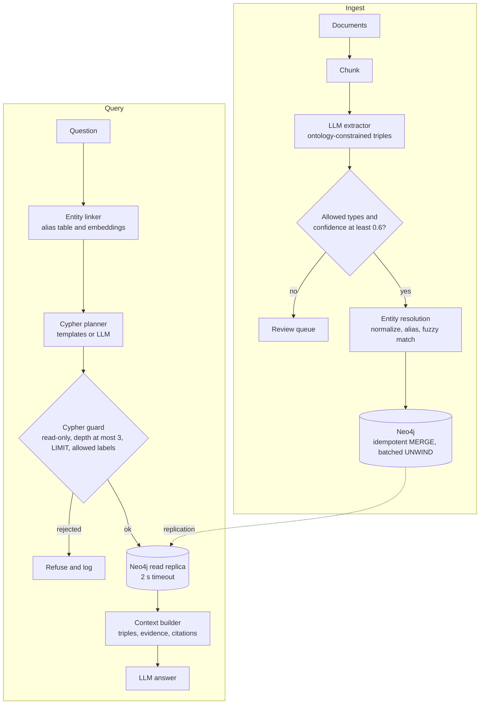

# Intuition & Mental Model

Vector RAG answers "which paragraph sounds like the question?" A knowledge graph answers "**how are these things connected?**" Questions like *"Which suppliers of our delayed product are owned by a sanctioned entity?"* need hops across relationships, and no single paragraph contains the answer. A graph stores **entities** (nodes) and **relations** (edges) explicitly, so a query can walk from product → supplier → parent company → sanctions list.

GraphRAG pipeline in plain English:
1. **Extract** entities and relations from text with an LLM, validated against a fixed ontology (allowed node and edge types).
2. **Resolve** duplicates ("IBM", "International Business Machines") into one node, or the graph fragments and multi-hop paths break.
3. **Store** in a graph database (Neo4j) with provenance (which document, which sentence).
4. **Retrieve** by finding seed entities in the question, expanding N hops with Cypher, and giving the model the subgraph plus source text.
5. **Guard** generated Cypher: read-only, allowlisted labels, bounded depth and row limits, parameterized values.

Use it when relationships matter (ownership, dependencies, org charts, fraud rings, supply chains). Skip it when questions are single-document lookups; plain hybrid RAG is cheaper.

# Production Architecture & Data Flow

The app role has READ on the query path and WRITE only on the ingest worker. A tenant_id property sits on every node and edge and is injected by the guard, never by the model.

# Architectural Trade-Off Matrix

| Approach | Latency | Scalability | Implementation Complexity | Cost |
|---|---|---|---|---|
| **Native graph DB (Neo4j) + Cypher** | Low for 1-4 hop traversals (index-free adjacency), ms-level | Vertical + read replicas; sharding is harder (Fabric/Infinigraph) | Medium-High: ontology, ER, Cypher ops | Medium-High (licensing, memory-heavy) |
| **Property graph in Postgres (recursive CTE / Apache AGE)** | Fine for shallow hops, degrades past 3 | Good: reuse Postgres ops | Medium | Low: no new database |
| **Vector-only RAG (no graph)** | Lowest | Highest | Lowest | Lowest, but cannot answer multi-hop questions reliably |

# Enterprise War Stories & Edge Cases

**1. One bank, forty nodes.** "JPMorgan", "J.P. Morgan Chase & Co.", and "JPM" became separate nodes, so an ownership path to a sanctioned entity was invisible. *Remediation:* canonical IDs from a reference source (LEI, ticker), alias table, blocking + fuzzy matching with human review for ambiguous merges, and a metric tracking duplicate-cluster rate.

**2. The supernode that melted the database.** A query expanding from the node `United States` with no depth or limit touched 30 million edges and stalled the cluster. *Remediation:* bounded depth, `LIMIT`, query timeouts, a guard that rejects unbounded variable-length patterns, degree caps (skip nodes above a threshold unless explicitly allowed), and a read replica for LLM-generated queries.

**3. LLM-generated Cypher that deleted data.** A text-to-Cypher agent given a write-capable connection produced `MATCH (n) DETACH DELETE n` after a user pasted an injection. *Remediation:* read-only database role (the real control), a static guard that rejects write clauses and `CALL` procedures outside an allowlist, parameterized queries, and query templates for the 80% of questions that are repeatable.
