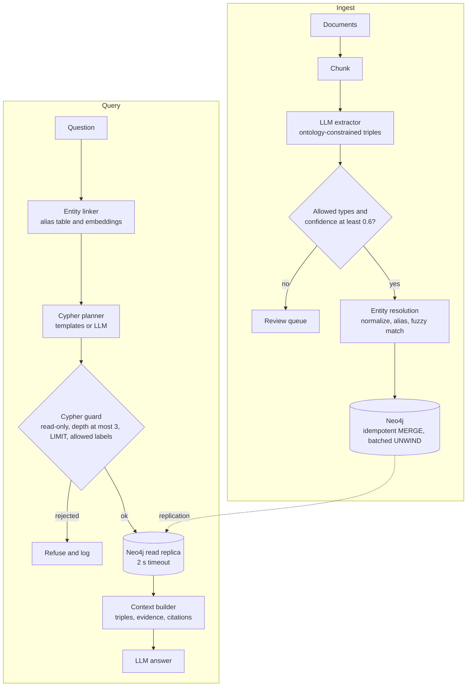

> **Syllabus lessons for this module:** full teaching notes for every topic are in [Syllabus Topic Write-ups](#syllabus-topic-write-ups); the topic-to-code map is in the [Syllabus Coverage Map](#syllabus-coverage-map) and [COVERAGE.md](../../COVERAGE.md).

# Intuition & Mental Model

Vector RAG answers "which paragraph sounds like the question?" A knowledge graph answers "**how are these things connected?**" Questions like *"Which suppliers of our delayed product are owned by a sanctioned entity?"* need hops across relationships, and no single paragraph contains the answer. A graph stores **entities** (nodes) and **relations** (edges) explicitly, so a query can walk from product → supplier → parent company → sanctions list.

GraphRAG pipeline in plain English:
1. **Extract** entities and relations from text with an LLM, validated against a fixed ontology (allowed node and edge types).
2. **Resolve** duplicates ("IBM", "International Business Machines") into one node, or the graph fragments and multi-hop paths break.
3. **Store** in a graph database (Neo4j) with provenance (which document, which sentence).
4. **Retrieve** by finding seed entities in the question, expanding N hops with Cypher, and giving the model the subgraph plus source text.
5. **Guard** generated Cypher: read-only, allowlisted labels, bounded depth and row limits, parameterized values.

Use it when relationships matter (ownership, dependencies, org charts, fraud rings, supply chains). Skip it when questions are single-document lookups; plain hybrid RAG is cheaper.

# Production Architecture & Data Flow



The app role has READ on the query path and WRITE only on the ingest worker. A tenant_id property sits on every node and edge and is injected by the guard, never by the model.

# Architectural Trade-Off Matrix

| Approach | Latency | Scalability | Implementation Complexity | Cost |
|---|---|---|---|---|
| **Native graph DB (Neo4j) + Cypher** | Low for 1-4 hop traversals (index-free adjacency), ms-level | Vertical + read replicas; sharding is harder (Fabric/Infinigraph) | Medium-High: ontology, ER, Cypher ops | Medium-High (licensing, memory-heavy) |
| **Property graph in Postgres (recursive CTE / Apache AGE)** | Fine for shallow hops, degrades past 3 | Good: reuse Postgres ops | Medium | Low: no new database |
| **Vector-only RAG (no graph)** | Lowest | Highest | Lowest | Lowest, but cannot answer multi-hop questions reliably |

# Enterprise War Stories & Edge Cases

**1. One bank, forty nodes.** "JPMorgan", "J.P. Morgan Chase & Co.", and "JPM" became separate nodes, so an ownership path to a sanctioned entity was invisible. *Remediation:* canonical IDs from a reference source (LEI, ticker), alias table, blocking + fuzzy matching with human review for ambiguous merges, and a metric tracking duplicate-cluster rate.

**2. The supernode that melted the database.** A query expanding from the node `United States` with no depth or limit touched 30 million edges and stalled the cluster. *Remediation:* bounded depth, `LIMIT`, query timeouts, a guard that rejects unbounded variable-length patterns, degree caps (skip nodes above a threshold unless explicitly allowed), and a read replica for LLM-generated queries.

**3. LLM-generated Cypher that deleted data.** A text-to-Cypher agent given a write-capable connection produced `MATCH (n) DETACH DELETE n` after a user pasted an injection. *Remediation:* read-only database role (the real control), a static guard that rejects write clauses and `CALL` procedures outside an allowlist, parameterized queries, and query templates for the 80% of questions that are repeatable.


# Syllabus Topic Write-ups

This module teaches enterprise graph architecture: how to model data as nodes and relationships, how to load it from relational systems, how to query and tune it, which managed services host it, and how to use it to give a chatbot connected facts instead of only similar text. It matters to a Forward Deployed Engineer because customers rarely arrive with clean data. They arrive with ERP tables, supplier contracts and event logs, and the question "how are these things connected, and what is affected if one breaks" is exactly where a graph beats tables and vector search. You will be expected to model a customer's domain on a whiteboard, justify the choice of database, and explain why a query is slow.

**How to study this module**

Read the topics in order, because each builds on the previous one. Topic 1 gives the vocabulary (nodes, relationships, properties) that every other topic uses. Topic 2 adds meaning and validation rules on top of the model. Topic 3 shows how to get real relational data into that model. Topic 4 gets you a running database. Topics 5 and 6 teach the query language and multi-hop traversal. Topic 7 teaches why queries get slow and how to fix them, so it needs 5 and 6 first. Topic 8 compares the second major platform. Topics 9 and 10 apply everything to two classic domains. Topic 11 brings it together for a chatbot.

1. Topics 1 to 3: model and load.
2. Topic 4: provision and connect.
3. Topics 5 to 7: query, traverse, tune.
4. Topic 8: Neptune as the AWS alternative.
5. Topics 9 to 11: apply to logistics, recommendations and chatbots.

**Module cheat sheet**

| Must-know | One-line answer |
|---|---|
| Property graph building blocks | Nodes (with labels and properties), relationships (one type, one direction, own properties), and properties as key-value facts on either. |
| Where a fact belongs | On the relationship if it describes the link (since, weight, timestamp); on the node if it describes the thing. |
| Index-free adjacency | Each node holds direct references to its relationships, so a hop costs about the node's degree, not the size of the graph. |
| Taxonomy vs ontology | A taxonomy is a single-parent "is a kind of" tree; an ontology adds typed relationships, domain and range rules, and inference rules. |
| Relational to graph rules | Row becomes node, foreign key becomes relationship, join table becomes relationship with properties. |
| Idempotent loading | Use MERGE on a unique key plus a uniqueness constraint so reruns create no duplicates. |
| `neo4j+s://` | Bolt over TLS with certificate verification; the usual scheme for AuraDB. |
| Cost of a graph query | Roughly the number of nodes and relationships touched; anchor on the most selective node. |
| EXPLAIN vs PROFILE | EXPLAIN shows the estimated plan without running; PROFILE runs the query and reports actual db hits. |
| Variable-length growth | Paths grow like b to the power k for branching factor b and depth k, so always bound `*1..k`. |
| Shortest path caveat | Fewest hops is not lowest cost; use a weighted algorithm when edges carry time or price. |
| Neptune languages | Gremlin and openCypher for property graphs, SPARQL for RDF; one writer plus read replicas on shared storage, inside a VPC. |
| Graph retrieval flow | Link entities, expand a bounded neighborhood, number the facts as context, answer with citations, verify the citations exist. |

### 1. Nodes, edges, and properties
**What you will be able to do**

- Explain a property graph to a non-engineer in two minutes using a map or org-chart analogy.
- Decide, for any fact, whether it belongs on a node, on a relationship, or in a node of its own.
- Sketch a graph model for a new domain on a whiteboard and name its labels, relationship types and constraints.
- Spot duplicate-node and supernode risks in a model review.

**Prerequisites**

Basic familiarity with relational tables, primary keys and foreign keys. Nothing earlier in this course is required; this is the vocabulary lesson for the module.

**The idea from first principles**

Start with the problem. A relational database stores facts as rows in tables, and it connects rows by matching key values in a join. That works well when the question is "list all orders over 500". It strains when the question is about connections: "which suppliers are within three links of this plant". Each link is another join, each join needs the database to look up matching keys, and the query text grows with every hop. The naive approach of adding more join tables does not remove the work, it just spreads it over more tables.

An everyday analogy is a transit map. You do not look up "connections" in a table of stations; you stand at a station and follow the lines that leave it. A graph database stores data the same way. Each thing is a station, each connection is a line leaving it, and answering a question means walking.

Now the precise terms. A property graph has three building blocks. A node is a record representing a thing, such as a hub, a policy or a customer. A label is a type tag on a node, such as `Hub`; a node can carry more than one label. A relationship (also called an edge) is a record that connects a start node to an end node. It has exactly one type, such as `ROUTE`, and one direction fixed when it is created. A property is a key-value fact, such as `code: 'FRA'`, attached to a node or to a relationship. Property values are scalars or lists of scalars; they are not nested maps.

The key mechanism is index-free adjacency. Each node stores direct references to the relationships attached to it. To expand from a node you follow those references; you do not search a global index. So the cost of one hop depends on the node's own degree, which is its number of relationships, and not on how many nodes exist in the whole database. This is why a three-hop question stays fast in a graph holding a hundred million nodes, provided your starting node is selective. Direction is stored, but you can read a relationship in either direction in a query, so direction carries meaning without limiting you.

The modeling skill is deciding where each fact goes. Facts about a thing live on its node (a hub's name). Facts about a link live on the relationship (transit hours on a lane, a purchase date). Things you want to navigate from, share between many entities, or attach facts to become nodes of their own (a country, a category, an order with many attributes).

**How it works, step by step**

1. List the nouns in the domain. Each noun that has its own identity becomes a label: Hub, Shipment, Carrier.
2. List the verbs between nouns. Each becomes a relationship type, named as an action in capitals: ROUTE, ROUTED_VIA, OPERATED_BY.
3. Choose a stable unique key per label (a code or id) and create a uniqueness constraint on it. Constraints also create an index, which gives you a fast starting point for queries.
4. For every attribute, ask: does it describe the thing or the link between two things? Place it accordingly.
5. For every attribute you will filter on, ask whether you also want to navigate from it. If yes, promote it to a node (country as a node, not a string).
6. For any relationship that repeats between the same two nodes with its own attributes (many purchases of the same item), decide whether a single relationship with a list is enough or whether an intermediate node (an Order or Event) is needed. Use a node when each occurrence has several attributes or needs to link to more than two things.
7. Check for supernodes: any node likely to have millions of relationships. Plan to bucket them or avoid expanding through them.
8. Write three sample queries against the model. If one needs awkward workarounds, remodel.

Worked calculation of hop cost (illustrative numbers). A graph has 3,000,000 hubs. FRA has 12 outgoing lanes. The question "where can I go from FRA in one hop" follows 12 references. Two hops: each of those 12 hubs has about 12 lanes, so about 12 + 144 = 156 relationships followed. Doubling the graph to 6,000,000 hubs changes nothing, because only the neighborhood of FRA is touched. In a relational schema without a suitable index, the same question could scan a lane table of millions of rows.

**Worked example 1: small and hand-traceable**

Take three hubs and two lanes. Hubs: FRA, ORD, RTM. Lanes: FRA to ORD with 9 hours, RTM to FRA with 11 hours.

```cypher
MERGE (a:Hub {code: 'FRA'})
MERGE (b:Hub {code: 'ORD'})
MERGE (c:Hub {code: 'RTM'})
MERGE (a)-[:ROUTE {transit_hours: 9}]->(b)
MERGE (c)-[:ROUTE {transit_hours: 11}]->(a)
```

Trace the state. After the first three lines there are 3 nodes, each with one label and one property. After the fourth line there is 1 relationship stored on FRA (outgoing) and on ORD (incoming), carrying `transit_hours: 9`. After the fifth line FRA holds two references: one outgoing to ORD and one incoming from RTM. Now ask "which hubs can I reach from FRA": the engine looks at FRA's outgoing references, finds one, and returns ORD. Ask "which hubs lead into FRA": it reads the incoming references and returns RTM. Direction mattered: RTM cannot reach ORD in one hop, and FRA cannot reach RTM at all, because no such relationship exists.

**Worked example 2: enterprise scenario**

An insurer wants to detect repair-fraud rings. Entities are policies, claimants, garages and phone numbers. The fact "claim paid on 2026-03-02 for 1,800" describes the link between a policy and a garage, but a policy can be repaired at the same garage many times, and each claim also has an adjuster and a status. That is more than one attribute and more than two things, so Claim becomes a node.

```cypher
CREATE CONSTRAINT policy_id IF NOT EXISTS FOR (p:Policy) REQUIRE p.id IS UNIQUE;
CREATE CONSTRAINT garage_id IF NOT EXISTS FOR (g:Garage) REQUIRE g.id IS UNIQUE;
CREATE CONSTRAINT claim_id IF NOT EXISTS FOR (c:Claim) REQUIRE c.id IS UNIQUE;
MERGE (p:Policy {id: 'P-77'})
MERGE (g:Garage {id: 'G-12'})
MERGE (c:Claim {id: 'C-5001'})
SET c.amount = 1800, c.paid_on = date('2026-03-02'), c.status = 'paid'
MERGE (p)-[:FILED]->(c)
MERGE (c)-[:REPAIRED_AT]->(g);
```

Commentary: the three constraints give uniqueness and indexes, so reruns do not duplicate and lookups are fast. `MERGE` on the key only, with `SET` for the other properties, is the safe pattern; merging on all properties would create a second node whenever any value changed. The claim is a node because it has its own attributes and links to two other things. The question "which garages share more than ten policies in common" is now a short pattern through Claim nodes. Contrast the earlier simple case: "FRIEND since 2019" between two users is just a relationship property, since there is only one attribute and two endpoints.

**Hands-on practice**

Exercise 1 (easy). Where does each fact go: a hub's name, a lane's transit time, the date a customer became a member of a loyalty tier, a customer's email?

Solution: the hub's name is a node property because it describes the hub. Transit time describes the lane between two hubs, so it is a relationship property. Membership date describes the link between customer and tier, so it is a property on a `MEMBER_OF` relationship. The email describes the customer, so it is a node property.

Exercise 2 (medium). A retailer stores `country` as a string on 20 million customer nodes and wants "customers in the same country as the supplier of product X". What is wrong, and what is the better model?

Solution: the string is a value you want to navigate through, and matching it forces a scan or index lookup on every customer. Promote country to a `Country` node with a unique code, link `(Customer)-[:LIVES_IN]->(Country)` and `(Supplier)-[:BASED_IN]->(Country)`, and the question becomes a short pattern from the product to the supplier to the country back to customers. Beware that Country becomes a supernode with millions of incoming relationships, so start the query from the product and filter before expanding into customers, or add a region level.

Exercise 3 (hard). Model a bank where customers have accounts, accounts send transfers to other accounts, and compliance asks for "all accounts within three transfers of a flagged account in the last 30 days". Decide node and relationship layout and the key constraints.

Solution: nodes `Customer` and `Account`; `(Customer)-[:OWNS]->(Account)`. A transfer between two accounts has amount, timestamp, channel and reference, and may be reviewed, so a relationship `TRANSFERRED` with those properties is workable for traversal, while an intermediate `Transaction` node is better if you need to link it to other entities such as devices. For the traversal-heavy question choose the relationship with a `ts` property and filter inside the path with a predicate on all relationships. Constraints: unique `Account.id`, unique `Customer.id`, and an index on the transfer timestamp if your version supports relationship property indexes (verify). Bound the depth at 3, and consider a cap on very high-degree accounts such as payroll or merchant accounts.

**Alternatives and trade-offs**

| Option | Latency on multi-hop | Scalability | Complexity | Risk |
|---|---|---|---|---|
| Property graph | Low for selective starts | Scales with neighborhood size, supernodes hurt | Moderate, new skills | Weaker at big aggregations |
| Relational tables | High, repeated self-joins | Mature, vertical and horizontal options | Familiar | Query text and cost grow with hops |
| RDF triples | Moderate | Good, standards-based | Higher, verbose queries | Edge properties awkward |

Choose a property graph when questions are about connections and paths. Choose relational when questions are mostly filters, sums and group-bys on well-defined tables. Choose RDF when you must merge data from many sources under shared standards or need built-in inference. A graph is the wrong tool for plain reporting over millions of rows with no relationships involved.

**Where it goes wrong in production**

- Duplicate nodes. Symptom: the same customer appears twice and a path "disappears". Cause: `CREATE`, or `MERGE` on a non-unique property, with no constraint. Diagnose: group nodes by key and look for counts above 1. Fix: unique constraints, `MERGE` on the key only, a one-off merge of existing duplicates.
- Facts on the wrong element. Symptom: a hub has a `transit_hours` that nobody can interpret. Cause: link facts stored on a node. Diagnose: read the property names on nodes and ask which link each describes. Fix: move the fact to the relationship.
- Everything is a property. Symptom: queries filter on a `country` string across millions of nodes and are slow. Cause: a value you navigate through was kept as a property. Diagnose: PROFILE shows a label scan. Fix: promote it to a node.
- Supernodes. Symptom: one node with millions of relationships slows every query touching it. Cause: a hub-like entity such as a country or a bestseller. Diagnose: count relationships per node, sort descending. Fix: bucket nodes (by date or region), filter early, avoid expanding through it.
- Mixed relationship types. Symptom: one type `RELATED_TO` everywhere, and queries must inspect properties to know the meaning. Cause: lazy modeling. Fix: specific types per meaning.

**Do not confuse**

A label is a type tag on a node; a property is a value. A relationship type (`ROUTE`) is the kind of link; a relationship property (`transit_hours`) is a fact about one specific link. A graph database is not the same as a graph visualization tool: the first stores and queries connected data, the second draws it.

**How interviewers probe this**

1. What are the parts of a property graph?
2. Where would you store the date a customer bought a product, and why?
3. Why is a relationship hop cheap compared with a join?
4. When should an attribute become a node instead of a property?
5. Design a model for suppliers, parts and plants, and say where lead time goes.
6. What breaks when you load the same file twice?
7. What is a supernode, and how does it hurt?
8. Trap: "A graph database is always faster than a relational one, right?"

**Model answer (60-90 seconds)**

"A property graph has nodes, relationships and properties. Nodes are the things, with labels as type tags. Relationships connect two nodes, have one type and one direction, and can carry their own properties. The engine stores direct references from each node to its relationships, so a hop costs about the node's degree, not the size of the database. That is why multi-hop questions that need self-joins in SQL become short patterns. My modeling rule is that facts about a link, like a timestamp or weight, live on the relationship, and anything I want to navigate from or share, like a country or category, becomes its own node. For example, in a supplier model, lead time goes on the SUPPLIES relationship because it is specific to that supplier and part. The limit is that graphs are weaker for large aggregations, so I would keep a warehouse for reporting, and I always add uniqueness constraints so repeated loads do not create duplicate nodes."

**Quick-fire answers**

- Q: What are the parts of a property graph? / A: Labeled nodes, typed directed relationships, and key-value properties on both. Labels are type tags, and a relationship has exactly one type.
- Q: Where does the purchase date go? / A: On the relationship between customer and product, because it describes the link. If the purchase has many attributes, make it an Order node.
- Q: Why is a hop cheap? / A: Index-free adjacency: each node holds pointers to its relationships, so expansion cost follows local degree and not total data size.
- Q: When does an attribute become a node? / A: When you traverse through it, share it among many entities, or attach facts to it. A country is the typical case.
- Q: Suppliers, parts, plants? / A: Supplier-[:SUPPLIES]->Part-[:USED_IN]->Plant, with lead time and price on SUPPLIES, unique ids with constraints.
- Q: What breaks on a second load? / A: Without MERGE and constraints you get duplicates and broken paths; with them the load is idempotent.
- Q: Supernode? / A: A node with a huge number of relationships. Every traversal through it multiplies work; bucket, filter early or avoid it.
- Q: Graph always faster? / A: No. It wins on selective multi-hop traversals and loses on large scans and aggregations, where a columnar warehouse is better.

**Recap in five lines**

- A property graph is nodes, typed directed relationships and properties on both.
- Index-free adjacency makes hop cost depend on local degree, not total size.
- Link facts go on relationships; navigable or shared things become nodes.
- Constraints plus MERGE on the key keep loads idempotent and duplicate-free.
- Watch for supernodes and use a warehouse for heavy aggregation.

### 2. Ontologies vs taxonomies
**What you will be able to do**

- Explain the difference between a taxonomy and an ontology with a concrete example in two minutes.
- Write domain and range rules and use them to reject a bad triple.
- Apply inverse, transitive and symmetric rules by hand to derive new facts.
- Judge how much ontology a project actually needs.

**Prerequisites**

Topic 1 (nodes, relationships, labels). Helpful: the idea of a class and an instance from object-oriented programming.

**The idea from first principles**

Start with the problem. Three teams feed a graph. One calls a site a "Warehouse", another a "DC", a third "Facility". An extraction pipeline reads contracts and produces statements like "Acme owns Plant 7". Some are wrong: "Plant 7 owns Acme". Without any shared definition of what the types mean and how they may connect, the graph slowly fills with contradictory or impossible facts, and queries return nonsense that nobody can trace.

An everyday analogy is a library. A catalog tree (Science, then Physics, then Optics) tells you where a book sits: that is a taxonomy. A full library system also knows that "author wrote book" connects a person to a book, that "book published by publisher" connects a book to a company, and that if a book is part of a series and the series is part of a collection, the book is also part of the collection. That second system is an ontology.

Precise definitions. A taxonomy is a hierarchy of concepts in which every concept has at most one parent and the only relationship is "is a kind of". It answers questions of classification and supports navigation, faceted search and rollups. An ontology is a formal model of a domain: a set of classes, a set of relationship types, constraints on those relationships, and optionally rules that derive new facts. A relationship definition has a domain (the class the source must belong to) and a range (the class the target must belong to). `OWNS` with domain Organization and range Facility means only organizations can own and only facilities can be owned.

Rules come in a few standard kinds. An inverse rule says that if A OWNS B then B OWNED_BY A. A transitive rule says that if X PART_OF Y and Y PART_OF Z then X PART_OF Z. A symmetric rule says that if A PARTNER_OF B then B PARTNER_OF A. Class hierarchies in an ontology are often a directed acyclic graph rather than a strict tree, so a ColdChainHub can be a subclass of both Hub and TemperatureControlled. That multiple inheritance is exactly what a taxonomy cannot express.

Two uses justify the cost. Validation rejects facts that break domain and range. Inference derives facts you did not store, which keeps queries short. If you need neither, a taxonomy (or even a plain label) is enough.

**How it works, step by step**

1. Write down the classes you need, with subclass links: Hub is a Location, ColdChainHub is a Hub.
2. Write each relationship type with domain, range and any rule flags (inverse, transitive, symmetric).
3. For validation, take each proposed fact (source, relationship, target). Find the classes of source and target, including ancestors through subclass links.
4. Accept the fact only if the source class is the domain or a descendant of it, and the target class is the range or a descendant. Otherwise reject and log it.
5. For inference, repeatedly apply the rules to the stored facts until no new facts appear (a fixed point). For a transitive relationship this is the transitive closure.
6. Decide where to run inference: at query time (always fresh, slower) or in batch with derived facts stored and tagged (fast reads, can go stale).
7. Version the ontology and track rejected facts, because the rejection rate tells you whether the extractor or the model needs work.

Worked calculation of transitive closure. Stored facts: Dock4 PART_OF WarehouseA, WarehouseA PART_OF Campus1, Campus1 PART_OF Region2. Round 1 derives Dock4 PART_OF Campus1 and WarehouseA PART_OF Region2. Round 2 derives Dock4 PART_OF Region2. Round 3 derives nothing new, so we stop. Three stored facts became six. For a chain of n nodes the closure holds n(n-1)/2 facts, so n = 100 gives 4,950 facts from 99 stored. That growth is why materializing inference needs thought.

**Worked example 1: small and hand-traceable**

Classes: Hub is a Location. ColdChainHub is a Hub. Organization is a class. Relationship `OWNS`: domain Organization, range Location.

Proposed facts and verdicts:
1. (Acme: Organization) OWNS (RTM: Hub). Source is an Organization, matching the domain. Target is a Hub, which is a subclass of Location, matching the range. Accept.
2. (RTM: Hub) OWNS (Acme: Organization). Source is a Hub, not an Organization. Reject: wrong domain.
3. (Acme) OWNS (Borealis: Organization). Target is an Organization, not a Location. Reject: wrong range.
4. (Acme) OWNS (FRA: ColdChainHub). ColdChainHub is a Hub, which is a Location. Accept, thanks to subclass reasoning.

Notice that fact 4 would be rejected by a naive check that compared class names for equality. Checking ancestors is the whole point of the class hierarchy.

**Worked example 2: enterprise scenario**

A manufacturer extracts supply relationships from contracts with an LLM. The ontology defines `SUPPLIES` (Supplier to Part) and `LOCATED_IN` (Facility to Region). The extractor outputs a batch of triples, some reversed or of the wrong type. A loader applies domain and range as a gate.

```cypher
UNWIND $triples AS t
MATCH (a {id: t.src}), (b {id: t.dst})
WHERE t.rel = 'SUPPLIES' AND 'Supplier' IN labels(a) AND 'Part' IN labels(b)
MERGE (a)-[:SUPPLIES]->(b)
```

Commentary: the `MATCH` finds both endpoints by id. The `WHERE` encodes domain (source labeled Supplier) and range (target labeled Part). A reversed triple matches the id lookup but fails the label test, so nothing is created. Relationship types cannot be parameters, so a real loader generates one statement per allowed relationship type from the ontology table, after validating the type names against a safe identifier pattern. Triples that fail should be written to a review table, not silently dropped, because a high reject rate points to a prompt or ontology problem. Subclass labels (for example a node labeled both `Supplier` and `PreferredSupplier`) work with this check because the node carries every label.

**Hands-on practice**

Exercise 1 (easy). Is "Electronics > Phones > Smartphone" a taxonomy or an ontology? Can a "Smartphone" also sit under "Wireless Devices"?

Solution: it is a taxonomy, a single-parent hierarchy of "is a kind of". If Smartphone must sit under both Phones and Wireless Devices it has two parents, so it is no longer a strict tree; that needs a DAG of classes, which is ontology territory (or a taxonomy with tags added).

Exercise 2 (medium). Given `PART_OF` is transitive and `LOCATED_IN` has domain Facility and range Region, and facts: Line3 PART_OF PlantA, PlantA PART_OF Division9, PlantA LOCATED_IN Bavaria. List the derived facts and say whether "Line3 LOCATED_IN Bavaria" is derived.

Solution: derived from transitivity: Line3 PART_OF Division9. The location fact does not propagate, because `LOCATED_IN` has no rule linking it to `PART_OF`. To derive that Line3 is in Bavaria you must add a rule such as "if X PART_OF Y and Y LOCATED_IN Z then X LOCATED_IN Z", which is a property chain. Also check validity: PlantA must be a Facility and Bavaria a Region, else the stored fact is rejected.

Exercise 3 (hard). Your LLM extractor has a 12 percent reject rate against the ontology. Is the ontology too strict or the extractor too loose? Describe how to decide and what to change.

Solution: sample 100 rejected triples and label each as truly wrong, wrongly rejected, or ambiguous. If most are truly wrong (reversed, wrong entity type), fix the extractor prompt, add few-shot examples with the correct direction, and add entity-type hints. If many are wrongly rejected, the ontology is missing a class or relationship (for example, a "Port" that is neither a Facility nor a Hub); extend the model and version it. If ambiguous, the definition needs a clearer rule. Track the rate per relationship type, since one type often dominates the rejects.

**Alternatives and trade-offs**

| Option | Cost | Benefit | Choose when |
|---|---|---|---|
| Taxonomy only | Low | Navigation, rollups, tagging | Catalog browsing, simple classification |
| Lightweight ontology (domain/range, a few rules) | Medium | Data quality gate, shorter queries | LLM extraction, multi-team data |
| Full OWL reasoning | High | Rich logical inference, formal semantics | Life sciences, regulated domains with strong governance |
| No schema, free-form labels | Lowest | Speed on day one | Throwaway prototypes only |

Query-time inference is fresh but slows reads; batch materialization is fast but stale. A heavy ontology is the wrong tool when the team cannot name an owner for it or when no question depends on inference or validation.

**Where it goes wrong in production**

- Ontology rot. Symptom: new data uses types the schema does not list. Cause: nobody owns the model. Diagnose: count nodes with labels outside the ontology. Fix: assign an owner, version the ontology, review rejected facts monthly.
- Over-modeling. Symptom: months of workshops, no query answered. Cause: building from theory. Diagnose: ask which business question each class serves. Fix: start from the top ten questions.
- Stale inferred facts. Symptom: a removed fact still yields derived facts. Cause: materialized inference not recomputed. Diagnose: compare derived edges against a fresh closure. Fix: tag derived edges and recompute or delete them on change.
- Cycles in a taxonomy. Symptom: ancestor queries never finish. Cause: a bad edit made a node its own ancestor. Diagnose: run a cycle check. Fix: validate acyclicity on every write.
- Closure explosion. Symptom: storage and write time jump. Cause: materializing a transitive relationship over a long chain. Fix: compute at query time with bounded paths, or materialize only the levels you query.

**Do not confuse**

Subclass (a Hub is a kind of Location) is a class-level fact. An instance fact (FRA is a Hub) is data-level. Taxonomy edges are always class-level. Also, a schema (what properties a label has) is not an ontology: an ontology states what concepts mean and how they relate, with rules, while a schema only constrains storage.

**How interviewers probe this**

1. What is the difference between a taxonomy and an ontology?
2. Give an example of an inference rule and run it on three facts.
3. How can an ontology help an LLM extraction pipeline?
4. Is a taxonomy a graph?
5. How would you design an ontology for a hospital network, and where would you stop?
6. What breaks when two teams maintain overlapping ontologies?
7. Where would you run inference, and what are the failure modes?
8. Trap: "Our graph has labels, so we already have an ontology, right?"

**Model answer (60-90 seconds)**

"A taxonomy is a hierarchy where each term has one parent and the only relationship is 'is a kind of'. It is good for navigation and rollups. An ontology defines multiple relationship types, says which classes each may connect, called domain and range, and adds rules to infer facts, such as inverse and transitive relationships. In practice I use a taxonomy for browsing and a lightweight ontology as a validation gate, for example rejecting an extracted triple where a Facility owns an Organization, and that matters a lot when an LLM is producing the triples. For inference, if PART_OF is transitive, a dock in a warehouse in a campus is in the campus, so queries stay short. The trade-off is maintenance: a big ontology nobody owns decays, so I start from the questions the business asks. Another limit is that materialized inferred facts can go stale, so I tag them as derived and recompute."

**Quick-fire answers**

- Q: Taxonomy vs ontology? / A: A taxonomy is a single-parent hierarchy of "is a kind of". An ontology adds typed relationships, domain and range constraints, and inference rules.
- Q: An inference rule example? / A: Transitive PART_OF: dock in warehouse and warehouse in campus gives dock in campus. Inverse OWNS gives OWNED_BY.
- Q: Help for LLM extraction? / A: It validates each extracted triple against allowed types and rejects impossible ones before they enter the graph.
- Q: Is a taxonomy a graph? / A: Yes, a special case: a tree with one relationship type.
- Q: Hospital ontology? / A: Start with Patient, Clinician, Facility, Department, Procedure and relationships like TREATED_BY and LOCATED_IN with domain and range, then grow only from real questions.
- Q: Overlapping ontologies? / A: Conflicting terms and duplicate concepts. Resolve with a single owner and an explicit mapping layer.
- Q: Where to run inference? / A: Query time is fresh but slower; batch materialization is fast but can go stale, so tag and recompute derived edges.
- Q: Labels equal ontology? / A: No. Labels are tags; an ontology adds meaning, constraints and rules.

**Recap in five lines**

- A taxonomy is a single-parent "is a kind of" tree; an ontology adds typed relationships and rules.
- Domain and range checks reject impossible facts, using subclass links.
- Inverse, transitive and symmetric rules derive facts you did not store.
- Transitive closure of a chain of n nodes holds n(n-1)/2 facts, so materialize carefully.
- Start small, from real questions, and give the model an owner.

### 3. Transforming relational data tables to graph structures
**What you will be able to do**

- Map any relational schema to a graph model using four mechanical rules.
- Write an idempotent batch load and reconcile node and relationship counts against the source.
- Decide when a table should not become a node.
- Diagnose a load that silently created nothing.

**Prerequisites**

Topic 1 (nodes, relationships, constraints) and relational basics: primary key, foreign key, join table.

**The idea from first principles**

Start with the problem. A customer's order system lives in a relational database: customers, orders, order items, products. It answers "total sales by month" well. Now the business asks "which customers bought something that was also bought by customers who returned items". In SQL that is a stack of self-joins over large tables. The data is already there, but its connections are implicit: they exist only as matching key values that the database rediscovers on every query.

An analogy: a phone book lists people and, separately, lists numbers called. To find who knows whom you must look up each name in the other list again and again. Converting to a graph is like drawing the lines once and keeping them.

The terms. An entity table is a table whose rows are things with their own identity (customers). A foreign key (FK) is a column that holds the primary key of a row in another table. A join table (or association table) has a key made of two foreign keys and connects two entity tables many-to-many (order_items connects orders and products). A batch load is a bulk import run on a schedule. Idempotent means that running the same load twice gives the same result as running it once.

The four mapping rules are mechanical. Each entity table becomes a label, and each row becomes a node whose properties are the row's columns, keyed by the primary key. Each foreign key becomes a relationship from the child row to the parent row, and the FK column is dropped from the node because the relationship now carries that information. Each join table becomes a many-to-many relationship, and the join table's extra columns become relationship properties. Lookup tables with a handful of values (status codes) usually become a property or a small set of nodes, depending on whether you navigate through them.

The naive approach is a one-to-one copy of every table. It produces a graph that looks like the schema diagram and has the same awkwardness, because nobody asked which relationships the queries will traverse. A good conversion is query-driven: copy what the questions need, and design relationship types with business names (`PLACED`, `CONTAINS`), not table names.

**How it works, step by step**

1. Inventory the schema: tables, primary keys, foreign keys, join tables, row counts.
2. Classify each table as entity, join table or lookup.
3. List the questions the graph must answer and mark the tables and keys they need. Drop the rest.
4. Create a uniqueness constraint per label on the old primary key. This also gives the index that makes loading fast.
5. Load all nodes first, in batches: `UNWIND $rows AS row MERGE (n:Label {id: row.id}) SET n += row.props`. Merge on the key only.
6. Load relationships second. Match both endpoints by key, then `MERGE` the relationship. If an endpoint is missing, the match returns no row and nothing is created, silently.
7. For relationships that must be distinct (several transfers between the same two accounts), include a unique key from the source in the `MERGE` pattern, such as a transaction id.
8. Reconcile: nodes per label equal rows per table; relationships equal non-null FK values or join-table rows. Investigate any difference.
9. Handle change: stamp each load, then remove or flag nodes not seen in the latest full load, or consume delete events from change data capture.

Worked calculation of expected counts. `customers`: 1,000 rows. `orders`: 5,000 rows, `customer_id` non-null in 4,950. `order_items`: 12,000 rows with unique (order_id, product_id) pairs. `products`: 300 rows. Expected: 1,000 + 5,000 + 300 = 6,300 nodes. Relationships: 4,950 PLACED + 12,000 CONTAINS = 16,950. Suppose the graph shows 16,350. The gap is 600, which equals the number of order_items whose product_id has no row in `products` (orphans that the MATCH could not find). The reconciliation exposed a data quality problem in the source, not a load bug.

**Worked example 1: small and hand-traceable**

Source rows. `customers`: (1, Ana), (2, Ben). `orders`: (10, customer 1, total 40), (11, customer 2, total 15), (12, customer 1, total 25).

Load nodes: two Customer nodes with ids 1 and 2, three Order nodes with ids 10, 11, 12. Load relationships by iterating orders:
- Row 10: match Customer 1 and Order 10, merge PLACED. Count 1.
- Row 11: Customer 2 to Order 11. Count 2.
- Row 12: Customer 1 to Order 12. Count 3.

Rerun the whole load. Every `MERGE` finds an existing node or relationship, so counts stay at 5 nodes and 3 relationships. If the load had used `CREATE`, the rerun would have produced 10 nodes and 6 relationships and Ana would have two copies. Now the query "orders of Ana" walks from Customer 1 across two PLACED relationships: orders 10 and 12.

**Worked example 2: enterprise scenario**

A bank loads accounts and a transfers table (from_id, to_id, amount, ts, txn_id) to find mule-account chains. The transfers table is effectively a join table between accounts with its own columns, so it becomes a relationship with properties.

```cypher
CREATE CONSTRAINT acct_id IF NOT EXISTS FOR (a:Account) REQUIRE a.id IS UNIQUE;

UNWIND $rows AS row
MATCH (src:Account {id: row.from_id})
MATCH (dst:Account {id: row.to_id})
MERGE (src)-[t:TRANSFERRED {txn_id: row.txn_id}]->(dst)
SET t.amount = row.amount, t.ts = datetime(row.ts)
```

Commentary line by line. The constraint makes `Account.id` unique and indexed, so each `MATCH` is a quick seek. `UNWIND $rows` turns a parameter list into one row per transfer, so you can send a few thousand rows per transaction (an illustrative batch size to tune). The two `MATCH` lines require both accounts to exist, which is why accounts are loaded first. The `MERGE` pattern includes `txn_id`, so each transaction is one relationship: without it, MERGE would match on type and endpoints only and collapse many different transfers between the same pair into one relationship. `SET` updates the mutable properties on every run, so a corrected amount in the source flows through. `datetime(row.ts)` assumes an ISO-formatted string. Values travel as parameters, never concatenated into the statement. A real pipeline also records rows whose accounts were missing.

**Hands-on practice**

Exercise 1 (easy). Map this schema: `students(id, name)`, `courses(id, title)`, `enrollments(student_id, course_id, grade)`.

Solution: labels `Student` and `Course` with unique `id`. `enrollments` is a join table with an extra column, so it becomes `(Student)-[:ENROLLED_IN {grade: ...}]->(Course)`. No nodes for the join table, and the grade lives on the relationship.

Exercise 2 (medium). `orders` has a `status` column with values 'new', 'shipped', 'returned' and a `warehouse_id` FK. Decide how to model each.

Solution: `warehouse_id` becomes `(Order)-[:FULFILLED_FROM]->(Warehouse)` and the column is dropped. `status` has three values and you may filter by it often; keep it as a node property (indexed if filters are frequent) unless you traverse through statuses or attach facts to them, in which case a `Status` node would be justified. Document the choice.

Exercise 3 (hard). Your nightly full load leaves nodes for customers deleted in the source. Design a fix, and show the cleanup query.

Solution: stamp each run with a load id, set `n.last_seen = $load_id` in the node `MERGE`/`SET`, and after a successful load remove or flag the rest.

```cypher
MATCH (c:Customer)
WHERE c.last_seen <> $load_id
SET c.deleted = true
```

Flagging first is safer than deleting, because a partial source extract would otherwise wipe valid data. Add a guard that aborts cleanup if the extract row count dropped by more than a threshold (an illustrative 10 percent). For deletion use `DETACH DELETE` only after review. For lower latency, use change data capture and apply delete events directly.

**Alternatives and trade-offs**

| Option | Freshness | Complexity | Risk | Choose when |
|---|---|---|---|---|
| Nightly or hourly batch ETL | Stale by the schedule | Low | Deletes and drift | Reporting, analysis, batch recommendations |
| Change data capture streaming | Near real time | High: ordering, deletes, replay | Partial failures | Fraud checks, live operations |
| Virtualized graph over SQL | Live | Medium | Multi-hop performance depends on SQL engine | Quick pilots, small data |
| Dual write from application | Live | Medium | Inconsistency between stores | Rarely; prefer events |

Do not convert at all if the questions are aggregations over single tables.

**Where it goes wrong in production**

- One-to-one table copy. Symptom: a graph that mirrors the schema and answers nothing new. Cause: no query-driven design. Diagnose: list which relationships any query traverses. Fix: model for the traversals, collapse lookup tables.
- Edge load before node load. Symptom: zero relationships, no error. Cause: `MATCH` finds nothing so the clause emits no rows. Diagnose: compare counts. Fix: enforce order and reconcile.
- Slow loads. Symptom: hours for millions of rows. Cause: no index on the match key, or one huge transaction. Fix: constraints first, bounded batches.
- Stale deletions. Symptom: removed source rows linger and appear in results. Cause: upsert-only loads. Fix: load stamps or delete events.
- Type drift. Symptom: id 42 and '42' become different nodes. Cause: inconsistent types between exports. Fix: normalize types in the extract step.
- Collapsed relationships. Symptom: transfer totals too low. Cause: MERGE without a distinguishing key. Fix: key on the source transaction id.

**Do not confuse**

`CREATE` always makes a new element; `MERGE` matches or creates. A foreign key (a column pointing to a row) is different from a relationship (a stored, typed, directed link that can carry properties). A join table row becomes a relationship, but an entity table row becomes a node.

**How interviewers probe this**

1. How do you turn a foreign key into a graph structure?
2. What happens to a join table with extra columns?
3. Why MERGE rather than CREATE for loads?
4. Why load nodes before relationships?
5. Design the migration for a 200-table ERP schema.
6. What breaks when source rows are deleted or updated?
7. How would you verify that the load is correct?
8. Trap: "Just copy every table, then we can query anything."

**Model answer (60-90 seconds)**

"I apply four mapping rules and then adjust for the questions. Entity tables become labels and rows become nodes keyed by primary key. Foreign keys become relationships from child to parent and the column disappears. Join tables become many-to-many relationships whose extra columns turn into relationship properties. Lookup tables usually become properties. I create uniqueness constraints first, load nodes, then relationships, with parameterized batches and MERGE so reruns are idempotent. Then I reconcile counts against the source, for example relationships equal non-null foreign key values. The trade-off is that a literal copy of every table gains nothing, so I only model what traversals need. The limit is deletes: upsert loads never remove stale data, so I use a load stamp or change data capture."

**Quick-fire answers**

- Q: Foreign key to graph? / A: A relationship from the child node to the parent node, and the column is removed from the node.
- Q: Join table with extra columns? / A: A relationship between the two entities, with those columns as relationship properties.
- Q: Why MERGE? / A: It is idempotent on the key, so a retried load does not duplicate nodes or relationships.
- Q: Why nodes first? / A: Relationship loads match existing endpoints. If they are absent, the clause yields no rows and nothing is created, without an error.
- Q: 200-table ERP? / A: Pick the top questions, model only the entities and links they need, load in stages, and reconcile counts per stage.
- Q: Deletes and updates? / A: Upserts handle updates via SET; deletes need a load stamp with cleanup or CDC delete events.
- Q: Verify correctness? / A: Nodes per label equal rows per table, relationships equal non-null FKs or join rows, and spot-check sample paths against SQL.
- Q: Copy every table? / A: No. That reproduces the schema without benefit; model the relationships your queries traverse.

**Recap in five lines**

- Rows become nodes, foreign keys become relationships, join tables become relationships with properties.
- Constraints first, nodes second, relationships third.
- MERGE on the key makes loads idempotent; include a source id when relationships must stay distinct.
- Reconcile counts to catch silent failures such as orphans.
- Plan for deletes with load stamps or change data capture.

### 4. AuraDB cloud provisioning
**What you will be able to do**

- Walk through provisioning a managed Neo4j instance and say what each step protects against.
- Build a correct connection string and explain each URI scheme.
- Wire an application to the database with secrets in environment variables and run a smoke test.
- Explain the least-privilege setup for a chatbot that may run model-written queries.

**Prerequisites**

Topic 1 (what a graph database stores). Basic knowledge of environment variables and secret managers.

**The idea from first principles**

Start with the problem. Running a graph database yourself means installing it, sizing disks and memory, patching, taking and testing backups, handling upgrades and securing the network. For a team whose real job is building a customer solution, that is a large distraction, and mistakes (an untested backup, an unpatched server) surface at the worst moment.

An everyday analogy is renting a serviced apartment versus owning a house. In the serviced apartment someone else fixes the plumbing, but you accept the building's rules and cannot knock down walls. AuraDB is the serviced apartment version of Neo4j: you get a running database and the provider handles servers, backups and upgrades, while you give up some control over plugins and low-level tuning.

The terms. A managed service is a database run by the vendor, accessed over the network. An instance is one provisioned database. A tier is a bundle of capacity and features; names, sizes and limits change over time, so always read the current documentation instead of trusting remembered numbers. Bolt is Neo4j's binary protocol that drivers use. A URI scheme tells the driver how to connect: `neo4j://` uses routing without encryption, `neo4j+s://` uses encryption with full certificate verification, and `neo4j+ssc://` uses encryption but accepts self-signed certificates, so it protects less. A secret manager is a service that stores credentials and hands them to applications at runtime.

Why the connection details matter. The generated password is shown once, at creation. If it is lost, the only recovery is a reset, which means every application that used it breaks until updated. And an application that connects as the admin user turns any bug or prompt injection into a database-wide problem. So provisioning is partly a security exercise: store the secret correctly, use TLS, and create narrower users for each purpose.

**How it works, step by step**

1. Sign in to the vendor console and choose to create a new instance. Pick the tier that fits your data size and features (check current documentation for what each includes).
2. Choose the region. Place it near the application to cut round-trip latency, and in the right jurisdiction for any data residency requirement. Region usually cannot be changed afterwards without recreating the instance and restoring data.
3. Download or copy the credentials shown at creation, and immediately store them in the secret manager. Do not paste them into chat, tickets or the repository.
4. Wait for the instance to report that it is running and note its connection URI, which looks like `neo4j+s://<instance-id>.databases.neo4j.io`.
5. Set environment variables for URI, username and password in the runtime (container, function or server), populated from the secret manager.
6. Smoke test from the real runtime environment, not only from a laptop. Success on a laptop does not prove the production network path works, since firewalls, proxies and allow lists may differ.
7. Create least-privilege users: one for the loader with write rights, one for the application with read-only rights. Check the documentation for how users and roles are managed on your tier.
8. Plan operations: backup and restore procedure, monitoring of storage and connections, and how to resize.

A worked latency calculation (illustrative numbers). If the application is in a region with 80 ms round trip to the database and a request issues 5 sequential queries, network time alone is 5 x 80 = 400 ms. Moving the instance next to the application, at about 2 ms per round trip, reduces that to 10 ms. Region choice and reducing round trips (one query returning what five used to) both matter.

**Worked example 1: small and hand-traceable**

A developer wants to confirm connectivity. Variables are set:

```bash
export NEO4J_URI='neo4j+s://<instance-id>.databases.neo4j.io'
export NEO4J_USERNAME='neo4j'
cypher-shell -a "$NEO4J_URI" -u "$NEO4J_USERNAME" "RETURN 1"
```

Trace it. The shell exports the URI and username. `cypher-shell` reads the address and username from flags, and prompts for the password (supplying it via the `NEO4J_PASSWORD` environment variable is also supported by the tool; check your version). The `+s` scheme makes the client open a TLS connection and verify the server certificate against trusted authorities. If the handshake succeeds and login is accepted, the query `RETURN 1` runs and prints a single row with value 1. Failure modes map to causes: a certificate error means TLS interception or the wrong scheme, an authentication error means wrong credentials, and a timeout means the network path is blocked. Each distinct error points at a different layer, which is why a smoke test is worth doing before writing any application code.

**Worked example 2: enterprise scenario**

A telecom builds a network-topology graph for incident analysis, queried by an incident chatbot. Engineers load the topology with a write user. The chatbot gets a reader. The application uses the official Python driver with one long-lived driver object per process.

```python
import os
from neo4j import GraphDatabase

driver = GraphDatabase.driver(
    os.environ["NEO4J_URI"],
    auth=(os.environ["NEO4J_USERNAME"], os.environ["NEO4J_PASSWORD"]),
)
driver.verify_connectivity()

def neighbors(device_id):
    with driver.session() as session:
        result = session.run(
            "MATCH (d:Device {id: $id})-[:CONNECTED_TO]-(n:Device) RETURN n.id AS id LIMIT 50",
            id=device_id,
        )
        return [r["id"] for r in result]
```

Commentary. The credentials come from the environment, populated by the secret manager, so nothing sensitive is in the code. The driver is created once at module load, because it owns a connection pool; creating one per request is a classic cause of connection errors under load. `verify_connectivity` fails fast at startup instead of at the first user request. The query uses a parameter `$id`, which prevents injection and lets the server reuse query plans, and it has a `LIMIT`. For the chatbot service you would supply the reader user's credentials, so even an unexpected generated query cannot modify data. Role and user administration commands differ by edition and tier; verify them against current documentation.

**Hands-on practice**

Exercise 1 (easy). Why does the URI use `neo4j+s` and what would change if you wrote `neo4j`?

Solution: `+s` enables TLS with certificate verification, so the traffic is encrypted and the server identity is checked. Plain `neo4j` sends data unencrypted, which exposes credentials and data on the network. A managed cloud database normally rejects or discourages that; use `+s`.

Exercise 2 (medium). Your app works on a laptop but times out in production. List the first three things to check.

Solution: (1) Network path: does the production environment allow outbound traffic to the database host and port, or is it behind a proxy or restricted egress? (2) Credentials and URI: are the production environment variables actually set and pointing at the right instance? (3) TLS interception: does a corporate proxy replace certificates, producing handshake errors that look like timeouts? Reproduce with `cypher-shell` from inside the production network to separate application bugs from network problems.

Exercise 3 (hard). Design the environment setup for dev, staging and production, including credentials and what the chatbot is allowed to do.

Solution: three separate instances, so test loads can never touch production. Each has its own credentials in the secret manager, readable only by that environment's runtime role. Schema is applied by versioned migration scripts (constraints and indexes), run by a loader identity with write rights. The chatbot uses a read-only user in each environment, plus an application-level guard that rejects write clauses and an allowlist of procedures, plus query timeouts. Rotate credentials on a schedule and when staff leave, and alert on authentication failures. Production data is never copied into dev without masking.

**Alternatives and trade-offs**

| Option | Control | Operations burden | Cost profile | Choose when |
|---|---|---|---|---|
| AuraDB | Lower | Low | Predictable service fee | Small team, fast start |
| Self-hosted Neo4j | Highest (plugins, tuning) | High: upgrades, backups, HA | Infrastructure plus staff time | Custom plugins, strict network isolation |
| Amazon Neptune | Medium | Low, AWS-native | Fits AWS-standardized shops | Identity and networking all in AWS |
| Embedded or local container | Full | Low for dev | Free | Local development and tests |

AuraDB is the wrong tool when a customer's policy forbids a third-party managed service, or when you need server plugins that the service does not allow.

**Where it goes wrong in production**

- Lost credentials. Symptom: nobody can log in after the person who created the instance leaves. Cause: password kept on a laptop. Diagnose: authentication errors for all clients. Fix: secret manager, documented rotation and a break-glass owner.
- Admin everywhere. Symptom: an injected query changes data. Cause: shared admin credential for the application. Diagnose: audit which user the app connects as. Fix: role-based users, with the chatbot read-only.
- Region mismatch. Symptom: high latency on every query, or a compliance finding. Cause: instance far from the app or in the wrong jurisdiction. Diagnose: measure round trip time. Fix: recreate in the right region and restore data.
- Connection storms. Symptom: connection errors and slowdowns under load. Cause: a new driver per request. Diagnose: count open connections. Fix: one long-lived driver with pooling per process.
- Capacity surprise. Symptom: writes fail or slow as data grows. Cause: tier limits. Diagnose: monitoring of storage and memory. Fix: resize before limits hit; verify current limits in documentation.

**Do not confuse**

An instance credential (a database user) is different from your cloud console login. The URI scheme chooses transport security; it does not grant permissions. A managed service handling backups does not mean you may skip restore tests.

**How interviewers probe this**

1. How do you connect an application to AuraDB securely?
2. What does `neo4j+s` mean, and how does it differ from `neo4j+ssc`?
3. Where do the credentials live and who can read them?
4. Why use separate read and write users?
5. Design environment setup for dev, staging and production.
6. What breaks when the password is lost or the region is wrong?
7. A smoke test passes on your laptop but fails in production. Why?
8. Trap: "The vendor handles backups, so we do not need to test restores."

**Model answer (60-90 seconds)**

"AuraDB is managed Neo4j, so the vendor runs servers, backups and upgrades. I create an instance in the right region, save the one-time credentials straight into a secret manager, and connect with the neo4j+s scheme, which is Bolt over TLS with certificate verification. The application reads URI and credentials from environment variables, opens one pooled driver at startup, and verifies connectivity as a smoke test, run from the real runtime network. I create separate users, with a read-only role for anything that serves user queries, which matters most when an LLM writes Cypher. The trade-off against self-hosting is less control over plugins and tuning in exchange for much lower operations burden. The limit is that tiers and capacity limits change, so I check current documentation, and I still test restores."

**Quick-fire answers**

- Q: Secure connection? / A: neo4j+s URI, credentials from a secret manager, a least-privilege user, and a pooled driver.
- Q: neo4j+s vs neo4j+ssc? / A: +s verifies the server certificate. +ssc encrypts but accepts self-signed certificates, so it gives weaker protection and suits test setups only.
- Q: Where do credentials live? / A: In a secret manager, injected as environment variables at runtime. Never in the repo or in chat.
- Q: Why separate users? / A: To limit blast radius, so a read path cannot modify data even if a bad query is generated.
- Q: Environment design? / A: Separate instances and credentials per environment, schema applied through versioned migrations, chatbot read-only.
- Q: Password lost or wrong region? / A: Reset the password and rotate it in all consumers. A wrong region means recreating the instance and restoring data.
- Q: Laptop works, production fails? / A: Likely egress rules, proxies, TLS interception or unset environment variables. Reproduce from inside the production network.
- Q: Skip restore tests? / A: No. A backup you have never restored is an assumption, not a recovery plan.

**Recap in five lines**

- Managed service means the vendor operates servers, backups and upgrades; you keep security and data design.
- Use neo4j+s, and keep credentials in a secret manager from the first minute.
- One long-lived pooled driver per process; verify connectivity at startup.
- Least privilege: read-only users for query paths, especially with LLM-generated queries.
- Choose region deliberately and check current tier limits in documentation.

### 5. Pattern matching syntax
**What you will be able to do**

- Read any Cypher MATCH pattern aloud as a sentence.
- Write patterns with labels, property maps, direction, alternation and filters.
- Choose between MATCH, OPTIONAL MATCH and MERGE.
- Spot a Cartesian product or a missing label in a code review.

**Prerequisites**

Topic 1 (nodes, relationships, labels, properties). A little SQL helps for comparison.

**The idea from first principles**

Start with the problem. In SQL you describe how to combine tables: which tables, joined on which columns, in which order. The shape of the answer is buried in join conditions. For connection questions, that obscures what you actually want, which is a shape: "a hub, connected by a lane, to another hub in the EU".

An analogy is a "wanted" poster with a sketch. You do not give the police a search procedure; you describe what you are looking for, and they find everyone who matches. Cypher is declarative in the same way: you draw the shape, and the database decides how to find it.

The notation looks like a diagram drawn in text. A node is written in round brackets, `(h:Hub {code: 'FRA'})`, where `h` is a variable name (so you can refer to it later), `Hub` is a label and the braces hold a property map that must match. A relationship is written in square brackets between dashes with an arrow for direction: `-[r:ROUTE]->`. Reversed is `<-[:ROUTE]-`, and with no arrowhead, `-[:ROUTE]-`, either direction matches. Alternation `[:ROUTE|FERRY]` allows several types. A pattern with variables bound can then be filtered with `WHERE` and projected with `RETURN`.

Clauses to know. `MATCH` finds all places the pattern occurs. `WHERE` filters the matches. `RETURN` selects output, with `ORDER BY`, `SKIP` and `LIMIT`. `OPTIONAL MATCH` behaves like a left join: if the pattern is absent, the row survives with nulls. `MERGE` matches the pattern or creates it if absent. `WITH` passes selected results to the next stage and is also how you aggregate in the middle of a query.

One semantic rule matters: within a single `MATCH` clause a relationship can be used at most once per matched path, which is called relationship uniqueness. Nodes may repeat. For example, in `(a)-[:FRIEND]-(b)-[:FRIEND]-(c)` the walk from a to b and straight back along the same friendship is excluded, so c cannot equal a by retracing one edge. If two separate relationships connect the same pair of users, though, c can still equal a, so a defensive `WHERE c <> a` is cheap insurance.

**How it works, step by step**

1. The planner reads the pattern and the available indexes and statistics.
2. It chooses a starting point, usually the most selective node (an index seek on a labeled property), and expands outwards along the pattern.
3. Each expansion follows relationships from current rows to neighbors, checking types, direction, labels and property maps.
4. `WHERE` predicates filter rows, ideally applied as early as the planner can.
5. `RETURN` projects columns; aggregation functions such as `count`, `collect` and `min` group by the non-aggregated columns.
6. `ORDER BY` sorts, then `SKIP` and `LIMIT` cut the result.
7. Variables bound in one `MATCH` and reused in a later clause constrain it. Variables with no shared names create a Cartesian product (every row of one pattern paired with every row of the other).

Worked calculation of row counts. Hubs: FRA, AMS, ORD. Lanes: FRA to AMS 3h, FRA to ORD 9h, AMS to ORD 8h. Pattern: from FRA across ROUTE to a hub in region EU with transit at most 5. Anchor FRA: one row. Expand: two outgoing lanes, two rows (AMS, ORD). Filter region EU: AMS passes, ORD (region US) fails. Filter hours at most 5: AMS has 3, passes. Result: one row. Two disconnected `MATCH` patterns of 3 hubs each would instead yield 3 x 3 = 9 rows, which shows how a Cartesian product multiplies.

**Worked example 1: small and hand-traceable**

Data: users Ana, Ben, Cy, Dee. Friendships (undirected in meaning, stored once each): Ana-Ben, Ben-Cy, Cy-Dee, Ana-Cy.

Query: friends of friends of Ana who are not Ana and not already her friends.

```cypher
MATCH (a:User {name: 'Ana'})-[:FRIEND]-(f:User)-[:FRIEND]-(fof:User)
WHERE fof <> a AND NOT (a)-[:FRIEND]-(fof)
RETURN DISTINCT fof.name
```

Trace. Anchor Ana. First hop (either direction): Ben and Cy. From Ben: Ana (excluded by `fof <> a`), Cy (rejected, since Ana-Cy exists). From Cy: Ben (rejected, Ana-Ben exists), Dee (accepted), Ana (excluded). Result: Dee. `DISTINCT` guards against duplicates when several friends lead to the same person. Notice the pattern reads as the sentence it describes, which is the whole point of the syntax.

**Worked example 2: enterprise scenario**

A logistics operations team asks: which EU hubs can I reach from Frankfurt in one lane of at most 10 hours, and which airlines or ferries serve them?

```cypher
MATCH (a:Hub {code: 'FRA'})-[r:ROUTE|FERRY]->(b:Hub)
WHERE b.region = 'EU' AND r.transit_hours <= 10
OPTIONAL MATCH (b)<-[:SERVES]-(c:Carrier)
RETURN b.code AS hub, type(r) AS mode, r.transit_hours AS hours, collect(c.name) AS carriers
ORDER BY hours
LIMIT 25
```

Commentary. The anchor `(a:Hub {code: 'FRA'})` carries a label and a property, so an index on `Hub.code` gives a direct seek. The alternation lets one query cover two modes, and `type(r)` returns which one matched. `WHERE` filters on the destination's region and the lane's hours. `OPTIONAL MATCH` keeps hubs even if no carrier serves them (the `collect` returns an empty list), whereas a plain `MATCH` would silently drop those hubs. `collect(c.name)` aggregates carriers per row group. `LIMIT 25` bounds the result. One subtlety: a `WHERE` attached to an `OPTIONAL MATCH` filters only the optional part, so put hub filters on the first `MATCH`.

**Hands-on practice**

Exercise 1 (easy). Write a pattern for "customers who placed an order containing product P-9".

Solution:

```cypher
MATCH (c:Customer)-[:PLACED]->(o:Order)-[:CONTAINS]->(:Product {sku: 'P-9'})
RETURN DISTINCT c.id
```

The product node is anonymous (no variable) because we do not need to return it. `DISTINCT` removes customers who ordered it several times.

Exercise 2 (medium). Return every hub and, if it exists, its closure flag from a `Closure` node, without dropping hubs that have none.

Solution:

```cypher
MATCH (h:Hub)
OPTIONAL MATCH (h)<-[:AFFECTS]-(cl:Closure)
RETURN h.code, cl.reason
```

Hubs without a closure get a null reason. With a plain `MATCH` they would disappear.

Exercise 3 (hard). Find pairs of hubs reachable within two lanes but with no direct lane, listing each pair once.

Solution:

```cypher
MATCH (a:Hub)-[:ROUTE]->(m:Hub)-[:ROUTE]->(b:Hub)
WHERE a <> b AND NOT (a)-[:ROUTE]->(b) AND id(a) < id(b)
RETURN DISTINCT a.code, b.code
```

`a <> b` removes loops, the `NOT` pattern removes direct lanes, and comparing ids keeps each unordered pair once. Using `id()` is acceptable for ad hoc queries, but internal ids are not stable keys and some versions deprecate `id()` in favor of `elementId()`, so verify against your version, or compare business keys such as `a.code < b.code`. Note this is directed; reverse pairs need a second thought if lanes go both ways. On a large graph this is expensive, so anchor on a bounded set of hubs.

**Alternatives and trade-offs**

| Language | Style | Strength | Weakness |
|---|---|---|---|
| Cypher (openCypher) | Declarative patterns | Readable, planner optimizes | Less control over exact traversal order |
| Gremlin | Imperative traversal steps | Precise control, portable across engines | Verbose, easy to write inefficient steps |
| SPARQL | Triple patterns over RDF | Standards, inference | Edge properties are clumsy |
| SQL with joins | Relational | Familiar, tooling | Multi-hop patterns are hard to read and slow |

Choose Cypher for readable pattern-heavy queries. Choose Gremlin for explicit traversal control or on engines that favor it. Pattern matching is the wrong tool for heavy numeric aggregation over huge unconnected rows.

**Where it goes wrong in production**

- Missing labels. Symptom: queries slow down as the graph grows. Cause: an all-nodes scan. Diagnose: PROFILE shows `AllNodesScan`. Fix: label anchor nodes and index the lookup property.
- Cartesian products. Symptom: row counts explode. Cause: two disconnected patterns in one `MATCH`. Diagnose: plan shows a cartesian product operator. Fix: connect patterns or stage with `WITH`.
- Direction mistakes. Symptom: empty results. Cause: pattern direction opposes stored direction. Diagnose: rerun without arrows. Fix: correct the pattern or the model.
- Unlimited returns. Symptom: client memory exhaustion. Cause: no `LIMIT`. Fix: limit and paginate.
- Silent nulls. Symptom: empty results from a property typo, since missing properties are null and null comparisons are never true. Fix: schema checks and test queries.
- Wrong OPTIONAL placement. Symptom: rows vanish or duplicate. Cause: filtering in the wrong clause. Fix: understand which clause owns each `WHERE`.

**Do not confuse**

`MATCH` finds only; `MERGE` finds or creates. `WHERE` after `MATCH` filters rows; `WHERE` after `OPTIONAL MATCH` filters only the optional part. A property map in the pattern `{code: 'FRA'}` is an equality filter on that element, equivalent to a simple `WHERE`.

**How interviewers probe this**

1. Write a pattern that finds the friends of friends of a user.
2. What does a missing arrow mean?
3. What is the difference between `MATCH` and `OPTIONAL MATCH`?
4. Why is `MATCH (a)-[:ROUTE]->(b)` slow on a big graph?
5. How would you find hubs reachable within two lanes but not directly?
6. What breaks when two patterns share no variable?
7. How does relationship uniqueness affect results?
8. Trap: "A property map in the pattern is slower than WHERE."

**Model answer (60-90 seconds)**

"Cypher is declarative pattern matching. I draw the shape I want in ASCII: nodes in parentheses with labels and property maps, relationships in square brackets with a type, and arrows for direction. The planner picks an anchor, ideally an indexed lookup, and expands from there. WHERE filters, RETURN projects, and LIMIT bounds the output. OPTIONAL MATCH works like a left join, and MERGE matches or creates. For example, 'EU hubs reachable from Frankfurt within ten hours' is one pattern plus a two-condition filter. The trade-off is that I give up explicit control of traversal order, compared with Gremlin, in return for readable queries. The limits are mistakes like forgetting labels, which causes broad scans, and writing disconnected patterns, which creates a Cartesian product, so I check the plan with PROFILE."

**Quick-fire answers**

- Q: Friends of friends? / A: `MATCH (u:User {id:$id})-[:FRIEND]-(f)-[:FRIEND]-(fof) WHERE fof <> u AND NOT (u)-[:FRIEND]-(fof) RETURN DISTINCT fof`.
- Q: No arrow? / A: It matches either direction.
- Q: OPTIONAL MATCH? / A: Like a left join: rows are kept with nulls if the pattern is missing.
- Q: Why slow on a big graph? / A: Without labels or an index, the planner may scan all nodes before filtering.
- Q: Two lanes but not direct? / A: Match the two-hop pattern, require `a <> b`, add `NOT (a)-[:ROUTE]->(b)`, and use DISTINCT.
- Q: Disconnected patterns? / A: They produce a Cartesian product of the two row sets.
- Q: Relationship uniqueness? / A: One relationship appears at most once per matched path in a MATCH clause; nodes may repeat, so add inequality filters when needed.
- Q: Property map slower than WHERE? / A: No. The planner treats an equality property map like an equivalent filter; both can use an index.

**Recap in five lines**

- Nodes in parentheses, relationships in brackets, arrows for direction, no arrow for either.
- MATCH finds, OPTIONAL MATCH keeps nulls, MERGE finds or creates.
- Bind names to filter or return elements; WHERE after OPTIONAL MATCH only filters the optional part.
- Always label and index the anchor; connect patterns to avoid Cartesian products.
- Relationships do not repeat within a path, nodes can, so add inequality filters.

### 6. Path traversal queries
**What you will be able to do**

- Write bounded variable-length patterns and explain their cost with a formula.
- Distinguish fewest-hops from lowest-cost paths and pick the right tool for each.
- Compute Dijkstra's algorithm by hand on a small graph.
- Design a blast-radius query and protect it from supernodes and cycles.

**Prerequisites**

Topic 5 (pattern syntax). Topic 1 (degree and supernodes).

**The idea from first principles**

Start with the problem. Many valuable questions have no fixed number of steps: "which suppliers could be affected if this plant stops, through any chain of up to three links", or "what is the quickest way to ship from Frankfurt to Sydney". In SQL you would write a self-join per hop, so the query changes with the depth, or use a recursive query that still expands row by row through large tables.

An analogy is a rumor spreading through a friend network. In round one it reaches your friends, in round two their friends, and so on. A path query asks "who has heard the rumor after at most k rounds", and the speed at which the audience grows is the thing to respect.

The terms. A path is an alternating sequence of nodes and relationships; its length is the number of relationships. A variable-length pattern such as `[:ROUTE*1..3]` matches paths of 1 to 3 consecutive relationships of that type. The branching factor b is the average number of relationships a node offers for expansion. A shortest path in the hop-count sense is one with the fewest relationships. A weighted shortest path minimizes the sum of a cost property along the path (transit time, price). Dijkstra's algorithm computes weighted shortest paths when all weights are non-negative.

The core fact is growth. If each node has b outgoing choices, the number of paths of length k is about b to the power k. With b = 10, depth 3 has about 1,000 paths and depth 6 has about a million. Real graphs are uneven, and a single supernode in the middle of a path multiplies work enormously. This is why every variable-length pattern needs an upper bound and, in real systems, a timeout.

A second fact: the built-in `shortestPath` function in Cypher minimizes hops and ignores relationship properties. For cost-based routing you need Dijkstra or another weighted algorithm, either through a graph algorithm library available on your platform (verify what your deployment offers) or in application code.

**How it works, step by step**

1. Anchor the start node with an indexed lookup so the traversal begins from one node.
2. Choose the relationship types and direction to follow, and an upper bound k.
3. Expand breadth-first: all nodes at depth 1, then from those, depth 2, and so on up to k. For each path, check relationship uniqueness (a relationship is not reused within one path).
4. Apply filters on nodes or relationships inside the path where possible (for example `ALL(r IN relationships(p) WHERE r.status = 'open')`), so you prune early instead of after enumerating.
5. For hop-based shortest path, run the built-in search, which stops as soon as it finds the shortest length.
6. For weighted shortest path, run Dijkstra: keep a table of best known cost to each node, starting at 0 for the source and infinity elsewhere. Repeatedly pick the unvisited node with the lowest cost, mark it settled, and for each neighbor update `cost[neighbor] = min(cost[neighbor], cost[node] + weight)`. Stop when the target is settled.
7. De-duplicate results: many paths can reach the same node, so aggregate with `DISTINCT` and `min(length(p))` when you only need reachability.
8. Set a timeout and a result limit as a safety net.

Worked Dijkstra calculation. Edges: A to B 4, A to C 1, C to B 2, B to D 1, C to D 7. Start: cost A=0, B=inf, C=inf, D=inf.
- Settle A (0): B = min(inf, 0+4) = 4, C = min(inf, 0+1) = 1.
- Settle C (1, the lowest unvisited): B = min(4, 1+2) = 3, D = min(inf, 1+7) = 8.
- Settle B (3): D = min(8, 3+1) = 4.
- Settle D (4). Target reached with cost 4, via A-C-B-D.
Fewest hops would pick A-B-D (2 hops, cost 5) or A-C-D (2 hops, cost 8); the cheapest path has 3 hops and costs 4. That mismatch is the interview point.

**Worked example 1: small and hand-traceable**

Graph: Plant P is supplied by S1 and S2. S1 is supplied by S3. S2 is supplied by S3 and S4. S4 is supplied by S5. Directions point from supplier to the one it supplies.

Query: suppliers within 2 links of P.

```cypher
MATCH p = (s:Supplier)-[:SUPPLIES*1..2]->(:Plant {id: 'P'})
RETURN s.id AS supplier, min(length(p)) AS hops
ORDER BY hops, supplier
```

Trace. Depth 1: S1 and S2 reach P in 1 hop. Depth 2: S3 via S1 (length 2), S3 via S2 (length 2), S4 via S2 (length 2). S5 is 3 hops away and excluded. Raw rows: S1, S2, S3, S3, S4. Aggregation by supplier gives S1 (1), S2 (1), S3 (2), S4 (2), where `min(length(p))` collapses the duplicate S3 rows. The bound k = 2 excluded S5.

**Worked example 2: enterprise scenario**

A manufacturer's plant halts after a fire. Procurement wants every supplier within three links, ranked by closeness, ignoring links marked inactive, and a quick check of how many parts each affects.

```cypher
MATCH p = (s:Supplier)-[:SUPPLIES*1..3]->(plant:Plant {id: $plant_id})
WHERE ALL(r IN relationships(p) WHERE r.active = true)
WITH s, min(length(p)) AS hops
OPTIONAL MATCH (s)-[:PRODUCES]->(part:Part)
RETURN s.name AS supplier, hops, count(DISTINCT part) AS parts
ORDER BY hops, parts DESC
LIMIT 50
```

Commentary. The pattern is anchored on the plant by an indexed `id`, and the depth bound is 3. The `ALL(...)` predicate keeps only paths with every link active; written inside the `WHERE` of the same `MATCH`, the planner can prune during expansion in many versions (verify with PROFILE). `WITH s, min(length(p))` collapses many paths per supplier into one row, which also shrinks the work for later steps. `OPTIONAL MATCH` adds parts without losing suppliers that have none. `LIMIT 50` caps output. If some intermediate suppliers have thousands of customers (supernodes), add a degree guard or exclude known aggregators, and consider a query timeout. For weighted questions, such as the quickest alternative route, hand the candidate subgraph to a weighted algorithm.

**Hands-on practice**

Exercise 1 (easy). Branching factor 6. Estimate the number of paths of exactly length 4 from one start node, and the total up to length 4.

Solution: length 4 is about 6^4 = 1,296. Total up to length 4 is 6 + 36 + 216 + 1,296 = 1,554. Depth 5 would add 7,776, which shows how fast one more hop grows.

Exercise 2 (medium). Run Dijkstra on edges A-B 2, A-C 5, B-C 1, C-D 2, B-D 6 (directed as written) from A to D.

Solution: start A=0. Settle A: B=2, C=5. Settle B (2): C=min(5, 2+1)=3, D=min(inf, 2+6)=8. Settle C (3): D=min(8, 3+2)=5. Settle D at 5. Path A-B-C-D with cost 5. A hop-count search would pick A-B-D (2 hops, cost 8) or A-C-D (2 hops, cost 7).

Exercise 3 (hard). A "blast radius" query returns 4 million rows and times out. Diagnose and fix.

Solution: likely causes: no depth bound or too large a bound, traversal through a supernode, and many duplicate paths to the same node. Steps: (1) PROFILE with a smaller bound to see rows per operator. (2) Reduce the bound to the business need (for example 3). (3) Filter in-path (`ALL` on relationship status or type). (4) Exclude or cap high-degree nodes by checking a stored degree property. (5) Collapse duplicates early with `WITH node, min(length(p))`. (6) If the question is reachability only, switch to a breadth-first algorithm that visits each node once rather than enumerating paths. (7) Precompute reachability for hot nodes if the graph changes slowly.

**Alternatives and trade-offs**

| Option | Latency | Scale | Complexity | Choose when |
|---|---|---|---|---|
| Native variable-length Cypher | Good at small depth | Exponential with depth | Low | Depth 1 to 4, selective start |
| Graph algorithm library (Dijkstra, k-shortest paths) | Good | Handles weights | Medium | Weighted routing and ranking |
| Precomputed reachability or closure | Fastest reads | Storage and refresh cost | High | Stable graphs, heavy reads |
| Recursive SQL (CTE) | Degrades with depth | Row explosion | Medium | No graph database available |

Path enumeration is the wrong tool for pure reachability on large dense graphs, and the wrong tool for capacity-constrained routing, which needs a solver.

**Where it goes wrong in production**

- Unbounded expansion. Symptom: timeouts and memory growth. Cause: `*` with no limit. Diagnose: PROFILE rows climb at each expand. Fix: bounded depth plus a server and client timeout.
- Wrong notion of shortest. Symptom: a route with fewer hops but longer transit. Cause: `shortestPath` ignores weights. Fix: weighted algorithm.
- Supernode blow-up. Symptom: a tiny query touches millions of relationships. Cause: the path crosses a high-degree node. Diagnose: degree histogram. Fix: filter, bucket or exclude.
- Duplicate results. Symptom: the same supplier appears many times. Cause: many paths to one node. Fix: `DISTINCT` or aggregate with `min`.
- Direction errors. Symptom: no path where one exists. Cause: stored direction opposes the pattern. Diagnose: retry without arrows. Fix: correct direction.
- Cycles inflating counts. Symptom: counts higher than expected. Cause: nodes can repeat within a path. Fix: node-uniqueness predicates or algorithms that track visited nodes.

**Do not confuse**

Fewest hops is a count of relationships; lowest cost is a sum of weights. Reachability (can I get there) is different from path enumeration (list every way to get there); the second is far more expensive. `shortestPath` (one shortest) differs from `allShortestPaths` (all ties).

**How interviewers probe this**

1. What does `*1..3` mean?
2. Why must you bound variable-length patterns?
3. Is `shortestPath` the cheapest path?
4. How do you find the cheapest route by transit time?
5. Design a blast-radius query for a failed supplier.
6. What breaks when the graph has cycles or supernodes?
7. Estimate the work for depth 4 with an average degree of 8.
8. Trap: "Dijkstra works fine with negative edge weights if you are careful."

**Model answer (60-90 seconds)**

"A path query follows relationships across several hops. In Cypher a variable-length pattern like star one to three expands up to three hops. The work grows roughly as branching factor to the power of depth, so I always bound depth and start from a selective, indexed node. The built-in shortest path minimizes hop count, not cost, so for transit time or price I use Dijkstra through an algorithm library or application code. A typical example is finding suppliers within three links of a stopped plant, which would be a triple self-join in SQL; I filter inactive links inside the path and aggregate with the minimum length so each supplier appears once. The limits are supernodes, cycles and duplicate paths, which I handle with filters, depth limits and DISTINCT, and for capacity constraints I would use a solver."

**Quick-fire answers**

- Q: `*1..3`? / A: Between one and three hops of the given relationship pattern.
- Q: Why bound? / A: Paths grow exponentially with depth, so an unbounded query can exhaust memory and time.
- Q: Is shortestPath the cheapest? / A: No. It minimizes hop count and ignores weights.
- Q: Cheapest route? / A: Run a weighted algorithm such as Dijkstra using the cost property, via a library or in application code.
- Q: Blast radius? / A: Bounded traversal from the failed node, filter inactive links in-path, and aggregate with min length so targets appear once.
- Q: Cycles and supernodes? / A: Use depth limits, node filters, degree caps and distinct results, or visited-set algorithms.
- Q: Depth 4, degree 8? / A: About 8 + 64 + 512 + 4,096, roughly 4,700 paths from one start, dominated by the last level.
- Q: Negative weights in Dijkstra? / A: No. Dijkstra requires non-negative weights; use Bellman-Ford if negatives exist.

**Recap in five lines**

- Variable-length patterns follow k hops; cost grows like b to the power k.
- Always bound depth, anchor on a selective node and set timeouts.
- Fewest hops differs from lowest cost; use Dijkstra for weights.
- Prune inside the path, collapse duplicates with DISTINCT or min length.
- Watch supernodes, cycles and direction.

### 7. Optimizing complex graph joins
**What you will be able to do**

- Explain what a "join" is in a graph database and estimate its cost with simple arithmetic.
- Read an EXPLAIN or PROFILE plan and recognize a bad anchor, a scan and a Cartesian product.
- Choose between an index, a shortcut relationship and a precomputed value for a slow query.
- Diagnose a supernode problem in a production query.

**Prerequisites**

Topics 5 and 6 (pattern syntax and traversal). Topic 1 (degree, supernodes, constraints and indexes).

**The idea from first principles**

Start with the problem. A graph query that worked on a demo dataset takes 40 seconds on production data. The text is the same, only the data grew. In a relational database you tune joins by choosing join order, indexes and join algorithms. A graph database has the same issue under a different name: the query is a pattern, the planner must pick where to start and in which order to expand, and a poor choice makes it touch millions of elements it did not need to.

An analogy is finding a person at a conference. If you know their name, you ask the front desk (an index) and walk straight to them. If all you know is "someone from Germany", you may have to talk to every attendee. Starting from the most specific clue and then following connections outward is far cheaper than starting from the biggest crowd and filtering.

The terms. A traversal step (an expand) follows relationships from current rows to neighbor nodes. A graph "join" is a sequence of such steps, and its cost is roughly the number of nodes and relationships touched. Cardinality is the number of rows an operator produces; the planner estimates it from statistics (counts and distributions the database keeps about labels, properties and relationships). An anchor is the node set where the traversal starts. A label scan reads every node with a label; an index seek jumps to nodes with a given property value; an all-nodes scan reads every node in the database. Database hits ("db hits") are the unit that PROFILE uses for storage accesses, a good proxy for work.

The principle: the cost of an expand is the number of input rows times the average degree of the relationship type followed. So you want few rows early and filters applied before big expansions. That means starting at the most selective node, expanding toward the larger side, and pushing predicates down so rows are discarded before the next hop multiplies them.

Supernodes are the main hazard. A node with 5 million relationships, such as a country or a bestseller product, turns any traversal through it into a huge fan-out. Averages hide this: a graph with average degree 5 can still contain a node with degree 5 million, and one query that crosses it dominates the whole workload.

**How it works, step by step**

1. Run `EXPLAIN` to see the estimated plan without executing the query. Check the first operator: you want a node index seek, not a label scan or an all-nodes scan.
2. Run `PROFILE` on a representative parameter value to execute the query and see rows and db hits per operator. Look for the operator where rows jump by orders of magnitude.
3. Compare estimated and actual rows. A big gap means stale statistics or skewed data, and the planner may have chosen a bad start.
4. Fix the anchor: create an index or uniqueness constraint on the lookup property, add the label to the pattern, and make sure parameter types match the stored type (a string against an integer property cannot use the index).
5. Reorder so that selective conditions apply first. Use `WITH` and `LIMIT` to cut rows between stages when only a few results are needed.
6. Cap variable-length depth and filter inside the path.
7. Remove Cartesian products by connecting patterns with shared variables.
8. If the pattern is still too expensive, change the model: add a shortcut relationship that is maintained for a hot path, store a precomputed count or flag on a node, or split a supernode into buckets.
9. As a last resort add a planner hint to force an index or join order, and document why.
10. Re-run `PROFILE` and compare db hits before and after. A change that does not reduce db hits is not an optimization.

Worked calculation (illustrative numbers). 1,000,000 customers, each placed 5 orders, each order has 4 items, and one product SKU appears in 200 orders.

Plan A starts at customers and filters later: 1,000,000 customers, expand to 5,000,000 orders, expand to 20,000,000 items, then filter to the SKU. About 26,000,000 elements touched.

Plan B starts at the product via index seek and walks outward: 1 product, 200 orders, 200 customers (one per order). About 401 elements touched. The ratio is 26,000,000 divided by 401, about 65,000 times less work, for the same answer. The only difference is where the traversal starts.

**Worked example 1: small and hand-traceable**

A tiny graph: 3 customers (C1, C2, C3), 4 orders (O1 by C1, O2 by C1, O3 by C2, O4 by C3), 2 products (P1 in O1, O3, O4; P2 in O2). Question: customers who bought P1.

Plan from the product side: seek P1 (1 element). Follow `CONTAINS` backwards to orders: O1, O3, O4 (3). Follow `PLACED` backwards to customers: C1, C2, C3 (3). Total touched: 1 + 3 + 3 = 7.

Plan from the customer side: scan 3 customers, expand to 4 orders, expand to 4 order-product links, then filter to P1: 3 + 4 + 4 = 11 touched, and it scales with total customers, not with P1's popularity. At 3 customers the difference is trivial; at a million it is the 65,000 times above. This is why a toy dataset can hide a plan problem: always test with production-sized data or at least production-shaped statistics.

**Worked example 2: enterprise scenario**

An e-commerce company must find all customers who bought a recalled SKU within the last 90 days, fast enough for a live support tool.

```cypher
CREATE INDEX product_sku IF NOT EXISTS FOR (p:Product) ON (p.sku);

PROFILE
MATCH (p:Product {sku: $sku})<-[:CONTAINS]-(o:Order)<-[:PLACED]-(c:Customer)
WHERE o.placed_at >= datetime() - duration({days: 90})
RETURN DISTINCT c.id
LIMIT 500
```

Commentary. The index makes `Product.sku` a seek, so the plan should open with a node index seek rather than a label scan over all products. The pattern reads outward from the product, the selective side. The date predicate filters orders before they expand to customers, so work after the filter shrinks. `DISTINCT` removes customers who bought it more than once, and `LIMIT` caps the result. In the profile, check that db hits are in the hundreds or thousands, not millions; if the first operator is `NodeByLabelScan` the parameter type probably mismatches the stored type (for example a number versus a string SKU). If the recall is for a bestseller with 5 million order lines, the product itself is a supernode: add the date filter as early as possible, or maintain a shortcut `(Product)-[:SOLD_ON {day}]->(Day)` bucket structure so that you start from only the last 90 days of buckets. Verify index and date function syntax against your database version.

**Hands-on practice**

Exercise 1 (easy). A PROFILE shows `NodeByLabelScan` on `Customer` with 2,000,000 rows as the first operator, for a query that passes a customer id. What is wrong?

Solution: the lookup by id is not using an index. Create a uniqueness constraint or an index on `Customer.id`, make sure the pattern includes the label and the property, and confirm the parameter type equals the stored type. After the fix, the first operator should be a node unique or index seek with 1 row.

Exercise 2 (medium). Two plans for "orders for customers in Germany that contain product P": Germany has 5,000,000 customers, P is in 300 orders. Estimate touched elements for starting from Germany versus starting from P, with 5 orders per customer.

Solution: from Germany: 5,000,000 customers, expand to 25,000,000 orders, then filter on P: about 30,000,000 touched. From P: 1 product, 300 orders, 300 customers, then check country: about 600. Start from P. If the question were reversed (a rare product in few countries, a common product elsewhere), the planner's estimate would need to pick the smaller side, which is why statistics matter.

Exercise 3 (hard). A "recommend products to customers of a country" query touches a `Country` supernode with 20 million incoming `LIVES_IN` relationships and takes 12 seconds. Propose three remedies and their trade-offs.

Solution: (1) Start from a smaller anchor: instead of country, begin from the specific customer or product and only check the country as a filter. Cheap, but not always possible. (2) Bucket the supernode: introduce `Region` or `City` nodes below `Country` so expansion fans out over smaller sets. Costs modeling complexity and a migration. (3) Precompute: store aggregate results per country (top products) on a summary node, refreshed by a batch job. Fastest reads, but stale by the refresh interval. Combine with a timeout and a degree guard as a safety net.

**Alternatives and trade-offs**

| Technique | Benefit | Cost | Choose when |
|---|---|---|---|
| Index on lookup property | Cheap anchor | Write overhead, storage | Frequent lookup by key |
| Denormalized shortcut relationship | One hop instead of three | Must be kept in sync | Hot read path |
| Precomputed aggregates on nodes | Instant reads | Stale unless refreshed | Dashboards, counts |
| Splitting supernodes (bucket nodes) | Bounded expansion | Model complexity | High-degree entities |
| Query hints | Immediate fix | Fragile when data changes | Last resort |

Tuning is the wrong tool when the workload is mostly scans and aggregations over large tables; move that to a warehouse instead of squeezing it into traversals.

**Where it goes wrong in production**

- Label scan on a large label. Symptom: latency rises as data grows. Cause: no index or non-selective anchor. Diagnose: PROFILE first operator. Fix: index and anchor on the selective node.
- Stale statistics. Symptom: the planner picks a bad start after a big load. Cause: outdated cardinality estimates. Diagnose: estimated rows far from actual. Fix: refresh statistics, then re-check the plan.
- Supernode expansion. Symptom: one query touches millions of relationships. Cause: traversal through a country or bestseller. Diagnose: relationship count per node. Fix: filter early, bucket or avoid.
- Cartesian product. Symptom: rows multiply unexpectedly. Cause: disconnected patterns. Diagnose: plan shows a cartesian product operator. Fix: connect or stage with `WITH`.
- Parameter type mismatch. Symptom: index not used. Cause: sending a string for an integer property. Fix: consistent types.
- Cold cache. Symptom: the first run is slow, later runs fast. Cause: data not in memory. Diagnose: repeat the query. Fix: warm-up or memory sizing, not query rewriting.

**Do not confuse**

`EXPLAIN` estimates and does not run; `PROFILE` runs and measures. Estimated rows are guesses from statistics; db hits are measured accesses. A graph "join" does not use a join key lookup per hop the way SQL does; it follows stored relationship references. An index speeds up finding a start node, not walking relationships.

**How interviewers probe this**

1. What is a join in a graph database?
2. What is the difference between `EXPLAIN` and `PROFILE`?
3. What is a supernode and how do you handle it?
4. How do you choose the anchor of a query?
5. A three-hop query is slow. Walk me through your diagnosis.
6. What breaks when the planner estimates are wrong?
7. Design the data model change to speed a hot three-hop query.
8. Trap: "Adding an index will speed up the traversal itself."

**Model answer (60-90 seconds)**

"In a graph a join is a traversal, and cost is roughly the number of nodes and relationships touched. So optimization means touching fewer. I start from the most selective node, using an index seek, and expand toward the large side, filtering early and bounding depth. I verify with PROFILE, which reports actual database hits, instead of guessing from the query text. For example, starting from one SKU and walking out to its orders and customers might touch hundreds of elements, while starting from all customers touches tens of millions, for the same result. If that is still too slow I change the model, with a shortcut relationship, a precomputed count, or bucket nodes for a supernode. The trade-offs are write overhead for indexes and synchronization effort for shortcuts. The limit is that heavy aggregation over large tables belongs in a warehouse."

**Quick-fire answers**

- Q: What is a join? / A: A traversal. Its cost is roughly the number of nodes and relationships touched.
- Q: EXPLAIN vs PROFILE? / A: EXPLAIN shows the estimated plan without running. PROFILE executes and reports real rows and db hits per operator.
- Q: Supernode? / A: A node with a very large number of relationships. Handle it with early filters, bucketing or avoidance.
- Q: Choosing the anchor? / A: The most selective, indexed node, so the starting row count is tiny and expansion grows from there.
- Q: Slow three-hop diagnosis? / A: PROFILE it, find the operator where rows jump, check the first operator for a scan, compare estimated and actual rows, then fix the anchor, filters or model.
- Q: Wrong estimates? / A: The planner picks a poor start. Refresh statistics, compare estimated and actual rows, restructure or hint.
- Q: Model change for a hot query? / A: A maintained shortcut relationship, a precomputed property or bucketed intermediate nodes.
- Q: Index speeds traversal? / A: No. It speeds finding start nodes. Traversal follows stored relationship references.

**Recap in five lines**

- Graph join cost is roughly nodes and relationships touched.
- Anchor on the most selective indexed node and expand toward the large side.
- Use PROFILE db hits to verify, and compare estimated with actual rows.
- Supernodes, scans and Cartesian products are the usual culprits.
- When rewriting is not enough, change the model or precompute.

### 8. Overview of Amazon Neptune
**What you will be able to do**

- Describe Neptune's architecture and the three query languages it supports.
- Explain how access is secured in a VPC with IAM signing.
- Compare Neptune with a Neo4j service and justify a choice for a given customer.
- Port a simple traversal between openCypher and Gremlin and flag semantic differences.

**Prerequisites**

Topics 5 and 6 (Cypher patterns and traversals). Topic 4 for the managed-service idea. Basic AWS knowledge: VPC, IAM roles.

**The idea from first principles**

Start with the problem. A customer runs everything on AWS: identity through IAM, networking in VPCs, backups and monitoring through AWS services, compliance reviews tied to AWS. Introducing a separate vendor's database means new network paths, a new identity system and a new procurement and security review. The customer asks for a graph database that lives inside the platform they already trust.

An analogy is the in-house cafeteria versus an outside caterer. The cafeteria may have a smaller menu, but it is inside the building, uses the same access badges and follows the same rules. Neptune is the in-house option for AWS shops.

The facts. Amazon Neptune is a managed graph database service from AWS. It supports two data models: property graphs, queried with Apache TinkerPop Gremlin or openCypher, and RDF, queried with SPARQL. A Neptune database cluster has one writer instance and optionally read replicas; all instances share a single distributed, replicated storage volume, so replicas read the same data rather than keeping separate copies (verify current limits on replica count and replication behavior in documentation). The cluster is deployed in your VPC subnets, which means it is not exposed to the public internet by default and applications reach it from compute inside the network or through private connectivity. Authentication can use IAM: each request is signed with Signature Version 4 using temporary credentials from a role, and IAM policies decide what that role may do. There is also a related analytics offering for large-scale graph analytics; check current documentation for what it covers.

Terms for the languages. Gremlin is an imperative language: you write a traversal as a chain of steps (`out`, `has`, `repeat`) that the engine runs, so you control the walk. openCypher is the open specification of the Cypher pattern language, declarative like Topic 5. SPARQL queries RDF triples (subject, predicate, object), designed for linked data and standards-based sharing. Property graph and RDF are different data models, and you generally pick one per dataset.

Compared with a Neo4j service, Neptune is service-only (no self-hosting), has a different tooling ecosystem and handles indexing itself, so you typically do not create indexes the way you do in Neo4j. Feature coverage of openCypher is not identical to Neo4j's Cypher, and the same query can behave differently, so porting needs testing.

**How it works, step by step**

1. Create a subnet group in the VPC and a Neptune cluster with a writer instance. Add reader instances as needed for read load.
2. Configure security groups so only the application's compute can reach the Neptune port, and enable encryption and IAM authentication according to your security policy.
3. Load data. For bulk loads, place files in S3 in a supported format and use the bulk loader, which needs an IAM role that Neptune can assume to read the bucket. For small changes, use write queries.
4. Applications connect to the cluster endpoint for writes and the reader endpoint for reads, which spreads connections across replicas.
5. When IAM authentication is enabled, the client signs each request with temporary credentials, normally using an AWS SDK helper, and includes the session token for temporary credentials. The Neptune IAM policy allows specific actions, such as read-only access.
6. Choose the language per use: openCypher for pattern queries, Gremlin for explicit traversals, SPARQL for RDF.
7. Monitor with the usual AWS monitoring tools and plan backup and restore using the service's snapshot features.
8. Test queries on representative data, because semantics and performance can differ from other engines.

A worked consistency calculation (illustrative numbers). Suppose replicas typically lag the writer by about 20 ms (an example figure, verify real behavior). A user places an order, and the next page reads from the reader endpoint 5 ms later. There is a 15 ms window where the read can return old data. The fix is to read from the writer endpoint for that read-after-write path, or accept eventual consistency where it is harmless.

**Worked example 1: small and hand-traceable**

The same traversal in two languages: from hub FRA, follow ROUTE up to three hops, return the codes along each path.

```cypher
MATCH p = (s:Hub {code: 'FRA'})-[:ROUTE*1..3]->(e)
RETURN [x IN nodes(p) | x.code] AS path
LIMIT 25
```

```groovy
g.V().has('Hub', 'code', 'FRA').repeat(out('ROUTE').simplePath()).times(3).emit().path().by('code').limit(25)
```

Trace on a graph FRA to AMS, AMS to ORD, ORD to FRA (a cycle). Cypher: paths FRA-AMS (1 hop), FRA-AMS-ORD (2 hops), FRA-AMS-ORD-FRA (3 hops, because the relationship ORD to FRA is new; only relationships may not repeat, and node FRA reappears). Gremlin with `simplePath()`: the third hop back to FRA is rejected because it would revisit FRA, so it returns only FRA-AMS and FRA-AMS-ORD. Same intent, different result on cyclic data. The `emit()` returns paths of every length up to the limit, and `by('code')` projects node codes. This is the standard porting trap: engines differ on node repetition, so state the intent (simple paths or not) explicitly and test.

**Worked example 2: enterprise scenario**

A retailer on AWS runs a recommendation and supplier graph in Neptune. A chatbot service on containers in the same VPC queries it through the reader endpoint, with an IAM role per service that allows read-only graph actions.

An application typically does this (generic pseudocode, not a specific SDK call; verify the exact signing and endpoint details in current Neptune documentation):

- Read the endpoint host from configuration, for example `NEPTUNE_ENDPOINT`.
- Obtain temporary credentials from the task role through the AWS SDK default provider chain.
- Sign an HTTPS request to the openCypher path of the endpoint on the Neptune port with SigV4, using the service name documented for Neptune data access.
- Send the query text and a JSON-encoded parameters object.
- Parse the JSON results.

Commentary. Because the cluster lives in a private network, the chatbot must run inside that VPC or reach it through private connectivity; a developer laptop will time out by design. Using an SDK or library that performs signing avoids hand-written signing bugs such as wrong region, wrong service name or clock skew. A least-privilege role limited to read actions stops a generated query from modifying data, which complements any application-level query guard. Reads go to the reader endpoint to spread load, except where read-your-writes is required.

**Hands-on practice**

Exercise 1 (easy). Name the three query languages and which data model each serves.

Solution: Gremlin and openCypher serve the property graph model. SPARQL serves RDF. A given dataset uses one model, so choose the data model before the language.

Exercise 2 (medium). Your service gets 403 errors from Neptune after you enable IAM authentication. List four things to check.

Solution: (1) The region and service name used when signing. (2) Clock skew on the client, since signatures include a timestamp and expire quickly. (3) The session token header when using temporary credentials. (4) The IAM policy on the role: does it allow the specific Neptune data-access action and resource for this cluster? Also confirm the request goes to the right endpoint and port, and use an SDK helper instead of manual signing.

Exercise 3 (hard). A customer asks "Neptune or Neo4j for a supplier-risk chatbot?" The customer is all-in on AWS, has no graph experience, and wants Cypher. Give a reasoned recommendation.

Solution: weigh the criteria. Platform fit favors Neptune: same VPC, IAM, backups, one vendor. Query language: Neptune supports openCypher, but coverage is partial compared with Neo4j's Cypher, so list the queries and tests needed. Ecosystem and tooling favor Neo4j (tooling, algorithm libraries, community), which matters for a team new to graphs. Algorithms like weighted shortest paths may need application code or the analytics offering on Neptune. A reasonable recommendation: if governance and AWS integration dominate and the queries are standard patterns, choose Neptune after a short proof of concept running the real queries; if the team needs rich tooling or advanced algorithms quickly, a Neo4j service is easier. State that you would verify current feature coverage in documentation before committing.

**Alternatives and trade-offs**

| Option | Strength | Weakness | Choose when |
|---|---|---|---|
| Neptune | AWS-native networking, IAM, backups; Gremlin, openCypher, SPARQL | Service-only, smaller ecosystem, language coverage differences | AWS-standardized organizations, RDF needs |
| AuraDB / Neo4j | Rich tooling, Cypher ecosystem, algorithm libraries | Separate vendor, cross-cloud networking | Tooling and ecosystem matter most |
| Relational with recursive queries | No new system | Multi-hop performance and readability suffer | Shallow graphs, no new platform allowed |

Neptune is the wrong tool when the team depends on Neo4j-specific plugins or procedures, or needs a laptop-friendly development flow with no cloud account.

**Where it goes wrong in production**

- Cannot connect. Symptom: timeouts from a laptop. Cause: the cluster is only reachable inside the VPC. Diagnose: test from in-VPC compute. Fix: run clients in the VPC or use private connectivity.
- Signing failures. Symptom: 403 errors with IAM enabled. Cause: wrong region, service name, clock skew or missing session token. Fix: SDK signing helper and a correct role policy.
- Porting drift. Symptom: queries from Neo4j behave differently or fail. Cause: partial openCypher coverage and semantic differences such as node repetition. Fix: a test suite of representative queries and a check of supported clauses in documentation.
- Read-after-write surprises. Symptom: a replica returns old data. Cause: replica lag. Fix: read from the writer where read-your-writes matters.
- Slow loads. Symptom: bulk load fails or stalls. Cause: malformed files or missing S3 permissions for the loader role. Fix: validate files and check the loader status.
- Wrong language for the data. Symptom: no results. Cause: data loaded as RDF but queried with Gremlin, or the reverse. Fix: keep one model per dataset and document it.

**Do not confuse**

Gremlin is an imperative traversal language, openCypher is declarative patterns, and SPARQL queries RDF triples. They address different data models and are not interchangeable by syntax alone. The writer endpoint (writes and consistent reads) is different from the reader endpoint (load-balanced reads that may lag). VPC placement (network reachability) is different from IAM authentication (who may call).

**How interviewers probe this**

1. What is Neptune and what query languages does it support?
2. How is access to Neptune controlled?
3. What is the difference between the writer and reader endpoints?
4. How would you choose between Neptune and Neo4j for a customer?
5. Design the network and identity setup for a chatbot that queries Neptune.
6. What breaks when you port Neo4j queries to Neptune?
7. How do you bulk load a large dataset?
8. Trap: "Neptune is just hosted Neo4j."

**Model answer (60-90 seconds)**

"Neptune is AWS's managed graph database. It supports property graphs through Gremlin and openCypher, and RDF through SPARQL. A cluster has one writer and optional replicas that share one storage volume, and it lives inside a VPC, so applications connect from compute in that network, with IAM-signed requests controlling who can do what. I would choose it when the organization is standardized on AWS, wants one place for identity, networking and backups, or needs RDF. The trade-off versus Neo4j is a smaller ecosystem and differences in openCypher coverage, so I would run the real queries in a proof of concept before porting. In production I watch for network reachability, signing errors and replica lag where I need read-your-writes. I verify specifics in current AWS documentation because limits and features change."

**Quick-fire answers**

- Q: What is Neptune? / A: AWS's managed graph database supporting Gremlin and openCypher for property graphs and SPARQL for RDF.
- Q: Access control? / A: VPC placement and security groups for reachability, plus IAM-signed requests and policies for authorization.
- Q: Writer vs reader endpoint? / A: Writes go to the writer. Reads can be spread across replicas through the reader endpoint, with possible small lag.
- Q: Neptune or Neo4j? / A: Neptune for AWS integration and RDF, Neo4j for ecosystem and tooling. Decide with a proof of concept on real queries.
- Q: Chatbot setup? / A: Chatbot in the same VPC with a task role granting read-only graph actions, querying the reader endpoint, plus a query guard.
- Q: Porting issues? / A: Feature coverage and semantics differ, for example node repetition in paths. Test representative queries.
- Q: Bulk load? / A: Stage files in S3 and use the bulk loader with a role that can read the bucket. Check the loader status and validate formats first.
- Q: Hosted Neo4j? / A: No. It is a different engine with its own storage and language support, so behavior and tooling differ.

**Recap in five lines**

- Neptune is AWS's managed graph service: Gremlin and openCypher for property graphs, SPARQL for RDF.
- One writer plus read replicas on shared storage, inside your VPC.
- Access uses IAM-signed requests plus network controls.
- Port queries carefully: coverage and semantics differ from Neo4j.
- Always verify current limits and features in AWS documentation.

### 9. Mapping logistics networks
**What you will be able to do**

- Model a logistics network as a graph with the right nodes, relationships and properties.
- Answer "what is exposed" and "what is the best alternative" for a closed hub.
- Run Dijkstra on a small network by hand and in a few lines of code.
- Name the data freshness and capacity pitfalls that make routes fail in practice.

**Prerequisites**

Topics 1, 5 and 6 (modeling, patterns, traversal and weighted paths). Topic 7 for supernodes around major hubs.

**The idea from first principles**

Start with the problem. A global carrier moves parcels through ports, airports and warehouses. When a port closes because of a strike or storm, operations has minutes to answer two questions: which shipments are affected, and how do we reroute them. In a relational system, routes live in tables of legs and shipments in other tables; finding alternatives means recursive queries over legs, and finding affected shipments means joining shipment plans to legs to hubs. Each question is possible but slow to write and slow to run, at exactly the time people need speed.

An analogy is a road atlas. A closed bridge is not a number in a table; it is a missing line on a map, and you find another way around by following other lines. A logistics graph is that atlas, with each line carrying travel time and cost.

The model. Hubs (ports, airports, warehouses) are nodes labeled `Hub`, with properties such as `code`, `region` and `status`. Lanes are directed `ROUTE` relationships between hubs, carrying `transit_hours`, `cost`, `mode` (sea, air, road), `capacity` and `status`. Shipments are nodes with `id`, `due_date` and `status`, linked to their planned hubs with a relationship such as `ROUTED_VIA` carrying a `seq` number to preserve order. Direction matters because a lane from A to B may not exist in reverse, or may have different times.

The two questions map to two traversals. Exposure is a short traversal from the closed hub to the shipments planned through it. Rerouting is a weighted shortest-path search on the lanes that are still open, excluding the closed hub. Both rely on live data being on the edges: a closed lane must be marked closed, or the search will happily route through it.

A caution on limits. A graph answers "what is reachable and what is cheapest on one metric". Full optimization with vehicle capacity, driver hours and time windows is a different class of problem (vehicle routing) that needs a solver. The graph is the right place to store the network and to do impact analysis, and the source of data for a solver.

**How it works, step by step**

1. Define node labels (`Hub`, `Shipment`, optionally `Carrier`) and relationship types (`ROUTE`, `ROUTED_VIA`, `OPERATED_BY`). Create unique constraints on `Hub.code` and `Shipment.id`.
2. Load static data first: hubs and lanes with baseline `transit_hours`, `cost` and `capacity`.
3. Stream live updates onto the lane and hub properties (`status`, delay minutes, `updated_at`). Reject or discount data older than a freshness limit.
4. For exposure: start at the closed hub, traverse `ROUTED_VIA` backwards to shipments, filter by status and due date, and sort by urgency.
5. For rerouting: from the shipment's current hub to its destination, run a weighted shortest-path search that excludes the closed hub and lanes whose status is not open. The weight is the metric you care about (hours or cost).
6. Compare the arrival time of the best alternative with the due date to classify each shipment: rerouted (path exists and arrives on time), late (path exists but too slow), stranded (no path), or endpoint down (origin or destination is the closed hub).
7. Check capacity: if many shipments choose the same alternative lane, the lane may overflow. Assign shipments in priority order and decrement remaining capacity, or hand the problem to a solver.
8. Record decisions for audit.

Worked Dijkstra calculation on a small network (illustrative hours). Lanes: FRA to RTM 3, RTM to JFK 168 (sea), FRA to AMS 2, AMS to JFK 9 (air), FRA to LHR 4, LHR to JFK 8. Source FRA, target JFK, RTM closed.
- Start FRA=0.
- Settle FRA: RTM is excluded. AMS=2, LHR=4.
- Settle AMS (2): JFK = 2 + 9 = 11.
- Settle LHR (4): JFK = min(11, 4 + 8) = 11 (tie).
- Settle JFK at 11 via AMS or LHR.
With RTM open, FRA-RTM-JFK costs 3 + 168 = 171, so air routes already win here on time, but RTM would be chosen if the criterion were cost and sea were far cheaper. This shows why the metric must be explicit.

**Worked example 1: small and hand-traceable**

Network: hubs A, B, C, D. Lanes (hours): A to B 2, B to D 2, A to C 1, C to D 5. Shipments: S1 planned A to B to D, S2 planned A to C to D. Hub B closes.

Exposure: shipments routed via B: S1 (S2 is not). Reroute S1 from A to D excluding B: only A-C-D remains, cost 1 + 5 = 6 hours versus the original 4. If S1's deadline gives 8 hours, it is rerouted with a 2-hour delay. If C were also closed there is no path left and S1 is stranded. If the closed hub were D, the destination itself, S1 and S2 would both be classified endpoint down: no reroute can help. The classification step is where the business decisions live.

**Worked example 2: enterprise scenario**

A parcel carrier needs to react when Rotterdam (RTM) closes. Operations wants a ranked list of in-transit shipments planned through RTM, and a computed reroute for each.

```cypher
MATCH (h:Hub {code: $closed})<-[:ROUTED_VIA]-(s:Shipment)
WHERE s.status = 'in_transit'
RETURN s.id AS shipment, s.due_date AS due, s.origin AS origin, s.dest AS dest
ORDER BY due
```

Commentary: the query anchors on the closed hub by an indexed code, then follows `ROUTED_VIA` backwards to shipments, a short, cheap traversal even at large scale. The filter keeps only in-transit shipments, and sorting by due date puts the most urgent first. The reroute step is a weighted search per shipment, which can run in application code over the lanes retrieved for the region. A compact, correct Dijkstra in Python:

```python
import heapq

def cheapest(lanes, src, dst, blocked=frozenset()):
    graph = {}
    for a, b, w in lanes:
        if a in blocked or b in blocked:
            continue
        graph.setdefault(a, []).append((b, w))
    best = {src: 0}
    heap = [(0, src)]
    while heap:
        cost, node = heapq.heappop(heap)
        if node == dst:
            return cost
        if cost > best.get(node, float("inf")):
            continue
        for nxt, w in graph.get(node, []):
            new = cost + w
            if new < best.get(nxt, float("inf")):
                best[nxt] = new
                heapq.heappush(heap, (new, nxt))
    return None
```

The function skips lanes touching blocked hubs, keeps the best known cost per node, and uses a priority queue to settle the lowest-cost node first. It returns `None` when no path remains, which maps to the stranded classification. A production version also returns the path itself, filters on lane status and handles capacity. Libraries may offer weighted shortest paths on your platform; verify before writing your own.

**Hands-on practice**

Exercise 1 (easy). Where do you store transit time, port congestion status and a shipment's due date?

Solution: transit time describes a lane, so it is a property on the `ROUTE` relationship. Congestion status describes the hub, so it is a node property on `Hub` (and may also set lane status). The due date describes the shipment, so it is a property on `Shipment`.

Exercise 2 (medium). Using the lanes FRA to AMS 2, AMS to JFK 9, FRA to LHR 4, LHR to JFK 8, FRA to RTM 3, RTM to JFK 168, find the best path to JFK with AMS closed, and classify a shipment due in 10 hours.

Solution: exclude AMS. Options: FRA-LHR-JFK = 4 + 8 = 12, FRA-RTM-JFK = 171. Best is 12 hours. A shipment due in 10 hours is late (a path exists but misses the deadline by 2 hours). A shipment due in 24 hours would be rerouted.

Exercise 3 (hard). Operations complains that reroute suggestions all pick the same alternate lane and it overflows. Propose a fix.

Solution: shortest-path alone ignores capacity. Options: (1) Add a `capacity` and `reserved` property on lanes and assign shipments in priority order (due date, service level), decrementing remaining capacity and recomputing the path when a lane fills. (2) Compute k alternative paths per shipment and spread load across them. (3) For a large, tightly constrained problem, export the candidate network and demands to a solver that optimizes assignment under capacity and time windows, then write the decisions back. Validate with a replay of last month's disruption.

**Alternatives and trade-offs**

| Option | Strength | Weakness | Choose when |
|---|---|---|---|
| Graph database | Natural reroute and exposure queries | Needs live updates and algorithm support | Impact analysis, exploration, explainability |
| Relational with routing tables | Fits existing TMS systems | Multi-hop alternatives are hard and slow | Few hops, existing reporting |
| Dedicated routing engine or solver | Optimizes under capacity and time windows | Heavy, not a general query tool | Daily planning, vehicle routing |
| Hybrid: graph for data, solver for optimization | Best of both | Two systems to keep in sync | Large networks with hard constraints |

A graph alone is the wrong tool for full vehicle routing with time windows and driver hours.

**Where it goes wrong in production**

- Stale edge data. Symptom: routes through lanes that are actually closed. Cause: batch-updated statuses. Diagnose: compare `updated_at` with now. Fix: streaming updates and a maximum age check.
- Undirected modeling. Symptom: impossible reverse routes. Cause: direction ignored. Fix: model each direction as its own lane.
- Time-blind model. Symptom: a route is valid but misses connection times. Cause: static transit only. Fix: model departures as nodes or add schedule properties.
- Ignoring capacity. Symptom: all shipments rerouted onto one lane. Cause: shortest path without capacity. Fix: capacity-aware assignment or a solver.
- Hub supernode. Symptom: queries through a major hub are slow. Cause: massive degree. Diagnose: relationship counts. Fix: filter by status and date early, bucket by day.
- Wrong metric. Symptom: cheap but late routes. Cause: optimizing cost when the business needs time. Fix: make the metric an explicit parameter.

**Do not confuse**

Exposure (which shipments are affected) is a reachability question; rerouting (what is the best alternative) is a shortest-path question. A lane (hub to hub) is different from a shipment's planned leg (a shipment's use of a lane); keep them separate so one lane can carry many shipments. Static distance is different from live transit time.

**How interviewers probe this**

1. How would you model a shipping network as a graph?
2. Where do transit time and status live?
3. How do you find the shipments affected by a port closure?
4. How do you reroute around a closed hub?
5. Design a system that updates routes as disruptions arrive.
6. What breaks when lane data is out of date or capacity is ignored?
7. How would you classify shipments after a closure?
8. Trap: "Shortest path solves logistics optimization."

**Model answer (60-90 seconds)**

"I model hubs, ports and warehouses as nodes, lanes as directed ROUTE relationships with transit time, cost, capacity and status as properties, and shipments linked to the hubs they are planned to pass through, with a sequence number. When a hub closes, I answer two questions. Exposure is a traversal from the hub back to in-transit shipments, filtered and sorted by due date. Rerouting is a weighted shortest path over open lanes excluding the closed hub, and then I classify each shipment as rerouted, late, stranded or endpoint down. The trade-off is that a graph is excellent for impact analysis but is not a full optimizer, so for capacity and time windows I would call a solver. The main production risk is stale lane data, so I stream status updates onto the edges and check data age."

**Quick-fire answers**

- Q: Model? / A: Hubs as nodes, directed lanes with time, cost, capacity and status, shipments linked to hubs with a sequence number.
- Q: Where is transit time? / A: On the lane relationship, since it describes the link.
- Q: Affected shipments? / A: Traverse from the closed hub to in-transit shipments planned through it, filter by status and sort by due date.
- Q: Reroute? / A: Weighted shortest path over open lanes excluding the hub, then compare arrival with the due date.
- Q: Keeping routes current? / A: Stream status events to update lane properties and enforce a freshness limit.
- Q: What breaks with stale data or no capacity? / A: Routes pass through closed lanes, and all shipments pile onto one alternative. Use freshness checks and capacity-aware assignment.
- Q: Classification? / A: Rerouted, late, stranded or endpoint down, depending on whether a path exists and meets the due date.
- Q: Shortest path equals optimization? / A: No. It ignores capacity, time windows and vehicle constraints; those need a solver.

**Recap in five lines**

- Hubs are nodes; directed lanes carry time, cost, capacity and status.
- Exposure is a traversal; rerouting is a weighted shortest path.
- Live data must be on the edges and checked for freshness.
- Classify results: rerouted, late, stranded, endpoint down.
- Use a solver when capacity and time windows matter.

### 10. Modeling user interactions
**What you will be able to do**

- Model users, items and interaction events as a graph, and justify whether an event is a relationship or a node.
- Compute a recency-decayed preference score by hand.
- Write a collaborative-filtering query and explain how to correct popularity bias.
- Describe how to serve graph recommendations in production and where embeddings are the better tool.

**Prerequisites**

Topics 1 and 5 (modeling and patterns). Topic 7 helps for supernode handling.

**The idea from first principles**

Start with the problem. A retailer has a log of events: user 17 viewed item 4 at 10:02, added item 4 to the cart at 10:05, bought item 9 yesterday. They want to recommend items, explain why, and find groups of similar users. In a table, each event is a row and similarity requires comparing user histories pairwise, which means big self-joins on a table that grows by millions of rows a day.

An analogy is a bookstore clerk with a good memory. To recommend a book, the clerk thinks of the customers who bought what you bought, then of what else those customers bought, and suggests the most common choices you have not read. That is a three-step walk: you to your books, to other readers, to their books. A graph stores those steps as relationships so the walk is direct.

The model. Users and items are nodes. An interaction is a relationship between them, typed by behavior (`VIEWED`, `CARTED`, `PURCHASED`) and carrying a timestamp. An alternative is one `INTERACTED` type with an `action` property; separate types make queries clearer and let the planner use type statistics, while a single type is simpler to load. If an interaction has many attributes or links to other entities (a session, a campaign, a device), make it an `Event` node instead of a relationship.

Scoring. Events are not equal: a purchase says more than a view. Assign a weight per behavior (for example view 1, cart 3, purchase 5, as illustrative values). Old events matter less, so apply exponential decay with a half-life h: score = weight x 0.5^(age / h). With h = 30 days, an event that is 30 days old counts half as much as today's, 60 days old counts a quarter.

Collaborative filtering is the walk described above. From the target user, find items they interacted with, then other users who interacted with those same items (the peers), then items those peers interacted with that the target has not. Rank by how many peers, or by summed peer weights.

Popularity bias is the standard failure. A bestseller is bought by nearly everyone, so it shows up in nearly every peer's list, and raw counts recommend it to everyone. Corrections: divide by a function of item popularity (such as the logarithm of total interactions), or use a similarity measure such as Jaccard similarity (size of the intersection divided by size of the union of two users' item sets), or cosine similarity on weighted vectors.

**How it works, step by step**

1. Create `User` and `Item` nodes with unique ids, and interaction relationships with a timestamp `ts` and a behavior type.
2. Decide event weights per behavior. Keep them in configuration so they can be tuned.
3. For each user and item pair compute `score = sum(weight x 0.5^(age_days / half_life))` over their events.
4. Identify peers: users who share at least one item with the target, ideally weighted by overlap.
5. Collect candidate items from peers, remove items the target already has.
6. Score each candidate, by number of supporting peers or summed peer similarity, divided by a popularity factor.
7. Sort and return the top N, with the supporting evidence (which items led to it) for explanations.
8. For scale, run this offline for active users, store results (for example a `RECOMMENDED` relationship or a cache), and refresh on a schedule. Use the live query only for fresh signals.
9. Cap peers per item (sample the most recent, say 200) so one bestseller does not explode the traversal.

Worked decay calculation (illustrative). Half-life 30 days. Purchase weight 5, 60 days ago: 5 x 0.5^(60/30) = 5 x 0.25 = 1.25. Cart weight 3, 15 days ago: 3 x 0.5^(15/30) = 3 x 0.5^0.5 = 3 x 0.7071 = 2.12. View weight 1, 0 days ago: 1 x 1 = 1. The recent cart (2.12) now outranks the old purchase (1.25), as intended. A user with all three events on one item has total preference 1.25 + 2.12 + 1 = 4.37.

Worked Jaccard calculation. User A bought items {1, 2, 3}; user B bought {2, 3, 4}. Intersection {2, 3} has size 2; union {1, 2, 3, 4} has size 4; Jaccard = 2 / 4 = 0.5.

**Worked example 1: small and hand-traceable**

Purchases: Ana: {A, B}; Ben: {A, B, C}; Cy: {A, D}; Dee: {B, C, D}. Recommend for Ana.

Step 1, Ana's items: A, B. Step 2, peers: users who bought A or B: Ben (A, B), Cy (A), Dee (B). Step 3, candidates from peers, excluding Ana's items: Ben gives C, Cy gives D, Dee gives C and D. Counts: C = 2 (Ben, Dee), D = 2 (Cy, Dee). Tie, so use similarity. Jaccard with Ana {A, B}: Ben {A, B, C}: intersection 2, union 3, 0.667. Cy {A, D}: intersection 1, union 3, 0.333. Dee {B, C, D}: intersection 1, union 4, 0.25. Weighted candidate scores: C = 0.667 + 0.25 = 0.917, D = 0.333 + 0.25 = 0.583. Recommend C first. The similarity weighting broke a tie that raw counts could not, and it also explains the recommendation ("people very similar to you bought C").

**Worked example 2: enterprise scenario**

A media company recommends titles from co-viewing, excluding what the user has watched, and discounts globally popular titles.

```cypher
MATCH (u:User {id: $uid})-[:WATCHED]->(i:Title)<-[:WATCHED]-(o:User)-[:WATCHED]->(rec:Title)
WHERE NOT (u)-[:WATCHED]->(rec) AND o <> u
WITH rec, count(DISTINCT o) AS peers
MATCH (rec)<-[w:WATCHED]-()
WITH rec, peers, count(w) AS popularity
RETURN rec.id AS title, peers * 1.0 / log(popularity + 1) AS score
ORDER BY score DESC
LIMIT 10
```

Commentary. The first pattern walks user to title to other users to their titles. `WHERE` removes titles the user already watched and the user themselves. `count(DISTINCT o)` counts supporting peers once each, even if several shared titles connect them. The second `MATCH` counts total watchers per candidate title as its popularity. The score divides peers by the natural logarithm of popularity plus one, so a title watched by 10 million people needs far more peer support than one watched by 1,000. For a large catalog, counting all watchers of every candidate is itself expensive, so store a `watch_count` property on each title, updated by a batch job, and read it instead of counting. The query is run per user in batch, with a cap on peers per title, and results are cached. Verify function names and numeric behavior in your database version.

**Hands-on practice**

Exercise 1 (easy). Half-life 14 days, weight 4, event age 28 days. Compute the decayed score.

Solution: age divided by half-life is 28 / 14 = 2, so the factor is 0.5^2 = 0.25 and the score is 4 x 0.25 = 1.

Exercise 2 (medium). Items: user U bought {1, 2}; V bought {1, 2, 3, 4}; W bought {2, 5}. Compute Jaccard of U with V and with W, and say which peer should weigh more.

Solution: U and V: intersection {1, 2} = 2, union {1, 2, 3, 4} = 4, Jaccard 0.5. U and W: intersection {2} = 1, union {1, 2, 5} = 3, Jaccard 0.333. V weighs more. Note V's larger history lowers its similarity per overlap but it still shares more items with U.

Exercise 3 (hard). Your recommender returns the top 10 global bestsellers to everyone. Diagnose and give two fixes with a verification method.

Solution: popularity bias from raw peer counts. Fix 1: divide by a popularity factor, such as log of total interactions, or use Jaccard-weighted peers. Fix 2: downweight or filter items above a popularity percentile in the candidate stage, and add a diversity step (maximal marginal relevance or category caps). Verify offline by holding out each user's most recent purchases, measuring hit rate at 10 and the share of recommendations from the top 1 percent of items before and after, then validate with an online A/B test. A fix that improves diversity but lowers hit rate needs a deliberate trade-off.

**Alternatives and trade-offs**

| Option | Latency | Scalability | Complexity | Choose when |
|---|---|---|---|---|
| Graph traversal (co-occurrence) | Fine for small to mid graphs, precompute for large | Cost grows with popular nodes | Low | Explainable, quick start, rich relationships |
| Matrix factorization or embeddings | Fast at serving, slow to train | Scales with offline training | Medium to high | Large catalogs, sparse data, accuracy focus |
| Popularity and rules | Fastest | Trivial | Very low | Cold start, fallback |
| Hybrid graph plus embeddings | Moderate | Good | High | Mature products needing accuracy and explanations |

Graph recommendations are explainable ("because you watched X"), which helps in regulated or high-trust settings. Embedding models usually win on accuracy at very large scale. The graph approach is the wrong tool when you have billions of events with sparse overlap and need millisecond serving without precomputation.

**Where it goes wrong in production**

- Popularity bias. Symptom: everyone gets the same top items. Cause: raw counts. Diagnose: share of recommendations from the top 1 percent of items. Fix: normalize or use similarity.
- Cold start. Symptom: new users or items get nothing. Cause: no edges. Fix: fall back to popularity, content-based or session-based items.
- Edge explosion. Symptom: storage and query time grow quickly. Cause: every event kept as a relationship forever. Fix: aggregate old events into counts per user and item, archive detail in a warehouse.
- Supernode items. Symptom: a bestseller makes traversals slow. Cause: millions of incoming edges. Fix: cap or sample peers, precompute.
- Feedback loops. Symptom: recommendations narrow over time. Cause: the system trains on its own outputs. Fix: exploration, diversity constraints, holdout traffic.
- Privacy exposure. Symptom: explanations reveal other users' behavior. Cause: showing peer-level evidence. Fix: explain at item or category level only and honor deletion requests across edges.

**Do not confuse**

An event (a single interaction, stored as a relationship or node) is different from a preference score (an aggregate computed from many events). Collaborative filtering (based on behavior of similar users) is different from content-based filtering (based on item attributes). Popularity (how many people interacted) is different from relevance (how likely this user is to).

**How interviewers probe this**

1. How do you model user interactions in a graph?
2. How do you weight recent events?
3. How does graph-based collaborative filtering work?
4. Why do popular items dominate and how do you fix it?
5. Design a real-time recommendation service on a graph.
6. What breaks when event volume grows 100 times?
7. When would you choose embeddings over graph traversal?
8. Trap: "More edges always means better recommendations."

**Model answer (60-90 seconds)**

"I model users and items as nodes and each interaction as a timestamped relationship, with a weight per behavior such as view, cart and purchase. I apply recency decay with a half-life, so score is weight times 0.5 to the power of age over half-life; with a 30-day half-life, a 30-day-old purchase counts half. For recommendations I walk from the user to their items, to other users who interacted with them, and then to those users' other items, excluding what the user already has, and rank by aggregated peer score. Raw counts favor popular items, so I divide by a popularity factor or use a similarity such as Jaccard. The trade-off against embeddings is explainability and simplicity versus accuracy at very large scale. Operationally I precompute in batch, cap supernodes and aggregate old events so the graph does not grow without bound."

**Quick-fire answers**

- Q: Model? / A: User and Item nodes with typed, timestamped interaction relationships. Use an Event node if interactions have many attributes or link to other entities.
- Q: Recency? / A: Multiply the event weight by 0.5 to the power of age divided by half-life.
- Q: Collaborative filtering? / A: User to their items to similar users to those users' other items, minus already-seen, ranked by aggregated score or similarity.
- Q: Popularity bias fix? / A: Normalize by item popularity, such as dividing by a log of total interactions, or use Jaccard or cosine similarity.
- Q: Real-time service? / A: Precompute scores offline, serve from a cache, and use the live graph only for fresh signals, with capped peer sets.
- Q: 100 times events? / A: Aggregate old edges into counts, sample peers, move detail to a warehouse, and precompute more.
- Q: Embeddings instead? / A: When the catalog and event volume are huge and sparse and accuracy matters more than explanations, or serving needs vector lookup.
- Q: More edges always better? / A: No. Noise, stale events and supernodes can hurt quality and cost, so weight, decay and prune.

**Recap in five lines**

- Users and items are nodes; interactions are timestamped, typed relationships.
- Score events with weights and exponential decay by half-life.
- Collaborative filtering walks user, items, peers, peer items; exclude seen items.
- Fix popularity bias with normalization or similarity such as Jaccard.
- Precompute, cap supernodes, aggregate old events, and consider embeddings at scale.

### 11. Graph-based retrieval logic for AI chatbot
**What you will be able to do**

- Explain how graph retrieval differs from vector retrieval and when each wins.
- Walk through the full pipeline: entity linking, bounded expansion, fact rendering, generation and verification.
- Design guardrails for expansion size, citations, fallbacks and generated queries.
- Diagnose a chatbot that answers confidently about the wrong entity.

**Prerequisites**

Topics 1, 5, 6 and 7 (model, patterns, traversal and cost control). Familiarity with retrieval-augmented generation and vector search from earlier modules of this course.

**The idea from first principles**

Start with the problem. A language model answers from its training data and from whatever you put in its prompt. For enterprise questions the answer lives in the customer's own records, so you must retrieve the relevant facts and place them in the prompt. Vector search retrieves text chunks that are semantically similar to the question. That works for "what does the return policy say", where one chunk contains the answer. It fails for "which customers are affected by the delayed Rotterdam shipment", because the answer is not in any single chunk: the shipment record names a container, another record maps the container to orders, a third maps orders to customers. The needed fact is a chain, and similarity search does not follow chains.

An analogy is a detective's evidence board with string between photos. Searching for photos that look like the case gives you a pile of pictures. Following strings from the suspect gives you the people and places connected to them. Graph retrieval is following the strings.

The pipeline has four parts. Entity linking maps words in the question to nodes in the graph ("Rotterdam" to the hub `RTM`), by exact match, alias table, fuzzy match or embeddings, and records a confidence. Bounded expansion gathers the neighborhood around the linked nodes, up to a hop limit, a fact limit and a degree cap, so the context stays relevant and small. Fact rendering turns each path into a short numbered sentence. Generation instructs the model to answer using only those numbered facts and to cite them. A verification step then checks that every cited number exists and that the answer does not claim facts outside the context.

Two supporting ideas. Fallback: if nothing in the question links to a node, retrieval from the graph would return nothing, so you fall back to vector search over text or tell the user you cannot answer; you never let the model improvise. Query generation: instead of fixed templates, a model can write Cypher from a question. That is flexible and risky: the model can produce wrong, expensive or destructive queries, so such queries run under a read-only database role, pass a static check that rejects write clauses and unapproved procedures, and run with a timeout. For repeatable questions, parameterized templates are safer and faster.

**How it works, step by step**

1. Receive the question and normalize it (lowercase, strip punctuation, expand known abbreviations).
2. Entity linking: look up candidate mentions in an alias table, then try fuzzy matching, then embedding similarity. Keep matches above a confidence threshold. If two nodes match with similar scores, ask a clarifying question.
3. If no entity links, fall back to vector search or return an honest "I cannot find that".
4. Expansion: for each linked node, traverse 1 or 2 hops with a cap on total facts (for example 30, illustrative) and skip neighbors whose degree exceeds a threshold, or sample them.
5. Rank facts, preferring shorter paths, higher-confidence entities and recent facts, and trim to the token budget.
6. Render each fact as a numbered line, for example `[3] Shipment S-17 is ROUTED_VIA hub RTM`. Include timestamps where relevant.
7. Prompt the model: answer only from the numbered facts, cite fact numbers, and say "not found" if the facts do not answer the question.
8. Verify: parse citations and check that each number exists in the context; reject or retry if not. Optionally check that named entities in the answer appear in the facts.
9. Log the question, linked entities, facts and answer for evaluation and debugging.

Worked calculation of context size (illustrative numbers). The linked node RTM has 40 one-hop facts and 600 two-hop facts. A 2-hop expansion without limits would produce 640 facts at about 25 tokens each, which is 16,000 tokens of context, most of it irrelevant. With a hop limit of 1, a fact limit of 20 and ranking, the context is 20 x 25 = 500 tokens. That is about 32 times smaller, cheaper and usually more accurate, because the model has fewer distractors.

**Worked example 1: small and hand-traceable**

Graph facts: Shipment S-17 ROUTED_VIA RTM; Shipment S-21 ROUTED_VIA RTM; Customer Acme ORDERED S-17; Customer Borealis ORDERED S-21; Customer Cy ORDERED S-30; S-30 ROUTED_VIA ORD.

Question: "Which customers are affected by the delay at Rotterdam?"

Trace. Linking: the alias table maps "Rotterdam" to RTM with confidence 1.0. Expansion, hop 1 from RTM: S-17 and S-21 (via ROUTED_VIA). Hop 2: Acme and Borealis (via ORDERED). S-30 is not connected to RTM and is excluded, as is Cy. Facts rendered: [1] S-17 ROUTED_VIA RTM, [2] S-21 ROUTED_VIA RTM, [3] Acme ORDERED S-17, [4] Borealis ORDERED S-21. Model answer: "Acme and Borealis are affected [1][3][2][4]." Verification: citations 1 to 4 exist in the context, so the answer passes. If the model had written "Cy is affected [5]", citation 5 does not exist and the answer is rejected. A vector search over the shipment documents would likely return text about the Rotterdam delay but not the customer joins.

**Worked example 2: enterprise scenario**

An insurer's support assistant answers "which policyholders are affected by the flood at the Leeds depot?". Facilities link to policies through insurance relationships, and some policies cover a facility indirectly through a portfolio.

```cypher
MATCH (d:Facility {name: $name})<-[:INSURES|LOCATED_AT*1..2]-(x:Policyholder)
RETURN DISTINCT x.id AS policyholder
LIMIT 30
```

The application code renders and verifies the facts:

```python
import re

def render(rows):
    return [f"[{i}] Policyholder {r['policyholder']} is linked to the facility" for i, r in enumerate(rows, 1)]

def citations_valid(answer, n_facts):
    cited = {int(m) for m in re.findall(r"\[(\d+)\]", answer)}
    return bool(cited) and all(1 <= c <= n_facts for c in cited)
```

Commentary. The facility name enters as a parameter `$name`, never concatenated into the query. The path is bounded at two hops and returns at most 30 distinct policyholders, which keeps the prompt small. `render` produces numbered facts; `citations_valid` extracts the bracketed numbers from the model's answer and checks that at least one citation exists and every number is in range. If it fails, the system retries once with a stricter instruction and then returns "I could not verify an answer". A production system also resolves "Leeds depot" through entity linking with a confidence threshold (there may be several Leeds facilities), runs under a read-only credential, and logs everything for audit. Verify path-alternation syntax on your database version.

**Hands-on practice**

Exercise 1 (easy). Why would vector search alone struggle with "which customers are affected by the delayed Rotterdam shipment"?

Solution: the answer requires joining facts across several records (shipment to container to order to customer). Each chunk is retrieved by similarity to the question, so you may get text about Rotterdam and delays, but nothing guarantees that the order and customer records are retrieved or connected. Graph traversal follows the explicit relationships and returns the connected set.

Exercise 2 (medium). Your expansion for a linked supplier returns 900 facts. Propose five controls and show the effect on token cost if each fact is 25 tokens and you cap at 25 facts.

Solution: controls: lower the hop limit to 1; cap facts at 25; skip or sample neighbors above a degree threshold; rank by path length and recency; filter by relationship types relevant to the question. Cost: 900 x 25 = 22,500 tokens before, 25 x 25 = 625 tokens after, about 36 times fewer. Also add a measurement: evaluate answer accuracy before and after, since a cap that cuts the relevant fact hurts quality.

Exercise 3 (hard). The assistant confidently answers about "Smith Industries" in Ohio when the user meant "Smith Industrial" in Texas. Diagnose and redesign the entity linking.

Solution: the fuzzy matcher picked the best score without checking ambiguity. Redesign: (1) retrieve the top candidates, not one. (2) If the best score is below a threshold, or the gap to the second candidate is small, ask the user to disambiguate with distinguishing attributes (city, account id). (3) Use context such as the user's account or region to prefer matches. (4) Show the linked entity in the answer ("Answering for Smith Industries, Ohio") so mistakes are visible. (5) Log ambiguous cases and add aliases. (6) Evaluate linking accuracy separately from answer quality, because a perfect generator cannot fix a wrong entity.

**Alternatives and trade-offs**

| Option | Strength | Weakness | Choose when |
|---|---|---|---|
| Vector RAG over chunks | Easy, handles unstructured text | Weak at multi-hop and aggregation | Document question answering |
| Graph retrieval | Precise joins, explainable paths | Needs a curated graph and entity linking | Relationship-heavy questions |
| Text-to-Cypher by an LLM | Flexible questions | Wrong or unsafe queries, needs guards | Analysts with read-only access |
| Parameterized query templates | Safe, fast, testable | Fixed set of questions | The repeatable 80 percent of questions |
| Hybrid (graph plus vector) | Best coverage | More complexity and latency | Mixed structured and unstructured data |

Graph retrieval is the wrong tool when the knowledge is mostly narrative text with few entities, or when nobody can maintain the graph.

**Where it goes wrong in production**

- Wrong entity linked. Symptom: confident answer about the wrong customer. Cause: fuzzy matching on ambiguous names. Diagnose: log linked entities and review disagreements. Fix: confidence thresholds, clarifying questions.
- Context flood. Symptom: vague answers and high cost. Cause: expansion through high-degree nodes. Diagnose: count facts and tokens per request. Fix: degree caps, hop and fact limits, ranking.
- Fabricated citations. Symptom: the model cites a fact that does not exist. Cause: no verification. Fix: validate citation numbers and refuse on failure.
- Unsafe generated queries. Symptom: a write or expensive query runs. Cause: model-written Cypher goes straight to a writable connection. Fix: read-only role, static checks, templates, timeouts.
- Stale graph. Symptom: answers contradict current records. Cause: graph refresh lags the source systems. Diagnose: compare against the source for sampled answers. Fix: timestamps on facts and freshness warnings.
- Prompt injection through data. Symptom: a node property contains instructions that change the model's behavior. Cause: retrieved text treated as instructions. Fix: delimit retrieved facts as data, tell the model to ignore instructions inside them, and sanitize properties.

**Do not confuse**

Entity linking (mapping text to a node) is different from retrieval (collecting facts around that node). A failure in the first makes the second return the wrong neighborhood confidently. Graph retrieval (traversal over explicit relationships) is different from vector retrieval (similarity over text). A citation (a pointer to a retrieved fact) is not proof of correctness; verification checks that the cited fact exists and supports the claim.

**How interviewers probe this**

1. What is graph-based retrieval and how does it differ from vector RAG?
2. How do you link entities in a question to graph nodes?
3. How do you keep the context small and relevant?
4. When would you pick text-to-Cypher over templates?
5. Design a graph RAG chatbot for supplier-risk questions.
6. What breaks when the question mentions an entity not in the graph?
7. How would you evaluate the system?
8. Trap: "The model cites sources, so the answers are verified."

**Model answer (60-90 seconds)**

"Graph retrieval answers from connected facts rather than only similar text. I first link entities in the question to graph nodes, then expand a bounded neighborhood, with limits on hops, facts and node degree. I turn the facts into numbered sentences, ask the model to answer only from them and cite the numbers, and then verify that every cited number exists. It is stronger than plain vector search for multi-hop questions, like which customers are affected by a delayed shipment, because the relationships are explicit and traversal follows them. The trade-offs are the cost of building and maintaining the graph and the fragility of entity linking. When nothing links, I fall back to vector search or say I cannot answer. If I use model-generated Cypher, I run it under a read-only role with static checks and timeouts, and I prefer templates for repeatable questions."

**Quick-fire answers**

- Q: How does it differ from vector RAG? / A: It retrieves connected facts by traversal rather than nearest text chunks, so multi-hop questions work and the evidence path is explicit.
- Q: Entity linking? / A: Exact and alias match first, then fuzzy or embedding match with a confidence threshold, and a clarifying question when two candidates are close.
- Q: Keeping context small? / A: Hop limit, fact limit, degree cap and ranking within a token budget.
- Q: Text-to-Cypher vs templates? / A: Templates for repeatable questions. Generated queries only with read-only access, static validation and timeouts.
- Q: Supplier-risk bot? / A: Link supplier, expand to parts and plants, add news chunks from vector search, answer with numbered citations and verify them.
- Q: Entity not in graph? / A: Fall back to vector search or say it cannot answer. Never let the model guess.
- Q: Evaluation? / A: Measure linking accuracy, retrieval recall of the needed facts, answer correctness and citation validity separately, using a labeled question set.
- Q: Citations mean verified? / A: No. A citation only points to a fact. You must check that the fact exists and supports the claim.

**Recap in five lines**

- Graph retrieval follows relationships to gather connected facts that similar-text search misses.
- Pipeline: link entities, bounded expansion, numbered facts, cited answer, verification.
- Control context with hop, fact and degree limits plus ranking.
- Fall back when nothing links; never let the model guess.
- Generated queries need read-only roles, validation and timeouts; prefer templates.

# Syllabus Coverage Map

All pointers are to `modules/07_graph_rag/lab.py` unless stated. New code sits under `# ---- Syllabus extension: ... ---` banners and runs from `extension_demo()`. Pieces that existed before the extension (triple extraction, entity resolution, `CypherPlanner`, `guard_cypher`, `InMemoryGraph`) are kept and reused for topic 11.

| # | Site topic | Where it is taught |
|---|---|---|
| 1 | Nodes, edges, and properties | lab.py, banner "typed property graph": `PropertyGraph`, `GNode`, `GRel`, `LabelSchema`, `build_demo_property_graph` (unique and required constraints, indexes, `merge_node` / `merge_rel`); README Concept notes "Nodes, relationships, properties" |
| 2 | Ontologies vs taxonomies | lab.py, banner "taxonomy vs ontology": `Taxonomy` (single-parent tree, `ancestors`, `lowest_common_ancestor`), `Ontology` + `RelationDef` (domain/range, `infer` for transitive, inverse and symmetric rules, `validate`), `build_logistics_ontology` |
| 3 | Transforming relational data tables to graph structures | lab.py, banner "relational tables to a graph": `introspect`, `relational_to_cypher` (idempotent `MERGE` statements), `load_cypher`, `make_sales_db` (sqlite3, FKs and a join table) |
| 4 | AuraDB cloud provisioning | README Concept notes "AuraDB provisioning" (console flow, URI, env vars, verification); lab.py `Neo4jAdapter` (`validate_uri`, `from_env`, lazy `neo4j` import; the live connection is not exercised offline) |
| 5 | Pattern matching syntax | lab.py, banner "pattern matching and path traversal": `parse_query` and `PatternEngine.run` (labels, types, directions, property maps, `WHERE`, `RETURN`, `LIMIT`); README Concept notes "Pattern syntax cheat sheet" |
| 6 | Path traversal queries | lab.py: variable-length `*1..3` in `PatternEngine`, `shortest_path` (Dijkstra, blocked nodes), `k_paths` and `score_path` (path ranking) |
| 7 | Optimizing complex graph joins | lab.py: `PatternEngine.plan` / `_cost` (anchor choice by cardinality estimate), `PropertyGraph.create_index`, `PropertyGraph.touched`; `extension_demo` step 5 prints rows touched for left, right, auto and indexed plans |
| 8 | Overview of Amazon Neptune | README Concept notes "Amazon Neptune overview"; lab.py `TraversalSpec`, `to_open_cypher`, `to_gremlin` (same traversal as both languages) |
| 9 | Mapping logistics networks | lab.py, banner "logistics network modeling": `build_logistics_graph`, `fastest_route` (avoid closed hub), `exposure_if_hub_fails` |
| 10 | Modeling user interactions | lab.py, banner "modeling user interactions": `build_interaction_graph`, `user_vector` (recency decay), `recommend`, `co_occurrence` |
| 11 | Graph-based retrieval logic for AI chatbot | lab.py, banner "graph-based retrieval logic": `GraphRetriever` (link, bounded expand, cited context), `unresolvable_citations`; existing `CypherPlanner`, `guard_cypher`, `read_with_retry` and `InMemoryGraph` cover the guarded text-to-Cypher path |

## Concept notes

**Nodes, relationships, properties.** A node has one label (`Hub`) and properties (`code: 'FRA'`). A relationship has exactly one type (`ROUTE`), one direction and its own properties (`transit_hours: 6`). Put a fact on the relationship when it describes the link, not either endpoint (`since`, `weight`, `ts`). Constraints keep data clean:

```cypher
CREATE CONSTRAINT hub_code IF NOT EXISTS FOR (h:Hub) REQUIRE h.code IS UNIQUE;
CREATE INDEX product_sku IF NOT EXISTS FOR (p:Product) ON (p.sku);
```

**Taxonomy vs ontology.** A taxonomy is a tree of is-a: every term has one parent, and the only question it answers is "is X a kind of Y?" (Smartphone is a Phone is Electronics). An ontology adds typed relations with rules: domain and range (`OWNS` goes from an Organization to a Facility), multiple inheritance (a ColdChainHub is both a Hub and TemperatureControlled), and inference (if A OWNS B then B OWNED_BY A; PART_OF is transitive). Use a taxonomy for navigation and faceting; use an ontology to validate extracted triples and to derive facts nobody wrote down. In this module the ontology is what `validate_ontology` enforces at ingest.

**Relational to graph, in four rules.** (1) An entity table becomes a label and each row a node, keyed by its primary key. (2) A foreign key column becomes a relationship from the child row to the parent row, and is dropped from node properties. (3) A table whose primary key is two foreign keys is a many-to-many relationship; its other columns become relationship properties. (4) Emit `MERGE` on the key, never `CREATE`, so a reload is idempotent. Labels and relationship types cannot be Cypher parameters, so they are validated against a safe identifier pattern; values always travel as parameters. For large loads, batch rows with `UNWIND $rows AS row MERGE ...`.

**Pattern syntax cheat sheet.**

```cypher
(n)                          // any node
(h:Hub {code: 'FRA'})        // label and property map
(a)-[:ROUTE]->(b)            // typed, directed
(a)<-[:ROUTED_VIA]-(s)       // reversed
(a)-[:ROUTE]-(b)             // either direction
(a)-[r:ROUTE|FERRY]->(b)     // alternation, r bound to the relationship
(a)-[:ROUTE*1..3]->(b)       // 1 to 3 hops; always bound the upper end
p = (a)-[:ROUTE*1..3]->(b)   // p holds the path; length(p) is its hops
WHERE b.region = 'EU' AND r.transit_hours <= 10
```

The lab engine supports exactly this subset (AND only, no OR, no aggregation) and uses trail semantics: one relationship is never reused within a path. Real Cypher is much larger; treat the lab as a model of how matching works, not as a Cypher implementation.

**Join optimization.** A graph "join" is a traversal, and its cost is the rows touched along the way. Rules of thumb: anchor on the most selective node (an indexed equality lookup beats a label scan); expand from the small side towards the big side; filter early; cap variable-length depth; avoid expanding supernodes. In Neo4j check plans with `EXPLAIN` (estimated) or `PROFILE` (actual db hits); you want `NodeUniqueIndexSeek` or `NodeIndexSeek` at the leaf, not `NodeByLabelScan` of a large label. The lab prints the same effect with its own counter: anchoring on the left end touches thousands of rows, anchoring on the right end touches a few hundred, and adding an index on `Product.sku` cuts it again.

**AuraDB provisioning (Neo4j managed cloud).** Console flow: sign in at console.neo4j.io, create a new instance, pick a tier and region, and when the instance is created download the credentials file. The generated password is shown only once at creation, so store it in your secret manager at that moment. The connection URI has the form `neo4j+s://<instance-id>.databases.neo4j.io` (`+s` means TLS with certificate verification). Never put the password in code or in a repository. Check current tier limits and pricing in the console; they change, so this module does not quote them.

```bash
export NEO4J_URI='neo4j+s://<instance-id>.databases.neo4j.io'   # from the credentials file
export NEO4J_USERNAME='neo4j'
read -rs NEO4J_PASSWORD && export NEO4J_PASSWORD                # paste, never echo or commit
cypher-shell -a "$NEO4J_URI" -u "$NEO4J_USERNAME" -p "$NEO4J_PASSWORD" "RETURN 1"   # smoke test
pip install neo4j                                               # only for Neo4jAdapter
```

Then `Neo4jAdapter.from_env()` reads those variables, rejects non-TLS URIs for remote hosts, applies `guard_cypher`, and retries transient errors with exponential backoff. Create an application database user with the read role for the query path and keep the admin credential out of the app, as in the module's war stories.

**Amazon Neptune overview.** Neptune is AWS's managed graph database. It supports property graphs through Apache TinkerPop Gremlin and openCypher, and RDF through SPARQL. A cluster has one writer and read replicas sharing one storage volume, lives inside a VPC (reach it from compute in the VPC, not the public internet), and can require IAM database authentication: each request is signed with AWS Signature Version 4 for the `neptune-db` service, and the caller's IAM policy must allow actions such as `neptune-db:ReadDataViaQuery`. The same traversal in both languages (this is what `to_open_cypher` and `to_gremlin` emit):

```cypher
MATCH p = (s:Hub {code: $start})-[:ROUTE*1..3]->(e) RETURN [x IN nodes(p) | x.code] AS path LIMIT $limit
```

```groovy
g.V().has('Hub', 'code', 'FRA').repeat(out('ROUTE').simplePath()).times(3).emit().path().by('code').limit(25)
```

```bash
# openCypher over HTTPS with an IAM-signed request (curl 7.75 or newer; add the session token header for temporary credentials)
curl --aws-sigv4 "aws:amz:$AWS_REGION:neptune-db" --user "$AWS_ACCESS_KEY_ID:$AWS_SECRET_ACCESS_KEY" \
  "https://$NEPTUNE_ENDPOINT:8182/openCypher" -d "query=MATCH (n) RETURN count(n) LIMIT 1"
```

How it differs from Neo4j: Neptune is a service you cannot self-host and not a plugin platform (no APOC or Graph Data Science library), indexing is managed by the service rather than declared with `CREATE INDEX`, uniqueness is enforced by your writer logic or by using your own IDs, and security is IAM plus VPC instead of database users. Gremlin is imperative step-by-step traversal; Cypher is declarative pattern matching. Choose Neptune when you are AWS-native and want managed operations; choose Neo4j or AuraDB when you want the Cypher ecosystem and tooling. Verify language-feature coverage against the current Neptune documentation before porting queries.

**Logistics modeling.** Hubs are nodes, lanes are directed `ROUTE` edges carrying `transit_hours`, shipments link to planned hubs with `ROUTED_VIA {seq}`. "Fastest route avoiding a closed hub" is Dijkstra with the closed node blocked; "what is exposed if hub X fails" is an incoming `ROUTED_VIA` traversal plus a reroute computation per shipment, flagged `rerouted`, `stranded` or `endpoint_down`, plus the hubs that become unreachable.

**User-interaction modeling.** Users, items and events: an event is an edge (`VIEWED`, `ADDED_TO_CART`, `PURCHASED`) with a timestamp. Weight = event weight x 0.5 to the power (age in days / half-life), so a 30-day half-life halves a month-old purchase. Recommendation is a three-hop traversal (user to items to other users to their items) scored by cosine similarity of decayed vectors.

**Chatbot retrieval.** Link entities in the question (alias table, longest match first), expand a bounded subgraph (hop limit, fact limit, degree cap), number every fact with its source, give only those facts to the model, and verify that each `[n]` in the answer exists. Anything the retriever cannot link should fall back to vector search, not to guessing.
