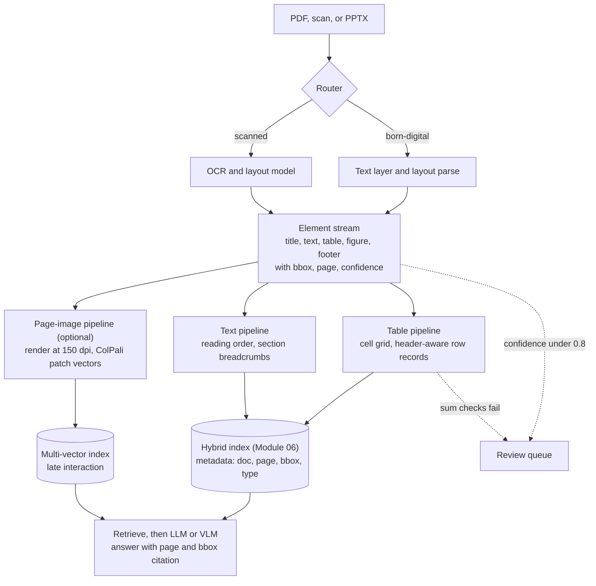

# Intuition & Mental Model

Enterprise knowledge lives in PDFs, scans, slide decks and spreadsheets pasted into Word. A plain "extract text, chunk, embed" pipeline destroys exactly what matters: **layout**. A table row becomes a run-on sentence, a footnote lands mid-paragraph, a chart disappears.

Two families of fixes:
1. **Parse structurally, then retrieve text.** Layout models (LayoutLM-style) and parsers (Unstructured, Docling) detect blocks: title, paragraph, table, figure, footer. Tables are kept as tables (rows and columns, or Markdown/HTML) and each cell keeps its header context. Headers/footers are dropped; reading order is restored for multi-column pages.
2. **Retrieve pages as images.** ColPali-style retrievers embed a page screenshot as many patch vectors and score a query with **late interaction (MaxSim)**: for each query token, find its best-matching patch, then sum. No OCR needed, so charts and layout are searchable. A vision-language model then reads the retrieved page images.

Practical rule: use structured parsing for text-heavy, table-heavy compliance documents (cheap, auditable); add page-image retrieval where visuals carry the meaning (diagrams, slides, scanned forms). Always keep a **confidence score and page coordinates** so humans can verify an extracted number against the source.

# Production Architecture & Data Flow

Documents and page images stay inside the VPC. VLM inference is self-hosted or reached through a private endpoint.

# Architectural Trade-Off Matrix

| Approach | Latency | Scalability | Implementation Complexity | Cost |
|---|---|---|---|---|
| **Layout-aware parsing (Unstructured/Docling + LayoutLM) → text/table chunks** | Ingest 1-5 s/page, query as fast as text RAG | High; CPU/GPU batchable | Medium | Low-Medium |
| **ColPali-style page-image retrieval (multi-vector) + VLM answer** | Query heavier (MaxSim over patches, VLM tokens for images) | Medium: ~1,000 vectors/page inflates index (50-100x) | Medium-High | High: storage + VLM inference |
| **Plain OCR → text chunking** | Fast | High | Low | Low, but loses tables/figures: silent accuracy loss |

# Enterprise War Stories & Edge Cases

**1. The balance sheet that added up wrong.** OCR flattened a financial table; "(1,204)" (a negative) was read as "1,204" and a footnote marker "3" glued onto "2021" became "20213." Extracted totals were off by millions. *Remediation:* keep table structure, parse parentheses as negatives, validate with row/column sums, confidence thresholds with human review, and always store page and bbox for evidence.

**2. Multi-column PDF read across the gutter.** A two-column regulatory filing was read left-to-right across both columns, interleaving unrelated sentences; a retrieved "paragraph" said the opposite of the rule. *Remediation:* layout model for reading order, column detection, regression tests with golden page images, and a sampling audit comparing parse output to the rendered page.

**3. Scanned forms at 40% skew.** Field engineers photographed forms at angles; OCR confidence dropped, and fields shifted into neighbouring cells. *Remediation:* preprocessing (deskew, denoise, contrast), per-field confidence, forms-specific key-value extraction instead of free OCR, and a human-in-the-loop queue for anything below threshold, with corrections feeding the evaluation set.
