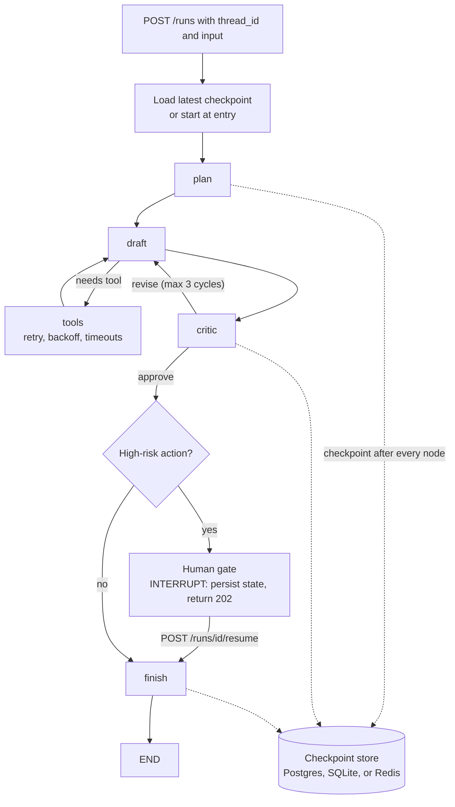

> **Syllabus lessons for this module:** full teaching notes for every topic are in [Syllabus Topic Write-ups](#syllabus-topic-write-ups); the topic-to-code map is in the [Syllabus Coverage Map](#syllabus-coverage-map) and [COVERAGE.md](../../COVERAGE.md).

# Intuition & Mental Model

A simple LLM chain is a **straight road**: step 1, step 2, step 3. A real agent is a **flowchart with loops**: draft an answer, critique it, go back and fix it, call a tool, wait for a human, continue tomorrow. Frameworks like LangGraph model this as a **state machine**: a typed *state* object, *nodes* (functions that read state and return updates), and *edges* (fixed or conditional) that decide the next node. Cycles are allowed, which is what lets an agent iterate.

Why enterprises care:
- **Determinism you can reason about.** Every transition is explicit, so you can draw it, test it and audit it. "The agent decided" becomes "node `critic` returned `revise`, edge routed to `drafter`."
- **Persistence and checkpointing.** After every node the state is saved. If the pod dies mid-run, you resume from the last checkpoint instead of paying for the whole run again. The same mechanism enables *interrupts* (pause for human approval, resume days later) and *time travel* (replay from an earlier checkpoint to debug).
- **Bounded loops.** A cycle without a limit is an invoice. Every graph needs a recursion limit and a budget.

The lab implements these semantics from scratch (state reducers, conditional edges, checkpoint/resume, interrupt, recursion limit) so you understand what LangGraph's `StateGraph`, `add_conditional_edges`, `checkpointer` and `interrupt` actually do.

# Production Architecture & Data Flow



Failure model: a crash between nodes resumes at next_node. A crash inside a node re-runs that node, so side-effecting tools need idempotency keys. A recursion limit (for example 25 steps) raises GraphRecursionError.

# Architectural Trade-Off Matrix

| Approach | Latency | Scalability | Implementation Complexity | Cost |
|---|---|---|---|---|
| **LangGraph (explicit graph + checkpointer)** | Small overhead per node (checkpoint write ~2-10 ms) | High: stateless workers, state in Postgres/Redis | Medium: must model the flow | Low framework cost; cost is LLM calls |
| **Free-form agent loop (ReAct "while True")** | Lowest to prototype | Poor control: unbounded loops, hard to resume | Low initially, High to harden | Unpredictable token spend |
| **Workflow engine (Temporal/Step Functions) + LLM activities** | Higher orchestration latency | Very high, durable for days/months | High: separate platform and SDKs | Medium-High (platform ops) |

# Enterprise War Stories & Edge Cases

**1. The infinite revise loop.** A drafter/critic pair disagreed forever: the critic always found a nit. 40,000 loops ran overnight on a stuck input, costing roughly $9k. *Remediation:* recursion limit, per-run token budget, "stalled progress" detection (same critic feedback twice → escalate), and a cheap model for critique.

**2. Resume that double-charged a customer.** The pod died after the `issue_refund` tool call succeeded but before the checkpoint was written; on resume the node re-ran and refunded twice. *Remediation:* idempotency keys derived from `(thread_id, step)` on every side-effecting tool, write-ahead "intent" records, and checkpoint *before* external effects when feasible (outbox pattern).

**3. State blob bloat.** The full retrieved documents were stored in agent state; checkpoints reached 8 MB each, and the database filled in weeks with replay latency of seconds. *Remediation:* store references (document ids) in state, keep large artifacts in object storage, TTL old checkpoints (keep latest + milestones), and schema-version the state so old checkpoints can still be resumed after deploys.


# Syllabus Topic Write-ups

This module teaches how to build software agents as explicit graphs of steps: what makes a program an agent, the main control patterns (ReAct, plan-and-execute, router, supervisor), and the graph mechanics that implement them (state, nodes, edges, routing, compilation, concurrency, nesting, map-reduce and conflict handling). It matters to a Forward Deployed Engineer because customers rarely want a demo chatbot. They want a system that calls their internal tools, survives failures, can be audited and has a bounded cost, and a graph with explicit state is the structure that makes those properties possible. LangGraph is the reference framework here, so verify exact names, defaults and signatures against its current documentation before relying on them.

**How to study this module**

Read the topics in order, because each one uses the previous ones. Topics 1 to 4 are about patterns and are framework-free: you can understand them with a plain Python loop. Topics 5 to 8 turn the patterns into a graph: state, nodes and edges, routing, compiling. Topics 9 to 12 are about running many things at once: async, nesting, map-reduce and conflicts. A suggested path:

1. Topic 1 (agency) to know when an agent is the right tool at all.
2. Topic 2 (ReAct) as the baseline loop, then Topic 3 (plan-and-execute) as its main alternative.
3. Topic 4 (router and supervisor) to see how several specialists are coordinated.
4. Topics 5, 6, 7 together, since state, nodes and conditional edges are one mental model, then Topic 8 (compiling).
5. Topic 9 (async), then Topic 11 (map-reduce) which is async fan-out with a reduce step.
6. Topic 12 (state conflicts) right after 11, because fan-out is what creates conflicts, then Topic 10 (nested graphs) to close with composition.

**Module cheat sheet**

| Must-know | One-line answer |
|---|---|
| Agent vs chain | In a chain the programmer fixes the control flow; in an agent the model chooses the next action from a goal, tools and observations, including when to stop. |
| ReAct | Loop of Thought, Action (tool plus input), Observation, repeated until the model answers or a step cap is hit. |
| Cost of a loop | Model calls grow linearly with steps, input tokens grow faster because the transcript is resent each step. |
| Plan-and-execute | One planner call writes typed steps, a cheap executor runs them, a replanner repairs permanent failures; good for known shapes, brittle for surprises. |
| Router vs supervisor | A router decides once and hands off with no loop; a supervisor is a loop that regains control after every worker and decides when to finish. |
| Graph anatomy | Shared state, nodes that return partial updates, and edges (fixed or conditional) that decide what runs next. |
| Reducer | A function (old, new) to merged, declared per state field; without one the field is overwritten, and parallel writes to it are an error in LangGraph. |
| Compile | Validates wiring (missing edges, unreachable nodes, dead ends) and attaches runtime services such as a checkpointer; a recursion limit bounds steps per run. |
| Conditional edge | A plain function reads state and returns a label that maps to the next node; keep it deterministic and put an attempt cap in it. |
| Concurrency vs parallelism | Async interleaves waiting work on one thread, which helps I/O-bound agent calls but not CPU-bound work. |
| Concurrency safeguards | A timeout per branch, a semaphore to cap in-flight calls, and retries with backoff and jitter. |
| Map-reduce | Fan out one worker per item (count known at run time), collect with an appending reducer, then reduce, in stages if the result is large. |
| State conflict | Two parallel nodes writing one field in the same step; fix it with a per-field merge rule that does not depend on finish order. |
| Subgraph | A compiled graph used as a node, with its own state schema; keep the interface narrow and map fields explicitly. |

### 1. Defining agency
**What you will be able to do**

- Explain in two minutes, to a non-engineer, the difference between a chatbot, a workflow and an agent.
- List the parts of an agent (goal, tools, memory, decision step, action step, stopping rule) and draw the loop.
- Decide, for a given customer problem, whether an agent, a router or a fixed chain is the right shape, and defend the choice with cost and risk.
- Spot in a design review the missing guard rails: no step cap, write tools without approval, unbounded history.

**Prerequisites**

You should know what a language model call is, what a function or tool call is (the model returns a name and arguments, your code runs it), and basic Python. No earlier module is required.

**The idea from first principles**

Start with the problem. A language model on its own can only produce text from what is in its prompt. A customer asks "where is my parcel?" and the model has no access to the shipping system. The first fix is to write code that fetches the data and puts it in the prompt. That is a pipeline, or chain: step 1 fetch, step 2 format, step 3 ask the model. The programmer decided the order and the model only fills in the last step.

Chains break when the right steps depend on the input. Suppose the customer writes only "my email is a@x.com, where is my parcel?". The chain was written assuming an order number. It calls the delivery lookup with an empty value and fails. You could add an "if email, look up order first" branch, then another branch for phone number, then another for tracking code, and soon you have a tangle of special cases that still misses the next variation.

An everyday analogy: a recipe versus a cook. A recipe lists steps in a fixed order. A cook with a goal ("make dinner for four"), a kitchen (tools) and a look in the fridge (observations) decides what to do next, adapts when the onions are missing, and decides when dinner is done. An agent is the cook. The recipe is the chain.

Now the precise definitions. An agent is a program in which a language model chooses the next action, repeatedly, based on a goal, the tools available and the observations so far, and also decides when to stop. A tool is a function the model may request, described by a name, a natural-language description and an argument schema. Memory is the record the model can read: short-term memory is the history of this run (actions and results), long-term memory is stored information that persists across runs. An observation is the result returned by a tool. The loop is: perceive (read state), decide (model picks an action), act (run the tool), repeat. The stopping rule is a finish action from the model, a budget (steps, tokens, money, time), or an external guard such as a human approval.

Agency is a spectrum, not a switch. From least to most freedom: one model call; a chain with fixed steps; a router where the model picks one branch; a loop where the model picks actions repeatedly; several loops that hand work to each other. Each step up buys flexibility and costs predictability, latency, tokens and testability. The engineering skill is choosing the lowest point on the spectrum that solves the problem.

**How it works, step by step**

1. Define the goal and constraints as text the model sees every turn, for example "Answer the customer's delivery question. Never promise a date the system does not show."
2. Register tools with names, descriptions and argument schemas. Each tool should do one thing and return small, clear output. Mark each tool read-only or write.
3. Initialize memory with the goal and the user input.
4. Decide: send goal, tool descriptions and memory to the model. It returns either a tool call (name plus arguments) or a final answer.
5. Validate the call: does the tool exist, do the arguments match the schema, is this write action permitted without approval.
6. Act: run the tool with a timeout, catching exceptions.
7. Observe: append the result (or the error text) to memory.
8. Check stopping: finish action, step count at maximum, token or cost budget exceeded, or no progress detected. If not stopped, go to step 4.

Worked calculation of cost and latency (all numbers are illustrative). A chain makes 1 model call of 1,500 input tokens and 200 output tokens, taking 2 seconds. An agent for the same request takes 4 loop iterations. Model latency per call is 2 seconds, tool latency 0.5 seconds. Total time is 4 x 2 + 3 x 0.5 = 9.5 seconds, versus 2.5 seconds for the chain (the chain has one 0.5 second fetch). Tokens: iteration k resends the growing memory. If memory grows by 250 tokens per iteration, inputs are 1,500, 1,750, 2,000, 2,250 which sum to 7,500 input tokens, five times the chain. That is the price of flexibility: here about four times the latency and five times the input tokens. It is worth paying only when the chain would give a wrong or failed answer for a meaningful share of inputs.

**Worked example 1: small and hand-traceable**

Tools: find_order(email) returns an order id; get_eta(order_id) returns a date. Input: "a@x.com, where is my parcel?". Memory starts as [goal, input].

Iteration 1. Decide: model returns find_order(email="a@x.com"). Act: returns "8841". Memory: [goal, input, find_order -> 8841].

Iteration 2. Decide: model returns get_eta(order_id="8841"). Act: returns "Thursday". Memory: [..., get_eta -> Thursday].

Iteration 3. Decide: model returns finish("Your parcel arrives Thursday."). Stop. Three model calls, two tool calls.

Now the fixed chain on the same input: it calls get_eta(order_id="") and receives an error. Same data, different outcome, because only the agent could choose to look up the order first. Run it again with input "order 8841, where is it?": the agent skips find_order and finishes in 2 iterations, while the chain works. That variability in path is the definition of agency in action.

**Worked example 2: enterprise scenario**

A telecom runs a support assistant. Customers ask about bills, outages and plans, and a common question is "why is my bill higher and did the outage affect it?", which needs the invoice, the outage log and the plan terms, in an order that depends on what each shows. The team uses a loop with read-only tools and a refund tool guarded by human approval.

```python
READ_ONLY = {"invoice_lookup", "outage_lookup", "plan_lookup"}

def run_agent(goal, tools, llm, approve, max_steps=8):
    history = [("goal", goal)]
    for step in range(max_steps):
        action = llm(history)
        if "finish" in action:
            return action["finish"]
        name, args = action["tool"], action["args"]
        if name not in tools:
            history.append(("error", f"unknown tool {name}"))
            continue
        if name not in READ_ONLY and not approve(name, args):
            history.append(("error", "action not approved"))
            continue
        history.append((name, tools[name](**args)))
    return "I could not finish; escalating to a human agent."
```

Commentary: the read-only set is an allow list, so any new tool is treated as risky until classified. Unknown tools become error observations rather than crashes, so the model can recover. The approval callback is the human-in-the-loop hook for the refund tool. The step cap returns a safe handoff instead of an exception, which is the right customer experience. In production you would also log every action with the run id, because auditors will ask what the model did and why.

**Hands-on practice**

Exercise 1 (easy). A task is "convert a CSV of invoices into a monthly total per customer". Is it an agent, a chain or a single call? Solution: a chain, or just code. The steps are known and identical for every input, so letting a model choose steps adds cost and risk with no gain. If a model is used at all, it is for a narrow sub-step such as normalizing messy customer names.

Exercise 2 (medium). Using the illustrative cost numbers from the lesson (2 s per model call, 0.5 s per tool call), compute the latency of a 6-iteration agent that makes 5 tool calls, and the latency of a 6-iteration agent after you make the 3 independent lookups run in parallel. Solution: serial is 6 x 2 + 5 x 0.5 = 14.5 s. If three of the five tool calls can run together, those take 0.5 s instead of 1.5 s, saving 1.0 s, so 13.5 s. The lesson: parallel tool calls help only a little because model latency dominates, so reducing the number of iterations matters more.

Exercise 3 (hard). Design the guard rails for an insurance claims agent that can read policy and claim data, request documents from the customer by email, and approve payouts. List what is automatic, what needs approval and what the stop conditions are. Solution: reads are automatic (policy lookup, claim history). Emailing the customer is a write with external effect, so allow only from approved templates and log it. Payout approval always needs a human above a threshold and arguably always in early rollout. Stop conditions: a step cap (say 10), a per-run cost cap, a repeated identical call detector, and a timeout on the whole run. Add least-privilege credentials so the agent's database user cannot write at all, and an evaluation set of past claims that the agent must pass before each release.

**Alternatives and trade-offs**

| Option | Latency | Predictability | Cost | Choose when |
|---|---|---|---|---|
| Single model call | lowest | high | lowest | The answer needs no external data |
| Chain (fixed steps) | low and fixed | high | low and fixed | The steps are known and the same for every input |
| Router | low | high | low | Inputs fall into a few categories |
| Agent loop | variable, seconds to minutes | lower | variable | The path depends on intermediate results |

The technique is the wrong tool when the path is known, when errors are very costly and cannot be reversed, or when you cannot afford variable latency. Testing also changes: you cannot assert an exact sequence of calls, so you assert bounds (steps under a limit, only allowed tools used, final answer matches a reference on an evaluation set).

**Where it goes wrong in production**

- Runaway loops. Symptom: runs with 30+ steps and high cost. Cause: no cap, or the model retries a failing call unchanged. Diagnose: histogram of steps per run, search for repeated identical calls. Fix: step and token budgets, repeated-call detection, error text that explains what to change.
- Bad arguments. Symptom: tool errors on invented ids. Cause: vague tool descriptions or no schema. Diagnose: group tool errors by tool and argument. Fix: strict schemas, validation, clearer descriptions with examples.
- Unsafe side effects. Symptom: an unwanted refund or email. Cause: write tools with broad permission and no approval. Diagnose: audit log review. Fix: approval gates, least privilege, idempotency keys.
- Cost tail. Symptom: average is fine, p99 is 10 times higher. Cause: a few long runs. Diagnose: percentile tracking per run. Fix: per-run budgets and alerts on the tail.
- Agent used where a chain would do. Symptom: flaky behavior on a simple task. Cause: over-engineering. Diagnose: check whether the traces show the same path every time. Fix: replace with a chain.

**Do not confuse**

- Agent versus workflow: in a workflow code decides the path; in an agent the model does.
- Tool-using LLM app versus agent: a single tool call decided by code is not a loop with model-chosen steps.
- Agent versus assistant: "assistant" is a product word, "agent" describes the control structure.

**How interviewers probe this**

- What is the difference between an agent and a chain or workflow?
- What are the components of an agent, and what is the loop?
- How does an agent decide when to stop, and what happens if it never does?
- When would you not use an agent?
- Design a claims-triage agent: what do you hard-code and what do you let the model decide?
- What breaks when the model repeatedly chooses a tool that keeps failing?
- How do you test a system whose path differs every run?
- Trap: "An agent is just an LLM with tools, right?" What is missing from that definition?

**Model answer (60-90 seconds)**

"An agent is a program where the model chooses the next action from a goal, the tools it has and what it has observed, and also chooses when to stop. A chain is the opposite: the programmer fixes the order. Mechanically an agent is a loop. I build context from the goal and history, the model returns a tool call or a finish, I validate and run the tool, append the result, and repeat until it finishes or hits a budget. The benefit is handling inputs where the path varies: if a customer gives only an email, the agent looks up the order first, where a chain would pass an empty order number and fail. The cost is predictability, latency and tokens, since every iteration is a model call and the transcript is resent each time. So I use the lowest-freedom shape that works: a chain if steps are known, a router for categories, an agent only when the next step depends on earlier results. The limit is testing and safety: I bound steps, gate write actions, and evaluate on scenarios with assertions on bounds."

**Quick-fire answers**

- Q: Agent versus chain? A: In a chain the programmer fixes the sequence of steps. In an agent the model chooses the next action each turn and decides when to stop.
- Q: Components and loop? A: Goal, tools, memory, a decision step by the model and an action step run by code, plus a stopping rule. The loop is perceive, decide, act, repeat.
- Q: How does it stop? A: The model emits a finish action, or a budget (steps, tokens, cost, time) or a guard ends the run. You must have the budget, because the model alone may never finish.
- Q: When not to use one? A: When steps are known, when latency must be fixed, or when errors are irreversible. A chain is cheaper, faster and easier to test.
- Q: Claims triage design? A: Hard-code validation, eligibility rules and payout approval. Let the model choose which evidence lookups to run and how to summarize, with read-only tools, a step cap and human approval for denial or payment.
- Q: Tool keeps failing? A: Without a cap it loops and burns money. Return the error as an observation, detect identical repeated calls, cap steps, and escalate with the partial result.
- Q: Testing nondeterministic paths? A: Run an evaluation set and assert properties: step count bounds, allowed tools only, final answer correctness, cost. Do not assert exact traces.
- Q: Trap, "just an LLM with tools"? A: The missing piece is model-controlled iteration with a stopping rule. One tool call that code decides on is a workflow, not an agent.

**Recap in five lines**

- An agent lets the model pick the next action and when to stop; a chain fixes the order in code.
- The loop is perceive, decide, act, repeat, with tools and memory feeding the decision.
- Agency costs predictability, latency and tokens, so use the lowest-freedom shape that works.
- Always bound the loop (steps, tokens, time) and gate write actions with approval.
- Test with evaluation sets and bounds, not exact traces.

### 2. ReAct framework loops
**What you will be able to do**

- Write out a ReAct trace by hand (Thought, Action, Observation) for a small question.
- Compute how input tokens grow over the steps of a loop and explain why cost is super-linear.
- Implement the safe execution step: validate, run with timeout, return errors as observations.
- Name five production failure modes of ReAct loops and their fixes.

**Prerequisites**

Topic 1 (agency, the loop and the stopping rule). You should know what a tool call is and basic JSON.

**The idea from first principles**

The problem: a model that answers in one shot cannot use information it does not have, and a model that acts blindly cannot adapt. Early tool-use approaches had the model write a whole plan of calls up front, or produce a final answer without looking anything up. Both fail when the second step depends on the first. Asked "Is order 8841 late?", the model cannot know which carrier to query until it has seen the order.

ReAct, short for reason plus act, solves this by interleaving. The model writes a Thought (a short piece of reasoning about what it needs), then an Action (a tool name and input), and then the system returns an Observation (the tool result). That observation is appended to the transcript, and the model produces the next Thought. The cycle repeats until the model writes a Final Answer. The reasoning step helps because writing out "I need the ship date first" focuses the next action, and the observation step grounds the model in real data instead of guesses.

Analogy: a detective at a crime scene. She does not write the final report before looking at anything. She notes a hunch (thought), checks the cellar (action), sees footprints (observation), updates the hunch, and continues until she can name the culprit.

Terms. Transcript is the running record of thoughts, actions and observations that is sent to the model on every step. Tool registry is the map from tool names to functions your code is willing to run. Parsing is turning the model's reply into a structured action; modern chat APIs return tool calls as structured data, which removes most text parsing, but the logic is the same. Step is one round of think, act, observe. The whole thing is a loop with a stopping rule, as in Topic 1, with a specific discipline: every model decision is made after seeing the last observation.

**How it works, step by step**

1. Build the prompt: instructions, the list of tools with argument schemas, the question, and the instruction to either call a tool or answer.
2. Call the model with the transcript so far.
3. If the reply is a Final Answer, return it.
4. Otherwise extract the tool name and arguments.
5. Validate: the name must be in the registry and the arguments must match the schema. If not, make the observation an error message that names the problem and lists valid tools.
6. Execute with a timeout and exception handling. A tool exception becomes an observation, not a crash.
7. Truncate the observation to a size limit so one big response cannot swamp the context.
8. Append the Thought, Action and Observation to the transcript.
9. Check the step cap and budgets. If exceeded, stop with a safe fallback. Otherwise go to step 2.

Cost formula. Let p be the prompt tokens (instructions, tools, question) and t the tokens added per step (thought, call, observation). Input tokens at step k are about p + (k - 1) x t. Total input over n steps is n x p + t x (0 + 1 + ... + (n - 1)) = n x p + t x n(n - 1) / 2.

Worked calculation (illustrative numbers). p = 1,000, t = 300, n = 6. Sum of (k - 1) for k = 1..6 is 0+1+2+3+4+5 = 15. Total = 6 x 1,000 + 300 x 15 = 6,000 + 4,500 = 10,500 input tokens. Six independent calls with just the prompt would use 6,000. If n doubles to 12: 12,000 + 300 x 66 = 31,800, which is more than three times as much for twice the steps. That is why cost grows super-linearly and why shorter loops, smaller observations and prompt caching of the stable prefix (if your provider supports it) matter.

**Worked example 1: small and hand-traceable**

Question: "How many days late is order 8841?" Tools: get_order(id) and today(). Registry has both.

Step 1. Thought: I need the promised date. Action: get_order(8841). Observation: {"promised": "May 6", "status": "in transit"}.

Step 2. Thought: I need today's date to compare. Action: today(). Observation: "May 9".

Step 3. Thought: promised May 6, today May 9, still in transit, so 3 days late. Final Answer: "Order 8841 is 3 days late."

Now inject a mistake. At step 1 the model calls get_orders(8841) (typo). Validation fails, the observation is "Error: unknown tool get_orders. Available: get_order, today". Step 2 the model corrects itself. The run costs one extra step but succeeds, which is the point of returning errors as observations. Without that, the first typo would crash the run.

**Worked example 2: enterprise scenario**

A bank's operations team asks "Why was payment P-204 held?". Tools, all read-only: payment_status(id), screening_result(id), account_flags(account). The model calls payment_status, sees "held: review, account A-77", then screening_result and account_flags, and writes a summary with the evidence. The execution step is the critical code.

```python
import json

def run_step(action, tools, max_chars=2000):
    name = action.get("tool")
    args = action.get("args", {})
    if name not in tools:
        return f"Error: unknown tool {name!r}. Available: {sorted(tools)}"
    try:
        result = tools[name](**args)
    except TypeError as exc:
        return f"Error: bad arguments for {name}: {exc}"
    except Exception as exc:
        return f"Error: {name} failed: {exc}"
    text = result if isinstance(result, str) else json.dumps(result, default=str)
    return text[:max_chars]
```

Commentary: the unknown-tool branch returns the valid list, which is the cheapest way to correct a typo. TypeError catches wrong or missing arguments and tells the model which tool it concerns. The generic except is deliberate: tool failures must not kill the run, but in production you would also log the traceback. The final slice enforces an output limit so a 50,000-token response cannot flood the transcript; a better version returns a summary plus an id the model can use to page. Because all three tools are read-only and the bank's database role is read-only, even a model that misbehaves cannot change anything.

**Hands-on practice**

Exercise 1 (easy). Write the ReAct trace for "What is the total of orders 1 and 2?" with a tool get_order(id) returning amounts 40 and 25. Solution: Thought: need order 1. Action: get_order(1). Observation: 40. Thought: need order 2. Action: get_order(2). Observation: 25. Thought: 40 + 25 = 65. Final Answer: 65. Four model calls including the final answer if each thought and action takes one call, or three if the final answer comes with the last thought. A model that supports parallel tool calls may fetch both orders in one step.

Exercise 2 (medium). With p = 800 and t = 250, compute total input tokens for n = 4 and n = 8, and the ratio. Solution: n = 4: 4 x 800 + 250 x (4 x 3 / 2) = 3,200 + 1,500 = 4,700. n = 8: 8 x 800 + 250 x (8 x 7 / 2) = 6,400 + 7,000 = 13,400. Ratio 13,400 / 4,700 is about 2.85 for twice the steps.

Exercise 3 (hard). A tool returns 40,000 characters of log lines and the agent starts giving poor answers. Diagnose and fix. Solution: the context is dominated by one observation, so earlier instructions and the question are diluted, and cost rises. Fix by capping output per tool, adding a search-or-filter parameter to the tool (for example a time window or keyword) so the model asks for what it needs, summarizing in the tool, and returning an id for paging. Add a test that feeds an oversized observation and asserts the transcript stays under a limit.

**Alternatives and trade-offs**

| Pattern | Model calls | Adapts to surprises | Auditability | Use when |
|---|---|---|---|---|
| ReAct | one per step | high | transcript only | The next step depends on the last result |
| Plan-and-execute | 1 plan plus few | low to medium | explicit plan | Known shape, repeated task |
| Single call with retrieval first | one | none | high | One lookup is enough |

ReAct is the right default for exploratory questions. It is the wrong tool when the steps are known (use a plan or a chain), when latency must be bounded tightly, or when observations are huge and uncontrolled. Its thinking is local, so on long tasks it can wander or forget the goal; a plan gives global structure.

**Where it goes wrong in production**

- Looping on the same call. Symptom: many steps with identical actions. Cause: the model retries a failing action unchanged. Diagnose: count repeated action-argument pairs per run. Fix: step cap, repeat detection that injects "this call already failed, try something different", and richer error text.
- Context overflow. Symptom: errors or degraded answers late in a run. Cause: large observations and a growing transcript. Diagnose: log token count per step. Fix: truncate, summarize old steps, return references.
- Hallucinated tools or arguments. Symptom: unknown tool errors. Fix: schema validation, tool descriptions, fewer tools per agent.
- Prompt injection through observations. Symptom: the agent follows instructions found in a web page or document. Cause: tool output treated as instructions. Fix: treat output as data, minimize tool permissions, require approval for risky actions, and filter or label untrusted content.
- Slow runs. Symptom: 30 second answers. Cause: serial steps. Diagnose: per-step timing. Fix: parallel tool calls where independent, smaller model for easy steps, fewer steps via better tools.

**Do not confuse**

- ReAct versus chain of thought: chain of thought is reasoning only, with no tools; ReAct adds actions and observations from the outside world.
- Thought versus observation: thoughts are model-generated and can be wrong; observations are tool-generated and are the grounding.
- ReAct versus function calling: function calling is an API feature for returning structured tool calls; ReAct is the loop pattern that uses it.

**How interviewers probe this**

- What does ReAct stand for and what does the loop look like?
- Why should tool errors be returned as observations?
- How do you prevent infinite loops?
- How does token cost grow with the number of steps?
- Design a ReAct agent that answers questions over three internal systems.
- What breaks when a tool returns a very large response, or malicious text?
- How would you reduce latency of a six-step agent by half?
- Trap: "Does the Thought step make the model more correct?" What is the honest answer?

**Model answer (60-90 seconds)**

"ReAct is a loop where the model alternates reasoning and acting. It writes a short thought, picks a tool and input, my code runs the tool, and the result goes back into the transcript as an observation, and this repeats until the model gives a final answer. It is the default for tool use because the model decides the next step from what it just learned: look up the order, read the ship date, then call the carrier tool. The trade-off is cost and control. Every step is a model call and the transcript is resent, so six steps cost well over six times one short call, and the loop can wander or repeat. I bound it with a step cap and token budget, validate tool names and arguments, return errors as observations so the model can self-correct, and truncate big outputs. For a known task shape I would move to plan-and-execute for fewer calls and an auditable plan. The limit is that thoughts can be wrong and observations can contain injected text, so tools stay least-privilege."

**Quick-fire answers**

- Q: What is ReAct? A: A loop of Thought, Action, Observation. The model reasons, calls a tool, reads the result, and repeats until it answers.
- Q: Why errors as observations? A: The model can read the error and retry or switch tools, so a typo costs one step rather than crashing the run.
- Q: Preventing infinite loops? A: A maximum step count, a token or cost budget, and detection of repeated identical calls, with a safe fallback when any triggers.
- Q: Cost growth? A: Calls grow linearly with steps. Input tokens grow roughly with n squared times the per-step growth, because the whole transcript is resent each step.
- Q: Design over three systems? A: One tool per system with strict schemas and read-only credentials, output truncation, a step cap, logging of every action, and an evaluation set of real questions.
- Q: Huge or malicious output? A: Huge output crowds out context and raises cost; truncate or page it. Malicious text can steer the model, so treat observations as data and limit permissions.
- Q: Halving latency? A: Cut iterations with better tools, run independent calls in parallel, use a smaller model for easy steps, and cache the stable prompt prefix if supported.
- Q: Trap, does Thought help? A: Often it helps focus the next action, but thoughts can be fluent and wrong, so correctness comes from observations and validation, not from the thought text.

**Recap in five lines**

- ReAct interleaves Thought, Action and Observation until a final answer.
- Validate tools and arguments, and return errors as observations.
- Cost is super-linear in steps because the transcript is resent each time.
- Bound steps and tokens, truncate observations, and treat tool output as untrusted data.
- Prefer plan-and-execute when the task shape is known.
### 3. Plan & Execute structures
**What you will be able to do**

- Explain how plan-and-execute differs from ReAct and compute the model-call savings for a task by hand.
- Define a plan as typed data and write the validation that rejects bad plans before any side effect.
- Decide when a replan is warranted and how to cap it.
- Combine plan-and-execute with a bounded ReAct loop inside hard steps.

**Prerequisites**

Topic 1 (agency) and Topic 2 (ReAct loops, cost per step). You should be comfortable with Python classes and JSON.

**The idea from first principles**

The problem: ReAct reasons with the big model after every observation. For a task whose shape is known in advance, that is wasteful. If every monthly revenue report needs bookings, then refunds, then a net figure, then a narrative, there is no reason to pay a large model to rediscover that order every time, and a long transcript makes each later call more expensive and more prone to drift.

The fix is to separate deciding what to do from doing it. A planner makes one model call that outputs an ordered list of steps. An executor runs those steps, mostly with plain code or a cheaper model, without re-thinking between them. If a step fails in a way that cannot be retried, a replanner looks at what happened and writes a revised plan for the remaining work. A final synthesis call turns collected results into the answer.

Analogy: a builder with blueprints versus a builder improvising. The blueprint is drawn once by an architect (planner), the crew follows it (executor), and the architect is called back only when the crew finds that a wall is not where the drawing said (replan).

Definitions. A plan is an ordered, machine-readable list of steps. A step names a tool, gives its arguments, and may reference outputs of earlier steps. The executor is the component that runs steps in order and stores results by step id. A replan is a new plan for the remaining work, produced after a permanent failure or a violated assumption. Permanent failure means retrying the same step will not help (for example the tool says the data source is retired), as opposed to a transient failure like a timeout, which is retried with backoff. A synthesis step is the last call that composes the answer from results.

The benefit is threefold. Fewer large-model calls, so lower cost and latency. A plan is a visible artifact you can show to a user, store and audit. And you can validate the plan before executing anything, catching nonsense early. The cost is rigidity: the plan was made with only the question in view, not the results, so when results surprise you, the plan can be wrong.

**How it works, step by step**

1. Planner call: give the goal, the tool list and the output format. Ask for a list of steps with ids, tools and arguments. Use structured output so the reply parses.
2. Validate the plan: every tool exists, arguments fit the schema, step ids are unique, references point only to earlier steps, no write step comes before its prerequisites, and the step count is under a limit.
3. If validation fails, send the error back to the planner once or twice. Otherwise abort.
4. Execute in order. For each step, resolve references to earlier results, run the tool with a timeout, retry transient errors, and store the result under the step id.
5. If a step fails permanently, call the replanner with the goal, the original plan, completed results and the error. It returns a plan for the remainder. Increment the replan counter; stop if over the cap.
6. When steps are done, run the synthesis call with the results and write the answer.
7. Log the plan, each step input and output, and any replans.

Worked calculation of calls (illustrative). Task with 5 data steps and 1 narrative. ReAct: roughly one model call per step plus a final answer, so about 6 large-model calls, each with a growing transcript. Plan-and-execute: 1 plan call, 5 tool calls executed by code (0 model calls), 1 synthesis call, so 2 model calls. With one permanent failure and one replan: 1 + 1 + 1 = 3 calls. If a large-model call costs 3 units and a tool call 0.1 units: ReAct about 6 x 3 + 5 x 0.1 = 18.5; plan-and-execute about 2 x 3 + 5 x 0.1 = 6.5, or 9.5 with the replan. The saving depends on how many steps genuinely need judgment; if every step needs a model call anyway, the saving shrinks.

**Worked example 1: small and hand-traceable**

Goal: "Net revenue for May." Tools: bookings(month), refunds(month), subtract(a, b).

Planner output: step s1 bookings(month="May"); step s2 refunds(month="May"); step s3 subtract(a=ref(s1), b=ref(s2)).

Validation: tools exist, ids unique, s3 references only s1 and s2 which come earlier. Passes.

Execution: s1 returns 1,200. s2 returns 150. s3 resolves a = 1,200 and b = 150, returns 1,050. Synthesis: "Net revenue for May was 1,050." Two model calls.

Failure trace: suppose s2 raises "refunds_api retired". Retrying will not help, so this is permanent. The replanner receives the goal, the plan, results {s1: 1,200} and the error, and returns a new remainder: s2b refunds_from_warehouse(month="May"); s3 subtract(...ref(s2b)). Execution continues. Replan count is 1 of a maximum of 2. If the replanner returned a plan that failed the same way again, the cap would stop the run and escalate with the partial results.

**Worked example 2: enterprise scenario**

A finance team at an insurer produces a monthly premium and claims pack for executives. Steps are stable (premiums, claims paid, reserves, loss ratio, narrative), the tools are internal APIs, and compliance wants a record of exactly what ran. The plan is stored with the run id.

```python
from pydantic import BaseModel

class Step(BaseModel):
    id: str
    tool: str
    args: dict

class Plan(BaseModel):
    steps: list[Step]

def validate(plan: Plan, tools: dict, max_steps: int = 10) -> None:
    if len(plan.steps) > max_steps:
        raise ValueError("plan too long")
    seen = set()
    for s in plan.steps:
        if s.tool not in tools:
            raise ValueError(f"unknown tool {s.tool}")
        if s.id in seen:
            raise ValueError(f"duplicate step id {s.id}")
        seen.add(s.id)
```

Commentary: using a Pydantic model means a malformed plan fails at parse time, before any tool runs. The step cap blocks a planner that goes off on a 40-step tangent. Duplicate ids would let a later result overwrite an earlier one silently, so it is checked. In a fuller version you would also check that references (such as "ref(s1)") name earlier ids, and that write tools appear only after approval steps. Because the plan is data, the audit trail is the plan plus step outputs, which a compliance reviewer can read without replaying a model transcript.

**Hands-on practice**

Exercise 1 (easy). A plan has steps s1, s2, s3 where s3 references s4. Is it valid? Solution: no. References must point to earlier steps, and s4 does not exist yet (or comes later). Validation should reject it before execution and return the error to the planner.

Exercise 2 (medium). A 7-step task: 2 steps need judgment (a model call each), 5 are deterministic. Estimate model calls for ReAct versus plan-and-execute with judgment steps run as small model calls inside the executor. Solution: ReAct is about 7 reasoning calls plus a final answer, 8. Plan-and-execute is 1 plan, 2 judgment calls inside steps, 1 synthesis, so 4. Saving is about half. If the 2 judgment steps were replaced by bounded ReAct loops of 3 iterations each, the total becomes 1 + 6 + 1 = 8, equal to pure ReAct, so the structural benefit disappears. The saving depends on how many steps need real reasoning.

Exercise 3 (hard). Design the replan policy for a plan that pulls data from five systems. Solution: classify failures. Transient (timeout, 429, 503): retry with exponential backoff and jitter up to 3 times, no replan. Permanent (not found, retired, forbidden): replan. Data surprise (a result violates an assumption such as negative revenue): replan or escalate. Cap total replans at 2. Pass the replanner the goal, completed results, the failed step and the error text, and tell it not to repeat tools that failed. On exhaustion, return a partial answer that lists what is missing and escalate. Log each replan with the reason so you can measure which tools cause them.

**Alternatives and trade-offs**

| Pattern | Model calls | Handles surprises | Audit | Best for |
|---|---|---|---|---|
| Plan-and-execute | few | medium, via replan | high | Repeatable multi-step reports, ETL-like tasks |
| ReAct | many | high | medium | Exploratory questions |
| Fixed chain | fewest | none | highest | Steps never change |
| Plan with ReAct inside steps | medium | high where needed | high | Mostly known shape with a few hard steps |

Choose plan-and-execute when the shape is known and cost, speed and auditability matter. Choose ReAct when the next step depends on results. It is the wrong tool for open-ended research where each finding changes the direction, and when the planner cannot see enough about tools to produce correct arguments up front.

**Where it goes wrong in production**

- Invalid or hallucinated plans. Symptom: run aborts at validation or a tool receives nonsense. Cause: free-text plans or weak schemas. Diagnose: validation failure rate. Fix: typed plans, validation, one retry with the error text.
- Stale plan. Symptom: later steps run on data that makes them pointless. Cause: no check between steps. Diagnose: compare plan against actual results in traces. Fix: assumption checks after key steps that trigger a replan.
- Replan loops. Symptom: repeated replans, rising cost. Cause: the replanner reproduces the same failing plan. Fix: replan cap, tell the replanner which tools failed, escalate with partial results.
- Side effects before a later failure. Symptom: a customer is emailed and the next step fails. Cause: write steps early in the plan. Fix: order reads first, make writes idempotent, gate writes behind a validation step or approval.
- Planner blind to tool limits. Symptom: arguments that violate API limits. Fix: include tool constraints in the planner prompt and validate again at execution.

**Do not confuse**

- Replan versus retry: a retry repeats the same step for a transient error; a replan changes the remaining steps after a permanent failure.
- Plan-and-execute versus chain: in a chain a human wrote the steps once; here a model writes them per request.
- Planner versus supervisor: the planner thinks once ahead of time; a supervisor decides after every worker turn.

**How interviewers probe this**

- Explain plan-and-execute and how it differs from ReAct.
- Why use a cheaper model or plain code for the executor?
- What triggers a replan, and what does not?
- When would you choose plan-and-execute over ReAct, and when not?
- Design a report-generation agent that compliance can audit.
- What breaks when step 2 returns something that invalidates steps 3 to 5?
- How would you stop the planner from calling a tool that does not exist?
- Trap: "Plan-and-execute is always cheaper." Is that true?

**Model answer (60-90 seconds)**

"Plan-and-execute separates deciding what to do from doing it. A planner makes one model call that produces a typed list of steps, I validate it against the tool registry, and an executor runs the steps, often plain code or a smaller model, without calling the large model between steps. If a step fails permanently, a replanner gets the goal, results so far and the error and revises the rest, with a cap on replans. Compared with ReAct it uses fewer expensive calls, and the plan is a visible artifact, which is great for audit and progress display. The trade-off is rigidity: the plan is made before seeing results, so a surprise in step two can make the rest stale. For a monthly finance pack I would use it, because the steps are known: premiums, claims, reserves, loss ratio, narrative. For judgment-heavy steps I would run a small bounded ReAct loop inside the step. The limit is that if most steps need judgment, the savings vanish."

**Quick-fire answers**

- Q: Plan-and-execute versus ReAct? A: Plan-and-execute plans once and runs steps without reasoning in between. ReAct reasons after every observation.
- Q: Why a cheaper executor? A: The steps are already specified, so little judgment is needed. Code or a small model cuts cost and latency.
- Q: What triggers a replan? A: A permanent step failure, or a result that breaks an assumption the plan relied on. Transient errors get retries instead.
- Q: When choose which? A: Plan-and-execute for known, repeatable shapes where audit and cost matter. ReAct when the next step depends on what the last one returned.
- Q: Auditable report agent? A: Typed plan stored with the run id, validated steps, reads before writes, and logs of each step's input and output.
- Q: Step 2 invalidates the rest? A: Detect the violated assumption after step 2 and replan the remaining steps from current results, within the replan cap.
- Q: Stop nonexistent tools? A: Validate the plan against the registry before running, and send the error to the planner for one repair attempt.
- Q: Trap, always cheaper? A: No. If most steps need model judgment, or replans are frequent, the call count approaches ReAct, and a bad plan wastes the planning call too.

**Recap in five lines**

- A planner writes typed steps once; an executor runs them cheaply; a replanner repairs permanent failures.
- Validate the plan before any side effect, and cap steps and replans.
- Replan after permanent failures or broken assumptions; retry transient ones.
- Fewer large-model calls and an auditable plan, at the price of rigidity.
- Hybrids (plan on top, small ReAct inside hard steps) are common.

### 4. Supervisor and Router patterns
**What you will be able to do**

- State the difference between a router and a supervisor and draw both as graphs.
- Compute the expected cost of each for a request by hand.
- Design the stop conditions that stop a supervisor from looping or finishing early.
- Choose between router, supervisor and a single agent for a given workload and defend it.

**Prerequisites**

Topics 1 to 3 (agency, ReAct, plan-and-execute). A rough idea of what a node and an edge are is enough; Topics 5 to 7 formalize them.

**The idea from first principles**

The problem: one agent with 30 tools and a long instruction prompt chooses poorly. Tool descriptions compete for attention, the prompt becomes a contradictory essay, and one team cannot change billing behavior without risking technical-support behavior. The natural answer is specialists: a billing agent with billing tools and a technical agent with diagnostics tools. Now a new question appears: who decides which specialist handles a request, and who decides when the whole job is finished?

There are two answers. The first is a router. Think of a receptionist at a hospital who asks one question, "what brings you in?", and sends you to the right department. After that the department handles you completely and the receptionist is not involved again. The second is a supervisor. Think of a project manager who gives a task to the researcher, reads the result, hands it to the writer, reads that, sends it to the reviewer, and decides when the document is ready to ship. Control keeps returning to the manager.

Definitions. A specialist (or worker) is an agent or function focused on one kind of work. A router is a decision component that runs once at the start, classifies the request and dispatches to exactly one specialist, which finishes the job. A supervisor is a decision component in a loop: after every worker turn it reads shared state and chooses the next worker or FINISH. Handoff is passing control and context from one component to another. A completion criterion is a checkable condition that says the goal is met.

The two differ in loop structure. A router has a straight line with one fork: classify, then specialist, then end. A supervisor has a cycle: supervisor to worker back to supervisor, repeated. The cycle gives flexibility and costs extra decision calls, plus the risk of non-termination.

Naive approach and why it fails. Using a supervisor for everything feels general, and it is, but every request pays for at least two decision calls even when a single classification would do. Using a router for iterative work fails differently: the specialist cannot call another specialist or review itself, so research-then-draft-then-review work does not fit.

**How it works, step by step**

Router:

1. Receive the request and, if needed, minimal context.
2. Classify to a label from a fixed set, using rules, a small model or embedding similarity. Return a confidence if available.
3. If confidence is low or the label is "other", send to a fallback (a human, a general agent, or a clarifying question).
4. Dispatch to the specialist for the label. It runs to completion and its output is the answer.
5. Log the label and confidence for later evaluation.

Supervisor:

1. Initialize shared state: goal, a checklist of required outputs, a results area, a step counter.
2. Supervisor decision: a model call returns a structured decision, the name of a worker or FINISH.
3. Run the chosen worker. It reads state and writes its result (a summary and references, not a huge blob) to state.
4. Control returns to the supervisor. Increment the step counter.
5. Before honoring FINISH, check the completion criteria in code (all checklist items present). If unmet, override and continue or escalate.
6. End on FINISH with criteria met, or on step cap, or on a no-progress rule (same worker chosen twice with no state change).

Worked cost comparison (illustrative units). Decision call (classifier or supervisor) costs 1 unit; a specialist call costs 3 units. Router for one request: 1 + 3 = 4. Supervisor for a single-worker request: decide (1), worker (3), decide to finish (1) = 5. For a three-worker request: 1+3+1+3+1+3+1 = 13. For the same three-worker work, a plan-and-execute design could cost 1 plan + 9 workers + 1 synthesis = 11 but without adaptivity. The supervisor premium is the extra decision calls: 1 more for single-worker requests, 3 more for three-worker ones.

**Worked example 1: small and hand-traceable**

Router. Specialists: billing, tech. Input: "My invoice is wrong." Classify returns "billing" with confidence 0.93. Dispatch to billing, which replies. Done: 2 model calls. Input: "Hi" returns "other" with confidence 0.40, below the threshold of 0.7, so the fallback asks "How can I help: billing or technical?" Done.

Supervisor. Goal: "Write a short briefing on customer X." Checklist: [facts, draft, review]. State: all empty.

Turn 1: supervisor chooses researcher. Researcher writes facts. Checklist: facts done.
Turn 2: supervisor chooses drafter. Drafter writes draft. Checklist: facts, draft done.
Turn 3: supervisor chooses reviewer. Reviewer writes review with "approved". Checklist all done.
Turn 4: supervisor says FINISH, code verifies all three items are present, run ends. Four supervisor calls and three worker calls.

Suppose at turn 2 the supervisor tried FINISH early. The code check sees "draft" and "review" are missing, rejects it and continues. That check is what prevents premature finish.

**Worked example 2: enterprise scenario**

An insurer's service desk receives quote questions, claim-status questions and complaints. Quotes and status are categorical, so a router sends each directly to its specialist. Complaints usually need policy research, a drafted response and a compliance review, so that branch is a supervisor with three workers. The graph wiring in LangGraph style looks like this (verify the current API names; handoff helpers have changed over versions).

```python
def route(state) -> str:
    return state["category"]  # "quote", "status" or "complaint"

builder.add_conditional_edges(
    "classify", route,
    {"quote": "quote_agent", "status": "status_agent", "complaint": "supervisor"},
)
for worker in ["researcher", "drafter", "reviewer"]:
    builder.add_edge(worker, "supervisor")
```

Commentary: the conditional edge function is trivial because the classify node already wrote the category, which keeps routing deterministic and testable. The mapping makes every possible label explicit, so adding a category without wiring it fails loudly. The loop is created by the plain edges from each worker back to the supervisor; the supervisor node has its own conditional edge choosing a worker or END (omitted for space). Measure routing accuracy on labelled historical tickets, and measure how often the supervisor branch exceeds, say, 8 steps (an example threshold).

**Hands-on practice**

Exercise 1 (easy). Which pattern fits: sending an incoming email to HR, IT or Finance? Solution: a router. It is a one-shot classification and each department handles the email fully.

Exercise 2 (medium). A router costs 1 + 3 = 4 units. A supervisor on the same two-worker request costs? Compute the premium. Solution: 1 (decide) + 3 + 1 (decide) + 3 + 1 (finish) = 9. Premium is 5 units, so about 2.25 times the cost. If 80% of traffic is single-label, put a router in front and send only the remaining 20% to a supervisor, and the blended cost drops sharply (0.8 x 4 + 0.2 x 9 = 5.0 against 9 for always-supervisor).

Exercise 3 (hard). A supervisor sometimes alternates drafter, reviewer, drafter, reviewer forever because the reviewer keeps asking for small edits. Fix it. Solution: add a revision counter in state and a cap (for example 2 revision rounds). Make the reviewer return a structured verdict with a severity, and finish when only minor issues remain. Add the no-progress rule (if the draft text hash is unchanged between rounds, stop). Put the decision in code, not just in the prompt, and log the loop count so you can see how often the cap triggers.

**Alternatives and trade-offs**

| Pattern | Latency | Cost | Flexibility | Main risk |
|---|---|---|---|---|
| Router | lowest | lowest | low | A misroute is final |
| Supervisor | higher, variable | higher | high | Loops, premature finish |
| Peer handoff (workers pass control directly) | variable | variable | high | Hard to trace, cycles |
| One agent with all tools | low to medium | medium | medium | Tool overload hurts selection |

Choose a router for categorical traffic, a supervisor for multi-step work with feedback, and a single agent when the tool count is small. Multi-agent designs are the wrong tool when one agent with a good prompt and few tools already works; extra agents add latency, cost and failure points.

**Where it goes wrong in production**

- Misrouting. Symptom: wrong specialist answers confidently. Cause: ambiguous categories or weak classifier. Diagnose: confusion matrix on labelled traffic. Fix: clearer labels, confidence threshold with fallback, retrain or add examples.
- Supervisor ping-pong. Symptom: alternating workers with no progress. Cause: no progress detection. Diagnose: trace of worker sequences. Fix: step cap, revision cap, no-progress rule.
- Premature or missing finish. Symptom: incomplete answers, or runs that never end. Cause: completion left to the model's judgment. Fix: code-checked completion criteria.
- Context bloat. Symptom: rising cost per turn. Cause: every worker output copied into the supervisor prompt. Fix: workers write short summaries and references.
- Hidden cost on simple traffic. Symptom: high latency for easy questions. Cause: supervisor in front of everything. Fix: router first.

**Do not confuse**

- Router versus supervisor: dispatch once versus control loop.
- Supervisor versus planner: the planner commits to a plan ahead; the supervisor decides each next step after seeing results.
- Router versus conditional edge: the router is a pattern; a conditional edge is the graph primitive used to build it.

**How interviewers probe this**

- Router versus supervisor, one sentence each?
- How do you implement each as a graph?
- How does a supervisor know when to stop?
- How would you evaluate the router in production?
- Design a multi-agent support desk: which parts are router and which are supervisor?
- What breaks when two workers disagree, or the supervisor loops?
- How would you reduce supervisor cost on mostly simple traffic?
- Trap: "Multi-agent is always better than a single agent." Respond.

**Model answer (60-90 seconds)**

"A router decides once. It classifies the request, hands it to a specialist, and that specialist finishes the job, so there is no loop and cost and latency are low and predictable. A supervisor is a loop: it delegates to a worker, reads the result, and decides the next step, including when to stop, so control returns to it after every worker turn. In a graph the router is a conditional edge picking one node, and the supervisor is a node that every worker has an edge back to, plus a route to END. The trade-off is that a supervisor costs extra decision calls and can loop or finish early, so I only use it for work that needs iteration such as research, draft and review, and I check completion criteria in code with a step cap. For an insurer's service desk I would route quotes and status questions directly and send complaints to a supervisor. The limit is that a router's misroute is final, so I add a confidence threshold and a fallback."

**Quick-fire answers**

- Q: Router versus supervisor? A: A router chooses a specialist once and the specialist finishes. A supervisor regains control after each worker and decides what comes next or when to stop.
- Q: Graph implementation? A: Router: a conditional edge from a classify node to one of several nodes. Supervisor: edges from each worker back to the supervisor node, which routes to a worker or END.
- Q: How does a supervisor stop? A: It emits FINISH when completion criteria are met, verified in code, with a step cap and a no-progress rule as backstops.
- Q: Evaluating the router? A: Label a sample of real traffic, measure accuracy per class and the cost of each kind of misroute, and monitor drift over time.
- Q: Support desk design? A: Router for categorical intake, supervisor for multi-step cases, human fallback on low confidence, and shared state with summaries only.
- Q: Disagreement or loops? A: Add an arbiter rule or human escalation for disagreement, and revision caps plus no-progress detection for loops.
- Q: Cut supervisor cost? A: Put a router first so simple requests skip the loop, use a small model for supervisor decisions, and keep worker outputs short.
- Q: Trap, multi-agent always better? A: No. Extra agents add latency, cost and failure points. If one agent with few tools works, it is simpler to test and operate.

**Recap in five lines**

- A router classifies once and dispatches; a supervisor loops and decides when to finish.
- In a graph: router is a conditional edge; supervisor is workers with edges back to it.
- A supervisor needs code-checked completion criteria, a step cap and no-progress detection.
- Route categorical traffic, supervise iterative work, and put a router in front to save cost.
- Misroutes are final, so use confidence thresholds, fallbacks and evaluation on labelled traffic.
### 5. Defining graphs and state management
**What you will be able to do**

- Describe a graph (state, nodes, edges) and explain how a run is a sequence of state updates.
- Design the state schema for a multi-step agent, deciding what belongs in state and what belongs outside it.
- Explain reducers and compute the result of applying them by hand.
- Explain what a checkpointer enables and what can go wrong with schema changes and bloat.

**Prerequisites**

Topics 1 to 4 (patterns). Basic Python typing (TypedDict, Annotated) and the idea of a function that merges two values.

**The idea from first principles**

The problem: once an agent has several steps, those steps must share information. The first draft is usually a big function with local variables, or a set of functions passing arguments to each other. That works until you need to pause for a human approval, resume after a crash, retry one step, or see what the agent knew at step 4. Local variables vanish when the process dies, and an argument chain hides what each step actually changed.

The fix is to make the shared information a first-class object. State is a single, explicit record that flows through the run. Each step reads it and contributes changes. Because the record is explicit, the framework can save it after every step (a checkpoint), show it to you, replay from it, and hand it to a human for approval.

Analogy: a patient chart in a hospital. Each department (lab, radiology, pharmacy) reads the chart, adds its own entries and hands it on. The chart can be paused overnight and picked up by the next shift, and an auditor can see who added what and when. Without the chart, each department would rely on memory and phone calls.

Definitions. A graph is the whole program: a state schema, a set of nodes and a set of edges. State is the schema's current values. A schema is a typed description of the fields, such as a TypedDict, dataclass or Pydantic model. A channel is one field together with its update rule. An update is the partial dictionary a node returns. A reducer is a function (old value, new value) that returns the merged value, attached to a field. The default rule for a field without a reducer is overwrite. A checkpoint is a saved snapshot of state after a step, written by a checkpointer to a store such as memory, a file or a database. A thread (or run id) identifies a sequence of checkpoints that belong to one conversation or job.

Why reducers exist. Suppose two nodes each add a note to a list. With overwrite, the second node replaces the first node's list and one note is lost. With an append reducer, both notes survive. The reducer is the declared answer to "what happens when more than one writer touches this field?".

**How it works, step by step**

1. Define the schema. List every field a node may read or write, with types. Decide a reducer for each field that more than one node may write; leave the rest as overwrite.
2. Initialize state from the input. Fields not provided take their defaults or are absent, depending on the schema type.
3. Run the first node. It receives the current state and returns an update containing only keys it changed.
4. Apply the update. For each returned key, if the field has a reducer compute reducer(old, new); otherwise replace the old value.
5. Save a checkpoint (if a checkpointer is attached) keyed by thread and step.
6. Choose the next node via edges, then repeat from step 3 until END.
7. On resume, load the latest checkpoint for the thread and continue from the next step instead of the start.

Message history is so common that LangGraph provides a standard reducer for message lists that appends new messages and replaces ones with a matching id; check the current docs for its exact behavior.

Worked calculation. Schema: amount (overwrite), notes (append), attempts (add, meaning old + new). Initial: amount 0, notes [], attempts 0.

Node A returns {"amount": 40, "notes": ["checked order"], "attempts": 1}. Apply: amount = 40 (overwrite); notes = [] + ["checked order"]; attempts = 0 + 1 = 1.
Node B returns {"notes": ["approved"], "attempts": 1}. Apply: amount unchanged at 40; notes = ["checked order", "approved"]; attempts = 1 + 1 = 2.
Final state: amount 40, notes of length 2, attempts 2. Without the reducer on notes, B's update would give notes = ["approved"], losing a record.

**Worked example 1: small and hand-traceable**

Schema in LangGraph style:

```python
import operator
from typing import Annotated, TypedDict

class State(TypedDict):
    amount: float
    notes: Annotated[list[str], operator.add]
```

Trace a run with two nodes, check and decide. Input {"amount": 25.0, "notes": []}.

check reads amount 25.0, returns {"notes": ["under limit"]}. State: amount 25.0, notes ["under limit"].
decide reads amount and notes, returns {"notes": ["auto-approved"]}. State: notes ["under limit", "auto-approved"].
Checkpoints saved after step 1 and step 2. If the process crashes after step 1, resume loads the checkpoint with notes ["under limit"] and runs decide, with no need to re-run check. That is the practical value of explicit state: the work that was done is not lost, and the run does not repeat side effects of earlier steps.

**Worked example 2: enterprise scenario**

A hospital network builds a prior-authorization assistant. It reads a request, extracts the procedure code, checks which supporting documents are missing, and decides whether to submit or ask the clinic for more. Clinical documents are large and regulated, so state holds only identifiers and decisions, never the documents. The schema:

```python
import operator
from typing import Annotated, TypedDict

class AuthState(TypedDict):
    request_id: str
    procedure_code: str
    missing_docs: Annotated[list[str], operator.add]
    doc_refs: list[str]
    status: str
```

Commentary: request_id lets any node fetch the full request from the system of record. doc_refs holds storage ids, so state stays a few hundred bytes even when documents are megabytes. missing_docs has an append reducer because separate checks (referral letter, imaging report) may each report a gap. status is overwrite, since only one decision node sets it. Checkpoints go to a database with encryption at rest and a retention period matching policy, because even identifiers and codes are sensitive. Auditors can replay the checkpoint history to see exactly when each field changed and which node changed it.

**Hands-on practice**

Exercise 1 (easy). A state has total (overwrite). Node A returns {"total": 10} and node B (later) returns {"total": 7}. What is the final total? With a reducer operator.add instead? Solution: overwrite gives 7. With operator.add the sequence gives 0 + 10 = 10, then 10 + 7 = 17.

Exercise 2 (medium). List what you would and would not store in state for a contract-review agent that handles 80-page PDFs. Solution: store the contract id, document storage reference, extracted clause list as short structured items, risk flags, reviewer decisions and counters. Do not store the full text, page images or embeddings. If the agent needs the text, a node fetches it by reference and discards it after use. Rule of thumb: state is what you are willing to write to storage on every step.

Exercise 3 (hard). You deploy a new version that renames the field status to decision while 200 runs are paused awaiting human approval. What happens and how do you handle it? Solution: resumed runs load checkpoints with the old key, and the new code looks for the new key, so nodes may fail or silently read defaults. Handle by treating the schema as versioned: add a schema_version field, keep the old key readable for a deprecation window, write a migration step at load time that maps old to new, and test resume against saved checkpoints from the previous version before release. Prefer additive changes (new optional fields) over renames.

**Alternatives and trade-offs**

| Approach | Strength | Weakness |
|---|---|---|
| Shared typed state in a graph | Inspectable, resumable, testable per node | Schema design effort, bloat risk |
| Pass messages between agents | Loosely coupled and simple | Hard to resume or audit a whole run |
| Global mutable object or database row | Easy to share | Hidden coupling, races, no replay |
| Stateless request handler with external store only | Scales horizontally, simple | You rebuild context each time, no step-level resume |

Use graph state when a run has several steps, needs pause and resume, or must be audited. It is the wrong tool for a single-step request, and for large data, where an external store with references is better. Remember that more state is not free: every checkpoint writes it.

**Where it goes wrong in production**

- State bloat. Symptom: slow resume, large storage bills, timeouts when loading checkpoints. Cause: payloads, full transcripts or embeddings in state. Diagnose: measure serialized state size per step. Fix: references instead of payloads, trim or summarize message history.
- Lost updates. Symptom: a field mysteriously missing entries. Cause: overwrite on a field several nodes write. Diagnose: inspect checkpoints around the step. Fix: reducers on shared fields and clear ownership of the rest.
- Schema drift. Symptom: runs fail on resume after a deploy. Cause: renamed or removed fields. Fix: versioning, migrations, additive changes.
- Sensitive data persisted. Symptom: PII or secrets visible in checkpoint tables. Cause: raw data and tokens in state. Fix: data minimization, encryption, retention limits, never store secrets in state.
- Unserializable values. Symptom: errors when saving a checkpoint. Cause: file handles or clients in state. Fix: keep only plain serializable data, create clients inside nodes.

**Do not confuse**

- State versus memory: state is the working record of one run; long-term memory is information stored across runs and fetched into state when useful.
- Checkpoint versus log: a checkpoint is a restorable snapshot; a log is a record of events that cannot restart a run on its own.
- Reducer versus node logic: a reducer is a tiny merge rule on a field, not business logic.

**How interviewers probe this**

- What are the three parts of a graph in this model?
- What is a reducer and why do you need one?
- What belongs in state and what does not?
- What does a checkpointer give you?
- Design the state for a multi-step refund agent.
- What breaks when you deploy a new schema while runs are paused?
- How would you keep a long conversation from growing state without bound?
- Trap: "Why not just use a global dictionary?"

**Model answer (60-90 seconds)**

"A graph has shared state, nodes and edges. State is a typed record that flows through the run. Each node reads it and returns only the keys it changed, and the framework applies those updates using a per-field rule. By default a field is overwritten; for fields several nodes write, such as a list of notes, I declare a reducer, a function that merges old and new values, like list append. That makes each node testable on its own and each step inspectable, and with a checkpointer saving state after every step I get resume after a crash, pauses for human approval and replay for audit. The trade-off is design discipline. Every step is persisted, so I keep state small and store references to documents, not the documents, and I version the schema so paused runs survive a deploy. For a refund agent I would hold the order id, amount, approval status and an append-only notes list. The limit is that checkpoints can hold sensitive data, so they need encryption and retention rules."

**Quick-fire answers**

- Q: Three parts? A: A shared state schema, nodes that do work and return partial updates, and edges that decide what runs next.
- Q: Reducer? A: A function that merges the old and new value of a field. Without one the new value overwrites the old.
- Q: What goes in state? A: Small serializable facts such as ids, decisions, counters and short summaries. Large documents and clients stay outside, referenced by id.
- Q: Checkpointer? A: Storage that saves state after each step, enabling resume after failure, pausing for approval and replay.
- Q: Refund agent state? A: Order id, amount, approval status, an append-reducer notes list and references to evidence, plus a schema version.
- Q: Schema change with paused runs? A: Old checkpoints may not load or may be misread. Version the schema, migrate at load time, prefer additive changes and test resume.
- Q: Bounding conversation growth? A: Trim or summarize old messages, keep recent turns, and store the full history outside state if it is required.
- Q: Trap, global dictionary? A: It hides who changed what, has races under concurrency, and cannot be checkpointed, resumed or replayed. Explicit state does all three.

**Recap in five lines**

- State is one explicit typed record that flows through the run.
- Nodes return partial updates; reducers decide how updates merge into each field.
- Checkpoints after each step give resume, approval pauses and replay.
- Keep state small, store references, never secrets, and version the schema.
- Overwrite is the default, so declare reducers wherever several nodes write.

### 6. Creating nodes and edges
**What you will be able to do**

- Write a node as a pure function from state to a partial update and test it without a framework.
- Wire nodes with normal edges, including fan-out and fan-in, and predict the execution order.
- Explain why nodes should be small, idempotent and non-mutating.
- Review a graph definition and spot missing edges, giant nodes and unsafe side effects.

**Prerequisites**

Topic 5 (state, updates, reducers). Python functions and dictionaries.

**The idea from first principles**

The problem: you have the shared state, and now you need a way to describe the work. If you write one large function that calls the model, calls three tools and sends an email, then any failure means rerunning everything, you cannot see which part is slow, and a crash leaves no restart point. If you write many small functions but call them from a handwritten loop, you rediscover a workflow engine, badly.

The graph model splits the work in two kinds of object. A node is a unit of work. An edge is a rule for what runs after it. Control flow lives only in edges; computation lives only in nodes. This split is what lets the framework add checkpoints between nodes, time each node, retry a node and draw the workflow.

Analogy: an assembly line. Stations (nodes) each do one operation on the product (state) and pass it on. The conveyor belts (edges) decide where it goes next. A station does not decide the route; if you want a quality check to send items back, you configure the belt.

Definitions. A node is a function (sync or async) that takes state and returns a dictionary containing only the keys it changed. A normal edge is an unconditional link from node A to node B: after A finishes, B runs. START is a virtual node meaning "the entry point"; END means "stop". Fan-out is two or more edges leaving one node, so several nodes become ready together. Fan-in is an edge from several nodes into one, so that node waits until all of them are done (in LangGraph, an edge from a list of nodes; verify in the current docs). A superstep is one round in which all ready nodes run, their updates are applied, and the next ready set is computed. Idempotent means that running the node twice has the same effect as running it once.

Rules for good nodes follow from the model. Single responsibility, so a failure or slowdown points at one thing. No in-place mutation of the incoming state, because the framework tracks returned updates for merging and checkpointing, and mutating the input hides changes from it. No hidden global state, because replay and parallel runs would diverge. Idempotent side effects, because retries and resumes can run a node again.

**How it works, step by step**

1. Write a node: a function taking state (and optionally run config) and returning a dict of updates.
2. Register it under a unique name. Names are the labels edges use.
3. Add an edge from START to the first node.
4. Add edges between nodes in the order you want. Add an edge to END from the last node(s).
5. Compile (Topic 8). The framework checks the wiring.
6. At run time, the engine finds the nodes that are ready, runs them (concurrently if several), applies their updates to state, saves a checkpoint, and computes the next ready set.
7. The run ends when END is reached, or a step limit stops it.

Worked calculation of supersteps. Edges: START to A; A to B and A to C (fan-out); B and C to D (fan-in); D to END. Superstep 1: A. Superstep 2: B and C together. Superstep 3: D (it waited for both). Superstep 4: END. If B takes 2 seconds, C takes 5 seconds and D takes 1 second, with A at 1 second, total is 1 + max(2, 5) + 1 = 7 seconds, not 1 + 2 + 5 + 1 = 9 seconds. Also note that D's start time is set by the slowest parent.

**Worked example 1: small and hand-traceable**

State has keys question, category, draft. Nodes:

```python
from langgraph.graph import StateGraph, START, END

def triage(state):
    return {"category": "billing"}

def reply(state):
    return {"draft": "Hi, about your invoice..."}

builder = StateGraph(State)
builder.add_node("triage", triage)
builder.add_node("reply", reply)
builder.add_edge(START, "triage")
builder.add_edge("triage", "reply")
builder.add_edge("reply", END)
```

(Assume State is a TypedDict with those three keys.) Trace: input {"question": "Why is my bill high?"}. Step 1: triage runs and returns {"category": "billing"}; state is question, category. Step 2: reply runs and returns {"draft": ...}; state is question, category, draft. Step 3: END. The final state has all three keys. Unit test of a node needs no framework: call triage({"question": "x"}) and assert the returned dict equals {"category": "billing"}.

**Worked example 2: enterprise scenario**

A manufacturer processes supplier quality complaints that arrive by email. The workflow is stable: extract fields from the email, look up the part, assess severity, open a ticket. No model decides control flow here, though models may be used inside extract and assess.

```python
def lookup_part(state):
    record = parts_db.get(state["part_id"])
    return {"part_record_id": record.id, "line": record.line}

def open_ticket(state):
    key = f"complaint-{state['email_id']}"
    ticket_id = tickets.create_once(key=key, severity=state["severity"])
    return {"ticket_id": ticket_id}

builder.add_node("extract", extract)
builder.add_node("lookup_part", lookup_part)
builder.add_node("assess", assess)
builder.add_node("open_ticket", open_ticket)
builder.add_edge(START, "extract")
builder.add_edge("extract", "lookup_part")
builder.add_edge("lookup_part", "assess")
builder.add_edge("assess", "open_ticket")
builder.add_edge("open_ticket", END)
```

Commentary (parts_db and tickets are placeholders for the company's own clients). lookup_part reads state, calls a read-only database and returns only new keys. open_ticket derives an idempotency key from the email id, and the ticket system's create-once call ensures that a retry or a resume after a crash does not open a second ticket; this method name is hypothetical, so in practice use your system's idempotency feature or check for an existing ticket first. Because each step is a separate node, a failure in assess retries only assess, and per-node timing tells you whether extraction or the database lookup is the slow part.

**Hands-on practice**

Exercise 1 (easy). A node does state["draft"] = "hello" and returns nothing. What is wrong and how do you fix it? Solution: it mutates the input in place and returns no update. The framework never sees the change, so merging, checkpointing and replay are wrong. Fix: return {"draft": "hello"}.

Exercise 2 (medium). Edges: START to A; A to B; A to C; B to D; C to D; D to END. Timings A 1s, B 3s, C 2s, D 1s. Compute total time and list supersteps. Solution: superstep 1 A (1s), superstep 2 B and C concurrently (3s, the slower), superstep 3 D (1s). Total 5s. A purely sequential version would take 1+3+2+1 = 7s.

Exercise 3 (hard). A node sends a customer email and then updates a CRM record. The CRM call times out and the node is retried. What happens and how do you make it safe? Solution: the retry sends a second email, because the node is not idempotent. Split into two nodes (send_email, update_crm) so the email step checkpoints before the CRM call, give the email a deduplication key (for example a hash of customer and template and run id) and record in state that it was sent, and make the CRM update an upsert. Then a retry of the CRM node does not re-send the email.

**Alternatives and trade-offs**

| Style | Pros | Cons |
|---|---|---|
| Fine-grained nodes | Per-node tests, retries, timings, checkpoint granularity | More wiring and more checkpoints to write |
| One big node | Simple to write | Hard to test, retry or observe; a failure repeats everything |
| Plain function calls with try/except | Minimal overhead | No resume, no graph-level observability |
| External workflow engine | Mature durability and scheduling | Heavier, separate system to run |

Use finer nodes around anything that can fail, costs money or needs a pause. Keep trivial pure transformations together. Graph nodes are the wrong tool for a two-line script, and a heavy workflow engine may be better for long-running, scheduled, cross-service processes.

**Where it goes wrong in production**

- In-place mutation. Symptom: changes vanish after resume or in replay. Cause: node edits the input state. Diagnose: compare checkpoints with expected values. Fix: return updates only.
- Non-idempotent side effects. Symptom: duplicate emails, tickets or charges. Cause: retries or resumes rerun the node. Diagnose: search for duplicate external records. Fix: idempotency keys and check-then-write.
- Dangling or unreachable nodes. Symptom: runs hang or a node never runs. Cause: missing edge. Fix: compile-time validation and graph tests.
- Giant nodes. Symptom: one slow or failing node hides which part is wrong. Cause: many responsibilities in one function. Fix: split by failure and cost boundaries.
- Wrong or misspelled keys. Symptom: a downstream node reads None. Cause: a node writes a key the schema does not define. Fix: typed schemas and tests on returned keys.

**Do not confuse**

- Node versus tool: a node is a unit of graph execution; a tool is a function a model may request, which may be called from inside a node.
- Edge versus conditional edge: fixed next node versus a function that chooses at run time (Topic 7).
- Fan-out versus loop: fan-out runs several nodes in the same step; a loop revisits a node in later steps.

**How interviewers probe this**

- What is a node and what does it return?
- What is the difference between a normal edge and a conditional edge?
- How do you do fan-out and fan-in with edges, and when does the join node run?
- Why return an update instead of mutating state?
- Design the node breakdown for a document-processing agent.
- What breaks when a node is retried after a partial side effect?
- How do you unit test a node?
- Trap: "Can a node decide where control goes next?"

**Model answer (60-90 seconds)**

"A node is a function that takes the current state and returns a partial update, only the keys it changed. An edge says which node runs next, and together they are the whole control flow. START and END are virtual endpoints. If two edges leave a node, both targets run in the next step, and an edge from several nodes into one waits for all of them, so total time follows the slowest branch. I keep nodes small and single-purpose so I can unit test them as plain functions, time them, retry them independently, and because checkpoints are taken between nodes, finer nodes give finer resume points. I never mutate the incoming state, since that hides changes from the framework and breaks replay. For nodes with side effects I make them idempotent with a deduplication key, so a retry cannot send an email or charge a card twice. The limit is overhead: for trivial logic I keep it inside one node."

**Quick-fire answers**

- Q: What is a node? A: A function from state to a partial state update. It may be sync or async.
- Q: Normal versus conditional edge? A: A normal edge always runs a fixed next node. A conditional edge calls a function on state to choose the next node at run time.
- Q: Fan-out and fan-in? A: Several edges leaving a node make the targets run in the same step. Edges from a list of nodes into one make it wait for all of them, so time follows the slowest.
- Q: Why not mutate state? A: The framework merges and checkpoints the returned updates. In-place edits escape that, so resume and replay are wrong.
- Q: Document agent breakdown? A: Separate fetch, extract, validate, enrich, decide and notify nodes, split at failure, cost and approval boundaries.
- Q: Retry after partial side effect? A: It repeats the effect unless the side effect is idempotent. Split the node and use idempotency keys.
- Q: Unit testing a node? A: Call it as a plain function with a dict, fake the external clients, and assert on the returned dict.
- Q: Trap, can a node route? A: A node can write a value that a conditional edge reads, but the routing decision itself belongs to an edge. Some framework versions also let a node return a command with a destination; check the docs.

**Recap in five lines**

- Nodes do work and return partial updates; edges decide what runs next.
- START and END are virtual; fan-out runs targets together, fan-in waits for all parents.
- Keep nodes small, single-purpose, non-mutating and idempotent.
- Finer nodes give finer retries, timings and resume points.
- Test nodes as plain functions and check wiring with graph tests.
### 7. Conditional routing logic
**What you will be able to do**

- Write a routing function that reads state and returns a label, and map labels to nodes.
- Build a bounded critique loop and prove by hand that it terminates.
- Explain why routing should be driven by validated structured values, not free text.
- Test every branch of a router so that no label can strand a run.

**Prerequisites**

Topic 5 (state) and Topic 6 (nodes, normal edges). Topic 4 shows routers and supervisors as patterns; this topic is the graph primitive behind them.

**The idea from first principles**

The problem: a straight pipeline cannot do anything interesting. Real workflows branch (billing goes one way, technical another), loop (rewrite until good enough) and stop early (nothing to do). If the next node were always fixed, you would have to push those decisions inside nodes, where they are hard to see, test or draw.

Conditional routing makes the decision explicit. After a node finishes, a small function looks at state and says where to go. The workflow stays a visible graph, and the branching rule is a separate unit you can test.

Analogy: a railway junction. The train (the run) arrives at a switch, the signal operator (the routing function) looks at the train's destination label and sets the points. The operator does not drive the train and does not carry cargo; the only job is to read the label and pick a track.

Definitions. A conditional edge attaches a routing function to a source node. A routing function takes state and returns a label (or directly a node name). A path map is a dictionary from labels to node names; it makes all possible destinations explicit. A loop is a route that leads back to an earlier node. A guard is a condition in the router that forces exit, such as an attempt counter. A deterministic router depends only on state values, so the same state always gives the same route. That property makes routing testable, replayable and cheap.

Why structured values matter. Models produce text. If the router matches on phrases such as "I think we are done", a small wording change silently changes behavior, and the string might contain both "done" and "not done". The robust method: have the model emit a structured field (for example a score from 1 to 10, or a label from an enumerated set), validate it with a schema, store it in state, and let the router compare values. The model can still make the judgment; code makes the control decision.

Termination matters most for loops. A loop needs a guaranteed exit even if the model never says what you want. The standard guard is a counter that increments each pass and a condition "score high enough, or attempts at maximum". On top of that, the framework's recursion limit (maximum steps per run) is a last resort, not a design tool.

**How it works, step by step**

1. A node finishes and its update is applied to state.
2. The framework calls the routing function with the new state.
3. The function inspects fields and returns a label such as "revise" or "done".
4. The path map converts the label to the next node name (or END).
5. The next node runs. If it is an earlier node, the run loops.
6. Guards in the function ensure a route to END exists for every state, including bad ones (missing field, out-of-range value).

Worked calculation of loop bound and cost. A drafter and a critic: each pass costs the drafter call (3 units) and the critic call (1 unit) = 4 units (illustrative). Router rule: exit when score >= 8 or attempts >= 3. Worst case is 3 passes = 12 units, plus the final send. Suppose the first-pass score is at least 8 for 60% of tickets, and second-pass for 30% and third-pass or capped for 10%. Expected passes = 0.6 x 1 + 0.3 x 2 + 0.1 x 3 = 0.6 + 0.6 + 0.3 = 1.5, so expected cost 6 units, worst case 12. Without the cap the worst case is unbounded, which is the real danger.

**Worked example 1: small and hand-traceable**

The routing function and wiring:

```python
def after_critic(state):
    if state["score"] >= 8 or state["attempts"] >= 3:
        return "done"
    return "revise"

builder.add_conditional_edges(
    "critic", after_critic, {"revise": "drafter", "done": END}
)
```

Assume the drafter increments attempts each time it runs (attempts uses an add reducer or the drafter returns the new count). Trace with scores returned by the critic: 5, 6, 6.

Pass 1: drafter sets attempts = 1. Critic sets score = 5. Router: 5 >= 8 is false; 1 >= 3 is false; return "revise". Go to drafter.
Pass 2: attempts = 2, score = 6. Router: false, false, "revise".
Pass 3: attempts = 3, score = 6. Router: 6 >= 8 false, but 3 >= 3 true, return "done". Go to END.
The run ends after 3 passes even though the critic was never satisfied. The reply that goes out may be mediocre, so in production you would also set a flag such as capped = true so a human can review capped cases.

**Worked example 2: enterprise scenario**

A bank's complaint-response drafter must follow regulatory wording rules. A critic node applies a checklist and returns structured output: a pass or fail for each rule and a list of violations. The router decides send, revise or escalate.

```python
from typing import Literal

def route_after_review(state) -> Literal["revise", "send", "escalate"]:
    if state["violations"] == []:
        return "send"
    if state["attempts"] >= 2:
        return "escalate"
    return "revise"

builder.add_conditional_edges(
    "review",
    route_after_review,
    {"revise": "drafter", "send": "send_reply", "escalate": "human_queue"},
)
```

Commentary: the return annotation documents the allowed labels and helps drawing tools. violations is a list produced by the reviewer under a schema, so the router compares to an empty list rather than parsing prose. The attempts check guarantees exit with a safe fallback to a human queue, which is a better outcome than sending a non-compliant letter or looping forever. Every label appears in the path map, so a typo fails at compile time rather than in production. Because the function is pure, a test can feed five hand-made states and assert the label for each.

**Hands-on practice**

Exercise 1 (easy). The router returns "revise" when score < 8 and "done" otherwise, with no counter. The critic always returns 7. What happens? Solution: the run loops until the framework's recursion limit raises an error, spending model calls on every pass. Fix: add the attempts guard.

Exercise 2 (medium). Write test cases for after_critic (score >= 8 or attempts >= 3). Solution: (score 9, attempts 1) gives "done"; (score 8, attempts 1) gives "done" (boundary); (score 7, attempts 1) gives "revise"; (score 7, attempts 3) gives "done" (boundary of cap); (score 3, attempts 0) gives "revise". Add a case with a missing score key and decide the behavior, for example treat as 0 and route to revise, or raise a clear error; what matters is that the behavior is chosen and tested.

Exercise 3 (hard). Design routing for a three-way triage with a confidence value, where a low-confidence classification should not guess. Solution: classify node writes label and confidence. Router: if confidence < 0.7 return "clarify" (ask the user a question or send to a human); else return the label. Path map has billing, technical, other, clarify. Guard the clarify loop with a counter (at most 2 questions), then route to a human. Tests: each label at confidence 0.9, each at 0.5, and the loop cap. Evaluate the threshold on labelled data, and review how many cases go to clarify so it does not become a bottleneck.

**Alternatives and trade-offs**

| Option | Strengths | Weaknesses |
|---|---|---|
| Conditional edge with a code function | Deterministic, cheap, testable, visible in the graph | Needs state fields to carry the decision |
| Model decides the route directly (tool call or command) | Flexible, handles open-ended choices | Costs a call, harder to test, can loop |
| Branch inside one node (if/else in code) | Simple for tiny cases | Hidden from graph, no per-branch checkpoint or trace |
| Separate workflow per case | Clear isolation | Duplication and orchestration overhead |

Use a code router when the decision can be computed from state. Use a model-chosen route when the options are open-ended (a supervisor choosing a worker), but still validate the choice against an allowed list. The technique is the wrong tool when the decision needs hidden information not in state; then add a node that fetches it first.

**Where it goes wrong in production**

- Infinite or very long loops. Symptom: recursion limit errors, cost spikes. Cause: no counter or a counter that is never incremented. Diagnose: loop counts per run. Fix: guards in the router, with tests that prove the exit.
- Free-text routing. Symptom: flapping behavior after a prompt tweak. Cause: matching on phrases. Fix: structured output with schema validation.
- Label with no destination. Symptom: crash or stuck run on a rare label. Cause: path map incomplete. Fix: path map covers all labels, with a default or fallback label, and tests for each.
- Silent bad data. Symptom: routes go to "done" because a missing field is treated as success. Fix: explicit handling of missing or invalid values, defaulting to a safe route such as human review.
- Router doing expensive work. Symptom: latency spikes at branches. Cause: model or network calls inside the routing function. Fix: do the work in a node, keep the router a pure comparison.

**Do not confuse**

- Conditional edge versus normal edge: chosen at run time versus fixed.
- Routing function versus node: the router reads state and returns a label, it does not update state.
- Router pattern (Topic 4) versus conditional edge: the pattern is the architecture; the edge is how you build it.

**How interviewers probe this**

- What is conditional routing and how is it expressed in a graph?
- How does a critique loop terminate?
- Why not route on the model's raw text?
- How do you test a graph with many branches?
- Design the routing for a support agent with escalation to a human.
- What breaks when a router returns a label that is not in the path map, or state has a missing field?
- How would you prevent a revise loop from burning money in production?
- Trap: "Can the router be an LLM call?"

**Model answer (60-90 seconds)**

"Conditional routing means the next node is chosen at run time by a small function that reads state and returns a label, which a path map turns into a node. It is what turns a straight pipeline into something that can branch, loop and finish. A classic use is a critique loop: a drafter writes, a critic scores, and the router sends the run back to the drafter if the score is low or on to send if it is good. I always add a guard, an attempt counter, so the router exits to a human or to send after, say, three passes, because a picky critic could otherwise loop forever. I keep the router deterministic and cheap, and I have the model emit a structured value that I validate and store in state, rather than parsing free text. The trade-off is that a model-chosen route is more flexible but costs a call and is harder to test. I test every label and every boundary, so no input can strand a run."

**Quick-fire answers**

- Q: What is conditional routing? A: A function reads state after a node and returns a label that selects the next node, enabling branches, loops and early exit.
- Q: How does the critique loop end? A: A guard in the router exits when the score is high enough or an attempt counter reaches a cap. The recursion limit is only a backstop.
- Q: Why not route on raw text? A: Wording changes silently change behavior and the text can be ambiguous. A validated structured value is stable and testable.
- Q: Testing many branches? A: Unit test the router with a table of states covering every label and boundary, and run graph tests that assert each route reaches END.
- Q: Support routing with escalation? A: Classify with confidence, route low confidence to clarify, cap clarify rounds, and send failures or capped cases to a human queue.
- Q: Unknown label or missing field? A: An unmapped label fails or strands a run. Cover all labels in the path map and handle missing values with a safe default such as human review.
- Q: Preventing runaway revise cost? A: Attempt cap in the router, structured pass criteria, per-run cost budget, and monitoring of loop counts.
- Q: Trap, router as LLM? A: It can be, for open-ended choices like picking a worker, but validate the output against an allowed list and keep a code guard. For computable decisions use code.

**Recap in five lines**

- A routing function reads state and returns a label that maps to the next node.
- Loops need a guard so an exit always exists; the recursion limit is only a backstop.
- Route on validated structured values, not free text.
- Keep routers pure and cheap; do the work in nodes.
- Test every label and boundary so no branch can strand a run.

### 8. Compiling graphs
**What you will be able to do**

- Explain what compiling does and which wiring errors it can and cannot catch.
- Attach a checkpointer and run a graph with a thread id and a step limit.
- Write graph-level tests that check every route reaches the end.
- Describe how checkpointing enables resume and human-in-the-loop pauses.

**Prerequisites**

Topics 5 to 7 (state, nodes and edges, conditional routing).

**The idea from first principles**

The problem: a graph is a description. While you are adding nodes and edges, nothing checks that the description makes sense. You might add an edge to a node you never created, forget to connect a node to anything, or create a cycle with no path out. In ordinary code a type checker or a failed import would catch some of this, but in a dynamic graph builder the mistakes survive until a rare branch runs in production, after you have already paid for model calls.

Compiling is the step that freezes the description and checks it. The builder object is mutable and incomplete; the compiled graph is a validated, immutable, runnable object. It is also where you attach runtime services: persistence of state, pause points and settings.

Analogy: a building inspection. Architects can draw whatever they like (builder). Before anyone moves in, an inspector checks that every room has a door, no staircase leads nowhere and there is a fire exit (compile). The inspection does not prove the building is pleasant to live in, only that it is structurally sound.

Definitions. A builder is the mutable object on which you call add_node and add_edge. Compile validates and returns a runnable graph. Validation covers structural checks: every edge references an existing node, a path from START exists, nodes have outgoing edges or lead to END, and conditional routes name real nodes. Reachability analysis finds nodes nobody can get to. A checkpointer is a storage backend that saves state after each step. A thread id is a key identifying one conversation or job within the checkpointer. A recursion limit is the maximum number of steps in one run; exceeding it raises an error. Interrupts are pause points, set before or after chosen nodes, where the run stops and waits for external input such as a human approval.

What compile cannot check. It sees structure, not behavior. It cannot know whether a router function will return a label that is mapped, whether a loop's condition ever becomes true, or whether a node reads a key that no earlier node wrote. Those need tests. LangGraph validates much of the structure at compile, but the exact checks vary by version, so treat the list above as the general idea and verify against the documentation.

**How it works, step by step**

1. Build: add nodes, edges and conditional edges to the builder.
2. Compile: call compile, optionally passing a checkpointer and interrupt settings. Structural errors are raised here, with the offending node names.
3. Fix errors and recompile until clean. This happens before any model call.
4. Invoke: call invoke (or the async version) with an input and a config that includes a thread id (for the checkpointer) and a recursion limit.
5. The engine runs supersteps. After each, it saves a checkpoint under the thread id.
6. If an interrupt is configured, the run stops at that node and returns; later you invoke again with the same thread id (and any human input) to resume from the saved checkpoint.
7. If the step count exceeds the recursion limit, a recursion error is raised instead of running forever.

Worked calculation of the safety net. A graph has a revise loop with an attempts cap of 3: each pass involves 2 nodes (drafter, critic), plus triage, send and the router. Maximum steps in a normal run is about 1 (triage) + 3 x 2 (loop) + 1 (send) = 8. A recursion limit of 25 is far above that, so it only triggers on a real bug; a limit of 8 would trigger falsely on a legitimate worst case. Rule: set the limit comfortably above the legitimate worst case, roughly 2 to 3 times, and alert when it fires.

**Worked example 1: small and hand-traceable**

A builder with a deliberate mistake:

```python
builder = StateGraph(State)
builder.add_node("triage", triage)
builder.add_node("reply", reply)
builder.add_node("audit", audit)
builder.add_edge(START, "triage")
builder.add_edge("triage", "reply")
builder.add_edge("reply", END)
app = builder.compile()
```

Trace the checks. Edges reference triage and reply, which exist. END is reachable via reply. But audit has no incoming edge: nobody can reach it, and it has no outgoing edge. A validating compile reports this problem (the exact behavior and message depend on the version, and some versions only warn). Fix: either connect audit (reply to audit, audit to END) or remove it. Now suppose instead you wrote add_edge("reply", "reviw") with a typo. Compile reports that "reviw" is not a known node, and no model call has been made yet.

**Worked example 2: enterprise scenario**

An insurer's claims-intake graph must pause for human approval before any payout and must be resumable if the service restarts. The compile step attaches a durable checkpointer and an interrupt before the payout node. The example uses an in-memory saver for brevity; in production use a database-backed checkpointer from the library's current options.

```python
from langgraph.checkpoint.memory import MemorySaver

app = builder.compile(
    checkpointer=MemorySaver(),
    interrupt_before=["payout"],
)

config = {"configurable": {"thread_id": "claim-1042"}, "recursion_limit": 25}
state = app.invoke({"claim_id": "1042"}, config)
state = app.invoke(None, config)
```

Commentary: the thread id ties the two invokes together, so the second call resumes from the checkpoint saved when the run paused at payout. Passing None as input means "continue", not "start over". In a real approval flow, between the two calls a human reviews the saved state, and may edit it, and only then does the second invoke run payout. The recursion limit sits in the config. MemorySaver loses data on restart, which is why a database checkpointer is needed for the "survives a restart" requirement. Verify the current API names and the config key layout in the documentation, since they have changed between releases.

**Hands-on practice**

Exercise 1 (easy). A graph has nodes A, B, C with edges START to A, A to B, and nothing out of B or involving C. List the problems compile should flag. Solution: B has no outgoing edge or path to END (dead end), and C is unreachable (no incoming edge) and also has no outgoing edge. Fix by adding B to END and either connecting or removing C.

Exercise 2 (medium). Write a test plan for a router with labels billing, technical and other. Solution: build the graph with stub nodes that write a marker and return immediately. For each label, invoke with state that causes that label and assert that the run ends and that the expected node ran. Add a test with an unknown category value and assert the intended fallback. Add a test that sets attempts above the cap and asserts the loop exits. These tests are cheap because no real model calls happen.

Exercise 3 (hard). Compute a sensible recursion limit for a graph with a plan, an execute loop of up to 6 steps (each step is 2 nodes: act and check), a replan loop of up to 2 replans (each replan adds one node and restarts at most 3 steps), and a final summary. Solution: base nodes: plan 1 + summary 1 = 2. Execute loop worst case 6 x 2 = 12. Replans: 2 x (1 + 3 x 2) = 14 (each replan node plus up to 3 steps of 2 nodes). Worst case about 2 + 12 + 14 = 28. Limit about 2 x 28 = 56 or a rounder 60. A limit of 25 would falsely fail the worst legitimate run. Also set alerts when a run exceeds, say, 70% of the legitimate worst case.

**Alternatives and trade-offs**

| Approach | Strengths | Weaknesses |
|---|---|---|
| Compile-time validation plus tests | Early, cheap errors; structure guaranteed | Cannot check behavior |
| Runtime validation only | Simple | Errors appear in production, after cost |
| Heavy static typing of the whole graph | More guarantees | Hard to maintain, graph shapes are dynamic |
| End-to-end evaluation with real models | Checks real quality | Expensive, slow, non-deterministic |

Use compile checks and stub-based graph tests on every commit, and real-model evaluation on a schedule. Compiling is the wrong place to look for correctness of prompts or answer quality.

**Where it goes wrong in production**

- Treating compile as sufficient. Symptom: a rare branch hangs. Cause: structure was valid, behavior was not. Diagnose: trace the stuck run. Fix: router tests for each label and boundary.
- Recursion limit too low or too high. Symptom: false failures on legitimate long runs, or runaway cost. Fix: compute the worst case and set the limit above it, with alerts.
- In-memory checkpointer in production. Symptom: paused runs vanish after a deploy. Cause: volatile storage. Fix: a durable backend, and tests that restart the process mid-run.
- Missing thread id or reused thread id. Symptom: runs share state or resume wrongly. Cause: sloppy config. Fix: one thread id per job, generated and logged by the caller.
- Checkpoint and schema mismatch after deploy. Symptom: resume errors. Fix: versioned schema and migration (Topic 5).

**Do not confuse**

- Compile versus run: compile validates and freezes the graph; run executes it.
- Recursion limit versus attempts cap: one is the framework's global backstop, the other is your business rule inside the router.
- Checkpointer versus logging: a checkpoint restores a run; a log only describes it.

**How interviewers probe this**

- What does compiling a graph do?
- What kinds of errors does it catch and what does it miss?
- What is a checkpointer and what is a thread id?
- How do you pause a run for human approval and resume it?
- Design the testing strategy for a graph with many routes.
- What breaks when you use an in-memory checkpointer in production, or set the recursion limit too low?
- How would you choose the recursion limit?
- Trap: "If it compiles, it works." Respond.

**Model answer (60-90 seconds)**

"Compiling turns the mutable builder into a validated, runnable graph. It catches structural mistakes before any model call: edges to nodes that do not exist, nodes nobody can reach, dead ends, and routes with no valid destination. It is also where I attach runtime services: a checkpointer that saves state after every step, optional interrupt points for human approval, and at run time a thread id and a recursion limit that caps steps per run. With a checkpointer and a thread id, a run can pause before a sensitive node and resume later from the saved state, even after a restart if the backend is durable. The trade-off is what compile cannot see: behavior. It does not know whether a router returns an unmapped label or a loop ever exits. So I add a test per router label and boundary using stub nodes, and I set the recursion limit above the computed legitimate worst case, with an alert when it fires. If it compiles, it is well-formed, not correct."

**Quick-fire answers**

- Q: What does compile do? A: It validates the graph's structure and returns a frozen, runnable object, and it is where a checkpointer and interrupt points are attached.
- Q: What does it catch and miss? A: It catches missing nodes, unreachable nodes, dead ends and bad route targets. It cannot check router behavior, loop exit, or whether nodes write the keys others read.
- Q: Checkpointer and thread id? A: A checkpointer stores state after each step. The thread id identifies one job's sequence of checkpoints so it can be resumed.
- Q: Pause for approval? A: Set an interrupt before the sensitive node, run until it pauses, let a human review or edit state, then invoke again with the same thread id to continue.
- Q: Testing strategy? A: Compile checks on each commit, stub-node tests per route and boundary, restart tests for resume, and scheduled evaluation with real models.
- Q: In-memory saver or low limit? A: An in-memory saver loses paused runs on restart. A limit below the legitimate worst case fails valid runs, so compute the worst case and add headroom.
- Q: Choosing the recursion limit? A: Compute the maximum legitimate steps from loop caps, multiply by roughly two to three, and alert when it is reached.
- Q: Trap, if it compiles it works? A: Compile checks structure only. Behavior such as unmapped labels and unbounded loops needs tests.

**Recap in five lines**

- Compile validates structure and freezes the graph before any model call.
- It cannot check behavior, so test every router label and boundary with stub nodes.
- A checkpointer plus thread id gives resume and human-approval pauses; use a durable backend in production.
- Set the recursion limit above the computed worst case and alert when it fires.
- Well-formed does not mean correct.
### 9. Running agent tasks concurrently using async execution
**What you will be able to do**

- Explain concurrency versus parallelism and why async helps I/O-bound agent work.
- Compute the speed-up from running independent calls together, including the effect of a concurrency cap.
- Write an async fan-out with a timeout per call and a semaphore, and handle partial failure.
- Recognize the blocking-call mistake in a code review.

**Prerequisites**

Topic 6 (fan-out and fan-in in a graph). Basic Python functions; no prior asyncio knowledge is assumed.

**The idea from first principles**

The problem: an agent spends most of its wall-clock time waiting. A model call takes seconds, a vendor API takes a second, and the CPU sits idle. If three research branches each take 4 seconds and you run them one after another, the user waits 12 seconds, while the machine has done almost no work.

Analogy: a cook who starts the rice, and while it simmers chops vegetables, and while the oven preheats washes the pan. One person, many things in progress, because most steps are waiting. That is concurrency. Parallelism would be hiring three cooks who each work at the same instant. For waiting-dominated work you do not need three cooks.

Definitions. Concurrency means several tasks are in progress during overlapping time periods, though not necessarily executing at the same instant. Parallelism means several tasks are literally executing simultaneously on different CPU cores. Async programming in Python uses coroutines: functions defined with async def that can pause at an await point and let other coroutines run on the same thread. An event loop is the scheduler that runs coroutines and resumes each one when what it awaited is ready. asyncio.gather runs many awaitables concurrently and returns their results in the order given. A task is a coroutine scheduled on the loop. A semaphore is a counter-based gate that limits how many tasks may be inside a section at once. A timeout cancels a task that takes too long. Rate limiting means the provider rejects or delays calls above a rate.

Why not simply start everything? Providers limit requests per minute and tokens per minute, so firing 200 calls at once causes 429 (too many requests) errors, and sockets and memory also have limits. The correct approach is bounded concurrency: as many in flight as the weakest limit allows.

Why not threads or processes? Threads work for blocking libraries but are heavier and need care with shared state. Processes give true parallelism for CPU-bound work such as parsing large files or embeddings computed locally. Agent orchestration is mostly I/O waiting, so async is the lightest fit, provided every call inside is genuinely non-blocking.

**How it works, step by step**

1. Identify independent work: calls that do not need each other's results.
2. Write each unit as an async function using an async client (an async HTTP library or an SDK's async interface).
3. Wrap each call with a timeout, so a hung vendor cannot stall the run.
4. Gate calls with a semaphore sized to the provider's limit and your budget.
5. Launch the group with asyncio.gather (use return_exceptions so one failure does not cancel the rest, or handle failures deliberately).
6. Inspect results: separate successes from exceptions, retry transient failures with backoff and jitter, and record what failed.
7. In a graph, nodes that share a predecessor run in the same superstep, and you run the whole graph through its async entry point (in LangGraph, ainvoke).

Worked calculation. Time to run N tasks of duration d each with concurrency limit c, ignoring overhead: roughly ceil(N / c) x d. Example (illustrative): N = 40 calls, d = 2 seconds each. Sequential: 40 x 2 = 80 s. c = 8: ceil(40 / 8) = 5 waves x 2 = 10 s. c = 40: 2 s but likely rate-limited. Little's Law gives the in-flight count needed for a target rate: concurrency = throughput x latency. For 20 calls per second at 2 seconds latency, you need about 20 x 2 = 40 in flight; if the provider allows only 10 calls per second, concurrency of 20 saturates it, and more only causes errors.

**Worked example 1: small and hand-traceable**

Three async tasks that each simulate waiting (this runs as written in Python 3.8 or later):

```python
import asyncio, time

async def branch(name, seconds):
    await asyncio.sleep(seconds)
    return f"{name} done"

async def main():
    start = time.perf_counter()
    results = await asyncio.gather(
        branch("A", 1), branch("B", 2), branch("C", 3)
    )
    print(results, round(time.perf_counter() - start))

asyncio.run(main())
```

Trace: gather starts all three coroutines. Each hits await asyncio.sleep and yields. The loop is idle until the earliest timer fires: A resumes at 1 s, B at 2 s, C at 3 s. gather returns when the last finishes, so total about 3 seconds, not 6, and results appear in the order A, B, C regardless of finish order. Now replace asyncio.sleep(seconds) with time.sleep(seconds), which blocks the thread: the first branch holds the whole loop for 1 s, then the next for 2 s, and the total becomes 6 s. That is the blocking-call mistake, and nothing raises an error; it just silently becomes sequential.

**Worked example 2: enterprise scenario**

A bank's due-diligence agent must check a counterparty against 12 internal and vendor sources (sanctions list, adverse media, registry, credit, and so on). Each source takes 1 to 8 seconds, and some vendors allow only 5 simultaneous requests. The fan-out uses a semaphore, a timeout and tolerance for partial failure.

```python
import asyncio

sem = asyncio.Semaphore(5)

async def check(source, entity):
    async with sem:
        try:
            return source, await asyncio.wait_for(source.fetch(entity), timeout=20)
        except asyncio.TimeoutError:
            return source, {"error": "timeout"}

async def run_checks(sources, entity):
    return await asyncio.gather(*(check(s, entity) for s in sources))
```

Commentary: source.fetch is assumed to be an async method of a non-blocking client. The semaphore caps in-flight calls at 5, matching the strictest vendor. wait_for cancels a call after 20 s. A timeout is converted into an explicit error result, so the report can say "adverse media check timed out" rather than silently omitting it, which matters for compliance. Other exceptions would propagate and cancel the gather unless you handle them; production code would also catch them, or pass return_exceptions=True, and retry transient errors with backoff before giving up. Total time is bounded by roughly ceil(12 / 5) = 3 waves at the slowest source time, instead of the sum of all 12.

**Hands-on practice**

Exercise 1 (easy). Four tasks take 3, 3, 3 and 3 seconds. How long sequentially, and with unlimited concurrency? Solution: sequential 12 s. Concurrent about 3 s (the slowest).

Exercise 2 (medium). 30 calls, 2 seconds each, a provider that allows at most 10 concurrent requests. Estimate total time and the Little's Law check for a target of 5 calls per second. Solution: ceil(30 / 10) = 3 waves x 2 s = 6 s. For 5 calls per second at 2 s latency, in-flight needed = 5 x 2 = 10, which matches the cap, so the cap is not the bottleneck and throughput is capped at 10 / 2 = 5 per second. Raising the cap would only help if the provider's limit also rises.

Exercise 3 (hard). An async node calls a synchronous HTTP library and your concurrency benefit disappears. Show how to diagnose and two ways to fix it. Solution: Diagnose by timing: run three nodes together and see total time equal to the sum rather than the max, or enable asyncio debug mode, which reports slow callbacks that block the loop. Fix one: switch to an async client library. Fix two: if the library is sync-only, run it in a worker thread with asyncio.to_thread so the loop stays free (available since Python 3.9), keeping a semaphore around it because threads are a limited resource. For CPU-heavy work use a process pool.

**Alternatives and trade-offs**

| Approach | Best for | Cost and risk |
|---|---|---|
| Async (asyncio) | Many I/O waits, agent orchestration | Whole call chain must be non-blocking; subtle blocking bugs |
| Threads | Blocking libraries, modest concurrency | More memory, shared-state hazards |
| Processes | CPU-bound work, true parallelism | Heavy startup, data must be serialized between processes |
| Queue plus worker fleet | Large, durable, cross-machine workloads | More infrastructure and operations |
| Sequential | Small, simple jobs | Slow for I/O-heavy fan-out |

Use async for fan-out of network calls inside one process. It is the wrong tool for CPU-bound work, where it gives no speed-up, and for very large volumes that need durability and retry beyond one process, where a queue is better.

**Where it goes wrong in production**

- Blocking inside async. Symptom: no speed-up, the whole service stalls under load. Cause: sync I/O or heavy CPU in a coroutine. Diagnose: debug mode, per-request timing, loop lag metrics. Fix: async clients, to_thread, process pools.
- Unbounded fan-out. Symptom: 429 errors, connection resets, memory spikes. Cause: no semaphore. Fix: bounded concurrency tuned to provider limits, plus backoff.
- One slow call holds the run. Symptom: p99 latency equals the vendor's worst case. Cause: no timeouts. Fix: per-call timeout and a decision about partial results.
- Retry storms. Symptom: errors multiply when a vendor is down. Cause: all callers retry immediately. Fix: exponential backoff with jitter, retry budgets and circuit breakers.
- Cancelled work and leaked resources. Symptom: orphaned requests continue after a timeout. Cause: cancellation not propagated. Fix: use clients that support cancellation and close sessions in finally blocks.

**Do not confuse**

- Concurrency versus parallelism: overlapping progress versus simultaneous execution on multiple cores.
- Async versus threads: cooperative switching at await points versus operating system scheduling.
- Timeout versus rate limit: a timeout bounds how long you wait; a rate limit bounds how fast you may call.

**How interviewers probe this**

- What is the difference between concurrency and parallelism?
- Why does async help an agent but not a CPU-bound task?
- What does asyncio.gather do and how do you limit concurrency?
- How do you handle one failing branch out of many?
- Design the fan-out for 40 transcripts against a rate-limited model API.
- What breaks when a blocking call sits inside an async function?
- How do you size the concurrency limit?
- Trap: "Async makes my code run faster." Respond.

**Model answer (60-90 seconds)**

"Agent runs are dominated by waiting on the network, so concurrency helps a lot. Concurrency means several tasks are in progress at once, sharing time, and parallelism means they literally run simultaneously on different cores. In Python's asyncio, coroutines yield at await points, so one thread keeps many calls in flight, and asyncio.gather launches a group and returns the results in order. If three independent branches take 4 seconds each, the run takes about 4 seconds instead of 12. In a graph, nodes that follow the same predecessor run in the same step, and I use the async entry point. The safeguards matter: a timeout per call so one slow vendor cannot hold the run, a semaphore to cap in-flight requests under the provider's limit, and retries with backoff and jitter. The classic mistake is a blocking call inside an async node, which quietly removes the benefit. The limit is that async does nothing for CPU-bound work, where I would use processes."

**Quick-fire answers**

- Q: Concurrency versus parallelism? A: Concurrency is overlapping progress of tasks, possibly on one thread. Parallelism is simultaneous execution on multiple cores.
- Q: Why does async help agents? A: They wait on networks most of the time, so a single thread can keep many requests in flight. CPU-bound work gets no benefit.
- Q: gather and limiting? A: gather runs awaitables concurrently and returns results in order. A semaphore around each call limits how many run at once.
- Q: One branch failing? A: Use per-call timeouts and catch exceptions or use return_exceptions, retry transient errors, and report missing results explicitly instead of omitting them.
- Q: 40 transcripts design? A: Map one async task per transcript, semaphore sized to the provider limit (for example 8), timeout and backoff per call, collect results with explicit failures, then reduce.
- Q: Blocking inside async? A: It freezes the event loop so everything runs sequentially and the service can stall. Use async clients, to_thread or a process pool.
- Q: Sizing the limit? A: Take the smaller of the provider's rate or concurrency limit and your budget, then check with in-flight equals throughput times latency, and tune from error rates.
- Q: Trap, async is faster? A: Only for I/O-bound work with real overlap. It adds no CPU speed, and blocking calls erase the gain.

**Recap in five lines**

- Agent latency is mostly waiting, so overlap independent calls.
- Concurrency overlaps progress; parallelism needs multiple cores.
- Always add a timeout per call and a semaphore for bounded concurrency.
- Never block the event loop; use async clients, to_thread or processes.
- Use Little's Law (in-flight = throughput x latency) to size limits.

### 10. Managing nested parent-child graph architectures
**What you will be able to do**

- Explain what a subgraph is and why teams use nesting.
- Map parent state to child state and back, and explain the isolation benefits.
- Choose between a shared-key subgraph and a wrapper function node.
- Identify leaky interfaces and checkpoint or streaming pitfalls in a nested design.

**Prerequisites**

Topics 5 to 8 (state, nodes and edges, routing, compile). Topic 4 (supervisor and router) is a common use of subgraphs.

**The idea from first principles**

The problem: a single graph grows. At 30 nodes and four teams contributing, nobody understands all of it, a change by one team breaks another, and the state schema becomes a shared dumping ground. In ordinary software, you manage this complexity with modules and functions, hiding internals behind an interface.

The graph version of a function is a subgraph. A compiled graph can itself be used as a node in another graph. From the outside it looks like one node with an input and an output; inside it has its own state, nodes and edges, and can be built, tested and versioned separately.

Analogy: a company with departments. The CEO's organization chart shows "Compliance" as one box. Inside Compliance there are many people and processes, which the CEO does not need to know. As long as Compliance accepts requests in the agreed form and returns reports in the agreed form, it can reorganize itself freely.

Definitions. A parent graph is the outer graph. A child graph or subgraph is a compiled graph used as a node of the parent. Interface is the set of fields the parent passes in and the fields the child returns. State isolation means the child has its own schema and cannot read or write parent fields it was not given. Shared keys are field names that appear in both schemas; in LangGraph, a compiled subgraph added directly as a node exchanges state through shared keys. A wrapper function node is a normal function node that calls the child's invoke with mapped inputs and maps the outputs back to the parent, and works when schemas differ. Check the current LangGraph documentation for exact behavior of shared keys, streaming of inner steps and how checkpoints of subgraphs are stored.

Why isolation matters. If the child may read and write the whole parent state, any change in the child's behavior can affect any parent field, and you lose the ability to reason locally. A narrow interface is a contract: the parent promises inputs, the child promises outputs.

**How it works, step by step**

1. Define the child's own state schema with exactly the fields it needs, for example query and findings.
2. Build and compile the child graph; test it alone with fixtures.
3. In the parent, either add the compiled child directly as a node (when keys overlap) or write a wrapper node that maps fields.
4. The wrapper builds the child's input from parent state (choosing only needed fields), invokes the child (async if the parent is async), and returns a partial update to the parent from the child's result.
5. Add edges in the parent as with any node.
6. When the parent runs, the child runs as one step from the parent's point of view; inside, the child has its own steps and its own recursion budget.
7. With checkpointing, decide how child state is persisted (part of the parent's checkpoint or its own). Verify this in the documentation of your version, because it affects resume and debugging.

Worked calculation of interface size. Parent state has 14 fields. Child needs 2 inputs and produces 1 output. The interface has 3 fields; the other 12 fields are invisible to the child, so a change in any of 12 fields cannot break the child, and the child cannot corrupt them. If instead the child saw all 14, there would be 14 possible coupling points. Fewer shared fields means fewer ways to break each other.

**Worked example 1: small and hand-traceable**

Parent state: question, findings, answer. Child state: query, findings. The wrapper:

```python
async def research_node(state):
    out = await research_graph.ainvoke({"query": state["question"]})
    return {"findings": out["findings"]}
```

Trace: parent state {"question": "Is vendor X sanctioned?"}. research_node builds child input {"query": "Is vendor X sanctioned?"}. The child runs its own nodes (search, read, summarize) and returns {"query": ..., "findings": ["not on list A", "not on list B"]}. The wrapper returns only {"findings": [...]}, so the parent state gains findings and nothing else from the child's internals leaks. If the child later adds a draft_notes field, the parent is unaffected because the wrapper does not copy it.

**Worked example 2: enterprise scenario**

A bank's onboarding agent has a parent graph (intake, risk triage, decision, notify) and two subgraphs owned by different teams: a KYC subgraph (identity checks, document verification) owned by Compliance Engineering, and an adverse-media subgraph owned by Financial Crime. Each team releases independently. The parent only passes customer_id and receives a structured result.

```python
async def kyc_node(state):
    out = await kyc_graph.ainvoke({"customer_id": state["customer_id"]})
    return {"kyc_result": {"status": out["status"], "version": out["graph_version"]}}

async def media_node(state):
    out = await media_graph.ainvoke({"customer_id": state["customer_id"]})
    return {"media_result": {"hits": out["hit_count"], "version": out["graph_version"]}}

parent.add_node("kyc", kyc_node)
parent.add_node("media", media_node)
parent.add_edge("intake", "kyc")
parent.add_edge("intake", "media")
parent.add_edge(["kyc", "media"], "decision")
```

Commentary: each wrapper passes only a customer id, which also means the child receives no personal data it does not need. Results are small structured dictionaries, not raw documents. Including the child graph version in the result lets the audit trail show which version of each team's logic produced a decision. kyc and media run in the same superstep because both follow intake, and decision waits for both. Because each child has its own interface, Compliance can add a new check to KYC without touching the parent, as long as status is still produced. The contract should be documented and tested with a contract test in the parent's pipeline.

**Hands-on practice**

Exercise 1 (easy). Parent has fields a, b, c, d; the child needs b and returns e. What goes in the wrapper? Solution: input {"b": state["b"]}; output {"e": out["e"]}, if the parent defines e. Fields a, c and d are not exposed.

Exercise 2 (medium). Two teams own two subgraphs that both write a parent field named notes through shared keys, with no reducer. What goes wrong and what do you change? Solution: if they run in the same superstep, both write notes and the framework raises a concurrent update error (or one write overwrites the other, depending on configuration). Fix by giving each team its own output field (kyc_notes, media_notes), or by declaring an append reducer on notes. Prefer separate fields so ownership stays clear, and let a later node combine them.

Exercise 3 (hard). Design a contract test for a child subgraph that a different team owns. Solution: write a test in the parent repository that invokes the compiled child with fixture inputs covering the interface (normal case, missing optional field, empty result, failure) and asserts that the output has the required keys, types and value ranges and ignores additional keys. Run it in CI whenever the child's package version changes. Also assert a latency or step bound for the child, and fail the build when the contract breaks, so a child change cannot silently break the parent.

**Alternatives and trade-offs**

| Approach | Strengths | Weaknesses |
|---|---|---|
| Subgraph as node (shared keys) | Minimal glue code | Implicit coupling through key names |
| Wrapper node with explicit mapping | Clear contract, different schemas allowed | Extra code to maintain |
| One flat large graph | Simple to see everything | Does not scale organizationally, tangled state |
| Separate services called over HTTP | Independent deploys and scaling | Network latency, versioning, operational overhead |

Choose subgraphs when teams or components need independent evolution inside one deployment, wrappers when schemas differ or you want an explicit contract, and separate services when independent scaling and deployment are needed. Nesting is the wrong tool for small graphs where it only adds indirection.

**Where it goes wrong in production**

- Leaky interface. Symptom: a child change breaks the parent. Cause: shared keys or wide mapping. Diagnose: diff the fields the child reads and writes. Fix: narrow mapping, explicit contract and contract tests.
- State conflicts through shared keys. Symptom: occasional lost updates or errors. Cause: two subgraphs writing one parent field. Fix: separate fields or reducers (Topic 12).
- Hard-to-debug runs. Symptom: traces show one opaque node. Cause: inner steps not surfaced. Fix: enable streaming or tracing of subgraph steps if available, and log the child graph version and run id.
- Resume confusion. Symptom: paused or failed runs resume from the wrong place. Cause: unclear checkpoint scope for child state. Fix: test pause and resume inside a child, and verify persistence behavior in your version.
- Unbounded nested loops. Symptom: cost explosion. Cause: the child has its own loop, and the parent loops over the child. Fix: separate caps at each level and a global budget.

**Do not confuse**

- Subgraph versus tool: a subgraph is a graph with its own state and steps; a tool is a single function the model can call.
- Subgraph versus supervisor workers: workers can be subgraphs, but the supervisor is a pattern of control, not a nesting mechanism.
- Shared keys versus a mapped interface: implicit coupling by name versus explicit field mapping.

**How interviewers probe this**

- What is a subgraph and why would you use one?
- How does state flow between parent and child?
- When do you need a wrapper function instead of adding the child directly?
- How do you version and test a child owned by another team?
- Design a multi-team agent platform where each team owns a subgraph.
- What breaks when the child and parent share keys and both write them?
- How do you debug a failure inside a subgraph?
- Trap: "Why not put everything in one big graph?"

**Model answer (60-90 seconds)**

"A nested graph lets one compiled graph be used as a single node inside another. The child has its own state schema, nodes and edges, can be built and tested alone, and the parent sees only inputs and outputs. That is how teams scale agents: a research team owns a research subgraph, a compliance team owns a review subgraph, and a parent composes them. When schemas differ I use a small wrapper node that maps the needed parent fields in and returns only the results out, which keeps the interface narrow and explicit. If the child can read and write the whole parent state I lose isolation, and a change inside it can break the parent. The trade-offs are indirection and the need to understand how checkpoints and streaming work across levels, so I verify that in the framework docs. In practice I keep contracts small, version the child, run contract tests in the parent's CI, and cap loops at each level."

**Quick-fire answers**

- Q: What is a subgraph? A: A compiled graph used as a node of another graph, with its own state, nodes and edges and a narrow interface to the parent.
- Q: How does state flow? A: With shared keys, matching field names pass between parent and child. With a wrapper, you map chosen parent fields in and results out explicitly.
- Q: When a wrapper? A: When schemas differ, or when you want an explicit, minimal contract rather than implicit coupling by key names.
- Q: Versioning and testing another team's child? A: Pin the version, include the version in results for audit, and run contract tests on the interface in the parent's CI.
- Q: Multi-team platform design? A: One subgraph per team with a documented interface, wrapper nodes in the parent, small structured outputs, versioning, per-level budgets, and tracing across levels.
- Q: Shared keys both written? A: Parallel writes to the same parent field conflict. Use separate output fields or a reducer, and give each field one owner.
- Q: Debugging inside a subgraph? A: Use tracing or streaming that exposes inner steps if available, log child version and run id, and reproduce by invoking the child alone with the captured input.
- Q: Trap, one big graph? A: It works for small cases, but at scale it tangles state and couples teams. Subgraphs give isolation and independent testing, at the cost of some indirection.

**Recap in five lines**

- A subgraph is a compiled graph used as a node, with its own state and a narrow interface.
- Use wrapper nodes to map only needed fields in and results out.
- Isolation lets teams change internals without breaking the parent.
- Give subgraphs separate output fields or reducers to avoid conflicts.
- Verify checkpoint and streaming behavior across levels, and cap loops at each level.
### 11. Aggregating parallel outputs with map-reduce patterns
**What you will be able to do**

- Explain map-reduce for agents and why the fan-out width is only known at run time.
- Compute time and token usage for a map-reduce run, including a staged reduce.
- Implement dynamic fan-out with Send and an appending reducer, and handle partial failure.
- Decide when map-reduce is the wrong approach.

**Prerequisites**

Topic 9 (async and bounded concurrency), Topic 5 (reducers) and Topic 7 (conditional edges). Topic 12 explains why the reducer in this pattern is essential.

**The idea from first principles**

The problem: you have many items of the same kind, such as 40 call transcripts, 200 contract clauses or 500 support tickets, and you need one combined result, such as a quarterly summary. Putting everything in a single prompt fails for two reasons. The input may exceed the model's context window, and even when it fits, quality drops as the prompt grows, and cost and latency grow with it. Processing them one at a time works but is slow.

Map-reduce solves this with two phases. In the map phase, you apply the same worker independently to each item, in parallel. In the reduce phase, you combine the per-item outputs into one. The idea is old, from distributed data processing, and it fits agents because per-item work (summarize, classify, extract) is independent and mostly waiting on a model.

Analogy: grading 40 exams with a team. Each grader marks a stack (map). The head of department collects the marks and writes the class report (reduce). The head never reads all 40 papers.

Definitions. Map: apply a function to each element, independently. Reduce: combine many results into one. Fan-out: launch many branches from one point; in map-reduce the number of branches equals the number of items and is only known at run time, which a fixed set of edges cannot express. Send is LangGraph's mechanism for this: a conditional edge returns a list of Send objects, each naming a node and the input payload for that branch. Fan-in: the point where results come back together. An appending reducer on a state field collects each branch's result into a list. Staged (hierarchical) reduce: reduce in batches, then reduce the batch results. Partial failure: some branches fail while others succeed.

Why the reducer is essential: all branches write to the same field in the same step. Without a rule for combining, they conflict (Topic 12). With an append reducer, every branch's output is added to the list.

Alternatives to this idea are covered later, but in short: if the combined input fits comfortably in context and the task needs cross-item reasoning, a single call may be better, because map-reduce loses cross-item context unless the reduce step restores it.

**How it works, step by step**

1. Split: produce the list of items in state (documents, rows, chunks).
2. Fan out: a conditional edge function returns one Send per item, with that item as the branch's input.
3. Map: each branch runs the worker node, with bounded concurrency, timeouts and retries.
4. Collect: each worker returns a small result; an appending reducer accumulates them in a state list. Include the item id in each result so failures and ordering can be traced.
5. Barrier: the reduce node runs after all branches finish.
6. Reduce: combine the results. If they exceed a size threshold, reduce in stages: batch into groups, summarize each group, then combine the group summaries.
7. Report gaps: if some items failed, state that explicitly in the output with counts and ids.

Worked calculation (illustrative numbers). 40 transcripts, each 3,000 tokens. Summarizing each costs 3,000 input and 300 output. Map phase tokens: 40 x 3,000 = 120,000 input and 40 x 300 = 12,000 output. Time with concurrency 8 and 6 s per call: ceil(40 / 8) = 5 waves x 6 s = 30 s (sequential would be 240 s). Reduce: 40 summaries x 300 tokens = 12,000 tokens, which fits in one reduce call of, say, 8 s. Total about 38 s. If summaries were 1,500 tokens each (60,000 total) and the context limit were smaller than that, a staged reduce would batch 10 summaries (15,000 tokens) into 4 group summaries of 600 tokens each, then reduce 2,400 tokens in a final call: 4 + 1 = 5 reduce calls, with the 4 group calls running concurrently.

**Worked example 1: small and hand-traceable**

State: docs (list of strings), summaries (append reducer), final. Wiring:

```python
import operator
from typing import Annotated, TypedDict
from langgraph.types import Send
from langgraph.graph import StateGraph, START, END

class State(TypedDict):
    docs: list[str]
    summaries: Annotated[list[str], operator.add]
    final: str

def fan_out(state):
    return [Send("summarize", {"doc": d}) for d in state["docs"]]

def summarize(branch):
    return {"summaries": [branch["doc"][:20]]}

def reduce_node(state):
    return {"final": " | ".join(state["summaries"])}
```

Wiring: add_conditional_edges(START, fan_out, ["summarize"]), add_edge("summarize", "reduce"), add_edge("reduce", END), nodes registered with add_node. Trace with docs = ["alpha report...", "beta report...", "gamma report..."]. fan_out returns 3 Send objects. Three summarize branches run in one step; each receives only {"doc": ...}. Each returns a one-item list, and the reducer concatenates: summaries has 3 items (their order may vary, which is why you carry ids when order matters). The reduce node then runs once and writes final. (Verify the current Send import path and conditional-edge signature in the documentation, as they have evolved.) The key points: three items produced three branches, with no change to the graph wiring.

**Worked example 2: enterprise scenario**

A telecom wants a quarterly voice-of-customer report from 400 call summaries across regions. Each call summary is classified for theme and sentiment (map), and then the counts and representative quotes are combined (reduce). The map step must tolerate vendor errors, and the reduce must not silently drop failures.

```python
import asyncio

sem = asyncio.Semaphore(8)

async def classify(item):
    async with sem:
        for attempt in range(3):
            try:
                return await asyncio.wait_for(llm_classify(item["text"]), timeout=30)
            except Exception:
                await asyncio.sleep(2 ** attempt)
        return {"id": item["id"], "error": "failed"}

def reduce_results(results):
    ok = [r for r in results if "error" not in r]
    failed = [r["id"] for r in results if "error" in r]
    return {"themes": count_themes(ok), "failed_ids": failed, "n_ok": len(ok)}
```

Commentary: llm_classify and count_themes are placeholders for the team's own functions. The semaphore bounds concurrency at 8 for the model provider's rate limit. Each item gets three attempts with exponential backoff (1 s, 2 s, 4 s); in production add random jitter so retries do not synchronize. The error marker for a permanently failed item is explicit, and reduce_results reports failed ids and the success count, so the report can say "372 of 400 calls analyzed, 28 failed" instead of misleading executives with a quiet undercount. The reduce is deterministic code for counting; use a model only for the narrative part, and stage that if the quote set is large.

**Hands-on practice**

Exercise 1 (easy). 12 items, 5 s each, concurrency 4. Time for the map phase? Solution: ceil(12 / 4) = 3 waves x 5 s = 15 s, versus 60 s sequential.

Exercise 2 (medium). 100 summaries of 800 tokens each must be reduced, with a reduce call limited to 20,000 input tokens. Design a staged reduce and count calls. Solution: 100 x 800 = 80,000 tokens. Batch of 20 summaries = 16,000 tokens, under the limit. So 5 batches, 5 group calls (concurrent). If each group summary is 700 tokens, the final call takes 5 x 700 = 3,500 tokens. Total reduce calls: 5 + 1 = 6. If the final input were still over the limit, add another level.

Exercise 3 (hard). Out of 40 branches, 3 fail permanently, and the executive summary must not mislead. Design the handling. Solution: map workers catch exceptions and return structured error results with the item id; they retry transient errors with backoff and a bounded attempt count. The reduce reports n_ok and failed ids and passes them to the narrative step with an instruction to state coverage ("37 of 40"). Set a threshold, for example if more than 10% failed, mark the report incomplete and alert instead of publishing. Save failed ids so a rerun processes only those. This avoids both silent omission and wasting work on a full rerun.

**Alternatives and trade-offs**

| Approach | Strengths | Weaknesses |
|---|---|---|
| Map-reduce | Scales to many items, parallel, bounded context per call | Loses cross-item context unless reduce restores it; more calls |
| Single large-context call | Sees everything at once | Context limits, higher cost, quality drops on very long input |
| Sequential refinement (rolling summary) | Preserves order and context | Slow, errors accumulate |
| Retrieval then answer (RAG) | Reads only what is relevant | Misses items that retrieval fails to surface; not suited for "cover everything" tasks |

Choose map-reduce when every item must be processed and items are independent. Choose RAG when only a few items matter for a question. It is the wrong tool for tasks needing deep cross-item reasoning, such as detecting contradictions between two specific documents, where a targeted comparison is better.

**Where it goes wrong in production**

- Reduce overflow. Symptom: context errors or poor final quality. Cause: too many or too long map outputs. Fix: staged reduce, shorter map outputs, structured results.
- Silent omission. Symptom: totals look plausible but are low. Cause: failed branches dropped. Diagnose: compare input count to output count. Fix: explicit error results and coverage reporting.
- Rate limit storms. Symptom: many 429 errors. Cause: unbounded fan-out. Fix: semaphore, backoff with jitter.
- State conflicts or lost results. Symptom: fewer results than branches. Cause: missing append reducer on the collecting field. Fix: reducer on the field (Topic 12).
- Nondeterministic ordering. Symptom: report order varies between runs. Cause: results arrive in finish order. Fix: carry item ids and sort in the reduce.
- Cost explosion. Symptom: large bills on big inputs. Cause: no cap on item count. Fix: limit the number of items, sample or pre-filter, and set a budget.

**Do not confuse**

- Map-reduce versus batching: batching groups items into one call; map-reduce makes one call per item then combines.
- Fan-out versus loop: many branches in one step versus repeated passes over time.
- Reducer (state merge) versus reduce step (the combining node): one is a field merge rule, the other is a unit of work. Both appear in this pattern.

**How interviewers probe this**

- What is map-reduce and when do you use it for agents?
- How do you fan out when the number of items is unknown until run time?
- How do you collect results from parallel branches safely?
- How do you handle partial failures?
- Design a pipeline to summarize 5,000 documents.
- What breaks when the reduce input exceeds the context window?
- How do you keep results ordered and cost bounded?
- Trap: "Why not just put all documents in one prompt?"

**Model answer (60-90 seconds)**

"Map-reduce splits a job into many independent pieces, runs the same worker on each, and then combines the results. The number of pieces is only known at run time, so in LangGraph I return one Send per item from a conditional edge, and each branch gets its own input. The branches write to a state field with an appending reducer, so the reduce node sees every result. For 40 call transcripts, one worker per transcript with a concurrency cap of around 8 takes a fraction of the sequential time, and a final reduce merges the summaries. I plan for partial failure: retries with backoff, an explicit error result for items that still fail, and a report that says how many succeeded. If the combined summaries are too big, I reduce in stages. The trade-off is that per-item processing loses cross-item context, so for questions about only a few documents I would use retrieval, and for tight cross-document reasoning a targeted comparison."

**Quick-fire answers**

- Q: What is map-reduce for agents? A: Apply the same worker to each item independently in parallel, then combine the results. It handles many items beyond one context window.
- Q: Unknown number of items? A: A conditional edge returns one Send per item at run time, so the number of branches follows the data.
- Q: Collecting results safely? A: Give the collecting field an appending reducer so concurrent writes are merged rather than overwritten or rejected.
- Q: Partial failures? A: Retry transient errors with backoff, return explicit error results for permanent failures, and report coverage and failed ids in the reduce output.
- Q: Pipeline for 5,000 documents? A: Pre-filter if possible, map with a concurrency cap and budget, store results externally by id, staged reduce in batches, report coverage, and make reruns process only failed ids.
- Q: Reduce overflow? A: The final call errors or degrades. Reduce in stages, shorten map outputs and use structured results.
- Q: Ordering and cost? A: Carry item ids and sort in the reduce, and cap the item count and set a per-run budget.
- Q: Trap, one prompt? A: It may exceed the context window, and quality, cost and latency worsen with length. Map-reduce bounds each call, at the cost of cross-item context.

**Recap in five lines**

- Map applies one worker to each item in parallel; reduce combines the results.
- Send creates one branch per item at run time; an appending reducer collects results.
- Bound concurrency, retry with backoff, and return explicit errors for failed items.
- Reduce in stages when outputs are large, and report coverage so gaps are visible.
- Use retrieval or targeted comparison when cross-item reasoning matters.

### 12. Handling state conflicts during concurrent node execution
**What you will be able to do**

- Explain what a state conflict is and why its symptoms are intermittent.
- Choose a merge rule (reducer) for each type of field and verify the properties it needs.
- Work out by hand the result of concurrent writes under different reducers.
- Explain why last write wins is a risky default and how to design a deterministic alternative.

**Prerequisites**

Topic 5 (state and reducers), Topic 9 (async) and Topic 11 (map-reduce fan-out).

**The idea from first principles**

The problem: as soon as two nodes run at the same time and both write the same state field, the final value depends on which write is applied last. Which one that is depends on timing: network latency, a slow model call, an overloaded server. The program may produce the right answer 99 times and a wrong one on the hundredth, with nothing in the logs to explain it. This class of bug is called a race condition, and it is among the hardest to reproduce because the cause is timing, not input.

Analogy: two clerks update the same spreadsheet cell at nearly the same moment. One writes 5, the other writes 7. Whichever saves last wins, and nobody is told that the other value was discarded. If the cell was supposed to hold the sum of both clerks' work, the final value is wrong whichever one wins.

Definitions. A state conflict occurs when two or more nodes in the same step write the same field. A reducer is a function (old, new) returning the merged value; it defines what happens on a write. Associative means grouping does not matter: merge(merge(a, b), c) equals merge(a, merge(b, c)). Commutative means order does not matter: merge(a, b) equals merge(b, a). A reducer that is both associative and commutative gives the same result regardless of arrival order, which is what you need when finish order varies. Append for lists is associative but not commutative (the order of items depends on arrival), so you sort or carry ids if order matters. Sum and max are both. Last write wins (LWW) picks the most recent write by arrival time and is neither safe nor deterministic under concurrency. A versioned LWW picks the write with the higher version number (with a tiebreaker such as writer name), which is deterministic because it does not depend on arrival.

What the framework does. In LangGraph, when two parallel nodes write the same field in one step and the field has no reducer, the run raises an error about an invalid concurrent update instead of silently choosing. That is the safe behavior, and you should treat the error as a design prompt: decide the merge rule. The exact error name and behavior should be checked in the current documentation.

Why the tempting fix is wrong. It is easy to make the error go away by giving every field a last-write-wins reducer. The error disappears and the race remains, now invisible. The engineering task is to ask, for each shared field, what the right combination is.

**How it works, step by step**

1. List the fields that more than one parallel node may write. Any field written by branches in the same step is a candidate.
2. For each field, ask what the business meaning of two simultaneous writes is: should both be kept (findings), summed (cost), maximized (risk score), or one chosen by rule (status)?
3. Pick a reducer that implements that meaning and check the properties: associative and commutative if arrival order varies.
4. Where no meaningful merge exists, remove the conflict by design: give each branch its own output field and let a later node combine them, or serialize the writes.
5. Write a test that runs the branches with different artificial delays and asserts the same final state.
6. Keep the error for fields without reducers, so new accidental conflicts fail loudly.

Worked calculation. Two parallel branches in one step: branch A writes {score: 6, findings: ["x"], cost: 3}, branch B writes {score: 9, findings: ["y"], cost: 5}. Initial: score 0, findings [], cost 0.

With reducers max (score), append (findings), add (cost): score = max(max(0, 6), 9) = 9, in either order. findings = ["x", "y"] or ["y", "x"] depending on order. cost = 0 + 3 + 5 = 8, in either order.
With overwrite everywhere: if A is applied last, score 6, findings ["x"], cost 3; if B is last, score 9, findings ["y"], cost 5. Neither equals the correct total (score 9, both findings, cost 8), and which wrong answer you get depends on timing.

**Worked example 1: small and hand-traceable**

Define fields and a custom versioned reducer:

```python
import operator
from typing import Annotated, TypedDict

def latest(old, new):
    if old is None:
        return new
    return new if (new["version"], new["writer"]) >= (old["version"], old["writer"]) else old

class State(TypedDict):
    findings: Annotated[list[str], operator.add]
    peak_risk: Annotated[int, max]
    status: Annotated[dict, latest]
```

Trace two writes to status in the same step: A writes {"version": 3, "writer": "a", "value": "review"} and B writes {"version": 4, "writer": "b", "value": "approved"}. Order 1: latest(None, A) = A, then latest(A, B): (4, "b") >= (3, "a") so B wins. Order 2: latest(None, B) = B, then latest(B, A): (3, "a") >= (4, "b") is false, so B stays. Same result in either order. That is determinism. Now suppose both write version 4 with writers "a" and "b": the tuple comparison breaks the tie by writer name, so "b" wins in both orders. (The tiebreaker is arbitrary but stable, and you should also log that a tie occurred.) Note also: peak_risk with max works with Python's built-in max as a two-argument reducer.

**Worked example 2: enterprise scenario**

An insurer runs parallel fraud checks on a claim: a device-fingerprint check, a provider-history check and a geography check. Each returns findings, a risk score and a cost (API charges). The merge rules: findings are appended, the peak risk is the maximum, cost is summed for chargeback reporting, and the claim status must come from a single decision node after the checks, not from the branches.

```python
import operator
from typing import Annotated, TypedDict

class ClaimState(TypedDict):
    claim_id: str
    findings: Annotated[list[dict], operator.add]
    peak_risk: Annotated[int, max]
    check_cost: Annotated[float, operator.add]
    status: str
```

Commentary: findings are dictionaries that include the check name, so after append, a later node can sort them for deterministic display. peak_risk uses max because for risk, the worst signal should dominate regardless of arrival. check_cost uses addition and is initialized to 0.0, so that every branch contributes. status has no reducer and is deliberately written only by the decision node that runs after the three checks join, so a conflict on status would raise an error and reveal a design mistake. Tests run the three checks with randomized delays 50 times and assert identical final peak_risk, cost and the same set of findings.

**Hands-on practice**

Exercise 1 (easy). Three branches each write count = 1, with reducer operator.add and initial 0. Final value? And with overwrite? Solution: add gives 3. Overwrite gives 1, and the other two increments are lost.

Exercise 2 (medium). Branches write risk scores 4, 8, 6. Which reducers give the same result in any order and what is the result for each of max, add and "last write wins"? Solution: max gives 8 in any order (associative, commutative). add gives 18 in any order. Last write wins gives 4, 8 or 6 depending on finish order, so it is nondeterministic. For a risk signal, max is the sensible meaning.

Exercise 3 (hard). Two nodes both want to set an approval status in the same step: a rules engine sets "reject" with version 2, a human-in-the-loop override sets "approve" with version 3. Design the merge and show the outcome. Solution: use a versioned reducer comparing (version, writer). The override has the higher version, so "approve" wins in either order. Better still, remove the conflict: have the rules engine write rule_decision and the human write override_decision, and a final node compute status with a documented precedence (override beats rules). Log both inputs for audit, and test with swapped arrival orders. Document precedence rules, since legal or compliance may need them.

**Alternatives and trade-offs**

| Approach | Strengths | Weaknesses |
|---|---|---|
| Per-field reducers | Explicit, deterministic merges | Requires thought for each field and commutative reducers |
| Separate fields per branch plus a combine node | Clear ownership, easy audit | More fields and one more node |
| Serialize the nodes (no parallelism) | Simplest reasoning | Gives up the latency benefit |
| Last write wins everywhere | Never errors | Hides races, nondeterministic, wrong results |
| External transactional store with locking | Strong guarantees for shared data | Complexity, latency, contention |

Use reducers for fields with a natural merge, separate fields for decisions with ownership, and serialization when the speed-up is small. Use an external store with transactions for shared business records such as account balances; graph state is not the right place to coordinate those.

**Where it goes wrong in production**

- Silent overwrite. Symptom: occasional missing findings or wrong totals. Cause: overwrite on a field written by parallel nodes. Diagnose: compare per-branch outputs to final state, run with randomized delays. Fix: appropriate reducers.
- Last write wins applied everywhere. Symptom: no errors, intermittent wrong decisions. Cause: the error was silenced rather than designed. Fix: replace with explicit merge rules per field.
- Non-commutative reducer. Symptom: results differ between runs with the same input. Cause: a reducer depends on arrival order, such as list append when order matters. Fix: sort in a downstream node using ids, or use commutative merges.
- Reducer with side effects or mutation. Symptom: corrupted state, flaky checkpoints. Cause: the reducer mutates old in place or calls external services. Fix: pure functions that return new values.
- Conflicts hidden inside subgraphs. Symptom: errors only in the nested configuration. Cause: shared keys written by several subgraphs (Topic 10). Fix: separate fields per subgraph.
- Untested timing. Symptom: bug appears only in production load. Cause: tests ran with uniform delays. Fix: randomized-delay tests and repeated runs.

**Do not confuse**

- Concurrency conflict versus logical bug: a conflict depends on timing; a logic bug fails every time.
- Reducer versus lock: a reducer defines how writes are combined; a lock stops simultaneous writes.
- Commutative versus associative: order of operands versus grouping of operations; you want both for arrival-independent results.

**How interviewers probe this**

- What is a state conflict and how does it arise?
- What does a reducer do and give three examples with fields they suit?
- Why is last write wins dangerous?
- What properties should a reducer have when finish order varies?
- Design the merge rules for three parallel risk checks.
- What breaks when a reducer depends on arrival order or mutates its input?
- How do you test for concurrency conflicts?
- Trap: "The framework raises an error on conflicts. Can I just catch it and move on?"

**Model answer (60-90 seconds)**

"A state conflict happens when two nodes running in parallel write the same field in the same step. Without a merge rule, one write overwrites the other, and which one wins depends on finish order, so the bug appears only occasionally and is hard to reproduce. The fix is to choose a merge rule per field with a reducer: append for lists of findings, add for counters and costs, max for a risk score, and for a status a deterministic rule such as the higher version with a stable tiebreaker. For results not to depend on timing, the reducer should be associative and commutative, and where order matters, such as with appended lists, I carry ids and sort later. In LangGraph a parallel write to a field with no reducer raises an error, and I keep that behavior because it forces a design decision. The tempting mistake is making last write win everywhere, which just hides the race. I test with randomized delays, and for decisions I often give each branch its own field and combine later."

**Quick-fire answers**

- Q: What is a state conflict? A: Two or more nodes in the same step write the same field. The outcome then depends on timing unless a merge rule is defined.
- Q: Reducer examples? A: Append for lists of findings, add for counters or costs, max for risk scores, and a versioned latest rule for status fields.
- Q: Why is last write wins dangerous? A: It depends on arrival order, silently discards data and gives different results between runs, so it hides the race rather than resolving it.
- Q: Reducer properties? A: Associative and commutative, so grouping and order of arrival do not change the result. Append needs ids and sorting if order matters.
- Q: Three risk checks design? A: Append findings, max for peak risk, add for cost, and a single downstream decision node writing status, plus randomized-delay tests.
- Q: Order-dependent or mutating reducer? A: Results vary between runs or state is corrupted. Use pure, commutative functions and sort downstream.
- Q: Testing for conflicts? A: Run branches with randomized artificial delays many times and assert identical final state, and keep errors on fields without reducers.
- Q: Trap, catch the error? A: Catching it only hides a real design flaw. Decide the correct merge for the field, or give each branch its own field.

**Recap in five lines**

- A conflict is two parallel writes to one field; the result depends on timing.
- Pick a reducer per field that matches the business meaning: append, add, max or a versioned latest.
- Aim for associative and commutative merges so finish order does not matter.
- Last write wins everywhere hides the race; keep the error and design the merge.
- Test with randomized delays, and separate fields when no merge makes sense.

# Syllabus Coverage Map

Every bullet of the "Agentic Frameworks & LangGraph" syllabus, with the exact place it is taught. All code is in `lab.py`; the new material sits under banner comments named `# ---- Syllabus extension: <topic> ---` and is run by `extension_demo()` at the end of `main()`.

| # | Site topic | Where it is taught |
|---|---|---|
| 1 | Defining agency | lab.py, "defining agency": `Agent` Protocol (goal, tools, memory, perceive/decide/act), `OrderAgent`, `run_agent` (termination by a `finish` action plus a step guard) versus `fixed_chain`; the "agency" log lines run three inputs through both |
| 2 | ReAct framework loops | lab.py, "ReAct loop": `react_loop` (Thought/Action/Observation transcript), `ScriptedLLM`, tool registry dict, `AgentLoopError` step guard, unknown-tool and malformed-reply observations |
| 3 | Plan & Execute structures | lab.py, "Plan-and-Execute": typed `Plan`/`PlanStep`, `revenue_planner` (planner and replanner), `plan_and_execute` (executor, replan on `ToolPermanentError`, `max_replans`) |
| 4 | Supervisor and Router patterns | lab.py, "router vs supervisor": `build_router_graph` (classify once, route to a specialist subgraph) and `build_supervisor_graph` (control returns to the supervisor after every worker; it decides when to FINISH); the older consensus/governance version is Module 10 |
| 5 | Defining graphs and state management | lab.py: `AgentState` + `apply_update` + `Checkpoint`/`FileCheckpointer` (original engine); `ConcurrentGraph(state_cls, reducers)` and `merge_updates` (typed state per graph, per-field reducers) |
| 6 | Creating nodes and edges | lab.py: `StateGraph.add_node`, `add_edge`, `set_entry` (original engine; inherited and extended by `ConcurrentGraph`, which adds `add_fanout`, `add_map`, `add_subgraph`) |
| 7 | Conditional routing logic | lab.py: `StateGraph.add_conditional_edges` with `after_critic` in `build_graph` (revise loop); `ConcurrentGraph.add_conditional_edges(..., targets=[...])` with `route` in `build_router_graph` and `decide` in `build_supervisor_graph` |
| 8 | Compiling graphs | lab.py: `StateGraph.compile` (edge check, attaches checkpointer) and `ConcurrentGraph.validate` / `compile_concurrent` (missing edges, unreachable nodes, cycles with no path to END, bad targets); `build_invalid_graph` shows the `GraphValidationError` report |
| 9 | Running agent tasks concurrently using async execution | lab.py, "concurrent fan-out": `ConcurrentGraph.add_fanout`, `CompiledConcurrent._gather` (`asyncio.gather` with per-node `asyncio.wait_for` timeouts, `NodeTimeoutError`), `build_research_graph`; `one_run` in `extension_demo` runs whole graphs concurrently under a semaphore; optional `build_langgraph_app` |
| 10 | Managing nested parent-child graph architectures | lab.py: `ConcurrentGraph.add_subgraph` (child has its own state schema, `input_map`/`output_map`), `build_parent_child_graph`, `make_specialist` |
| 11 | Aggregating parallel outputs with map-reduce patterns | lab.py: `ConcurrentGraph.add_map` (one branch per item, `max_concurrency` semaphore) and the reduce node in `build_map_reduce_graph`, with `FlakySummariser` + `with_backoff` inside the worker |
| 12 | Handling state conflicts during concurrent node execution | lab.py: `merge_updates` (raises `StateConflictError` when two branches write one field without a reducer), reducers `reduce_append`, `reduce_add`, `reduce_max`, `reduce_lww` over `Versioned` (version, then writer, so finish order never matters) |

Not taught as runnable code against a live framework: LangGraph itself. `build_langgraph_app` is a lazy adapter (imports `langgraph` inside the function and raises `LangGraphNotInstalledError` with an install hint). The demo executes the offline engine; the adapter runs only if `langgraph` is installed.

## Concept notes

Run it: `python3 lab.py` (needs only `pydantic`). Optional adapter: `pip install langgraph`, then rerun; the last log line switches from "adapter skipped" to a result.

- **Agency.** A chain has its control flow fixed by the programmer. An agent has a goal, tools, memory, and chooses the next action from what it has observed, including when to stop. The lab shows it concretely: with only an email address, the chain calls `get_eta("")` and fails; the agent first calls `find_order`, then `get_eta`.
- **ReAct.** The model alternates a short Thought, an Action (tool name and input) and the tool's Observation, which is appended to the transcript. Always bound it (`max_steps`), and turn tool errors into observations so the model can recover.
- **Plan-and-Execute.** One planning call produces typed steps; a cheap executor runs them without re-thinking each time. When a step fails permanently the replanner gets the list of broken tools and returns a revised plan. Cheaper and more predictable than ReAct for well-understood tasks; worse when the next step depends on surprises.
- **Router vs supervisor.** A router decides once and hands off (low latency, no loop). A supervisor is a loop: it delegates, reads the result, delegates again, and decides when the goal is met. Use a router for classification-shaped traffic and a supervisor when work needs iteration.
- **Concurrency.** Independent nodes run with `asyncio.gather`; wrap each in `asyncio.wait_for` so one slow branch cannot hold the run, and bound fan-out with a `Semaphore` (the map-reduce demo caps at 2 in flight).
- **Reducers.** A reducer is `(old, new) -> merged`. Append for lists, add for counters, max for scores, last-write-wins by version for a status. Without a reducer, two writers to one field is a bug, so the engine raises `StateConflictError` rather than picking a winner silently.
- **Compile-time validation.** Catch wiring mistakes before any tokens are spent: a node with no outgoing edge, a node nobody can reach, a loop that cannot reach END.
- **Real LangGraph equivalents** (verify against the docs for your installed version): reducers are declared with `Annotated[list[str], operator.add]` on the state type; `StateGraph(State)`, `add_node`, `add_edge`, `add_conditional_edges(src, router, mapping)`, `compile()`, then `await app.ainvoke(input)`. Passing a list of sources to `add_edge` waits for all of them (a join).
