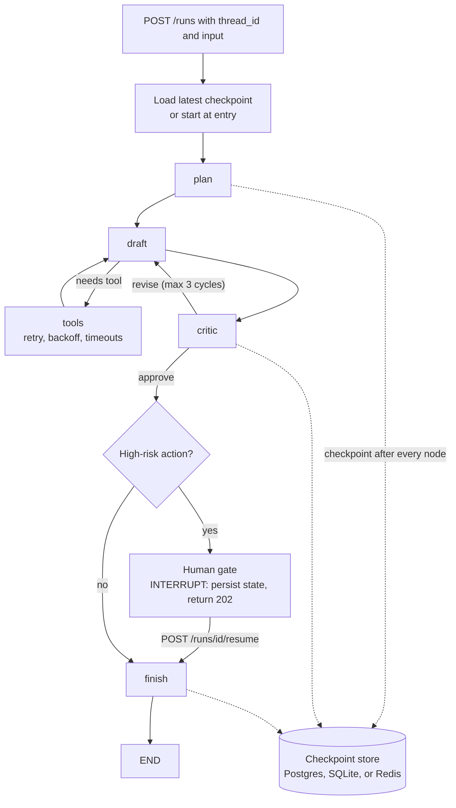

# Intuition & Mental Model

A simple LLM chain is a **straight road**: step 1, step 2, step 3. A real agent is a **flowchart with loops**: draft an answer, critique it, go back and fix it, call a tool, wait for a human, continue tomorrow. Frameworks like LangGraph model this as a **state machine**: a typed *state* object, *nodes* (functions that read state and return updates), and *edges* (fixed or conditional) that decide the next node. Cycles are allowed, which is what lets an agent iterate.

Why enterprises care:
- **Determinism you can reason about.** Every transition is explicit, so you can draw it, test it and audit it. "The agent decided" becomes "node `critic` returned `revise`, edge routed to `drafter`."
- **Persistence and checkpointing.** After every node the state is saved. If the pod dies mid-run, you resume from the last checkpoint instead of paying for the whole run again. The same mechanism enables *interrupts* (pause for human approval, resume days later) and *time travel* (replay from an earlier checkpoint to debug).
- **Bounded loops.** A cycle without a limit is an invoice. Every graph needs a recursion limit and a budget.

The lab implements these semantics from scratch (state reducers, conditional edges, checkpoint/resume, interrupt, recursion limit) so you understand what LangGraph's `StateGraph`, `add_conditional_edges`, `checkpointer` and `interrupt` actually do.

# Production Architecture & Data Flow

Failure model: a crash between nodes resumes at next_node. A crash inside a node re-runs that node, so side-effecting tools need idempotency keys. A recursion limit (for example 25 steps) raises GraphRecursionError.

# Architectural Trade-Off Matrix

| Approach | Latency | Scalability | Implementation Complexity | Cost |
|---|---|---|---|---|
| **LangGraph (explicit graph + checkpointer)** | Small overhead per node (checkpoint write ~2-10 ms) | High: stateless workers, state in Postgres/Redis | Medium: must model the flow | Low framework cost; cost is LLM calls |
| **Free-form agent loop (ReAct "while True")** | Lowest to prototype | Poor control: unbounded loops, hard to resume | Low initially, High to harden | Unpredictable token spend |
| **Workflow engine (Temporal/Step Functions) + LLM activities** | Higher orchestration latency | Very high, durable for days/months | High: separate platform and SDKs | Medium-High (platform ops) |

# Enterprise War Stories & Edge Cases

**1. The infinite revise loop.** A drafter/critic pair disagreed forever: the critic always found a nit. 40,000 loops ran overnight on a stuck input, costing roughly $9k. *Remediation:* recursion limit, per-run token budget, "stalled progress" detection (same critic feedback twice → escalate), and a cheap model for critique.

**2. Resume that double-charged a customer.** The pod died after the `issue_refund` tool call succeeded but before the checkpoint was written; on resume the node re-ran and refunded twice. *Remediation:* idempotency keys derived from `(thread_id, step)` on every side-effecting tool, write-ahead "intent" records, and checkpoint *before* external effects when feasible (outbox pattern).

**3. State blob bloat.** The full retrieved documents were stored in agent state; checkpoints reached 8 MB each, and the database filled in weeks with replay latency of seconds. *Remediation:* store references (document ids) in state, keep large artifacts in object storage, TTL old checkpoints (keep latest + milestones), and schema-version the state so old checkpoints can still be resumed after deploys.
