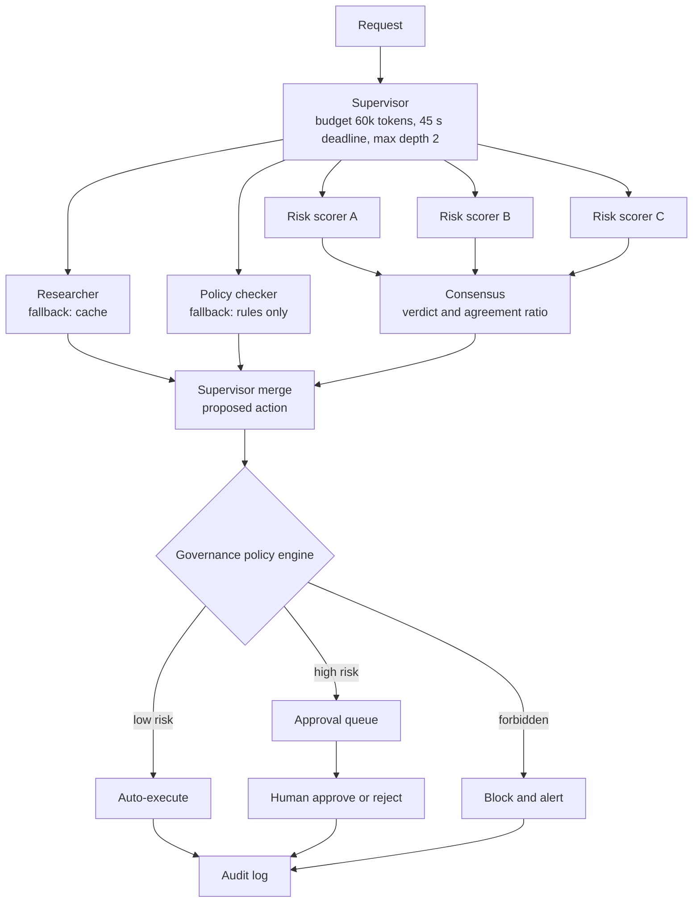

# Intuition & Mental Model

One agent with twenty tools and a long prompt behaves like one employee doing every job: it gets confused, slow and unauditable. A **multi-agent system** is an organization chart: a **supervisor** receives the goal, breaks it into tasks and delegates to **specialist workers** (each with a narrow prompt, a small tool set and its own limits). The supervisor merges results and decides what happens next.

Three governance ideas make this safe in enterprises:
1. **Consensus.** For high-stakes judgments (is this transaction fraud? does this clause violate policy?), ask several independent agents (different prompts or models) and require a quorum or a weighted majority. Disagreement is a signal, not an error: it routes to a human.
2. **Fallbacks.** Every worker has a degradation path: retry with backoff, then a secondary model/agent, then a rule-based answer, then escalate. The system returns a *labelled* degraded result rather than an exception.
3. **Human-in-the-loop (HITL) by risk, not by habit.** A policy engine scores each proposed action (amount, reversibility, data sensitivity). Low-risk actions auto-execute; high-risk actions wait for approval; some actions are forbidden outright. Approvals, rejections and reasons are all logged.

More agents is not automatically better: every hop adds latency, cost and a new place to fail. Add an agent only when specialization measurably improves accuracy or governance.

# Production Architecture & Data Flow

The three scorers use different prompts or models and independent contexts. Each worker has its own credentials, and only the executor can call write APIs.

# Architectural Trade-Off Matrix

| Approach | Latency | Scalability | Implementation Complexity | Cost |
|---|---|---|---|---|
| **Hierarchical supervisor + specialist workers** | Medium: planning hop + parallel workers | High: workers scale independently | Medium-High | Medium: extra planning tokens |
| **Single generalist agent with many tools** | Lowest for simple tasks | Low: prompt/tool sprawl, hard to test | Low | Low until errors dominate |
| **Peer-to-peer / debate swarm** | Highest: many rounds | Medium; hard to bound | High: emergent behavior, hard to audit | High: N agents x rounds tokens |

# Enterprise War Stories & Edge Cases

**1. Three agents agreeing for the wrong reason.** A "consensus" panel used the same model and nearly identical prompts, so all three made the same mistake on an edge case (a sanctions-list near-match) and the system approved a payment. *Remediation:* diversity by construction (different models, prompts, evidence slices), deterministic rule checks as one voter, calibrated confidence, and mandatory human review when any voter's confidence is below threshold.

**2. The supervisor that delegated forever.** The supervisor re-planned after each worker reply, and a flaky worker caused repeated re-plans; one request spawned 600 sub-tasks. *Remediation:* depth and fan-out limits, global token/time budget propagated to workers, idempotent task IDs to dedupe, and a re-plan cap (max 2) after which the request escalates.

**3. Approval fatigue.** Every action required approval; reviewers clicked "approve" in 1.5 seconds, and a harmful refund slipped through. *Remediation:* risk-tiered routing so humans see only the 5-10% of actions that matter, show the evidence and the *reason* for escalation, require a typed justification for high-risk approvals, and sample auto-approved actions for audit.
