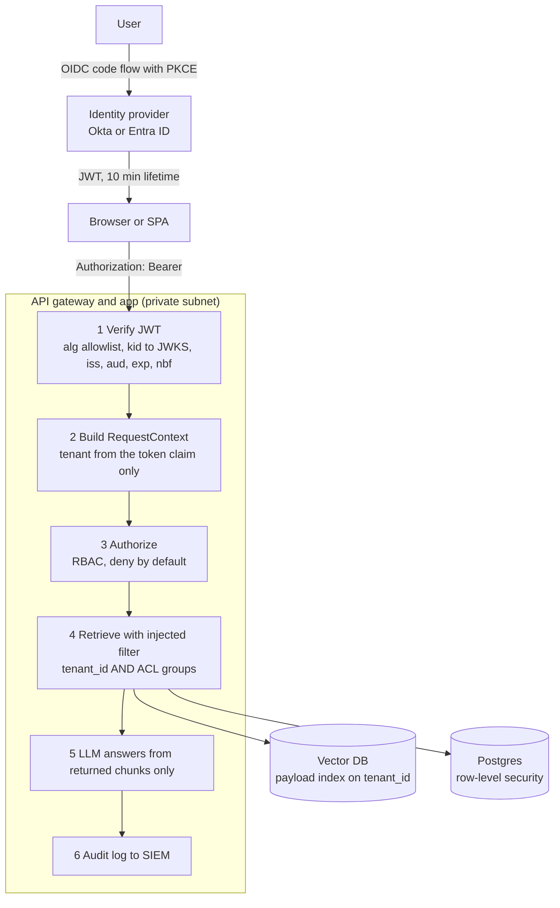

# Intuition & Mental Model

In a multi-tenant AI product, the nightmare is not a hallucination, it is **Tenant A's contract appearing in Tenant B's answer**. That is a data breach, and with RAG it happens easily: all customers' chunks live in one vector index, the similarity search happily returns the nearest chunk from *anyone*, and the model dutifully quotes it.

The defense is the same as in any secure system, applied at every layer:
1. **Authentication (who are you?)**: OIDC login at an identity provider (Okta, Entra ID) gives the app a signed **JWT**. The API verifies signature, issuer (`iss`), audience (`aud`), expiry (`exp`), and the algorithm allowlist, with keys fetched from the provider's JWKS endpoint and rotated by `kid`.
2. **Authorization (what may you do?)**: roles map to permissions (RBAC); attributes such as department or clearance refine them (ABAC).
3. **Isolation (whose data can you touch?)**: the **tenant id comes from the verified token, never from the request body or the model**, and is injected as a mandatory metadata filter on every retrieval. Filtering happens *inside* the index query (pre-filter), not after top-k.
4. **Defense in depth**: namespace-per-tenant for the largest customers, row-level security in the relational store, per-tenant encryption keys for crypto-shredding, audit logs that record the effective filter.

The golden rule: the model is not a security boundary. Anything it could be tricked into asking for must already be impossible for the caller.

# Production Architecture & Data Flow

Fail-closed posture: a missing or invalid claim returns 401, and a store query without a tenant filter refuses to run.

# Architectural Trade-Off Matrix

| Approach | Latency | Scalability | Implementation Complexity | Cost |
|---|---|---|---|---|
| **Shared index + mandatory metadata filter (pre-filter)** | Low; filtered ANN needs good payload indexes | Excellent: thousands of tenants in one cluster | Medium: filter must be un-bypassable, recall tuning for selective filters | Lowest |
| **Namespace / collection per tenant** | Lowest per query (small index) | Good up to ~10k namespaces; per-tenant overhead and lifecycle | Medium | Medium: memory floor per tenant |
| **Dedicated cluster / account per tenant** | Lowest, no noisy neighbors | Limited by ops effort | High: provisioning, upgrades, observability x N | Highest; justified for regulated whales |

# Enterprise War Stories & Edge Cases

**1. Tenant id taken from the request body.** The search endpoint accepted `{"tenant_id": "..."}` from the client "for convenience." A pentester changed it and read another customer's documents. *Remediation:* derive the tenant exclusively from the verified token claim, ignore/deny body-supplied values, add an integration test that attempts cross-tenant reads for every endpoint, and make the vector store client constructible only with a `RequestContext`.

**2. `alg: none` and key confusion.** A homegrown JWT check trusted the token's own `alg` header; an attacker forged a token with `alg=none`, and another variant used the public RSA key as an HMAC secret. *Remediation:* pin allowed algorithms server-side, select the key by `kid` from the issuer's JWKS, reject unsigned tokens, validate `iss`/`aud`, and use a vetted library (PyJWT/authlib) in production.

**3. Post-filtering leaked through top-k.** The system retrieved top 10 across all tenants then dropped other tenants' rows; users saw empty or poor results, and timing and count side channels hinted at other tenants' content. *Remediation:* pre-filter inside the ANN query, per-tenant payload index, constant-shape error handling, and a monitoring query that alerts if any returned chunk has a tenant different from the caller's (canary assertion).
