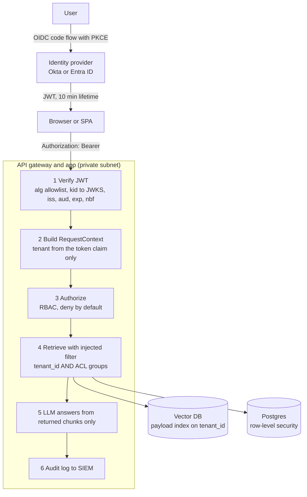

> **Syllabus lessons for this module:** full teaching notes for every topic are in [Syllabus Topic Write-ups](#syllabus-topic-write-ups); the topic-to-code map is in the [Syllabus Coverage Map](#syllabus-coverage-map) and [COVERAGE.md](../../COVERAGE.md).

# Intuition & Mental Model

In a multi-tenant AI product, the nightmare is not a hallucination, it is **Tenant A's contract appearing in Tenant B's answer**. That is a data breach, and with RAG it happens easily: all customers' chunks live in one vector index, the similarity search happily returns the nearest chunk from *anyone*, and the model dutifully quotes it.

The defense is the same as in any secure system, applied at every layer:
1. **Authentication (who are you?)**: OIDC login at an identity provider (Okta, Entra ID) gives the app a signed **JWT**. The API verifies signature, issuer (`iss`), audience (`aud`), expiry (`exp`), and the algorithm allowlist, with keys fetched from the provider's JWKS endpoint and rotated by `kid`.
2. **Authorization (what may you do?)**: roles map to permissions (RBAC); attributes such as department or clearance refine them (ABAC).
3. **Isolation (whose data can you touch?)**: the **tenant id comes from the verified token, never from the request body or the model**, and is injected as a mandatory metadata filter on every retrieval. Filtering happens *inside* the index query (pre-filter), not after top-k.
4. **Defense in depth**: namespace-per-tenant for the largest customers, row-level security in the relational store, per-tenant encryption keys for crypto-shredding, audit logs that record the effective filter.

The golden rule: the model is not a security boundary. Anything it could be tricked into asking for must already be impossible for the caller.

# Production Architecture & Data Flow



Fail-closed posture: a missing or invalid claim returns 401, and a store query without a tenant filter refuses to run.

# Architectural Trade-Off Matrix

| Approach | Latency | Scalability | Implementation Complexity | Cost |
|---|---|---|---|---|
| **Shared index + mandatory metadata filter (pre-filter)** | Low; filtered ANN needs good payload indexes | Excellent: thousands of tenants in one cluster | Medium: filter must be un-bypassable, recall tuning for selective filters | Lowest |
| **Namespace / collection per tenant** | Lowest per query (small index) | Good up to ~10k namespaces; per-tenant overhead and lifecycle | Medium | Medium: memory floor per tenant |
| **Dedicated cluster / account per tenant** | Lowest, no noisy neighbors | Limited by ops effort | High: provisioning, upgrades, observability x N | Highest; justified for regulated whales |

# Enterprise War Stories & Edge Cases

**1. Tenant id taken from the request body.** The search endpoint accepted `{"tenant_id": "..."}` from the client "for convenience." A pentester changed it and read another customer's documents. *Remediation:* derive the tenant exclusively from the verified token claim, ignore/deny body-supplied values, add an integration test that attempts cross-tenant reads for every endpoint, and make the vector store client constructible only with a `RequestContext`.

**2. `alg: none` and key confusion.** A homegrown JWT check trusted the token's own `alg` header; an attacker forged a token with `alg=none`, and another variant used the public RSA key as an HMAC secret. *Remediation:* pin allowed algorithms server-side, select the key by `kid` from the issuer's JWKS, reject unsigned tokens, validate `iss`/`aud`, and use a vetted library (PyJWT/authlib) in production.

**3. Post-filtering leaked through top-k.** The system retrieved top 10 across all tenants then dropped other tenants' rows; users saw empty or poor results, and timing and count side channels hinted at other tenants' content. *Remediation:* pre-filter inside the ANN query, per-tenant payload index, constant-shape error handling, and a monitoring query that alerts if any returned chunk has a tenant different from the caller's (canary assertion).


# Syllabus Topic Write-ups

This module teaches how a product decides who is calling, what they may do, and whose data they may touch. For a Forward Deployed Engineer this is the part of the job where a customer's security team asks hard questions in week one: which login standard do you support, how do our Entra groups become roles, and how do you prove one tenant can never see another's documents in an AI answer. If you can answer those precisely, you earn trust quickly. If you cannot, the deal or the rollout stalls.

**How to study this module**

Read the topics in order, because each builds on the one before. Topic 1 gives the vocabulary (identity, permission, isolation) that every other topic uses. Topic 2 explains the token that carries identity. Topic 3 explains how apps obtain tokens, and topic 4 is the older enterprise equivalent that carries identity as XML. Topic 5 shows how a customer's directory groups turn into the roles your app understands. Topic 6 explains how roles become permissions, and topic 7 pushes those permissions all the way down into search and retrieval for AI features.

1. Topic 1, then topic 2 (identity and the token).
2. Topic 3, then topic 4 (two ways of obtaining proof of identity).
3. Topic 5, then topic 6 (from directory groups to roles to permissions).
4. Topic 7 last, since it applies everything before it to RAG.

Product-specific details (identity provider claim names, limits, library calls) change over time, so verify exact names and syntax against current documentation. Numbers marked as examples are illustrative.

**Module cheat sheet**

| Must-know | One-line answer |
|---|---|
| Authentication vs authorization | Authentication proves who you are; authorization decides what that identity may do. Always in that order. |
| 401 vs 403 vs 404 | 401 means no valid credentials, 403 means known user but denied, 404 is often used to hide that another tenant's object exists. |
| JWT structure | Three base64url parts (header, payload, signature) joined by dots. Encoded, not encrypted. |
| Decoding vs verifying | Anyone can decode a JWT; trust exists only after signature, `iss`, `aud` and time checks pass with a pinned algorithm. |
| Algorithm and key handling | Pin allowed algorithms server-side and pick the key by `kid` from the issuer's JWKS; never trust the token's own `alg`. |
| Auth code + PKCE | The client sends a hashed secret first (S256 challenge) and proves the original (verifier) when redeeming the code. |
| Client credentials | Machine-to-machine grant with no user; confidential client, narrow scopes, no refresh token. |
| Refresh token rotation | Each refresh issues a new refresh token; reuse of an old one signals theft, so revoke the whole family. |
| SAML validation list | Signature, issuer, `NotBefore`/`NotOnOrAfter`, audience, recipient, `InResponseTo`, replay cache; use a vetted library. |
| Entra group overage | Tokens carry a limited number of groups; past that, the claim is replaced by a pointer and you query Microsoft Graph. |
| Map groups by object ID | Display names change and can collide; GUIDs are stable. Unmapped users get no role. |
| RBAC vs ABAC | RBAC grants permissions through roles; ABAC adds conditions on attributes (tenant, region, clearance). Use both, deny by default. |
| Retrieval security | Pre-filter inside the vector query using tenant and ACL from the verified token; the model is never the security boundary. |

### 1. Authentication vs authorization
**What you will be able to do**

- Explain the difference between authentication and authorization to a non-engineer in two minutes.
- Choose between 401, 403 and 404 for any failed request and justify it.
- Spot a missing object-level check in a code review.
- Describe the three gates every request should pass in a multi-tenant API.

**Prerequisites**

Basic knowledge of HTTP requests, status codes and what an API endpoint is. Nothing earlier in this course is required; this is the vocabulary lesson for the whole module.

**The idea from first principles**

Picture a hospital. At the front desk a guard checks your photo ID and gives you a badge. That is authentication: the guard establishes who you are. Later you walk up to the records room. The badge reader checks whether your badge opens that door. That is authorization: a decision about what a known person may do. Notice that the second check needs the first one to have happened, but passing the first tells you nothing about the second. A visitor badge proves identity and still opens almost nothing.

Software systems blur the two because both happen on one request and both can fail with an error. The naive approach is "if the user is logged in, let them do it". That fails the moment two customers share one system. A logged-in clinician from hospital A is perfectly authenticated, yet must never read hospital B's patient notes. The system therefore needs a second and third question beyond "who is this?".

Define the terms precisely. A principal (or subject) is the authenticated actor, a user or a service. A credential is the proof the principal presents, such as a password plus second factor, a session cookie, or a signed token. A permission is a named capability such as `invoice:read`. A resource is the thing being accessed, such as invoice 9001. Authorization is the decision function: given a principal, an action and a resource, return allow or deny. A tenant is one customer organization using a shared product, and isolation means a principal from one tenant cannot touch another tenant's resources.

This gives three questions, asked in order. First, is the credential valid, and who is it? Second, may this principal perform this kind of action at all? Third, may they perform it on this particular resource? The third is the one teams forget, and it is the root of the most common serious API vulnerability, broken object level authorization (BOLA), sometimes called an insecure direct object reference (IDOR).

**How it works, step by step**

1. Extract the credential from the request: a bearer token in the `Authorization` header or a session cookie.
2. Authenticate: verify it. For a signed token this is signature plus claim checks; for a session it is a store lookup. If this fails, respond 401 with a `WWW-Authenticate` header naming the scheme the client should use. Output: an identity such as subject, tenant and roles.
3. Authorize the action: evaluate the identity's roles against the permission the route requires. If it fails, respond 403.
4. Authorize the object: load the resource using a query that includes the caller's tenant (and ownership or sharing rules). If it is not found for this caller, respond 404, which is the same answer you give for a record that truly does not exist.
5. Perform the action and write an audit record: who, what, which resource, which decision.
6. On any unexpected error in steps 2 to 4, deny. A permission check that fails open is a vulnerability.

A worked count. Suppose an API has 40 endpoints and 3 of them take an object id. Gates 1 and 2 are usually applied by shared middleware, so they cover all 40 by construction. Gate 3 is object specific, so it must be applied in each of those 3 handlers. If one is missed, that is 1 vulnerable endpoint out of 40 even though 39 behave perfectly. The ratio is why teams put gate 3 into a shared data-access layer: it reduces "remember in 3 places" to "cannot forget in 0 places".

**Worked example 1: small and hand-traceable**

Data: invoices table rows (id, tenant_id): (9001, 12), (9002, 7). Priya belongs to tenant 7 with role viewer. Viewers hold `invoice:read` only.

Request A: `GET /invoices/9002` with Priya's valid token. Gate 1: token verifies, identity is (Priya, tenant 7, viewer). Gate 2: route needs `invoice:read`, viewer has it, pass. Gate 3: query `WHERE id = 9002 AND tenant_id = 7` returns row 9002. Response 200.

Request B: `GET /invoices/9001` with the same token. Gates 1 and 2 pass identically. Gate 3: query `WHERE id = 9001 AND tenant_id = 7` returns nothing, because 9001 belongs to tenant 12. Response 404.

Request C: `DELETE /invoices/9002`. Gate 1 passes. Gate 2: route needs `invoice:delete`, viewer lacks it. Response 403.

Request D: `GET /invoices/9002` with an expired token. Gate 1 fails. Response 401. Nothing else is evaluated.

Four requests, four outcomes, each traceable to exactly one gate.

**Worked example 2: enterprise scenario**

A hospital network exposes `GET /patients/{id}/notes`. Clinicians sign in through the hospital's identity provider and the API receives a verified identity with a role (clinician or billing) and a set of ward ids. Billing staff must never read clinical notes. Clinicians must only read notes for patients on their wards. Cross-hospital reads are forbidden.

```python
def get_notes(ctx, patient_id):
    if "notes:read" not in ctx.permissions:
        raise Forbidden()                      # gate 2: role lacks the action
    row = db.fetch_one(
        "SELECT * FROM notes n JOIN patients p ON p.id = n.patient_id "
        "WHERE n.patient_id = %s AND p.tenant_id = %s AND p.ward_id = ANY(%s)",
        (patient_id, ctx.tenant_id, list(ctx.ward_ids)),
    )
    if row is None:
        raise NotFound()                       # gate 3: same answer for missing and foreign
    audit.log(ctx.subject, "notes:read", patient_id, "allow")
    return row
```

The permission check handles the role. The SQL carries tenant and ward conditions inside the query, so a bug elsewhere cannot return a foreign row. Returning the same 404 for "no such patient" and "not your patient" prevents an attacker from enumerating which ids exist. The audit line records the decision, which regulators in healthcare expect.

**Hands-on practice**

Exercise 1 (easy). A user with an expired token calls an endpoint. Which status code, and which header should accompany it?

Solution: 401, because the system cannot establish identity. Include `WWW-Authenticate` naming the expected scheme (for example Bearer) so clients know how to authenticate again.

Exercise 2 (medium). An endpoint `GET /reports/{id}` loads the report by id only, then checks `role == "analyst"`. Describe the vulnerability and write the fix.

Solution: it checks the action (gate 2) but not the object (gate 3), so any analyst can read any tenant's report by changing the id. Fix: load with `WHERE id = %s AND tenant_id = %s` using the tenant from the verified token, and return 404 when no row comes back. Add a test where tenant 7's analyst requests tenant 12's report id and expects 404.

Exercise 3 (hard). Design a test that proves no endpoint in a 60-endpoint API leaks across tenants.

Solution: enumerate routes automatically. Seed two tenants with one object of each type. For every route that accepts an id, authenticate as tenant A and request tenant B's object id, asserting 404 (or 403 where documented). Also send a request with a tenant id in the body or query string and assert it is ignored. Run it in CI so new endpoints cannot ship without coverage. Add a check that fails the build if a route is not in the enumerated list.

**Alternatives and trade-offs**

| Enforcement point | Strength | Weakness | Choose when |
|---|---|---|---|
| Each handler | Explicit, sees full context | Easy to forget one | Small codebases with strong review |
| Gateway or middleware policy | One place to audit | Cannot see object ownership | Authentication and coarse permission checks |
| Query-level tenant scoping | Cannot return foreign rows | Needs discipline in every query | Always, as a default data-access layer |
| Database row-level security | Enforced even for buggy code | Needs per-request context, harder to debug, owner roles bypass it unless forced | High-assurance or regulated data |

Use layers. The technique of server-side checks is the wrong tool only when you try to use it for client-side protection: hiding a button never secures anything.

**Where it goes wrong in production**

- Missing object check. Symptom: pentest finding that changing an id reads another tenant's data, with perfectly normal logs. Root cause: handler authenticated and role-checked but never scoped by tenant. Diagnose with the cross-tenant test above. Fix: scoped data-access layer.
- UI-only enforcement. Symptom: buttons are hidden but curl works. Root cause: permissions checked only in the front end. Fix: enforce on the server.
- Information leak through status codes. Symptom: 403 for foreign objects and 404 for missing ones lets attackers map valid ids. Fix: one response for both.
- Stale roles. Symptom: a demoted employee keeps admin power for hours. Root cause: roles baked into a long-lived token. Fix: short tokens, server-side revocation for sensitive roles.
- Fail-open on errors. Symptom: during a permission-service outage, everything is allowed. Root cause: exception handler returns allow. Fix: deny on error and cache decisions briefly for resilience.

**Do not confuse**

- Authentication vs session: authentication happens at login; a session or token merely carries its result.
- 401 vs 403: 401 means "I do not know who you are", 403 means "I know, and no".
- Identity vs permission: a valid token proves identity only.
- Authorization vs isolation: authorization asks whether the action is allowed for the role, isolation asks whether this specific record is the caller's.

**How interviewers probe this**

1. What is the difference between authentication and authorization?
2. When do you return 401, 403 and 404?
3. What is an insecure direct object reference and how do you prevent it?
4. Where in the stack should authorization be enforced?
5. Design the checks for a multi-tenant document API.
6. What breaks if the permission service times out?
7. How would you prove, not just claim, that tenants are isolated?
8. Trap: "Our API requires a valid JWT on every route, so it is secure, right?"

**Model answer (60-90 seconds)**

"Authentication establishes who is calling and authorization decides what that identity may do. I treat them as separate gates in a fixed order. First I verify the credential, a failure is a 401. Then I check the role against the action, a failure is a 403. Then I check the specific object belongs to the caller's tenant, and I return 404 for foreign objects so I do not confirm they exist. The mechanism I trust most is putting the tenant condition inside the query, so an application bug cannot return someone else's row. The trade-off is that gateway checks are easy to audit but cannot see object ownership, while per-handler checks see everything but are easy to forget, so I layer them and fail closed. For example, in a clinical notes API, being a valid clinician is not enough, the patient has to be on your ward. The limit is that all of this depends on the identity being correct, so token verification has to be airtight."

**Quick-fire answers**

- Q: Authentication vs authorization? A: Authentication establishes identity, authorization evaluates that identity against a policy. Authentication comes first and cannot substitute for authorization.
- Q: 401, 403, 404? A: 401 no valid credentials, 403 known user denied, 404 for missing or deliberately hidden objects. Cross-tenant lookups should use 404.
- Q: What is an IDOR? A: An endpoint that takes an object id and returns it without checking ownership. Fix it with ownership-scoped queries and tests.
- Q: Where to enforce? A: On the server in layers: gateway for authentication, handler for action checks, data layer for ownership. Never only in the UI.
- Q: Design for a multi-tenant API? A: Verify the token, take tenant only from the verified claim, check the role for the action, scope every query by tenant, deny by default, audit every decision.
- Q: Permission service times out? A: Fail closed, and use a short-lived cache of recent decisions so a blip does not become an outage.
- Q: Prove isolation? A: Automated cross-tenant tests over every route plus a canary object in another tenant, run in CI and in production monitoring.
- Q: Trap answer? A: A valid JWT only proves authentication. Without role and object checks any authenticated user can reach any record.

**Recap in five lines**

- Authentication answers who, authorization answers what, and they run in that order.
- Three gates: valid credential, allowed action, owned object.
- 401 for no identity, 403 for denied, 404 to hide foreign objects.
- Put the tenant condition in the query so forgetting is impossible.
- Enforce on the server, deny by default, audit every decision.

### 2. Understanding JWT tokens
**What you will be able to do**

- Take a JWT apart by hand and say what each segment is for.
- List every check a verifier must make and explain what attack each one stops.
- Choose between HS256 and RS256 and between JWTs and opaque tokens.
- Describe how key rotation through a JWKS endpoint works without downtime.
- Spot unsafe JWT handling in a code review.

**Prerequisites**

Topic 1 (authentication vs authorization). Basic familiarity with JSON and the idea of a hash or signature.

**The idea from first principles**

Suppose your API runs on twenty servers. A user logs in once at an identity provider. Every later request must prove the login happened, without each server calling the identity provider. The naive approach is a session id stored in a shared database: every request becomes a lookup, and that database becomes a bottleneck and a single point of failure. The alternative is a token that carries its own proof. The server can check the proof locally using only a public key.

Think of a concert wristband with a hologram. The staff do not phone the box office for each guest. They look at the wristband, check the hologram is genuine, and read the date printed on it. A JWT (JSON Web Token, pronounced "jot") is that wristband. The printed text is the payload and the hologram is the signature.

Define the parts. A JWT is three base64url strings joined by dots. Base64url is a reversible text re-encoding of bytes with URL-safe characters; it uses no key and hides nothing. The header is JSON describing how the token is signed: `alg` (algorithm) and usually `kid` (key id). The payload is JSON with claims, which are statements about the session. Registered claims include `iss` (issuer, who created it), `sub` (subject, the user), `aud` (audience, which API it is for), `exp` (expiry), `nbf` (not before), `iat` (issued at) and `jti` (unique token id). The signature is computed over the first two parts, so it proves the issuer produced that exact header and payload.

The central fact: the payload is encoded, not encrypted. Anyone holding the token can read it, and an attacker can edit it and re-encode it. The edited token still decodes. What fails is the signature check, because the signature was computed over the original bytes. So decoding proves nothing; only verification proves anything. A signed JWT is formally a JWS (JSON Web Signature); a JWT whose payload is encrypted is a JWE.

Two signature families exist. HMAC algorithms such as HS256 use one shared secret for signing and verifying, so anyone able to verify can also forge. RSA and elliptic-curve algorithms such as RS256 and ES256 use a private key to sign and a public key to verify, so many services can verify without being able to mint tokens. For anything with more than one verifying service, use asymmetric signing. The issuer publishes its public keys at a JWKS (JSON Web Key Set) URL, each tagged with a `kid`, which is how verifiers find the right key and how rotation works.

**How it works, step by step**

1. Receive `Authorization: Bearer <token>`. Split on dots; there must be exactly three parts.
2. Base64url-decode the header and read `alg` and `kid`. Treat both as untrusted hints.
3. Compare `alg` with your own allowlist (for example only RS256). Reject `none` and any algorithm you did not configure. This stops an attacker choosing a weak or absent signature.
4. Select the verification key. For asymmetric tokens look up `kid` in the cached JWKS. If the `kid` is unknown, refetch the JWKS once (rate limited) and retry, then reject. Never use a key supplied inside the token.
5. Verify the signature over `base64url(header) + "." + base64url(payload)`.
6. Check claims: `iss` equals the issuer you expect, `aud` includes your API's identifier, `exp` is in the future and `nbf` is in the past, both with a small leeway for clock skew (30 to 60 seconds is a common example value).
7. Only now trust `sub`, `tenant` and role claims, and pass them to authorization.

Worked calculation of time checks. A token has `iat = 1000`, `nbf = 1000`, `exp = 1600` (seconds since 1 January 1970). Lifetime is 1600 - 1000 = 600 seconds, 10 minutes. The verifier allows 30 seconds of leeway. At verifier time 1620: is `now > exp + leeway`? 1620 > 1630 is false, so the token is still accepted. At time 1631: 1631 > 1630 is true, so it is rejected. For `nbf`, at time 985 the check `now < nbf - leeway` is 985 < 970, false, so accepted; at time 960 it is 960 < 970, true, so rejected.

Size intuition: a small token with a handful of claims is typically a few hundred bytes. A token stuffed with hundreds of group ids can reach several kilobytes, which can exceed header size limits in proxies (limits vary, check yours).

**Worked example 1: small and hand-traceable**

Take the header `{"alg":"RS256","kid":"k2"}` and payload `{"iss":"https://login.example.com/","sub":"u-77","aud":"api://claims","exp":1600,"roles":["viewer"]}`. The token is `H.P.S`, where H and P are the base64url of those JSON documents and S is the signature over `H.P`.

An attacker decodes P, changes `roles` to `["admin"]`, and re-encodes it as P'. The forged token is `H.P'.S`. The verifier recomputes the check over `H.P'`. S was produced over `H.P`, so verification fails and the request is rejected with 401. The payload edit was trivial, which is exactly why the signature check cannot be skipped.

A second attacker sets the header to `{"alg":"none"}` and drops the signature. A verifier that reads `alg` from the token might skip verification. A verifier with a pinned allowlist rejects at step 3. A third attacker changes `alg` to HS256 and signs with the server's public RSA key as the HMAC secret, hoping the library treats the public key as a shared secret. The pinned RS256 allowlist rejects this too.

**Worked example 2: enterprise scenario**

An insurer runs a claims API on many pods behind an identity provider. Access tokens last 10 minutes. The API verifies locally with the provider's published keys. When the provider rotates keys, the API must not need a deploy.

```python
import jwt
from jwt import PyJWKClient

jwks = PyJWKClient("https://login.example.com/.well-known/jwks.json")

def verify(token):
    signing_key = jwks.get_signing_key_from_jwt(token)      # selects the key by kid
    return jwt.decode(
        token,
        signing_key.key,
        algorithms=["RS256"],                                # pinned by us
        audience="api://claims",
        issuer="https://login.example.com/",
        leeway=30,
    )
```

Line by line: `PyJWKClient` fetches and caches the JWKS and finds the key matching the token's `kid`. `algorithms=["RS256"]` is our allowlist, so the header cannot choose. `audience` and `issuer` reject tokens minted for other APIs or other providers. `leeway` covers small clock differences. Exact function names differ between libraries and versions, so check the documentation of the one you use. Rotation works because the provider publishes the new key in the JWKS before signing with it; new tokens carry the new `kid`, the verifier sees an unknown `kid`, refetches, and continues. The old key stays published until old tokens expire.

**Hands-on practice**

Exercise 1 (easy). A token's `exp` is 5400 and your server clock reads 5420 with 30 seconds of leeway. Accept or reject?

Solution: the rejection condition is `now > exp + leeway`, which is 5420 > 5430, false. Accept. At 5431 it would be rejected.

Exercise 2 (medium). A teammate writes: decode the token, read `roles`, and if `admin` is present allow the delete. Explain what is wrong and fix the order.

Solution: decoding proves nothing, so anyone can craft a token with `admin`. Verify the signature with a key chosen from the issuer's JWKS and a pinned algorithm, check `iss`, `aud`, `exp` and `nbf`, and only then read `roles`. Add a test that submits an edited payload with the original signature and expects 401.

Exercise 3 (hard). Design logout and revocation for 10-minute access tokens and 8-hour refresh sessions across 20 services.

Solution: keep access tokens short, so the worst case after logout is 10 minutes. Store refresh tokens server-side with rotation, and revoke the whole family on logout. For urgent cases (compromised account, terminated employee) keep a small denylist of `jti` values or a per-user "tokens valid after" timestamp in a fast shared cache; services check it only for sensitive operations or for every call if the latency budget allows (a cache lookup is usually under a few milliseconds, an illustrative figure). Accept that non-sensitive reads may stay valid for up to 10 minutes and document that.

**Alternatives and trade-offs**

| Option | Latency | Revocation | Complexity | Choose when |
|---|---|---|---|---|
| Self-contained JWT | Local, no network | Delayed until expiry | Key management, rotation | Many stateless services, short lifetimes |
| Opaque token plus introspection | Network call or cache | Immediate | Introspection endpoint to run and secure | Admin tools, strict revocation needs |
| Server-side session cookie | Session store lookup | Immediate | Shared store, CSRF protection | Classic web apps on one domain |
| JWE (encrypted JWT) | Local plus decryption | Same as JWT | Higher | Claims must be hidden from the holder |

JWTs are the wrong tool when you need instant revocation of every request, or when claims are sensitive and the token passes through untrusted clients.

**Where it goes wrong in production**

- Trusting the token's `alg`. Symptom: forged tokens accepted in a pentest. Root cause: library configured to follow the header. Diagnose by testing `alg: none` and HS256-with-public-key tokens. Fix: pin algorithms and keys server-side.
- No `aud` check. Symptom: a token for the billing API works on the claims API. Fix: validate audience and give each API its own identifier.
- Key rotation outage. Symptom: every request returns 401 right after the provider rotates keys. Root cause: JWKS cached forever. Diagnose from unknown `kid` in logs. Fix: refetch on unknown `kid`, with rate limiting to avoid hammering the provider.
- Long lifetimes. Symptom: a leaked token is used days later. Fix: short access tokens, rotating refresh tokens.
- Sensitive data in claims. Symptom: personal data visible in browser tools or logs. Fix: minimal claims, and never log full tokens, since a logged token is a usable credential until it expires.
- Clock skew. Symptom: intermittent 401s on one node. Root cause: unsynchronized clock. Fix: time synchronization and a small leeway.

**Do not confuse**

- Decode vs verify: decoding reads, verifying proves origin and integrity.
- JWT vs JWS vs JWE: signed tokens are JWS, encrypted ones are JWE.
- Access token vs ID token: the ID token tells a client who logged in; the access token is presented to an API.
- Encoded vs encrypted: base64url hides nothing.
- `exp` vs session lifetime: the token expires sooner than the refresh session behind it.

**How interviewers probe this**

1. What are the three parts of a JWT and what is in each?
2. Is a JWT encrypted? Can I trust a claim I can read?
3. What exactly do you validate on every request?
4. HS256 vs RS256: which would you use across ten services and why?
5. How does key rotation work without downtime?
6. Design logout and revocation for a JWT-based system.
7. What happens if the signing key leaks?
8. Trap: "We store the user's role in the JWT, so we do not need to check anything else, correct?"

**Model answer (60-90 seconds)**

"A JWT is a compact signed token with a header, a payload of claims and a signature, each base64url encoded. It lets many services verify identity locally without calling the identity provider. The key fact is that it is encoded, not encrypted, so anyone can read or edit it, and decoding proves nothing. I trust it only after verifying the signature with a key chosen by kid from the issuer's JWKS, using an algorithm allowlist I pinned myself, then checking iss, aud, exp and nbf with small leeway. I use an asymmetric algorithm so services can verify but not mint tokens. The trade-off against opaque tokens is that JWTs scale well but cannot be revoked before expiry, so I keep access tokens around ten minutes and use rotating refresh tokens, plus a denylist for emergencies. The limit is that role claims in the token are only as fresh as the token."

**Quick-fire answers**

- Q: Three parts? A: Header (algorithm, key id), payload (claims), signature, all base64url and dot separated.
- Q: Encrypted? A: No, only signed. Readable by anyone, so keep claims minimal or use JWE.
- Q: What to validate? A: Pinned algorithm, signature, issuer, audience, expiry and not-before with small leeway.
- Q: HS256 vs RS256? A: HS256 shares one secret with every verifier, so any verifier can forge. RS256 verifies with a public key only, which suits many services.
- Q: Key rotation? A: Publish the new key in the JWKS, start signing with it, keep the old key until old tokens expire. Verifiers refetch on an unknown `kid`.
- Q: Logout and revocation? A: Short access tokens, server-side refresh revocation, and a `jti` denylist or per-user valid-after time for urgent cases.
- Q: Signing key leaks? A: Rotate immediately, remove the old key from the JWKS, force re-login, and audit tokens issued under it.
- Q: Trap answer? A: Roles in a token are a cache of a past decision. Verify it first, and re-check sensitive operations against current state.

**Recap in five lines**

- A JWT is header.payload.signature, encoded and signed but not encrypted.
- Decoding is not verifying; verify before trusting any claim.
- Pin the algorithm, pick the key by `kid` from the JWKS, check `iss`, `aud`, `exp`, `nbf`.
- Prefer asymmetric signing when several services verify.
- Short lifetimes plus rotating refresh tokens replace instant revocation.

### 3. OAuth grant types
**What you will be able to do**

- Explain OAuth 2.0 and its four roles to a non-engineer in two minutes.
- Pick the right grant for a web app, a command-line tool, a TV app and a batch job.
- Compute a PKCE challenge conceptually and explain why a stolen code is useless.
- Trace device-flow polling and refresh-token rotation with reuse detection by hand.
- Name the deprecated grants and say why they were retired.

**Prerequisites**

Topics 1 and 2 (authorization basics and JWT tokens). Knowing what an HTTP redirect and a query string are.

**The idea from first principles**

A user wants a reporting app to read their invoices from a billing service. The naive way is to give the reporting app the user's billing password. That is dangerous: the app now has full power, forever, and the user cannot take it back without changing the password everywhere. Think of a hotel valet key. It starts the car and opens the driver's door, but not the trunk, and you can ask for it back. OAuth 2.0 is a standard way to hand out valet keys for APIs.

Define the roles. The resource owner is the user who owns the data. The client is the application asking for access. The authorization server authenticates the user and issues tokens. The resource server is the API holding the data. A scope is a named slice of access, such as `invoices:read`. An access token is the short-lived valet key the client presents to the API. A refresh token is a longer-lived credential used only at the authorization server to get new access tokens. A grant type is the procedure used to obtain a token, and different clients have different constraints, so there are several.

The key constraint is whether the client can keep a secret. A confidential client is a server-side app that can hold a secret safely. A public client, such as a browser app, mobile app or CLI, cannot: anything shipped to a device can be extracted. Public clients historically used the implicit grant, which returned tokens directly in the browser address bar, leaking them through history, logs and referrer headers. That grant is deprecated. The replacement for public and confidential clients with a user is authorization code with PKCE.

The problem PKCE (Proof Key for Code Exchange, pronounced "pixie") solves: in the code flow the authorization server sends a one-time code back through the browser to the client's redirect address. On a phone or a shared machine another app might intercept that redirect and redeem the code. PKCE binds the code to a secret that only the original client knows, so interception gets the attacker nothing.

**How it works, step by step**

Authorization code with PKCE:

1. The client creates a random `code_verifier` (RFC 7636 specifies 43 to 128 characters from a restricted alphabet) and a random `state`, and stores both.
2. It computes `code_challenge = BASE64URL(SHA256(code_verifier))` and sends the user's browser to the `/authorize` endpoint with `response_type=code`, `client_id`, `redirect_uri`, `scope`, `state`, `code_challenge` and `code_challenge_method=S256`.
3. The authorization server authenticates the user (MFA, existing session), shows consent, stores the challenge with the code it generates, and redirects to the registered `redirect_uri` with `code` and the same `state`.
4. The client checks that `state` equals the stored value, which defeats forged callbacks.
5. The client posts to the token endpoint with the `code`, `redirect_uri` and the original `code_verifier`.
6. The server recomputes SHA-256 of the verifier, compares with the stored challenge, checks the code is unused, unexpired (seconds to a minute or so is typical) and issued to this client, then returns an access token and possibly a refresh token.

Why it holds: SHA-256 cannot be run backwards, so seeing the challenge in the redirect does not reveal the verifier.

Client credentials: the client posts `grant_type=client_credentials` with its own authentication (secret or certificate) and scopes. No user, no refresh token, and the token represents the application itself.

Device authorization (RFC 8628): the device requests a `device_code`, a short `user_code`, a verification URL and an `interval` (default 5 seconds). The device shows the code. The user opens the URL on a phone and approves. The device polls the token endpoint every `interval` seconds. Responses: `authorization_pending` (keep waiting), `slow_down` (add 5 seconds to the interval), `expired_token` and `access_denied` (stop).

Refresh rotation: presenting refresh token R1 returns a new access token and R2, and R1 is marked used. If R1 appears again, someone has a copy, so the server revokes the whole family (R2 and descendants) and forces re-login.

**Worked example 1: small and hand-traceable**

PKCE with an illustrative tiny verifier. Verifier V = "abc123...". Do not compute the hash by hand; reason about the flow: the client sends C = BASE64URL(SHA256(V)) at step 2. An attacker watching the redirect in step 3 sees only the `code`. At step 6 the attacker posts the code with no verifier or a guessed one V'. The server computes SHA256(V'), which differs from C with overwhelming probability, so it refuses. The legitimate client posts V, the hash matches C, and it succeeds.

Device polling trace with interval 5 seconds: t=0 start. t=5 poll, `authorization_pending`. t=10 poll, `authorization_pending`. t=15 poll, `slow_down`, so interval becomes 10. t=25 poll, `authorization_pending`. t=35 poll, success. Total elapsed 35 seconds, 5 polls, one back-off.

Refresh rotation trace: login gives R1. Refresh with R1 gives R2 (R1 used). Refresh with R2 gives R3 (R2 used). A thief replays R1: the server sees a used token, revokes R3, and the real user's next refresh fails, prompting login. The cost is one forced login; the benefit is that stolen tokens die quickly.

**Worked example 2: enterprise scenario**

A bank's analytics platform has three callers of the ledger API. Analysts use a browser app: code with PKCE. A nightly reconciliation job runs on a server with no user: client credentials, scope `ledger:read` only. A support engineer's CLI on a locked-down jump host uses device authorization. The job's token request:

```bash
curl -s -X POST https://login.example.com/oauth2/token \
  -d grant_type=client_credentials \
  -d client_id=recon-job \
  -d client_secret="$RECON_SECRET" \
  -d scope="ledger:read"
```

Commentary: `grant_type` selects the flow. `client_id` and `client_secret` authenticate the application; the secret comes from an environment variable populated by a secrets manager, never stored in source. `scope` requests the minimum access. Many providers also support certificate-based client authentication or workload identity, which removes the static secret entirely. Endpoint paths and parameter names vary by provider, so check its documentation. The access token is then sent as `Authorization: Bearer <token>` to the ledger API, which verifies it as in topic 2 and checks the scope.

**Hands-on practice**

Exercise 1 (easy). A single-page app needs to call an API on behalf of a user. Which grant?

Solution: authorization code with PKCE. A browser app is a public client and cannot keep a secret, and implicit is deprecated.

Exercise 2 (medium). An attacker intercepts an authorization code from a mobile redirect. The app used PKCE. Walk through why the attack fails and what else you would check.

Solution: the attacker lacks the `code_verifier`, so the token endpoint's hash comparison fails. Also verify the code is single use and short lived, `redirect_uri` is an exact match to a registered value, `state` was validated, and the code is bound to the original client id.

Exercise 3 (hard). Device flow polling: interval 5, you receive `slow_down` twice then `authorization_pending` once, then success. If you poll immediately after each wait, what are the poll times starting at t=0?

Solution: poll at 5 (interval 5) returns slow_down, interval becomes 10. Poll at 15 returns slow_down, interval becomes 15. Poll at 30 returns pending. Poll at 45 returns success. Times: 5, 15, 30, 45. Polling faster than the interval risks being throttled or blocked.

**Alternatives and trade-offs**

| Grant | Use when | Main risk | Latency and complexity |
|---|---|---|---|
| Auth code + PKCE | User present on browser, mobile or CLI | Redirect and state mistakes | Browser round trips, moderate |
| Client credentials | No user, trusted backend | Secret leakage, over-broad scopes | One call, simplest |
| Device authorization | No browser or keyboard | User-code phishing, polling load | Slow human step, moderate |
| API keys | Very simple integrations | No scopes, no expiry, hard rotation | Simplest, weakest |

OAuth is the wrong tool when you only need to identify who logged in; that is the job of OpenID Connect, which sits on top of OAuth. It is also overkill for a single trusted internal script, where workload identity may be simpler.

**Where it goes wrong in production**

- Loose redirect URI matching. Symptom: codes delivered to attacker pages. Root cause: wildcard or prefix matching. Fix: exact string match against a registered list.
- Missing `state` validation. Symptom: users silently signed into someone else's account. Fix: random per-request state, verified on return.
- Over-broad client credentials. Symptom: one leaked secret exposes everything. Diagnose by auditing scopes per client. Fix: one client per workload, minimal scopes, rotation, certificates.
- Undetected refresh token theft. Symptom: access continues after a laptop theft. Fix: rotation with reuse detection and an absolute session lifetime.
- Legacy password grant in old apps. Symptom: apps collecting passwords, bypassing MFA. Fix: migrate to code with PKCE.
- Token endpoint hammered by pollers. Symptom: 429s on device logins. Fix: respect `interval` and `slow_down`.

**Do not confuse**

- OAuth vs OIDC: OAuth authorizes API access, OIDC adds an ID token about the login.
- Scope vs role: scopes limit what a token may do for a client; roles describe a user's standing.
- Authorization code vs access token: the code is a one-time voucher exchanged for the token.
- Confidential vs public client: whether a secret can be kept.
- Client credentials vs password grant: the first is the app acting as itself, the second collected a user's password and is deprecated.

**How interviewers probe this**

1. What is OAuth 2.0 and what problem does it solve?
2. Which grant would you use for a single page app and why?
3. How does PKCE stop a stolen authorization code?
4. When do you use client credentials, and what are its risks?
5. Explain the device flow and its polling rules.
6. Design authentication for a CLI, a web app and a batch job calling one API.
7. What breaks if a refresh token is stolen, and how do you limit damage?
8. Trap: "OAuth is an authentication protocol, right?"

**Model answer (60-90 seconds)**

"OAuth 2.0 lets an application get scoped, revocable access to an API without ever seeing the user's password, and the grant type is the procedure for getting the token. For anything with a user in a browser, mobile app or CLI, I use authorization code with PKCE: the client sends a SHA-256 hash of a random verifier up front and reveals the verifier only when redeeming the code, so an intercepted code is useless. I also validate state and require exact redirect URIs. For backend jobs with no user I use client credentials with narrow scopes and ideally certificate or workload identity rather than a static secret. For headless devices I use device authorization. The trade-off is that refresh tokens extend exposure, so I rotate them and revoke the family on reuse. I would avoid implicit and password grants because both are deprecated. A limit worth saying: OAuth alone is about authorization, so login identity comes from OpenID Connect."

**Quick-fire answers**

- Q: What is OAuth 2.0? A: A framework for delegated, scoped API access using tokens instead of passwords. It defines roles (owner, client, authorization server, resource server) and grant types.
- Q: SPA grant? A: Authorization code with PKCE, because a browser cannot keep a client secret.
- Q: How does PKCE help? A: The code is bound to a verifier only the client knows, and the server checks it against the earlier SHA-256 challenge.
- Q: Client credentials? A: Machine-to-machine with no user, a confidential client, narrow scopes and no refresh token.
- Q: Device flow? A: The device shows a code, the user approves elsewhere, and the device polls at the given interval, adding 5 seconds on `slow_down`.
- Q: Design for CLI, web, batch? A: Device flow or code with PKCE for the CLI, code with PKCE for the web app, client credentials for the job, each a separate client with minimal scopes.
- Q: Stolen refresh token? A: Rotation exposes reuse, so you revoke the token family and force re-login, and absolute lifetimes cap the exposure.
- Q: Trap answer? A: OAuth authorizes access to APIs. Authentication of the user is OpenID Connect built on OAuth.

**Recap in five lines**

- OAuth hands out scoped, revocable tokens instead of passwords.
- Code with PKCE for users, client credentials for services, device flow for headless devices.
- PKCE binds the code to a verifier, so a stolen code cannot be redeemed.
- Validate `state`, require exact redirect URIs, rotate refresh tokens and revoke on reuse.
- Implicit and password grants are deprecated; OIDC, not OAuth, handles login identity.

### 4. SAML assertions
**What you will be able to do**

- Explain SAML single sign-on, with the IdP and SP roles, in two minutes.
- Walk through an SP-initiated login and name every field you must validate.
- Explain why a signature must be verified by a vetted library and what a wrapping attack is.
- Debug the three most common SAML failures (clock, certificate, audience).
- Decide when to offer SAML versus OIDC.

**Prerequisites**

Topic 1 (authentication vs authorization) and topic 2 (what a signed token proves). Familiarity with XML basics and browser redirects helps.

**The idea from first principles**

A large manufacturer has 20,000 employees and uses dozens of cloud tools. If each tool had its own passwords, the company could not enforce MFA centrally or cut off a leaver in one step. The company wants one place to log in, its corporate directory, and every tool to trust that place. This is single sign-on (SSO). The naive alternative, giving each tool the directory's passwords, is unacceptable since every tool would then handle those passwords.

Think of a notarized letter. The notary (identity provider) checks your ID and signs a letter saying "this person is Priya, an employee, in the finance group, valid today". You carry the letter to a business (service provider). The business does not know you, but it knows the notary's stamp, and it checks the letter's date and that it names that business. SAML (Security Assertion Markup Language, 2.0 is the version in use) standardizes that letter in XML.

Define the terms. The identity provider (IdP) authenticates users and issues statements about them; examples are Entra ID or Okta. The service provider (SP) is your application, which consumes those statements. An assertion is the signed XML statement. It contains an Issuer, a Subject (usually a NameID), Conditions (validity window and audience), an AuthnStatement (how and when the user logged in) and an AttributeStatement (email, groups). A response is the envelope around the assertion, with a status and, often, its own signature. Metadata is an XML file each side publishes: entity id, endpoints and signing certificates. The ACS (assertion consumer service) is your endpoint that receives the response. A binding is the transport; HTTP-POST (the browser auto-submits a form containing the base64 response) is the common one for responses.

Why does this protocol cause so many outages and security bugs? XML signatures sign a referenced element, not "the whole message". If a verifier checks that some signature is valid but then reads data from a different, unsigned element, an attacker can wrap a forged assertion around a genuine signed one. That is the signature wrapping attack. XML canonicalization (normalizing XML text before hashing) adds more subtlety. So verification must be done by a mature library, and your code must only use data from the element whose signature was verified.

**How it works, step by step**

SP-initiated login:

1. The user opens your app. You generate an AuthnRequest with a unique id and redirect the browser to the IdP's single sign-on URL, usually remembering where the user wanted to go.
2. The IdP authenticates the user (password, MFA, or an existing IdP session).
3. The IdP builds a response with an assertion, signs the assertion, the response or both, and returns an auto-submitting form.
4. The browser posts the base64 response to your ACS URL.
5. You decode and validate (below), then create your own session and map attributes to roles.

Validation checklist, with what each stops:

- Signature verifies against a certificate taken from the IdP's metadata (stops forgery).
- Issuer equals the configured IdP entity id (stops assertions from another IdP).
- Status is success and there is exactly one assertion, and it is the signed one (stops wrapping).
- Current time is inside `NotBefore` and `NotOnOrAfter`, with small skew (stops stale captures).
- Audience equals your entity id (stops assertions meant for another app).
- Bearer `SubjectConfirmationData` `Recipient` equals your ACS URL (stops cross-app relay).
- `InResponseTo` matches the AuthnRequest id you issued, when SP-initiated (stops unsolicited injection).
- Assertion id has not been seen before; store it until `NotOnOrAfter` (stops replay).

Worked time-window calculation. `NotBefore = 09:00:00`, `NotOnOrAfter = 09:05:00` UTC, so the window is 5 minutes. Allow 60 seconds of skew, an example value. Accept when `NotBefore - 60s <= now < NotOnOrAfter + 60s`, that is from 08:59:00 to before 09:06:00. At 09:05:30 accept. At 09:06:00 reject, since the upper bound is exclusive. At 09:06:30 reject. A server whose clock runs 2 minutes fast reads real time 09:04:30 as 09:06:30 and rejects a perfectly valid assertion, which is why clock synchronization matters.

**Worked example 1: small and hand-traceable**

A trimmed assertion (ids and names are made up):

```xml
<saml:Assertion ID="_a1b2" IssueInstant="2026-01-01T09:00:10Z">
  <saml:Issuer>https://idp.customer.example/</saml:Issuer>
  <saml:Subject>
    <saml:NameID>priya@customer.example</saml:NameID>
    <saml:SubjectConfirmationData Recipient="https://app.example.com/saml/acs"
        InResponseTo="_req77" NotOnOrAfter="2026-01-01T09:05:00Z"/>
  </saml:Subject>
  <saml:Conditions NotBefore="2026-01-01T09:00:00Z" NotOnOrAfter="2026-01-01T09:05:00Z">
    <saml:AudienceRestriction>
      <saml:Audience>https://app.example.com/saml</saml:Audience>
    </saml:AudienceRestriction>
  </saml:Conditions>
</saml:Assertion>
```

Trace at 09:02:00 with our own request id `_req77`. Signature: assume the library verified it. Issuer matches the configured IdP. Time: 09:02 is inside the window. Audience equals `https://app.example.com/saml`, our entity id. Recipient equals our ACS URL. `InResponseTo` equals `_req77`. Assertion id `_a1b2` is not in the replay cache, so add it until 09:05. Result: accept. If an attacker re-posts the same response at 09:03, the replay cache already holds `_a1b2`, so it is rejected. If the assertion's audience named `https://other.example.com`, we reject even though everything else is genuine.

**Worked example 2: enterprise scenario**

A supplier-portal vendor sells to 200 manufacturers, each with its own IdP. Onboarding a customer means swapping metadata with their IT team, storing the IdP's entity id, SSO URL and certificate(s) per tenant, and mapping their `groups` attribute to your roles. At the ACS endpoint, the flow is generic pseudocode (the real calls depend on your library):

```text
POST /saml/acs/{tenant}
  1. load tenant IdP config (entity id, certificates)
  2. library.verify(response, tenant certificates)       vetted library only
  3. use only data from the verified assertion element
  4. check Audience, Recipient, InResponseTo, time window
  5. check assertion id against replay cache (key: tenant + id)
  6. map groups attribute to roles, default none
  7. create application session bound to tenant
```

Commentary: loading config per tenant prevents one customer's IdP from authenticating users into another tenant. Step 3 is the wrapping defense. The replay cache key includes the tenant so ids from different IdPs cannot collide. Step 6 ties back to topic 5. Verify details against your library and each IdP's documentation.

**Hands-on practice**

Exercise 1 (easy). Which party is the service provider when Priya logs in to your product via her company's Entra ID?

Solution: your product is the SP, Entra ID is the IdP. The IdP authenticates, the SP consumes the assertion.

Exercise 2 (medium). Window 14:00:00 to 14:05:00, skew allowance 30 seconds. Which of these arrival times are accepted: 13:59:40, 13:59:20, 14:05:20, 14:05:30?

Solution: lower bound is 13:59:30, upper bound is 14:05:30 exclusive. 13:59:40 accepted. 13:59:20 rejected. 14:05:20 accepted. 14:05:30 rejected.

Exercise 3 (hard). Customer says "SSO worked yesterday and fails for everyone today with a signature error". List your diagnosis steps.

Solution: first check whether the IdP rotated or renewed its signing certificate, comparing the certificate in the failing response with the stored one. Check certificate expiry dates. If the IdP now uses a new certificate, add it as a second trusted certificate (rollover), rather than replacing blindly, and ask the customer for updated metadata. Rule out clock issues if the error is a time error instead. Then add an expiry alert at 30 days (example) before each stored certificate expires.

**Alternatives and trade-offs**

| Option | Complexity | Fit | Risk |
|---|---|---|---|
| SAML 2.0 | High: XML, certificates, metadata exchange | Enterprise buyers who require it | Wrapping flaws, certificate expiry, clock errors |
| OpenID Connect | Moderate: JSON, JWT, standard libraries | New apps, mobile, APIs | Some legacy IdPs lack it |
| Identity broker or SSO platform | Lowest for you | Many customer IdPs with varied protocols | Extra vendor, cost and dependency |

Offer SAML because buyers demand it, but use OIDC for your own new integrations. SAML is the wrong tool for mobile apps and API calls, where it is awkward.

**Where it goes wrong in production**

- Certificate expiry. Symptom: all logins fail for one customer on one day. Root cause: IdP certificate renewed. Diagnose by comparing certificates. Fix: multiple trusted certificates, expiry alerts.
- Clock skew. Symptom: assertions rejected as not yet valid or expired. Root cause: unsynchronized server clocks. Fix: time synchronization, small leeway.
- Signature wrapping and unsafe XML parsing. Symptom: forged identities in a pentest. Root cause: reading data from unsigned elements or permissive parsers. Fix: vetted library, only use verified element, disable external entities and DTDs.
- Missing audience, recipient or `InResponseTo` checks. Symptom: assertion for another app accepted. Fix: enforce all three.
- No replay cache. Symptom: a captured response works repeatedly. Fix: store assertion ids until expiry.
- Attribute mismatches. Symptom: users log in but have no roles. Root cause: IdP sends a different attribute name or value format. Fix: log received attribute names at debug level for onboarding and use a tenant-specific mapping.

**Do not confuse**

- SAML vs OIDC: XML and redirects for enterprise SSO versus JSON and JWT for modern apps and APIs.
- IdP vs SP: who authenticates versus who relies on it.
- Assertion vs response: the claim statement versus its envelope.
- Authentication vs provisioning: SAML logs a user in; creating and removing accounts in advance is usually done through SCIM or just-in-time creation.

**How interviewers probe this**

1. What is a SAML assertion and what does it contain?
2. What is the difference between an IdP and an SP?
3. Which fields do you validate, and what does each protect against?
4. When would you offer SAML and when OIDC?
5. Why should you never write your own XML signature verification?
6. Design SSO for a product sold to 200 enterprise customers.
7. What breaks when a customer's signing certificate expires?
8. Trap: "The assertion's signature is valid, so we can trust everything in the response."

**Model answer (60-90 seconds)**

"SAML is an XML-based single sign-on standard. The user opens my app, the service provider, which redirects to the customer's identity provider. After login the IdP posts back a signed assertion naming the user and carrying attributes such as email and groups. I validate the signature against the certificate from their metadata, then issuer, audience, recipient, the NotBefore and NotOnOrAfter window with small skew, InResponseTo, and a replay check on the assertion id. I never write signature verification myself, because XML signatures have known wrapping attacks, so I use a vetted library and only read data from the verified element. The trade-off is that SAML is heavy and brittle compared with OIDC, but enterprise buyers often require it. At scale I would store per-tenant IdP configuration, support certificate rollover and alert before expiry. A limit: SAML authenticates, so roles still need a mapping and deny-by-default."

**Quick-fire answers**

- Q: What is an assertion? A: A signed XML statement from the IdP about a user: subject, conditions, authentication event and attributes.
- Q: IdP vs SP? A: The IdP authenticates users and issues assertions; the SP is your application that trusts them.
- Q: What do you validate? A: Signature, issuer, status, time window, audience, recipient, `InResponseTo` and replay.
- Q: SAML or OIDC? A: SAML where enterprise customers require it, OIDC for new apps, mobile and APIs.
- Q: Why not write your own verification? A: XML canonicalization and signature wrapping are subtle, and mistakes produce forged logins. Use a vetted library.
- Q: Design for 200 customers? A: Per-tenant IdP config from metadata, vetted library, per-tenant replay cache and group maps, certificate rollover, expiry alerts and a test-login tool.
- Q: Certificate expires? A: Logins fail for that tenant. Trust old and new certificates during rollover and alert in advance.
- Q: Trap answer? A: A valid signature on one element does not make the rest trustworthy. You must read only from the signed element and still check audience, recipient and time.

**Recap in five lines**

- SAML moves a signed assertion from the IdP to your SP through the browser.
- Validate signature, issuer, time window, audience, recipient, `InResponseTo` and replay.
- Use a vetted library and read data only from the verified element.
- Expect certificate expiry and clock skew to be your top outages.
- Offer SAML for enterprise demand, prefer OIDC for new integrations.

### 5. Mapping Azure AD groups
**What you will be able to do**

- Explain how a customer's directory groups become roles in your application.
- Describe the group overage problem and implement the Graph fallback safely.
- Explain why object IDs, not display names, are the mapping key.
- Choose between the groups claim, app roles and a Graph lookup.
- Trace a user with nested and numerous groups through a mapping by hand.

**Prerequisites**

Topic 2 (JWT claims) and topic 4 (SAML attributes). Topic 6 explains what a role means once mapped.

**The idea from first principles**

A customer's IT team already runs access control through directory groups: "Finance-Analysts", "Platform-Admins". When a new hire joins finance, IT adds them to the group and every connected tool should follow. The naive approach is to ask the customer to also create accounts and set roles inside your product. Now access lives in two places. When someone leaves, IT removes them from the directory but forgets your product, and a former employee keeps access. Auditors dislike that.

The better idea is to let the directory stay the source of truth and translate its groups into your roles at login. Think of a translator at a border who maps "titles on foreign documents" to "titles your country recognizes". The translation table is configuration you control, and anything not in the table is not recognized.

Define the terms. Azure AD is Microsoft's cloud identity service, now named Microsoft Entra ID. A tenant is one customer's directory. A group is a directory object with members; it can be nested, containing other groups. An object ID is the GUID that uniquely and permanently identifies the group, while a display name is an editable label that two groups can even share. A claim is a statement in the token, and the groups claim lists the group object IDs the user belongs to. An app role is a role your application defines in its Entra app registration, which admins assign to users or groups; it appears in a roles claim. Microsoft Graph is Microsoft's REST API for reading directory data, and `transitiveMemberOf` is the Graph relationship that includes nested membership.

The wrinkle is token size. A token cannot hold unlimited groups. Documentation describes limits around 200 groups for JWT tokens and around 150 for SAML assertions (verify current numbers). When a user exceeds the limit, the groups claim is omitted and the token carries a pointer (the claim names and sources fields) saying "look this up in Graph". This is the overage case, and apps that ignore it silently deny the very users with the most memberships, who are often the most senior.

**How it works, step by step**

1. Configure the app registration to emit group information. The manifest has a setting for which groups to include. Restricting it to groups assigned to the application keeps tokens small and avoids most overage (verify setting names and values in current documentation).
2. The user signs in and your API verifies the token as in topic 2, including that the `tid` (tenant id) claim is a tenant you serve.
3. Read the groups claim into a set and lowercase the GUIDs for comparison.
4. If the claim is absent but an overage pointer is present, call Graph for the user's transitive memberships. Follow paging links, but only to the Graph host, cap the number of pages, and cache the result briefly.
5. Look each group id up in your mapping table, keyed by tenant and group object ID. Collect the roles, union them.
6. Apply the role hierarchy from topic 6 so an admin also gets editor and viewer.
7. If nothing maps, return no role, which means no access. Log the decision and the matched groups.

Worked calculation of paging. A user has 240 groups, above the 200 limit, so the token has no groups claim. Graph returns 100 results per page in this illustration, so 240 groups need ceil(240 / 100) = 3 requests. With a page cap of 10 pages the cap would allow up to 1,000 groups. If Graph returned a next link for page 11, you stop and fail closed, since a loop or malicious redirect is more likely than a user with over 1,000 groups.

Worked cache arithmetic. If 5,000 users log in over an hour, each needing the Graph fallback, and the cache holds results for 5 minutes (example), a user logging in twice within 5 minutes costs one Graph call instead of two. Caching trades freshness (up to 5 minutes of stale membership) for fewer calls and less exposure to throttling (HTTP 429).

**Worked example 1: small and hand-traceable**

Mapping table for tenant T1 (ids shortened for readability):

```yaml
tenant: T1
group_role_map:
  "aaaa-1111": reader
  "bbbb-2222": editor
  "cccc-3333": admin
default_role: none
```

User Sam's token groups claim is `["AAAA-1111", "dddd-4444"]`. Lowercase gives `{"aaaa-1111", "dddd-4444"}`. `aaaa-1111` maps to reader. `dddd-4444` is not in the table, so it is ignored. Result roles: `{reader}`.

User Lee's token has no groups claim and an overage pointer. The app calls Graph, which returns `["bbbb-2222", "eeee-5555"]` across two pages. `bbbb-2222` maps to editor, `eeee-5555` is unmapped. Result: `{editor}`, and with the hierarchy editor also includes reader.

User Ana belongs only to unmapped groups. Result: empty set, so she gets no access and sees a "request access" page, which is correct under deny by default.

**Worked example 2: enterprise scenario**

An insurer deploys your claims-review tool. Their IT wants three roles driven by existing groups, and they want to onboard 1,500 adjusters without touching your product. You store a per-tenant mapping, and each customer admin edits their own through a settings page, protected by your admin role. The core of the resolver:

```python
def resolve_roles(tenant_id, token_groups, graph_lookup):
    mapping = GROUP_ROLE_MAP[tenant_id]                  # per-tenant table, GUID keys
    groups = token_groups if token_groups is not None else graph_lookup()
    ids = {g.lower() for g in groups}
    roles = {mapping[g] for g in ids if g in mapping}
    return roles                                          # empty set means no access
```

Commentary: the mapping is per tenant, so a group GUID from tenant A can never grant a role in tenant B. `token_groups is not None` distinguishes "claim absent" (use Graph) from "claim present but empty" (user truly has no groups), a subtle bug source. Lowercasing avoids case-mismatch failures. The returned empty set is the deny-by-default outcome. Production code also needs the page cap, host check, caching and 429 handling described above.

**Hands-on practice**

Exercise 1 (easy). A group is renamed from "Finance-Analysts" to "Finance-Readers". Your map uses object IDs. What happens?

Solution: nothing changes. The object ID is stable, so the mapping continues to work. A map keyed by display name would have silently stopped granting the role.

Exercise 2 (medium). A user is in 310 groups, Graph pages hold 100 results, and your cap is 3 pages. What should the app do?

Solution: ceil(310 / 100) = 4 pages are needed, which exceeds the cap of 3. The app should fail closed (deny and log) rather than use partial data, then raise the cap or, better, restrict the token's groups claim to groups assigned to the app so lookups are rarely needed.

Exercise 3 (hard). Design onboarding for a new customer tenant so that no user can ever receive a role from a mis-typed group id, and so a leaver loses access within 15 minutes.

Solution: validate GUID format on save, and verify each group id exists in the customer's directory through a Graph read before accepting the mapping. Store the tenant id with each mapping and require the token's `tid` to match. For leaver speed, set access token lifetime and group-cache TTL to at most 10 minutes each (example values), so the worst case is under 15 minutes. For immediate cutoff of terminated users, support SCIM deprovisioning or a "revoke sessions" call that clears server-side sessions and refresh tokens.

**Alternatives and trade-offs**

| Option | Latency | Freshness | Complexity | Choose when |
|---|---|---|---|---|
| Groups claim in token | None | As of token issue | Overage handling | Small group counts, quick start |
| App roles claim | None | As of token issue | Role assignment work in Entra | You control the app registration |
| Graph lookup at login | One or more calls | Fresh at login | Throttling, extra permissions, caching | Heavy users, exact membership needed |
| SCIM provisioning into your store | Fast runtime checks | Lag between sync cycles | Sync job, deprovisioning risk | You need roles offline or in search filters |

Group mapping is the wrong tool when roles must be per resource rather than per organization, such as "owner of this one project"; that belongs in your application data, not the directory.

**Where it goes wrong in production**

- Overage ignored. Symptom: senior users get "no access" while juniors are fine. Root cause: the groups claim vanished past the limit. Diagnose by checking for the overage pointer in a failing user's token. Fix: Graph fallback and restricting the claim to app-assigned groups.
- Display-name mapping. Symptom: a renamed or duplicated group grants the wrong role. Fix: key on object ID.
- Permissive default role. Symptom: any employee reaches the tool. Fix: default none and an explicit request-access flow.
- Graph throttling. Symptom: login storms on Monday morning return errors. Root cause: one Graph call per login with no cache. Fix: short cache, honor `Retry-After`, exponential backoff.
- Stale access after removal. Symptom: a leaver still works for hours. Root cause: long token and cache lifetimes. Fix: short TTLs and session revocation.
- Following unvalidated next links. Symptom: SSRF-style requests to unexpected hosts. Fix: only follow links on the Graph host.

**Do not confuse**

- Group vs app role: a group is a directory object managed by customer IT, an app role is defined by your application.
- Display name vs object ID: label versus permanent identifier.
- Direct vs transitive membership: transitive includes nested groups.
- Tenant ID vs group ID: the tenant is the whole directory, the group is one object inside it.
- Authentication vs provisioning: a token tells you about a login now; provisioning pre-creates or removes accounts.

**How interviewers probe this**

1. How do you map directory groups to application roles?
2. Why use object IDs instead of display names?
3. What is the group overage problem and how do you handle it?
4. Groups claim vs app roles: which would you choose?
5. Design role mapping for a multi-tenant app where every customer has an Entra tenant.
6. What breaks when a user is removed from a group?
7. How would you avoid Graph throttling at scale?
8. Trap: "If a user has no groups in the token, they have no groups, right?"

**Model answer (60-90 seconds)**

"Entra ID is Microsoft's identity service, and customers already manage access through its groups, so I let the directory stay the source of truth. I keep a per-tenant table from group object ID to my application role. At login I verify the token, read the groups claim, look up each id, union the roles and deny by default if nothing maps. I key on object IDs because display names are editable and not unique. The edge case is overage: a token carries only a limited number of groups, so for heavy users the claim is replaced by a pointer and I query Microsoft Graph, with a page cap, a host check, a short cache and retry on 429. The trade-off is freshness against latency and throttling, so I keep tokens and caches short. For my own app I would prefer app roles or limit the claim to assigned groups, and I would verify limits in current documentation."

**Quick-fire answers**

- Q: How to map? A: A per-tenant table from group object ID to app role, evaluated at login, deny by default.
- Q: Why IDs? A: Display names can change or collide, while GUIDs are permanent and unique.
- Q: Overage? A: When a user has more groups than a token can carry, the claim is replaced by a pointer and you fetch memberships from Graph.
- Q: Groups vs app roles? A: App roles are small, explicit and app-specific. Groups reuse existing customer structure but need overage handling.
- Q: Multi-tenant design? A: Key the map by tenant id plus group id, require the token's tenant to match, and let each customer admin manage their own map with validation.
- Q: Removed from a group? A: Access persists until the token and cache expire, so keep both short and support session revocation.
- Q: Avoid throttling? A: Cache per user for a few minutes, honor `Retry-After`, back off, and shrink the claim with app-assigned groups.
- Q: Trap answer? A: Absent is different from empty. An absent claim with an overage pointer means the list is incomplete, not that the user has no groups.

**Recap in five lines**

- Keep the directory as the source of truth and translate groups to roles at login.
- Map by object ID, per tenant, and deny by default.
- Overage replaces the groups claim with a pointer; resolve it through Graph safely.
- Short token and cache lifetimes bound how long removed access lingers.
- Prefer app roles or app-assigned groups to keep tokens small.

### 6. Implementing Role-Based Access Control
**What you will be able to do**

- Explain RBAC to a non-engineer and say why auditors like it.
- Model users, roles, permissions and a role hierarchy, and compute effective permissions by hand.
- Add attribute conditions (ABAC) to a role check without causing role explosion.
- Review an authorization implementation for deny-by-default and cycle safety.

**Prerequisites**

Topic 1 (the three gates) and topic 5 (how roles are obtained from directory groups).

**The idea from first principles**

A 5,000-person company has 200 applications. The naive way to control access is a list per user: Priya may view reports, edit forecasts, but not delete accounts. With 5,000 users and 40 permissions that is potentially 200,000 yes or no decisions to maintain, and nobody can answer "who can delete accounts?" without reading everything. When Priya changes jobs, someone must find and change dozens of her entries and will miss some.

Think of keys on a ring. A building does not cut a unique key for each person's exact doors. It defines a few key types, "cleaner", "manager", "security", gives each type a set of doors, and hands people a key type. Changing a job means swapping one key. RBAC (Role-Based Access Control) is exactly that: permissions are granted to roles, and users are assigned roles.

Define the terms. A permission is an action on a kind of resource, written like `forecast:write`. A role is a named bundle of permissions, such as manager. An assignment links a user to one or more roles. The effective permissions of a user are the union of the permissions of all their roles. A role hierarchy lets one role inherit another: admin inherits manager, which inherits viewer, so you list each permission once at the lowest role that needs it. Deny by default means a permission that is not granted is refused, with no exceptions for missing data.

RBAC has a known limit. Roles describe who someone is in the organization, but many rules depend on the data: "managers may edit forecasts, but only for their own region", or "analysts may read documents up to their clearance level". Forcing these into roles creates role explosion: manager-emea, manager-apac, manager-emea-confidential, and so on, until you have hundreds of roles nobody understands. The fix is ABAC (Attribute-Based Access Control): keep a few roles and add conditions that compare attributes of the subject (region, department, clearance), the resource (region, owner, sensitivity) and the context (time, network). The role says the action is possible in principle, the attributes say whether it is allowed for this resource now.

**How it works, step by step**

1. Define permissions as `resource:action` strings and keep the list small and meaningful.
2. Define roles as sets of permissions, and a hierarchy as a directed graph of "inherits" edges. Validate at load that the graph has no cycles, since a cycle makes inheritance undefined and can loop forever.
3. Resolve a user's roles (from directory mapping in topic 5) and compute the closure: all roles reachable through inheritance.
4. Compute effective permissions as the union of permissions across that closure.
5. At request time, check the required permission. If absent, deny with 403. Unknown roles, unknown permissions and errors all deny.
6. Evaluate attribute conditions for the specific resource. Every condition attached to the permission must pass.
7. Log the decision with the matched role and rule, which makes access reviews and incident investigations practical.

Worked count. Hierarchy: viewer has {report:read}; manager inherits viewer and adds {forecast:write}; admin inherits manager and adds {user:delete}. Effective permissions: viewer 1; manager 1 + 1 = 2; admin 2 + 1 = 3. Without the hierarchy you would list 1 + 2 + 3 = 6 grants; with it you list 3. At 40 permissions and 6 roles an auditor reads a 6-row table and answers "who can delete accounts?" in minutes.

Role explosion arithmetic. If you need manager rights per region and there are 5 regions and 3 sensitivity levels, pure roles need 5 x 3 = 15 manager variants, and the count multiplies with each new dimension. With ABAC you keep 1 manager role and write 2 rules (region matches, clearance covers sensitivity).

**Worked example 1: small and hand-traceable**

Roles: viewer {report:read}; manager inherits viewer, adds {forecast:write}; admin inherits manager, adds {user:delete}. Rule on `forecast:write`: subject.region must equal resource.region.

Case 1: Dana is a manager in EMEA, editing an EMEA forecast. Closure of manager = {manager, viewer}. Permissions = {report:read, forecast:write}. Required `forecast:write` is present. Rule: EMEA equals EMEA, pass. Allow.

Case 2: Dana edits an APAC forecast. Permission present, rule EMEA vs APAC fails. Deny with 403 (or 404 if cross-tenant).

Case 3: Dana deletes a user. `user:delete` is not in her permissions. Deny.

Case 4: a role named `contractor` appears in a token but is not defined. Unknown role, no permissions, deny.

Case 5: a bad config makes manager inherit admin and admin inherit manager. The cycle check rejects the configuration at startup, so the system refuses to run rather than behave unpredictably.

**Worked example 2: enterprise scenario**

A telecom's billing platform has roles: support-agent (read invoices), billing-manager (issue credits up to a limit), and finance-admin (approve large credits). Rules: agents and managers act only on customers in their own market; credits above 500 currency units need finance-admin (example threshold). A compact policy table and check:

```python
ROLE_PERMS = {
    "support-agent":   {"invoice:read"},
    "billing-manager": {"invoice:read", "credit:issue"},
    "finance-admin":   {"invoice:read", "credit:issue", "credit:approve_large"},
}

def allowed(user, perm, resource):
    if perm not in set().union(*(ROLE_PERMS.get(r, set()) for r in user.roles)):
        return False
    if resource.market != user.market:
        return False                       # ABAC: same market only
    if perm == "credit:issue" and resource.amount > 500 and "finance-admin" not in user.roles:
        return False                       # amount threshold
    return True
```

Commentary: the first block computes union permissions and denies unknown roles because `get(r, set())` yields nothing. The market check is a condition on attributes and is cheap to extend. The amount rule shows a context-dependent condition that would need dozens of roles if encoded as roles alone. Everything falls through to a deny only if a check fails, so in real code prefer writing the structure so that the last line is the only place that returns allow, and every unexpected branch denies. In production the policy usually lives in data or a policy engine, not code.

**Hands-on practice**

Exercise 1 (easy). With the hierarchy viewer, manager, admin from worked example 1, how many total permissions does admin have?

Solution: viewer contributes report:read, manager adds forecast:write, admin adds user:delete, so 3 effective permissions.

Exercise 2 (medium). The business wants "managers can edit forecasts for their region, plus any region if they hold the temporary cover attribute". Write the rule without new roles.

Solution: condition on `forecast:write`: allow if `subject.region == resource.region` or `subject.cover_regions` contains `resource.region`. The cover attribute is assigned with an expiry date, and the rule also checks the current time against it. No new role is created and the audit trail shows which clause matched.

Exercise 3 (hard). You inherit a system with 300 roles. Outline how you would reduce them and prove nothing regressed.

Solution: export current effective permissions per user as a baseline. Cluster roles that differ only by a dimension such as region or level, and replace each cluster with one role plus an attribute rule. Recompute effective permissions per user under the new model and diff against the baseline for every user and every resource sample, investigating each difference. Roll out in shadow mode first (evaluate both, enforce the old, log disagreements) for a period, then switch. Keep a deny-by-default test suite and add the cycle check.

**Alternatives and trade-offs**

| Model | Expressiveness | Complexity | Auditability | Choose when |
|---|---|---|---|---|
| RBAC | Coarse, role based | Low | High: a table | Stable job functions, most business apps |
| ABAC | Fine, data and context aware | Medium to high | Medium: rules need review | Region, clearance, ownership rules |
| ACLs per resource | Exact per object | Grows with objects | Low at scale | Document sharing (explicit grants) |
| Relationship-based (Zanzibar style) | Graph of sharing relationships | High, needs a dedicated service | Medium | Google Drive style sharing at large scale |

RBAC alone is the wrong tool when rules depend on the record being accessed. Policy engines add flexibility, but each adds an operational dependency and latency (usually small if evaluated in process).

**Where it goes wrong in production**

- Role explosion. Symptom: hundreds of roles, nobody can explain them, access reviews are rubber-stamped. Root cause: each exception became a role. Diagnose by counting roles and finding near-duplicates. Fix: roles plus attribute rules.
- Permissive defaults. Symptom: new endpoints are accessible to everyone because no permission was declared. Fix: routes without a declared permission are rejected, and tests enforce it.
- Privilege creep. Symptom: people accumulate roles across job moves. Fix: periodic access reviews and expiry on elevated roles.
- Cycles or missing validation in hierarchies. Symptom: startup hangs or inherited rights nobody intended. Fix: validate the graph at load.
- Checks only at the gateway. Symptom: internal service calls bypass authorization. Fix: enforce in each service, and propagate the caller's identity.
- Stale role data. Symptom: demoted users keep rights. Fix: short token lifetimes and re-resolve roles from the source on sensitive actions.

**Do not confuse**

- RBAC vs ABAC: roles bundle permissions, attributes add data-dependent conditions.
- Role vs permission: roles are for people, permissions are for code. Code should check permissions, never role names.
- Role vs group: a group is a directory container, a role is an application concept that groups map to.
- Authorization vs isolation: the permission says what the role may do, the tenant filter says on whose data.

**How interviewers probe this**

1. What is RBAC and why do enterprises use it?
2. What is a role hierarchy and what can go wrong with one?
3. What is role explosion and how do you avoid it?
4. How do RBAC and ABAC complement each other?
5. Design authorization for a multi-tenant SaaS with regions and sensitivity levels.
6. What breaks when an engineer adds an endpoint and forgets the permission check?
7. How would you audit "who can delete accounts" across the system?
8. Trap: "Our code checks `if user.role == 'admin'`, which is simple and secure."

**Model answer (60-90 seconds)**

"RBAC grants permissions to roles and gives users roles, so access is managed in a small table rather than per user. I define permissions as resource-action pairs, roles as sets of them, and a hierarchy so admin includes manager. Effective permissions are the union over a user's roles, and I deny by default for unknown roles, unknown permissions and errors. Roles are coarse, though. For rules like managers editing only their region, I add ABAC conditions on attributes instead of inventing a role per exception, which avoids role explosion. The trade-off is that a role table is easy to audit while attribute rules need careful review and tests. For example, in a billing system I would keep three roles and add rules for market and credit amount. The limit is that RBAC cannot express per-document sharing, which needs ACLs or relationships."

**Quick-fire answers**

- Q: What is RBAC? A: Permissions are attached to roles and users are assigned roles, so one assignment change updates many permissions. It is easy to audit.
- Q: Role hierarchy? A: Roles inherit permissions from lower roles. The graph must be validated as acyclic at load.
- Q: Role explosion? A: Creating a role per exception until the model is unmanageable. Use few roles plus attribute conditions.
- Q: RBAC with ABAC? A: Roles give the coarse permission, attributes check region, tenant, clearance or ownership for the specific resource.
- Q: Design for regions and sensitivity? A: A few roles, a permission per action, conditions comparing subject and resource attributes, deny by default, a tenant filter in queries and decision logging.
- Q: Forgotten permission check? A: The endpoint becomes open. Make declaring a permission mandatory at route registration and test for it.
- Q: Audit who can delete accounts? A: Query effective permissions per role for the delete permission, resolve which groups map to those roles, and list members.
- Q: Trap answer? A: Checking role names scatters policy through code and breaks when roles change. Check permissions and keep policy in data.

**Recap in five lines**

- Users get roles, roles get permissions, and effective permissions are the union.
- Hierarchies reduce duplication but must be validated for cycles.
- Add ABAC conditions instead of inventing a role per exception.
- Deny by default, and check permissions in code, never role names.
- Log decisions so access reviews and investigations are possible.

### 7. Enforcing data-level permissions in retrieval layers
**What you will be able to do**

- Explain why RAG creates a new data leakage risk and how retrieval-time filtering closes it.
- Show with numbers why pre-filtering beats post-filtering.
- Design chunk metadata and a filter built from a verified identity.
- Choose between shared index with filters, namespace per tenant and dedicated clusters.
- Write a test suite that proves isolation instead of assuming it.

**Prerequisites**

Topics 1 to 6, especially the idea that tenant and groups come from a verified token. Basic understanding of RAG: documents are split into chunks, embedded as vectors, and the most similar chunks are given to a language model.

**The idea from first principles**

In a normal application, authorization guards a door per record. In a RAG system the retrieval step searches across everything at once and returns whatever is most similar to the question, with no concept of ownership. Imagine a library where a research assistant fetches the five books closest to your question from every shelf in the building, including the locked archive, and reads them aloud to you. Asking nicely not to read the archive books does not fix it. The books must never be fetched.

That is the central rule: the model is not a security boundary. A language model that has been given a confidential chunk can be coaxed to reveal it, through a clever question or a hidden instruction inside another document. A model that never received the chunk cannot leak it. Security therefore has to happen before the model, in the retrieval layer, using the caller's verified identity.

Define the terms. A chunk is a piece of a document stored with a vector and metadata. An ACL (access control list) on a chunk lists which groups or users may read it. A sensitivity label is a classification such as public, internal or confidential. A metadata filter is a condition applied during search, for example `tenant_id = 7`. Pre-filtering applies the filter inside the vector search so only permitted chunks compete for the top k. Post-filtering retrieves the top k from everything and then removes forbidden results. Row-level security (RLS) is a database feature that applies a policy to every query on a table. Crypto-shredding means deleting a tenant's encryption key to make their data unrecoverable.

Why naive post-filtering fails: suppose k is 10 and the caller may see only 2 percent of the index. The top 10 chunks are mostly from other tenants, so after dropping them the caller gets zero or one result. Quality collapses, and the pattern of empty results, latency and counts can reveal that matching content exists elsewhere. Pre-filtering fixes both problems, at the cost of making approximate nearest neighbour (ANN) search work under selective filters, which needs good payload indexes and sometimes tuning.

**How it works, step by step**

1. At ingestion, attach metadata to every chunk: `tenant_id`, an ACL (allowed groups or users) copied from the source system, a sensitivity label, and the source document id.
2. At request time, verify the token (topic 2) and build a request context with the tenant and the user's groups from the verified claims and group mapping (topic 5). Never take the tenant from the request body or from the model.
3. Authorize the action (can this role use search at all?) per topic 6.
4. Compile a filter: tenant equals the caller's tenant AND (chunk ACL intersects the caller's groups) AND sensitivity is within the caller's clearance.
5. Run the vector query with that filter applied inside the index search, so ranking only sees permitted chunks. The store client should refuse to run any query without a tenant filter.
6. Optionally mask sensitive fields in returned chunks (field-level masking) according to the caller's role.
7. Give only these chunks to the model, and record in the audit log the effective filter and the ids returned.
8. When source permissions change, re-sync chunk ACLs, and delete chunks when documents are deleted.

Worked calculation of post-filter waste. An index has 1,000,000 chunks across 500 tenants of equal size, so the caller's tenant owns 2,000 chunks (0.2 percent). Take k = 10 and assume similarity is unrelated to tenant. The expected number of the top 10 belonging to the caller's tenant is 10 x 0.002 = 0.02. So on average 98 percent of queries return nothing useful. To get 5 permitted results on average you would need to over-fetch k' where k' x 0.002 = 5, so k' = 2,500 results from the ANN index, which is slow and still gives no guarantee. Pre-filtering gets 5 permitted results from a candidate set of 2,000 directly.

**Worked example 1: small and hand-traceable**

Four chunks in the index:

| id | tenant | acl groups | sensitivity | text topic |
|---|---|---|---|---|
| c1 | 7 | finance | internal | Q3 forecast |
| c2 | 7 | hr | confidential | salary bands |
| c3 | 12 | finance | internal | competitor contract |
| c4 | 7 | finance, hr | internal | travel policy |

Caller: Sam, tenant 7, groups {finance}, clearance internal. Query: "salary bands for engineers".

Filter: tenant = 7 AND acl intersects {finance} AND sensitivity <= internal. c1 passes (tenant 7, finance, internal). c2 fails (acl hr, confidential). c3 fails (tenant 12). c4 passes (finance in acl). Candidate set is {c1, c4}. The search ranks only those, returning c4 or c1 depending on similarity. The salary chunk c2 is never retrieved, even though it is the best semantic match for the question. With post-filtering, c2 would rank first, and although it is dropped, Sam might see an empty answer and get a hint about hidden content. With pre-filtering Sam gets the best permitted material and the model never sees c2.

**Worked example 2: enterprise scenario**

A bank offers an internal assistant over policies, product sheets and client files. Client files carry ACLs from the document management system. Staff belong to Entra groups per desk. The relational store holds metadata and uses RLS as a second layer. Request flow: verify token, resolve groups, query with filter, answer from chunks, audit.

```python
def search(ctx, query_vector):
    flt = {
        "tenant_id": ctx.tenant_id,
        "acl_groups": {"any_of": sorted(ctx.groups)},
        "sensitivity_rank": {"lte": ctx.clearance_rank},
    }
    hits = store.search(query_vector, filter=flt, top_k=5)   # pseudocode: syntax varies by vector database
    audit.log(ctx.subject, flt, [h.id for h in hits])
    return hits
```

For the relational layer, a Postgres policy keeps rows scoped even if application code is wrong (set the tenant per transaction and use a non-owner role, or force RLS for the owner):

```sql
ALTER TABLE documents ENABLE ROW LEVEL SECURITY;
CREATE POLICY tenant_isolation ON documents
  USING (tenant_id = current_setting('app.tenant_id')::uuid);
-- per request, inside the transaction:
-- SET LOCAL app.tenant_id = '<verified tenant uuid>';
```

Commentary: the filter is built from the context object that came from the verified token, so a caller cannot change it. Logging the filter and ids lets investigators reconstruct what was shown. The `SET LOCAL` setting lasts only for the transaction, preventing leakage across pooled connections. Verify filter syntax and index options against your vector database's documentation.

**Hands-on practice**

Exercise 1 (easy). Why can a prompt saying "never reveal other tenants' data" not replace a filter?

Solution: the model can be manipulated by user input or by text inside retrieved documents, and it may simply make mistakes. Data that was never retrieved cannot be revealed, so the control must run before the model.

Exercise 2 (medium). A tenant owns 0.5 percent of a 400,000-chunk index. With post-filtering and k = 20, what is the expected number of permitted results, and what k' would you need to expect 10?

Solution: the expected permitted results are 20 x 0.005 = 0.1. For 10 expected, k' x 0.005 = 10 gives k' = 2,000. That is 100 times more than the original k, which shows why pre-filtering is needed.

Exercise 3 (hard). Design an isolation test that proves a deliberately broken filter would be caught.

Solution: seed two tenants with a canary document in each containing a unique marker string. For every user in each tenant, run queries built from every chunk of both tenants, including queries copied from the other tenant's canary text. Compute expected visibility with an independent oracle (a simple function from the ACL rules, not sharing code with the filter) and assert the returned ids are a subset of the oracle's allowed set and that no foreign canary appears. Include a mutation test: temporarily swap in a store that ignores the tenant filter and assert the suite fails. Run it in CI and run the canary check continuously in production, alerting if any returned chunk's tenant differs from the caller's.

**Alternatives and trade-offs**

| Approach | Latency | Scalability | Complexity | Cost | Risk |
|---|---|---|---|---|---|
| Shared index with mandatory pre-filter | Low with payload indexes | Thousands of tenants | Medium | Lowest | A filter bug affects everyone |
| Namespace or collection per tenant | Lowest per query | Limited by per-tenant overhead | Medium | Medium | Lifecycle and cross-tenant admin errors |
| Dedicated cluster or account per tenant | Lowest, no noisy neighbours | Limited by operations effort | High | Highest | Smallest blast radius |
| Post-filter only | Apparently fine | Fails with selective filters | Low | Low | Quality loss and information leakage |

Choose shared index for most tenants, dedicated resources for regulated or very large customers, and never post-filter alone. Retrieval filtering is the wrong tool for protecting data that must not exist in the system at all; there, do not index it.

**Where it goes wrong in production**

- Tenant taken from the request. Symptom: a pentest reads another customer's documents by editing a field. Root cause: convenience parameter. Fix: tenant only from the verified token, and make the store client constructible only from a request context.
- Post-filtering. Symptom: empty or thin answers for small tenants, and timing hints. Fix: pre-filter with a payload index on tenant.
- Stale ACLs. Symptom: a user removed from a project can still retrieve its chunks. Root cause: ACLs copied at ingestion and never updated. Diagnose by comparing source permissions with chunk metadata. Fix: event-driven permission sync and periodic reconciliation; consider checking the source system at answer time for the most sensitive items.
- Leaks through other channels. Symptom: confidential text appears in logs, caches or an embeddings cache shared across tenants. Fix: tenant-scoped caches, redacted logs, per-tenant keys.
- Unfiltered paths. Symptom: a summarization or "similar documents" feature bypasses filters. Fix: one shared retrieval function and tests across every feature.
- Highly selective filters hurting recall. Symptom: relevant permitted chunks missing from results. Fix: tune the index for filtered search, or use separate namespaces for the largest tenants.

**Do not confuse**

- Pre-filter vs post-filter: filtering inside versus after the ranking.
- Authorization vs retrieval relevance: similarity decides what is relevant, permissions decide what may be considered.
- Prompt instruction vs enforcement: a prompt asks, a filter prevents.
- Namespace isolation vs row-level security: separation inside the vector store versus policy inside the relational database. Use both layers where both stores exist.

**How interviewers probe this**

1. Why is RAG a data leakage risk in a multi-tenant product?
2. Pre-filter vs post-filter: what is the difference and why does it matter?
3. Where does the tenant id come from and why?
4. Shared index, namespace per tenant or dedicated cluster: how do you choose?
5. Design permission-aware retrieval for a bank with document-level ACLs.
6. What breaks when source document permissions change?
7. How do you prove no cross-tenant leakage?
8. Trap: "We told the model in the system prompt not to share other customers' data."

**Model answer (60-90 seconds)**

"In RAG the retrieval step searches across everything and returns the most similar chunks, so without controls it can return another tenant's data and the model will happily quote it. The model is not a security boundary, so I enforce permissions before it. At ingestion I store tenant, ACL groups and sensitivity on every chunk. At request time I verify the token, take the tenant and groups from it, never from the body, build a filter, and apply it inside the vector query as a pre-filter, so ranking only sees permitted chunks. Post-filtering is worse because with selective filters the top k is mostly forbidden, so quality collapses and results leak hints. The trade-off is shared index for cost against namespaces or dedicated clusters for stronger isolation, and I add row-level security and audit logs as defence in depth. The limit is freshness: ACLs must be synced when source permissions change, and I prove isolation with canary tests."

**Quick-fire answers**

- Q: Why is RAG risky? A: Similarity search ignores ownership, so unfiltered retrieval can surface any tenant's chunks and the model will quote them.
- Q: Pre vs post filter? A: Pre-filtering applies conditions inside the search so only permitted chunks are ranked. Post-filtering drops forbidden results after top k, leaving too few results and leaking hints.
- Q: Where does tenant come from? A: The verified token claim only. Body or model supplied values can be forged or manipulated.
- Q: Choosing isolation level? A: Shared index with filters for most tenants, namespaces for large ones, dedicated clusters for regulated customers who need the smallest blast radius.
- Q: Design for document ACLs? A: Copy ACLs onto chunks, build filters from verified groups, enforce in the query, sync on permission change, audit filters and returned ids.
- Q: Permissions change at the source? A: Chunk ACLs go stale. Use event-driven sync plus reconciliation, and re-check the source for the most sensitive documents.
- Q: Proving no leakage? A: Independent oracle, every user against queries from every chunk, canary documents in other tenants, a mutation test with a broken store, and production monitoring.
- Q: Trap answer? A: A system prompt is a request, not a control. The data must never reach the model for that user.

**Recap in five lines**

- The model is not a security boundary, so enforce permissions before retrieval results reach it.
- Store tenant, ACL and sensitivity on every chunk and filter from the verified identity.
- Pre-filter inside the vector query; post-filtering wastes top k and leaks hints.
- Layer namespaces or RLS, encryption and audit logs, and keep ACLs in sync with the source.
- Prove isolation with oracle-based tests, canary documents and a mutation test.

# Syllabus Coverage Map

Module syllabus: **Identity & Access Management**. Everything marked `lab.py` runs offline with `python3 lab.py` (pydantic and the standard library only). New code lives under the `# ---- Syllabus extension: ... ---` banners and is exercised by `extension_demo()`, which `main()` calls last. The one third-party library (python3-saml) appears only as a lazily imported adapter that raises `MissingDependency` with an install hint.

| # | Site topic | Where it is taught |
|---|---|---|
| 1 | Authentication vs authorization | `lab.py`, section "authentication vs authorization (401 vs 403)" (`guarded_endpoint`, with the original `AuthenticationError` / `AuthorizationError` and `authorize`); also "Intuition & Mental Model" above |
| 2 | Understanding JWT tokens | `lab.py`, section "JWT anatomy (decoding is NOT verifying)" (`decode_unverified`, `REGISTERED_CLAIMS`) plus the original `sign_jwt`, `JwtVerifier`, `KeySet` (verification, `kid` rotation, `alg` allowlist) |
| 3 | OAuth grant types | `lab.py`, section "OAuth 2.0 grant types as a state machine" (`AuthorizationServer`, `PkceClient`, `poll_device_token`; authorization code + PKCE, client credentials, device authorization, refresh rotation with reuse detection, deprecated implicit and password grants refused) |
| 4 | SAML assertions | `lab.py`, section "SAML 2.0 assertions" (`SamlAssertionValidator`, `build_lab_saml_response`, `parse_xml_safely`, lazy `python3_saml_validate`); signature verification is deliberately not implemented, see Concept notes |
| 5 | Mapping Azure AD groups | `lab.py`, section "Azure AD (Entra ID) group mapping" (`resolve_entra_groups`, `GraphGroupResolver`, `FakeGraphTransport`, `GroupRoleMap`) |
| 6 | Implementing Role-Based Access Control | `lab.py`, section "RBAC with role hierarchy, plus ABAC conditions" (`RoleHierarchy`, `PolicyEngine`, `build_lab_policy`) plus the original `ROLE_PERMISSIONS` and `authorize` |
| 7 | Enforcing data-level permissions in retrieval layers | `lab.py`, section "data-level permissions in the retrieval layer" (`AclVectorStore`, `compile_filter`, `eval_filter`, `apply_masks`, `isolation_matrix`, audit entries) plus the original `TenantVectorStore` |

## Concept notes

**401 vs 403 vs 404.** 401 means "I do not know who you are" (missing, expired or invalid credentials) and carries a `WWW-Authenticate` header. 403 means "I know who you are and the answer is no". When an object belongs to another tenant, return 404 so you do not confirm it exists. Order of checks: authenticate, authorize, then isolate.

**JWT anatomy.** Three base64url parts: header (`alg`, `kid`, `typ`), payload (claims such as `iss`, `sub`, `aud`, `exp`, `nbf`, `iat`, `jti`), signature. The payload is encoded, not encrypted, and anyone can decode it, so a decoded token proves nothing. Trust starts only after the signature is verified with a key you selected by `kid` from the issuer's JWKS, an algorithm allowlist you pinned, and `iss`, `aud` and time checks. The lab shows a payload edited to `roles: ["admin"]` that decodes cleanly and still fails verification.

**OAuth grants.**
- *Authorization code + PKCE* for browser, mobile and CLI apps: the client keeps a random `code_verifier` and sends only its SHA-256 `code_challenge` (`S256`); the server checks it at the token endpoint, so a stolen code is useless. Also check `state` on return, require exact `redirect_uri` matches, and make codes single use with a short life.
- *Client credentials* for machine to machine: confidential client, no user, no refresh token, narrow scopes.
- *Device authorization* for TVs and headless devices: the device polls with the returned `interval`; `authorization_pending` means keep waiting, `slow_down` means add 5 seconds, `expired_token` and `access_denied` are terminal.
- *Refresh token rotation*: every refresh returns a new refresh token; presenting an already used one signals theft, so revoke the whole family.
- *Implicit and resource owner password* grants are deprecated and omitted from OAuth 2.1; the lab refuses them with an explanation.

**SAML in production.** The lab checks Issuer, status, exactly one Assertion, `NotBefore` / `NotOnOrAfter` with small clock skew, `AudienceRestriction`, bearer `Recipient`, `InResponseTo`, assertion id replay, and extracts attributes. It does NOT verify the XML signature: that needs canonicalization, reference resolution and signature-wrapping defenses that must come from a vetted library (python3-saml or xmlsec). An identity returned by the lab validator is marked `signature_verified: false` and must not be trusted in production. Use the lazy adapter shape instead:

```bash
pip install python3-saml        # needs the xmlsec system library (for example: brew install libxmlsec1)
```

**Entra ID (Azure AD) groups.** Map group object IDs (GUIDs), never display names, to application roles in a configurable table and deny by default. A token embeds a limited number of groups (documented as about 200 for JWT and 150 for SAML; check current docs). Past the limit the groups claim is omitted and `_claim_names` / `_claim_sources` point at a lookup: resolve through Microsoft Graph (for example `GET /users/{id}/transitiveMemberOf`, which pages with `@odata.nextLink`), cache briefly, retry on 429 honoring `Retry-After`, cap the page count, and never follow a next link to another host. Setting `groupMembershipClaims` in the app manifest to `ApplicationGroup` limits the claim to groups assigned to the application, which avoids most overage.

```json
{ "groupMembershipClaims": "SecurityGroup" }
```

**RBAC and ABAC together.** Roles give coarse permissions with inheritance (admin inherits editor inherits viewer); cycles are rejected at load. Attribute rules then ask whether this subject may act on this resource now (same tenant, clearance covers sensitivity, owner or same department, business hours). Default is deny and every rule for a permission must pass.

**Data-level permissions.** Compile the caller's context into a filter (tenant AND sensitivity AND ACL match) and push it into the index query so ranking only sees authorized chunks. Add field-level masking for sensitive fields and inline patterns, write an independent oracle for "may this user see this chunk", and test every user against queries built from every chunk, including a canary document planted in another tenant. A deliberately broken store in the lab proves the test fails when the filter is wrong. Record the effective filter and returned ids in the audit log.
