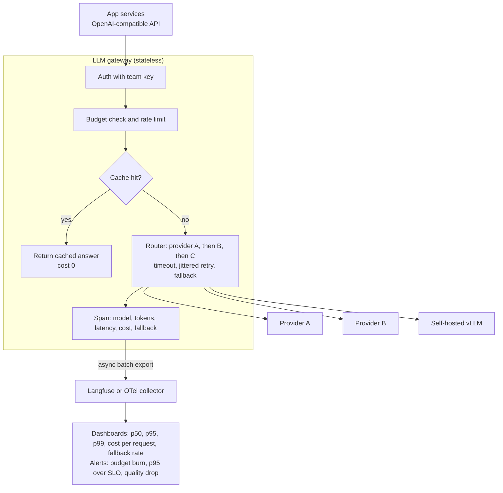
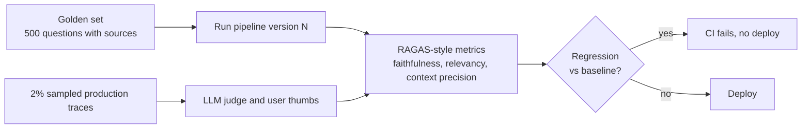

> **Syllabus lessons for this module:** full teaching notes for every topic are in [Syllabus Topic Write-ups](#syllabus-topic-write-ups); the topic-to-code map is in the [Syllabus Coverage Map](#syllabus-coverage-map) and [COVERAGE.md](../../COVERAGE.md).

# Intuition & Mental Model

You cannot operate what you cannot see, and with LLMs "working" is not binary. A request can return HTTP 200 in 900 ms and still be wrong, expensive, or slower than last week. Three disciplines turn an LLM demo into an operated service:

1. **Observability (traces).** One user request becomes a *trace*: a tree of *spans* (retrieval, rerank, LLM call, tool call), each with latency, model, token counts, cost and inputs/outputs (masked). Tools: Langfuse, LangSmith, OpenTelemetry GenAI conventions. When someone says "the bot was slow yesterday at 3pm," you can find the exact span.
2. **Evaluation (quality).** A fixed *golden set* of questions with expected facts runs automatically on every prompt, model or index change. Metrics in the RAGAS family: **faithfulness** (is every claim in the answer supported by the retrieved context?), **answer relevancy**, **context precision/recall** (did retrieval fetch the right chunks, in a good order?). Treat it like unit tests: a regression blocks the release.
3. **Gateway engineering (control).** A single gateway (LiteLLM-style) in front of all model providers gives: one API, **fallbacks** when a provider fails, **budgets** (per team/tenant, hard stop), **latency SLOs**, caching, and central logging. Business rules live here instead of in 40 services.

Budgets are as important as accuracy: a latency budget (e.g. p95 < 3 s) and cost budget (e.g. < $0.04 per answer) are product requirements. Every optimization (caching, smaller models for easy queries, shorter prompts) is judged against quality *and* these budgets.

# Production Architecture & Data Flow





Prompts and outputs are masked (Module 13) before they leave the gateway for the observability backend. The lower diagram is the offline evaluation loop plus online sampling.

# Architectural Trade-Off Matrix

| Approach | Latency | Scalability | Implementation Complexity | Cost |
|---|---|---|---|---|
| **Self-hosted gateway (LiteLLM proxy) + Langfuse (self-hosted)** | +2-10 ms | High: stateless proxy, Postgres/ClickHouse backends | Medium: you run and upgrade it | Low licence cost; ops cost |
| **Managed observability/gateway SaaS (LangSmith, Helicone, Portkey, cloud gateways)** | +10-50 ms (extra hop) | High; vendor handles it | Low | Per-trace/seat pricing grows with volume; data leaves boundary |
| **Hand-rolled logging in each service (print + dashboards)** | Lowest | Poor: inconsistent fields, no cross-service traces | Low initially, High later | Hidden: engineer time and blind spots |

# Enterprise War Stories & Edge Cases

**1. The bill that tripled overnight.** A new feature appended the full conversation history to every call; average input tokens rose from 1.2k to 9k. Nobody noticed for 11 days because dashboards tracked request counts, not tokens. *Remediation:* per-request cost in every span, budget alerts at 50/80/100% of daily caps with a hard stop at the gateway, token-count percentiles per route, and a CI check on prompt size.

**2. A "better" model made answers worse.** Switching to a newer model improved fluency but dropped faithfulness from 0.92 to 0.81, because it paraphrased beyond the source. The team had only checked latency. *Remediation:* golden set run on every model/prompt change, faithfulness and context-precision gates, canary traffic with side-by-side judge scoring, and rollback by alias flip at the gateway.

**3. Fallback storm hid an outage.** The primary provider degraded; the gateway silently fell back to a slower secondary, p95 tripled, and the secondary hit its own rate limits, producing cascading 429s. Dashboards showed "success rate 99%." *Remediation:* track fallback rate as a first-class SLI, alert on it, set per-provider concurrency caps, circuit breakers with cool-downs, and degrade deliberately (smaller model/shorter answer) rather than failing over blindly.


# Syllabus Topic Write-ups

This module teaches how to make LLM systems dependable and measurable. The first half covers reliability and control of model calls: safe retries, backoff, gateways, rate limits and fallbacks. The second half covers evaluation and observability: judging quality, RAG metrics, benchmarks, run tracking, traces, cost and latency, agent debugging, session metrics and trace export. A Forward Deployed Engineer is the person who gets a model-backed system working inside a customer's environment and keeps it working, so these are the tools you use when the customer asks "how do you know it works, what does it cost, and what happens when it fails". Numbers marked as examples are invented for teaching; vendor-specific names and syntax should be checked against current documentation.

**How to study this module**
Read the topics in this order, because later ones lean on earlier ones.
1. Topics 1 and 2 (idempotency keys, backoff) first. They explain why retries exist and how to make them safe.
2. Topics 3 and 4 (gateway, rate limits and fallback). They build on retries and show where the controls live.
3. Topics 8, 7 and 6 (benchmarks, retrieval metrics, faithfulness and relevancy). You need a dataset before you can measure anything, and retrieval is measured before generation.
4. Topic 5 (LLM judge), which supplies the scoring engine behind topics 6 and 7, then topic 9 (tracking runs) to compare scores over time.
5. Topics 10 and 11 (traces, cost and latency), then 12 and 13 (agent debugging, session metrics), then 14 (export), which feeds traces back into topics 8 and 9.

**Module cheat sheet**

| Must-know | One-line answer |
|---|---|
| Idempotent operation | Doing it twice has the same effect as doing it once. |
| Idempotency key | One unique label per intent, so the executor can detect a repeat and replay the stored result. |
| Four key cases | First call executes, concurrent duplicate joins, later duplicate replays, same key with different payload is rejected. |
| Full jitter backoff | Sleep a random time between 0 and min(cap, base x 2^attempt), so clients stop retrying in lockstep. |
| What to retry | Timeouts, 429 and 5xx; never validation or auth failures; honour Retry-After. |
| Gateway virtual key | A revocable, budgeted key for a team; real provider keys live only in the gateway. |
| Token bucket | Capacity C, refill rate r per second; allows bursts up to C and a sustained rate of r. |
| Little's Law | In-flight requests = arrival rate x average latency. |
| Judge biases | Position, verbosity and self-preference; mitigate with order swap, rubrics and human calibration. |
| Faithfulness | Supported claims divided by total claims in the answer, measured against retrieved context. |
| Context precision vs recall | Precision asks how much retrieved context was useful (rank-aware); recall asks whether everything needed was retrieved. |
| Regression decision | Compare candidate and baseline on the same cases with a bootstrap interval, not a single mean. |
| Trace vs span | A trace is one request end to end; a span is one timed step inside it, with attributes. |
| Percentiles | p50 is typical, p95 and p99 are the tail; averages hide the tail. |
| Mask before export | Remove personal data before traces leave your system, never after. |

### 1. Idempotency keys for safe tool execution

**What you will be able to do**
- Explain idempotency and idempotency keys to a non-engineer in two minutes.
- Walk through the four cases an executor must handle (first call, join, replay, conflict).
- Design a key and a store for a side-effecting tool, including the concurrency case.
- Spot unsafe retry logic in a code review.

**Prerequisites**
Basic HTTP and what a timeout is. Retries are developed further in topic 2 of this module.

**The idea from first principles**
Imagine you post a cheque to the bank and the postman loses the receipt. You do not know whether the bank got it. If you post a second cheque you may pay twice; if you do nothing you may not pay at all. A computer calling another computer over a network is in the same position: when a request times out, the caller cannot tell whether the action happened. This is the "lost acknowledgement" problem.

The naive fix is "retry until you see success". For reads that is fine. For writes (refund a customer, send an email, create a ticket) it duplicates the effect whenever the first attempt actually succeeded. Agents make this worse because their frameworks retry automatically and the model itself may decide to call the tool again.

An operation is idempotent if running it once or many times leaves the system in the same state. Setting a status to "closed" is idempotent; "add 40.00 to the balance" is not. We cannot always redesign an operation, so we add a label: an idempotency key, a unique identifier for one intent (one business action, such as "refund order 991"). The executor remembers what it did for each key and, on a repeat, returns the remembered result instead of acting again.

Terms to hold on to: a side effect is a change outside the function (money moved, email sent). A replay is returning a stored result for a repeated key. TTL (time to live) is how long an entry is kept. A payload fingerprint is a hash of the request arguments, used to detect misuse of a key.

**How it works, step by step**
1. The caller creates the key once per intent and reuses it on every retry. Two common ways: a random UUID generated when the intent is created, or a hash of scope, tool name and canonical arguments (sorted keys, no extra whitespace, so equal arguments always produce the same text).
2. The executor atomically claims the key: it writes an entry with status "in progress", the payload fingerprint and a TTL, but only if the key does not already exist. In Redis this is one command, `SET key value NX EX 86400` (NX: only if absent; EX: expiry in seconds). Atomic matters because two simultaneous duplicates must not both win.
3. If the claim succeeded, run the side effect.
4. On success, store the result and set the status to "done".
5. On failure, delete the entry (or mark it retryable) so a later attempt can really run.
6. If the claim failed, read the existing entry. Status "done" with the same fingerprint: replay the stored result. Status "in progress": wait briefly for completion or answer "try again shortly". Different fingerprint: raise a conflict error, because one intent cannot have two meanings.
7. For the downstream service, pass the same key in whatever idempotency mechanism it offers (verify the exact header name and retention window in its documentation), because your own store cannot cover a crash between the side effect and step 4.

Worked calculation (example numbers): the refund tool refunds 40.00. Without keys, the first attempt succeeds (balance +40.00), the response is lost, the retry succeeds again (+40.00): net 80.00, an error of 40.00. With keys: attempt 1 claims K and credits 40.00; attempt 2 finds K done and returns the stored receipt; net 40.00. If 1 in 200 calls loses its acknowledgement (example rate) and you process 50,000 refunds a month, that is about 250 potential duplicates a month, each a manual correction.

**Worked example 1: small and hand-traceable**
Store starts empty. Calls arrive for tool `send_email` with key K1 and args {to: a@x.com, subject: "Hi"}.

- t0: call A with K1. Store has no K1, claim succeeds, state K1 = in progress (fingerprint F1). Email is sent.
- t1: call B with K1 arrives while A is still running. Claim fails, state is in progress, B waits.
- t2: A finishes, K1 = done, result "sent id 77". B wakes, reads K1 done with fingerprint F1 equal to its own, returns "sent id 77". One email in total.
- t3: call C with K1 but subject "Bye" (fingerprint F2). K1 is done with F1, F2 differs, conflict error. This protects against a bug reusing a key for a different action.
- t4: call D with K2, same args as A. New key, new email, which is correct if the user truly wants a second email.

**Worked example 2: enterprise scenario**
A bank's assistant can call a tool that reopens a blocked card. The agent framework retries on timeout. The tool derives its key from the user's request id, tool and card, and forwards it to the card platform, assuming that platform supports an idempotency header.

```python
import hashlib, json

def make_key(scope, tool, args):
    canon = json.dumps(args, sort_keys=True, separators=(",", ":"))
    return hashlib.sha256(f"{scope}:{tool}:{canon}".encode()).hexdigest()

def execute(store, key, fingerprint, run):
    if store.claim(key, fingerprint):      # atomic set-if-absent
        try:
            result = run()
            store.finish(key, result)
            return result
        except Exception:
            store.release(key)             # allow a real retry later
            raise
    return store.wait_or_replay(key, fingerprint)
```

Commentary: `make_key` uses only stable inputs, so every retry produces the same key. `claim` must be atomic in the real store. `release` on failure stops a failed attempt from being replayed forever. `wait_or_replay` handles the in-progress, done and conflict cases. Here `store` is a hypothetical object with those four methods; it is a sketch of the design, not a library API.

**Hands-on practice**
Exercise 1 (easy): Which of these are idempotent: set `status=closed`; append a note; delete ticket 12; increment a counter?
Solution: set status is idempotent (same end state). Append a note is not (two notes). Delete ticket 12 is idempotent in effect (it is gone either way), though the second call may return "not found". Increment is not.

Exercise 2 (medium): A developer builds the key as sha256(tool + args + current time in seconds). Explain the bug and fix it.
Solution: the time component changes on every retry, so each retry gets a new key and nothing is ever recognized as a repeat. Remove the clock; derive from stable fields, or generate one UUID per intent and reuse it.

Exercise 3 (hard): Your store says "done" but the vendor shows two emails. Give two causes and fixes.
Solution: (a) The process crashed after the vendor accepted the call but before the store recorded success, so the retry re-sent. Fix: pass the key to the vendor, or reconcile with the vendor's sent log before retrying. (b) The key was derived with a field that differs across retries (such as a retry counter). Fix: inspect logged keys for the same intent and remove the varying field.

**Alternatives and trade-offs**

| Approach | Strength | Weakness | Choose when |
|---|---|---|---|
| Idempotency key with store | Any side effect, supports replay | Shared store and TTL to run | Payments, tickets, emails |
| Naturally idempotent design (set state, upsert by id) | No extra storage | Not always possible | Updates describing a target state |
| Transactions or outbox pattern | Strong guarantees inside one database | Does not extend to external APIs | Internal data changes |
| Never retry writes | Simple | Lower availability | Rare, low-value actions |

Cost is a store lookup per call, typically milliseconds. The technique is the wrong tool for pure reads, where a cache is simpler.

**Where it goes wrong in production**
- Key contains a timestamp or random value per attempt. Symptom: duplicates continue. Diagnose: log keys per intent and compare. Fix: stable derivation.
- Downstream ignores the key. Symptom: your store shows one call, the vendor two effects. Diagnose: compare with vendor records. Fix: forward the key or reconcile.
- Errors cached as results. Symptom: retries keep returning an old failure. Fix: release on failure.
- TTL shorter than the retry window. Symptom: late retries act again. Fix: TTL longer than max retry plus queue delay.
- Non-atomic check-then-set. Symptom: rare simultaneous duplicates. Fix: single atomic set-if-absent.

**Do not confuse**
Idempotency (repeating is safe) differs from message deduplication (a queue dropping copies) and from retrying (the act of trying again). Retries create the need; idempotency makes them safe.

**How interviewers probe this**
1. What does idempotent mean, and are HTTP GET, PUT and POST idempotent?
2. Why do agents especially need idempotency keys?
3. Should the client or server generate the key?
4. Design the key store for a refund tool, including concurrency.
5. What breaks if the process crashes between performing the side effect and storing the result?
6. How long should keys live, and what happens at expiry?
7. How do you make an email-sending tool safe if the email API has no idempotency support?
8. Trap: "If I use a UUID per request, am I idempotent?"

**Model answer (60-90 seconds)**
"An idempotent operation has the same effect whether you run it once or many times. An idempotency key is how I make a non-idempotent tool, like send refund or send email, safe to retry. The caller creates one key per intent and reuses it on every retry. The executor claims the key atomically, runs the action and stores the result. A repeat returns the stored result, a concurrent duplicate waits, and the same key with different arguments is rejected as a bug. The cost is a shared store and a TTL to manage, and the guarantee only holds end to end if the downstream service also honours the key, because a crash between acting and recording can still duplicate the effect. For example, a banking agent retries a card reopen after a timeout and the second call simply returns the first receipt."

**Quick-fire answers**
- Q: Idempotent meaning, and GET, PUT, POST? A: Repeating gives the same effect as once. GET and PUT are defined as idempotent in HTTP; POST is not by default.
- Q: Why agents? A: They retry automatically and a timeout does not reveal whether the action happened.
- Q: Client or server key? A: Client, because only the client knows which retries belong to one intent.
- Q: Store design? A: Atomic set-if-absent with status, fingerprint and TTL; replay on done, wait on in-progress, conflict on mismatch, release on failure.
- Q: Crash between act and record? A: The retry acts again unless the downstream honours the key or you reconcile.
- Q: Key lifetime? A: Longer than the longest retry window plus delays, often hours to days, traded against storage. After expiry a repeat looks new.
- Q: No downstream support? A: Record intent before sending, check the vendor's sent log or use a reference id in the content to reconcile, and accept a small residual risk.
- Q: Trap answer? A: Only if the same UUID is reused across retries of the same intent; a fresh UUID per attempt defeats the purpose.

**Recap in five lines**
- Timeouts hide whether an action happened, so blind retries duplicate side effects.
- One key per intent, stable across retries, never time-based.
- Executor cases: execute, join, replay, conflict; clear on failure.
- Claim atomically and set a TTL longer than the retry window.
- Forward the key downstream or reconcile, because your store cannot see past a crash.

### 2. Exponential backoff strategies

**What you will be able to do**
- Compute capped exponential and jittered waits by hand.
- Explain a retry storm and why jitter prevents it.
- Decide which errors to retry and how to bound total retry time.
- Review retry code for amplification and missing deadlines.

**Prerequisites**
Idempotency keys (topic 1 of this module) and the basic idea of HTTP status codes.

**The idea from first principles**
Picture a shop that suddenly gets a crowd. If every customer who is turned away comes straight back, the doorway jams and nobody gets served. If each customer waits a bit and comes back later, the crowd thins out. Retrying a failed API call has the same dynamic: a provider returning rate-limit or overload errors is already struggling, and instant retries from thousands of clients add load exactly when capacity is short. This feedback loop is a retry storm.

Fixed waits help little. If 300 clients all fail at the same instant and all wait exactly 1 second, they all return at the same instant. The load arrives as a synchronized wave. Exponential backoff increases the wait with each failure (0.5 s, 1 s, 2 s, 4 s), which lowers pressure over time, but clients that started together still stay together. Jitter, meaning deliberate randomness in the wait, breaks the lockstep.

Terms: attempt n counts from 0; base b is the first wait; cap c is the largest allowed wait; a deadline is a total time budget for the whole operation; a retryable error is one that may succeed if tried again (timeouts, connection resets, HTTP 429 and 5xx), as opposed to permanent errors like 400 validation errors or 401 and 403 auth errors, where retrying changes nothing. The Retry-After header is the server telling you how long to wait.

**How it works, step by step**
Formulas, with ceiling(n) = min(c, b x 2^n):
- Capped exponential: wait = ceiling(n)
- Full jitter: wait = uniform(0, ceiling(n))
- Equal jitter: wait = ceiling(n)/2 + uniform(0, ceiling(n)/2)
- Decorrelated jitter: wait = min(c, uniform(b, previous_wait x 3))

Algorithm:
1. Make the call. On success return.
2. If the error is not retryable, raise immediately.
3. If attempts are used up, or the next wait would pass the deadline, raise.
4. If Retry-After is present, wait at least that long.
5. Else compute the jittered wait, sleep, increment n, repeat.

Worked calculation (example numbers): b = 0.5 s, c = 30 s.
- Ceilings by attempt: n=0: 0.5; n=1: 1; n=2: 2; n=3: 4; n=4: 8; n=5: 16; n=6: 32 capped to 30.
- Worst-case total waiting across the first six retries (n=0..5): 0.5+1+2+4+8+16 = 31.5 s. If the user-facing deadline is 20 s, six retries cannot all fit, so you reduce attempts or cap.
- Full jitter at n=3 draws uniformly from 0 to 4 s, mean 2 s.
- Equal jitter at n=3 draws from 2 to 4 s, mean 3 s, so it always waits at least 2 s.
- Decorrelated, previous wait 2 s, base 0.5: draw from uniform(0.5, 6), then cap at 30.

Why jitter helps, in numbers (example): 300 clients fail together. With no jitter, all 300 retry at t+0.5, then again at t+1.5 (a spike of 300 each time). With full jitter, the first retry window of 0.5 s spreads 300 retries across it, about 600 per second instead of 300 in one instant, and the second window (0 to 1 s) spreads them further as clients succeed and drop out.

**Worked example 1: small and hand-traceable**
Client calls a service that fails twice then succeeds. Settings: b=1, c=8, attempts=5, full jitter. Random draws are made up: 0.37 and 0.81 of the range.

- attempt 0 fails (503). Retryable. ceiling = min(8, 1x2^0) = 1. wait = 0.37 x 1 = 0.37 s.
- attempt 1 fails (503). ceiling = min(8, 2) = 2. wait = 0.81 x 2 = 1.62 s.
- attempt 2 succeeds. Total waiting 1.99 s plus call times.
Now suppose attempt 1 returned 400. Step 2 raises immediately; no wait, no more attempts.

**Worked example 2: enterprise scenario**
A telecom runs a nightly job classifying 200,000 support transcripts with a model API. At 02:00 the provider returns 429s. The job wraps each call in a retry helper with full jitter, a cap of 60 seconds, 6 attempts and a 5 minute per-item deadline. Items that exhaust retries go to a dead-letter queue (a holding area for failed items) for review in the morning, so one bad hour does not block the batch.

```python
import random, time

def call_with_backoff(fn, retryable, attempts=6, base=0.5, cap=60):
    for n in range(attempts):
        try:
            return fn()
        except retryable:
            if n == attempts - 1:
                raise
            time.sleep(random.uniform(0, min(cap, base * 2 ** n)))
```

Commentary: `retryable` is a tuple of exception types you chose deliberately, so validation errors propagate. The last attempt re-raises instead of sleeping. The sleep draws from zero up to the capped exponential, which is full jitter. A production version would also read Retry-After and enforce the deadline; those are omitted to keep the sketch short.

**Hands-on practice**
Exercise 1 (easy): Compute capped exponential waits for b=1, c=10, n=0..5.
Solution: ceilings are 1, 2, 4, 8, then 16 capped to 10, and 32 capped to 10: 1, 2, 4, 8, 10, 10.

Exercise 2 (medium): Three layers each retry 3 times on failure. A permanently failing dependency is called. How many calls hit it per user action?
Solution: each layer multiplies attempts, 3 x 3 x 3 = 27 calls at the bottom (counting 3 tries per layer). Fix: retry at one layer only and pass failures up.

Exercise 3 (hard): 1,000 clients hit a 30 second outage with b=1, c=60, no jitter. After recovery, estimate when retries arrive and propose a fix.
Solution: waits are deterministic: attempts at roughly 1, 3, 7, 15, 31, 63 seconds after the first failure (cumulative sums of 1, 2, 4, 8, 16, 32). At t=31 all 1,000 clients arrive simultaneously, a wave the recovering service may not handle. Add full jitter so arrivals spread across each interval, add a client-side concurrency limit, and have the server shed load gracefully with Retry-After.

**Alternatives and trade-offs**

| Approach | Behaviour | Trade-off |
|---|---|---|
| Fixed delay | Same wait | Simple, but synchronizes clients |
| Exponential, no jitter | Growing waits | Clients stay in lockstep |
| Full jitter | Random from 0 to ceiling | Best spread, some very quick retries |
| Equal jitter | Half fixed, half random | Guaranteed minimum wait, less spread |
| Circuit breaker | Stop calling after repeated failure | Protects dependency, needs state and tuning |
| Client-side rate limit or queue | Avoids hitting limits | More design, fewer errors |

Backoff is the wrong tool for permanent errors and for sustained outages (use a circuit breaker and fallback there).

**Where it goes wrong in production**
- Retry amplification across layers. Symptom: dependency traffic is a multiple of user traffic during incidents. Diagnose: compare client and server request counts. Fix: retry at one layer.
- No jitter. Symptom: periodic spikes at 1, 3, 7 seconds after an incident. Diagnose: histogram of arrival times. Fix: add jitter.
- Retrying permanent errors. Symptom: wasted spend on 400 responses. Diagnose: error breakdown by status. Fix: classify errors.
- Ignoring Retry-After. Symptom: continued 429s. Fix: use the hint as a minimum wait.
- No deadline. Symptom: requests hang longer than the caller's timeout and work is wasted. Fix: total budget below the caller's timeout.

**Do not confuse**
Backoff (spacing retries), rate limiting (capping send rate before errors happen) and a circuit breaker (pausing calls after repeated failure) are different controls. Retries of writes also need idempotency keys (topic 1).

**How interviewers probe this**
1. What is exponential backoff and why add a cap?
2. What is jitter and why does it matter?
3. Which errors should you retry and which not?
4. Compare full, equal and decorrelated jitter.
5. Design retry behaviour for a chain of three services.
6. What breaks when a thousand clients retry after a 30 second outage?
7. How do you pick base, cap and attempt count?
8. Trap: "Retries make my system more reliable, so more retries is better, right?"

**Model answer (60-90 seconds)**
"Backoff means waiting longer between retries so a failing dependency can recover. In exponential backoff the wait doubles each attempt up to a cap, for example half a second, one, two, four. The flaw is that clients that failed together retry together, so I add jitter, usually full jitter, where each client sleeps a random time between zero and the capped value. I retry only transient errors, such as timeouts, 429 and 5xx, honour Retry-After, and bound the whole thing with an attempt limit and a deadline. The trade-off is added latency for unlucky requests, and retries of writes are only safe with idempotency keys. In a nightly batch against a rate-limited model API, this keeps the job moving and sends persistent failures to a dead-letter queue. The limit is that backoff cannot fix a sustained outage, which needs a circuit breaker or fallback."

**Quick-fire answers**
- Q: Why a cap? A: Without it waits grow without bound, breaking deadlines and delaying detection of recovery.
- Q: Why jitter? A: It desynchronizes clients so retries do not arrive as one spike.
- Q: What to retry? A: Timeouts, connection resets, 429 and 5xx. Not 400, 401, 403 or other permanent errors.
- Q: Jitter variants? A: Full spreads widest; equal keeps a guaranteed minimum wait; decorrelated derives the next wait from the previous and needs no attempt counter.
- Q: Three-service chain? A: Retry at one layer, share a deadline downward, use a circuit breaker, idempotency keys on writes.
- Q: Thousand clients after outage? A: Without jitter they return as synchronized waves and may re-trigger the outage; with jitter load ramps.
- Q: Choosing parameters? A: Base near typical recovery time, cap near the user's patience or job tolerance, attempts so total worst-case wait fits the deadline.
- Q: More retries better? A: No; each layer multiplies load, and retries beyond the deadline waste work and deepen outages.

**Recap in five lines**
- Instant retries amplify overload; waits must grow.
- Exponential growth with a cap, plus jitter to avoid lockstep.
- Retry only transient errors, honour Retry-After, bound attempts and total time.
- Retry at one layer and make writes idempotent.
- Backoff handles blips; circuit breakers and fallbacks handle sustained failure.

### 3. Centralizing provider API keys via LiteLLM/Portkey

**What you will be able to do**
- Explain what an LLM gateway does and when it is worth running.
- Describe the request path through a gateway including virtual keys and aliases.
- Design key, budget and alias management for several teams.
- Name the risks a gateway introduces and how to reduce them.

**Prerequisites**
Basic API authentication ideas (API keys, environment variables). Rate limiting is covered in topic 4.

**The idea from first principles**
Think of a hotel master key. If every cleaner carries a copy of the master key, losing one copy means rekeying the building. Instead, the front desk issues room-limited cards that can be cancelled individually, and only the front desk holds the master. An LLM gateway is the front desk for model providers.

Without it, each application stores a real provider key. The problems grow with scale: a leak exposes a key with full spend authority, rotation requires coordinating many deploys, nobody can see total spend by team, and switching providers means editing every client.

An LLM gateway is a proxy service that applications call instead of calling providers. LiteLLM (open source) and Portkey are examples of products in this category; verify current features and terminology in their documentation. Core terms: a provider key is the real credential from a model vendor. A virtual key is a gateway-issued credential mapped to a team with limits such as allowed models, a spend budget and request limits. A model alias is a stable internal name like "chat-prod" that the gateway maps to a real provider and model. Because many gateways accept a widely used chat request format, existing client libraries often work by changing only the base URL (verify for your gateway).

The gateway is therefore a control point: authentication, authorization, routing, limits, logging and cost attribution all happen in one place. The price is that it is now a critical dependency and a high-value target.

**How it works, step by step**
1. An operator stores real provider keys in a secrets manager and exposes them to the gateway process, for example as environment variables.
2. The operator defines aliases: each alias lists one or more underlying deployments.
3. The operator issues a virtual key per team and environment with allowed aliases, budget and limits.
4. An application sends a request to the gateway URL with its virtual key and an alias.
5. The gateway authenticates the virtual key and checks it is not revoked or expired.
6. It checks limits: allowed alias, remaining budget, request and token rates.
7. It resolves the alias to a provider and model, injects the real key and forwards the request.
8. It receives the response, records usage (tokens, estimated cost, latency, team, alias) and returns it.

Worked calculation (example numbers): team A has a monthly budget of 2,000 currency units and has spent 1,990. A request estimated at 6 units is allowed (1,996). The next estimated at 12 would reach 2,008, so it is rejected with a budget error, and an alert fires at the configured threshold (say 80%). Leak scenario: 12 services held keys; one repo leaks. Before the gateway, rotation means 12 deploys. After, you revoke one virtual key in seconds and rotate one real key inside the gateway, with no application deploys.

**Worked example 1: small and hand-traceable**
Config has alias "chat-prod" mapped to model M1 with key from environment variable PROVIDER_API_KEY. Virtual key vk-claims allows only "chat-prod".

- Request 1: vk-claims asks for "chat-prod". Key valid, alias allowed, budget fine. Gateway sends to M1 with the real key. Response returned; usage logged under team claims.
- Request 2: vk-claims asks for "chat-experimental". Alias not allowed, gateway returns an authorization error, nothing leaves the network.
- Request 3: after an incident, an operator revokes vk-claims. Every later request fails authentication at the gateway; the real key is untouched.
- Change: operator repoints "chat-prod" to model M2. All clients now use M2 with no code change (and should have passed an evaluation run first).

**Worked example 2: enterprise scenario**
A hospital network has three internal teams: claims, scheduling and clinical documentation. Clinical documentation must only use a model deployment in an approved region. The platform team configures aliases per team and gives each team a virtual key restricted to its alias.

```yaml
model_list:
  - model_name: clinical-docs
    litellm_params:
      model: provider/approved-regional-model
      api_key: os.environ/CLINICAL_PROVIDER_KEY
  - model_name: scheduling-chat
    litellm_params:
      model: provider/small-model
      api_key: os.environ/GENERAL_PROVIDER_KEY
```

Commentary: each `model_name` is the alias applications use. `litellm_params.model` points to the real provider model (placeholders here). `api_key: os.environ/...` means the secret is read from an environment variable at runtime and never written in the file, so the config can be committed safely. Restricting which alias a key may use, setting budgets and per-key limits are done through the gateway's key management features; field names differ by product and version, so check the current documentation.

**Hands-on practice**
Exercise 1 (easy): List three benefits of virtual keys over distributing real keys.
Solution: revocation of one team without affecting others; per-team budgets and usage attribution; real keys never leave the gateway, shrinking leak exposure.

Exercise 2 (medium): A team wants to move from model M1 to M2. Describe a safe rollout using aliases.
Solution: create alias "chat-prod-next" pointing to M2, run the evaluation set against it and compare with the baseline, route a small share of traffic, watch quality, cost and latency, then repoint "chat-prod" and keep the old mapping ready for rollback.

Exercise 3 (hard): Design the gateway deployment for ten teams, including availability and the blast radius of a gateway compromise.
Solution: run at least two replicas behind a load balancer with health checks; keep real keys in a secrets manager, injected at start and rotated on a schedule; separate keys per environment and sensitivity class so a compromise of one does not expose all; restrict network access to the gateway and from it to provider endpoints; budgets and rate limits per virtual key; audit logs of key use; mask prompt content in logs or set retention; monitor error rate and latency; document a break-glass procedure for direct provider access.

**Alternatives and trade-offs**

| Option | Pros | Cons |
|---|---|---|
| Each service holds its own key | Simplest, no extra hop | Leak blast radius, no central budget, painful rotation |
| Shared library plus secrets manager | No new service | No central routing, budgets or per-team revocation |
| Self-hosted gateway | Control, data stays in your network | You operate it (scale, upgrades, availability) |
| Managed gateway | Less operations, built-in dashboards | Prompts pass through a third party; review contracts and data residency |
| Cloud provider endpoint with IAM | Reuses existing identity and audit | Limited to that cloud's models |

The extra hop adds some network latency, usually small compared with model time; measure it. A gateway is overkill for one team with one provider.

**Where it goes wrong in production**
- Gateway outage stops every AI feature. Symptom: all teams fail at once. Diagnose: gateway health and error dashboards. Fix: replicas, health checks, break-glass path.
- Real keys in committed config. Symptom: secret scanner alerts. Fix: environment or secrets manager references, scanning in CI, rotate the exposed key.
- No per-key budgets. Symptom: a loop burns the month's spend overnight. Fix: budgets, rate limits and alerts per virtual key.
- Alias drift. Symptom: quality changes after someone repoints an alias. Diagnose: audit log of config changes against quality metrics. Fix: change control plus an evaluation run before changes.
- Prompt logging without retention rules. Symptom: sensitive text in logs. Fix: mask or disable content logging, set retention.

**Do not confuse**
A provider key (real credential) differs from a virtual key (gateway-scoped, revocable). A gateway (central proxy and policy) differs from an SDK wrapper library (client-side code with no central control). An alias (internal stable name) differs from a model name (the provider's identifier).

**How interviewers probe this**
1. What is an LLM gateway and what problems does it solve?
2. What is a virtual key?
3. Why use model aliases?
4. Gateway versus calling providers directly: latency and risk?
5. Design key management and cost control for ten teams.
6. What breaks if the gateway goes down or is compromised?
7. How would you attribute spend to products rather than teams?
8. Trap: "Does a gateway make us provider-independent?"

**Model answer (60-90 seconds)**
"A gateway is a proxy between my applications and the model providers. Applications get virtual keys, which are revocable and tied to a team, a budget and a set of allowed model aliases, and only the gateway holds the real provider keys. That gives me one place to rotate secrets, revoke a team, enforce budgets and rate limits, collect usage and cost, and change which model sits behind an alias without redeploying clients. The flow is: authenticate the virtual key, check limits, resolve the alias, inject the real key, forward, record usage. The costs are an extra hop and a new critical dependency, so I run replicas and monitor it, and I protect it like a secrets service because a compromise exposes the real keys. For a hospital group it also lets me restrict a clinical team to an approved-region model. For a single team with one provider it can be unnecessary overhead."

**Quick-fire answers**
- Q: What is a gateway? A: A proxy that centralizes provider credentials, routing, limits and usage tracking for model calls.
- Q: Virtual key? A: A scoped, revocable credential issued by the gateway instead of the real provider key.
- Q: Why aliases? A: Applications depend on a stable name, so models can change without code changes.
- Q: Latency and risk versus direct? A: One extra hop plus a new single point of failure and trust, traded for control and visibility.
- Q: Ten-team design? A: Secrets manager for real keys, a virtual key per team and environment, budgets and limits, alerts, audit logs, replicas.
- Q: Down or compromised? A: Down stops all features unless replicated; compromised exposes real keys, so isolate, rotate and restrict network paths.
- Q: Spend by product? A: Issue virtual keys per product, or attach metadata or tags to requests if the gateway supports them (verify), and aggregate usage logs.
- Q: Provider independence? A: Only partly; prompts, output formats and quality differ by model, so switching still needs evaluation.

**Recap in five lines**
- Real provider keys live only in the gateway; apps get virtual keys.
- Virtual keys carry budgets, limits and allowed aliases and can be revoked instantly.
- Aliases decouple applications from specific models.
- The gateway centralizes logging, cost attribution and routing.
- It is a critical dependency: replicate it, secure it, and test alias changes.

### 4. Configuring rate limiting and fallback routing

**What you will be able to do**
- Compute token bucket behaviour by hand and explain the fixed window boundary flaw.
- Size a concurrency limit using Little's Law.
- Design a fallback chain with cooldowns that respects compliance constraints.
- Diagnose why limits fail when several gateway replicas run.

**Prerequisites**
Backoff (topic 2) and the gateway (topic 3), which is where these controls usually live.

**The idea from first principles**
A motorway on-ramp has a metering light: it lets cars onto the road at a steady rate so the motorway does not jam. Rate limiting is the metering light for API traffic. Fallback routing is the alternate route a navigation app offers when the main road is closed.

Why limit at all? Providers enforce their own limits, expressed as requests per minute and often tokens per minute, and answer excess traffic with HTTP 429. Inside a company, one runaway job or one chatty team can use the whole quota and starve the customer-facing assistant. Limiting per team at the gateway turns a shared resource into fair shares.

Why fall back? Providers have outages, regional incidents and slow periods. If the only model is down, the product is down. A fallback sends the request to another deployment or provider so the feature degrades gracefully instead of failing.

Terms: a limit is a maximum rate. A quota is a total allowance over a period. Throttling means slowing or rejecting traffic above a limit. Concurrency is the number of requests in flight at one time. A cooldown is a period during which a failing deployment is skipped. A burst is a short spike above the average rate.

Naive limiting (count requests in a calendar minute, reject above N) is easy but has an edge flaw, shown below, which is why better algorithms exist.

**How it works, step by step**
Token bucket: a bucket holds up to C tokens (capacity) and gains r tokens per second (refill rate). Each request costs tokens (1 per request, or the estimated token count for token limits).
1. On each request, compute elapsed time since the last check.
2. Refill: tokens = min(C, tokens + r x elapsed).
3. If tokens >= cost, subtract cost and allow. Otherwise reject (429) or delay.

Worked calculation (example numbers): C = 10, r = 2 per second, bucket full.
- t=0: 10 requests arrive. All allowed, tokens = 0.
- t=0.5: refill 2 x 0.5 = 1 token. One request allowed, tokens = 0.
- t=0.6: refill 0.2 token. Request needs 1, rejected.
- Long run: no more than 2 per second on average, with bursts up to 10.

Fixed window: limit 100 per minute counted per calendar minute. 100 requests at 12:00:59 and 100 more at 12:01:00 are both accepted, 200 in about two seconds. Sliding window log stores request timestamps and counts those in the last 60 seconds (exact, more memory). Sliding window counter estimates by weighting the previous window: count = current + previous x (fraction of previous window still inside the sliding span).

Little's Law: L = lambda x W, where L is the average number in flight, lambda is the arrival rate and W is average time in the system. At 20 requests per second with 3 s per call, L = 60. A concurrency cap of 40 would force queueing or rejection even though the request rate is within limits, so size concurrency from rate times latency, with headroom.

Fallback flow:
1. Send to the primary deployment.
2. On a retryable failure (429, 5xx, timeout) retry once with backoff.
3. If still failing, try the next deployment in an ordered list.
4. Return the first success and tag the response with the route used.
5. Mark the failing deployment as cooling down so new requests skip it for a short time.
Selection among healthy options can be by fixed priority, lowest recent latency, lowest cost or least busy. Provider limits differ by product, so verify them.

**Worked example 1: small and hand-traceable**
Sliding window counter, limit 10 per 60 s. Previous window (12:00) had 8 requests; the current window (12:01) has 3 so far; we are 15 s into the current window.
- Fraction of previous window still inside the last 60 s: 1 - 15/60 = 0.75.
- Estimated count = 3 + 8 x 0.75 = 9.
- 9 < 10, so the next request is allowed. After it, the estimate is 10 and the one after is rejected. A fixed window would have shown only 3 and allowed seven more, exposing the boundary flaw.

**Worked example 2: enterprise scenario**
An insurer runs a claims assistant for adjusters (interactive) and a nightly summarization batch on one gateway. The batch gets a small tokens-per-minute budget so it cannot starve the assistant. The assistant falls back from the primary model to a backup at a second provider, but only for requests flagged as containing no regulated data, because the backup is outside the approved data agreement.

```yaml
router_settings:
  num_retries: 1
  cooldown_time: 30
  fallbacks: [{"claims-chat": ["claims-chat-backup"]}]
```

Commentary: `num_retries` is the retry before falling back. `cooldown_time` (seconds) is the period a failing deployment is skipped, preventing hammering. `fallbacks` maps an alias to an ordered list of substitutes. These are LiteLLM-style names shown for illustration; check your version's documentation. The data-class restriction is not a gateway default and must be enforced through your own routing rules or by using separate aliases and keys for regulated and unregulated traffic.

**Hands-on practice**
Exercise 1 (easy): Bucket C=5, r=1 per second, starts full. Ten requests arrive at t=0. How many are allowed and when is the next allowed?
Solution: 5 allowed at t=0 (bucket empty), 5 rejected. One token refills per second, so the next allowed request is at t=1.

Exercise 2 (medium): A service averages 8 requests per second and calls take 2.5 s. What concurrency cap avoids queueing in normal load, with 50% headroom?
Solution: L = 8 x 2.5 = 20. With 50% headroom, 30.

Exercise 3 (hard): Four gateway replicas each enforce a local token bucket of 100 requests per minute for a team whose contract limit is 100 per minute. What happens, and what are two fixes?
Solution: traffic is spread across replicas, so each may admit 100, giving up to 400 per minute and 429s from the provider. Fix one: shared counters in a common store such as Redis with atomic operations. Fix two: divide the limit (25 per replica), which is simpler but wastes capacity if traffic is unevenly balanced.

**Alternatives and trade-offs**

| Option | Strength | Weakness |
|---|---|---|
| Token bucket | Bursts allowed, smooth long-run rate, cheap | Needs shared state across replicas |
| Fixed window | Simplest | Boundary double burst |
| Sliding window log | Exact | Memory per request |
| Sliding window counter | Near exact, small memory | Approximate |
| Queue and shed load | Protects backend | Adds latency or drops work |
| Fallback to another model | Availability | Quality, cost and compliance differences |

Choose token bucket for general use, queues for batch and fallbacks for user-facing flows. Fallback is the wrong tool when outputs must be identical, such as a regulated workflow validated against one model.

**Where it goes wrong in production**
- Per-replica limits. Symptom: effective limit is a multiple of intended. Diagnose: compare gateway counts with provider counts. Fix: shared state or divided limits.
- Limiting requests when the provider limits tokens. Symptom: 429s at low request rates. Fix: estimate tokens before the call and limit on tokens too.
- Silent fallbacks. Symptom: quality complaints with no alert. Diagnose: route tag distribution. Fix: metric and alert on fallback rate, tag responses.
- Fallback to a non-compliant region or model. Fix: restrict fallback lists per data class and review them with security.
- Retry and fallback amplification in an outage. Symptom: traffic doubles during an incident. Fix: cooldowns, circuit breakers, a total attempt cap.

**Do not confuse**
Rate limiting (reject excess) differs from load balancing (spread across healthy targets). Fallback (switch to another target after failure) differs from retry (try the same target again). Concurrency limit (in-flight cap) differs from rate limit (arrivals per time).

**How interviewers probe this**
1. What is a token bucket and how does it differ from a fixed window?
2. How would you rate limit tokens per minute rather than requests?
3. Why can a fixed window let through double the limit?
4. Design fallback routing for a customer-facing assistant.
5. What breaks when you run several gateway replicas?
6. Is falling back to a different model always safe?
7. How do you size a concurrency limit?
8. Trap: "If the primary is down, just send everything to the backup, right?"

**Model answer (60-90 seconds)**
"Rate limiting caps how much a caller can send, and fallback routing redirects a request when the primary model fails. For limiting I like a token bucket: capacity C refilled at rate r, each request spends tokens, so I get bursts up to C and a steady rate of r. Fixed windows are simpler but can let through double the limit at a boundary, and sliding windows fix that at more cost. For LLMs I limit tokens as well as requests because providers do. For fallback I retry once with backoff, then walk an ordered list with a cooldown on the failing deployment and tag each response with the route used. The limits are that counters must be shared across replicas, and a backup model can differ in quality, cost and data residency, so I restrict fallbacks per data class and alert when they fire. A fallback also is not free capacity: the backup has its own limits."

**Quick-fire answers**
- Q: Token bucket versus fixed window? A: The bucket refills continuously and allows controlled bursts; a fixed window resets at boundaries and can admit double the limit across one.
- Q: Limiting tokens per minute? A: Estimate tokens before the call and spend that from the bucket, then adjust with actual usage afterward.
- Q: Why double? A: Requests just before and just after the reset count against fresh windows.
- Q: Fallback design? A: Retry once, ordered fallbacks with cooldowns, per-data-class restrictions, route tagging and alerts.
- Q: Several replicas? A: Local counters multiply the limit; use shared state or divide it.
- Q: Always safe? A: No. Models differ in quality, cost, output format and compliance terms.
- Q: Concurrency sizing? A: Little's Law: arrival rate times average latency, plus headroom.
- Q: Send everything to backup? A: Not blindly. The backup has its own capacity and limits, so shed or queue low priority traffic to avoid taking it down too.

**Recap in five lines**
- Token bucket: refill r, capacity C, bursts allowed, long-run rate r.
- Fixed windows have a boundary flaw; sliding windows fix it.
- Concurrency is rate times latency (Little's Law).
- Fallback: retry once, ordered list, cooldown, tag the route, alert on use.
- Limits need shared state, and fallbacks need compliance and quality checks.

### 5. Automating LLM-as-a-judge scoring pipelines

**What you will be able to do**
- Write an anchored rubric and a structured judge prompt.
- Explain position, verbosity and self-preference bias and how to counter each.
- Compute Cohen's kappa by hand to check judge agreement.
- Design a judging pipeline that handles parse failures and drift.

**Prerequisites**
Backoff (topic 2) because judge calls are model calls that fail. Datasets come from topic 8; score tracking comes in topic 9.

**The idea from first principles**
Suppose your team ships prompt changes every week and has 3,000 test cases. Reading all outputs by hand is impossible, yet "it feels fine" is not acceptable for a bank. Traditional metrics such as exact match or word overlap do not work well on free text, because two correct answers can share no words. A model can read both the question and the answer and give a judgment, much as a teacher marks essays against a mark scheme. That is LLM-as-a-judge.

A judge is still a model, so it can be wrong in systematic ways, and an unchecked judge gives numbers that look precise but mean little. The craft is in constraining the judge (clear rubric, structured output, one criterion at a time) and measuring its agreement with humans.

Terms: pointwise judging scores one answer on a scale; pairwise judging chooses the better of two answers; a rubric is the written criteria with anchored examples of each score level; calibration means comparing the judge with human labels; inter-rater agreement is how often two raters agree; Cohen's kappa corrects that for chance agreement. Position bias is favouring the first (or last) option. Verbosity bias is favouring longer answers. Self-preference is a model favouring text written in its own style.

**How it works, step by step**
1. Define one criterion per judge call, such as "grounded in the provided policy" or "answers the question asked". Mixed criteria produce muddy scores.
2. Write anchors: what a 1, 3 and 5 look like, with a short example each.
3. Build the prompt: question, answer, any reference or context, rubric, and an output format such as JSON with a score and a one sentence reason.
4. Call with randomness turned down (temperature near zero where supported) for stable results.
5. Parse and validate: JSON parses, the score is an integer in range. On failure retry a limited number of times with a reminder; if it still fails, record "judge failure" rather than inventing a score.
6. For pairwise tests, run both orders (A,B then B,A). Keep verdicts that agree; treat disagreements as ties or send to human review.
7. Aggregate per criterion with means and the share below a threshold; store judge model version, rubric version and prompt text with the run.
8. Periodically score a human-labelled sample and compute agreement.

Cohen's kappa = (po - pe) / (1 - pe), where po is observed agreement and pe is the agreement expected by chance from each rater's label frequencies.

Worked calculation (example numbers): 100 answers, labels pass or fail. Both pass: 60. Both fail: 20. Human pass and judge fail: 10. Human fail and judge pass: 10.
- po = (60+20)/100 = 0.80.
- Human pass rate = (60+10)/100 = 0.70; judge pass rate = (60+10)/100 = 0.70.
- pe = 0.70 x 0.70 + 0.30 x 0.30 = 0.49 + 0.09 = 0.58.
- kappa = (0.80 - 0.58) / (1 - 0.58) = 0.22 / 0.42 = 0.52, roughly moderate agreement. Raw 80% agreement looked better than it is because the pass class dominates.

**Worked example 1: small and hand-traceable**
Rubric "answers the question", 1 to 5. Question: "What is the refund window?" Answer: "Our policy is thoughtful and customer friendly." Judge returns {"score": 1, "reason": "No window stated"}. Parse: valid JSON, score 1 in range, accepted.
Second case: the judge returns "I'd say about a 4". Parse fails; retry with "Return JSON only". The retry returns {"score": 4, "reason": "States 30 days"}. Accepted.
Pairwise: A = short correct answer, B = long answer with a wrong detail. Order A,B gives "A". Order B,A gives "A" (the same answer, now in second position). Verdicts agree, so A wins. If order A,B gave "A" and B,A gave "B" (always the first), the verdicts are inconsistent, so call it a tie.

**Worked example 2: enterprise scenario**
A bank's knowledge assistant answers policy questions. The team runs a nightly job that judges 500 sampled answers on "grounded in policy" and "answers the question". Each week compliance staff label 50 of the same answers. If kappa falls below an agreed threshold (their choice, for example 0.6), scores are reported as unreliable and the rubric is revised first.

```python
import json

def parse_verdict(text):
    data = json.loads(text)
    score = int(data["score"])
    if not 1 <= score <= 5:
        raise ValueError("score out of range")
    return score, data["reason"]
```

Commentary: `json.loads` raises on malformed output, which triggers the retry path. The range check catches a valid JSON score of 9. Returning the reason keeps an audit trail. A production version would catch exceptions, count them as judge failures and never silently convert them to zero.

**Hands-on practice**
Exercise 1 (easy): Why ask for JSON and validate it?
Solution: scores need to be machine-aggregated; free text varies. Validation catches missing fields and out-of-range values, and separate handling of failures prevents bad data from distorting averages.

Exercise 2 (medium): Compute kappa: both pass 45, both fail 35, human pass judge fail 10, human fail judge pass 10.
Solution: po = 0.80. Human pass = 0.55, judge pass = 0.55. pe = 0.55x0.55 + 0.45x0.45 = 0.3025 + 0.2025 = 0.505. kappa = (0.80 - 0.505) / 0.495 = 0.596, about 0.60.

Exercise 3 (hard): After a prompt change, the judge score rises from 3.9 to 4.3, but support tickets increase. List three hypotheses and checks.
Solution: (a) The new answers are longer and the judge has verbosity bias; check score against length and use a length-penalizing rubric. (b) The rubric misses what users care about, such as actionability; sample tickets and compare with scores, add a criterion. (c) The dataset does not match real traffic; compare dataset topics with ticket topics and add real cases.

**Alternatives and trade-offs**

| Method | Cost | Strength | Weakness |
|---|---|---|---|
| Human review | High, slow | Ground truth | Does not scale |
| LLM judge | Low per case | Scales, handles open text | Biases, drift, needs calibration |
| Rule-based checks | Very low | Deterministic | Only for checkable properties |
| Embedding similarity | Low | Fast | Weak on factual correctness |

Use rules for checkable properties (format, banned phrases), a judge for semantic quality, and humans to calibrate and to decide high-risk cases. A judge is the wrong tool for facts the judge itself cannot verify.

**Where it goes wrong in production**
- Position bias. Symptom: the first option wins more than half the time. Diagnose: swap orders on a sample. Fix: always judge both orders.
- Verbosity bias. Symptom: longer answers score higher regardless of content. Diagnose: correlate score with length. Fix: rubric that penalizes padding.
- Self-preference. Symptom: a model family rates its own outputs highly. Fix: judge with a different model and verify with humans.
- Judge drift after a provider update. Symptom: scores shift with no system change. Diagnose: rerun the fixed calibration set. Fix: pin versions where possible and recalibrate.
- Parse failures scored as zero. Symptom: sudden dips tied to formatting. Fix: track judge failures separately.

**Do not confuse**
A judge model (grades outputs offline or in tests) differs from a reward model (trained on preferences to steer training) and from a guardrail (blocks or edits outputs at runtime). Pointwise (score one) differs from pairwise (rank two).

**How interviewers probe this**
1. What is LLM-as-a-judge and why use it?
2. Pointwise versus pairwise: when each?
3. What biases do judges have and how do you counter them?
4. How do you know the judge is trustworthy?
5. Design a judging pipeline for a support assistant that ships weekly.
6. The judge score went up but users complain. What happened?
7. What is Cohen's kappa and why not raw agreement?
8. Trap: "Can I use the same model to generate and to judge, to save cost?"

**Model answer (60-90 seconds)**
"LLM-as-a-judge uses a model to grade outputs against a written rubric, which lets me evaluate thousands of cases per change instead of dozens. I give it one criterion at a time with anchored score levels, ask for structured JSON, validate it, and treat failures separately. For comparisons I run both orders to cancel position bias. The key limitation is that a judge is a model with biases, such as favouring longer or first-listed answers, or its own style, so I calibrate it against human labels on a sample and track a chance-corrected agreement measure like Cohen's kappa. I also version the rubric and judge together so scores are comparable. In a bank policy assistant I would trust the judge for trends and release gates, while compliance staff keep reviewing a sample and every high-risk category."

**Quick-fire answers**
- Q: What and why? A: A model scoring outputs against a rubric, used because human review does not scale.
- Q: Pointwise versus pairwise? A: Pointwise gives an absolute score; pairwise picks the better of two and is usually more reliable for subtle differences.
- Q: Biases? A: Position, verbosity and self-preference. Counter with order swaps, rubrics that penalize padding and a different judge model.
- Q: Trust? A: Compare with human labels, report kappa, keep a fixed calibration set and re-run it after any change.
- Q: Weekly pipeline? A: Fixed dataset, per-criterion rubrics, validated JSON, stored runs, human sampling, CI gate.
- Q: Score up, users unhappy? A: The rubric may miss what users value, the judge may reward verbosity, or the dataset may not reflect real traffic.
- Q: Kappa? A: Agreement corrected for chance. Raw agreement overstates quality when one label dominates.
- Q: Same model as judge? A: It risks self-preference inflating scores; if you must, verify against human labels and prefer a different model.

**Recap in five lines**
- A judge scales review but is a biased model that must be calibrated.
- One criterion per call, anchored rubric, validated JSON.
- Swap order in pairwise comparisons; compare with humans using kappa.
- Version rubric and judge model with every run.
- Use rules for checkable things and humans for high-risk calls.

### 6. Calculating RAGAS faithfulness and answer relevance metrics

**What you will be able to do**
- Compute faithfulness from a list of claims by hand.
- Explain how answer relevancy is estimated using embeddings and cosine similarity.
- Say why faithfulness is not correctness.
- Decide which metric explains which kind of failure.

**Prerequisites**
LLM-as-a-judge (topic 5), because claim checking is done by a judge model. Embeddings and cosine similarity are used here; a short definition is included.

**The idea from first principles**
Imagine marking a student's essay when the student was only allowed to use the textbook pages you handed them. You ask two separate questions. First, is every statement in the essay backed by those pages? Second, did the essay actually answer the question set? A student can copy a page accurately and answer a different question (faithful, irrelevant), or answer the question with invented facts (relevant, unfaithful). RAG evaluation needs both checks for the same reason.

RAG (retrieval-augmented generation) means the model answers using retrieved documents. Its characteristic failure is hallucination, where the model states things the documents do not support. A fluent hallucination in a compliance setting, for example a wrong cancellation period, is worse than a visible refusal.

RAGAS is an open-source toolkit of RAG metrics. Its metric definitions and function names change between versions, so check current docs. This lesson teaches the ideas.

Terms: a claim is one atomic statement that can be true or false. Context is the retrieved text given to the model. Entailment means the context supports the claim. An embedding is a vector (list of numbers) representing meaning. Cosine similarity between vectors a and b is (a . b) / (|a| x |b|), between -1 and 1, higher meaning more similar in direction.

**How it works, step by step**
Faithfulness:
1. A model splits the answer into atomic claims.
2. For each claim a model decides whether the context supports it.
3. Faithfulness = supported claims / total claims, from 0 to 1.

Answer relevancy (as commonly described):
1. A model generates N questions that the given answer would respond to.
2. Embed the original question and each generated question.
3. Score = mean cosine similarity between the original question and the generated ones.
The intuition: if the answer is on topic, questions reconstructed from it resemble the original question; an evasive or off-topic answer yields different questions.

Worked calculation (example numbers): answer "The refund window is 30 days, and refunds are paid in cash." Context: "Refunds are accepted within 30 days of purchase."
- Claim 1: refund window is 30 days. Supported.
- Claim 2: refunds are paid in cash. Not in context. Unsupported.
- Faithfulness = 1/2 = 0.50.
Cosine example with 2-dimensional vectors: a = (1, 0), b = (0.8, 0.6). a . b = 0.8. |a| = 1, |b| = sqrt(0.64+0.36) = 1. Cosine = 0.8. If three generated questions have cosines 0.92, 0.88 and 0.90 with the original, relevancy = (0.92+0.88+0.90)/3 = 0.90.

**Worked example 1: small and hand-traceable**
Question: "Who approves expenses above 5,000?" Context: "Expenses above 5,000 require approval from the finance director." Answer A: "The finance director approves them." Answer B: "The finance director approves them, usually within two days." Answer C: "Expense policy is important to the company."
- A: 1 claim, supported. Faithfulness 1.0. Generated question likely "Who approves large expenses?" Relevancy high.
- B: 2 claims; "within two days" unsupported. Faithfulness 0.5. Relevancy still high.
- C: 1 claim ("policy is important") that is not in the context, so 0 of 1, faithfulness 0.0, and the generated questions ("Why is policy important?") differ from the original, so relevancy is low. Together the pair of numbers identifies each failure type.

**Worked example 2: enterprise scenario**
A telecom's billing assistant answers from tariff documents. After each prompt change the team runs both metrics on 300 stored question, context and answer triples. After one change, faithfulness drops on roaming questions. Claim level output shows the model began adding "helpful" detail such as typical charges that appear nowhere in the tariff. The prompt is changed to forbid information beyond the context and to say "not found" otherwise, and faithfulness recovers.

```text
claims = split_into_claims(answer)
supported = [c for c in claims if context_entails(c)]
faithfulness = len(supported) / len(claims)
```

Commentary: this is generic pseudocode. `split_into_claims` and `context_entails` are judge model calls in practice. Guard against an empty claim list (a refusal) by defining the score for that case explicitly. For real use, apply the library's current interface or your own calibrated implementation.

**Hands-on practice**
Exercise 1 (easy): An answer has 5 claims, 4 supported. Faithfulness?
Solution: 4/5 = 0.80.

Exercise 2 (medium): Compute cosine similarity for a = (3, 4) and b = (4, 3).
Solution: a . b = 12 + 12 = 24. |a| = 5, |b| = 5. Cosine = 24/25 = 0.96.

Exercise 3 (hard): Faithfulness is 1.0 on every case but users report wrong answers. Give causes and checks.
Solution: faithfulness measures support by the retrieved context, not truth. Causes: retrieval returns outdated or wrong documents; the claim checker is lenient; the answer is faithful but omits key information. Checks: measure context recall and precision against reference answers (topic 7), sample claim verdicts by hand for calibration, and review document freshness.

**Alternatives and trade-offs**

| Approach | Pros | Cons |
|---|---|---|
| Claim-based faithfulness | Interpretable, finds the offending claim | Several model calls per answer; judge errors |
| Whole-answer yes/no groundedness | Cheap | Coarse, misses partial hallucination |
| Human annotation | Most reliable | Slow, costly |
| Reference-answer similarity | Simple | Needs gold answers; penalizes valid rephrasing |

Cost scales with claims times cases, so sample on large datasets. Claim-based scoring is best for debugging; a coarse check is better for a runtime guardrail with a latency budget. These metrics are the wrong tool for judging tone, style or factual correctness beyond the context.

**Where it goes wrong in production**
- Poor claim splitting. Symptom: noisy, unstable scores. Diagnose: read split output on 20 samples. Fix: tune the splitting prompt.
- Lenient or weak judge. Symptom: high faithfulness despite hallucinations found by humans. Fix: calibrate against labelled claims.
- Faithfulness mistaken for correctness. Fix: add retrieval and reference-based metrics.
- Relevancy rewards generic, vague answers. Fix: pair with correctness checks.
- Version drift. Symptom: scores jump after a library upgrade. Fix: pin versions and store them with each run.

**Do not confuse**
Faithfulness (supported by the given context) differs from correctness (true in the world) and from answer relevancy (addresses the question). Answer relevancy differs from context relevance (whether retrieved chunks are on topic).

**How interviewers probe this**
1. Define faithfulness and answer relevancy.
2. How is faithfulness computed?
3. Faithfulness is 1.0 but the answer is wrong. How is that possible?
4. How can you compute answer relevancy without a reference answer?
5. How would you operationalize these metrics in CI?
6. What breaks when you change the judge model?
7. Design an evaluation for a compliance assistant where hallucination is unacceptable.
8. Trap: "Our relevancy score is 0.95, so the answers are good."

**Model answer (60-90 seconds)**
"Faithfulness measures whether an answer's claims are supported by the retrieved context. I split the answer into atomic claims, check each against the context with a judge model, and divide supported claims by total claims, so 6 of 8 gives 0.75. Answer relevancy asks whether the answer addresses the question; a common method generates questions the answer would respond to and averages their embedding similarity with the original. They catch different failures: an invented but on-topic answer has high relevancy and low faithfulness, and a faithful but evasive one is the reverse. The limits are that faithfulness checks against the context, not against reality, and both depend on model judges that need calibration. I would run them on a stored dataset for each release, look at claim-level failures, and pair them with retrieval metrics and human review for high-risk areas."

**Quick-fire answers**
- Q: Define the metrics. A: Faithfulness is the share of answer claims supported by context; relevancy is how well the answer addresses the question.
- Q: Faithfulness computation? A: Split into claims, verify each against the context, divide supported by total.
- Q: Faithful but wrong? A: The context was wrong, stale or incomplete and the answer repeated it.
- Q: Relevancy without reference? A: Generate questions from the answer and compare with the original by embedding similarity.
- Q: CI use? A: Fixed dataset, pinned versions, thresholds on means and on regression intervals.
- Q: Judge change? A: Scores shift without any system change, so recalibrate and record judge versions.
- Q: Compliance design? A: Claim-level faithfulness with a strict threshold, a refusal path when context is missing, human review of failures, and retrieval evaluation.
- Q: Relevancy 0.95? A: It says the answer is on topic, not that it is true or supported; check faithfulness and correctness.

**Recap in five lines**
- Faithfulness = supported claims / total claims against the context.
- Answer relevancy compares the original question with questions regenerated from the answer.
- Both metrics are needed; each catches a different failure.
- Faithfulness is not truth; bad retrieval can yield faithful but wrong answers.
- Calibrate the judge and pin versions so scores stay comparable.

### 7. Measuring context precision and recall

**What you will be able to do**
- Compute precision at k, rank-aware context precision and context recall by hand.
- Use the two numbers to decide whether to fix chunking, search or reranking.
- Explain why ground-truth passages are needed.
- Describe the precision versus recall trade-off when changing top-k.

**Prerequisites**
RAG basics (retrieve chunks, then generate) and topic 6 for the generation-side metrics. Topic 8 shows how to build the labelled dataset these metrics need.

**The idea from first principles**
You ask a librarian for books to answer a question. Two things can go wrong. They can hand you a big stack where only two books matter (low precision), so you waste time wading through noise. Or they can hand you a small stack that misses the one book you needed (low recall), so you cannot answer at all. If the useful books are on top, you find them faster, which is why order matters.

In a RAG system, retrieval is the librarian and the language model is the reader. When an answer is wrong, the cause may be retrieval or generation, and the fix differs completely. Measuring retrieval separately avoids rewriting prompts when the real problem is that the right chunk never arrived.

Terms: a chunk is a slice of a document stored in the index. Top-k is the number of chunks returned. A chunk is relevant if it contains information needed to answer. A reference answer is a known-good answer used as ground truth. Precision is the share of retrieved items that are relevant. Recall is the share of needed information that was retrieved.

**How it works, step by step**
Precision at k: P@k = (relevant chunks among the first k) / k.

Rank-aware context precision (average precision form commonly used):
1. Mark each retrieved chunk relevant (1) or not (0), in rank order.
2. At each rank position holding a relevant chunk, compute P@k.
3. Average those values across the relevant chunks.

Context recall (reference-based):
1. Split the reference answer into statements.
2. For each statement, judge whether it can be attributed to the retrieved context.
3. Recall = attributed statements / total statements.
Classic retrieval recall, when passages are labelled: recall@k = (relevant passages found in the top k) / (all relevant passages).

Worked calculation (example numbers): relevance flags in order are [1, 0, 1, 0, 0].
- Rank 1 relevant: P@1 = 1/1 = 1.000.
- Rank 3 relevant: P@3 = 2/3 = 0.667.
- Average precision = (1.000 + 0.667) / 2 = 0.833.
Same chunks reordered [0, 0, 1, 0, 1]: P@3 = 1/3 = 0.333, P@5 = 2/5 = 0.400, average = 0.367. Same content, much lower score, because relevant chunks sit lower.
Recall: reference answer has 4 statements, 3 are attributable to the context. Recall = 3/4 = 0.75, and the missing statement points to the fact retrieval failed to bring.

**Worked example 1: small and hand-traceable**
Question: "What is the notice period and the penalty for late cancellation?" Reference answer statements: (S1) notice period is 14 days; (S2) late cancellation costs 50. The index returned four chunks:
- c1: "Notice period: 14 days." Relevant, supports S1.
- c2: "Office opening hours." Not relevant.
- c3: "Holiday calendar." Not relevant.
- c4: "Payment terms." Not relevant.
Precision: only rank 1 relevant, so average precision = P@1 = 1.0. P@4 = 1/4 = 0.25. Recall: S1 supported, S2 not, so recall = 1/2 = 0.50. Diagnosis: good ordering but a missing fact, so check whether the penalty clause was indexed or was split across chunks. Raising k to 8 might bring c5 "Late cancellation fee: 50" and lift recall to 1.0 while precision falls.

**Worked example 2: enterprise scenario**
An insurer's claims assistant performs badly on exclusion questions. Per-question metrics show recall 0.4 and precision 0.8: what is retrieved is relevant but half the needed clauses are missing. Inspecting chunks shows exclusion clauses were split across chunk boundaries, so no single chunk holds the complete rule. The team re-chunks by clause with overlap and recall rises without any prompt change.

```python
def precision_at_k(flags, k):
    return sum(flags[:k]) / k

def avg_precision(flags):
    hits = [precision_at_k(flags, i + 1) for i, f in enumerate(flags) if f]
    return sum(hits) / len(hits) if hits else 0.0

print(avg_precision([1, 0, 1, 0, 0]))
```

Commentary: `flags` is the relevance label per ranked chunk. `precision_at_k` slices the first k flags. `avg_precision` evaluates P@k only at positions where a relevant chunk appears, then averages; the guard returns 0 when nothing relevant was retrieved. The final line prints about 0.833.

**Hands-on practice**
Exercise 1 (easy): Top 5 flags [1, 1, 0, 0, 1]. Compute P@5.
Solution: 3 relevant out of 5 = 0.60.

Exercise 2 (medium): Compute average precision for [0, 1, 1, 0].
Solution: P@2 = 1/2 = 0.5; P@3 = 2/3 = 0.667. Average = (0.5 + 0.667)/2 = 0.583.

Exercise 3 (hard): You raise top-k from 5 to 10. Recall rises from 0.60 to 0.85, precision falls from 0.60 to 0.35, and answer quality gets worse. Explain and propose a fix.
Solution: extra chunks add noise and long context that distracts the model or truncates useful text, while the added recall may be on facts the question did not need. Fix: keep a larger first-stage k (say 10 to 20) but add a reranker to select the best 3 to 5, then re-measure both metrics and end-to-end answer quality.

**Alternatives and trade-offs**

| Metric family | Needs labels | Notes |
|---|---|---|
| Judge-based context precision and recall with reference answers | Reference answers | Scales to many questions; cost and judge noise |
| Classic recall@k, MRR, nDCG with labelled passages | Passage labels | Deterministic and cheap; labelling effort |
| End-to-end answer correctness only | Reference answers | Cannot localize whether retrieval or generation failed |

Use labelled-passage metrics when you can afford labels, judge-based metrics to scale. These metrics are the wrong tool if the failure is in generation (use topic 6). Verify current RAGAS metric names and inputs in its documentation.

**Where it goes wrong in production**
- No ground-truth passages. Symptom: recall cannot be computed or is guessed. Fix: build questions from known passages (topic 8).
- Over-generous relevance judge. Symptom: precision looks great while humans disagree. Fix: calibrate on a labelled sample.
- Optimizing precision by shrinking k. Symptom: recall collapses and answers go missing. Fix: track both together.
- Stale evaluation set. Symptom: scores stay high while the corpus changed. Fix: refresh with document updates.
- Duplicate chunks fill the top ranks. Symptom: low diversity, low recall at high precision. Fix: dedupe or use diversity reranking.

**Do not confuse**
Context precision (how much retrieved text is useful, with order) differs from context recall (is everything needed there). Retrieval precision differs from answer faithfulness (topic 6), which concerns the generated text. Context relevance (chunk on topic) differs from sufficiency (chunk contains the needed fact).

**How interviewers probe this**
1. Define context precision and context recall.
2. Why use a rank-aware precision?
3. Recall is low, what do you change? Precision is low?
4. Compute average precision for [0, 1, 1, 0].
5. How would you build a retrieval evaluation for a new document set?
6. Retrieval scores are high but answers are wrong. What next?
7. How do you choose top-k?
8. Trap: "Higher recall is always better, so retrieve 50 chunks."

**Model answer (60-90 seconds)**
"Context precision and recall evaluate retrieval on its own. Recall asks whether the retrieved chunks contain everything needed for the right answer, usually checked against the statements of a reference answer. Precision asks how much of what I retrieved is relevant, and the rank-aware version rewards relevant chunks near the top by averaging precision at each relevant position. This tells me where to fix things: low recall points to chunking, embeddings, hybrid search or query rewriting; low precision points to smaller k or reranking. The trade-off is that raising k tends to raise recall and lower precision, and extra noise can hurt the generator. For a new corpus I would build questions with known source passages, measure both, then tune. If retrieval looks good and answers are still wrong, I would turn to faithfulness and the prompt."

**Quick-fire answers**
- Q: Definitions? A: Precision is the useful share of retrieved context; recall is the share of needed information that was retrieved.
- Q: Why rank-aware? A: Prompts and models weight early context more and wasted tokens cost money, so order matters.
- Q: Fixes? A: Low recall: chunking, embeddings, hybrid search, query rewriting, higher k. Low precision: lower k, reranking, metadata filters.
- Q: Average precision for [0,1,1,0]? A: P@2 = 0.5 and P@3 = 0.667, mean 0.583.
- Q: New corpus evaluation? A: Generate questions with known passages, review a sample, measure both metrics.
- Q: Good retrieval, wrong answers? A: Look at generation: faithfulness, prompt, truncation, or contradictory chunks.
- Q: Choosing k? A: Plot recall and precision against k on the dataset, choose the knee, and consider rerank to reduce k.
- Q: Retrieve 50? A: Not necessarily; noise, cost and latency rise, and models can lose relevant details in long contexts.

**Recap in five lines**
- Retrieval is measured separately from generation to localize failures.
- Precision at k is relevant in top k divided by k; the rank-aware form rewards early hits.
- Recall asks whether the needed facts were retrieved at all.
- Low recall: fix indexing and search; low precision: fix k and reranking.
- Ground-truth passages are required, which topic 8 provides.

### 8. Creating synthetic benchmark datasets from source documents

**What you will be able to do**
- Generate factoid, multi-hop, negative and unanswerable test questions from documents.
- Verify and deduplicate generated items with a repeatable procedure.
- Estimate the bad-item rate from a reviewed sample.
- Explain the limits of synthetic data and how to blend in real queries.

**Prerequisites**
RAG basics. The benchmark feeds topics 6 and 7 for scoring and topic 9 for tracking.

**The idea from first principles**
A driving test works because the examiner knows in advance what a correct response to each situation looks like. An AI system needs the same: questions plus known correct answers. Before launch, you often have documents but no labelled questions. Waiting for real users to supply them means shipping blind.

The idea is to use a model to read your documents and write exam questions from them. Because each question is created from a specific passage, the answer and its location are known by construction. That gives you ground truth for retrieval metrics (was the passage found?) and for answer checks (does the answer match?).

The naive version, "ask a model for 100 questions about this document", produces mostly easy questions that copy the document's wording. A system can score high on those and still fail with real users, who ask vaguely, misspell, combine topics and ask things the documents never cover. A good benchmark therefore deliberately includes harder types and is verified and reviewed.

Terms: a source passage is the text span an answer comes from. Factoid is a single-fact question. Multi-hop needs two or more passages. A negative (false-premise) question contains a wrong assumption the system should correct. An unanswerable question asks about something the documents do not contain, where the right behavior is to say so. Near-duplicates are questions with almost the same meaning. Lexical overlap is the share of words a question shares with its passage.

**How it works, step by step**
1. Ingest documents, chunk them, and keep an id and location for each passage.
2. Sample passages across all documents so coverage is broad, not only the longest files.
3. For each passage, prompt a model to write a question answerable only from it, a short expected answer and the exact quoted supporting span. Ask for paraphrase rather than copying the text.
4. For multi-hop, sample two related passages and request a question that needs both, recording both sources.
5. For negative questions, take a factoid question and alter a fact (wrong number or wrong product). The expected behavior is "correct the premise".
6. For unanswerable questions, write questions on topics absent from the corpus; expected behavior is "say the documents do not cover it".
7. Verify: the quoted span exists in the passage, the expected answer is derivable from it, and lexical overlap is below a threshold.
8. Deduplicate using text or embedding similarity above a chosen threshold.
9. Tag type and difficulty, enforce quotas, version the dataset and review a random sample by hand.

Worked calculation (example numbers): sample 200 passages, generate 3 questions each: 600 candidates. Verification removes 70 (unsupported answers): 530. Deduplication removes 90: 440. Quotas: 60% factoid (264), 20% multi-hop (88), 10% negative (44), 10% unanswerable (44). Reviewing 40 random items finds 3 bad (7.5%). Expected bad items in the full set is about 0.075 x 440 = 33. With only 40 reviewed the estimate is rough (a plausible range is wide), so you either review more or tighten verification until the bad rate is acceptable.

**Worked example 1: small and hand-traceable**
Passage P1: "Refunds are accepted within 30 days of purchase with a receipt." Passage P2: "Gift cards cannot be refunded."
- Factoid: Q "How long do I have to return an item?" Expected "30 days". Span "within 30 days of purchase". Verify: span in P1, answer derivable, question shares few words with the passage ("return" versus "refund"). Accept.
- Multi-hop: Q "Can I get my money back for a gift card after 10 days?" Needs P1 (window) and P2 (not refundable). Expected "No, gift cards cannot be refunded." Sources P1, P2.
- Negative: Q "Since refunds are accepted within 60 days, can I return an item after 45 days?" Expected: correct the premise, the window is 30 days.
- Unanswerable: Q "Do you refund shipping costs?" The corpus is silent. Expected: say it is not covered.
- Duplicate check: "How long do I have to return an item?" and "What is the time limit for returns?" are near-duplicates; keep one.

**Worked example 2: enterprise scenario**
A manufacturer wants to evaluate an assistant over maintenance manuals before launch. Engineers have no labelled questions. The team generates 400 questions across manuals, adds 40 unanswerable ones about equipment the manuals do not cover, has two technicians review 60 items, and stores the final set as version 1. After launch, masked real technician queries replace a growing share of the set.

```json
{"id": "q-0142", "type": "multi_hop", "difficulty": "hard",
 "question": "Which torque applies to the pump bracket after the 2023 revision?",
 "expected": "45 Nm",
 "sources": ["manual-a.md#brackets", "revision-notes.md#2023"]}
```

Commentary: `type` and `difficulty` allow reporting scores by category. `expected` is the ground truth answer (example value). `sources` lists every passage needed, which is what makes retrieval recall measurable. Because it is multi-hop, retrieving only one of the two sources means partial recall. Keep the dataset in version control with a version label so run results (topic 9) always refer to a specific set.

**Hands-on practice**
Exercise 1 (easy): Write one negative and one unanswerable question for the passage "The warranty lasts 24 months."
Solution: negative: "Since the warranty lasts 36 months, can I claim in month 30?" Expected: correct the premise, the warranty is 24 months. Unanswerable: "Does the warranty cover accidental water damage?" The passage is silent, so the expected behavior is to say it is not covered by the documents.

Exercise 2 (medium): From 500 candidates, verification removes 12%, then dedupe removes 20% of the rest. How many remain?
Solution: after verification 500 x 0.88 = 440. After dedupe 440 x 0.80 = 352.

Exercise 3 (hard): Your system scores 0.95 retrieval recall on the synthetic set but 0.70 on 50 labelled real queries. Diagnose and respond.
Solution: the synthetic questions share wording with passages, so lexical search finds them easily; real queries use different vocabulary, abbreviations and vague phrasing. Respond by measuring lexical overlap in the synthetic set and generating paraphrased or noisy variants, adding the real queries (masked) to the benchmark, reporting scores separately for synthetic and real subsets, and prioritizing improvements such as hybrid search or query rewriting.

**Alternatives and trade-offs**

| Source of test data | Realism | Cost | Scale |
|---|---|---|---|
| Synthetic from documents | Low to medium | Low | High |
| Real user logs, labelled | High | Medium (labelling, privacy) | Grows with traffic |
| Expert-written | High | High | Low |
| Public benchmarks | Not your domain | Free | High |

Start synthetic, add expert-written hard cases, and migrate toward real logs. Synthetic sets are good at detecting regressions; they are weaker as absolute quality estimates. They are the wrong tool when documents change daily and nobody regenerates the set.

**Where it goes wrong in production**
- Questions copy source wording. Symptom: inflated retrieval scores. Diagnose: compute overlap. Fix: paraphrase instructions and overlap thresholds.
- Wrong expected answers. Symptom: a good system scores poorly on certain items. Diagnose: review failures first. Fix: verification and human review.
- Leakage. Symptom: scores climb because the same data was used for tuning. Fix: hold out a locked test set.
- Stale benchmark. Symptom: failures on content that changed. Fix: regenerate affected items with document versions.
- All easy questions. Symptom: ceilings near 100%, no signal. Fix: quotas for multi-hop, negative and unanswerable types.

**Do not confuse**
Synthetic data (generated from documents) differs from augmented data (variants of existing real questions) and from training data. A benchmark (for evaluation, held out) differs from a fine-tuning set (used to change the model).

**How interviewers probe this**
1. Why create synthetic benchmarks?
2. What question types would you include and why?
3. How do you ensure the generated answers are correct?
4. What are the limits of synthetic data?
5. Design the evaluation set for a new RAG assistant with no users yet.
6. Your benchmark score is 95% but users complain. Why?
7. How big should the benchmark be?
8. Trap: "A strong model wrote the questions, so no review is needed."

**Model answer (60-90 seconds)**
"A synthetic benchmark is a test set generated from your own documents so the correct answer and supporting passage are known by construction. I need it because before launch there is no labelled data, and I want regression tests rather than opinions. I generate several types: single-fact, multi-hop across documents, questions with false premises, and unanswerable questions where the right behavior is to say the documents are silent. I require a quoted supporting span, verify the answer is derivable from it, deduplicate, tag difficulty and have people review a sample. The limit is realism: model-written questions are cleaner and closer to the source wording than real users, so scores run optimistic. I treat it as a starting point and replace it with masked real queries and expert-written hard cases as traffic arrives."

**Quick-fire answers**
- Q: Why? A: Cheap labelled data for measuring changes before real traffic exists.
- Q: Types? A: Factoid, multi-hop, negative (false premise), unanswerable.
- Q: Correctness? A: Require a quoted span, verify derivability, deduplicate and review a sample by hand.
- Q: Limits? A: Easier and cleaner than real queries, so optimistic and biased toward source wording.
- Q: No users yet? A: Synthetic base plus expert-written hard cases, then add real queries as they arrive.
- Q: 95% but unhappy users? A: Distribution mismatch: real queries are messier and broader and include cases the set lacks.
- Q: Size? A: Enough that confidence intervals on key slices are narrow; a few hundred is a common start, but compute intervals rather than trusting a number.
- Q: No review needed? A: Wrong. Models produce unsupported or trivial items; a reviewed sample estimates the bad rate.

**Recap in five lines**
- Generate questions from passages so answers and sources are known.
- Include factoid, multi-hop, negative and unanswerable types.
- Verify quoted spans, check overlap, dedupe and review a sample.
- Synthetic sets detect regressions but overstate real quality.
- Blend in masked real queries and refresh the set as documents change.

### 9. Tracking evaluation scores across deployment runs

**What you will be able to do**
- Define what a run record must contain to be reproducible.
- Compare a candidate with a baseline using paired differences and a bootstrap interval.
- Choose a regression rule that avoids both false alarms and missed regressions.
- Explain why small datasets limit what you can conclude.

**Prerequisites**
A scored dataset (topics 5 to 8). Basic statistics: mean, and the idea of sampling variation.

**The idea from first principles**
A single exam score tells you little. Whether a student improved depends on previous scores and on how much scores normally wobble. Evaluation scores for a model system wobble too: the judge is slightly random, the model may be slightly random, and the dataset is only a sample of the questions users could ask. If the average rises from 0.82 to 0.84, is that real improvement or luck?

Tracking means storing every evaluation run with enough metadata to reproduce and compare it. Without that, you cannot answer "what changed on Tuesday?" because you do not know which prompt, model, dataset or code produced Monday's number. The record should be immutable, meaning never edited afterwards, so history stays trustworthy.

Comparing runs should be paired: the same cases scored under both versions, so you compare case by case. Pairing removes the variation caused by some questions being harder than others. The question becomes "on average, how much did each case change, and could that average change be due to chance?"

Terms: a baseline is the version in production (or last accepted). A candidate is the new version. A paired difference for case i is candidate score minus baseline score. Bootstrapping means resampling the cases with replacement many times to see how much the mean difference varies. A confidence interval is the range that the mean difference plausibly falls in. A regression is a drop larger than you tolerate. A minimum effect size is the smallest change you care about.

**How it works, step by step**
1. Run the pipeline on a versioned dataset and save a record: run id, timestamp, code version, prompt version, model and parameters, judge version, dataset version, aggregate metrics and per-case scores.
2. Load the baseline run on the same dataset version and align cases by id.
3. Compute paired differences d_i = candidate_i - baseline_i.
4. Bootstrap: repeat B times (for example 2,000): sample n differences with replacement, compute their mean; collect the B means.
5. Take the 2.5th and 97.5th percentiles of the B means as a 95% interval.
6. Decide: flag a regression if the upper end of the interval is below zero and the mean drop is bigger than the minimum effect size. Flag an improvement symmetrically. Otherwise report "no clear change".
7. Wire it into CI so a flagged regression blocks deployment or requires an explicit override.

Worked calculation (example numbers): 5 cases, baseline scores [0.9, 0.8, 0.7, 0.9, 0.6], candidate [0.8, 0.8, 0.5, 0.9, 0.5].
- Differences: -0.1, 0.0, -0.2, 0.0, -0.1.
- Mean difference = -0.4 / 5 = -0.08.
- Two example bootstrap resamples (drawn with replacement from those five differences): [0.0, -0.1, 0.0, -0.2, 0.0] has mean -0.06, and [-0.1, -0.1, -0.2, -0.1, 0.0] has mean -0.10. Repeating this thousands of times gives a spread of means.
- With only 5 cases, a resample can by chance contain mostly the zero differences, so the lower end of the interval sits close to zero and you cannot confidently call a regression. This is why sample size matters.

**Worked example 1: small and hand-traceable**
Ten paired differences (example): [-0.1, -0.1, 0, -0.2, -0.1, 0, -0.1, -0.1, 0, -0.1]. Sum = -0.8, mean = -0.08. The spread is small and all differences are zero or negative, so a bootstrap interval will be roughly [-0.11, -0.05] (illustrative; compute it with code). Upper end -0.05 < 0, and the drop 0.08 exceeds a minimum effect size of 0.03, so flag a regression.
Contrast: differences [+0.3, -0.4, +0.2, -0.3, +0.1, -0.2, +0.3, -0.4, +0.2, -0.1]. Sum = -0.3, mean = -0.03, but the spread is large so the interval spans zero comfortably, for example [-0.20, +0.14]. Do not flag; the data cannot distinguish the change from noise.

**Worked example 2: enterprise scenario**
A bank's assistant prompt is changed on Tuesday and complaints start Thursday. The evaluation registry holds a record per deployment. The team compares the Tuesday run with the previous baseline on dataset version 3 and finds faithfulness down by 0.06 with an interval entirely below zero, concentrated in the "fees" category. They roll back, fix the prompt, and the CI gate now blocks such changes.

```json
{"run_id": "2026-10-25-a", "git_sha": "abc123", "prompt": "v14",
 "model": "model-x", "judge": "judge-v2", "dataset": "v3",
 "faithfulness_mean": 0.87, "n_cases": 400}
```

Commentary: `git_sha` and `prompt` identify exactly what was tested. `model` and `judge` are recorded because changing either shifts scores. `dataset` makes comparisons valid only between runs using the same version. `n_cases` tells readers how much to trust the mean. Per-case scores are stored alongside (omitted here) so paired comparison is possible later. Records are appended as lines in a JSONL file or rows in a table, and never modified.

**Hands-on practice**
Exercise 1 (easy): Baseline [0.8, 0.6, 0.9], candidate [0.7, 0.7, 0.8]. Compute the mean paired difference.
Solution: differences -0.1, +0.1, -0.1. Sum -0.1, mean -0.033.

Exercise 2 (medium): A mean score dropped 0.02 and the 95% interval is [-0.05, +0.01]. Regression or not? What would you do?
Solution: the interval includes zero, so the drop is not established. Do not block automatically; look at which categories moved, increase the dataset or rerun to reduce noise, and consider whether 0.02 is below your minimum effect size anyway.

Exercise 3 (hard): The CI gate fires false alarms about once a week although nothing meaningful changed. Give causes and fixes.
Solution: causes: judge or model randomness between runs; too few cases; multiple metrics checked at once (more chances of a false alarm); dataset differences. Fixes: pin or lower temperature, run each case several times and average, enlarge the dataset on volatile slices, require a minimum effect size, use paired bootstrap rather than comparing means, and decide in advance which metrics gate the release.

**Alternatives and trade-offs**

| Approach | Strength | Weakness |
|---|---|---|
| Compare raw means | Trivial | Ignores noise; frequent false alarms or misses |
| Fixed threshold ("fail if below 0.85") | Simple to explain | Ignores baseline and sample size |
| Paired bootstrap interval | Handles noise, no distribution assumptions | More compute, needs per-case scores |
| Paired statistical test (such as a paired t-test or Wilcoxon) | Standard, quick | Assumptions; bootstrap is easier to explain |
| Dedicated experiment tracking platform | UI, history, collaboration | Cost and integration effort |

Use thresholds for hard safety floors and intervals for change detection. Tracking runs is the wrong tool when you have almost no cases; invest in the dataset first.

**Where it goes wrong in production**
- Missing metadata. Symptom: cannot explain a score change. Diagnose: try reproducing a run. Fix: mandatory fields at write time.
- Comparing across dataset versions. Symptom: nonsense deltas. Fix: store dataset version and block cross-version comparisons.
- Tiny datasets. Symptom: wide intervals, flip-flopping gates. Fix: grow data where decisions are riskiest.
- Judge or model drift. Symptom: scores move with no code change. Fix: pin versions and run a fixed anchor set regularly.
- Checking many metrics and cherry-picking. Symptom: spurious regressions. Fix: define primary gate metrics beforehand.

**Do not confuse**
A run record (immutable result) differs from a deployment (what is live). Statistical significance (unlikely to be chance) differs from practical significance (large enough to matter), which is why you use a minimum effect size. A paired comparison differs from comparing two independent averages.

**How interviewers probe this**
1. Why track evaluation runs and what goes in a record?
2. What is a baseline and why compare on the same cases?
3. What does a bootstrap confidence interval tell you?
4. Design regression gating for CI.
5. The gate fires randomly. What do you do?
6. How big should the dataset be?
7. A metric improved while another dropped. How do you decide whether to ship?
8. Trap: "The mean went up 0.01, so the new prompt is better."

**Model answer (60-90 seconds)**
"Evaluation scores only mean something relative to earlier runs, so I store every run as an immutable record: code version, prompt version, model, judge, dataset version and per-case scores. To compare a candidate with the baseline, I use the same cases and compute paired differences, then bootstrap those differences to get a confidence interval on the mean change. I flag a regression only if the whole interval is below zero and the drop exceeds a minimum effect size, and I wire that into CI so a flagged regression blocks the release or needs an explicit override. The trade-off is that you need per-case scores and enough cases; with small datasets the intervals are wide and real drops look like noise. I also pin versions of the judge and model so score changes reflect my change."

**Quick-fire answers**
- Q: Why track and what is in a record? A: To compare over time and reproduce; code, prompt, model, judge, dataset version, per-case and aggregate scores.
- Q: Baseline and same cases? A: The baseline is the accepted version; same cases remove difficulty differences so you compare paired changes.
- Q: Bootstrap interval? A: Resample the paired differences many times; the spread of resampled means shows how uncertain the mean change is.
- Q: CI gating design? A: Fixed dataset version, paired bootstrap, minimum effect size, designated gate metrics, override with reason.
- Q: Random gate? A: Reduce randomness, rerun cases, enlarge data, require an effect size, avoid checking many metrics.
- Q: Dataset size? A: Enough that the interval on the important slice is narrower than the change you care about; compute it rather than guess.
- Q: One up, one down? A: Decide by pre-agreed priorities, such as faithfulness being a gate and style being advisory, and inspect per-category effects.
- Q: Mean up by 0.01? A: Not established; without an interval and an effect size it may be noise.

**Recap in five lines**
- Store immutable runs with code, prompt, model, judge and dataset versions.
- Compare candidate and baseline case by case on the same data.
- Bootstrap paired differences to get an interval for the mean change.
- Gate on interval below zero plus a minimum effect size.
- Small datasets and unpinned judges cause noisy gates.

### 10. Capturing deep span-level execution traces

**What you will be able to do**
- Explain traces, spans, attributes and parent-child relationships.
- Design the span tree for a RAG request or an agent run.
- Choose which attributes to record and which to mask.
- Read a trace to find the slow or failing step.

**Prerequisites**
Basic idea of a request flowing through services. Cost and latency analysis follows in topic 11.

**The idea from first principles**
When a parcel is delayed, the tracking page shows each stop with timestamps: warehouse, truck, depot, courier. You see where it sat for two days. A distributed trace is the tracking page for one request. Without it, a customer says "the assistant was slow and wrong", and you only have averages, which cannot explain that single case.

A trace is the record of one request's journey. It consists of spans. A span represents one unit of work: it has a name, start time, duration, status and attributes (key-value details), and it may have a parent span. The set of spans linked by parent relationships forms a tree. OpenTelemetry (OTel) is the open standard for creating and exporting traces, metrics and logs, and it defines a trace id that stays the same across services so spans from different programs join into one trace.

For LLM applications the interesting steps are the HTTP request, query rewriting, retrieval, reranking, each model call and each tool call. Recording them as separate spans shows time per step, where errors occur, and the exact inputs and outputs that mattered.

Terms: a trace id identifies the whole request. A span id identifies one span. Context propagation passes trace id and parent span id across process boundaries, typically in a request header. An event is a timestamped note inside a span. Sampling means keeping only a fraction of traces to control volume. OpenTelemetry has GenAI semantic conventions (standard attribute names for model calls); these are still evolving, so check the current specification.

**How it works, step by step**
1. A request arrives. The server starts a root span and creates a trace id.
2. Each step starts a child span inside the current one, using the tracing library's context mechanism.
3. On finish, a span records its end time and status (ok or error), and exceptions are attached.
4. Attributes are added: for a model call, the model name, input and output token counts, finish reason, and your own labels such as prompt version and route.
5. When calling another service, the trace context is passed along so its spans join the same tree.
6. Spans are exported in batches to a collector (using the OTLP protocol), which forwards them to a backend for storage and viewing. Tools such as Langfuse and LangSmith offer LLM-specific views; verify their current SDKs.
7. A sampling policy decides what to keep, for example everything with an error or high latency and a small share of the rest.

Worked calculation (example numbers): a request takes 6.0 s. Spans: http.request 6.0 s (root); retrieval 4.1 s; rerank 0.3 s; llm.call 1.4 s; tools 0.1 s. Children sum to 5.9 s, with 0.1 s of unaccounted time in the root (serialization, queueing). Retrieval is 4.1/6.0 = 68% of the time, so optimizing the model would barely help. Cost estimate: 1,500 input and 250 output tokens at example prices of 3 and 15 per million is 1,500 x 3 / 1,000,000 + 250 x 15 / 1,000,000 = 0.0045 + 0.00375 = 0.00825 per call.

**Worked example 1: small and hand-traceable**
A trace for "What is the roaming fee in Spain?" (example):
- http.request (root), 0 to 6.0 s, status ok.
  - retrieval, 0.1 to 4.2 s, attribute: top_k=5, results=0 relevant.
  - llm.call, 4.4 to 5.8 s, attributes: model, input tokens 800, output tokens 60, finish_reason stop.
Reading: the answer was wrong because retrieval returned nothing relevant after 4.1 s, and the model answered anyway from weak context. Two problems in one trace: slow retrieval and a missing "not found" behavior. The aggregate dashboard average latency would have hidden both.

**Worked example 2: enterprise scenario**
An insurer's claims assistant is instrumented with OpenTelemetry. Each model call is a span with GenAI-style attributes, plus custom attributes for prompt version and a hashed claim reference (never the claim text). Content capture is off by default and on only for a sampled, masked subset with seven day retention.

```python
from opentelemetry import trace

tracer = trace.get_tracer("claims-assistant")

def answer(question, model):
    with tracer.start_as_current_span("llm.call") as span:
        span.set_attribute("gen_ai.request.model", model)
        span.set_attribute("app.prompt_version", "v14")
        reply = call_model(question)          # your own function
        span.set_attribute("gen_ai.usage.output_tokens", reply.output_tokens)
        return reply
```

Commentary: `start_as_current_span` makes the new span a child of whatever span is active, building the tree automatically. Attribute names starting with `gen_ai.` follow OpenTelemetry's GenAI conventions as of this writing; confirm current names, since they are still changing. `app.prompt_version` is a custom attribute so you can group performance by prompt. `call_model` and `reply.output_tokens` are placeholders for your own client code. A full setup also needs the SDK configured with an exporter, which is omitted here.

**Hands-on practice**
Exercise 1 (easy): Name the spans you would create for a RAG chatbot request.
Solution: root http.request; query rewrite (if used); retrieval (vector search) with child spans for embedding and index lookup if useful; rerank; llm.call; and tool or post-processing spans.

Exercise 2 (medium): Spans: root 5.0 s; retrieval 1.0 s; llm.call 3.2 s; rerank 0.2 s. What is the unaccounted time and which step to optimize first?
Solution: children sum 4.4 s, so 0.6 s is unaccounted (queueing, serialization, framework overhead). The model call is 64% of total, so reduce output length, use a smaller model or stream; also investigate the 0.6 s gap.

Exercise 3 (hard): Design attributes and retention for a healthcare assistant where prompts contain patient data.
Solution: record structural attributes only by default (model, token counts, latency, prompt version, route, error type, a pseudonymous session id). Do not store raw prompts or outputs in general traces. For debugging, enable content capture on a small sampled subset, mask identifiers before the span is exported, store it in an access-controlled backend with short retention, and log access. Agree this design with privacy and security teams before launch.

**Alternatives and trade-offs**

| Approach | Strength | Weakness |
|---|---|---|
| Plain logs | Easy to start | No timing tree; hard to correlate |
| Metrics only | Cheap, great for dashboards and alerts | No per-request story |
| Distributed tracing (OpenTelemetry) | Per-request timeline across services, vendor neutral | Instrumentation effort, storage cost, sampling decisions |
| LLM-specific tracing tools | Prompt and token views, evaluation integration | Another vendor; data residency to review |

Use metrics for alerting and traces for explanation. Tracing is the wrong first step when you have one script and no users; logs are enough.

**Where it goes wrong in production**
- Sensitive content in span attributes. Symptom: personal data in the tracing backend. Diagnose: search a sample for identifiers. Fix: mask at the source, default to no content capture, retention limits.
- Broken context propagation. Symptom: traces split into disconnected fragments. Fix: pass trace context across services, test it.
- Over-sampling or under-sampling. Symptom: huge bills, or no data for rare failures. Fix: keep all errors and slow traces, sample the rest.
- Missing attributes. Symptom: cannot slice by model or prompt version. Fix: attribute standards and tests.
- Unbounded attribute size. Symptom: giant spans, dropped data. Fix: truncate long values and store large payloads separately by reference.

**Do not confuse**
A trace (whole request) differs from a span (one step). Logs (events as text lines), metrics (aggregated numbers) and traces (per-request timelines) are the three pillars and answer different questions. OpenTelemetry (a standard and SDKs) differs from a backend (storage and UI).

**How interviewers probe this**
1. What is a trace and what is a span?
2. How do traces help debug an LLM application?
3. Which attributes belong on a model-call span?
4. How does a trace follow a request across services?
5. How would you handle sensitive prompt content?
6. Design tracing for a multi-step agent.
7. Traces are disconnected in your backend. What do you check?
8. Trap: "We log everything, so we do not need tracing."

**Model answer (60-90 seconds)**
"A trace is the record of one request's journey, built from spans. Each span is one timed step, such as retrieval, reranking or a model call, with a start, duration, status and attributes, and spans nest in a parent-child tree. OpenTelemetry is the standard for producing them, and it propagates a trace id across services so the pieces join up. For LLM apps I put on each model span the model name, token counts, finish reason, cost and prompt version, which lets me see that a slow, wrong answer came from retrieval taking four seconds and returning nothing relevant, something aggregate dashboards cannot show. The trade-offs are instrumentation effort, storage cost and privacy: I mask personal data, default to not capturing content, and sample sensibly, keeping all errors. Metrics still handle alerting; traces explain individual cases."

**Quick-fire answers**
- Q: Trace and span? A: A trace is one request end to end; a span is one timed step in it with attributes and a parent.
- Q: Help with debugging? A: They show time and errors per step and the inputs and outputs of each, so you can localize the cause.
- Q: Model span attributes? A: Model, input and output tokens, finish reason, latency, cost, prompt version, route; check current OpenTelemetry GenAI names.
- Q: Across services? A: Context propagation passes the trace id and parent span id, usually in headers.
- Q: Sensitive content? A: Do not capture by default, mask before export, restrict access, set short retention.
- Q: Agent tracing design? A: A root span per run, a span per step with child spans for model and tool calls, step number and tool inputs as attributes.
- Q: Disconnected traces? A: Check that context is propagated through every hop, including queues and async tasks, and that services use the same propagator.
- Q: Logs enough? A: No. Logs lack structure and timing relationships; traces show where time went and how steps relate.

**Recap in five lines**
- A trace is one request; spans are its timed, nested steps.
- OpenTelemetry standardizes spans and passes trace ids across services.
- Record model, tokens, cost and versions as attributes.
- Mask personal data, limit content capture, set retention, sample smartly.
- Metrics alert; traces explain.

### 11. Monitoring granular token costs and endpoint latency

**What you will be able to do**
- Compute per-call cost from token counts and a price table.
- Compute p50, p95 and p99 from a list of latencies.
- Explain why averages hide problems and design alerts on percentiles and cost change.
- Account for retries and fallbacks in cost.

**Prerequisites**
Traces and attributes (topic 10), and the gateway (topic 3), which is a natural place to collect usage.

**The idea from first principles**
A water bill gives one number for the month, but if you want to find the leak you need meter readings per tap. LLM spend works the same way: a monthly invoice cannot tell you which feature, model or prompt change is responsible. And speed is similar to a bus timetable: "buses are on average five minutes late" hides the one bus a day that is an hour late, and that is the one people remember.

Cost per call is tokens times price. A token is a chunk of text (roughly a few characters) that models read and write; providers bill separately for input tokens (the prompt) and output tokens (the reply), usually priced per million tokens. Because prompts grow (more retrieved context, longer histories), cost per call can rise without any code change to the model call itself.

Latency is how long a call takes. Averages hide the tail, so we use percentiles. The p50 (median) is the value half of calls are faster than. The p95 is the value 95% of calls are faster than, and p99 likewise. For LLM calls there are also two timing parts: time to first token (when the user first sees text) and total time, which depends strongly on output length.

Terms: throughput is calls per second. A histogram counts how many observations fall into value ranges and is how percentiles are computed efficiently at scale. Cost anomaly means cost per call changing materially from a baseline.

**How it works, step by step**
1. On every model call, record: timestamp, endpoint or feature, model, input tokens, output tokens, latency, status, retry count, route (primary or fallback), team.
2. Convert tokens to cost with a price table kept in configuration: cost = (input tokens x input price + output tokens x output price) / 1,000,000, with prices per million tokens.
3. Count every attempt, including retries and fallback calls, because failed or discarded calls can still be billed (check your provider's billing rules).
4. Aggregate by endpoint, model, team and day: calls, tokens, cost, cost per call, p50, p95, p99.
5. Compare against a baseline, such as the same weekday last week, and alert on percentage change in cost per call and on p95 above a threshold.
6. Attribute changes by splitting by prompt version, model and route.

Percentile by hand (nearest-rank method): sort n values, p-th percentile is the value at rank ceil(p/100 x n). Worked calculation (example numbers): 20 latencies in seconds, sorted: 0.8, 0.9, 0.9, 1.0, 1.0, 1.0, 1.1, 1.1, 1.2, 1.2, 1.2, 1.3, 1.3, 1.4, 1.5, 1.6, 1.8, 2.5, 9.0, 14.0. Sum = 45.8, so mean = 45.8 / 20 = 2.29 s. p50: rank 10, value 1.2 s. p95: rank 19, value 9.0 s. p99: rank ceil(19.8) = 20, value 14.0 s. The mean (2.29 s) sits far from the typical experience (1.2 s) and far from the tail.

Cost worked example (example prices 3 per million input, 15 per million output): 1,200 input and 300 output tokens: 1,200 x 3 / 1,000,000 = 0.0036; 300 x 15 / 1,000,000 = 0.0045; total 0.0081 per call. At 100,000 calls a day: 810 per day. If a prompt change adds 400 retrieved tokens, input becomes 1,600: 0.0048 + 0.0045 = 0.0093, up 14.8%, or about 120 more per day.

**Worked example 1: small and hand-traceable**
Three calls (example): A: 1,000 in, 200 out, 1.0 s. B: 1,000 in, 200 out, 1.2 s, but it first failed once and was retried, so two attempts were made. C: 1,000 in, 200 out, 0.9 s on a fallback model priced differently. With prices 3 and 15 per million for the primary: one attempt costs 0.003 + 0.003 = 0.006. A = 0.006. B = 2 attempts = 0.012 if the failed attempt was billed (verify with the provider; a request that failed before processing may not be). C uses the backup price table. Reporting only "successful responses" would undercount B. The point is that cost per final answer should include every attempt that spent tokens.

**Worked example 2: enterprise scenario**
A telecom's customer assistant shows average latency of 1.2 s and looks healthy, but p99 is 14 s (example), and complaints concentrate among users with long conversations. Cost per call also rose 30% after a release that added retrieved context. The team adds per-endpoint dashboards with percentiles and a weekly cost-per-call comparison, and discovers that long histories are appended without trimming.

```text
cost_per_call = (input_tokens * price_in + output_tokens * price_out) / 1_000_000

alert when:
  p95_latency(endpoint, 1h) > 4 seconds
  cost_per_call(endpoint, 1d) > 1.25 * cost_per_call(endpoint, same day last week)
```

Commentary: prices are per million tokens and live in configuration since they change. The first alert uses a percentile, not the mean. The second uses relative change against the same weekday last week to cancel weekly patterns. The thresholds (4 seconds, 25%) are examples to set from your own baseline. This is alert logic written in plain pseudocode, not a specific monitoring product's syntax.

**Hands-on practice**
Exercise 1 (easy): 2,000 input and 500 output tokens at 2 and 10 per million. Cost?
Solution: 2,000 x 2 / 1,000,000 = 0.004; 500 x 10 / 1,000,000 = 0.005; total 0.009.

Exercise 2 (medium): Ten latencies: 1, 1, 1, 2, 2, 2, 3, 3, 4, 20. Compute mean, p50 and p90 (nearest rank).
Solution: sum = 39, mean 3.9. p50: rank 5, value 2. p90: rank 9, value 4. The 20 s outlier lifts the mean to nearly double the median.

Exercise 3 (hard): Cost per call rose 25% week over week with no model change. List a diagnostic path.
Solution: split cost by prompt version, endpoint, model and route. Check input tokens per call (more context or longer histories), output tokens per call (verbosity), retry count (more failures), fallback share (a pricier model serving traffic), and traffic mix (more long-conversation users). The split identifies which factor explains the change; then fix by trimming context, capping output, fixing the failing dependency or adjusting routing.

**Alternatives and trade-offs**

| Approach | Strength | Weakness |
|---|---|---|
| Provider dashboard only | Free, accurate invoice | Coarse, no per-feature attribution |
| Gateway-level usage tracking | Per team and key, central | Does not know your product features unless tagged |
| Application-level span attributes | Per feature and prompt version | Needs instrumentation; must count every attempt |
| Sampling instead of full capture | Cheap | Misses rare expensive cases |

Use the provider invoice as a reconciliation check and your own telemetry for attribution. Mean-only monitoring is the wrong tool for tail latency.

**Where it goes wrong in production**
- Averages hiding the tail. Symptom: dashboard green, users complaining. Fix: percentiles and per-segment views.
- Missing retry and fallback costs. Symptom: estimated cost below the invoice. Diagnose: reconcile telemetry with the invoice. Fix: record every attempt.
- Stale price tables. Symptom: wrong cost numbers after a price change. Fix: versioned configuration with effective dates.
- Unbounded context growth. Symptom: input tokens per call creep up over a conversation. Fix: trim, summarize or window history.
- High-cardinality labels. Symptom: metrics backend cost explodes. Fix: avoid user ids as metric labels; use traces for per-user detail.

**Do not confuse**
Latency (time per call) differs from throughput (calls per time) and from time to first token (when output starts). Cost per call differs from cost per session or per resolved task. Percentiles (distribution points) differ from averages.

**How interviewers probe this**
1. How do you compute the cost of an LLM call?
2. Why use percentiles instead of the average?
3. Which fields do you record on every call?
4. Design cost and latency monitoring for a multi-team platform.
5. Costs doubled this week. How do you investigate?
6. What do p99 spikes with a fine p50 usually indicate?
7. How do retries and fallbacks affect cost and latency numbers?
8. Trap: "Average latency is 1.2 seconds, so we meet our SLA."

**Model answer (60-90 seconds)**
"Cost per call is input tokens times the input price plus output tokens times the output price, using a price table I keep in configuration because prices change. I record input and output tokens, model, endpoint, route, retries and latency on every call, then aggregate by endpoint, model and team. For latency I use percentiles: p50 for the typical call and p95 and p99 for the tail, because the average hides the slow requests users complain about. I alert on p95 and on percentage change in cost per call versus the same weekday last week, and I make sure retries and fallback calls are counted. The trade-off is instrumentation effort and metric cardinality. If cost jumps, I split by prompt version, model, route and token counts to find the driver, often added context or longer histories."

**Quick-fire answers**
- Q: Cost of a call? A: Input tokens times input price plus output tokens times output price, with prices per million tokens.
- Q: Why percentiles? A: Distributions have long tails, so the mean misrepresents both the typical and the worst experience.
- Q: Fields to record? A: Timestamp, endpoint, model, input and output tokens, latency, status, retries, route, team.
- Q: Multi-team design? A: Central usage collection at the gateway plus application tags, aggregated by team, endpoint and model, with budgets and alerts.
- Q: Costs doubled? A: Split by prompt version, model, route, tokens in and out, retry rate and traffic mix; check the price table too.
- Q: p99 spikes, p50 fine? A: A minority of requests hit a slow path such as long contexts, retries, cold starts, or a slow tool or dependency.
- Q: Retries and fallbacks? A: Count every attempt for cost; for latency measure both per-attempt and end-to-end.
- Q: Average 1.2 s meets SLA? A: Not if the SLA is defined on a percentile or users experience the tail; check p95 and p99.

**Recap in five lines**
- Cost = tokens times price, split into input and output.
- Record tokens, model, endpoint, route and retries on every call.
- Use p50, p95 and p99; averages hide the tail.
- Alert on percentile latency and on relative cost change.
- Count every attempt and keep price tables in configuration.

### 12. Debugging multi-step agent reasoning and tool inputs

**What you will be able to do**
- Reconstruct an agent run as a step-by-step timeline.
- Recognize the main failure patterns: loops, bad tool arguments, context growth, slow steps.
- Quantify context growth and its cost effect.
- Add logging and guards that make agent failures diagnosable.

**Prerequisites**
Traces and spans (topic 10) and cost accounting (topic 11). Basic idea of an agent: a model that chooses tools in a loop.

**The idea from first principles**
Imagine debugging a colleague's work only by reading their final email, with none of their notes or the calls they made. Often the final answer is just a wrong sentence, and the actual error happened three steps earlier. An agent run is a sequence: the model thinks, chooses a tool and arguments, receives a result, and repeats until it decides to answer. A failure at step 3 can produce a confident wrong answer at step 7.

Debugging therefore means reconstructing the run as a timeline: for each step, what the model was shown, what it decided, what tool it called with what input, what came back, how long it took and how many tokens it used. With that you can distinguish a reasoning problem (the model chose badly) from a tool problem (the tool failed or returned junk) from a context problem (the model lost information because history was trimmed or bloated).

Terms: a step is one loop iteration. A tool call has a name and structured input (arguments). A tool result is what the tool returned, including errors. Context is everything sent to the model in a step, which usually includes the whole history. A loop in the agent sense means repeating the same action without progress. A step limit is a maximum number of iterations. Context window is the maximum tokens a model can accept.

**How it works, step by step**
1. Give every run an id and make each step a span (topic 10) or a structured log record with step number, tool, input, output summary, error, duration, tokens in and out.
2. Store tool inputs as structured data (JSON), not just a printed string, so you can search for a bad argument across many runs.
3. Reconstruct the timeline for a failing run by ordering records by step.
4. Apply checks, each corresponding to a pattern:
   - Repeated call: same tool and same input appearing two or more times with no new information.
   - Tool error: an error status; inspect the argument for emptiness or wrong format.
   - Context growth: input tokens per step rising; compute growth.
   - Slow step: one step's duration is a large share of the run.
   - Too many steps: step count above an expected maximum.
5. Fix at the right layer: validate tool arguments, give the model better tool descriptions, trim history, add a step limit and an escape behavior such as asking the user.
6. Add a regression case to the evaluation set (topic 8) so the failure cannot silently return.

Worked calculation (example numbers): input tokens by step are 1,000; 1,800; 2,600; 3,400; 4,200; 5,000. Growth is about 800 per step because each step appends the previous output and tool result. Total input tokens = 18,000 over six steps, versus 6,000 if each step used 1,000 tokens. At an example price of 3 per million input tokens, that is 0.054 versus 0.018, three times higher. If a step takes about 0.5 s per 1,000 input tokens (example), step 6 is about 2.5 s versus 0.5 s for step 1. Trimming or summarizing history flattens both.

**Worked example 1: small and hand-traceable**
Agent task: "Book a meeting with Sam next Friday." Timeline (example):
- Step 1: model calls calendar.search with {person: "Sam"}. Result: 2 calendars. Duration 0.4 s.
- Step 2: model calls calendar.create with {date: "", person: "Sam"}. Error: invalid date. Duration 0.1 s.
- Step 3: model calls calendar.create with {date: "", person: "Sam"} again. Same error.
- Step 4: model calls the same again. Run ends at the step limit with a vague apology.
Diagnosis: repeated identical call (steps 2 to 4) caused by an empty date argument. Root cause: the user said "next Friday" and the model did not resolve it to a date, and the tool error message was unhelpful. Fixes: validate the date and return a message such as "date must be YYYY-MM-DD", provide the current date in the prompt, stop after two identical failures and ask the user.

**Worked example 2: enterprise scenario**
A hospital network's scheduling agent fails 5% of the time (example). Searching structured tool-input logs for calendar.create errors shows 80% have an empty date. Reading traces shows most follow vague requests ("sometime next week"). The team adds argument validation with a clear error, a rule to ask a clarifying question when a date cannot be resolved, and a loop guard that stops after two identical failed calls.

```json
{"run_id": "r-193", "step": 3, "tool": "calendar.create",
 "input": {"date": "", "person": "Sam"},
 "error": "invalid date", "duration_ms": 110,
 "tokens_in": 2600, "tokens_out": 45}
```

```python
def guard(history, call, max_repeats=2):
    same = [h for h in history if h["tool"] == call["tool"] and h["input"] == call["input"]]
    if len(same) >= max_repeats:
        raise RuntimeError("repeated identical tool call, ask the user instead")
```

Commentary: the log line carries tool inputs as structured data, which is what makes the "empty date" pattern searchable across runs. Token counts per step reveal context growth. The guard compares tool name and input with earlier steps and stops the loop; `history` and `call` are dictionaries in the same shape as the log line. In production the guard's exception would be turned into an instruction to the model or a message to the user.

**Hands-on practice**
Exercise 1 (easy): Which patterns do these show? (a) the same search with the same query 4 times; (b) input tokens 1,000, 2,000, 3,000, 4,000.
Solution: (a) a loop of repeated identical calls. (b) context growth of about 1,000 tokens per step.

Exercise 2 (medium): A run has 5 steps with input tokens 1,000 + 1,500 + 2,000 + 2,500 + 3,000. Compute total input tokens and the total if history were trimmed to a constant 1,500 per step.
Solution: total = 10,000. Trimmed = 5 x 1,500 = 7,500, a 25% reduction (and trimmed runs lose older detail, so test quality).

Exercise 3 (hard): The agent answers confidently but wrongly and no tool errors appear. How do you debug it?
Solution: read the tool results, not just errors: check whether a tool returned empty or irrelevant data that the model treated as fact. Check whether the relevant information was truncated out of context. Compare the model's tool arguments with what the user asked (silent argument mistakes). Add checks that require evidence before final answers, treat empty results as "not found" in the tool contract, and add this case to the evaluation set.

**Alternatives and trade-offs**

| Approach | Strength | Weakness |
|---|---|---|
| Log only the final answer | Cheap | Cannot localize failures |
| Full step tracing | Complete timeline | Storage and privacy burden |
| Step limits and guards | Prevent runaway cost | Can cut off legitimate long tasks |
| Replay harness (rerun recorded steps) | Reproducible debugging | Needs recorded tool outputs and engineering effort |

Use full tracing during development and sampling plus error capture in production. Step-level debugging is the wrong approach for a single-call workflow that has no loop.

**Where it goes wrong in production**
- Silent loops. Symptom: cost and latency spikes on a few runs. Diagnose: count repeated calls. Fix: loop guard and better error messages.
- Malformed tool arguments. Symptom: scattered tool errors. Diagnose: search structured inputs. Fix: schema validation, clear errors, better tool descriptions.
- Context bloat. Symptom: later steps slow and expensive, older facts forgotten. Diagnose: tokens per step. Fix: summarize or trim history, keep key facts pinned.
- Sensitive data in logs. Symptom: personal data in tool inputs. Fix: mask before storage.
- Nondeterminism. Symptom: failures not reproducible. Fix: record full step inputs and outputs and replay from recordings.

**Do not confuse**
A model reasoning error (bad choice) differs from a tool error (tool failed or returned bad data) and from a context error (information lost or buried). A step limit (stops runaway) differs from a loop guard (detects repeats).

**How interviewers probe this**
1. How do you debug an agent that gave a wrong answer?
2. What information do you need to log for each step?
3. What are the common failure patterns in agent loops?
4. How do you detect and handle a loop?
5. Why does cost per step grow, and how do you control it?
6. Design observability for an agent that calls ten tools.
7. An agent fails only in production, not in tests. What do you do?
8. Trap: "The final answer is wrong, so we need a better model."

**Model answer (60-90 seconds)**
"An agent runs in a loop of reasoning, tool call and result, so a wrong final answer often comes from an earlier step. I debug by reconstructing the run as a timeline from traces: for each step, the tool, the structured input, the output or error, the duration and the tokens. Then I look for known patterns: the same call repeated, a tool error caused by an empty or malformed argument, input tokens growing each step because history is appended, and one slow step dominating. Fixes go at the right layer: schema validation and clear error messages for tools, history trimming, loop guards and step limits, and a clarifying question when inputs are missing. The trade-off is storage and privacy for detailed logs, so I mask data and sample in production. And I add each failure to the evaluation set so it cannot quietly return."

**Quick-fire answers**
- Q: Debug a wrong answer? A: Reconstruct the step timeline, then check tool inputs, outputs, errors and context at each step.
- Q: What to log? A: Run id, step, tool, structured input, output summary, error, duration, tokens in and out.
- Q: Common patterns? A: Repeated calls, bad arguments, context growth, slow step, too many steps.
- Q: Loops? A: Detect repeated identical calls, stop after a small number, return a clear error, ask the user or switch strategy.
- Q: Cost growth? A: History is resent every step, so input tokens grow; trim, summarize or window it.
- Q: Ten tools? A: A span per step and per tool, standard attributes, per-tool error rates and latency, schema validation, sampled content capture.
- Q: Only fails in production? A: Compare real inputs with test inputs, check tool and data differences, and record full steps so you can replay.
- Q: Better model? A: Not before checking tool arguments, tool results and context; many failures are in the plumbing.

**Recap in five lines**
- Reconstruct the run as a timeline of steps with structured tool inputs.
- Look for repeats, bad arguments, context growth and slow steps.
- Validate arguments, trim history and cap steps with loop guards.
- Log enough to replay, and mask sensitive values.
- Turn each failure into a regression test.

### 13. Creating custom user-session tracking metrics

**What you will be able to do**
- Define session-level metrics and compute them from an event stream.
- Compute time to first token, abandonment, retention and cost per session by hand.
- Choose between mean, median and percentiles for each metric.
- Design session tracking that respects privacy.

**Prerequisites**
Percentiles and cost (topic 11), and traces (topic 10). Basic idea of events and timestamps.

**The idea from first principles**
A shop measures how many people enter, but also whether they find what they need, whether they leave frustrated and whether they come back. Server metrics tell you each API call was fast and cheap. They cannot tell you that users abandon after the second answer. Session metrics describe people's experience across a whole conversation.

A session is a group of events belonging to one user visit or conversation, joined by a session id. Typical events: turn started, first token shown, turn finished, feedback given (thumbs up or down), session ended. From these you derive metrics that map to user value, such as how many turns a conversation needed, how long users waited before seeing anything, how often they gave negative feedback, how often they gave up, and how much each session cost.

Terms: a turn is one user message plus the assistant reply. Time to first token (TTFT) is the delay from the user's request to the first visible text; it governs perceived speed, especially with streaming. Abandonment is a turn that started and never finished, or a session that ends right after a poor answer (define it precisely in your own policy). Retention is the share of users who return after a given number of days; D1, D7 retention means returning on day 1 or within 7 days. A cohort is a group of users who started in the same period. A pseudonymous id is an identifier that does not directly reveal who the person is.

The key discipline is defining each metric precisely before computing it, because "abandonment" or "success" can mean many things and an unclear definition produces numbers nobody trusts.

**How it works, step by step**
1. Define events and a schema: session id, event name, timestamp, and optional fields (tokens, feedback, error).
2. Emit events from the client and server, with the same session id, and keep timestamps in a consistent time standard (for example UTC).
3. Group events by session and sort by time.
4. Derive per-session values: turns = count of turn_end events; TTFT per turn = first_token time minus turn_start time; feedback = last thumbs value; abandoned turns = turn_start events without a matching turn_end; cost = sum of call costs in the session.
5. Aggregate across sessions using medians and percentiles for timing, rates for binary outcomes, and sums or means for cost, always reporting the number of sessions.
6. Compute retention by cohort: users whose first session was on day 0, and of those the share with another session on day N.
7. Segment by prompt version, model, channel and customer so you can connect changes to outcomes.

Worked calculation (example numbers): 5 sessions. Turns: 3, 1, 6, 2, 4. Mean turns = 16/5 = 3.2; sorted 1, 2, 3, 4, 6, median = 3. TTFT per session (seconds): 0.8, 1.1, 0.9, 4.0, 1.0; sorted 0.8, 0.9, 1.0, 1.1, 4.0, median 1.0, mean 1.56. Thumbs: 3 up, 1 down, 1 none, so feedback rate = 4/5 = 80% and positive share among rated = 3/4 = 75%. Started turns 21 (sum of turns plus 5 unfinished) and finished 16, so turn abandonment = 5/21 = 24%. Cost per session: total 0.60 across 5 sessions = 0.12.
Retention: 200 users first seen in week 1; 50 returned within 7 days. D7 retention = 50/200 = 25%.

**Worked example 1: small and hand-traceable**
Events for session s42 (example, times in seconds from start):
- 0.0 turn_start
- 0.9 first_token
- 3.0 turn_end (tokens 412)
- 20.0 turn_start
- 21.4 first_token
- 21.5 user closes the page (no turn_end ever arrives, so turn 2 counts as abandoned)
Derived: turns finished = 1; turns started = 2; abandonment = 1/2 = 50% for this session; TTFT turn 1 = 0.9 s, turn 2 = 1.4 s; cost = cost of turn 1 plus partial cost of turn 2 (tokens already generated still cost money). The interesting observation: the second turn had a slower first token (1.4 s) and the user left, a pattern worth testing across many sessions.

**Worked example 2: enterprise scenario**
A telecom's support assistant has fast, cheap endpoints, yet ticket volume does not fall. Session metrics show a median of 5 turns per session, 18% abandonment after the first answer, and thumbs down concentrated on billing questions. Cohort retention shows D7 of only 12% for users whose first session was abandoned. The team redirects effort to billing answers rather than to latency.

```json
{"session_id": "s42", "event": "turn_end", "ts": "2026-10-25T10:00:03Z",
 "tokens": 412, "feedback": null, "prompt_version": "v14"}
```

```python
from statistics import median

def ttft_seconds(turns):
    return [t["first_token_ts"] - t["start_ts"] for t in turns if "first_token_ts" in t]

print(median(ttft_seconds([
    {"start_ts": 0.0, "first_token_ts": 0.9},
    {"start_ts": 20.0, "first_token_ts": 21.4},
])))
```

Commentary: the event carries only a pseudonymous `session_id`, not the user's name or email, and `prompt_version` lets you compare outcomes by release. `ttft_seconds` skips turns with no first token (failures), which should be counted separately as errors. The printed median of 0.9 and 1.4 is 1.15. Timestamps here are plain seconds for brevity; production events use timezone-aware times.

**Hands-on practice**
Exercise 1 (easy): 8 turns were started and 6 finished. Compute turn abandonment.
Solution: (8 - 6)/8 = 25%.

Exercise 2 (medium): 400 users joined in week 1; 90 came back within 7 days and 60 within 1 day. Compute D1 and D7 retention.
Solution: D1 = 60/400 = 15%; D7 = 90/400 = 22.5% (D7 as defined here includes those who returned on day 1).

Exercise 3 (hard): Thumbs-up rate is 92% but abandonment is 30%. Explain and propose analysis.
Solution: feedback has selection bias: satisfied users are more likely to click, and abandoning users rarely rate. Compute the thumbs rate among all sessions, not only rated ones, segment abandonment by question type and TTFT, review sample abandoned sessions, and add a lightweight implicit signal (re-asking the same question, rephrasing) as a dissatisfaction indicator.

**Alternatives and trade-offs**

| Approach | Strength | Weakness |
|---|---|---|
| Request-level metrics only | Simple, cheap | Misses user experience |
| Explicit feedback (thumbs) | Direct signal | Sparse, biased toward extremes |
| Implicit behavior signals | Dense | Needs careful definitions; can mislead |
| Product analytics platform | Funnels, cohorts, dashboards | Cost, data sharing, privacy review |
| Surveys | Rich reasons | Low response, slow |

Use request metrics for operations and session metrics for product quality. Session tracking is the wrong tool when you cannot collect the events legally, such as without consent where required.

**Where it goes wrong in production**
- Ambiguous definitions. Symptom: teams argue about the numbers. Fix: write the definition and the query for each metric.
- Missing or inconsistent session ids. Symptom: sessions split or merged. Diagnose: count sessions per user per day. Fix: stable id generation and tests.
- Clock skew between client and server. Symptom: negative TTFT. Fix: measure durations on one clock or send durations.
- Averages on skewed data. Symptom: one long session distorts numbers. Fix: medians and percentiles.
- Privacy problems. Symptom: identifiable data in analytics. Fix: pseudonymous ids, data minimization, retention limits, consent and review by the privacy team.

**Do not confuse**
A session (one visit or conversation) differs from a user (a person across sessions) and from a request (one call). Retention (coming back) differs from engagement (activity within a session). Abandonment (leaving without finishing) differs from a thumbs-down (explicit dissatisfaction).

**How interviewers probe this**
1. What is a session metric and how does it differ from a request metric?
2. Define time to first token and why it matters.
3. How would you define and measure abandonment?
4. Design the events and metrics for a chat assistant.
5. Thumbs-up is high but users are leaving. What is going on?
6. How do you compute D7 retention?
7. What privacy constraints apply to session tracking?
8. Trap: "Average response time is good, so users are happy."

**Model answer (60-90 seconds)**
"Request metrics describe calls; session metrics describe people across a conversation. I define a small event schema, with turn started, first token, turn finished and feedback, all tied to a pseudonymous session id. From those I derive turns per session, time to first token, thumbs rate, abandonment, cost per session and cohort retention such as D7. I report medians and percentiles rather than means for timing, always with the session count. The trade-off is that feedback is sparse and biased, so I pair it with implicit signals like abandonment and re-asking, and I define each metric precisely so everyone computes it the same way. Privacy matters: I use pseudonymous ids, collect only what I need, set retention limits and check consent with the privacy team. An endpoint can be fast and cheap and still fail users, and session metrics show that."

**Quick-fire answers**
- Q: Session versus request metric? A: Session metrics aggregate a whole conversation and reflect user experience; request metrics describe single calls.
- Q: TTFT? A: Time from request to the first visible text; it drives perceived responsiveness.
- Q: Abandonment? A: Define it explicitly, such as a turn started but not finished, or a session ending right after a poor answer, then measure the share.
- Q: Event design? A: Session id, event name, timestamp, plus tokens, feedback, version and error fields as needed.
- Q: High thumbs-up but leaving? A: Feedback is biased toward satisfied, active users; check abandonment and implicit signals across all sessions.
- Q: D7 retention? A: Of users in a start cohort, the share who return within seven days.
- Q: Privacy? A: Pseudonymous ids, minimal fields, retention limits, consent where required, access controls.
- Q: Average response time fine? A: It does not capture correctness, tail latency or whether users succeeded; check session outcomes.

**Recap in five lines**
- Sessions group events by a session id and show user experience.
- Core metrics: turns, TTFT, feedback, abandonment, cost per session, retention.
- Define each metric precisely and report medians, percentiles and counts.
- Combine sparse explicit feedback with implicit signals.
- Use pseudonymous ids and collect only what you need.

### 14. Exporting trace data for continuous model improvement

**What you will be able to do**
- Describe the flow from production traces to evaluation sets and training data.
- Design filters, masking and deduplication for exported data.
- Produce records in JSONL and explain OTLP export at a high level.
- List the legal and privacy checks required before reuse.

**Prerequisites**
Traces (topic 10), benchmarks (topic 8), judge scores (topic 5) and run tracking (topic 9).

**The idea from first principles**
A restaurant learns most from its own order slips: what people really asked for and where the kitchen slipped. Production traces are your order slips. They contain the real questions users ask, which are messier and more varied than any synthetic test, plus how the system answered, how long it took and sometimes feedback. Exporting them means moving selected traces out of the tracing system into places where they become useful: an evaluation set, a fine-tuning dataset, an analysis notebook or another observability tool.

The naive approach, "dump everything to a warehouse", has three problems. It spreads personal and confidential data to more systems. It floods you with duplicates and low-quality cases. And it may break the terms under which customers gave you their data. A good export is selective and sanitized: mask personal data first, filter for quality, deduplicate, then write in a simple format.

Terms: PII (personally identifiable information) is data that identifies a person, such as names, emails, phone numbers and account numbers. Masking replaces such values with placeholders. JSONL (JSON Lines) is a file format with one JSON record per line, convenient for streaming and for fine-tuning tools. OTLP (OpenTelemetry Protocol) is the standard wire format for sending traces, metrics and logs to a collector. A collector is a service that receives, processes and forwards telemetry. A dataset record is one example. Fine-tuning means further training a model on examples; whether and how you can do it depends on your provider and contracts.

**How it works, step by step**
1. Select a time window and traces by criteria: successful status, no errors, a feedback or judge score above a threshold for training or evaluation positives; failures and thumbs-down for hard cases.
2. Mask PII in every field you will keep (inputs, outputs, tool arguments), using pattern rules and, where needed, a detection tool. Verify by scanning a sample. Tools such as Microsoft Presidio exist for detection; verify current capabilities in documentation.
3. Remove duplicates: exact duplicates by hash of normalized input, and near duplicates by similarity.
4. Transform to the target schema, for example chat-format messages for fine-tuning or question, expected answer and context for evaluation.
5. Split into train, validation and test, ideally by session or user so near-identical examples do not leak across splits.
6. Write as JSONL with a dataset version and a manifest describing filters used.
7. Review a random sample by hand, and record who approved the export.
8. For observability tools, configure an OpenTelemetry exporter pointing to a collector endpoint, commonly through an environment variable such as OTEL_EXPORTER_OTLP_ENDPOINT, and verify the port, path and protocol for your collector.

Worked calculation (example numbers): 100,000 traces in a week. Filter to status ok and thumbs-up or judge score at least 4: 22,000. Dedupe exact inputs: 15,400 (30% removed). Near-duplicate removal: 12,000. A PII scan of a 200-record sample finds 5 records with unmasked values (2.5%), so you improve the masking rules and rescan until zero in a larger sample. Split 90/5/5: 10,800 train, 600 validation, 600 test.

**Worked example 1: small and hand-traceable**
Three traces (example):
- T1: user "How do I reset SSO for jane.doe@corp.com?", answer fine, thumbs up.
- T2: user "How do I reset SSO for john@corp.com?", answer fine, thumbs up.
- T3: user "reset sso", error status.
Masking: T1 and T2 become "How do I reset SSO for [EMAIL]?", which makes them duplicates. Dedupe keeps one. T3 is excluded for error (or kept in a separate failure set for analysis). Result: one record:
{"messages": [{"role": "user", "content": "How do I reset SSO for [EMAIL]?"}, {"role": "assistant", "content": "Go to Admin settings..."}]}
Note the order: masking happened before dedupe, which is why the duplicates were found.

**Worked example 2: enterprise scenario**
A bank wants to improve its assistant using real conversations. Legal confirms which customer agreements permit using conversation data for improvement and excludes the rest. The pipeline masks account numbers and names, drops conversations touching complaints or vulnerable-customer flags, selects thumbs-up and high judge scores, dedupes, and writes versioned JSONL to a restricted bucket. Hard cases (thumbs down) go to an evaluation set for the next release.

```json
{"messages": [{"role": "user", "content": "How do I reset SSO?"},
              {"role": "assistant", "content": "Go to Admin settings..."}]}
```

```python
import json, hashlib

def export_jsonl(records, path):
    seen = set()
    with open(path, "w", encoding="utf-8") as f:
        for r in records:
            h = hashlib.sha256(r["messages"][0]["content"].encode()).hexdigest()
            if h in seen:
                continue
            seen.add(h)
            f.write(json.dumps(r, ensure_ascii=False) + "\n")
```

Commentary: `records` must already be filtered and masked before this function, so the file never contains raw values. The hash of the first user message is a simple exact-duplicate check. Each record is written as one JSON line, which is the JSONL format. A real pipeline adds near-duplicate detection, a manifest and access controls, and it would not hold all hashes in memory for very large exports.

**Hands-on practice**
Exercise 1 (easy): Why mask before exporting rather than after?
Solution: once raw data reaches a warehouse or vendor, exposure has already widened and copies may exist in backups and logs; masking at the source keeps raw values inside the original system.

Exercise 2 (medium): Of 50,000 traces, 40% pass quality filters, then 25% of those are duplicates. How many records remain?
Solution: 50,000 x 0.40 = 20,000; duplicates 25% leave 15,000.

Exercise 3 (hard): Design the policy for using traces to fine-tune a model for a healthcare customer.
Solution: confirm contractual and legal permission (data processing agreement, patient consent rules, regional regulations) before any export; decide whether de-identified data suffices; mask identifiers and review a sample; keep data inside the approved environment and region; restrict access and log it; set retention and deletion rules including deletion on customer request; split by patient or session to avoid leakage; keep a dataset manifest; test the tuned model for memorization of sensitive data; and have privacy and legal review the process. This is a drafting sketch; Legal and Privacy must approve the actual policy.

**Alternatives and trade-offs**

| Approach | Strength | Weakness |
|---|---|---|
| Export real traces for evaluation sets | High realism | Needs masking and curation |
| Export for fine-tuning | Can improve the model on your domain | Legal, quality and leakage risks; cost |
| Keep traces in the vendor tool only | No data movement | Limited analysis and lock-in |
| Purely synthetic data | No privacy issue | Less realistic (topic 8) |
| Prompt and retrieval improvements instead of tuning | Cheaper, reversible | May not fix all gaps |

Choose evaluation sets from real traces first, because they are cheaper and less risky than fine-tuning. Fine-tuning is the wrong tool when the issue is retrieval or prompt design.

**Where it goes wrong in production**
- Exporting before masking. Symptom: personal data in the warehouse. Diagnose: scan the destination. Fix: mask at source, delete and notify per policy.
- Contract violations. Symptom: a customer objects to reuse. Fix: tenant-level opt-in flags and filtering by contract.
- Feedback loops and bias. Symptom: a model trained on its own outputs reinforces mistakes. Fix: human review and independent signals.
- Train and test leakage. Symptom: unrealistically high scores. Fix: split by session or user and dedupe across splits.
- Wrong OTLP endpoint or protocol. Symptom: no data in the backend. Diagnose: collector logs and exporter errors. Fix: verify endpoint, port and protocol.

**Do not confuse**
Masking (replace values with placeholders) differs from anonymization (making re-identification impossible, a stronger legal standard) and from encryption (reversible with a key). OTLP export (telemetry to a backend) differs from dataset export (curated examples). An evaluation set (for measuring) differs from a training set (for changing the model).

**How interviewers probe this**
1. Why export production traces?
2. What filters would you apply for an evaluation or training set?
3. Why mask before export?
4. Describe JSONL and why it is used.
5. Design a pipeline from traces to a fine-tuning dataset for a bank.
6. What can go wrong when you fine-tune on production data?
7. How does OTLP export work at a high level?
8. Trap: "We can use all customer conversations for training, the model is internal."

**Model answer (60-90 seconds)**
"Production traces show what real users ask and how the system answered, so I export selected traces to build evaluation sets and, where permitted, fine-tuning data. The flow is: filter for quality, such as no errors and good feedback or judge scores; mask personal data before anything leaves the source system; deduplicate; transform to a simple format like JSONL; split by session to avoid leakage; and review a sample. For observability backends I send spans through an OpenTelemetry collector using OTLP, and I verify the endpoint and protocol. The trade-offs are privacy, contract limits and quality: masking after export widens exposure, customer agreements may not allow reuse, and models trained on their own outputs can reinforce errors. I start with real traces for evaluation sets before considering fine-tuning, and I have Legal and Privacy approve the policy."

**Quick-fire answers**
- Q: Why export? A: Real traces give realistic test cases, hard failures and possible training data.
- Q: Filters? A: Successful status, good feedback or judge score for positives; failures and thumbs-down for hard cases; dedupe and policy filters.
- Q: Mask first? A: Exposure widens once raw data lands elsewhere; masking at the source keeps raw values contained.
- Q: JSONL? A: One JSON object per line; easy to stream, append and feed to tuning or evaluation tools.
- Q: Bank pipeline? A: Contract check, masking, filters, dedupe, session-based split, manifest, restricted storage, review and approval.
- Q: Risks of tuning on production data? A: Privacy and contract issues, memorization, feedback loops, leakage and quality drift.
- Q: OTLP? A: The standard protocol for sending telemetry to a collector or backend, configured by an endpoint and protocol; verify the details for your setup.
- Q: Internal model so allowed? A: No. Permission depends on contracts, consent and regulations, regardless of where the model runs.

**Recap in five lines**
- Real traces become evaluation sets, fine-tuning data and analysis inputs.
- Order: filter, mask, dedupe, transform, split, review.
- Mask before export; check contracts and regulations first.
- JSONL for datasets, OTLP and a collector for telemetry.
- Start with evaluation sets; tune models only with approval and care.


# Syllabus Coverage Map

Every row points into `lab.py` in this folder. The banner comments read `# ---- Syllabus extension: <topic> ---`, so a text search for the quoted section name finds the code. `python3 lab.py` runs everything offline (pydantic + stdlib); litellm, anthropic and langfuse appear only as lazily imported adapters that raise `OptionalDependencyMissing` with an install hint.

| # | Site topic | Where it is taught |
|---|---|---|
| 1 | Idempotency keys for safe tool execution | `lab.py`, section "idempotency keys for safe tool execution": `derive_idempotency_key`, `IdempotencyStore` (in-flight join, replay, TTL, `IdempotencyConflict`), `FakeEmailService` lost-acknowledgement demo |
| 2 | Exponential backoff strategies | `lab.py`, section "exponential backoff strategies and a retry-storm simulator": `ExponentialCapped`, `FullJitter`, `EqualJitter`, `DecorrelatedJitter`, `retry_with_strategy`, `simulate_retry_storm`; the shared `with_backoff` helper wraps every I/O adapter |
| 3 | Centralizing provider API keys via LiteLLM/Portkey | `lab.py`, section "LiteLLM-style gateway config, virtual keys, and a lazy litellm adapter": `parse_yamlish`, `GatewayConfig`, `resolve_secret` (os.environ references only), `load_gateway_config`, `GATEWAY_CONFIG_TEXT`, `VirtualKeyStore`, `AliasRouter`, `lazy_litellm_router` |
| 4 | Configuring rate limiting and fallback routing | `lab.py`, sections "rate-limiting algorithms" (`TokenBucket`, `FixedWindow`, `SlidingWindowLog`, `SlidingWindowCounter`, `ConcurrencyLimiter`, `compare_limiters`) and "fallback routing policies" (`PriorityPolicy`, `LatencyPolicy`, `CostPolicy`, `LeastBusyPolicy`, `LimitedProvider`, `AliasRouter` fallbacks); wired into `Gateway(limiter=, concurrency=, policy=)` |
| 5 | Automating LLM-as-a-judge scoring pipelines | `lab.py`, section "LLM-as-judge scoring pipeline": `Rubric`, `render_pointwise_prompt`, `render_pairwise_prompt`, `parse_json_verdict`, `judge_pointwise`, `judge_pairwise` (order-swap), `cohen_kappa`, `DeterministicJudge`, `AnthropicJudge` |
| 6 | Calculating RAGAS faithfulness and answer relevance metrics | `lab.py`, section "RAGAS-style metrics, fully defined": `extract_claims`, `claim_supported`, `ragas_faithfulness`, `TemplateQuestionGenerator`, `ragas_answer_relevancy`. Earlier base code: `faithfulness`, `answer_relevancy` |
| 7 | Measuring context precision and recall | `lab.py`, same section: `chunk_relevant`, `ragas_context_precision`, `ragas_context_recall`, `ragas_scores`. Earlier base code: `context_precision` |
| 8 | Creating synthetic benchmark datasets from source documents | `lab.py`, section "synthetic benchmark datasets from source documents": `SOURCE_DOCS`, `generate_synthetic_dataset` (factoid, multi-hop, negative, unanswerable; spans, difficulty, dedupe), `NaiveRagSystem`, `evaluate_system` |
| 9 | Tracking evaluation scores across deployment runs | `lab.py`, section "tracking evaluation scores across deployment runs": `RunMeta`, `EvalRun`, `RunRegistry` (JSONL round trip), `bootstrap_ci`, `compare_runs`. Earlier base code: `gate` regression check |
| 10 | Capturing deep span-level execution traces | `lab.py`, section "deep span-level traces, token/cost accounting, latency histograms": `SpanFactory`, `llm_attrs` (OpenTelemetry GenAI-style attribute names), `generate_traffic` (http.request, retrieval, llm.call). Earlier base code: `Tracer`, `Span` |
| 11 | Monitoring granular token costs and endpoint latency | `lab.py`, same section: `token_cost`, `LatencyHistogram`, `endpoint_report` (p50/p95/p99, tokens, cost per call), `cost_by_model`, `detect_cost_anomaly` |
| 12 | Debugging multi-step agent reasoning and tool inputs | `lab.py`, section "debugging multi-step agent reasoning and tool inputs": `AGENT_SCRIPT`, `build_agent_trace`, `reconstruct_agent_run` (repeated call, tool error, ballooning context, slow step, too many steps) |
| 13 | Creating custom user-session tracking metrics | `lab.py`, section "custom user-session tracking metrics": `SessionEvent`, `summarize_sessions`, `aggregate_sessions` (turns, time to first token, thumbs, abandonment, cost per session), `retention_buckets` (D1/D3/D7) |
| 14 | Exporting trace data for continuous model improvement | `lab.py`, section "exporting trace data for continuous improvement": `export_jsonl`, `to_otlp_json`, `mask_pii`, `build_dataset` (quality filters, dedupe, masked chat-format records), `LangfuseShapeExporter`, `InMemoryLangfuse` |

## Concept notes

**Idempotency keys.** A retry is only safe if repeating the call cannot repeat the side effect. The caller picks one key per *intent* (or derives it from scope, tool and canonical arguments); the executor stores the outcome under that key. Four cases matter: first call executes; a concurrent duplicate *joins* the in-flight call; a later duplicate gets the stored result (*replay*); the same key with a different payload is a bug and raises a conflict. Entries expire (TTL), and failed calls are forgotten so a retry can run. The lost-acknowledgement demo shows the hard part: the email was sent, the reply was lost, the retry sends a second one unless the key is passed to the downstream service and honoured there. In production the store is Redis (`SET key value NX EX ttl`) and the downstream API must support an idempotency header; check each vendor's docs for the exact header name and retention.

**Backoff strategies.** With attempt number *n*, base *b* and cap *c*: capped exponential waits `min(c, b*2^n)`; full jitter waits `uniform(0, min(c, b*2^n))`; equal jitter waits half of that plus `uniform(0, half)`; decorrelated jitter waits `min(c, uniform(b, previous*3))`. Without jitter, clients that failed together retry together. The simulator (300 clients, a 1 s outage, then 20 calls per 0.1 s) measures it: no jitter peaks at 140 attempts per bucket after recovery and 13% of clients still fail after ten attempts; full jitter peaks at 56 and everyone succeeds. Always add a cap, a maximum attempt count and a deadline, and retry only errors that are retryable (429, 5xx, timeouts).

**Centralized keys with LiteLLM or Portkey.** Applications get a revocable *virtual key* tied to a team, an allowed-model list and a rate limit. The real provider keys live only in the gateway's environment and are referenced in config as `os.environ/NAME`, so they never appear in code or git. `load_gateway_config` rejects inline secrets and unset variables at startup. The config shape follows LiteLLM's `model_list` / `litellm_params` / `router_settings` layout as I know it; verify keys against the current LiteLLM docs.

```yaml
model_list:
  - model_name: chat-prod
    litellm_params:
      model: vendor-a/large-model
      api_key: os.environ/VENDOR_A_API_KEY
      rpm: 600
router_settings:
  routing_strategy: latency-based-routing
  num_retries: 1
  fallbacks: [{"chat-prod": ["chat-backup"]}]
```
```bash
pip install 'litellm[proxy]'
litellm --config config.yaml
```
Portkey uses the same idea under its own names (virtual keys, configs); consult its docs for the syntax. Rolling back a model is then an alias change, not a code deploy.

**Rate limiting and routing.** *Token bucket* allows bursts up to its capacity and a steady refill; the same bucket meters tokens-per-minute if `cost` is the token count. *Fixed window* is cheapest but admits double the limit across a boundary (20 requests in 0.1 s against a limit of 10 in the demo). *Sliding window log* is exact but stores a timestamp per request. *Sliding window counter* approximates it with two counters. *Concurrency limit* caps in-flight calls and protects slow providers and streaming connections. For routing: priority (fixed order), latency-based (fastest recent), cost-based (cheapest first), least-busy (fewest in-flight). A per-deployment rpm limit shows up as a provider 429, which is what triggers fallback.

**LLM-as-judge.** The judge gets a rubric with anchored scale points and must answer in JSON; the pipeline validates the JSON with pydantic and retries with a reminder when it is malformed. Judges have *position bias*: the lab's biased judge favors whichever answer is shown first. Judging both orders and keeping only agreeing verdicts exposes that bias (disagreements go to a human or a third judge). Calibrate against human labels with Cohen's kappa. Version the rubric and judge model together with the scores.

**RAGAS-style metrics.** Faithfulness: split the answer into claims and count the fraction supported by the retrieved context. Answer relevancy: generate questions the answer would respond to and compare their embeddings with the real question (noncommittal answers score 0). Context precision: rank-aware average of precision@k at each relevant chunk, so relevant chunks ranked first score higher. Context recall: the fraction of ground-truth statements that can be attributed to the retrieved context. The real RAGAS library uses an LLM for the claim splitting, question generation and relevance judgments; the lab replaces each LLM call with a deterministic stand-in so the definitions run offline. Install with `pip install ragas`, and verify metric names and the evaluation API against the current RAGAS docs.

**Synthetic benchmarks.** Generate questions *from* your documents so the ground truth is known by construction: cloze factoids (mask a value), multi-hop (a fact from two documents), negative (a false premise the system should refute) and unanswerable (the corpus is silent, the correct behavior is to abstain). Store the supporting sentence offsets, tag difficulty, and dedupe near-identical questions by embedding similarity. Template questions are stilted; use an LLM generator and human review for a production set, but keep this structure.

**Tracking runs.** Store every evaluation as an immutable run: metric vector per case plus git sha, prompt version, model and dataset version. Compare candidate to baseline on the *same cases* and bootstrap a confidence interval on the mean difference. Flag a regression only when the whole interval is below zero and the effect is larger than a minimum (the lab uses 0.02). Small datasets give wide intervals: with 17 cases, the faithfulness drop of 0.265 and the answer-relevancy drop of 0.074 in the hallucinating run are significant, while the 0.06 to 0.08 shifts in the next run are not.

**Spans, cost and latency.** One trace per request, one span per step (retrieval, rerank, LLM call, tool call). Put the model, token counts, cost and endpoint on the span. The OpenTelemetry GenAI conventions define attribute names such as `gen_ai.request.model` and `gen_ai.usage.input_tokens`; they are still evolving, so verify against the current OpenTelemetry docs. Track p50/p95/p99 and a histogram per endpoint, cost per call, and alert when cost per call rises more than 20% versus the last window.

**Agent debugging.** Reconstruct the run as a timeline of thought, tool, tool input, output and error. Typical findings: the same tool called with the same input twice (a loop), a tool error caused by an empty argument, input tokens growing every step (history appended without trimming), one step dominating latency. The demo run costs about $0.045 at the illustrative large-model price, and the repeated call plus failed call are avoidable.

**Session metrics.** Events (turn start, first token, turn end, feedback) roll up to per-session turns, median time to first token, thumbs, abandonment (a turn that started but never ended), cost per session; retention is the share of a first-day cohort active again on day 1, 3 and 7. These are product signals that request-level latency never shows.

**Exporting for improvement.** Mask first, then export. JSONL is the simplest interchange. `to_otlp_json` builds an OTLP/JSON-shaped structure (`resourceSpans` > `scopeSpans` > `spans`, hex ids, nanosecond timestamps as strings); an OpenTelemetry collector accepts OTLP over HTTP, commonly configured with `OTEL_EXPORTER_OTLP_ENDPOINT` (verify the port and path for your collector). For fine-tuning or eval sets, keep only traces without errors that have good feedback or judge scores, dedupe inputs, and review samples by hand. Langfuse reads `LANGFUSE_PUBLIC_KEY`, `LANGFUSE_SECRET_KEY` and `LANGFUSE_HOST`; its Python SDK API changed between major versions, so the lab's exporter assumes the `client.trace(...)` shape and raises a clear error otherwise: check the current Langfuse docs or send OTLP instead.
