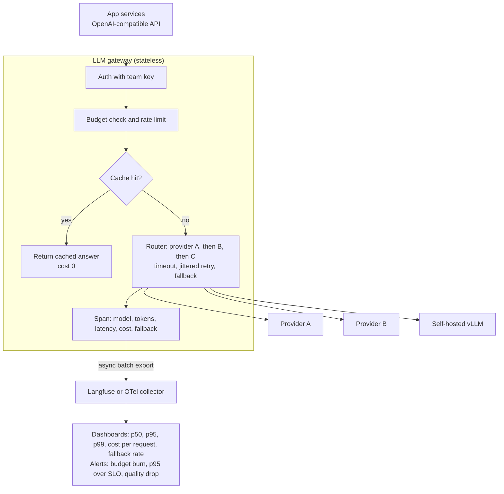
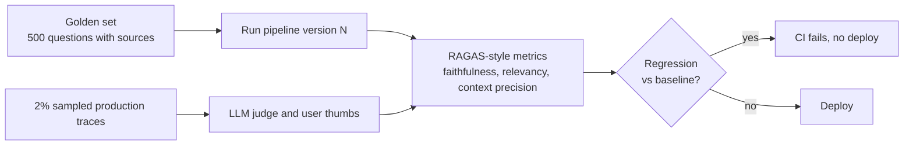

# Intuition & Mental Model

You cannot operate what you cannot see, and with LLMs "working" is not binary. A request can return HTTP 200 in 900 ms and still be wrong, expensive, or slower than last week. Three disciplines turn an LLM demo into an operated service:

1. **Observability (traces).** One user request becomes a *trace*: a tree of *spans* (retrieval, rerank, LLM call, tool call), each with latency, model, token counts, cost and inputs/outputs (masked). Tools: Langfuse, LangSmith, OpenTelemetry GenAI conventions. When someone says "the bot was slow yesterday at 3pm," you can find the exact span.
2. **Evaluation (quality).** A fixed *golden set* of questions with expected facts runs automatically on every prompt, model or index change. Metrics in the RAGAS family: **faithfulness** (is every claim in the answer supported by the retrieved context?), **answer relevancy**, **context precision/recall** (did retrieval fetch the right chunks, in a good order?). Treat it like unit tests: a regression blocks the release.
3. **Gateway engineering (control).** A single gateway (LiteLLM-style) in front of all model providers gives: one API, **fallbacks** when a provider fails, **budgets** (per team/tenant, hard stop), **latency SLOs**, caching, and central logging. Business rules live here instead of in 40 services.

Budgets are as important as accuracy: a latency budget (e.g. p95 < 3 s) and cost budget (e.g. < $0.04 per answer) are product requirements. Every optimization (caching, smaller models for easy queries, shorter prompts) is judged against quality *and* these budgets.

# Production Architecture & Data Flow

Prompts and outputs are masked (Module 13) before they leave the gateway for the observability backend. The lower diagram is the offline evaluation loop plus online sampling.

# Architectural Trade-Off Matrix

| Approach | Latency | Scalability | Implementation Complexity | Cost |
|---|---|---|---|---|
| **Self-hosted gateway (LiteLLM proxy) + Langfuse (self-hosted)** | +2-10 ms | High: stateless proxy, Postgres/ClickHouse backends | Medium: you run and upgrade it | Low licence cost; ops cost |
| **Managed observability/gateway SaaS (LangSmith, Helicone, Portkey, cloud gateways)** | +10-50 ms (extra hop) | High; vendor handles it | Low | Per-trace/seat pricing grows with volume; data leaves boundary |
| **Hand-rolled logging in each service (print + dashboards)** | Lowest | Poor: inconsistent fields, no cross-service traces | Low initially, High later | Hidden: engineer time and blind spots |

# Enterprise War Stories & Edge Cases

**1. The bill that tripled overnight.** A new feature appended the full conversation history to every call; average input tokens rose from 1.2k to 9k. Nobody noticed for 11 days because dashboards tracked request counts, not tokens. *Remediation:* per-request cost in every span, budget alerts at 50/80/100% of daily caps with a hard stop at the gateway, token-count percentiles per route, and a CI check on prompt size.

**2. A "better" model made answers worse.** Switching to a newer model improved fluency but dropped faithfulness from 0.92 to 0.81, because it paraphrased beyond the source. The team had only checked latency. *Remediation:* golden set run on every model/prompt change, faithfulness and context-precision gates, canary traffic with side-by-side judge scoring, and rollback by alias flip at the gateway.

**3. Fallback storm hid an outage.** The primary provider degraded; the gateway silently fell back to a slower secondary, p95 tripled, and the secondary hit its own rate limits, producing cascading 429s. Dashboards showed "success rate 99%." *Remediation:* track fallback rate as a first-class SLI, alert on it, set per-provider concurrency caps, circuit breakers with cool-downs, and degrade deliberately (smaller model/shorter answer) rather than failing over blindly.
