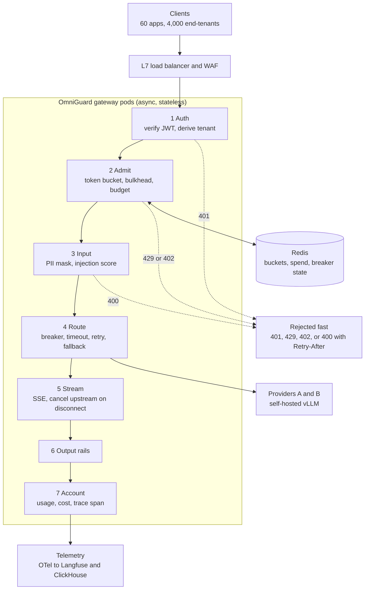

# Intuition & Mental Model

OmniGuard is the **front door for every AI request in a company**. Instead of 60 applications each calling model providers directly (each with its own keys, no budgets, no logging, no PII protection), they all call one gateway. The gateway answers five questions for every request, in order, in a few milliseconds:

1. **Who are you?** Verify the signed token (Module 12) and derive the tenant from it.
2. **Are you allowed to do this now?** Plan limits, rate limit (token bucket, Module 02), concurrency cap, daily budget (Module 14).
3. **Is this request safe to send?** Mask PII, score for prompt injection (Module 13).
4. **Who serves it?** Pick a provider, with timeout, retries, fallback and circuit breaker (Module 14).
5. **Is the answer safe to return, and what did it cost?** Output rails, usage accounting, trace span, streamed to the caller (Module 02).

The hard part is not any single feature, it is **fairness under load**: one tenant's retry storm must not slow down another tenant's requests. That is achieved by per-tenant token buckets (admission), per-tenant bulkheads (concurrency), and a global cap sized to provider quotas. Failing fast with `429 + Retry-After` is cheaper for everyone than queueing until timeouts.

This capstone composes Modules 02, 05, 12, 13 and 14. Read their READMEs first; the lab re-implements compact versions so it runs standalone.

# Production Architecture & Data Flow

Request states: AUTHENTICATED, ADMITTED, MASKED, ROUTED, STREAMING, then COMPLETED, CANCELLED, BLOCKED, or FAILED. A separate control plane holds tenant config, key rotation, policy versions, and price tables.

# Architectural Trade-Off Matrix

| Approach | Latency | Scalability | Implementation Complexity | Cost |
|---|---|---|---|---|
| **Custom async gateway (this design) on Kubernetes + Redis** | Lowest added latency (~5-15 ms), full control of rails and fairness | High; scale pods horizontally, Redis cluster for shared state | High: you own correctness of limits, streaming, failover | Infra + team cost; no per-request vendor fee |
| **OSS proxy (LiteLLM/Kong AI Gateway) + plugins** | +3-10 ms | High | Medium: configuration plus custom plugins for tenant guardrails | Low licence; moderate ops |
| **Direct provider calls + shared SDK in each app** | Lowest | Poor governance: limits, budgets, keys, logs scattered | Low per app, very high org-wide | Highest hidden cost: no cost control or incident visibility |

# Enterprise War Stories & Edge Cases

**1. Noisy neighbor starved the biggest customer.** One tenant's batch job with aggressive retries consumed the shared provider quota; the flagship tenant's chat latency went from 1.1 s to 14 s. The gateway had a global limiter but no per-tenant isolation. *Remediation:* per-tenant token buckets and bulkheads, weighted fair shares of provider quota (reserved capacity for premium plans), 429 with `Retry-After` to shape client retry behavior, and per-tenant dashboards of throttle rate.

**2. Redis blip turned into a full outage.** The rate limiter called Redis synchronously on every request; a 20-second failover caused 100% request failures, because the limiter failed *closed*. *Remediation:* local in-process fallback buckets (conservative fraction of the tenant limit) when Redis is unreachable, short Redis timeouts (20 ms), circuit breaker around Redis, and a documented decision: availability mode degrades to local limits, never to "no limits".

**3. Streams that outlived their callers.** Mobile clients disconnected mid-answer; the gateway kept pulling tokens from the provider and billing the tenant, and bulkhead slots stayed occupied until the provider finished, which throttled active users. *Remediation:* detect disconnects, propagate cancellation to the upstream call, release the bulkhead in `finally`, bound per-stream duration and tokens, and record "tokens generated vs tokens delivered" to reveal waste.
