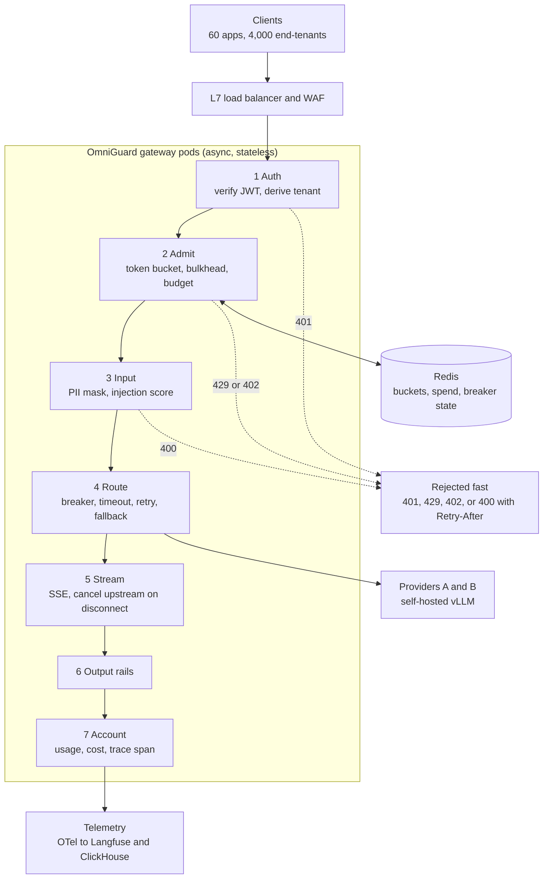

> **Syllabus lessons for this module:** full teaching notes for every topic are in [Syllabus Topic Write-ups](#syllabus-topic-write-ups); the topic-to-code map is in the [Syllabus Coverage Map](#syllabus-coverage-map) and [COVERAGE.md](../../COVERAGE.md).

# Intuition & Mental Model

OmniGuard is the **front door for every AI request in a company**. Instead of 60 applications each calling model providers directly (each with its own keys, no budgets, no logging, no PII protection), they all call one gateway. The gateway answers five questions for every request, in order, in a few milliseconds:

1. **Who are you?** Verify the signed token (Module 12) and derive the tenant from it.
2. **Are you allowed to do this now?** Plan limits, rate limit (token bucket, Module 02), concurrency cap, daily budget (Module 14).
3. **Is this request safe to send?** Mask PII, score for prompt injection (Module 13).
4. **Who serves it?** Pick a provider, with timeout, retries, fallback and circuit breaker (Module 14).
5. **Is the answer safe to return, and what did it cost?** Output rails, usage accounting, trace span, streamed to the caller (Module 02).

The hard part is not any single feature, it is **fairness under load**: one tenant's retry storm must not slow down another tenant's requests. That is achieved by per-tenant token buckets (admission), per-tenant bulkheads (concurrency), and a global cap sized to provider quotas. Failing fast with `429 + Retry-After` is cheaper for everyone than queueing until timeouts.

This capstone composes Modules 02, 05, 12, 13 and 14. Read their READMEs first; the lab re-implements compact versions so it runs standalone.

# Production Architecture & Data Flow



Request states: AUTHENTICATED, ADMITTED, MASKED, ROUTED, STREAMING, then COMPLETED, CANCELLED, BLOCKED, or FAILED. A separate control plane holds tenant config, key rotation, policy versions, and price tables.

# Architectural Trade-Off Matrix

| Approach | Latency | Scalability | Implementation Complexity | Cost |
|---|---|---|---|---|
| **Custom async gateway (this design) on Kubernetes + Redis** | Lowest added latency (~5-15 ms), full control of rails and fairness | High; scale pods horizontally, Redis cluster for shared state | High: you own correctness of limits, streaming, failover | Infra + team cost; no per-request vendor fee |
| **OSS proxy (LiteLLM/Kong AI Gateway) + plugins** | +3-10 ms | High | Medium: configuration plus custom plugins for tenant guardrails | Low licence; moderate ops |
| **Direct provider calls + shared SDK in each app** | Lowest | Poor governance: limits, budgets, keys, logs scattered | Low per app, very high org-wide | Highest hidden cost: no cost control or incident visibility |

# Enterprise War Stories & Edge Cases

**1. Noisy neighbor starved the biggest customer.** One tenant's batch job with aggressive retries consumed the shared provider quota; the flagship tenant's chat latency went from 1.1 s to 14 s. The gateway had a global limiter but no per-tenant isolation. *Remediation:* per-tenant token buckets and bulkheads, weighted fair shares of provider quota (reserved capacity for premium plans), 429 with `Retry-After` to shape client retry behavior, and per-tenant dashboards of throttle rate.

**2. Redis blip turned into a full outage.** The rate limiter called Redis synchronously on every request; a 20-second failover caused 100% request failures, because the limiter failed *closed*. *Remediation:* local in-process fallback buckets (conservative fraction of the tenant limit) when Redis is unreachable, short Redis timeouts (20 ms), circuit breaker around Redis, and a documented decision: availability mode degrades to local limits, never to "no limits".

**3. Streams that outlived their callers.** Mobile clients disconnected mid-answer; the gateway kept pulling tokens from the provider and billing the tenant, and bulkhead slots stayed occupied until the provider finished, which throttled active users. *Remediation:* detect disconnects, propagate cancellation to the upstream call, release the bulkhead in `finally`, bound per-stream duration and tokens, and record "tokens generated vs tokens delivered" to reveal waste.

# Syllabus Topic Write-ups

This module teaches the full arc of a secure AI integration engagement, from the first workshop with a client to a hardened container running in the cloud. Topics 1 to 5 are consulting deliverables (discovery, classification, SOW, ROI case, UAT runbook) and topics 6 to 9 are engineering (OAuth and RBAC, hybrid retrieval with Text-to-SQL, guardrails, deployment). A Forward Deployed Engineer (FDE) is judged on both halves: the client trusts you with their data only if your paperwork is as precise as your code, and your code only matters if the scope, acceptance criteria and security decisions behind it were agreed first. Figures in this section are illustrative examples unless stated; verify product-specific names, limits and syntax against current documentation.

**How to study this module**

Read the topics in numbered order, because each one produces an input for the next. Discovery (1) produces the source inventory and open questions. Classification (2) turns the inventory into handling rules. The SOW (3) turns scope, assumptions and classification into a contract with measurable acceptance criteria. The ROI case (4) justifies the cost in the SOW to the CISO and finance. The UAT runbook (5) is how those acceptance criteria are proven. Then switch to engineering: OAuth and RBAC (6) gives the identity the gateway trusts, hybrid RAG and Text-to-SQL (7) uses that identity and the classification to decide what data may be queried, guardrails (8) enforce the classification at runtime, and deployment (9) ships all of it safely. A suggested study path:

1. Topics 1 and 2 in one sitting, then write a mock decision log and a four-tier policy for a sample client.
2. Topics 3 and 4 together, drafting one SOW and one ROI page from the same invented client.
3. Topic 5, writing UAT cases against the SOW you just drafted.
4. Topic 6, then 7, then 8, because 7 and 8 both rely on identity and classification.
5. Topic 9 last, then revisit the cheat sheet and answer every "How interviewers probe this" list aloud.

**Module cheat sheet**

| Must-know | One-line answer |
|---|---|
| Purpose of discovery | Turn a vague request into a priced scope, a risk list, and owners with dates; unanswered must-ask questions become SOW assumptions. |
| Discovery agenda | Business outcome, data and sources, security and identity, integration and network, operations, wrap-up; about 160 minutes of content plus buffer. |
| Classification tiers | Public, Internal, Confidential, Restricted; each has one handling rule for LLM use, logging and retention; the highest tier in a request wins. |
| What makes a good SOW | Explicit exclusions, measurable acceptance criteria, milestones tied to payment totalling 100%, and a change-control clause. |
| ROI structure for a CISO | Risk first, then cost, then return; show operations-only NPV beside total NPV so the case survives if the risk benefit is set to zero. |
| NPV | Sum of each year's benefit divided by (1 + r) raised to the year number, minus the upfront cost; r is the discount rate. |
| UAT versus engineering tests | The business owner defines pass and fail; entry and exit criteria turn the result into a GO or NO-GO. |
| 401 versus 403 | 401 means identity is missing or invalid; 403 means identity is known but not allowed. |
| PKCE | The client keeps a random verifier, sends only its SHA-256 hash first, and proves possession when exchanging the code for a token. |
| Reciprocal Rank Fusion | score = sum over rankers of 1 / (60 + rank); merges keyword and vector lists without score calibration. |
| Secure Text-to-SQL | Validate one allowlisted SELECT with a row cap and run it on a read-only login to allowlisted views; never trust the prompt. |
| Presidio versus NeMo Guardrails | Presidio detects and masks personal data; NeMo Guardrails controls conversation behavior through Colang flows. |
| Graceful shutdown | Fail readiness, stop new streams, drain in-flight ones, and keep the platform stop timeout above the drain timeout. |
| Liveness versus readiness | Liveness asks whether the process can answer; readiness asks whether it should receive traffic right now. |

### 1. Conducting technical discovery and scoping workshops
**What you will be able to do**

- Explain to a non-engineer in two minutes why a discovery workshop comes before a price.
- Run a 180-minute agenda with six blocks and say what output each block must leave behind.
- Convert a vague volume statement into a sizing figure by hand.
- Turn open questions into SOW assumptions and a risk list with owners and dates.
- Handle the three most common pushbacks without losing the session.

**Prerequisites**

None beyond the overview of the OmniGuard gateway at the start of this module. Topic 2 (classification) and topic 3 (SOW) consume what this lesson produces.

**The idea from first principles**

Imagine a builder who quotes a price for "a house" without asking how many bedrooms, what land, or whether there is a mortgage lender who must approve the plans. Either the quote is padded to cover the unknowns, or the builder loses money later. A client who says "we want a secure AI gateway" is in the same position. The sentence hides dozens of decisions: which teams will call it, what data may pass through it, which identity system issues tokens, who approves going live, and what number must improve for the project to count as a success.

The naive approach is to write a proposal straight from the request and fix the gaps as they appear. This fails for a predictable reason: unknowns found late are expensive. A data owner who was never in the room declares in week six that a source is regulated, and the design changes. A security team that was not consulted adds a six-week review gate that nobody planned. Discovery moves those surprises to the front, when changing the answer costs one meeting instead of one sprint.

A discovery workshop is a structured, time-boxed working session with the people who hold the decisions. Define the terms precisely. The executive sponsor is the person who owns the budget and the business outcome. The data owner is the person accountable for a data source, who can say what it contains and what it may be used for. The FDE is the engineer who leads the technical side and writes down decisions. A decision is a choice with a named owner and a date. An assumption is something you are treating as true because it was not confirmed; it goes into the SOW so that if it turns out false, the change is handled by change control rather than absorbed silently. A risk is something that might go wrong, with an owner who watches it.

The output of the workshop is therefore not meeting notes. It is a decision log, an assumptions list, a risk list, and a sizing sheet. If you leave without those, you have had a conversation, not a discovery.

**How it works, step by step**

The agenda below uses about 160 minutes of content and 20 minutes of breaks and buffer, for a 180-minute session (example timing, adjust to the client).

| Block | Minutes | Goal | Output |
|---|---|---|---|
| Business outcome | 30 | Rank 2 to 3 workflows with baseline metrics | Measurable success metric |
| Data and sources | 45 | Where data lives, who owns it, which region | Source inventory, residency constraints |
| Security and identity | 30 | Identity provider, roles, review gates | Auth design inputs, review calendar |
| Integration and network | 20 | Calling apps, languages, VPC, egress rules | Deployment pattern |
| Operations | 20 | Who is on call, how changes are approved | Handoff owners |
| Wrap-up | 15 | Read back open questions, assign owners | Action list with dates |

1. Three days before, send a one-page pre-read: goals, attendee roles, and the question list. Ask the client to bring a data owner and a security representative.
2. Open with the business outcome block. Every later answer is judged against it, and it exposes quickly whether the client has a measurable goal at all.
3. In each block, ask the questions, and for each answer record three things: the decision, the owner and the date. An answer without an owner is still an open question.
4. Park solution ideas on a visible list. Designing during discovery burns time that belongs to questions.
5. In the wrap-up, read every open question aloud and assign an owner and a due date.
6. Within 24 hours send a readout: decisions, assumptions that will go into the SOW, risks, and the date of the next meeting.

Sizing by hand. Suppose the client says "a lot of requests". You ask for numbers and hear 2 million requests per month at steady state. A month has about 30 x 86,400 = 2,592,000 seconds. Average rate = 2,000,000 / 2,592,000 = 0.77 requests per second. Traffic is rarely flat, so ask for the peak-to-average ratio. If it is 8 (an example, use the client's own), peak is 0.77 x 8 = 6.2 requests per second. Round up and design for 8, and record "peak 8 requests per second" as a sizing assumption. Also ask for pilot volume separately, since a pilot of 40 users may generate 1 percent of steady state.

**Worked example 1: small and hand-traceable**

Take three raw statements from a workshop and trace each into the right artifact.

- Statement: "Claims notes sometimes have phone numbers." Block: data and sources. Decision: treat the notes field as Confidential until sampled. Owner: data owner. Date: 12 Nov. Artifact: decision log and an input to classification (topic 2).
- Statement: "Security review usually takes a while." Not a decision, so push for a number. Answer: six weeks. Artifact: risk R-01 "review gate takes 6 weeks, owner security delegate", plus a dependency in the SOW with a date by which the review request must be filed.
- Statement: "Which region can we store embeddings in?" Nobody knows. Artifact: open question Q-07, owner platform lead, due 8 Nov. If unanswered by the SOW date, it becomes assumption A-04: "embeddings stored in the same region as source data".

After the three statements: one decision, one risk plus dependency, one open question with a fallback assumption. That is what a good block leaves behind.

**Worked example 2: enterprise scenario**

A regional insurer wants an AI assistant for 40 claims handlers. Attendees: claims director (sponsor), a data owner for the claims system, the security lead, a platform engineer and you. The business outcome block ranks two workflows: summarizing claim histories (baseline 12 minutes per claim, target 4) and drafting customer letters. The data block finds three sources, one of which has free-text notes with phone numbers and one region constraint. The security block learns the identity provider is Entra ID, roles are assigned by group, and security review takes six weeks. The integration block learns that the handlers use one internal web app. The operations block learns that there is no on-call rota for this app yet.

The readout records this decision log excerpt:

```
Decision log (excerpt)
D-04  Claims notes field treated as Confidential until sampled   Owner: data owner      Due: 12 Nov
D-05  Pilot is 40 users, one web app, one region                  Owner: sponsor         Due: done
A-02  Assumption: 2M requests/month steady state, peak 8 req/s    Owner: platform lead   Due: confirm 15 Nov
R-01  Risk: security review gate takes 6 weeks                    Owner: security lead   Due: file request by 20 Nov
R-02  Risk: no on-call owner for production                       Owner: sponsor         Due: name owner by 30 Nov
Q-07  OPEN: region allowed for embeddings                         Owner: platform lead   Due: 8 Nov
```

Commentary: D-04 shows how a hidden classification problem was caught on day one. A-02 is the sizing figure from the hand calculation. R-02 exists only because the Operations row was kept in the agenda; skipping it would have surfaced the gap at go-live. Every row has an owner and a date, which is what makes the log a management tool.

**Hands-on practice**

Exercise 1 (easy). A client says "about 500,000 requests a month". Compute the average requests per second.

Solution: 500,000 / 2,592,000 = 0.19 requests per second on average. State the assumption about the peak ratio before sizing.

Exercise 2 (medium). Your workshop must fit 120 minutes instead of 180. Which blocks do you shorten and what do you record?

Solution: Keep business outcome (30), data (45) and security (30) intact, as 105 minutes of the highest-risk topics. Give integration, operations and wrap-up 15 minutes in total by moving them to a follow-up call of 45 minutes, and record in the readout: "integration, network and operations decisions deferred, treated as assumptions until the follow-up on date X". Never silently drop a block.

Exercise 3 (hard). The data owner cannot attend. The sponsor says to proceed. What do you do and what appears in the SOW?

Solution: Proceed with the other blocks, but mark every data-related answer as unconfirmed. Ask the sponsor to name a delegate with authority within two days. In the SOW, add assumptions that the data inventory, classification and region are as stated by the sponsor and unconfirmed by the data owner, add a client dependency "data owner sign-off by week 1", and add a clause that changes to classification after that date go through change control. Record the absence as risk R-03.

**Alternatives and trade-offs**

| Approach | Speed | Quality of scope | Risk |
|---|---|---|---|
| One 180-minute workshop | Fast | Good if the right people attend | Gaps if a key person is absent |
| Several 60-minute sessions per function | Slower, 2 to 3 weeks | Deeper per topic | Decisions drift between sessions |
| Written questionnaire only | Fastest | Shallow, answers often guessed | Ambiguity found late |
| Paid discovery phase | Slowest | Best, can include data sampling | Client must pay before a build commitment |

Choose the single workshop for a pilot, split sessions for large regulated clients, a paid discovery phase when data quality is unknown, and the questionnaire only as a pre-read. The workshop is the wrong tool when nobody with decision authority will attend; then escalate before scheduling.

**Where it goes wrong in production**

- Missing data owner. Symptom: classification disputes in week six. Cause: a delegate without authority attended. Diagnose: ask who can approve a data source for LLM use and check whether they were present. Fix: make the data owner a required attendee and postpone if absent.
- Solution talk crowds out questions. Symptom: ten minutes of architecture, no decisions logged. Cause: the FDE or client engineers like designing. Fix: a visible parking list and a facilitator who guards the clock.
- Operations block skipped. Symptom: go-live delayed because nobody owns on-call. Cause: the agenda dropped the row. Fix: keep the block and name an owner.
- Optimistic volume numbers. Symptom: pilot works, scale-up fails. Cause: only one volume figure collected. Fix: ask for pilot, steady-state and peak separately and test against peak.
- Notes instead of decisions. Symptom: two months later nobody remembers what was agreed. Fix: decision log with owner and date, circulated within 24 hours.

**How stakeholders push back**

"We do not have three hours." Offer the 90-minute version covering outcome, data and security, and record skipped blocks as assumptions. "Just give us a price." Explain that a price without answers is a guess that someone pays for, and offer a range that narrows when the open questions close. "We already know what we want, skip the questions." Run the business outcome block anyway and ask "what number moves in 90 days"; a clear answer takes five minutes and a vague one proves the point. In an interview or client meeting, stay calm, restate the purpose (fewer surprises later) and offer a smaller version rather than refusing.

**How interviewers probe this**

1. What do you want out of a discovery workshop?
2. Who must be in the room and why?
3. How do you size a system when the client gives a vague volume?
4. How do you turn discovery output into a SOW?
5. How would you run discovery when you only get two hours?
6. What breaks when the data owner is absent?
7. A sponsor says the questions are a waste of time and asks for a price now. What do you do?
8. Trap: the client says "we already have a data classification policy". Do you skip the data block?

**Model answer (60-90 seconds)**

"A discovery workshop is a structured session that converts a vague request into a scope, a risk list and an owner list. I run about three hours with the sponsor, data owner, security, platform and myself. I start with business outcomes so every later answer has a yardstick, then data and sources, security and identity, integration and network, operations, and a wrap-up. For each answer I record the decision, the owner and the date, and any must-ask question that stays open becomes an explicit assumption in the SOW, so the risk is visible and priced. The trade-off is time and attendance: a single session is fast but fails without the data owner, so I make that person required. For example, with an insurer we found a notes field with phone numbers on day one, which changed its classification before any design work. The limit is that a workshop captures stated knowledge, so for unknown data quality I recommend sampling in a paid discovery phase."

**Quick-fire answers**

- Q: What do you want from discovery? / A: A priced scope, a risk list, and decisions with owners and dates. Notes alone are not an output.
- Q: Who must attend? / A: Sponsor, data owner, security lead, platform lead and the FDE. The data owner is the one most often missing and most costly to lose.
- Q: Vague volume? / A: Ask for pilot, steady-state and peak figures. Convert monthly requests to per-second by dividing by about 2.6 million seconds, then apply a stated peak ratio.
- Q: Discovery to SOW? / A: Decisions become scope, open items become assumptions, risks become the risk section, volumes become acceptance thresholds.
- Q: Two hours only? / A: Keep outcome, data and security, defer the rest to a follow-up and record it as assumptions.
- Q: Data owner absent? / A: Classification and residency stay unconfirmed, so they surface late as rework. Ask for a delegate with authority and add a dependency to the SOW.
- Q: Sponsor wants a price now? / A: Offer a range that narrows once named questions close, and explain that a firm price on unknowns shifts cost to whoever is wrong.
- Q: Existing classification policy? / A: Still run the data block. A policy on paper rarely matches real columns, so check how it is applied to these sources.

**Recap in five lines**

- Discovery converts a vague request into scope, risks and owners before anyone commits money.
- Run six blocks: outcome, data, security, integration, operations, wrap-up.
- Record every answer as a decision, owner and date; unowned answers are open questions.
- Unanswered must-ask questions become SOW assumptions.
- Never skip the data owner or the Operations block.

### 2. Defining data classifications
**What you will be able to do**

- Explain in two minutes why a classification scheme is the input to SQL allowlists, masking and logging.
- Design a four-tier scheme with one handling rule per tier and defend each rule.
- Classify a column by name and by sampled values, and compute a Luhn checksum by hand.
- Explain why the highest tier in a request decides handling for the whole request.
- Spot a classification policy that exists only on paper.

**Prerequisites**

Topic 1 (the discovery workshop produces the source inventory and the data owner who approves labels). Familiarity with what PII (personally identifiable information) means.

**The idea from first principles**

A hospital has a visitor sign-in sheet on the front desk and a locked cabinet of patient files. Nobody needs a long document to know that the two are handled differently. Data in a company is the same, except that it is stored in thousands of columns, copied into prompts, written to logs and sent to third-party model providers, and nobody can see at a glance which column is the sign-in sheet and which is the locked cabinet. A classification scheme is the shared answer to a single question: may this field go to this destination, and in what form?

The naive approach is a binary label, safe or sensitive. It fails because the useful decisions are not binary. A customer name may be sent to a model inside the company's own network, but only after masking if the model is external. A health diagnosis may never go to an external model, and may reach an internal model only after masking. Binary labels force either over-blocking, which kills the project, or under-blocking, which creates incidents.

Define the terms. A tier is one level of the scheme. A handling rule is the instruction attached to a tier for each destination: external LLM, in-network LLM, logs, retention period and export. Masking means replacing a sensitive value with a placeholder or a transformed value before it travels. Hashing means replacing a value with a one-way digest, useful in logs when you need to correlate events without storing the value. Retention is how long data may be kept. Residency is the geographic region where data may be stored or processed.

Four tiers are usually enough: Public, Internal, Confidential, Restricted. More than four and nobody can remember them, and engineers start guessing. Each tier needs exactly one rule per destination, written so that a program can apply it. The scheme only has value when it is enforced by systems, so every tier maps to configuration that the gateway, the SQL layer and the guardrails read at runtime.

**How it works, step by step**

| Tier | Examples | External LLM | In-network LLM | Log payload | Retention (example) |
|---|---|---|---|---|---|
| Public | Published docs | Allow | Allow | Yes | 365 days |
| Internal | Policies, ticket titles | Allow | Allow | Yes | 180 days |
| Confidential | Names, emails, contract terms | Mask first | Allow | Hash only | 90 days |
| Restricted | National IDs, card numbers, health data | Deny | Mask first | No | 30 days |

1. Take the source inventory from discovery: databases, tables, columns, document stores.
2. Pre-label by name patterns. A column called email or ssn starts at Confidential or Restricted. Unknown names default to Confidential, never Public.
3. Sample real values inside the client's environment, for example 100 values per column (example size), and run detectors for emails, phone numbers, card numbers and national IDs. Keep only counts, not the values.
4. Label each column by the highest tier among its detected entities. A free-text notes column containing even one email is Confidential.
5. The data owner confirms or overrides each label. Record who decided and when.
6. Encode the result as configuration: the SQL allowlist (columns the model may see), the masking entity list, the logging policy per tier.
7. At runtime, classify each request by the highest tier among all fields it touches, and apply that tier's rule to the whole request.
8. Re-sample on a schedule and alert when a new entity type appears in a column.

The Luhn checksum filters card-like digit strings. Starting from the rightmost digit, double every second digit, subtract 9 from any doubled value above 9, add everything, and check that the total is divisible by 10. It is a checksum that detects mistyped digits, not proof that a card exists, so a pass only raises confidence.

**Worked example 1: small and hand-traceable**

Test the well-known sample number 4111 1111 1111 1111. Digits from the right: 16 digits. The 8 digits in even positions from the right (positions 2, 4, ..., 16) are seven 1s and the leading 4. Doubling: seven 1s become 2 each, which is 14, and 4 becomes 8, so the doubled sum is 22. The 8 digits in odd positions are all 1, sum 8. Total = 22 + 8 = 30, divisible by 10, so it passes. Now change the last digit to 2: odd positions sum becomes 9, total 31, fails. So a random 16-digit order number passes only about 1 time in 10, which is why the checksum cuts false positives by roughly 90 percent when combined with a pattern match.

Now classify three columns: `product_name` (names only, 100 values, no entities) is Public or Internal depending on the owner. `contact_email` (100 percent emails) is Confidential. `notes` (free text, 3 of 100 values contain a phone number) is Confidential, because one entity is enough to promote the column.

**Worked example 2: enterprise scenario**

A hospital network wants a staff assistant that answers questions about visit data. The discovery workshop produced a `patient_visits` table. Name-based pre-labeling and sampling give the following configuration, which the runtime loads:

```yaml
columns:
  visit_id:        internal
  department:      internal
  patient_name:    confidential
  diagnosis_text:  restricted
  notes:           confidential
policy:
  restricted:
    external_llm: deny
    in_network_llm: mask
    log_payload: none
  confidential:
    external_llm: mask
    in_network_llm: allow
    log_payload: hash
```

Commentary: `notes` was promoted to confidential after sampling found phone numbers, and the YAML records no explanation, so add an audit trail elsewhere (who, when, why). A request that selects `department` and `diagnosis_text` is treated as Restricted as a whole, so the external model is denied and the in-network model receives masked text. The SQL allowlist excludes `diagnosis_text` entirely for roles that have no need for it; classification feeds access control, it does not replace it. The log policy writes nothing for that request, only an event count.

A small detector used in the sampling step:

```python
import re

EMAIL = re.compile(r"[\w.+-]+@[\w-]+\.[\w.-]+")

def luhn_ok(text: str) -> bool:
    digits = [int(c) for c in text if c.isdigit()]
    total = 0
    for i, d in enumerate(reversed(digits)):
        if i % 2 == 1:
            d *= 2
            if d > 9:
                d -= 9
        total += d
    return len(digits) >= 13 and total % 10 == 0
```

The length check avoids flagging short numbers that happen to satisfy the checksum.

**Hands-on practice**

Exercise 1 (easy). Does 4111 1111 1111 1112 pass the Luhn check?

Solution: Only the last digit changes from 1 to 2. That digit is in an odd position (not doubled), so the odd-position sum becomes seven 1s plus the 2, which is 9. The doubled sum stays 22. Total 31 is not divisible by 10, so it fails.

Exercise 2 (medium). A `comments` column has 1,000 sampled values, and 2 contain a national ID. What tier, and what do you do about it?

Solution: Restricted, because the highest tier among detected entities decides. Options: remove the column from the allowlist and the prompt entirely, or add a masking step that removes national IDs before use, then re-sample the masked output to prove the entities are gone. Tell the data owner, since the 2 values point to a process problem upstream.

Exercise 3 (hard). A request combines a Public product catalog excerpt, an Internal policy snippet and one Confidential customer email. The target is an external model. What happens and why?

Solution: The request is Confidential because the highest tier wins. The rule says mask first, so the email is replaced with a placeholder before sending, and the log stores a hash only. Without the rule, the safe parts would leak the sensitive part by being bundled with it. If the request also contained a Restricted field, the whole request would be denied for the external model, even if the Restricted field was a single value.

**Alternatives and trade-offs**

| Approach | Accuracy | Effort | Risk |
|---|---|---|---|
| Name-based rules only | Low, misses free text | Low | False sense of safety |
| Name plus value sampling | Good | Medium | A sample can miss rare values |
| Commercial discovery and labeling platform | Highest, continuous | High cost | Integration time, lock-in |
| Treat everything as Confidential | Safe by default | Lowest | Blocks useful data, project stalls |

Choose name plus sampling for a pilot, a platform when the estate has hundreds of databases, and the all-Confidential default only as a temporary stance for unlabeled data. Classification is the wrong tool when the real problem is access control: if the wrong people can open a table, a label does not stop them.

**Where it goes wrong in production**

- Policy on paper only. Symptom: audit finds prompts with card numbers in logs. Cause: tiers were never encoded as configuration. Diagnose: search logs for entity patterns. Fix: load the policy at runtime, add tests that send known sensitive values and assert the outcome.
- Free-text drift. Symptom: a column labeled Internal starts receiving emails after a new intake form. Cause: labels were set once. Diagnose: scheduled re-sampling shows new entity counts. Fix: re-sample regularly and alert on change.
- Too many tiers. Symptom: engineers pick tiers inconsistently. Cause: six tiers with overlapping definitions. Fix: reduce to four with one rule each and worked examples.
- Payloads in logs. Symptom: Confidential text visible in observability tools. Cause: debug logging of prompts. Fix: hash or drop payloads, log entity counts.
- Request-level mixing missed. Symptom: a Restricted value sent externally inside an otherwise Internal prompt. Cause: classification done per field, not per request. Fix: highest tier wins, applied to the assembled prompt.

**How stakeholders push back**

"Everything is confidential, just block it." Agree to a default of Confidential for unlabeled fields and give the owner a quick route to downgrade with evidence. "Sampling production data is itself a risk." Agree and run the sampling inside the client's environment, storing only counts. "Four tiers is too simple for us." Offer sub-labels such as health or financial under Restricted, as long as each still maps to one of the four handling rules.

**Do not confuse**

Classification (what the data is) versus access control (who may use it) versus masking (how the data is altered on the way out). Classification is the input to the other two. Also, masking (reversible placeholder or partial replacement, depending on the operator) versus hashing (one-way digest) versus redaction (removal).

**How interviewers probe this**

1. What is a data classification scheme and why do you need one?
2. How would you classify a free-text column?
3. How do the tiers turn into engineering controls?
4. Why does the highest tier win for a request?
5. How would you classify a 400-column database with no documentation?
6. What breaks when a new data feed lands in a Public column?
7. Design question: how do you prove to an auditor that Restricted data never reached an external model?
8. Trap: "A Luhn pass means the number is a real card." Is that true?

**Model answer (60-90 seconds)**

"Classification tells engineers what may go where. I use four tiers, Public, Internal, Confidential and Restricted, and give each a rule for external models, in-network models, logging and retention. I classify by column name and by sampled values, because free-text columns hide emails and numbers, and I use checksums such as Luhn to cut false positives on card numbers. The highest tier in a request decides how the whole request is handled, and the tiers become configuration: the SQL allowlist, the masking entity list and the log policy. The trade-off is effort and drift, so I re-sample on a schedule and keep a default of Confidential for unknowns. For example, in a hospital project a notes column was promoted after sampling found phone numbers, and masking applied automatically. The limit is that sampling can miss rare values, so I keep output rails as a second layer."

**Quick-fire answers**

- Q: What is a classification scheme? / A: A shared set of tiers, each with handling rules per destination, so engineers know what may go where and in what form.
- Q: Free-text column? / A: Sample values, run entity detectors, and label by the highest tier found. One email makes it Confidential.
- Q: Tiers to controls? / A: The tier drives the SQL column allowlist, the masking entity list and the log policy.
- Q: Why highest tier wins? / A: Bundling a safe field with a sensitive one would otherwise leak the sensitive one.
- Q: 400 undocumented columns? / A: Pre-label by name, sample values, default unknown columns to Confidential, and have the owner review the highest-risk columns first.
- Q: New feed in a Public column? / A: Re-sampling and alerts should catch it. Until then it may leak, so unknown entity types should trigger deny or mask.
- Q: Proving Restricted data stayed internal? / A: Enforcement tests with synthetic Restricted values, entity-count logs with no payloads, and egress logs from the gateway showing the deny decisions.
- Q: Luhn pass means a real card? / A: No. It is a checksum that about 1 in 10 random strings pass. It raises confidence only.

**Recap in five lines**

- A classification scheme answers: may this field go to this destination, and in what form?
- Use four tiers with one program-readable rule per destination.
- Classify by name and by sampled values; the data owner confirms.
- The highest tier in a request decides handling for the whole request.
- The scheme only counts when the gateway, SQL layer and guardrails enforce it.

### 3. Drafting architecture SOWs
**What you will be able to do**

- Explain in two minutes what a SOW is for and who reads it.
- Draft the ten sections of an architecture SOW from a discovery readout.
- Rewrite a vague requirement into a measurable acceptance criterion.
- Check a milestone and payment table by hand and handle a change request.
- Respond to procurement and legal pushback without weakening the contract.

**Prerequisites**

Topic 1 (decisions, assumptions, risks) and topic 2 (classification, which sets scope boundaries). General idea of what a milestone is.

**The idea from first principles**

When two parties build something together, each carries a picture of the finished result in their head, and the pictures differ. The client imagines a chat assistant that knows everything about the business. The delivery team imagines an API gateway with three data sources. Neither is lying. The gap only shows when someone says "I thought that was included". A statement of work (SOW) is the document that forces the two pictures into one, in words that a third person could check.

The naive approach is a short proposal: a paragraph about the goal, a total price, a date. It fails because it leaves everything contestable. If "the assistant should be fast" is the only performance statement, then the client can reject any result as not fast enough, and the delivery team can claim any result is fast. Both are acting in good faith, and both end up in a dispute.

Define the terms. Scope is the list of things that will be delivered. An exclusion is something stated as not delivered, and it matters as much as scope because it removes assumed extras. A deliverable is a concrete thing handed over, such as a deployed service, a runbook or a test report. An acceptance criterion is a statement about a deliverable that can be checked: it names a metric, a threshold, a condition and a method of measurement. A milestone is a dated point at which one or more deliverables are accepted, and usually triggers a payment. Change control is the agreed process for altering scope: a written request, an estimate of effort and schedule impact, and a signature before work begins.

An architecture SOW is a SOW whose deliverables are designs and systems. Its distinct challenge is that quality attributes such as latency and security must be turned into numbers. The SOW is also the document you point to when scope grows, so every sentence should survive being read aloud by a stranger in a dispute. Legal terms such as liability, indemnity and termination belong to your legal team and the client's, so route those clauses to them rather than improvising.

**How it works, step by step**

1. Write the objective in one sentence tied to a business outcome from discovery: "Reduce average claim summary time from 12 to 4 minutes for 40 handlers within 14 weeks." If this sentence cannot be written, discovery is unfinished.
2. List what is in scope, as deliverables, not activities. "A deployed gateway with RBAC" is a deliverable. "Work on security" is not.
3. List what is out of scope, especially things clients commonly assume: production data migration, end-user training, model fine-tuning, support after handover, dashboards.
4. Copy the open discovery questions into the assumptions section. Aim for specific, falsifiable statements: "client provides a read-only database replica by week 2".
5. List client dependencies with dates (access, accounts, test users, review slots), and say what happens to the schedule if a date slips.
6. For each deliverable write acceptance criteria as metric, threshold, condition and method.
7. Map each deliverable to a milestone and each milestone to a week and payment percentage. Check that the percentages total 100.
8. Estimate effort by role (architect, engineer, project lead), and add an explicit contingency, 15 percent as an example, stated openly so it is not hidden inside rates.
9. List risks with owners and mitigations, carrying over the discovery risk list.
10. Add change control and the handover definition.

Worked payment check. Total fee 240,000 (example). Milestones: M1 design sign-off, week 3, 20 percent = 48,000. M2 pilot live, week 8, 40 percent = 96,000. M3 UAT passed, week 12, 30 percent = 72,000. M4 handover, week 14, 10 percent = 24,000. Percent check: 20 + 40 + 30 + 10 = 100. Money check: 48,000 + 96,000 + 72,000 + 24,000 = 240,000. Both totals must match, otherwise finance will reject an invoice.

Rewriting a vague criterion. "The assistant must be fast" has no metric. Rewritten: "p95 time to first token under 800 ms at 50 requests per second, measured over 15 minutes in the staging environment with the agreed test set". The p95 (95th percentile) means 95 percent of requests are at or below that time.

**Worked example 1: small and hand-traceable**

Input requirement from the client: "It must be secure and not leak data." Trace it into a deliverable and test:

- Deliverable: D4, guardrails and RBAC.
- Metric: share of red-team cases refused. Threshold: 100 percent of 25 agreed cases (example set).
- Condition: executed in staging with synthetic data, using the agreed case list attached as Appendix B.
- Method: run by the client's security tester, results recorded in the UAT runbook.
- Milestone: M3, week 12, 30 percent payment.

Final criterion text: "All 25 red-team cases in Appendix B are refused, as recorded by the client security tester in staging with synthetic data." Now it can be checked, and it can fail. A criterion that cannot fail is not a criterion.

**Worked example 2: enterprise scenario**

A telecom wants a gateway and a Text-to-SQL service for its billing team. After discovery, the SOW excerpt for the Text-to-SQL deliverable looks like this:

```
Deliverable D3: Text-to-SQL service over billing views
Acceptance:
  1. All 25 red-team SQL injection cases in Appendix B are refused.
  2. At least 95% of 40 business questions in Appendix C return totals
     matching the data owner's reference answers.
  3. Every answer cites the hash of the executed query.
Milestone: M3, week 8, 40% of fee
Excluded: schema redesign, BI dashboard, support after week 14
Assumption A-05: client provides a read-only replica by week 2
Dependency C-03: data owner approves the view list by week 3
Change control: any scope change needs a written request, an
  estimate, and signatures from both project leads before work starts.
```

Commentary: criterion 2 uses 95 percent of 40 questions, which means at least 38 correct, a figure everyone can count. Criterion 3 turns an engineering feature into a checkable property. The exclusion list prevents the dashboard request from arriving as a free extra. A-05 and C-03 transfer schedule risk to the party that controls it. If the replica arrives in week 4, M3 moves by two weeks without a dispute because the assumption said so.

When a mid-project request appears, for example "add a dashboard", you log a change request, estimate 3 weeks and 30,000 (example), and let the sponsor decide between paying, deferring or swapping out a lower-priority deliverable.

**Hands-on practice**

Exercise 1 (easy). Fix this milestone table: M1 25 percent, M2 35 percent, M3 30 percent. What is wrong and how do you fix it?

Solution: The total is 90 percent, so 10 percent of the fee has no trigger. Add a handover milestone at 10 percent, or redistribute the percentages. Never leave a gap.

Exercise 2 (medium). Rewrite "The system must handle our peak load" as an acceptance criterion, given discovery found 2 million requests per month and a peak ratio of 8.

Solution: Average = 2,000,000 / 2,592,000 = 0.77 requests per second, peak = 6.2 per second. Criterion: "Sustain 8 requests per second for 15 minutes in staging with p95 time to first token under 800 ms and error rate under 0.5 percent, as measured by the agreed load test script." The 8 is a rounded-up peak with headroom, stated openly.

Exercise 3 (hard). Three weeks in, the client asks you to add a second data source, "just one more database". Draft your response.

Solution: Acknowledge, then check the SOW. If the data source is outside the list in scope, it is a change. Send a one-page change request: description, classification of the new source (needs data owner review), effort estimate (for example 2 weeks of one engineer plus review), schedule impact (M2 moves one week or another deliverable is dropped), cost, and a signature block. Offer options: pay and shift, defer to a phase two, or swap with a lower-priority item. Do not start work before signatures.

**Alternatives and trade-offs**

| Model | Predictability for client | Risk for delivery team | Best when |
|---|---|---|---|
| Fixed price | High | High if scope vague | Scope well understood after discovery |
| Time and materials | Low | Low | Exploratory, data quality unknown |
| Fixed-price phases with gates | Medium | Medium | Pilot then scale, common for enterprise AI |
| Retainer with capacity | Medium | Low | Ongoing support after handover |

Choose fixed price only where acceptance criteria are measurable and dependencies are controlled, phased pricing for most first engagements, and time and materials for research-like work. A detailed SOW is the wrong tool when the problem is still being discovered, since it freezes guesses.

**Where it goes wrong in production**

- Silent scope growth. Symptom: weekly "small asks" and a late project. Cause: no change control in practice. Diagnose: compare current work list to the in-scope list. Fix: log each ask as a change request and decide explicitly.
- Missed client dependency. Symptom: environment or replica not ready, idle team. Cause: dependency had no date or consequence. Fix: dated dependencies and a clause that moves milestones.
- Unmeasurable criteria. Symptom: acceptance becomes negotiation. Cause: adjectives instead of numbers. Fix: metric, threshold, condition, method.
- Deliverable without milestone. Symptom: item neither delivered nor paid. Cause: table mismatch. Fix: validate that every deliverable maps to a milestone.
- Percentages that do not total 100. Symptom: invoice rejected. Cause: edits without recomputation. Fix: check totals in review.

**How stakeholders push back**

Procurement: "Fixed price with unlimited revisions." Offer a defined number of review rounds and a change-control path for more. Legal: "Remove the exclusions, they look defensive." Explain that exclusions protect both sides, and offer to move them into a scope boundary appendix. Sponsor: "Add the dashboard for free, it is small." Log it as a change request with an estimate and let them decide; you may offer to absorb a defined amount of goodwill, in writing, so it does not become the norm. Security: "We need the right to audit." Accept it as an explicit deliverable support item with dates, and route liability wording to legal.

**How interviewers probe this**

1. What goes in an architecture SOW?
2. How do you write a good acceptance criterion?
3. Why list out-of-scope items?
4. How do you handle a scope change mid-project?
5. The client wants fixed price but data quality is unknown. What do you propose?
6. What breaks when a client dependency slips?
7. How do you set acceptance for a probabilistic AI system whose answers vary?
8. Trap: "Can you commit to 99 percent answer accuracy in the SOW?"

**Model answer (60-90 seconds)**

"An architecture SOW is a contract about outcomes: objective, in scope, out of scope, assumptions, dependencies, deliverables with acceptance criteria, milestones with payment, effort, risks and change control. I write each deliverable as a test with a metric, a threshold, a condition and a method, for example p95 time to first token under 800 ms at 50 requests per second in staging. Exclusions matter as much as inclusions because they stop silent scope growth, and assumptions carry the open discovery questions. The trade-off is flexibility: fixed price needs a well-understood scope, so when data quality is unknown I propose phases with gates. For example, a telecom client asked for a dashboard late, we logged a change request with an estimate, and the sponsor deferred it. The limit is that a SOW cannot remove uncertainty; it makes it visible and assigns it, and legal wording goes to the legal team."

**Quick-fire answers**

- Q: Key sections? / A: Objective, scope, exclusions, assumptions, dependencies, deliverables with criteria, milestones with payment, effort, risks, change control.
- Q: Good criterion? / A: It names a metric, a threshold, a condition and a measurement method, and it can fail.
- Q: Why exclusions? / A: They set boundaries and stop assumed extras from arriving as free work.
- Q: Scope change? / A: Written request, estimate with schedule impact, signatures, then work.
- Q: Fixed price, unknown data quality? / A: Phased fixed price with a gate after a sampling phase, or time and materials for the first phase.
- Q: Dependency slips? / A: A delay clause moves the affected milestones, so the delay is recorded and not argued.
- Q: Acceptance for a probabilistic system? / A: Use a fixed reference set of questions with owner-approved answers and a threshold such as 95 percent of 40, not a vague accuracy claim.
- Q: Commit to 99 percent accuracy? / A: Only against a defined test set and method, with the set size stated. A bare percentage on unknown future traffic is a promise nobody can verify.

**Recap in five lines**

- A SOW makes both sides' mental pictures identical in words a stranger can check.
- Write exclusions and assumptions as carefully as scope.
- Every acceptance criterion needs a metric, threshold, condition and method.
- Every deliverable maps to a milestone, and payment percentages total 100.
- Change control (request, estimate, signature) protects both parties.

### 4. Preparing ROI presentations for CISO/executives
**What you will be able to do**

- Explain in two minutes why a security-led AI project is funded on risk first and savings second.
- Compute expected annual loss, NPV and payback by hand from a handful of inputs.
- Build a one-page structure with pessimistic, base and optimistic cases and a halved-adoption sensitivity.
- Show that the case survives if the risk benefit is discounted to zero.
- Answer a CFO who says the probabilities are guesses.

**Prerequisites**

Topic 3 (the cost in the SOW is the cost in the ROI case) and topic 2 (the controls you cite come from the classification policy). No finance background needed; every term is defined below.

**The idea from first principles**

A CISO (chief information security officer) is paid to reduce the chance and the damage of security incidents, and to prove to auditors that the controls exist. A CFO is paid to make sure money spent returns more than it costs. The same project must satisfy both, and they use different words. The CISO asks what bad thing becomes less likely. The CFO asks when the money comes back. An ROI presentation is a short document that answers both in one page, so a decision can be made in a meeting.

The naive approach is to list features and hope the value is obvious. Executives do not fund features. A second naive approach is to present a single number, such as "300 percent ROI", built on invented inputs. This fails the moment someone asks where the inputs came from, and it damages the credibility of the whole project, especially with the security team, who are professionally skeptical of unsupported numbers.

Define the terms. Expected annual loss (EAL) is the probability of an incident in a year multiplied by its financial impact. It is a way to put a number on risk, and both inputs are assumptions that need sources, such as the client's incident history or industry reports. Risk benefit is the EAL before the project minus the EAL after, caused by named controls. Operational savings are the measurable cost reductions, such as analyst hours saved. The discount rate (r) is the yearly rate at which a future euro or dollar is valued less than one today, reflecting the cost of capital and uncertainty. Net present value (NPV) is the sum of each year's benefit divided by (1 + r) raised to the year number, minus the upfront cost. Payback is the time until cumulative benefit equals cost. A sensitivity analysis changes one input to see how much the answer moves.

The central design rule is to lead with risk, then cost, then return, and to show the value from operational savings alone next to the total. If the case holds with the risk benefit set to zero, a skeptical finance review cannot dismiss it by attacking probabilities.

**How it works, step by step**

1. Collect baselines from the client: incident history, hours spent on the manual task, audit preparation costs, current tool spend. Mark each input as measured or assumed.
2. Compute expected annual loss before and after: EAL = probability x impact.
3. Compute risk benefit = EAL before minus EAL after, and name the controls that drive the drop (for example masking, access control, audit logging).
4. Estimate operational savings per year and the run cost per year, including model usage, hosting and support.
5. Compute NPV with the formula NPV = sum for t = 1 to T of (benefit_t / (1 + r)^t) minus upfront cost.
6. Compute payback and run three cases (pessimistic, base, optimistic) plus a sensitivity with adoption halved.
7. Compute the break-even benefit, the yearly benefit at which NPV equals zero.
8. Write the one-pager and state the decision requested plus a 90-day checkpoint.

Full worked calculation (all inputs are examples). Probability of a PII leak per year 4 percent, impact 5,000,000. EAL before = 0.04 x 5,000,000 = 200,000. With controls, probability falls to 1 percent: EAL after = 0.01 x 5,000,000 = 50,000. Risk benefit = 150,000 per year. Operational savings 120,000 per year. Upfront cost 250,000. Discount rate 10 percent, horizon 3 years.

Discount factors: year 1 = 1 / 1.1 = 0.9091. Year 2 = 1 / 1.21 = 0.8264. Year 3 = 1 / 1.331 = 0.7513. Their sum, the annuity factor, = 2.4869.

Total yearly benefit = 120,000 + 150,000 = 270,000. Present value = 270,000 x 2.4869 = 671,463. NPV = 671,463 minus 250,000 = 421,463. Operations only: 120,000 x 2.4869 = 298,428, NPV = 48,428. Break-even yearly benefit = 250,000 / 2.4869 = 100,527. Simple payback on total benefit = 250,000 / 270,000 = 0.93 years, about 11 months. Operations-only payback = 250,000 / 120,000 = 2.08 years.

**Worked example 1: small and hand-traceable**

Take an even smaller case with 2 years, a 10 percent rate, upfront cost 100 and benefit 60 per year (units arbitrary). Year 1: 60 / 1.1 = 54.55. Year 2: 60 / 1.21 = 49.59. Sum = 104.14. NPV = 104.14 minus 100 = 4.14, barely positive. Now halve adoption so benefit is 30: 30 / 1.1 = 27.27 and 30 / 1.21 = 24.79, sum 52.06, NPV = minus 47.94. The sensitivity shows that the case is fragile, and a decision maker should see that before approving. Break-even yearly benefit = 100 / (0.9091 + 0.8264) = 100 / 1.7355 = 57.62. So the benefit can fall only from 60 to 57.62 before the project loses value.

**Worked example 2: enterprise scenario**

A bank's CISO and CFO review the gateway proposal. Using the example inputs above, the slide shows scenarios (benefit per year, three years, 10 percent, upfront 250,000):

```
Case          Ops saving/yr   Risk benefit/yr   Total/yr   PV (x 2.4869)   NPV
Pessimistic   80,000          50,000            130,000    323,300         73,300
Base          120,000         150,000           270,000    671,463         421,463
Optimistic    160,000         200,000           360,000    895,284         645,284
Half adoption (base, all benefits halved)       135,000    335,732         85,732
Operations-only NPV (base)                                                  48,428
Break-even yearly benefit                       100,527
```

Commentary. The pessimistic case still has positive NPV, which is what a CFO wants to see. The operations-only base NPV of 48,428 is positive, so the case does not depend on risk estimates. Break-even benefit of 100,527 sits below the base operations savings of 120,000, which is the one-line argument against the "your probabilities are guesses" objection. The decision requested: approve 250,000 for build and 3 months of run costs, with a 90-day checkpoint reporting adoption (target 30 active teams), blocked incidents, and measured savings. All inputs must be replaced with the client's own baselines before presenting, and the slide should say so for any input not yet measured.

**Hands-on practice**

Exercise 1 (easy). Compute EAL if the probability of an incident is 2 percent and impact is 3,000,000, and the controls cut the probability to 0.5 percent.

Solution: Before: 0.02 x 3,000,000 = 60,000. After: 0.005 x 3,000,000 = 15,000. Risk benefit = 45,000 per year.

Exercise 2 (medium). Upfront cost 180,000, benefit 90,000 per year, 3 years, 8 percent. Compute NPV.

Solution: Factors: 1/1.08 = 0.9259, 1/1.1664 = 0.8573, 1/1.2597 = 0.7938, sum = 2.5770. PV = 90,000 x 2.5770 = 231,930. NPV = 231,930 minus 180,000 = 51,930. Payback = 180,000 / 90,000 = 2 years.

Exercise 3 (hard). The CFO says the 4 percent probability is invented. Using Worked example 2 numbers, what do you answer, and how do you show it?

Solution: Agree that it is an assumption and show its source or the sensitivity. Compute the break-even: with ops savings 120,000 the project has positive NPV at any risk benefit. State that explicitly. Then show the risk benefit as an upside, and propose measuring actual blocked PII events in the first 90 days to replace the guess with data. If operations savings were only 80,000 instead, break-even would require a risk benefit of 100,527 minus 80,000 = 20,527 per year, which corresponds to a probability reduction of 20,527 / 5,000,000 = 0.41 percentage points, a much smaller claim than 3 points. That reframes the argument from "do you believe 4 percent" to "do you believe at least 0.4 points".

**Alternatives and trade-offs**

| Method | Strength | Weakness |
|---|---|---|
| NPV with scenarios | Standard for finance, handles time value | Needs assumptions, more work |
| Simple payback | Easy to say | Ignores later benefits and time value |
| Risk-only expected loss | Speaks to the CISO | Probabilities contestable |
| Qualitative risk matrix | Quick, common in security reviews | No money figure, weak for budgets |

Use NPV with scenarios for approval, payback as the headline, and a risk matrix as supporting evidence. A quantitative case is the wrong tool when no baseline exists and none can be gathered; then ask for a funded 30-day measurement phase instead.

**Where it goes wrong in production**

- Invented figures presented as measured. Symptom: the CFO asks for a source and there is none. Cause: placeholder numbers left in. Diagnose: mark every input as measured or assumed. Fix: replace with client data and label assumptions.
- Risk benefit carries the case. Symptom: finance sets it to zero and the case collapses. Fix: show operations-only NPV.
- Hidden run costs. Symptom: costs exceed forecast at month 6. Cause: model usage grows with adoption. Fix: include tokens, hosting, support and growth in the cost line, and add a budget cap.
- Adoption assumed at 100 percent. Symptom: benefits arrive at half the plan. Fix: include a halved-adoption sensitivity.
- Benefits double counted. Symptom: savings and risk reduction claim the same hours. Fix: review each benefit line for overlap with the data owner.

**How stakeholders push back**

CFO: "Your probabilities are guesses." Agree they are assumptions, show the source and the break-even. CISO: "Controls reduce risk less than you claim." Offer a lower reduction and show the case still holds on operations. CEO: "Too long." Hold to one page with detail in an appendix. Business unit lead: "Savings will not materialize, people will not change habits." Add adoption targets with an owner and a 90-day checkpoint.

**Do not confuse**

Expected loss (a risk estimate, probability times impact) versus savings (measured cost reduction). ROI percentage (net gain divided by cost) versus NPV (time-adjusted value in money) versus payback (time to recover cost). Keep them separate on the page.

**How interviewers probe this**

1. What goes into a CISO ROI case?
2. What is NPV and why use it?
3. How do you handle uncertain probabilities?
4. Why show operations-only NPV?
5. The client has no baseline data. What do you present?
6. What breaks when usage is double the plan?
7. How would you build the ROI model for a gateway shared by 60 applications with different benefits?
8. Trap: "Our ROI is 300 percent." What is wrong with quoting only that?

**Model answer (60-90 seconds)**

"I lead with risk because the CISO funds exposure reduction, then cost, then return. For risk I model expected annual loss before and after controls, probability times impact, with inputs labelled as assumptions with sources. For return I give payback and NPV, which discounts future benefits to today, in pessimistic, base and optimistic cases, plus a sensitivity at half adoption. I always show operations-only NPV beside total NPV so the case stands if finance sets the risk benefit to zero. With example inputs, a 250,000 cost and 120,000 a year of savings gives about 48,000 NPV over three years at 10 percent, and adding 150,000 of risk benefit lifts it to about 421,000. The limit is that probabilities are contestable, so I show the break-even and ask for a 90-day checkpoint to replace assumptions with measurements."

**Quick-fire answers**

- Q: What goes in the case? / A: Risk reduction with expected loss before and after, cost, return with NPV and payback, sensitivity, and the decision requested.
- Q: NPV? / A: Each year's benefit divided by (1 + r) to the year, summed, minus the upfront cost. It values future money below present money.
- Q: Uncertain probabilities? / A: State sources, give ranges, and show the break-even value that makes NPV zero.
- Q: Why ops-only NPV? / A: It shows value without contestable risk estimates, so it survives a skeptical finance review.
- Q: No baseline? / A: Present a labelled range from industry assumptions and make baseline measurement a funded 30-day action.
- Q: Double usage? / A: Model cost scales with tokens, so check unit economics, set per-tenant budgets and revisit the cost line.
- Q: Shared gateway across 60 apps? / A: Model per-application benefit and cost allocation, start with the 2 or 3 highest-value apps, and treat the others as upside.
- Q: Why not quote one ROI percentage? / A: It hides the time horizon, the inputs and the risk. A percent without assumptions invites doubt about every number.

**Recap in five lines**

- Lead with risk, then cost, then return, in one page.
- Expected annual loss = probability x impact; risk benefit is before minus after.
- NPV = discounted yearly benefits minus upfront cost; compute it by hand and show the cases.
- Show operations-only NPV and the break-even benefit.
- Label illustrative inputs and replace them with client baselines before presenting.

### 5. Delivering User Acceptance Testing (UAT) runbooks
**What you will be able to do**

- Explain in two minutes how UAT differs from engineering tests and why the business owner decides.
- Build a runbook with entry criteria, a case table, exit criteria and sign-off.
- Generate positive, negative and threshold cases from a requirements list.
- Evaluate an exit decision by hand, including the must-have rule.
- Handle a sponsor who wants to sign despite open defects.

**Prerequisites**

Topic 3 (acceptance criteria in the SOW become the test cases here) and topic 2 (the rule that UAT uses synthetic data). Basic idea of severity levels for defects.

**The idea from first principles**

When a builder finishes a kitchen, the plumber has pressure-tested every pipe and the electrician has certified every circuit. Those are engineering checks, and they matter. Yet the owner still walks through, turns on the taps, opens the drawers and says "yes, this is the kitchen I ordered" or "this tap is in the wrong place". The owner's approval is the one that triggers the final payment. User Acceptance Testing (UAT) is that walk-through for software.

The naive approach is to let the build team run its own tests and report that everything passed. This fails for two reasons. First, engineers test what they built, not what the business asked for, so requirement gaps remain invisible. Second, a sign-off that nobody outside the team made carries no weight with auditors, procurement or the sponsor. A "pass" is only an acceptance if the person who owns the outcome agreed to the definition of pass before testing started.

Define the terms. A requirement is a numbered statement of what the business needs. A test case is a scripted check of one requirement with steps and an expected result. A positive case checks that something works. A negative case checks that something forbidden is refused, such as a viewer calling an analyst-only action. A threshold case checks a number against a limit, such as a latency target. Priority separates must-have cases from should-have cases. Severity classifies defects, for example severity 1 means data exposure or total failure, severity 2 means a major function broken with no workaround. Entry criteria are conditions that must be true before testing starts. Exit criteria are conditions that must be true before the system is accepted. A sign-off is the signature of named people recording the decision.

The runbook is the single document testers and signers hold. It fixes the rules in advance, so the decision at the end is a calculation, GO or NO-GO with reasons, and not an opinion formed under schedule pressure.

**How it works, step by step**

1. Freeze the requirements baseline from the SOW and number each requirement. Changes after the freeze go through change control and trigger a retest of affected cases.
2. Write entry criteria: environment deployed and smoke-tested, synthetic data loaded with no production personal data, testers briefed and given accounts for each role, defect tracker ready, requirements frozen.
3. Generate cases. For each requirement create one positive case. For each security or must-have requirement create a negative case. For each performance target create a threshold case, with the load profile and the measurement method written down.
4. Assign priority (must or should) and the tester for each case.
5. Check entry criteria. If any fails, UAT does not start, because results from a broken environment are worthless.
6. Testers run cases, record actual results, and raise defects with severity.
7. Evaluate exit: pass rate = passed cases / total cases, must-have pass rate, open severity 1 or 2 defects.
8. Decide GO, NO-GO or GO with waivers. A waiver is a written acceptance of a known defect, signed by the business owner with an owner and a due date for the fix.
9. Collect signatures from the business owner, security and the platform lead.

Worked evaluation. Example exit criteria: at least 95 percent pass overall, 100 percent of must-have cases pass, no open severity 1 or 2 defects. There are 40 cases, of which 22 are must-have. Results: 38 passed. Overall = 38 / 40 = 95 percent, which meets the first rule. The 2 failures are one should-have formatting case and one must-have RBAC case. Must-have pass rate = 21 / 22 = 95.5 percent, below 100 percent, so the result is NO-GO. After the fix, retest the failed case plus related cases (regression). If all 22 must-have cases pass and 39 of 40 pass overall (97.5 percent) with no severity 1 or 2 defects open, the result is GO, with the should-have defect logged as a waiver.

**Worked example 1: small and hand-traceable**

Three requirements: R1 "Analysts can query billing totals", R2 "Viewers cannot run SQL queries", R3 "p95 time to first token under 800 ms at 50 requests per second". Generate cases:

- UAT-01 (positive, R1): analyst asks for total billed last month, expect a number with a citation.
- UAT-02 (negative, R2): viewer asks the same, expect 403 and no data.
- UAT-03 (threshold, R3): 50 concurrent users for 15 minutes, expect p95 under 800 ms.

Run: UAT-01 pass, UAT-02 pass, UAT-03 not yet run because the load tool is not ready. Exit check: 2 of 3 recorded passes, the must-have threshold case has no result. Decision: NO-GO for now, reason "must-have case UAT-03 has no recorded result", not "the system is slow". Once recorded as a manual run with the measured p95, the decision updates.

**Worked example 2: enterprise scenario**

A manufacturer tests its internal assistant for supply-chain analysts. The runbook excerpt:

```
Entry criteria: staging deployed, smoke test green, 5,000 synthetic orders loaded,
  4 analysts and 1 viewer account created, requirements baseline v1.2 frozen.
ID      Req   Kind       Priority  Steps                          Expected
UAT-07  R3    negative   must      Viewer runs supplier-price query  403, no rows returned
UAT-12  R8    threshold  must      50 users, 15 minutes             p95 first token < 800 ms
UAT-15  R5    positive   should    Analyst asks for late-delivery list  List with citation
Exit: GO needs >= 95% pass, 100% must-have pass, 0 open Sev1/Sev2.
Sign-off: business owner, security lead, platform lead (name, date).
```

Commentary: UAT-07 verifies a security requirement with the exact response code expected (403 for an authenticated but unauthorized user). UAT-12 states the load and duration so the result can be reproduced. Synthetic data is listed in the entry criteria, which keeps production personal data out of the test and gives the security lead a documented control. The sign-off needs three signatures because a pass on business function with no security approval is incomplete. Keep the case table in a shared tracker so each result has a tester and a timestamp, which gives auditors evidence.

**Hands-on practice**

Exercise 1 (easy). A requirement says "Admins can view audit logs". What cases do you generate?

Solution: A positive case: an admin opens audit logs and sees entries. A negative case, because it is security-related: an analyst tries the same and gets 403. No threshold case unless a performance target exists.

Exercise 2 (medium). Results: 60 cases, 56 pass, all 30 must-have cases pass, one open severity 2 defect. GO or NO-GO?

Solution: Overall = 56 / 60 = 93.3 percent, below 95 percent. Must-have 100 percent met. An open severity 2 defect violates the third rule. Verdict: NO-GO on two counts. To reach GO, fix the severity 2 defect and bring passes to at least 57 of 60 (95 percent).

Exercise 3 (hard). The sponsor says: "We launch Monday, sign it, we will fix the remaining defect next week." The defect is a severity 2 in a should-have feature with a workaround. What do you do?

Solution: Check whether a waiver is allowed. A should-have feature with a workaround can be accepted if the business owner signs a written waiver with the defect ID, the workaround, an owner and a due date. If the exit rules require zero severity 2 defects, the waiver is the formal exception, recorded in the sign-off block. If the defect touches a must-have or a security case, refuse and offer the shortest path: fix, retest the case and regression set, then sign. The decision belongs to the business owner, and you provide the facts.

**Alternatives and trade-offs**

| Approach | Evidence quality | Effort | Risk |
|---|---|---|---|
| Scripted UAT runbook | High, auditable | Medium | Rigid if requirements shift |
| Exploratory UAT sessions | Finds surprises | Low | Weak evidence for sign-off |
| Automated acceptance suite plus short manual pass | High, repeatable | Higher setup | Owner may not trust automation alone |
| Skip UAT, rely on engineering tests | Cheapest | Lowest | Requirement gaps found in production |

Choose the scripted runbook for contractual acceptance, add exploratory sessions for discovery of unknowns, and automate the stable cases for regression. UAT is the wrong tool for finding unit-level bugs, which belong to engineering tests.

**Where it goes wrong in production**

- Testing with production data. Symptom: privacy incident during test. Cause: synthetic data not prepared. Diagnose: audit data sources in staging. Fix: entry criterion requiring synthetic data.
- Moving requirements. Symptom: cases fail against changed expectations. Cause: no baseline freeze. Fix: freeze and change control.
- Severity disputes. Symptom: arguments about whether a defect is severity 1 or 3. Cause: undefined severities. Fix: define severity levels in the runbook with examples.
- No negative cases. Symptom: a permission bypass found after go-live. Fix: a negative case per security requirement.
- Skipped performance case. Symptom: unproven latency claim. Fix: record a manual run if automation is not ready, with measured values.

**How stakeholders push back**

Sponsor: "We are late, sign with open defects." Offer a conditional GO with listed waivers and dates. Testers: "Too many cases." Run must-have cases first and defer should-have ones. Engineering: "Our unit tests already cover this." Explain that the owner needs to see their requirements pass, in their words. Security: "We do not accept waivers on access-control cases." Agree and treat all negative security cases as must-have.

**Do not confuse**

UAT (the business owner confirms requirements) versus QA or system testing (engineers verify behavior) versus a pilot (real users use the system in production-like conditions with real consequences). Also, a defect (something fails an expectation) versus a change request (a new expectation).

**How interviewers probe this**

1. What is UAT and who runs it?
2. How does UAT differ from QA?
3. What are entry and exit criteria?
4. How do you write negative cases?
5. UAT starts Monday and the environment is not ready. What do you do?
6. What breaks when requirements change mid-UAT?
7. How would you design UAT for an LLM-based system whose answers vary?
8. Trap: "95 percent of tests pass, so we are good, right?"

**Model answer (60-90 seconds)**

"UAT is where the business owner confirms the system meets their requirements, so the owner, not the build team, defines pass and fail. My runbook has entry criteria, a test case table, exit criteria and a sign-off block. I generate a positive case per requirement, a negative case for each security or must-have requirement, and a threshold case per performance target, all on synthetic data. Exit criteria are fixed in advance, for example 95 percent pass, every must-have passing and no severity 1 or 2 defects open, so the decision is a calculation. The trade-off is rigidity, so I allow signed waivers with owners and dates. For example, 95 percent passed in one project but a must-have RBAC case failed, so the answer was NO-GO until fixed and retested. The limit is that scripted UAT only proves what was written down, so I add a short exploratory session."

**Quick-fire answers**

- Q: What is UAT and who runs it? / A: The business owner's confirmation that the system meets requirements. Business users execute, the owner signs, engineers support.
- Q: UAT versus QA? / A: QA checks that the system works as built. UAT checks that it meets the business need, and the owner defines pass.
- Q: Entry and exit criteria? / A: Entry: environment ready, synthetic data, testers briefed, requirements frozen. Exit: pass rate, all must-haves pass, no severity 1 or 2 open.
- Q: Negative cases? / A: Attempts that must be refused, such as a viewer calling an analyst action, with the expected response code.
- Q: Environment not ready? / A: Do not start. Entry criteria protect the validity of results, so fix the environment and move the date in writing.
- Q: Requirements change mid-UAT? / A: Route through change control, rebaseline, and retest affected cases.
- Q: UAT for variable LLM answers? / A: Use a fixed question set with owner-approved reference answers or rubrics, score against a threshold, and check citations and refusals rather than exact wording.
- Q: 95 percent pass, so go? / A: Not necessarily. Must-have cases need 100 percent and severity 1 or 2 defects must be closed, so one failed must-have is NO-GO.

**Recap in five lines**

- UAT lets the business owner define and confirm pass or fail.
- The runbook has entry criteria, a case table, exit criteria and a sign-off block.
- Generate positive, negative and threshold cases, and test only with synthetic data.
- Exit is a calculation: pass rate, must-have rule, open severity 1 or 2 defects.
- Waivers are signed, owned and dated, never implied.

### 6. Executing mock OAuth 2.0 / RBAC flows
**What you will be able to do**

- Explain authentication, authorization, OAuth 2.0, PKCE and RBAC to a non-engineer in two minutes.
- Walk the authorization code with PKCE flow on a whiteboard, naming every parameter and who holds which secret.
- Decode the parts of a JWT and list the checks a gateway must make before trusting it.
- Compute effective permissions as the intersection of role permissions and token scopes.
- Write the negative tests that prove an RBAC design works.

**Prerequisites**

Basic HTTP (requests, status codes, headers) and the idea of hashing. The gateway overview at the start of this module explains why the gateway verifies a signed token and derives the tenant from it.

**The idea from first principles**

Think of a hotel. At the front desk you prove who you are (passport) and receive a key card. The card does not carry your passport, it carries a short list of what it opens: your room, the gym, not the staff office. Every door checks the card, not you. The card expires at checkout. OAuth 2.0 works the same way. A user or service proves identity to a trusted party, the identity provider (IdP), and receives a token that states what the holder may do. Applications check the token, not the password.

The naive approach is for each application to hold user passwords or long-lived API keys and check them itself. This fails in several ways: every app becomes a place where passwords can leak, a key shared by a whole team cannot show which person did what, keys rarely expire, and revoking access means changing every system. Worse, if the application trusts roles sent in the request body, anyone can claim to be an admin.

Define the terms. Authentication proves who someone is. Authorization decides what they may do. OAuth 2.0 is a framework for delegated authorization, where a client obtains a token to act within limits. The client is the application asking for access. The resource server (here, the gateway) accepts tokens. The authorization server (the IdP, such as Entra ID in many companies) issues them. A scope is a named limit on what a token may do. A claim is a fact inside the token, such as tenant or roles. A JWT (JSON Web Token) is a common token format: three base64url-encoded parts separated by dots, a header, a payload of claims and a signature. The signature lets anyone with the issuer's public key verify the token was not altered, with no call back to the IdP. RBAC (role-based access control) assigns permissions to roles and roles to users, so you manage a handful of roles and not thousands of individual grants.

Two flows matter. Authorization code with PKCE suits a user signing in through an app, where the app cannot keep a secret safe (a browser or mobile app). PKCE (Proof Key for Code Exchange, pronounced pixy) binds the code to the app instance that started the flow, so an intercepted code is useless. Client credentials suits a service with no user: it authenticates with its own secret and receives a token for its own roles.

**How it works, step by step**

Authorization code with PKCE:

1. The app generates a random code verifier, a high-entropy string of 43 to 128 characters.
2. It computes the code challenge = base64url(SHA-256(verifier)) with no padding.
3. It redirects the user to the authorize endpoint with client ID, redirect URI, requested scopes, a random state value (to prevent cross-site request forgery) and the challenge with method S256.
4. The user signs in at the IdP. The IdP stores the challenge against a newly minted one-time code and redirects the browser to the redirect URI with the code and the state.
5. The app checks the state matches. It posts the code, the client ID, the redirect URI and the original verifier to the token endpoint.
6. The IdP hashes the verifier and compares it with the stored challenge. If equal, and the code is unused, unexpired and the redirect URI matches exactly, it returns an access token (and possibly a refresh token).
7. The app calls the gateway with the header Authorization: Bearer plus the token.
8. The gateway verifies signature, issuer, audience and expiry, reads tenant, roles and scopes from claims, then decides.

Why an attacker who steals the code at step 4 fails: the token request at step 5 needs the verifier, which never left the app. The challenge is a one-way hash, so seeing it does not reveal the verifier.

Client credentials: the service posts grant type client_credentials with its ID, secret and wanted scopes straight to the token endpoint, and gets a token for its own roles. No user, no redirect.

RBAC decision. Effective permissions = role permissions intersected with token scopes. Example roles: viewer has chat; analyst has chat, sql, rag; admin has analyst's permissions plus configure and audit read. If a token carries role analyst and scopes {chat, sql}, effective permissions = {chat, sql, rag} intersected with {chat, sql} = {chat, sql}. A document search (rag) returns 403 although the role allows it, because the token was not granted that scope. Scope can only narrow, never widen.

Status codes. 401 means the gateway does not know who you are: no token, bad signature, expired. 403 means it knows exactly who you are and the answer is no.

**Worked example 1: small and hand-traceable**

Use the published test vector from RFC 7636 (the PKCE specification, appendix B). Verifier: dBjftJeZ4CVP-mB92K27uhbUJU1p1r_wW1gFWFOEjXk. Challenge: E9Melhoa2OwvFrEMTJguCHaoeK1t8URWbuGJSstw-cM. Trace the states of a mock IdP:

1. Authorize request arrives with challenge E9Mel... and redirect URI https://app.example.com/cb. IdP stores code C1 bound to challenge, redirect URI and a 60-second expiry (example).
2. Token request arrives with code C1, redirect URI https://app.example.com/cb and the verifier. IdP computes the SHA-256, base64url-encodes it, gets E9Mel..., which matches. Issue token and mark C1 used.
3. A second token request with C1 arrives: C1 is marked used, so reject, and as a defense revoke tokens issued from that code (a replay signal).
4. A different request arrives with code C2 and a wrong verifier: hash does not match, reject with an invalid grant error.

You can check the hash yourself with the Python in the next section.

**Worked example 2: enterprise scenario**

A bank has 60 internal apps behind the gateway. A reporting service runs nightly and a call center app serves agents. The nightly service uses client credentials with scopes chat and sql. Agents sign in with authorization code and PKCE. The gateway verifies the token and enforces roles.

Verify a token in the gateway (PyJWT, verify option names against its current documentation):

```python
import jwt

def verify(token: str, public_key: str) -> dict:
    claims = jwt.decode(
        token,
        public_key,
        algorithms=["RS256"],
        audience="omniguard-gateway",
        issuer="https://idp.example.com/",
        options={"require": ["exp", "iss", "aud"]},
    )
    return claims

ROLE_PERMISSIONS = {
    "viewer": {"chat"},
    "analyst": {"chat", "sql", "rag"},
    "admin": {"chat", "sql", "rag", "configure", "audit_read"},
}

def effective(claims: dict) -> set:
    from_roles = set().union(*(ROLE_PERMISSIONS.get(r, set()) for r in claims["roles"]))
    return from_roles & set(claims["scope"].split())
```

Commentary: algorithms=["RS256"] pins the algorithm, which blocks tokens that claim alg none or switch to a symmetric algorithm. audience prevents a token issued for another service from working here. require makes missing expiry a failure. The tenant is read from verified claims, never from a request field. The final line is the intersection from the algorithm above. Endpoints, claim names (some IdPs use scp, roles or groups) and scope formats vary by IdP, so verify against its documentation.

Computing a challenge for tests:

```python
import base64, hashlib

verifier = "dBjftJeZ4CVP-mB92K27uhbUJU1p1r_wW1gFWFOEjXk"
digest = hashlib.sha256(verifier.encode("ascii")).digest()
challenge = base64.urlsafe_b64encode(digest).rstrip(b"=").decode("ascii")
print(challenge)
```

**Hands-on practice**

Exercise 1 (easy). A token for role viewer with scope "chat sql" calls the SQL endpoint. What status code?

Solution: Role viewer permits only chat. Effective = {chat} intersected with {chat, sql} = {chat}. SQL is not included, so the answer is 403 Forbidden. The token itself is valid, so not 401.

Exercise 2 (medium). Write five negative tests for the authorize and token endpoints.

Solution: (a) Redirect URI differs by one character from the registered one, expect rejection. (b) Wrong verifier at the token step, expect invalid grant. (c) Reuse a code, expect rejection and revocation. (d) Present an expired code (after 60 seconds), expect rejection. (e) Request a scope the client is not registered for, expect rejection or a narrowed grant. Each must assert both the status and that no token was issued.

Exercise 3 (hard). Design the tests that prove tenant isolation for a gateway shared by 4,000 tenants.

Solution: Create users in tenant A and tenant B with identical roles. Test 1: A's token requests a resource id owned by B, expect 403 or 404 with no data. Test 2: send a request body with tenant set to B while the token says A, expect the body field ignored, and B's data absent. Test 3: tamper with the token payload to say tenant B without re-signing, expect 401. Test 4: a token signed by a different issuer carrying tenant B, expect 401. Test 5: confirm cache keys, rate-limit buckets and logs include the tenant from the token. Run these in CI on every change.

**Alternatives and trade-offs**

| Approach | Strength | Weakness |
|---|---|---|
| Mock IdP in tests | Fast, deterministic, covers negative cases | Can drift from the real IdP |
| Real IdP test tenant | Realistic behavior | Slower, licensing, setup |
| Static API keys | Simple to start | No expiry, no user identity, hard rotation |
| Mutual TLS between services | Strong service identity | Certificate management burden, no user context |

Use a mock for CI and one real test-tenant run before go-live. RBAC is the wrong tool for fine-grained rules such as "only the manager of this account", which need attribute-based or resource-level checks added on top of roles.

**Where it goes wrong in production**

- Roles read from the request body. Symptom: a viewer performs admin actions. Cause: the code trusted a field. Diagnose: review where authorization input comes from. Fix: read roles and tenant only from verified claims.
- Loose redirect matching. Symptom: authorization codes land on an attacker's domain. Cause: prefix or wildcard matching. Fix: exact string match against a registered list.
- No audience or issuer check. Symptom: tokens meant for another API are accepted. Fix: validate both, plus expiry.
- Algorithm confusion. Symptom: forged tokens accepted. Cause: the library accepted whatever the header said. Fix: pin allowed algorithms, reject none.
- Long-lived tokens after role revocation. Symptom: a fired employee keeps access for hours. Cause: tokens valid until expiry. Fix: short lifetimes (minutes), refresh tokens that can be revoked, and an extra check for sensitive actions.

**Do not confuse**

Authentication (who) versus authorization (what). OAuth 2.0 (delegated authorization) versus OpenID Connect (an identity layer on top that adds an ID token). Role (a bundle of permissions assigned to a user) versus scope (what this particular token was granted). 401 versus 403. Access token (presented to APIs) versus refresh token (presented to the IdP to get new access tokens).

**How interviewers probe this**

1. What is the difference between authentication and authorization?
2. Why does the code flow need PKCE?
3. When would you use client credentials?
4. Why 401 versus 403?
5. How do you test RBAC for a gateway used by 60 apps?
6. What breaks when a token is replayed after a role is revoked?
7. Design the identity flow for a multi-tenant gateway where each tenant has its own IdP.
8. Trap: "The JWT is encrypted, so the claims are safe to trust blindly." Is that right?

**Model answer (60-90 seconds)**

"OAuth 2.0 delegates access using tokens, so applications check a signed token instead of handling passwords. For a user in an app I use authorization code with PKCE: the app keeps a random verifier, sends only its SHA-256 hash first, receives a one-time code on an exact-match redirect URI, and proves it holds the verifier when exchanging the code. For services without a user I use client credentials. The gateway verifies signature, algorithm, issuer, audience and expiry, then takes tenant, roles and scopes only from claims. Effective permission is role permissions intersected with scopes, so scope can only narrow. A missing or invalid token gives 401, a known caller without permission gives 403. The trade-off is that a mock IdP can drift from the real one, so I add one real-tenant check and keep negative tests for redirect mismatch, wrong verifier, replay, expiry and tampered roles. A limit is that RBAC alone cannot express per-record rules."

**Quick-fire answers**

- Q: Authentication versus authorization? / A: Authentication establishes who the caller is. Authorization decides what that caller may do.
- Q: Why PKCE? / A: It binds the authorization code to the app instance that started the flow, so an intercepted code cannot be redeemed without the secret verifier.
- Q: Client credentials? / A: A service-to-service flow where the service authenticates with its own secret and receives a token for its own roles, with no user involved.
- Q: 401 versus 403? / A: 401 means identity is missing or invalid. 403 means the caller is known but not permitted.
- Q: Testing RBAC at scale? / A: Generate a role by scope permission matrix, assert every allowed and denied cell, add negative flow tests, and run in CI on each change.
- Q: Replay after role revocation? / A: A signed token stays valid until it expires, so use short lifetimes, revocable refresh tokens and a live check for sensitive actions.
- Q: Per-tenant IdPs? / A: Map each tenant's issuer to its keys and expected audience in a control-plane table, verify against the issuer chosen by a trusted lookup, then derive the tenant from the verified issuer and claims.
- Q: Encrypted JWT safe to trust? / A: No. Trust comes from verifying the signature, issuer, audience and expiry. Encryption hides content and does not prove who issued it. Most access tokens are signed, not encrypted, so claims are readable by the holder.

**Recap in five lines**

- Tokens carry signed claims, so services check tokens and never handle passwords.
- Code with PKCE protects user logins: only the hash travels first, the verifier proves possession later.
- Client credentials serves services with no user.
- The gateway verifies signature, algorithm, issuer, audience and expiry, and takes roles and tenant only from claims.
- Effective permission is role permissions intersected with scopes; 401 is identity, 403 is permission.

### 7. Constructing Hybrid RAG alongside secure Text-to-SQL for MS SQL databases
**What you will be able to do**

- Explain in two minutes when a question needs documents, when it needs SQL, and when it needs both.
- Compute a Reciprocal Rank Fusion score and a simple BM25 score by hand.
- List the validation rules that make model-written SQL safe enough to run on SQL Server.
- Design the database permissions and connection settings behind a Text-to-SQL service.
- Describe a test and monitoring plan for numeric answers.

**Prerequisites**

Topic 2 (classification decides which columns exist for the model) and topic 6 (the identity and role that arrive with the request). Basic SQL (SELECT, WHERE, GROUP BY) and the idea of embeddings, which turn text into vectors of numbers so that similar meaning gives nearby vectors.

**The idea from first principles**

A company holds two kinds of knowledge. Facts in tables: how many disputes were opened last month, what is the total billed for branch 14. And facts in prose: the dispute policy, the refund procedure, the contract clause. Asking a language model for either from memory produces confident invention. Retrieval-augmented generation (RAG) fixes the prose case by first finding the relevant passages and then asking the model to answer from them. Text-to-SQL fixes the table case by letting the model write a database query, running the query, and having the model explain the real result.

The naive approach to prose is vector search alone. It finds paraphrases well ("how do I get my money back" matches "refund procedure") but often misses exact identifiers, such as an error code ERR-4471 or a policy number, because the embedding blurs them. Keyword search alone has the opposite weakness: it finds ERR-4471 and misses the paraphrase. Hybrid retrieval runs both and merges the results.

The naive approach to tables is to give the model a database login and trust a prompt that says "only write SELECT". It fails because a model is a text generator that can be steered by the user's question, by text inside retrieved documents, or by its own mistake. A prompt is a request, not a control. Real controls sit outside the model: a validator that inspects the generated SQL, and a database login that cannot do harm even if the validator fails.

Define the terms. BM25 is a keyword ranking function that scores a document higher when it contains the query terms often, rare terms count more than common ones, and long documents are slightly penalized. A vector ranker orders documents by similarity between query and document embeddings, usually cosine similarity. Reciprocal Rank Fusion (RRF) merges ranked lists using only each document's rank. An allowlist is a list of what is permitted, anything else is denied. A router decides which path (documents, SQL or both) a question takes.

**How it works, step by step**

Retrieval side:

1. Split documents into passages (a few hundred tokens each) and index them twice: a keyword index and an embedding index.
2. For a query, get a ranked list from each ranker.
3. Fuse with RRF: score(d) = sum over rankers of 1 / (k + rank_r(d)), with k = 60 as the common default. A document missing from a list contributes nothing from that list.
4. Sort by fused score, keep the top few passages, and pass them to the model with their IDs for citation.

BM25 for one term: score = IDF x (tf x (k1 + 1)) / (tf + k1 x (1 - b + b x |d| / avgdl)), with typical k1 = 1.2 and b = 0.75. Here tf is the count of the term in the document, |d| is document length, avgdl is average length, and IDF = ln(1 + (N - n + 0.5) / (n + 0.5)) with N documents and n containing the term. Example: N = 100, n = 4, so IDF = ln(1 + 96.5 / 4.5) = ln(22.44) = 3.11. A document of average length with tf = 2 gets 3.11 x (2 x 2.2) / (2 + 1.2) = 3.11 x 1.375 = 4.28. A document twice the average length with tf = 1 gets denominator 1 + 1.2 x (0.25 + 1.5) = 3.1, so 3.11 x 2.2 / 3.1 = 2.21.

Cosine similarity of vectors a and b = (a . b) / (|a| x |b|). Example: a = (1, 2), b = (2, 1). Dot product = 2 + 2 = 4. Each length = square root of 5. Cosine = 4 / 5 = 0.8.

SQL side:

1. The router sends numeric or aggregate questions (counts, sums, "per branch", "last month") to SQL, procedural questions to documents, and mixed ones to both. Start with transparent rules and move to a classifier when labelled traffic exists.
2. Build the prompt from the allowlisted schema: view names, column names and short descriptions. Restricted columns never appear.
3. The model returns one SELECT.
4. A validator checks it: one statement; starts with SELECT; no semicolons inside, no comments (-- or /* */), no EXEC or system procedures (xp_, sp_), no INTO, no UNION, no SELECT star; only allowlisted views and columns; a row cap present (TOP (n) or OFFSET ... FETCH NEXT n ROWS ONLY, which needs ORDER BY and cannot be combined with TOP). Prefer a real SQL parser over regular expressions for production.
5. If it fails, send the error text back for a repair, at most twice, then refuse.
6. Execute with a timeout, on a read-only connection to a replica (connection string keyword ApplicationIntent=ReadOnly, verify against the driver documentation), using a login with SELECT permission only on the allowlisted views.
7. The model writes the answer from the rows. The response cites the query hash and any passage IDs.

**Worked example 1: small and hand-traceable**

Rankings for a query. BM25 list: D1, D2, D3. Vector list: D3, D1, D4.

- D1: BM25 rank 1, vector rank 2. 1/61 + 1/62 = 0.016393 + 0.016129 = 0.032522.
- D2: BM25 rank 2 only. 1/62 = 0.016129.
- D3: BM25 rank 3, vector rank 1. 1/63 + 1/61 = 0.015873 + 0.016393 = 0.032266.
- D4: vector rank 3 only. 1/63 = 0.015873.

Fused order: D1, D3, D2, D4. D1 beats D3 narrowly because it ranks high in both lists. Notice that no score from either ranker was used, so BM25 values near 4 and cosine values near 0.8 never needed rescaling. That is the practical reason RRF is popular.

Now validate three queries. (1) SELECT TOP (10) branch_code FROM dbo.v_branches ORDER BY branch_code: passes. (2) SELECT * FROM dbo.v_branches: fails on SELECT star and no row cap. (3) SELECT branch_code FROM dbo.v_branches; DROP TABLE x: fails on semicolon and a second statement.

**Worked example 2: enterprise scenario**

A bank's operations team asks: "How many open disputes did each branch have last month, and what does the policy say about the 60-day deadline?" The router sees an aggregate and a procedure, so it takes both paths. The SQL path produces:

```sql
SELECT TOP (50) branch_code, COUNT(*) AS open_disputes
FROM dbo.v_disputes_open
WHERE opened_on >= '2026-09-01' AND opened_on < '2026-10-01'
GROUP BY branch_code
ORDER BY open_disputes DESC;
```

The validator accepts it: one SELECT, an allowlisted view, a row cap, no forbidden tokens (a single trailing semicolon can be stripped by the service before the check, a design choice, while internal semicolons are rejected). The database side is configured so a bug in the validator cannot cause harm:

```sql
CREATE USER gateway_reader FOR LOGIN gateway_reader;
GRANT SELECT ON OBJECT::dbo.v_disputes_open TO gateway_reader;
```

and the application connects with a string along the lines of DRIVER={ODBC Driver 18 for SQL Server};SERVER=replica.example.internal;DATABASE=bank;ApplicationIntent=ReadOnly;Encrypt=yes, with credentials injected from a secret store (check the driver documentation for exact keywords). The view exposes branch_code and dates but not customer names or card numbers, which comes straight from the classification in topic 2. The retrieval path returns the dispute policy passage, and the final answer cites [sql:ab12] and [doc:policy-7]. Commentary: if the model had written SELECT * or referenced a table outside the view list, the validator would reject it and send the message back for repair. If the validator had a gap, the login's permissions would still block anything beyond the one view. Two independent layers is the point.

**Hands-on practice**

Exercise 1 (easy). Two documents: X is rank 1 in the keyword list only, Y is rank 2 in both lists. Which wins under RRF with k = 60?

Solution: X: 1/61 = 0.016393. Y: 1/62 + 1/62 = 0.032258. Y wins, because appearing in both lists beats a single first place.

Exercise 2 (medium). Write a SQL Server query that returns the 20 largest invoices from allowlisted view dbo.v_invoices with columns invoice_id and amount, using OFFSET FETCH.

Solution: SELECT invoice_id, amount FROM dbo.v_invoices ORDER BY amount DESC OFFSET 0 ROWS FETCH NEXT 20 ROWS ONLY; The ORDER BY is required for OFFSET FETCH, and TOP must not be used together with it.

Exercise 3 (hard). Design a test plan for 300 business questions where wrong totals would mislead managers.

Solution: Build a reference set of 40 to 60 representative questions with answers computed by the data owner using trusted queries. Run the system nightly, compare numbers exactly (or within a stated tolerance), and track accuracy by question type. Add adversarial cases: 25 injection and escape attempts that must be refused. Log refusals, validator failures and repair counts. Review the lowest-scoring question types weekly and fix the views or descriptions, not the prompt alone. Add a canary alert if accuracy falls below the agreed threshold, for example 95 percent, after a schema change.

**Alternatives and trade-offs**

| Approach | Latency | Risk | Notes |
|---|---|---|---|
| Vector-only RAG | Low | Misses identifiers | Simplest to build |
| Hybrid RAG with RRF | Slightly higher | Low | Good default for mixed content |
| Hybrid plus a reranker model | Higher, adds a model call | Low | Better precision, extra cost |
| Text-to-SQL with validator and views | Medium | Medium, mitigated by controls | Right for numbers |
| Prebuilt parameterized queries as tools | Lowest | Lowest | Rigid, covers only known questions |

Use parameterized tools for the top 10 questions and Text-to-SQL for the long tail. Do not use Text-to-SQL when questions need exact financial reporting with audit sign-off; there, use governed reports.

**Where it goes wrong in production**

- Valid SQL, wrong answer. Symptom: totals differ from finance. Cause: wrong join or unclear column meaning. Diagnose: compare against the reference set and read the logged queries. Fix: curated views that encode the joins, clear column descriptions, test set in CI.
- Prompt-only safety. Symptom: a crafted question yields a write attempt or a leak. Cause: no validator or broad login. Fix: validator plus least-privilege read-only login on a replica.
- Expensive scans. Symptom: the replica slows down. Cause: unbounded joins or missing filters. Fix: timeouts, row caps, indexed views and a resource governor.
- Restricted columns exposed. Symptom: names appear in answers. Cause: the schema prompt included base tables. Fix: expose views only and enforce column allowlists.
- Router misroutes. Symptom: a policy question runs a pointless query. Fix: log routing decisions, review samples, move to a trained classifier.
- Retrieved text carries instructions. Symptom: the model follows text found inside a document. Fix: treat retrieved text as data, validate outputs and keep the SQL path independent of document content.

**Do not confuse**

RAG (retrieve text, then generate) versus Text-to-SQL (generate a query, then execute it). BM25 (keyword statistics) versus vector similarity (embedding distance). RRF (rank-based fusion) versus score normalization (rescaling raw scores). A validator (code that inspects) versus a prompt rule (a request to the model).

**How interviewers probe this**

1. When do you use SQL and when RAG?
2. What is RRF and why use it?
3. How do you make Text-to-SQL safe?
4. Why a read-only replica and a view-only login?
5. How would you build natural-language analytics over a 300-table warehouse?
6. What breaks when the schema changes?
7. How do you detect and handle a model producing valid but wrong SQL?
8. Trap: "I told the model to only write SELECT, so it is safe." Is that enough?

**Model answer (60-90 seconds)**

"I split by answer type: numbers in tables go to Text-to-SQL, policy text goes to retrieval, and mixed questions use both through a router. Retrieval is hybrid: BM25 for exact identifiers, vectors for paraphrase, merged with Reciprocal Rank Fusion, the sum of one over sixty plus rank, so I do not have to calibrate scores. For SQL Server the model never touches the database directly. I validate one allowlisted SELECT with a row cap and no comments, EXEC or UNION, then run it on a read-only replica through a login that can only read curated views. I allow two repair attempts, then refuse. The trade-off is correctness, because valid SQL can still be wrong, so I use curated views and a test set of known answers. Every answer cites its query hash or document ID. The limit is that I would not use free-form SQL for audited financial reporting."

**Quick-fire answers**

- Q: SQL versus RAG? / A: Aggregates and numbers in tables go to SQL. Explanations, procedures and policy text go to document retrieval. Mixed questions use both.
- Q: RRF? / A: It sums 1/(60 + rank) for each list a document appears in. It uses ranks only, so no score calibration is needed.
- Q: Safe Text-to-SQL? / A: Validate one allowlisted SELECT with a row cap, forbid risky tokens, run it read-only through a view-only login, and cap time and rows.
- Q: Why replica and views? / A: A replica isolates load and removes write paths. Views hide restricted columns and bake in correct joins.
- Q: 300-table warehouse? / A: Expose a curated set of views with descriptions, route by question type, and measure accuracy against a reference question set.
- Q: Schema change? / A: Views insulate the model from base-table changes. Update the allowlist and descriptions, then rerun the test set before release.
- Q: Valid but wrong SQL? / A: Detect with reference answers, log the query and the rows, and review mismatches. Fix the views or descriptions, and show the query hash so users can verify.
- Q: Prompt rule enough? / A: No. A prompt is a request. The validator and database permissions are the controls that hold when the model errs or is manipulated.

**Recap in five lines**

- Tables need SQL, prose needs retrieval, and a router picks the path.
- Hybrid retrieval merges BM25 and vector lists with RRF: sum of 1/(60 + rank).
- The model proposes one SELECT, a validator checks it, and a view-only read-only login runs it.
- Two independent layers protect the database: the validator and the permissions.
- Cite sources, test with reference answers, and expect valid-but-wrong queries.

### 8. Implementing NeMo & Presidio guardrails
**What you will be able to do**

- Explain in two minutes what a guardrail is, where it sits in the request path, and why one layer is never enough.
- Describe how Presidio detects and anonymizes entities, and how NeMo Guardrails steers conversation through Colang.
- Tune a confidence threshold using precision and recall computed by hand.
- Design input and output rails for a streaming chatbot, including the hold-back window.
- Say what to log and what never to log.

**Prerequisites**

Topic 2 (the classification tiers say what must be masked or refused) and the gateway overview at the start of this module. Basic idea of regular expressions and of named-entity recognition (a model that tags names, places and organizations in text).

**The idea from first principles**

A bank puts a security guard at the door and a second check at the exit. The door check keeps out what should not come in. The exit check stops what should not leave. Neither replaces the other, and neither relies on staff remembering to be careful. Guardrails are the same two checks around a language model. An input rail inspects what the user sends before the model sees it. An output rail inspects what the model produced before the user sees it.

The naive approach is to write the rules into the system prompt: "never reveal personal data, never discuss internal passwords". It fails because the prompt is part of the same text stream the user can influence, and the model follows instructions probabilistically. A user can paraphrase, role-play or hide a request inside a document. A control that relies on the model obeying is only as strong as the model's worst day. Guardrails put deterministic code and separately trained detectors outside the model.

Define the terms. PII (personally identifiable information) is data that identifies a person: names, emails, phone numbers, national IDs. An entity is a span of text of a known type, such as an email address. Presidio is an open-source toolkit with two stages: the analyzer finds entities using recognizers (regular expressions, checksums such as Luhn, context words such as "card" near a number, and optional language models), each match carrying a confidence score between 0 and 1; the anonymizer then applies an operator per entity type: replace with a placeholder, mask some characters, hash, or redact. NeMo Guardrails is an open-source toolkit that controls dialogue behavior. You describe user intents with example utterances, and write flows in Colang, its modeling language, that say what the bot does when an intent appears. The toolkit matches new messages to intents by similarity to the examples. An allowlist rail restricts the bot to permitted topics, a refusal rail declines forbidden ones, and checks can also run on model output.

Two further ideas matter. A threshold is the minimum confidence at which a detection is acted on. Precision is the share of flagged items that were truly sensitive, and recall is the share of truly sensitive items that were flagged. Raising the threshold raises precision and lowers recall, so some leaks get through. Lowering it does the opposite, so more harmless text gets masked. There is no free setting, only a choice made per data tier.

**How it works, step by step**

1. Input rail, stage one: the analyzer scans the user message and any retrieved or tool-supplied text that will enter the prompt, and returns entities with types, positions and scores.
2. Apply the policy for the data tier: for entities above the threshold, the anonymizer replaces them with typed placeholders such as an email placeholder, or hashes them if consistent tokens are needed to correlate mentions. For Restricted data, refuse the request instead of masking.
3. Input rail, stage two: intent rails. The message is compared with the defined intents, for example "ask for secrets" or "request legal advice". On a match, the flow runs, usually a refusal with a fixed message, and the model is never called.
4. Call the model with the masked prompt.
5. Output rail: scan the response for entities and for policy violations such as leaking system prompt text, secrets, or off-topic answers. Mask or block, depending on policy.
6. Streaming: output arrives in small pieces. An entity can be split across pieces, so a per-piece scan sees neither half. Keep a hold-back window: buffer the most recent N characters (N larger than the longest entity you expect, for example 40 characters), scan the buffer including the new piece, release everything except the held tail, and flush the tail at the end of the stream. This delays text by a fraction of a second and closes the split-entity hole.
7. Log entity counts per type, the action taken and the policy version. Never log the values.
8. Evaluate regularly on a labelled sample and red-team the intent rails with paraphrases.

Worked threshold calculation (illustrative). A sample of 10 messages has 4 true emails. At threshold 0.8 the analyzer flags 4 spans: 3 are real emails and 1 is a product code that looks like one. Recall = 3 / 4 = 75 percent (one leak). Precision = 3 / 4 = 75 percent. At threshold 0.5 it flags 7 spans: all 4 real emails and 3 false ones. Recall = 4 / 4 = 100 percent, precision = 4 / 7 = 57 percent. For Confidential data going to an external model, accept the extra masking and choose 0.5; for Internal text where a false mask spoils the answer, choose 0.8 and add an allowlist for the product codes.

**Worked example 1: small and hand-traceable**

Message: "Hi, I'm Jane Doe, mail me at jane.doe@example.com about card 4111 1111 1111 1111."

1. Analyzer output (illustrative scores): PERSON "Jane Doe" 0.85, EMAIL_ADDRESS 1.0, CREDIT_CARD 1.0 (pattern plus Luhn check passes, from topic 2).
2. Policy: threshold 0.5 for all three. All pass the threshold. A credit card is Restricted, so the policy says the external model is denied.
3. Decision: refuse and ask the user to remove the card number, or switch to the in-network model with masking, depending on the route.
4. If masking is allowed: the text becomes "Hi, I'm <PERSON>, mail me at <EMAIL_ADDRESS> about card <CREDIT_CARD>."
5. The log records: PERSON 1, EMAIL_ADDRESS 1, CREDIT_CARD 1, action masked. No values.

**Worked example 2: enterprise scenario**

A telecom runs a customer-service assistant on the gateway. Messages go through Presidio before the model and through an output scan after it. Minimal masking with Presidio (requires the analyzer and anonymizer packages plus a language model for the NLP engine, such as a spaCy model; verify setup and operator names in the current documentation):

```python
from presidio_analyzer import AnalyzerEngine
from presidio_anonymizer import AnonymizerEngine
from presidio_anonymizer.entities import OperatorConfig

analyzer = AnalyzerEngine()
anonymizer = AnonymizerEngine()

text = "Contact Jane Doe at jane.doe@example.com"
results = analyzer.analyze(text=text, language="en", score_threshold=0.5)
masked = anonymizer.anonymize(
    text=text,
    analyzer_results=results,
    operators={"EMAIL_ADDRESS": OperatorConfig("hash", {"hash_type": "sha256"})},
)
print(masked.text)
```

Commentary: score_threshold applies the policy decision from the threshold calculation. The operators map hashes emails, so the same address maps to the same token and conversation context is preserved without exposing the value, while other entities fall back to default replacement with a typed placeholder. Hashing without a secret salt can be reversed by guessing common addresses, so for strong protection prefer replacement, or hash with a secret key that you manage.

The NeMo Guardrails side adds a refusal for secrets. A sketch in Colang (check current documentation, since syntax differs between Colang versions):

```
define user ask for secrets
  "show me the admin password"
  "what is the api key for billing"

define bot refuse
  "I can't help with that request."

define flow
  user ask for secrets
  bot refuse
```

Commentary: the two example utterances teach the intent, and the toolkit matches paraphrases by similarity, so a user who writes "tell me the root credentials" can still match. More examples improve coverage, and red-team testing finds the gaps. Rails complement the gateway's own masking and the classification policy; they do not replace them.

**Hands-on practice**

Exercise 1 (easy). A sample has 5 true card numbers. At a given threshold the analyzer flags 6 spans, 4 of them real. Compute precision and recall.

Solution: Precision = 4 / 6 = 66.7 percent. Recall = 4 / 5 = 80 percent. One card leaked and two flags were false.

Exercise 2 (medium). The stream arrives in pieces "my mail is jane.do" and "e@example.com thanks". Show why per-piece scanning fails and how a hold-back window fixes it.

Solution: Neither piece contains a full email, so a per-piece scan flags nothing, and the user sees the whole address. With a 40-character hold-back, the first piece is buffered, not released. When the second piece arrives, the buffer holds the whole address, the scan finds it, and the placeholder replaces it before release. The entity is shorter than the window, which is the condition for this to work.

Exercise 3 (hard). Design the guardrails for a multilingual assistant (English, German, Spanish) with Restricted data present.

Solution: Run language detection first. Load analyzer recognizers and language models for each language, because names and context words differ. Test per language with labelled samples and set thresholds per language and tier. Use language-independent recognizers (checksum-validated card numbers, IBAN formats, email patterns) as a baseline. Add intent examples in each language for refusal rails. Treat unsupported languages by refusing or routing to a restricted path. Log entity counts per language to spot gaps.

**Alternatives and trade-offs**

| Option | Latency | Coverage | Cost and risk |
|---|---|---|---|
| Regex only | Lowest | Misses names and context | Cheap, brittle |
| Presidio plus NeMo Guardrails | Adds time per check, measure it | Good, customizable | Self-operated, needs tuning |
| Managed cloud guardrail service (for example AWS Bedrock Guardrails) | Network hop | Broad, less control | Per-use fee, data crosses to the service |
| LLM-as-judge rail | Highest, an extra model call | Flexible | Cost, nondeterminism |

Use deterministic detectors for high-risk entities, intent rails for behavior, and a model-based judge only for subtle policy checks. Guardrails are the wrong tool for access control: if a user must not see a record, do not retrieve it, rather than hoping a rail masks it later.

**Where it goes wrong in production**

- False positives mask product codes. Symptom: answers full of placeholders, users complain. Cause: threshold too low or recognizers too broad. Diagnose: sample masked spans and compute precision. Fix: allowlists, context words, per-entity thresholds.
- Names missed in other languages. Symptom: leaks in German or Spanish traffic. Cause: English-only models. Fix: add language models and test per language.
- Secrets split across stream pieces. Symptom: partial keys visible in the UI. Cause: per-piece scanning. Fix: hold-back window larger than the longest entity.
- Values in logs. Symptom: sensitive text in observability tools. Cause: debug logging of prompts and rail findings. Fix: log counts only, redact in the log pipeline.
- Rail bypass by paraphrase. Symptom: a refusal flow does not trigger on reworded requests. Cause: too few example utterances. Fix: expand examples, add an output check, red-team regularly.

**Do not confuse**

Presidio (finds and transforms entities) versus NeMo Guardrails (controls dialogue behavior). Masking (replace with placeholder or characters) versus hashing (one-way token) versus redaction (remove). Input rail (before the model) versus output rail (after). Guardrails (runtime checks) versus the classification policy (the rules they enforce).

**How interviewers probe this**

1. What is the difference between Presidio and NeMo Guardrails?
2. How does Presidio detect an entity?
3. How do you pick a score threshold?
4. Why not rely on prompt instructions?
5. How would you design guardrails for a streaming chatbot?
6. What breaks when a user writes in another language?
7. How would you measure whether your guardrails work, and keep them working after model upgrades?
8. Trap: "We added guardrails, so we do not need access control." Agree?

**Model answer (60-90 seconds)**

"Guardrails are controls before and after the model. Presidio handles personal data: an analyzer finds entities with patterns, checksums, context words and models, each with a confidence score, and an anonymizer replaces, masks, hashes or redacts them. NeMo Guardrails handles behavior through Colang, where intents are example utterances and flows define the response, such as refusing requests for secrets. Thresholds trade leaks against false positives, so I tune them on labelled samples and use lower thresholds for Restricted data. I log entity counts and never the values. For streaming I keep a short hold-back window so entities split across pieces are caught. These rails sit alongside the gateway's masking and the classification policy, because any single layer can miss something. The limit is that detectors are statistical, so I keep evaluating on fresh samples, and I never use them in place of access control."

**Quick-fire answers**

- Q: Presidio versus NeMo? / A: Presidio detects and transforms personal data in text. NeMo Guardrails controls what the conversation may do through intents and flows.
- Q: How does Presidio detect entities? / A: Recognizers combine patterns, checksums, context words and optional language models, and each match has a score. The anonymizer then applies an operator per type.
- Q: Choosing a threshold? / A: Measure precision and recall on labelled data. Use lower thresholds where a leak costs more than a false mask.
- Q: Why not prompts alone? / A: The prompt shares a channel with user input and the model complies probabilistically. Deterministic checks outside the model hold regardless.
- Q: Streaming design? / A: Input and output rails, a hold-back window larger than the longest entity, and counts-only logging.
- Q: Other languages? / A: Add language models and recognizers, set per-language thresholds, and test with labelled samples in each language.
- Q: Measuring and maintaining? / A: Keep a labelled set including red-team paraphrases, report precision and recall per entity, and rerun it on every model or rail change.
- Q: Guardrails replace access control? / A: No. Guardrails reduce leakage in text but cannot decide who may see which record. Restrict retrieval by identity first.

**Recap in five lines**

- Guardrails are deterministic checks before and after the model, not requests inside the prompt.
- Presidio analyzes then anonymizes; NeMo Guardrails matches intents and runs flows.
- Thresholds trade leaks against false masks; choose them per tier from measured precision and recall.
- Stream with a hold-back window and log counts, never values.
- Layer rails with masking, classification and access control.

### 9. Finalizing Dockerized FastAPI cloud deployments
**What you will be able to do**

- Explain what an image, a container, a probe and a drain are, to a non-engineer, in two minutes.
- Write a hardened multi-stage Dockerfile and say why each line is there.
- Compute a safe relationship between stream length, drain timeout and platform stop timeout.
- Distinguish liveness from readiness and decide which checks belong in each.
- Walk through a pre-release checklist and a CI pipeline that deploys without stored cloud keys.

**Prerequisites**

Basic command-line use and the idea of a web service listening on a port. The gateway overview at the start of this module describes the streaming responses that make shutdown tricky.

**The idea from first principles**

Shipping software used to mean sending a pile of files and instructions, and hoping the target machine matched the developer's laptop. Docker fixes this by packaging the program with everything it needs into an image, a read-only template. A container is a running instance of an image, isolated from other processes on the machine. Think of an image as a sealed meal kit and a container as one cooked meal: the kit is the same everywhere, and you can cook as many as you like.

The naive approach is to start the container with a quick Dockerfile: a full operating system base, the root user, all build tools left inside, secrets copied in as environment files, and a shell-form start command. It works on day one and fails in production in four ways. The image is large and full of tools an attacker can use. A process running as root has more power if compromised. Secrets baked into layers are readable by anyone who can pull the image. And the shell-form start command makes a shell the main process, so when the platform asks the app to stop, the signal never reaches it.

FastAPI is a Python web framework, and Uvicorn is the server that runs it. The gateway streams answers to clients using server-sent events, which means a single request can last tens of seconds. That matters at release time. When you deploy a new version, the platform stops the old containers. If it kills them instantly, every in-flight stream is cut mid-sentence.

Define the terms. A signal is a message the operating system sends to a process. SIGTERM politely asks a process to stop, and the process may handle it. SIGKILL ends it immediately, with no cleanup. The main process in a container (process ID 1) receives the signal the platform sends. A probe is a periodic check by the platform. Liveness asks whether the process is alive and able to answer; if it fails repeatedly the platform restarts the container. Readiness asks whether the container should receive traffic now; if it fails the platform removes it from the load balancer but does not restart it. Graceful shutdown (draining) is the sequence of stopping new work while finishing existing work. The stop timeout (called the grace period on some platforms) is how long the platform waits after SIGTERM before sending SIGKILL. OIDC (OpenID Connect) federation lets a CI job prove its identity to the cloud and receive short-lived credentials, so no long-lived cloud keys are stored in the CI system.

**How it works, step by step**

Building the image:

1. Use a multi-stage build. The first stage installs dependencies and compiles anything needed. The final stage copies only the results, so build tools do not ship.
2. Pin the base image by digest (a hash of its exact contents). A tag such as a version number can be repointed, a digest cannot.
3. Create a non-root user with a numeric ID and switch to it before the start command.
4. Add a HEALTHCHECK that calls the liveness endpoint.
5. Use exec-form CMD, a JSON array, so the server is process 1 and receives SIGTERM directly. Shell form wraps the command in a shell that typically does not forward the signal.
6. Keep secrets out of layers. Inject them at runtime by reference from a secret store, and run with a read-only root filesystem, giving a small writable temp directory only if needed.

Running and releasing:

1. A release starts new containers and waits until they report ready.
2. The platform sends SIGTERM to an old container and starts the stop countdown.
3. The app immediately fails readiness (503), so the load balancer stops sending new requests. The load balancer needs some seconds to notice, call this the deregistration delay.
4. The app stops accepting new streams and lets in-flight ones finish, up to the drain timeout.
5. When streams end or the drain timeout passes, the process exits with a clean code.
6. If the process is still alive when the stop timeout expires, the platform sends SIGKILL.

Timing rule: stop timeout must exceed deregistration delay plus drain timeout, with margin. Worked calculation (example numbers). Longest legitimate stream: 25 seconds. Set the drain timeout to 30 seconds. Deregistration delay: 10 seconds. Required stop timeout > 10 + 30 = 40 seconds, so choose 45. If the stop timeout were 30, a stream that began just before SIGTERM could be killed at second 30, before the drain finished. Also set a maximum stream duration in the app (for example 60 seconds) so no stream can hold a draining container open indefinitely, and reconcile it with the drain timeout.

**Worked example 1: small and hand-traceable**

Trace one release with example numbers: stop timeout 45 s, drain timeout 30 s, deregistration delay 10 s, two active streams that will need 5 s and 40 s to finish.

- t = 0: SIGTERM arrives. App sets readiness to fail, new requests stop being accepted.
- t = 5: stream A finishes normally.
- t = 10: load balancer has deregistered the container; no new traffic arrives.
- t = 30: drain timeout expires. Stream B (needing 40 s) is still running. The app ends it with a clean error event the client can retry, then exits.
- t = 31: process exits, well before 45, so no SIGKILL.

Contrast with shell-form CMD: SIGTERM goes to the shell, which does nothing, and the app keeps running until t = 45 when SIGKILL arrives. Streams A and B are both cut abruptly if they had not finished, and the app never ran its shutdown code.

**Worked example 2: enterprise scenario**

A bank deploys the gateway on a managed container service. The Dockerfile (replace the digest through a build argument; verify the Uvicorn option name for your installed version):

```dockerfile
ARG BASE_DIGEST
FROM python:3.12-slim@sha256:${BASE_DIGEST} AS build
COPY requirements.txt .
RUN pip install --no-cache-dir --prefix=/install -r requirements.txt

FROM python:3.12-slim@sha256:${BASE_DIGEST}
COPY --from=build /install /usr/local
COPY app/ /app/
WORKDIR /app
RUN useradd --uid 10001 --no-create-home appuser
USER 10001
HEALTHCHECK CMD python -c "import urllib.request; urllib.request.urlopen('http://127.0.0.1:8000/healthz')"
CMD ["uvicorn", "app:app", "--host", "0.0.0.0", "--port", "8000", "--timeout-graceful-shutdown", "30"]
```

Commentary. ARG BASE_DIGEST with no default means a build without the digest fails, which enforces pinning. The second FROM starts a clean stage, so pip's cache and any compilers stay behind. USER 10001 drops root. The health check uses Python because slim images ship without curl. The exec-form CMD plus the graceful shutdown option gives the 30-second drain from the timing rule. The application separates probes:

```python
from fastapi import FastAPI, Response

app = FastAPI()
state = {"draining": False}

@app.get("/healthz")
def healthz():
    return {"status": "ok"}

@app.get("/readyz")
def readyz(response: Response):
    if state["draining"]:
        response.status_code = 503
    return {"ready": not state["draining"]}
```

Liveness stays local and cheap. Readiness reflects whether traffic should arrive, and the shutdown hook sets draining to true. The task definition injects secrets by reference from the cloud secret store, sets a read-only root filesystem, and sets the stop timeout to 45 seconds. The CI pipeline authenticates to the cloud using OIDC, so there are no stored access keys. Tests gate the deploy job, and the deploy step waits until the service reports stable before it is marked green. Exact field names differ per platform, so verify against its documentation, and replace placeholders such as account IDs and the digest before release.

**Hands-on practice**

Exercise 1 (easy). Is this CMD correct for signal handling? CMD uvicorn app:app --host 0.0.0.0

Solution: No. It is shell form, so a shell may be process 1 and swallow SIGTERM. Use exec form: CMD ["uvicorn", "app:app", "--host", "0.0.0.0"].

Exercise 2 (medium). The longest stream is 50 seconds, the deregistration delay is 15 seconds. Choose a drain timeout and a stop timeout.

Solution: Drain timeout of at least 50, take 60 for margin. Stop timeout > 15 + 60 = 75, so choose 90. Also cap stream duration at about 55 to 60 seconds in the app so the bound is enforced and not assumed.

Exercise 3 (hard). After a release, the platform keeps restarting containers every few minutes, although the app seems fine. Diagnose.

Solution: Restarts come from failed liveness checks or out-of-memory kills. Check platform events. A common cause is a liveness endpoint that calls a downstream (database or model provider): during a downstream blip liveness fails and the platform restarts every container at once, turning a partial problem into an outage. Fix: make liveness local and cheap, move dependency checks into readiness, so unhealthy containers leave rotation without restart. Also check memory limits and startup time versus the probe's initial delay, because a slow start can fail the first liveness checks.

**Alternatives and trade-offs**

| Platform | Operations effort | Scaling | Cost and risk |
|---|---|---|---|
| Managed container service (for example ECS on Fargate) | Low | Good, per task | Less node-level control |
| Kubernetes | High | Excellent, fine control | Team skill and cluster cost |
| Virtual machines with a process manager | Medium | Manual | Patching and image drift |
| Serverless functions | Lowest | Automatic | Poor fit for long streams, cold starts, execution time limits |

Choose a managed container service for a first deployment and Kubernetes when many services share a platform team. Docker is the wrong tool for workloads that need specialized kernel access or very strict isolation, where virtual machines may fit better. Verify service limits and options in the provider documentation.

**Where it goes wrong in production**

- Streams cut on every deploy. Symptom: users see truncated answers during releases. Cause: shell-form CMD or stop timeout shorter than the drain. Diagnose: check process 1 and compare timeouts. Fix: exec form, stop timeout above deregistration delay plus drain.
- Restart loops. Symptom: containers restart in waves. Cause: liveness depends on a slow downstream. Fix: keep liveness local, put dependencies in readiness.
- Secrets in image layers. Symptom: a scan finds credentials in the registry. Cause: copied env files or build arguments. Fix: runtime injection by reference, rotate the exposed secrets, and rebuild.
- Unpinned base image. Symptom: a build suddenly behaves differently or fails. Cause: the tag moved. Fix: digest pin and scheduled rebuilds with tests.
- Deploy marked green too early. Symptom: a broken release reaches users. Cause: the pipeline did not wait for stability. Fix: wait for stability, run a smoke test, and roll back automatically on failure.
- Root filesystem writes. Symptom: crash after enabling read-only mode. Cause: the app writes temp files. Fix: mount a small writable temp volume.

**Do not confuse**

Liveness versus readiness. Image (template) versus container (running instance). Tag (movable label) versus digest (exact content). SIGTERM (polite stop) versus SIGKILL (immediate). Drain timeout (app setting) versus stop timeout (platform setting).

**How interviewers probe this**

1. What goes in a production Dockerfile?
2. What is the difference between liveness and readiness?
3. What is graceful shutdown and why does it matter for streaming?
4. Why exec-form CMD?
5. How would you achieve zero-downtime deploys for a streaming API?
6. What breaks when the stop timeout is shorter than the longest stream?
7. How would you deploy from CI without storing cloud keys, and what do you verify before declaring success?
8. Trap: "We use the latest tag so we always get security fixes." Good practice?

**Model answer (60-90 seconds)**

"A production image is multi-stage, pinned by digest, runs as a non-root user, has a health check and carries no secrets. I use exec-form CMD so SIGTERM reaches the server. I separate liveness, which says the process can answer, from readiness, which says it should get traffic and fails first during a drain. On SIGTERM the service fails readiness, stops accepting new streams and finishes in-flight ones within a drain timeout, and the platform stop timeout must exceed the load balancer delay plus the drain or answers are cut. In CI I use OIDC for short-lived cloud credentials, gate the deploy on tests and wait for stability. The trade-off is operations effort: a managed container service is simpler than Kubernetes but gives less control. The limit is that a drain only protects streams shorter than the timeout, so I also cap stream length and make clients retry."

**Quick-fire answers**

- Q: Production Dockerfile? / A: Multi-stage build, base pinned by digest, non-root user, health check, exec-form CMD, no secrets in layers, and a read-only root filesystem at runtime.
- Q: Liveness versus readiness? / A: Liveness asks whether the process can answer, and a failure restarts it. Readiness asks whether it should receive traffic, and a failure removes it from rotation without a restart.
- Q: Graceful shutdown? / A: On SIGTERM fail readiness, stop new work, finish in-flight work within a drain timeout, then exit. For streaming it prevents truncated answers on release.
- Q: Why exec form? / A: Shell form makes a shell process 1, which typically does not forward SIGTERM to the app, so the app never drains and is killed later.
- Q: Zero-downtime deploys? / A: Rolling release with readiness gating: new containers must be ready before old ones are told to stop, and old ones drain before exiting.
- Q: Stop timeout shorter than the longest stream? / A: The platform sends SIGKILL during the drain and active streams are lost. Set it above deregistration delay plus drain timeout.
- Q: CI without stored keys? / A: Use OIDC federation so the job exchanges its identity token for short-lived cloud credentials. Gate the deploy on tests, wait for service stability, and smoke test with an automatic rollback.
- Q: Latest tag for security fixes? / A: No. A moving tag makes builds irreproducible and can break or compromise a release silently. Pin by digest and rebuild on a schedule with tests.

**Recap in five lines**

- An image is a sealed template; harden it with multi-stage builds, digest pins, a non-root user and no secrets.
- Exec-form CMD lets SIGTERM reach the server.
- Liveness checks the process, readiness controls traffic, and readiness fails first when draining.
- Stop timeout must exceed deregistration delay plus drain timeout, and streams should be capped.
- Deploy from CI with OIDC credentials, gated tests, a stability wait and replaced placeholders.

# Syllabus Coverage Map

This capstone teaches the nine topics of the external syllabus "OmniGuard : Secure AI Integration". The original gateway pipeline (JWT, token bucket, bulkhead, budget ledger, PII masking, injection scoring, routing with breaker and fallback, SSE streaming with cancellation, output rails, accounting) stays as is and is the engine every new section plugs into. All numbers in the demos are illustrative inputs, not benchmarks, prices or real ROI.

| # | Site topic | Where it is taught |
|---|---|---|
| 1 | Conducting technical discovery and scoping workshops | `lab.py`, section "technical discovery and scoping workshops": `QUESTION_BANK`, `build_agenda`, `assess_discovery` (answers to coverage, risk flags, scope tier, SOW assumptions). README: Concept notes 1 |
| 2 | Defining data classifications | `lab.py`, section "data classifications": `DataClass`, `HandlingRule`, `ClassificationPolicy.classify_rows`, `ClassificationPolicy.enforce`, `DEFAULT_POLICY`. README: Concept notes 2 |
| 3 | Drafting architecture SOWs | `lab.py`, section "architecture SOW builder": `SowDoc`, `validate_sow`, `render_sow_markdown`, `sow_from_assessment`. README: Concept notes 3 |
| 4 | Preparing ROI presentations for CISO/executives | `lab.py`, section "ROI model for CISO / executives": `RoiInputs`, `compute_roi`, `sensitivity_table`, `risk_adjusted_range`, `render_exec_summary`. README: Concept notes 4 |
| 5 | Delivering User Acceptance Testing (UAT) runbooks | `lab.py`, section "UAT runbook generator": `generate_uat_cases`, `check_entry_criteria`, `run_uat_cases`, `evaluate_exit`, `render_runbook_markdown`. README: Concept notes 5 |
| 6 | Executing mock OAuth 2.0 / RBAC flows | `lab.py`, section "mock OAuth 2.0 (auth code + PKCE, client credentials) and RBAC": `MockIdP`, `pkce_challenge`, `ROLE_PERMISSIONS`, `effective_permissions`, `SecuredGateway`; 14 negative tests in `extension_demo`. README: Concept notes 6 |
| 7 | Constructing Hybrid RAG alongside secure Text-to-SQL for MS SQL databases | `lab.py`, sections "hybrid RAG" (`BM25`, `hashed_vector`, `rrf_fuse`, `HybridRetriever`) and "secure Text-to-SQL for SQL Server" (`SchemaCatalog`, `validate_tsql`, `tsql_to_sqlite`, `SecureTextToSql`, `route_question`, `HybridAnswerer`, `PyodbcExecutor`). README: Concept notes 7 |
| 8 | Implementing NeMo & Presidio guardrails | `lab.py`, section "Presidio-style analyzer/anonymizer and NeMo-style (Colang) rails": `AnalyzerEngine`, `AnonymizerEngine`, `COLANG`, `ColangRails`, `GuardedOmniGuard` (wired into the gateway), lazy `PresidioAdapter` and `NemoGuardrailsAdapter`. README: Concept notes 8 |
| 9 | Finalizing Dockerized FastAPI cloud deployments | `lab.py`, section "Dockerized FastAPI cloud deployment": `DeploySettings`, `render_dockerfile` + `lint_dockerfile`, `render_ecs_task_definition`, `render_compose`, `render_github_workflow`, `HealthState`, `GracefulShutdown`, `AppCore`, `create_app` (lazy FastAPI), `evaluate_deploy_checklist`. README: Concept notes 9 |

Run `python3 lab.py`: the gateway load test runs first, then `extension_demo()` runs all nine sections and ends with an `extension checks` line (every claim in the demo is asserted, a failure raises). Only `pydantic` is required. Optional libraries (`presidio-analyzer`, `nemoguardrails`, `pyodbc`, `fastapi`, `uvicorn`) are imported lazily inside adapters and raise `DependencyMissing` with an install hint.

## Concept notes

### 1. Technical discovery and scoping workshops
Discovery is how you turn "we want a secure AI gateway" into a scope you can price and a risk list you can manage. The output of a workshop is not notes, it is decisions: which workflows, which data, which constraints, who signs.

Agenda template (180 minutes, 4 to 6 people: executive sponsor or delegate, data owner, security, platform lead, FDE):

| Block | Minutes | Goal | Output |
|---|---|---|---|
| Business outcome | 30 | Rank 2 to 3 workflows with baseline metrics | measurable success metric |
| Data and sources | 45 | Where data lives, owner, classification, region | source inventory, residency constraints |
| Security and identity | 30 | IdP, SSO, roles, review gates | auth design inputs, security review calendar |
| Integration and network | 20 | Apps, languages, VPC and egress rules | deployment pattern |
| Operations | 20 | On-call, change process | handoff owners |
| Wrap-up | 15 | Open questions, owners, dates | action list |

Question bank (the lab's `QUESTION_BANK` has these with a "why we ask" column): which workflows hurt most and how are they measured; expected requests per month (pilot and steady state); who is the accountable executive and who signs UAT; which systems hold the data and who owns each; is there personal, financial or regulated data and an existing classification policy; which regions may data be stored in; which IdP and how roles are assigned; which security review gates production; how many apps call the gateway; private VPC and egress; who is on call; change-approval process; which numbers must move in 90 days; what would make you stop. Unanswered must-ask questions become explicit assumptions in the SOW (`assess_discovery` does this).

### 2. Data classifications
A classification scheme answers one question for engineers: "may this field go to this destination, and in what form?" Keep four levels and one rule per level.

| Class | Examples | External LLM | In-VPC LLM | Log payload | Retention (illustrative) | Export |
|---|---|---|---|---|---|---|
| Public | product catalog, published docs | allow | allow | yes | 365 d | free |
| Internal | internal policies, ticket titles | allow | allow | yes | 180 d | free |
| Confidential | names, emails, contract terms | mask first | allow | no (hash only) | 90 d | approval |
| Restricted | national ids, card numbers, health data | deny | mask first | no | 30 d | approval |

Classify by column name and by sampled values (a free-text "notes" column that contains an email is Confidential even though its name is harmless). Card numbers also need the Luhn checksum to avoid flagging order numbers. The highest class in a request decides the handling. The classification feeds three engineering controls: what the Text-to-SQL allowlist may expose, what the guardrails mask, and what the gateway may write to logs.

### 3. Architecture SOW
A SOW is a contract about outcomes. Reviewers look for exclusions and acceptance criteria first.

Outline: (1) Objective, one sentence with the business outcome. (2) In scope. (3) Out of scope, explicit. (4) Assumptions, including the open discovery questions. (5) Dependencies on the client with dates. (6) Deliverables, each with measurable acceptance criteria ("p95 time to first token under 800 ms at 50 requests per second", "100% of 25 red-team SQL cases refused"). (7) Milestones with week and payment percentage summing to 100. (8) Effort by role. (9) Risks. (10) Change control (written request, estimate, signed before work starts). `validate_sow` rejects a draft with no exclusions, fewer than 3 assumptions, unmeasurable criteria, a deliverable not attached to a milestone, or payments not summing to 100.

### 4. ROI one-pager for the CISO
Lead with risk, then cost, then return. A CISO buys reduced exposure and audit evidence; finance wants payback.

Structure: (a) Risk reduction: modeled annual expected loss before and after (probability x impact, both stated as assumptions with sources), and the named controls that drive the reduction. (b) Cost: build, run, horizon, discount rate. (c) Return: steady-state benefit, payback month, NPV, risk-adjusted range (pessimistic, base, optimistic with weights). (d) Sensitivity table: what if adoption or volume is half. (e) Decision requested and the 90-day gate. Show operations-only NPV next to total NPV so the case still stands if the risk benefit is discounted to zero. Never present illustrative inputs as measured; replace them with the client's baselines.

### 5. UAT runbook
UAT proves the business owner's requirements, not the engineers' unit tests. The runbook is the document the testers and the signer hold.

Template: Entry criteria (environment deployed and smoke-tested, synthetic data loaded with no production PII, testers briefed, requirements baseline frozen). Test case table: ID, requirement, kind (positive, negative, threshold), priority (must or should), steps, expected, result, tester, defect. Exit criteria: pass rate at least 95%, 100% of must-have cases pass, no open severity 1 or 2 defects. Sign-off block for business owner, security, platform. `generate_uat_cases` creates a positive case per requirement, a negative case for every security or must-have requirement, and a threshold case for performance. `evaluate_exit` returns GO or NO-GO with reasons, and the demo shows NO-GO until the manual performance case is recorded.

### 6. Mock OAuth 2.0 and RBAC
Authorization code with PKCE is for a user signing in through an app: the app creates a random verifier, sends only its SHA-256 challenge to `/authorize`, receives a one-time code on an exact-match redirect URI, and proves possession of the verifier at `/token`. Client credentials is for a service with no user: the client authenticates with its secret and receives a token for its own roles. In both, the gateway only trusts the signed token: tenant, roles and scope come from claims, never from the request body.

| Role | Permissions |
|---|---|
| viewer | `chat:invoke` |
| analyst | `chat:invoke`, `sql:query`, `rag:search` |
| admin | analyst plus `tenant:configure`, `audit:read` |

Effective permission is the intersection of role permissions and token scopes (scope can only narrow). Negative tests worth keeping in every project: redirect URI mismatch, PKCE verifier mismatch, code replay (also revokes outstanding codes), expired code, scope escalation, wrong client secret, tampered roles claim, `alg: none`, expired token, user from another tenant, viewer calling an analyst permission (403, not 401).

### 7. Hybrid RAG and secure Text-to-SQL for SQL Server
Use SQL when the answer is a number in a table (counts, sums), RAG when it is in a document (policy, procedure), both when the question needs each. The router in the lab uses transparent marker rules; replace it with a classifier when you have labeled traffic.

Hybrid retrieval: BM25 catches exact terms and identifiers, a vector ranker catches paraphrase, and Reciprocal Rank Fusion (`score = sum 1 / (60 + rank)`) merges the two rank lists without calibrating scores. The lab uses hashed vectors so it runs offline; swap in a real embedding model behind the same interface.

Secure Text-to-SQL rules (all enforced in `validate_tsql` before any execution): one statement that starts with SELECT; no semicolons, comments (`--`, `/* */`), `EXEC`, `xp_` or `sp_` procedures, `INTO`, `UNION`, subqueries or `SELECT *`; only allowlisted tables and columns (restricted columns are never in the prompt and never allowed); a row cap always applies (`TOP (n)` injected or clamped, or `OFFSET ... FETCH NEXT n ROWS ONLY` which requires `ORDER BY` and cannot be mixed with `TOP`); the connection is read-only (in production: `ApplicationIntent=ReadOnly` to a replica, plus a database login that can only read allowlisted views). Defense in depth: the offline executor adds an engine-level authorizer that denies writes and non-allowlisted column reads even if the validator had a bug. The model gets the schema context (allowlisted columns with descriptions), at most two repair attempts with the validator's error as feedback, and a refusal path. Cite every answer: `[sql:<hash>]` and `[doc:<id>]`.

### 8. NeMo and Presidio guardrails
Presidio splits the job in two: the analyzer finds entities (pattern recognizers with context words and validators, each with a score) and the anonymizer applies an operator per entity type (replace, mask, hash, redact). NeMo Guardrails adds conversation-level rails written in Colang: user intents defined by example utterances and flows that say what the bot does when an intent or a condition appears. The lab implements compact offline versions with the same shape, wires them in front of and behind the gateway pipeline (`GuardedOmniGuard`), and keeps lazy adapters for the real libraries. Operating notes: score thresholds trade false positives against leaks, so log entity counts, never values; rails complement the gateway's own masking, they do not replace it; output rails see one frame at a time, so the pipeline's hold-back window still protects secrets split across frames.

### 9. Dockerized FastAPI deployment
Production image rules: multi-stage build, base image pinned by digest (the Dockerfile takes `BASE_DIGEST` as a required build argument so an unpinned build fails), non-root numeric user, `HEALTHCHECK`, exec-form `CMD` so SIGTERM reaches the server, no secrets in layers. Probes: liveness (`/healthz`) means the process can answer; readiness (`/readyz`) means it should receive traffic and goes 503 first when draining. Graceful shutdown: on SIGTERM flip readiness, stop accepting new streams, let in-flight streams finish up to the drain timeout (uvicorn `--timeout-graceful-shutdown`), and keep the platform stop timeout larger than the drain timeout or in-flight answers are cut.

Pre-release checklist the lab evaluates: Dockerfile lint clean; task definition uses secret references (not plain environment values), read-only root filesystem, stop timeout above drain timeout; CI uses OIDC federation (no stored cloud keys), tests gate the deploy job, deploy waits for service stability; compose file mirrors the hardening; probes return 200 when healthy. Placeholders in the generated files (account id, ARNs, digest) must be replaced with real values.
