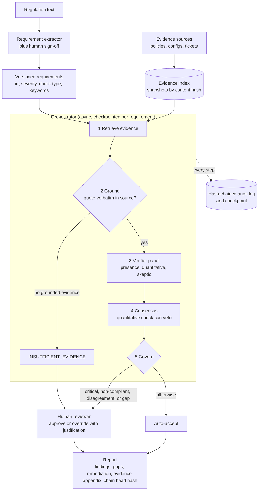

# Intuition & Mental Model

A compliance audit asks the same question hundreds of times: *"The regulation says X. Show me where our policies and evidence satisfy X, or tell me they don't."* Humans do this with spreadsheets over weeks. AuditMesh automates the mechanical 80% so experts spend time on the judgment calls.

The design principle that separates a trustworthy audit engine from a demo is: **never let the model's confidence stand in for evidence.**
1. **Decompose** the regulation into atomic, testable *requirements* (each with a severity and a check type: presence, a maximum time, a minimum frequency).
2. **Retrieve** candidate evidence from policies, configs and tickets (hybrid search, Module 06).
3. **Verify with a panel** of independent specialists (a presence checker, a quantitative checker, a skeptic), each producing a verdict plus rationale (Module 10).
4. **Ground every claim**: each cited quote must appear *verbatim* in the source document. Ungrounded evidence is discarded. No grounded evidence means the finding is `INSUFFICIENT_EVIDENCE`, never "compliant" by default.
5. **Govern**: critical requirements, non-compliant findings and panel disagreements go to a human reviewer with the evidence side by side. The system's job is to make that review fast, not to replace it.
6. **Prove**: every step is written to a **hash-chained audit log**, so an external auditor can verify nothing was altered after the fact. Runs are checkpointed so a crash resumes instead of restarting (Module 09).

The output is a report that is *defensible*: for each requirement, a verdict, quoted evidence with document locations, who/what decided, and the tamper-evident trail.

# Production Architecture & Data Flow

Requirement states: PENDING, RETRIEVED, GROUNDED, VOTED, then AUTO_ACCEPTED or IN_REVIEW and RESOLVED. Documents stay in-tenant (Module 12), and model calls are masked (Module 13) and routed through OmniGuard (Module 15).

# Architectural Trade-Off Matrix

| Approach | Latency | Scalability | Implementation Complexity | Cost |
|---|---|---|---|---|
| **Multi-agent panel + grounding + HITL + hash-chained log (this design)** | Minutes per requirement set; async parallelism | High: per-requirement tasks are independent | High: orchestration, grounding, audit chain | Medium: 3 verifier calls per requirement, bounded by routing cheap models first |
| **Single LLM "read all policies and answer" prompt** | Lowest per question | Poor at corpus scale; context limits | Low | Low per call but high risk cost: unverifiable and unauditable |
| **Rules/keyword engine (GRC tool rules) only** | Lowest | High | Medium: rule authoring and maintenance per regulation | Low; brittle on paraphrase and negation ("we do not encrypt") |

# Enterprise War Stories & Edge Cases

**1. The auditor found a "compliant" finding with a fabricated quote.** A model summarized a policy and cited a sentence that did not exist; it passed internal review because the paraphrase sounded plausible. *Remediation:* verbatim quote grounding with character offsets, automated rejection of ungrounded claims, reviewer UI that highlights the quote in the source, and sampling audits comparing 5% of findings against source documents.

**2. Negation and thresholds fooled the keyword layer.** "Backups are not encrypted" matched the keyword "encrypted" and passed; "notify within 96 hours" matched "notify within" and passed a 72-hour requirement. *Remediation:* a quantitative verifier that parses numbers, units and comparators, a negation-aware presence check, a skeptic that treats hedged language ("should", "where possible") as non-compliant for mandatory requirements, and regression tests built from every missed case.

**3. Evidence changed after sign-off.** A policy page was edited the day after the audit, and the company could not show what the system had actually seen. *Remediation:* snapshot evidence by content hash at retrieval time, store hashes in the audit chain, hash-chain log entries so tampering is detectable, and keep versioned requirements and prompts so a past audit can be replayed exactly.
